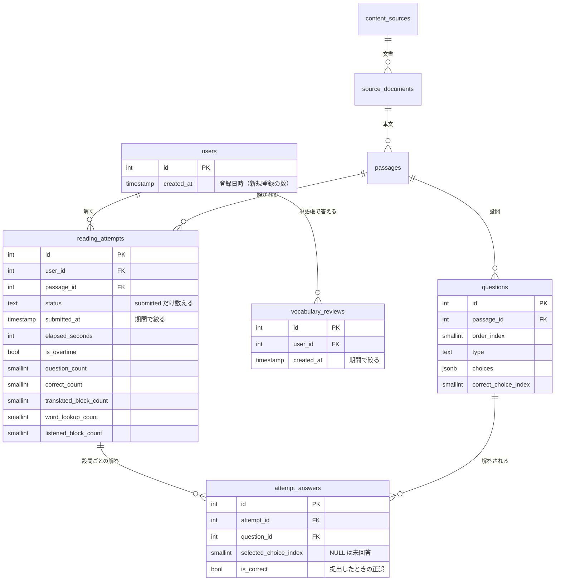
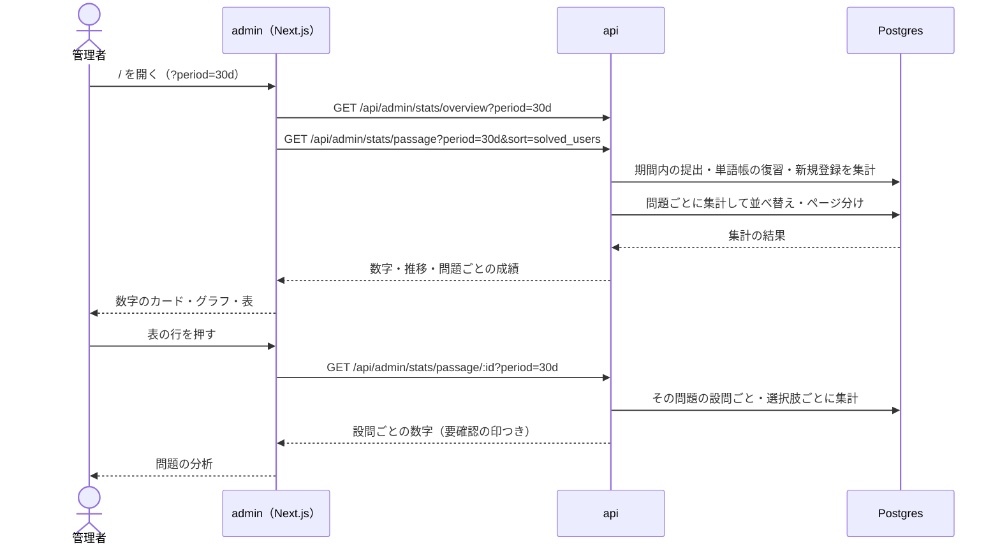

# admin のダッシュボード

管理者が、問題がどれだけ・どう解かれているかと、サービス全体の利用状況を見る画面。問題の質の問題（難しすぎる・簡単すぎる問題、紛らわしい選択肢、正解の誤り）を見つけて直すことと、利用の伸びを把握することに使う。

数字はすべて Postgres にある学習の記録（挑戦・設問ごとの解答・単語帳の復習）を、画面を開いたときに API がその場で集計して出す。行動イベント（ClickHouse）は使わない。

このドキュメントは **仕様（What）** と **設計（How）** を分けて記述する：

- **仕様**：ユーザーから見える挙動・ルール・データの意味
- **設計**：実装にあたっての技術的な選択と制約

## 関連 spec

- [`../reading-practice/README.md`](../reading-practice/README.md) — 挑戦（`reading_attempts`）と設問ごとの解答（`attempt_answers`）の正本。「解いた」はここの提出済みの挑戦
- [`../question-generation/README.md`](../question-generation/README.md) — 問題・設問の正本と、問題の確認・修正の画面（問題の分析からリンクする）
- [`../learning-record/README.md`](../learning-record/README.md) — 学習した日の条件（問題を解いた・単語帳で答えた）。「学習したユーザー」は同じ条件で数える
- [`../vocabulary-cards/README.md`](../vocabulary-cards/README.md) — 単語帳の復習（`vocabulary_reviews`）
- [`../read-aloud/README.md`](../read-aloud/README.md) — 読み上げを聞いた段落の数（`listened_block_count`）
- [`../admin-users/README.md`](../admin-users/README.md) — ユーザー管理。同じ時期に作り、サイドバーに並べる
- [`../user-behavior-events/README.md`](../user-behavior-events/README.md) — ClickHouse の行動イベント。本番の初期構成には無いため、このダッシュボードは使わない
- [`../github-auth/README.md`](../github-auth/README.md) — 退会するとそのユーザーの学習の記録も消え、集計から抜ける

## 目次

- [仕様](#仕様)
  - [用語](#用語)
  - [期間](#期間)
  - [全体の利用状況](#全体の利用状況)
  - [問題ごとの成績](#問題ごとの成績)
  - [問題の分析](#問題の分析)
  - [数に入らないもの](#数に入らないもの)
- [設計](#設計)
  - [集計の方法](#集計の方法)
  - [期間と日の区切り](#期間と日の区切り)
  - [インデックス](#インデックス)
  - [性能の目安](#性能の目安)
  - [画面の置き場所](#画面の置き場所)
  - [MVP 対象外（将来検討）](#mvp-対象外将来検討)
- [必要な画面](#必要な画面)
- [UI 設計](#ui-設計)
  - [ダッシュボード](#ダッシュボード)
  - [問題の分析](#問題の分析-1)
- [必要な API](#必要な-api)
- [必要な DB 設計](#必要な-db-設計)
- [フロー図](#フロー図)

---

## 仕様

### 用語

| 用語 | 意味 |
| --- | --- |
| 解いた | 挑戦を提出した（[reading-practice](../reading-practice/README.md) の `submitted`）。解いている途中・期限切れの挑戦は数えない |
| 解いた回数 | 期間内の提出の数。同じ人が同じ問題を 2 回解けば 2 回 |
| 解いた人数 | 期間内に 1 回以上解いたユーザーの数。同じ人が何度解いても 1 人 |
| 学習したユーザー | 期間内に、問題を解いた、または単語帳で 1 枚以上答えたユーザー（[learning-record](../learning-record/README.md) の学習した日と同じ条件） |
| 正答率 | 正解した設問の数 ÷ 設問の数（対象の挑戦すべての合計で割る。挑戦ごとの率の平均ではない） |
| 平均の解答時間 | 解くのにかかった時間（`elapsed_seconds`）の平均 |
| 時間超過の割合 | 解いたうち、制限時間を超えて提出した割合 |
| アシストの利用率 | 解いたうち、段落の和訳を 1 つ以上開いた / 設問の和訳を 1 つ以上出した（[question-translation](../question-translation/README.md)） / 単語の意味を 1 回以上調べた / 読み上げを 1 段落以上聞いた割合。4 つを別々に出す |

### 期間

- 「直近 7 日」「直近 30 日」「全期間」から選ぶ。既定は直近 30 日
- 日の区切りは日本時間。直近 7 日は今日を含む 7 日（今日の分は今の時点まで）
- 選んだ期間は URL（`?period=7d` など）に持ち、再読み込みしても変わらない。問題の分析を開いても同じ期間で見る
- 「登録ユーザー数」だけは期間に関係なく今の総数を出す（期間内の新規登録の数は別に出す）

### 全体の利用状況

数字のカード：

| カード | 中身 |
| --- | --- |
| 登録ユーザー | 今の総数。下に期間内の新規登録の数 |
| 学習したユーザー | 期間内の数 |
| 解いた回数 | 期間内の数。下に解いた人数 |
| 正答率 | 期間内に解いたすべての挑戦の正答率 |
| アシストの利用率 | 和訳・設問訳・単語・読み上げの 4 つ |

推移のグラフ：

- 学習したユーザー数・解いた回数・新規登録数の推移を 1 つのグラフに重ねる
- 直近 7 日・30 日は日ごと、全期間は週ごと（月曜始まり）に 1 点。数が 0 の日（週）も 0 として出す
- 全期間の始まりは、最初のユーザーが登録した週

### 問題ごとの成績

問題ごとの数字の表。よく解かれる問題、難しすぎる・簡単すぎる問題、時間が足りない問題を見つけるのに使う。

- 対象：公開中の問題と、期間内に解かれた問題（非公開に戻した問題も含む）。状態を列に出す
- 列：タイトル（下にソース名）、状態、難易度、解いた人数、解いた回数、正答率、平均の解答時間（制限時間と並べて「4:12 / 6:00」）、時間超過の割合、アシストの利用率（和訳・設問訳・単語・読み上げ）、公開日
- 並べ替え：解いた人数（既定。多い順）、解いた回数、正答率、平均の解答時間、時間超過の割合、公開日。同じ値の間は問題の ID の順
- タイトルの部分一致で絞り込める
- 50 件ずつページを分ける。全体の件数を出す
- 期間内に 1 回も解かれていない問題は、正答率などを「―」にする（解いた人数・回数は 0）
- タイトルを押すと、その問題の分析を開く

### 問題の分析

1 つの問題の、設問ごとの数字。紛らわしい選択肢や、正解の誤りを見つけるのに使う。

- 上部：タイトル、状態、ソース、公開日、問題ごとの成績と同じ数字。「確認・修正を開く」で [問題の確認・修正](../question-generation/README.md) へ移る
- 設問ごと：種類、設問文、正答率、選択肢ごとの選ばれた割合（正解に印を付ける）、未回答の割合
- 正解でない選択肢が正解と同じかそれ以上選ばれた設問に「要確認」の印を付ける。ただし、その設問の期間内の解答が 5 件以上のときだけ（数が少ないと偶然の偏りが大きいため）。挑戦がある問題は設問の数を変えられないので、どの設問の解答の数も解いた回数と同じになる
- 期間内に 1 回も解かれていない問題は、設問文と選択肢だけを出し、割合は「―」にする
- 注意書きを出す：非公開に戻して選択肢や正解を直した問題は、直す前の解答も同じ設問・同じ位置の選択肢として数える。正誤は提出したときのもの（[question-generation](../question-generation/README.md) のとおり、後から正解を直しても過去の点数は変わらない）

### 数に入らないもの

- 退会したユーザーの記録（退会で学習の記録ごと消える。[github-auth](../github-auth/README.md)）。過去の期間の数字も、退会があると減る
- 解いている途中・期限切れの挑戦
- 管理者の操作（公開・却下など）

---

## 設計

### 集計の方法

- 数字は admin が画面を開くたびに API が Postgres からその場で集計する。集計の結果を保存するテーブル・キャッシュは作らない
  - 本番の初期構成（[minimal-deploy](../minimal-deploy/README.md)）には ClickHouse も行動イベントも無く、Postgres だけが全環境で必ずあるデータの置き場所のため
  - 管理者は 1〜2 人で、開く回数が少ない
- 集計は API の Repository に SQL で書く（`count(*) FILTER (WHERE …)`・`count(DISTINCT user_id)`・`generate_series`）。Service は期間の解釈と、比率・「要確認」の判定を受け持つ
- 比率は API で 0〜1 の小数にして返す（分母が 0 なら `null`）。表示の丸めは admin がする
- 問題ごとの成績は、`reading_attempts` を `passage_id` で集計した結果に `passages`・`content_sources` を結び、並べ替えとページ分けまで SQL でする。並べ替えの列が集計の結果なので、ページ分けは cursor ではなく offset にする（問題は数百〜数千の想定で、offset でも十分速い）
- 問題の分析は、その問題の期間内の提出済みの挑戦について `attempt_answers` を `question_id`・`selected_choice_index` で集計する
- 「要確認」の判定と、画面で橙にする選択肢は `@repo/domain` の純関数（`rules/admin-stats.ts`）にして、テストで境界（解答 4 件 / 5 件、同数）を確かめる。API が判定の結果（`needs_review`・`misleading_choice_indexes`）を返し、画面は出すだけにする（admin は domain を import できないので、判定を書き直すとずれる）

### 期間と日の区切り

- 期間の始まりは日本時間の 0 時を UTC に直した時刻にし、`reading_attempts.submitted_at`・`vocabulary_reviews.created_at`・`users.created_at` を絞る
- `study_date`（提出したときのユーザーのタイムゾーンでの日付）は使わない。ユーザーごとに日の区切りが違うと、全体の「日ごとの数」の境界が揃わないため。日本以外のタイムゾーンのユーザーは、マイページの日付とダッシュボードの日付が 1 日ずれることがある
- 推移の日（週）は `generate_series` で作り、集計の結果を left join して 0 の日も返す。週は日本時間の月曜 0 時から（全期間の推移は、最初のユーザーが登録した日を含む週の月曜から）
- 「今日」は API の時計（`deps.now`）で決め、テストで固定できるようにする

### インデックス

期間で絞る集計と、問題ごとの集計のために足す（[step1](./tasks/step1-db-stats-indexes.md)）。

| テーブル | インデックス | 使う集計 |
| --- | --- | --- |
| `reading_attempts` | `(submitted_at) WHERE status = 'submitted'` | 全体の利用状況（期間内の提出） |
| `reading_attempts` | `(passage_id, submitted_at) WHERE status = 'submitted'` | 問題ごとの成績、問題の分析 |
| `vocabulary_reviews` | `(created_at)` | 学習したユーザー（単語帳で答えた人） |

- `users` は 1 万人規模なら全件を読んでも速いので足さない
- `attempt_answers` は問題の分析で `attempt_id` から引く（既存の一意のインデックス `(attempt_id, question_id)` を使う）ので足さない
- `CONCURRENTLY` は付けない。drizzle の migration は 1 つのトランザクションで流れて `CONCURRENTLY` を使えず、本番のデータが少ないうちに入れるのでロックの時間も短い

### 性能の目安

- 想定：ユーザー 1 万人、挑戦 50 万件、単語帳の復習 200 万件で、直近 7 日・30 日はどの API も 1 秒以内
- 全期間の全体の利用状況だけは、その規模で約 2 秒かかる（実装時に計測。200 万件の単語帳の答えを日本時間の週に束ねる推移が重い）。数字と推移の集計は並べて流す。管理者が 1〜2 人で開く回数が少ないので、MVP ではこのままにする
- 全期間が気になる・直近の期間も 1 秒を超えるようになったら、日ごと・問題ごとの集計表を cron で作り、API はそれを足し合わせる形に変える（[deferred](./deferred-dashboard-extensions.md)）

### 画面の置き場所

- admin のトップ（`/`）をダッシュボードにする。今の TailAdmin の EC のダッシュボード（`app/(dashboard)/page.tsx`）を置き換える。テンプレートの部品（`components/features/ecommerce/`）は消さない（design-mock で参考に読む）
- 問題の分析は `/analytics/passages/[id]`
- サイドバーは「ダッシュボード」「問題」「ソース」「ユーザー」の順。左上のロゴのリンク先は `/`（ダッシュボード）
- グラフは admin に入っている ApexCharts（`react-apexcharts`）を使う。Server Component でデータを取り、グラフだけを Client Component にする（ApexCharts はブラウザでしか動かないので `next/dynamic` の `ssr: false` で読む。テンプレートの `MonthlySalesChart` と同じ）

### MVP 対象外（将来検討）

以下は MVP では作らない。数字が遅くなったとき、または運用で必要になったときに着手する。

- 日ごと・問題ごとの集計表（遅くなったら）
- 期間の自由な指定、CSV の書き出し
- 継続率（登録した週ごとの、翌週以降に学習した割合）
- ソースごと・難易度ごとの集計
- 行動イベント（ClickHouse）を使う分析（途中でやめた問題、画面の閲覧など）

詳細：[`./deferred-dashboard-extensions.md`](./deferred-dashboard-extensions.md)

---

## 必要な画面

| パス | 画面名 | 役割 |
| --- | --- | --- |
| `/` | ダッシュボード | 期間の切り替え、全体の利用状況（数字のカード・推移のグラフ）、問題ごとの成績の表 |
| `/analytics/passages/[id]` | 問題の分析 | 1 つの問題の数字と、設問ごとの正答率・選択肢の割合・要確認の印 |

具体的な UI は [UI 設計](#ui-設計) を参照。

## UI 設計

`design-mock` skill で確定したデザイン。admin は既存の TailAdmin テンプレートのデザインを使う（[product-overview の admin のデザイン](../product-overview/README.md#admin-のデザイン)）。

| パス（admin） | 画面名 | モック |
| --- | --- | --- |
| `/` | ダッシュボード | `/mock/dashboard` |
| `/analytics/passages/[id]` | 問題の分析 | `/mock/analytics/passages/57` |

**2 つの画面に共通するもの**

| 項目 | 見た目 |
| --- | --- |
| 期間の切り替え | テンプレートの `ChartTab` と同じ形（`bg-gray-100` の地に、選択中は白の地と影）。「直近 7 日」「直近 30 日」「全期間」のリンクで、押すと URL の `?period=` を変える（`aria-current="page"`）。表の並べ替え・絞り込みは残し、ページは 1 に戻す。既定の直近 30 日は URL に付けない（`/`） |
| 数字の書き方 | 件数は 3 桁区切り（`1,284`）、比率は整数の %（`72%`）、時間は `5:12 / 6:00`（平均と制限時間）、値が無い（分母が 0）ときは既存の admin の画面と同じ「―」。数字は `tabular-nums` |
| 問題の状態のバッジ | 公開＝`success`、非公開に戻した問題＝`light` の「非公開」 |
| 正解・誤りの色 | 正解＝`success-500`（緑）、正解と同じかそれ以上選ばれた誤り・要確認＝`warning-500`（橙）、ほか＝`gray-300` |

### ダッシュボード

```
┌──────────────────────────────────────────────────────────────────────────────┐
│ ダッシュボード                                           Home > ダッシュボード │ ← PageBreadcrumb
│ [直近7日|直近30日|全期間]               2026-09-16 〜 2026-10-15（日本時間） │ ← 期間の切り替えと範囲
│ ┌────────────────┐┌────────────────┐┌────────────────┐┌────────────────┐     │ ← 数字のカード 4 枚
│ │ [👥]           ││ [⚡]           ││ [✓]            ││ [◔]            │     │
│ │ 登録ユーザー   ││ 学習したユーザー││ 解いた回数     ││ 正答率         │     │
│ │ 1,284          ││ 412            ││ 2,634          ││ 72%            │     │
│ │ 期間内の新規211││ 問題・単語帳…  ││ 解いた人数 356 ││ 解いた設問の…  │     │
│ └────────────────┘└────────────────┘└────────────────┘└────────────────┘     │
│ ┌───────────────────────────────────────────┐┌───────────────────────────┐   │
│ │ 推移                                      ││ アシストの利用率          │   │ ← 推移（8/12）とアシスト（4/12）
│ │ 日ごと・日本時間                          ││ 解いたうち、1 回以上…     │   │
│ │ ● 学習したユーザー ● 解いた回数 ● 新規登録 ││ 段落の和訳          34%   │   │
│ │ 120 ┤   ╱╲      ╱╲          ╱╲            ││ ████████░░░░░░░░░░░░░░    │   │ ← 横棒（brand-500）
│ │  60 ┤ ╱╲  ╲╱╲╱╲╱  ╲╱╲╱╲╱╲╱╲╱  ╲           ││ 単語の意味          61%   │   │
│ │   0 ┤___________________________          ││ ██████████████░░░░░░░░    │   │
│ │     9/16   9/22   9/28   10/4  10/10      ││ 読み上げ            22%   │   │
│ └───────────────────────────────────────────┘└───────────────────────────┘   │
│ 問題ごとの成績                                                               │
│ 公開中の問題と、期間内に解かれた問題。タイトルを押すと設問ごとの分析を開きます。│
│ ┌──────────────────────────────────────────────────────────────────────────┐ │
│ │ 24 件                                          [🔍 タイトルで絞り込む]   │ │
│ ├──────────────────────────────────────────────────────────────────────────┤ │
│ │ タイトル      状態 難易度 解いた人数▼ 解いた回数 正答率 平均/制限 超過 … │ │ ← ▼ は並べ替えの列と向き
│ │ Pod Lifecycle 公開 Normal 258         319        81%    4:28/6:30 6%  … │ │
│ │ Errors are…  非公開 Hard  11          13         44%    5:55/5:00 40% … │ │ ← 正答率 50% 未満は橙
│ │ Responding…   公開 Easy   0           0          ―      ―         ―   … │ │ ← 解かれていない
│ ├──────────────────────────────────────────────────────────────────────────┤ │
│ │ 1〜24 件目 / 24 件                               [Previous] [1] [Next]   │ │
│ └──────────────────────────────────────────────────────────────────────────┘ │
└──────────────────────────────────────────────────────────────────────────────┘
```

- 上部：期間の切り替えと、期間の範囲（日本時間の日付）
- **数字のカード**：テンプレートの `EcommerceMetrics` と同じ形（灰色の角丸のアイコン、ラベル、`text-title-sm` の太字の数、下に `text-theme-xs` の補足）。登録ユーザー（補足は期間内の新規）・学習したユーザー（問題を解いた・単語帳で答えた人）・解いた回数（解いた人数）・正答率（解いた設問の合計で計算）
- **推移**：ApexCharts の折れ線 3 本（滑らかな線、太さ 2）。学習したユーザー＝`#465FFF`（brand-500）、解いた回数＝`#12B76A`（success-500）、新規登録＝`#F79009`（warning-500）。凡例は上（グラフの外に出し、横にスクロールしても隠れない）、ツールチップは 3 本まとめて出す。点が 1 つ（全期間で最初の登録が今週など）のときは線の代わりに点を出す。横軸は「10/15」、全期間は「4/6〜」（週の月曜）で、30 日・全期間はおおよそ 8 つに間引く。ツールチップの見出しは年の付いた日付（「2026-10-15」、全期間は「2026-10-12 の週」）。縦軸は整数の目盛り（最大が 5 未満なら 1 刻み）。見出しの下に「日ごと・日本時間」／「週ごと（月曜始まり）・日本時間」
- **アシストの利用率**：段落の和訳・設問の和訳・単語の意味・読み上げの 4 本の横棒（`brand-500`、地は `gray-100`）と %
- **問題ごとの成績**：見出しと説明の下に表（テンプレートの `DataTable` と同じ枠・余白）
  - 上：件数と、タイトルの絞り込み（虫めがねのアイコン付きの入力欄。Enter で `?q=` を変え、期間・並べ替えは残してページは 1 に戻す）
  - 列：タイトル（下にソース名）、状態、難易度、解いた人数、解いた回数、正答率、平均時間 / 制限、時間超過、アシスト（和訳 / 設問訳 / 単語 / 読み上げ）、公開日
  - 並べ替えのできる列（解いた人数・解いた回数・正答率・平均時間・時間超過・公開日）は見出しがリンク（URL の `?sort=&order=` を変える）で、右に向きの印（選択中は ▼ / ▲、ほかは薄い ▼）。押すとその列で多い順、もう一度押すと少ない順。見出しのセルに `aria-sort` を付け、読み上げでも並べ替えの状態が分かるようにする
  - 解いた人数は太字。正答率が 50% 未満の問題は橙（`warning-600`）の太字にする（難しすぎる問題を見つけやすくする。判定は表示と同じく丸めた % で、49.5% は「50%」と出て橙にしない）
  - 行にホバーすると地を薄くする。タイトルを押すと同じ期間で問題の分析を開く
  - 下：「1〜24 件目 / 24 件」とテンプレートの `Pagination`。表が空のときは、絞り込みで 0 件なら「条件に合う問題がありません」と「絞り込みの文字を変えてください。」、問題がまだ無ければ「問題がありません」と「公開中の問題と、期間内に解かれた問題を出します。」、範囲外のページ（件数が減った後の古い URL など）なら「このページには問題がありません」と「Previous で最後のページに戻れます。」（下は「0〜0 件目 / 24 件」で、Previous は最後のページへ）
- まだ誰も学習していない状態：数字は 0 と「―」、推移は 0 の線、問題ごとの成績は公開中の問題が 0 で並ぶ（解かれていない下書きは出さない）

### 問題の分析

```
┌──────────────────────────────────────────────────────────────────────────────┐
│ 問題の分析                                                 Home > 問題の分析 │
│ ← ダッシュボードに戻る                             [直近7日|直近30日|全期間] │
│ ┌──────────────────────────────────────────────────────────────────────────┐ │
│ │ [公開] Normal                                          [確認・修正を開く] │ │ ← 確認・修正の画面へ
│ │ What Is Ownership?                                                       │ │
│ │ The Rust Programming Language・公開日 2026-09-28                         │ │
│ │ ──────────────────────────────────────────────────────────────────────── │ │
│ │ 解いた人数 解いた回数 正答率 平均時間/制限 時間超過 アシスト（和訳/単語/読み上げ）│ ← 問題ごとの成績と同じ数字
│ │ 214        272        56%    5:12 / 6:00   21%      41% / 66% / 18%       │ │
│ │ 直近 30 日の数字（日本時間）                                             │ │
│ └──────────────────────────────────────────────────────────────────────────┘ │
│ ┌ (i) 直した問題の数え方 ─────────────────────────────────────────────────┐ │ ← Alert（info）
│ │ 非公開に戻して選択肢や正解を直した問題は、直す前の解答も同じ設問・…    │ │
│ └──────────────────────────────────────────────────────────────────────────┘ │
│ ┌───────────────────────────────────┐┌───────────────────────────────────┐   │ ← 設問のカード（xl で 2 列）
│ │ Q1 [要旨]               正答率 84%││ Q2 [詳細][要確認]       正答率 39%│   │ ← 要確認は橙の枠とバッジ
│ │ What is the main purpose of …     ││ According to the passage, …       │   │
│ │ A To compare Rust's …          7% ││ 正解でない選択肢が、正解と同じか… │   │ ← 橙の一文
│ │   █░░░░░░░░░░░░░░░░░░░░░░░░░░     ││ A The value is copied …       46% │   │
│ │ B To explain the rules … ✓正解 84%││   ██████████░░░░░░░░░░░░░░░░░     │   │ ← 誤りが正解以上＝橙の棒
│ │   ██████████████████████░░░░░     ││ B The first variable … ✓正解  39% │   │ ← 正解＝緑の棒
│ │ C …                            5% ││   ████████░░░░░░░░░░░░░░░░░░░     │   │
│ │ D …                            3% ││ C …                            9% │   │
│ │ ───────────────────────────────── ││ D …                            2% │   │
│ │ 未回答 1%                         ││ 未回答 4%                         │   │
│ └───────────────────────────────────┘└───────────────────────────────────┘   │
└──────────────────────────────────────────────────────────────────────────────┘
```

- 上部：「← ダッシュボードに戻る」（同じ期間のダッシュボードへ。表の並べ替え・絞り込み・ページは戻さない）と期間の切り替え
- **問題のカード**：状態のバッジと難易度、タイトル（`text-xl` の太字）、ソースと公開日。右上に「確認・修正を開く」（副のボタン。`/passages/[id]` へ）。下に問題ごとの成績と同じ 6 つの数字（`dl`。スマホは 2 列、`sm` で 3 列、`xl` で 6 列）と、何の期間の数字か
- **注意書き**：テンプレートの `Alert`（info）。「直した問題の数え方」
- **設問のカード**（`xl` で 2 列）：
  - 見出し：「Q1」、種類のバッジ（`light`）、要確認なら `warning` のバッジ「要確認」。右に正答率（`text-lg` の太字）
  - 設問文。要確認なら、その下に橙の一文「正解でない選択肢が、正解と同じかそれ以上選ばれています。選択肢と正解を見直してください。」とカードの枠を橙（`warning-300`）にする
  - 選択肢ごと：記号（A〜D。正解は緑）、選択肢の文（正解には「✓ 正解」）、右に %、下に横棒（正解＝緑、正解と同じかそれ以上選ばれた誤り＝橙、ほか＝灰色）
  - 最後に区切り線と「未回答 4%」
- 設問の解答が 5 件未満：割合は出すが「要確認」の印・一文・橙の枠を出さない
- 期間内に解かれていない：数字・割合は「―」、横棒は空
- 設問が 0 個（収集しただけの問題を URL で開いたなど）：設問のカードの場所に「設問がありません」
- 問題が無い（ID の誤り。`1e3`・`0x10` のような正の整数でない ID と、DB の ID の上限を超える ID も含む）：本実装は 404 の画面。モックは「問題が見つかりません」とダッシュボードへ戻るリンク

**レスポンシブ・ダークモード**

- 数字のカードはスマホで 1 列、`sm` で 2 列、`xl` で 4 列。推移とアシストは `xl` で横に並べ、それより狭いと縦に積む。推移のグラフは幅 640px より狭いと横にスクロールし、始めは直近（右端）を見せる
- 表はスマホで横にスクロールする（ページ全体ははみ出さない）
- ダークモードはテンプレートの配色に従う（カードの地は `white/3`、文字は `white/90`、灰色の棒の地は `gray-800`）

## 必要な API

すべて `/api/admin/` 配下（admin の access token が必要。[admin-template の admin 認証](../admin-template/README.md#admin-認証)）。スキーマは `packages/schema/src/api-schema/admin/stats.ts`。

| メソッド | パス | クエリ | 説明 |
| --- | --- | --- | --- |
| GET | `/api/admin/stats/overview` | `period` | 全体の利用状況（数字と推移） |
| GET | `/api/admin/stats/passage` | `period`・`sort`・`order`・`q`・`page`・`limit` | 問題ごとの成績（並べ替え・絞り込み・ページ分け） |
| GET | `/api/admin/stats/passage/:id` | `period` | 問題の分析（問題の数字と設問ごとの数字） |

- `period` は `7d` / `30d` / `all`（既定 `30d`）
- 存在しない問題の分析は 404。期間内に解かれていない問題も 200 で返す（数字は 0 と `null`）
- レスポンスの項目は [step2](./tasks/step2-api-admin-stats.md)

## 必要な DB 設計

テーブル・列は足さない。集計に使う既存のテーブルと、足すインデックス（[インデックス](#インデックス)）だけ。



## フロー図


