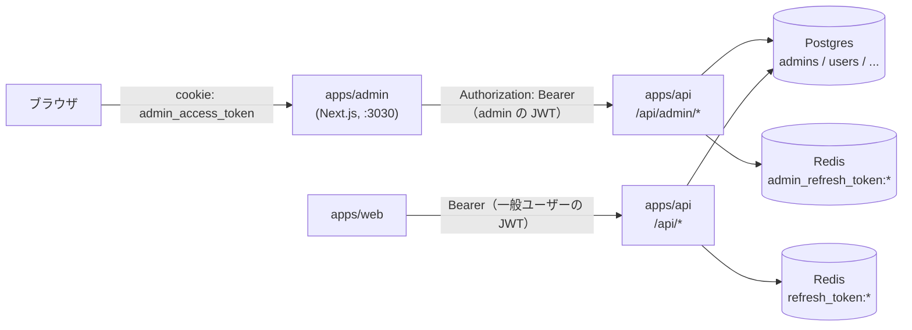
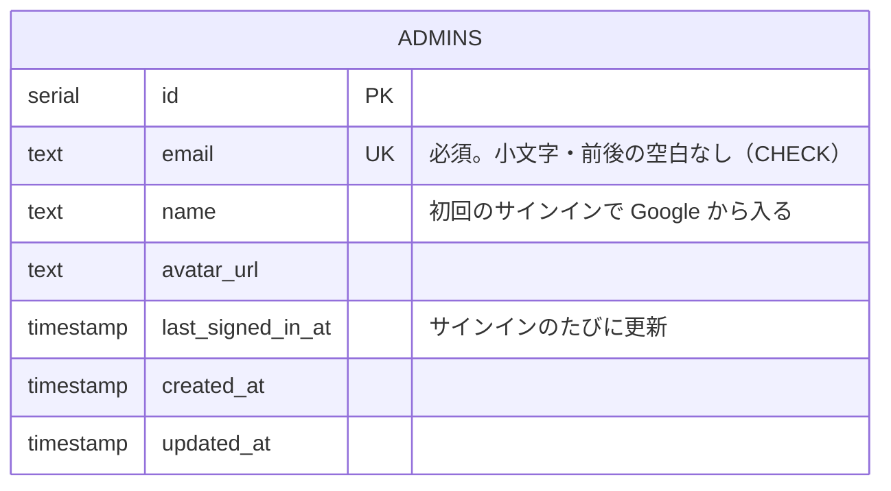
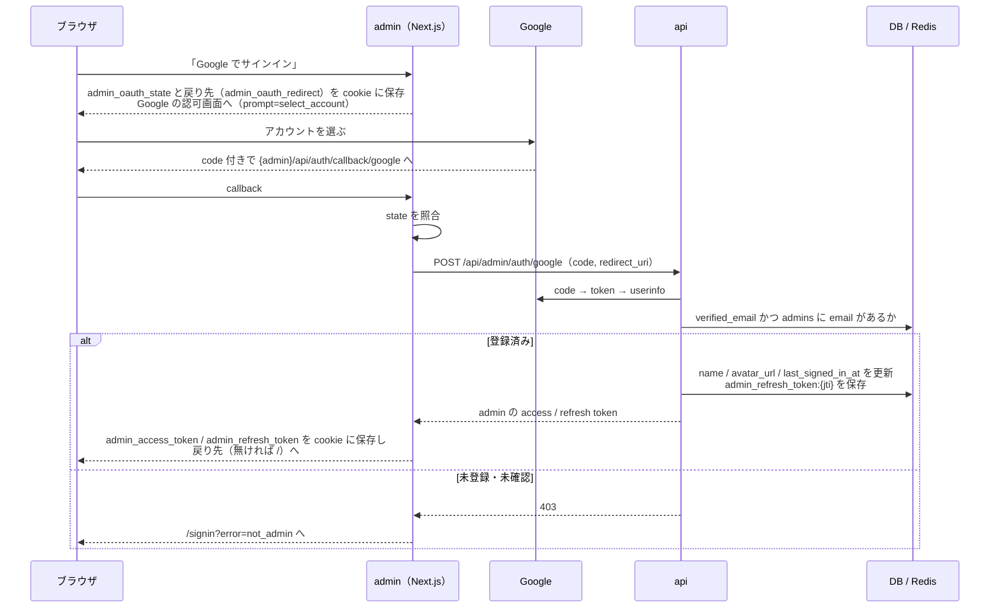
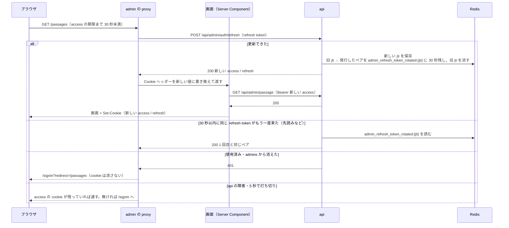
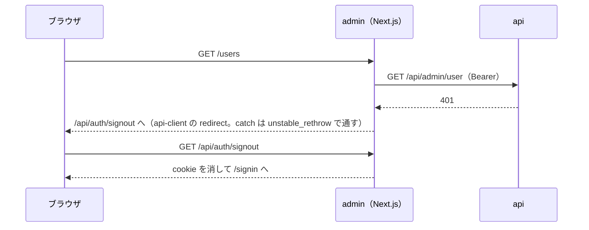
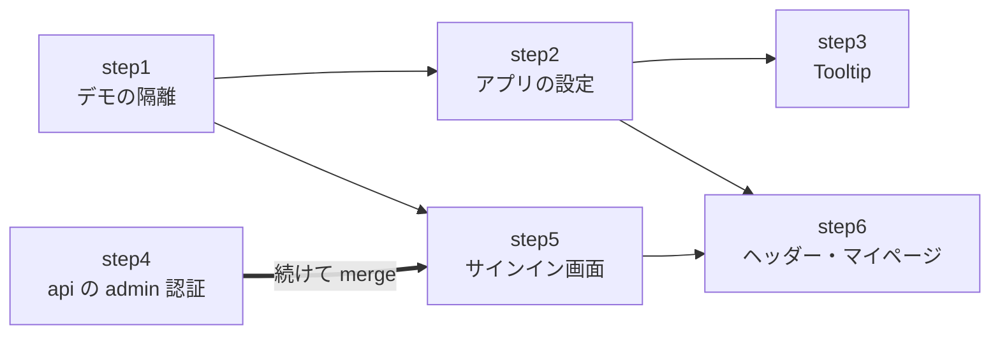

# admin を project-template に揃える

`apps/admin` を project-template の管理画面と同じ作りにする。今の admin は、TailAdmin のデモの画面が土台の画面と同じ URL に混ざっている。守りは Basic 認証と共有シークレット（`X-Admin-Token`）だけで、管理者ごとのサインインが無い。ヘッダーのユーザーメニューと通知も TailAdmin のダミーのままになっている。

この機能では、デモを `/demo` の下に分け、admin 専用の認証（`admins` テーブル・admin 専用の JWT・Google のサインイン）を入れる。ヘッダーにはサインイン中の admin を出し、マイページを作る。共通の部品として Tooltip を足す。ユーザー管理など tech-english で先に作った画面は、テンプレートのものに置き換えずに残す。

元にするのは project-template の `origin/main`（#132 まで）の `docs/spec/admin-template/` とコード。step で「テンプレートの〜を写す」と書いた所は、この版のファイルを見る。

このドキュメントは **仕様（What）** と **設計（How）** を分けて記述する：

- **仕様**：ユーザーから見える挙動・ルール・データの意味
- **設計**：実装にあたっての技術的な選択と制約

## 関連 spec

- [`../question-generation/README.md`](../question-generation/README.md#管理画面のアクセス制御) — 今の管理画面のアクセス制御（Basic 認証 + `X-Admin-Token`）。この spec で置き換える
- [`../github-auth/README.md`](../github-auth/README.md) — 一般ユーザーの GitHub ログイン。MVP 対象外の「admin の GitHub ログインと `users.role`」は、この spec の `admins` テーブル + Google に置き換わる
- [`../admin-users/README.md`](../admin-users/README.md) — ユーザー管理。テンプレートのユーザー管理（#128）は取り込まず、こちらを残す
- [`../admin-dashboard/README.md`](../admin-dashboard/README.md) — ダッシュボード（`/`）。サイドバーの「メニュー」の先頭に残す
- [`../source-tags/README.md`](../source-tags/README.md) — `DataTable` を独自に直した経緯（テンプレートの `DataTable` を取り込まない理由）
- [`../dev-login/README.md`](../dev-login/README.md) — 一般ユーザーの dev ログイン。admin の dev ログインも同じ多重ガードにする
- [`../../onboarding/auth.md`](../../onboarding/auth.md) — 一般ユーザーの認証（OAuth → 自前の JWT → httpOnly cookie）。admin の認証も同じ流れで、鍵・cookie・テーブルを分ける

## 目次

- [仕様](#仕様)
  - [変わるもの・変わらないもの](#変わるもの変わらないもの)
  - [デモと土台](#デモと土台)
  - [アプリ名・ロゴ・日時の表示](#アプリ名ロゴ日時の表示)
  - [Tooltip](#tooltip)
  - [admin のサインイン](#admin-のサインイン)
  - [admin の登録](#admin-の登録)
  - [ヘッダー](#ヘッダー)
  - [マイページ](#マイページ)
- [設計](#設計)
  - [テンプレートから取り込む範囲](#テンプレートから取り込む範囲)
  - [全体構成](#全体構成)
  - [デモの置き場所](#デモの置き場所)
  - [サイドバー](#サイドバー)
  - [アプリの設定と日時の表示](#アプリの設定と日時の表示)
  - [Tooltip の作り](#tooltip-の作り)
  - [admin 認証](#admin-認証)
  - [refresh token の保存と猶予](#refresh-token-の保存と猶予)
  - [proxy でのトークンの更新](#proxy-でのトークンの更新)
  - [api の 401 の扱い](#api-の-401-の扱い)
  - [移行の進め方](#移行の進め方)
  - [admin の JWT の鍵の配布](#admin-の-jwt-の鍵の配布)
  - [admin の登録コマンド](#admin-の登録コマンド)
  - [本番の Google OAuth クライアント](#本番の-google-oauth-クライアント)
  - [ヘッダーへのデータの渡し方](#ヘッダーへのデータの渡し方)
  - [MVP 対象外（将来検討）](#mvp-対象外将来検討)
- [必要な画面](#必要な画面)
- [必要な API](#必要な-api)
- [必要な DB 設計](#必要な-db-設計)
- [フロー図](#フロー図)
- [実装ステップ](#実装ステップ)

---

## 仕様

### 変わるもの・変わらないもの

| | 今 | この機能の後 |
| --- | --- | --- |
| 画面に入る | ブラウザの Basic 認証のダイアログ（共有のユーザー名とパスワード） | サインイン画面の「Google でサインイン」。登録した admin だけが入れる |
| デモの画面 | `/calendar`・`/ui/*` などの URL。サイドバーに出さない | `/demo/...` の URL。サイドバーの「デモ」に並べる |
| ヘッダー | TailAdmin のダミーの人物・通知 | サインイン中の admin。マイページとログアウト |
| タブのタイトル・ロゴ | ページごとに直書き、TailAdmin のロゴの画像 | `<ページ名> \| tech-english admin`、頭文字のアイコン |
| 説明の吹き出し | ブラウザの標準の吹き出し（`title`） | Tooltip |

次は変えない。

- ダッシュボード・問題・ソース・タグ・ユーザーの画面と URL、できること
- ユーザー管理の中身（一覧の絞り込み・並べ替え、学習の状況）
- `/mock`（tech-english の画面のデザインモック）
- api の `/api/admin/*` のパスとレスポンス

### デモと土台

- TailAdmin のデモの画面（カレンダー、フォーム・表・UI 部品・グラフの見本、プロフィール、サインイン・サインアップのフォームなど）を、URL `/demo/...` の下にまとめる
- サイドバーは見出し付きの 2 つのセクションにする
  - 「メニュー」：ダッシュボード・ソース・問題・タグ・ユーザー
  - 「デモ」：デモの画面。項目名は TailAdmin のまま（英語）
- 下の階層の画面（`/sources/new`・`/analytics/passages/1` など）を開いたときに選択中になるメニューは今と同じ
- EC のダッシュボードの見本（今はどこからも開けない）を `/demo/ecommerce` で見られるようにする
- `/mock` は今のまま。サイドバーに出さず、URL を直接開いて見る。サインインしないと開けない点は、ほかの画面と同じ

### アプリ名・ロゴ・日時の表示

- アプリ名は「tech-english admin」。サイドバー・スマホ幅のヘッダー・サインイン画面のロゴと、タブのタイトル（`<ページ名> | tech-english admin`）に出す
- ロゴは頭文字「T」のアイコンとアプリ名の文字。favicon も同じアイコンにする
- 言語は日本語（`lang="ja"`）。土台の文言は日本語、デモの文言は TailAdmin のまま
- 日時の書式は今と同じ `2026-10-15 09:00`（日本時間）。ユーザーの学習履歴の日時だけは、今と同じくそのユーザーのタイムゾーンで出す

### Tooltip

- 要素にマウスを乗せる、またはキーボードでフォーカスすると、説明の吹き出しが出る。外れると消え、Esc でも消える
- 位置は上・右・下・左。画面の端で切れるときは反対側に出る。長い説明は折り返す
- 種類は TailAdmin のデモと同じ 4 つ（白・黒・矢印なしの黒・矢印なしの白）。デモに見本の画面（`/demo/ui/tooltips`）を足す
- 土台の画面で、今ブラウザの標準の吹き出し（`title`）で出している説明を Tooltip にする。押せないボタンの説明も出る（今の `title` は、押せないボタンではマウスを乗せても出ない）

| 画面 | 場所 | 出す説明 |
| --- | --- | --- |
| 問題の確認・修正 | 「再生成」（挑戦がある問題で押せないとき） | 挑戦がある問題は再生成できません |
| 問題の確認・修正 | 「要確認を解除」 | 理由を確かめた・直した後に押すと、要確認の印と理由が消え、一覧の要確認の先頭から外れます |
| 問題の確認・修正 | 取得元（長いと途中で切れる） | 取得元のパスの全体 |
| 問題の確認・修正のプレビュー | 用語集の語句（下線の付いた語） | `見出し語：意味`。語義設問の対象なら「（語義設問の対象。解答中は非表示）」を付ける |
| ユーザー一覧 | 列見出し「ログイン方法」 | ユーザーが紐付けているログイン方法（GitHub・Google・dev）。今は説明が無く、新しく足す |

- ユーザーの詳細の学習カレンダーのマス（日付と学習の量）は、今のまま標準の吹き出しで出す（[設計](#tooltip-の作り)）

### admin のサインイン

- サインイン画面に「Google でサインイン」ボタンを置く。`admins` に email を登録した Google アカウントだけがサインインできる
  - 登録されていないアカウントでは「このアカウントには管理画面の権限がありません」と出し、サインインさせない
  - Google で email が確認済みでないアカウントもサインインさせない
- 一般ユーザー（GitHub でログイン）とは完全に別。一般ユーザーのトークンでは admin の画面にも API にも入れない（逆も同じ）
- 名前とアイコンは、サインインのたびに Google のものに更新する。最終サインイン日時も記録する
- 操作が無くても 7 日間はサインインしたまま。15 分の access token は、期限が近づくと次に画面を開いたときに裏で更新する
- ヘッダーのユーザーメニューの「ログアウト」で、いつでも終えられる
- `admins` から消された admin は、次の更新（最長 15 分後）でサインイン画面に戻る
- サインインせずに開いた画面は、サインインした後にその画面へ戻る
- production 以外では「dev admin でログイン」ボタンも出す。seed で入れた `admin@dev.local` として、Google を通さずに入れる
- Basic 認証のダイアログは出なくなる

### admin の登録

- 管理画面から admin を足す画面は作らない（[MVP 対象外](#mvp-対象外将来検討)）
- 本番は GitHub Actions の「Admin Create」に環境と email を入れて流す。最初の 1 人も 2 人目以降も同じ手順
- 登録済みの email をもう一度登録しても何も変わらない（エラーにもならない）
- ローカルは seed が `admin@dev.local` を入れる

### ヘッダー

- **ユーザーメニュー**：サインイン中の admin のアイコン（無ければ頭文字）・名前（無ければ email）・email を出す。メニューは「マイページ」と「ログアウト」
- **通知**：ベルを押すと通知の一覧が出る。tech-english には今は通知の元が無いので、常に「通知はありません」と出す
- **検索**：検索欄に入れて Enter を押すと、ユーザー一覧をその語で絞り込んだ状態で開く（名前・メールアドレスの部分一致。ユーザー一覧の絞り込みと同じ）。⌘K（Windows は Ctrl+K）で検索欄にフォーカスする

### マイページ

- `/profile`。サインイン中の admin のアイコン・名前・email・登録日時・最終サインイン日時を出す
- 名前とアイコンは Google のものなので、ここでは編集しない
- 今 `/profile` にある TailAdmin のプロフィールの見本は `/demo/profile` に移す

---

## 設計

### テンプレートから取り込む範囲

| テンプレートの PR | 内容 | 扱い |
| --- | --- | --- |
| #119〜#121・#123 | デモの隔離、アプリの設定、Tooltip | 取り込む（step1〜3） |
| #122・#124・#126・#127 | admin 認証（api・画面） | 取り込む（step4・5） |
| #128 | ユーザー管理（`/api/admin/users`、schema、画面、`DataTable` の書き換え、`Pagination`、`AUTH_PROVIDERS` の CHECK 制約） | 取り込まない |
| #129・#131 | ヘッダー、マイページ、`ui/avatar/UserAvatar`、相対時刻、頭文字と表示名の修正 | 取り込む（step6） |
| #130 | #128 のユーザー一覧の修正 | 取り込まない |
| #132 | コメントの整理 | 写すコードに含まれる |

- **ユーザー管理は tech-english のものを残す。** tech-english のほうが機能が多い（学習のまとめ・カレンダー・学習履歴・単語帳）。`DataTable` は source-tags で独自に直し、`SourceTable`・`PassageTable`・`TagTable`・`GlossaryTab` と `/mock` で使っている。テンプレートの書き換え（約 950 行）を入れると、これらの見た目と動きが変わる
- そのため、テンプレートの step6（ユーザー管理）に当たる step は作らない。tech-english の step6 はテンプレートの step7（ヘッダー）に当たる
- テンプレートの「デモを消す手順」など、テンプレートを使う人のための説明は取り込まない。tech-english はデモを design-mock の参考として残す

### 全体構成

admin は DB を直接触らず、Next.js のサーバー側（Server Component・Route Handler・Server Action）から `/api/admin/*` を呼ぶ（今と同じ）。変わるのは、付けるものが `X-Admin-Token` から admin の JWT になる点。

### デモの置き場所

デモは route group（`(demo)`）ではなく、**URL も `/demo/...` に分ける**。route group は URL に出ないので、デモの `/profile`（プロフィールの見本）と `/signin`（email + パスワードのフォームの見本）が、土台のマイページとサインイン画面の URL とぶつかる。

| 置き場所 | 中身 |
| --- | --- |
| `src/app/(dashboard)/demo/` | サイドバー付きのデモの画面 |
| `src/app/(auth)/demo/` | サインイン・サインアップのフォームの見本 |
| `src/components/demo/` | デモの画面だけが使う部品 |
| `src/components/demo/demo-nav-items.tsx` | サイドバーの「デモ」の項目 |
| `src/components/demo/demo.css` | デモだけが使う CSS（`/demo` の layout で読む） |
| `public/images/demo/` | デモだけが使う画像 |

- 土台（`/mock` を含む）はデモを import しない。逆向き（デモ → 土台）だけを許す。lint（`import/no-restricted-paths`）で強制する。デモを参考として残しつつ、土台がデモの部品に寄りかからないようにするため。デモの部品を土台で使いたくなったら、props で動く形にして `components/ui/` に移す
- tech-english では、テンプレートがデモだけのものとした依存のうち、次は土台が使っているので残す
  - `apexcharts` / `react-apexcharts` と `globals.css` の apexcharts の CSS：ダッシュボードの `OverviewChart`
  - `flatpickr`：`components/ui/form/DatePicker`
- どこからも使っていないものは消す：`react-dnd`・`react-dnd-html5-backend`・`swiper`・`@fullcalendar/list`・`@tailwindcss/forms`、`jsvectormap.d.ts`、`components/features/videos/`、参照されない画像（約 5MB）

### サイドバー

- 項目を `components/layout/nav-items.tsx` の `mainNavSection`（見出し「メニュー」）と、`components/demo/demo-nav-items.tsx` の `demoNavSection`（見出し「デモ」）に分ける。`AppSidebar` は 2 つを順に描く
- 選択中の判定は tech-english の今の作りを残す。全セクションのリンク先のうち、前方一致で最も長いものを選択中にする（`/` は完全一致だけ）。`MENU_PATH_ALIASES` で `/analytics/*` をダッシュボードに寄せる。テンプレートの判定（項目ごとの前方一致）には、別の項目に寄せる仕組みが無い
- サイドバーに「デモ」を出すのは、テンプレートに揃えるため（ユーザーの判断）。今の `apps/admin/CLAUDE.md` の「テンプレートの画面はメニューに出さない」は書き換える

### アプリの設定と日時の表示

`src/config/app.ts` にアプリ名・説明・言語・ロケール・タイムゾーンを置く。client component からも import するので、秘密の値は置かない（env は `src/env.ts`）。

- ロゴは `AppLogo` にまとめ、アプリ名の頭文字のアイコンとアプリ名の文字で描く。今の `AppLogo` の props（`className`・`isCompact`。押すとダッシュボードへ）は残し、サインイン画面の暗い背景用に `tone` を足す
- ページの `<title>` は root layout の `metadata.title.template`（`%s | tech-english admin`）で組み立てる。各ページは自分の名前だけを書く
- favicon は `public/favicon.svg` に置き、`metadata.icons` で指す。`app/icon.svg` にしないのは、`*.svg` を React の部品に変える svgr の設定と衝突するおそれがあるため
- **日時の表示は `libs/date.ts` の 1 か所にまとめる。** 今の `libs/format-date.ts`（10 ファイルが使う）をテンプレートの名前の `libs/date.ts` に移す
  - 書式は tech-english の `YYYY-MM-DD HH:mm` を残す。テンプレートは `YYYY/MM/DD HH:mm` だが、admin-users などの spec と今の画面がこの書式のため
  - タイムゾーンの既定は `appConfig.timeZone`（`Asia/Tokyo`）。引数で上書きできる形を残す。ユーザーの学習履歴は、そのユーザーのタイムゾーンを渡す（マイページと同じ日時にするため）
  - Server Component はサーバーのタイムゾーン（本番は UTC）で動くので、`toLocaleString()` を直接使わない
  - テンプレートの `convertDateToStartOfDayIso` / `addOneDayToDate`（#128 の日付の絞り込み用）は取り込まない。相対時刻の `formatRelativeTime` は step6 で足す
- `appConfig.timeZone` は画面の表示だけに使う。ダッシュボードの集計の日の区切りは `@repo/domain` の `ADMIN_STATS_TIME_ZONE`（api 側）で、別の定数。タイムゾーンを変えるときは両方を変える

### Tooltip の作り

`@floating-ui/react` を使う。TailAdmin のデモの Tooltip は同じライブラリの DOM 版で作られていて、位置の決め方・反転・はみ出しの補正まで同じにできるため。部品はテンプレートの `components/ui/tooltip/Tooltip.tsx` をそのまま写す。

- 吹き出しは `body` の直下に出す（`FloatingPortal`）。表の枠（`overflow-hidden` / `overflow-x-auto`）の中の列見出しでも切れない
- hover・focus・Esc・`aria-describedby` は floating-ui の `useHover` / `useFocus` / `useDismiss` / `useRole` に任せる
- **吹き出しの幅だけテンプレートから変える。** テンプレートは `whitespace-nowrap`（1 行）だが、tech-english には長い説明（「要確認を解除」や取得元のパス）がある。`w-max max-w-xs` にして、320px を超えたら折り返す。短い説明の見た目は変わらない
- 押せないボタン（`disabled`）にはマウスのイベントが届かないので、`tabIndex={0}` の `span` で包み、そこに Tooltip を付ける
- フォーカスできない要素（`dd`・語句の `span`・列見出しの文字）には `tabIndex={0}` を付け、キーボードでも出せるようにする
- 学習カレンダーのマスは対象外にする。1 年分（約 370 マス）をすべて Tab で止まる要素にすると、キーボードで先へ進めなくなる。吹き出しの部品も 370 個になる。日ごとの数字を見るための表示で、説明ではないので、標準の吹き出しのままにする
- `/mock` の `title` も対象外（モックは本実装に合わせて直さない）

### admin 認証

一般ユーザーの認証（[`docs/onboarding/auth.md`](../../onboarding/auth.md)）と同じ流れ（OAuth → api が code を検証 → 自前の JWT → httpOnly cookie）で、次を分ける。

| | 一般ユーザー | admin |
| --- | --- | --- |
| サインインの方法 | GitHub（PKCE） | Google |
| テーブル | `users` + `auth_accounts` | `admins` |
| JWT の payload | `{ userId }` | `{ adminId }` |
| JWT の鍵 | `JWT_ACCESS_SECRET` / `JWT_REFRESH_SECRET` | `JWT_ADMIN_ACCESS_SECRET` / `JWT_ADMIN_REFRESH_SECRET` |
| refresh token の Redis のキー | `refresh_token:{jti}` / `refresh_token_rotated:{jti}` | `admin_refresh_token:{jti}` / `admin_refresh_token_rotated:{jti}` |
| api の認証ミドルウェア | `authMiddleware`（全体に適用。`/api/admin/*` は見ない） | `adminAuthMiddleware`（`mountAdminApi` で `/api/admin` の mount の中だけに適用） |
| cookie | `app_access_token` / `app_refresh_token` / `app_oauth_state` | `admin_access_token` / `admin_refresh_token` / `admin_oauth_state` / `admin_oauth_redirect` |
| OAuth の redirect URI | `{web}/api/auth/callback/github` | `{admin}/api/auth/callback/google` |

- **サインインを Google にする理由**：テンプレートに揃える（ユーザーの判断）。GitHub にすると、OAuth App の callback が web と admin で別のホストになるので admin 用の OAuth App と env が増える。controller・schema・callback・PKCE もテンプレートと別物になる
- **管理者を `admins` テーブルで持つ理由**（`users.role` にしない）：一般ユーザーとトークンの鍵まで分けられ、一般ユーザーのトークンが admin の API を通る余地が無くなる。テンプレートにも揃う。github-auth の MVP 対象外にあった `users.role` の案は採らない
- **鍵を分ける理由**：権限の境界を「種別の確認を忘れないこと」ではなく、鍵の違いで守る。一般ユーザーのトークンは admin の鍵の検証で必ず失敗する。さらに次の 2 つで、鍵を写し間違えたときにも境界を保つ
  - env の検証で、JWT の鍵 4 つのうち同じ値があれば起動を止める
  - admin の access token の検証では、payload の `adminId` が数値で、`jti` を持たない（refresh token の取り違えでない）ことを確かめる
- **admin のミドルウェアを mount の中に置く理由**：Express 5 の mount と Router は URL の大文字小文字を区別しない。全体に適用するミドルウェアで `req.path` を文字列で比べると、`/API/Admin/me` が admin の判定をすり抜けて Router に届く。`app.use("/api/admin", adminAuthMiddleware, router)` の形なら、Router に届くリクエストは必ず admin の認証を通る（見落としても閉じる側に倒れる）。index.ts とテストで同じ組み方にするため、`mountAdminApi` にまとめる
- **パスの比較は大文字小文字を区別しない**：`authMiddleware` の `matchesPathPrefix` を `lib/is-path-under-prefix.ts` の `isPathUnderPrefix` に移し、小文字にそろえて比べる。`PUBLIC_PATHS` 全体の判定が Express の振り分けと揃う（今は `/API/HEALTH` が公開のパスと見なされない）
- **`/api/admin` を `PUBLIC_PATHS` から外す**。`authMiddleware` は `isPathUnderPrefix(req.path, "/api/admin")` で admin のパスを素通りさせ、認証は `adminAuthMiddleware` に任せる
- **cookie の名前を分ける理由**：cookie はポートが違っても同じホストなら共有される。ローカルの web（:3000）と admin（:3030）が同じ名前だと上書きし合う
- **admin の判定は email**：Google の userinfo の `verified_email` が `true` で、その email（小文字と前後の空白をそろえる。`normalizeEmail`）が `admins` にあれば admin とする。`verified_email` が無い応答は未確認として扱う。`admins` は事前登録制で、サインインのときに行を作らない
- `admins.email` には「小文字で前後に空白が無い」CHECK 制約を付ける。`admin:create` と seed の外（SQL を直接流すなど）で入れても、照合がずれて誰も入れない状態にならないように（source-tags の `tags_name_check` と同じ考え方）
- トークンの有効期限は一般ユーザーと同じ env（`JWT_ACCESS_EXPIRATION` / `JWT_REFRESH_EXPIRATION`）
- logout は refresh token だけを受け取る公開のパスにする。access token が切れていてもログアウトできるように
- 認証で拒否したときは、今と同じく method と path を warn に残す（トークンは出さない）
- **レート制限**：`apiRateLimiter` は一般ユーザーの鍵でトークンを検証して数え方を決めるので、admin のトークンは読めない。admin の API は今と同じく admin のサーバーの IP で数える。管理者は 1〜2 人なので 1 分 300 回で足りる

### refresh token の保存と猶予

- `IoRedisRefreshTokenRepository` は、キーの接頭辞をコンストラクタで受け取る（既定は今の `refresh_token`）。admin 用は `admin_refresh_token` で作る
- 接頭辞は **2 つのキーの両方** に掛ける（`{prefix}:{jti}` と、ローテーションの猶予の `{prefix}_rotated:{jti}`）。テンプレートには猶予のキーが無い。付け忘れると admin と一般ユーザーのキーが同じ空間に混ざる
- admin の refresh でも 30 秒の猶予を使う。画面と先読みのように、proxy に同じ refresh token が同時に 2 回来ても、2 回目に 1 回目と同じペアを返せる
- tech-english の `refreshTokens` は、トークンの持ち主がまだ居るかを確かめてから発行する（今は `userRepository.findById`）。admin でそのまま使うと `users` を引いてしまう。そこで、持ち主を引く Repository を `tokenOwnerRepository`（`findById` だけを持つ型）で受け取る形にする。一般ユーザーは `userRepository`、admin は `adminRepository` を渡す
- そのため、テンプレートの `refreshAdminTokens`（`admins` に居るかを確かめてから `refreshTokens` を呼ぶ）は作らない。同じ確かめが `refreshTokens` の中にある。`admins` から消された admin の refresh token は、jti を消して 401 になる（今の削除済みのユーザーと同じ）

### proxy でのトークンの更新

Next.js は Server Component の中で cookie を書き換えられない（Server Action と Route Handler だけ）。api-client が「401 なら refresh して cookie を書き直す」を Server Component から行うと、api 側だけ refresh token が作り直され、cookie は古いままになってセッションが切れる。そのため、更新は `src/proxy.ts` でだけ行う。

- access の cookie が無いか、期限まで 30 秒を切っていて（payload を検証せずに読んで `exp` を見る）、refresh の cookie があれば `POST /api/admin/auth/refresh` を呼ぶ（5 秒で打ち切る）
- 成功したら、レスポンスに新しい cookie を付け、同じリクエストの Cookie ヘッダーも書き換えて先に渡す。その画面の Server Component が新しい access token で api を呼べる
- **401 のときは cookie を消さずに `/signin?redirect=...` に送る。** 同時に来た別のリクエストが先に更新に成功していると、この refresh token はもう使用済み。ここで消すと、成功した側が付けた新しい cookie まで消える。サインイン画面は有効な access の cookie があれば `redirect` に戻す
- api の障害（5xx・通信エラー・打ち切り）のときは、access の cookie が残っていればそのまま通す。無ければ cookie を消さずにサインイン画面に送る（そのまま通すと api が 401 を返し、cookie が消えてしまう）
- サインイン画面でも更新を試す。api の一時的な障害でサインイン画面に送られた後、開き直せば元の画面に戻れるように
- 公開のパスは `/signin`・`/api/auth/callback/google`・`/api/auth/signout`・`/demo/signin`・`/demo/signup`・production 以外の `/api/dev/login`。サインイン画面以外の公開のパスでは更新もしない（callback などは自分で cookie を書くので、先に更新すると書き換える前の refresh token を無効にする）
- **`/api/` の下の Route Handler（ライセンスの検出）は、サインインが要るときに redirect せず 401 を返す。** ブラウザの `fetch` から呼ばれるので、redirect だとサインイン画面の HTML を受け取ってしまう（tech-english だけの変更）
- **Server Action（`next-action` ヘッダーの付いた POST）は、サインインが要るときも redirect せずに通す。** Next.js のクライアントは redirect を辿ったサインイン画面の応答を扱えず、エラー画面になる。認証の境界は api なので、token が無ければ api が 401 を返し、api-client が `/api/auth/signout` を経てサインイン画面に送る。api を呼ばない Server Action（`logoutAction`・`startGoogleOAuth`）は、サインインしていなくても困らない（tech-english だけの変更）
- proxy から `@/env`（`server-only`）を import する。テンプレートはこれでビルドが通っている。今の proxy の「`server-only` なので `process.env` を直接読む」は Basic 認証のときの作りで、置き換えると無くなる。step5 のビルドで確かめる

### api の 401 の扱い

- api-client（`libs/api-client.ts`）は Bearer を付けて呼ぶだけで、refresh も cookie の書き込みもしない
- api が 401 を返したら（JWT の鍵を作り直した後に、期限内の古い access token で呼んだときなど。admins から消えた admin は proxy の更新で 401 になる）、cookie を消す Route Handler の `/api/auth/signout` に redirect し、そこからサインイン画面に送る。cookie を消さずにサインイン画面に送ると、サインイン画面が「有効な access の cookie がある」と見て元の画面に戻し、往復が止まらなくなる
- `/api/auth/signout` は、外のサイトから開かれた（`sec-fetch-site: cross-site`）ときは cookie を消さない。リンクを踏ませるだけでログアウトさせられないように。このときは `/signin?error=session_expired` に送り、サインイン画面は `?error=` があると元の画面に戻さない（api が認めない access の cookie が残っているので、戻すと画面とサインイン画面の往復が止まらない）
- **redirect は例外（`NEXT_REDIRECT`）で実現しているので、api の呼び出しを try/catch で囲む所は catch の先頭で `unstable_rethrow` する。** tech-english には 19 か所ある（一覧は step5）。入れないと、セッション切れが「保存に失敗しました」などの表示に化ける
- tech-english の api-client の `ApiClientError`（`status`・`body`）・`put`・`delete`・204 の扱いは残す。Server Action が 400 / 404 / 409 を見分けて画面に出すため。テンプレートの api-client で置き換えない
- **ライセンスの検出の Route Handler は 401 を返す。** ブラウザの `fetch` から呼ばれるので、redirect ではなく状態で返す。api-client の `get` に `{ onUnauthorized: "throw" }` を渡すと、401 を redirect せずに `ApiClientError` で投げる。ソースのフォームは 401 のとき「ページを開き直してサインインしてください」と出す

### 移行の進め方

**api が `X-Admin-Token` と admin の JWT の両方を受け付ける期間は作らない。** step4 で `X-Admin-Token`・`ADMIN_API_TOKEN`・`lib/admin-token.ts` を消し、既存の admin のテスト（23 ファイル・147 か所）を admin の JWT に書き換えるところまで行う。

- 理由：admin の app はどの環境にも deploy していない。api の deploy も、`ADMIN_API_TOKEN` が Terraform・`seed-secrets.sh`・min の deploy のどこにも無く、今のままでは起動時に落ちる。守るべき移行中の本番が無く、両方を受け付けるコードは次の PR で消すだけになる
- step4 だけを main に入れると、ローカルの admin（`X-Admin-Token` を付けて呼ぶ）が api に 401 で弾かれ、画面が開けなくなる。**step4 と step5 は続けて merge する**（間に別の PR を挟まない）
- 既存の環境への反映は、step5 の後に [鍵の配布](#admin-の-jwt-の鍵の配布) の順で行う

### admin の JWT の鍵の配布

`JWT_ADMIN_ACCESS_SECRET` / `JWT_ADMIN_REFRESH_SECRET` を、今の JWT の鍵と同じ経路に足す。

| 場所 | 対応 |
| --- | --- |
| `apps/api/src/env.ts` | 必須（`min(32)`）として足す。`ADMIN_API_TOKEN` と、実装の無い `ADMIN_USE_DUMMY` を消す |
| `apps/api/.env.local` | dotenvx で足す。`ADMIN_API_TOKEN` の行を消す |
| `apps/api/test/vitest.setup.ts` / `turbo.json`（`test:ci` の `env`） | テスト用の既定値（一般ユーザーの鍵と別の値）と、CI で渡すキーに足す |
| Terraform `env/{dev,min,prd}/main.tf` | `random_password` を 2 つ足し、`module.app_secrets` の `initial_values` に足す。dev / prd は ECS の `secret_keys.api` にも足す |
| `.github/workflows/deploy-aws-min.yml` | min の api は Lambda なので、渡す `SECRET_KEYS_JSON` に足す |
| `scripts/deploy/seed-secrets.sh` | Secrets Manager に無ければ生成して足す（あれば触らない。作り直すと全 admin のセッションが切れる）。今の secret の読み込みに失敗したら止める |

- `seed-secrets.sh` は今、読み込みの失敗を `{}` として扱う。鍵を必ず生成するようになると、読み込みに失敗したときに「生成した 2 つの鍵だけ」で secret 全体を上書きし、`DB_PASSWORD` や JWT の鍵を消してしまう。secret は Terraform が初期値付きで作るので、読めないのは異常として止める
- **既存の環境では Terraform だけでは鍵が入らない。** `module.app_secrets` は初回の apply でしか `initial_values` を書かない（以降は `ignore_changes`）。一方、ECS は Secrets Manager に無いキーを参照するとタスクの起動に失敗する。そのため、既存の環境は次の順で反映する

1. `scripts/deploy/seed-secrets.sh <env>` で鍵を Secrets Manager に足す（本番の Google のクライアントもここで入れる。[後述](#本番の-google-oauth-クライアント)）
2. Terraform を apply する（dev / prd は `secret_keys` が増える）
3. deploy する（migration で `admins` ができ、api が新しい鍵を読む）
4. 「Admin Create」で admin を登録する

- `GITHUB_OAUTH_*` も `secret_keys.api` と min の `SECRET_KEYS_JSON` に無い（本番の一般ユーザーの GitHub ログインが `dummy` で動かない）。admin とは別の既存の穴なので、この spec では扱わない

### admin の登録コマンド

`packages/db` に `admin:create`（`pnpm --filter @repo/db admin:create --email <email>`）を作る。`admins` に email を upsert するだけで、名前とアイコンは初回のサインインで Google から入る。

- 本番では、deploy 済みの migration のイメージを ECS の one-shot タスクで起動する仕組み（`.github/actions/run-deployed-migration`）に、起動コマンドを差し替える `command` の入力を足す。`admin-create.yml`（workflow_dispatch：環境・email）から `admin:create` を流す
- migration のイメージは `packages/db` 一式と `tsx` を含むので、イメージを増やさずに済む。ただし `normalizeEmail` のために `@repo/domain` の `dist/` が要るので、`Dockerfile.migration` のビルドの対象に `@repo/db` の依存を足す
- email は Actions の入力にもログにも残る。コマンドの出力には重ねない。入力は正規表現で検査し、`jq` で JSON を組み立てる（シェルに直接展開しない）
- ローカルは seed で `admin@dev.local`（名前「Admin (dev)」）を入れる。dev ログインはこの admin で入る。dev ログインは `@dev.local` の admin しか受け付けない（`admin:create` で登録した実在の人に、Google を通さずになれないように）

### 本番の Google OAuth クライアント

tech-english の本番は一般ユーザーに Google を使っていないので、本番用の Google OAuth クライアントがまだ無い。admin のために用意する（手順は `docs/deploy/prd.md` に書く）。

1. Google Cloud で OAuth クライアント（種類：ウェブ アプリケーション）を作る
2. 「承認済みのリダイレクト URI」に `https://<admin のドメイン>/api/auth/callback/google` を足す（dev も同じ形で足す）
3. クライアント ID とシークレットを、`GOOGLE_CLIENT_ID` / `GOOGLE_CLIENT_SECRET` を export して `seed-secrets.sh` で api の secret に入れる（api の env・`secret_keys.api`・min の `SECRET_KEYS_JSON` には既にある）
4. admin の `GOOGLE_CLIENT_ID` と `NEXT_PUBLIC_APP_URL` に、同じクライアント ID と admin の URL を入れる

- OAuth の同意画面のスコープは `openid` / `email` / `profile` だけ。公開ステータスが「テスト」の間は、テストユーザーに足した Google アカウントしか認可できない。admin を足すときはテストユーザーにも足すか、公開ステータスを「本番」にする
- admin の app の deploy 先（URL）はまだ決まっていない（[MVP 対象外](#mvp-対象外将来検討)）。決めたときに 2 と 4 を行う
- **注意**：api の `GOOGLE_CLIENT_ID` / `GOOGLE_CLIENT_SECRET` に本番の値を入れると、使っていない一般ユーザーの `POST /api/auth/google` も同じクライアントで動くようになる（admin の redirect URI で取った code で一般ユーザーを作れる）。作られるのは普通のユーザーで、GitHub でも誰でも登録できるので、権限の問題にはならない。ルートの削除は github-auth の「別タスク」のまま
- ローカル：api の `.env.local` には Google のクライアントが既に入っている。admin の `.env.local` にも同じ `GOOGLE_CLIENT_ID` を入れ、Google Cloud に `http://localhost:3030/api/auth/callback/google` を足すと試せる。ふだんは dev ログインで足りる

### ヘッダーへのデータの渡し方

`(dashboard)/layout.tsx` を Server Component にし、サインイン中の admin（`GET /api/admin/me`）と通知を取ってから、クライアント側のシェル（`AdminShell`：サイドバー・ヘッダー・本文の枠）に props で渡す。サイドバーの開閉は今の Context のまま。

| 部品 | props |
| --- | --- |
| `UserDropdown` | `admin`（名前・email・アイコン） |
| `NotificationDropdown` | `notifications`（id・本文・リンク・日時・既読）、`markAllAsReadAction`（Server Action。省略可） |
| `HeaderSearch` | `action`（検索の行き先）、`maxLength`、`placeholder`。省略すると検索欄を出さない |

- proxy は cookie の期限しか見ないので、layout で `/api/admin/me` を呼び、画面を直接開いたとき・再読み込みのときは api がトークンを確かめる。クライアント側の遷移では layout が描き直されないので、機密を出す画面は自分で api を呼ぶ（今の画面はすべて自分で呼んでいる）
- 通知は `features/notification/notification.api.ts` で取る。tech-english には通知の元が無いので、空の配列を返すだけにする（テンプレートと同じスタブ）。通知の取得に失敗しても画面はエラーにしない
- 検索は `next/form` の GET 送信。JavaScript が無くても動き、URL はユーザー一覧の絞り込みと同じ `/users?q=...` になる。`maxLength` はユーザー一覧の `q` の上限（200）で、`features/user/user.params.ts` で API のクエリのスキーマから取る。テンプレートの `ADMIN_USER_LIST_MAX_QUERY_LENGTH` は #128 の定数なので使わない
- 今の `(dashboard)/layout.tsx` の `min-w-0`（広い表がページを広げず、カードの中でスクロールする）は `AdminShell` に残す。テンプレートには無い
- アイコンはテンプレートの `ui/avatar/UserAvatar` をヘッダーとマイページで使う。頭文字の切り方の修正（#131。「Admin (dev)」は「AD」）を `ui/avatar/AvatarText` に入れる。ユーザー管理の `features/user/UserAvatar` はそのまま残す
- 表示名は名前、無ければ email（`features/admin/admin-display-name.ts`）

### MVP 対象外（将来検討）

以下は作らない。管理者が増えたとき、または運用で要るようになったときに着手する。

- admin を管理画面から追加・削除する画面（今回は `admin:create` だけ）
- admin の権限（role）。今回は `admins` にいれば全権限
- admin の操作の記録（誰が何を見た・変えた）。[admin-users の MVP 対象外](../admin-users/deferred-user-actions.md#管理者の操作の記録と権限) と同じ
- 通知の実体（テーブル・API・配信）
- admin の app の deploy（Terraform・workflow・ドメイン）
- テンプレートのユーザー管理（#128）・`DataTable` のサーバー側モード・`AUTH_PROVIDERS` と `auth_accounts.provider` の CHECK 制約
- ユーザー管理のアイコンを `ui/avatar/UserAvatar` にまとめる
- 一般ユーザーの `POST /api/auth/google` と `GoogleOAuthClient` の削除（admin が `GoogleOAuthClient` を使うので、消すのはルートだけになる）

---

## 必要な画面

| 画面 | パス | 概要 |
| --- | --- | --- |
| サインイン | `/signin`（作り直す） | Google でサインイン。production 以外は dev admin でのログインも出す。エラーの表示 |
| マイページ | `/profile`（新設） | サインイン中の admin の情報 |
| デモ | `/demo/...`（移す） | TailAdmin の画面と UI 部品の見本。`/demo/ecommerce`・`/demo/ui/tooltips` を足す。`/demo/signin`・`/demo/signup` はサインインせずに見られる |
| ダッシュボード・問題・ソース・タグ・ユーザー | 今のまま | 中身は変えない。Tooltip を足す所だけ変わる（[仕様](#tooltip)） |
| デザインモック | `/mock`（今のまま） | サインインが要る |

全画面でヘッダー（ユーザーメニュー・通知・検索）とサイドバー（メニュー・デモ）が変わる。具体的な見た目は TailAdmin のデモに合わせる（step に書く）。

## 必要な API

admin（Next.js）のサーバー側からだけ呼ぶ。`/api/admin/auth/google` / `refresh` / `logout` / `dev-login` 以外は admin の access token（`Authorization: Bearer`）が要る。リクエストとレスポンスの形は [step4](./tasks/step4-api-admin-auth.md)。

| メソッド | パス | 説明 |
| --- | --- | --- |
| POST | `/api/admin/auth/google` | Google の code を検証し、`admins` に登録された確認済みの email ならトークンを返す。未登録・未確認は 403 |
| POST | `/api/admin/auth/refresh` | admin の refresh token をローテーションする（30 秒の猶予あり）。`admins` から消えていれば 401 |
| POST | `/api/admin/auth/logout` | admin の refresh token を無効にする。access token は要らない |
| POST | `/api/admin/auth/dev-login` | production 以外だけ。seed の `@dev.local` の admin のトークンを返す |
| GET | `/api/admin/me` | サインイン中の admin |
| （既存） | `/api/admin/{source,passage,stats,tag,user}/...` | パス・リクエスト・レスポンスは変えない。認証だけ `X-Admin-Token` から admin の access token にする |

admin（Next.js）の Route Handler：

| メソッド | パス | 説明 |
| --- | --- | --- |
| GET | `/api/auth/callback/google` | Google からの戻り先。state を照合し、api で code を検証して cookie に保存する |
| GET | `/api/auth/signout` | cookie を消してサインイン画面へ（api-client が 401 を受けたときの行き先） |
| GET | `/api/dev/login` | production 以外だけ。dev admin でログインする |
| GET | `/api/sources/license`（変更） | api の 401 を redirect せず 401 で返す |

## 必要な DB 設計

| テーブル | 主要カラム | 説明 |
| --- | --- | --- |
| `admins`（新設） | `id`, `email`（一意・必須・小文字）, `name`, `avatar_url`, `last_signed_in_at`, `created_at`, `updated_at` | 管理画面にサインインできる人。`users` とは関係を持たない |

- 制約・index の名前は `admins_email_key`（unique index）と `admins_email_check`（CHECK）
- migration は tech-english で `db:generate` して作る（最新の `20261015111338_drop_content_sources_tags` の後）。テンプレートの `20261015074549_add_admins` は snapshot の連鎖が違うのでコピーしない
- `users`・`auth_accounts` は変えない

## フロー図

**admin のサインイン**

**proxy でのトークンの更新**

**api が 401 を返したとき**（鍵の作り直しの後など）

---

## 実装ステップ

1 step = 1 PR。

| step | 内容 | 主な対象 |
| --- | --- | --- |
| [step1-admin-demo-isolation](./tasks/step1-admin-demo-isolation.md) | デモを `/demo` に分け、サイドバーをセクションに分ける。lint の zone、`demo.css`、使っていない依存・画像・`videos` の削除、`/demo/ecommerce`、`/profile` → `/demo/profile`、design-mock skill と CLAUDE.md | admin |
| [step2-admin-app-config](./tasks/step2-admin-app-config.md) | `config/app.ts`、title の template、`lang="ja"`、favicon、AppLogo、日時の表示を `libs/date.ts` にまとめる | admin |
| [step3-admin-tooltip](./tasks/step3-admin-tooltip.md) | Tooltip の部品とデモの見本。土台の `title` を Tooltip にする | admin |
| [step4-api-admin-auth](./tasks/step4-api-admin-auth.md) | `admins`、admin の JWT、`mountAdminApi`、auth と me の API、refresh token の接頭辞、`admin:create`・seed・Dockerfile・Admin Create の workflow、Terraform・seed-secrets・min の deploy。`X-Admin-Token` の削除と既存のテストの書き換え。関連ドキュメント | domain / db / logger / schema / api / infra / CI / docs |
| [step5-admin-auth-screens](./tasks/step5-admin-auth-screens.md) | サインイン画面・callback・signout・dev login・proxy での更新・cookie・戻り先の検査・ログアウト。api-client を Bearer に。Basic 認証の削除、`unstable_rethrow`、env、skill | admin / .claude |
| [step6-admin-header](./tasks/step6-admin-header.md) | ヘッダー（ユーザーメニュー・通知・検索）とマイページ | admin |

- step1 → step2 → step3 は認証と独立。step4 と並行して進められる
- step5 は step1 の後（`/demo/signin` とデモのサイドバーの項目を使う）
- **step4 と step5 は続けて merge する**（[移行の進め方](#移行の進め方)）
- step6 は step2（`libs/date.ts`）と step5（cookie と `/api/admin/me`）の後
- 既存の環境への反映（seed-secrets → apply → deploy → Admin Create）は step5 の後に行う
