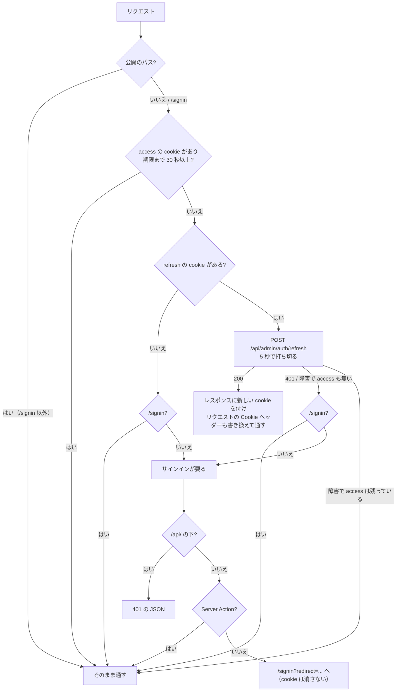

# step5-admin-auth-screens

admin の画面側の認証を作る。サインイン画面・Google の callback・dev ログイン・cookie・proxy による認証のガードとトークンの更新・戻り先の検査・api-client・ログアウト。Basic 認証を消す。api 側は [step4](./step4-api-admin-auth.md) で作ってある。

この step の後は、サインインしないと admin のどの画面も開けない（`/demo/signin`・`/demo/signup` を除く）。

設計: [admin 認証](../README.md#admin-認証) / [proxy でのトークンの更新](../README.md#proxy-でのトークンの更新) / [api の 401 の扱い](../README.md#api-の-401-の扱い) / [仕様: admin のサインイン](../README.md#admin-のサインイン)

## 前提

- [step4](./step4-api-admin-auth.md) の直後に merge する（間に別の PR を挟まない）。step4 だけが main にある間は、ローカルの admin が api に 401 で弾かれる
- [step1](./step1-admin-demo-isolation.md) の後（`/demo/signin` とデモのサイドバーの項目を使う）。サインイン画面の右側のロゴは [step2](./step2-admin-app-config.md) の `AppLogo`
- `pnpm --filter @repo/db db:seed` で `admin@dev.local` が入っていること
- この step のパスは、特に書かない限り `apps/admin/` からの相対

## 対応内容

### 変更するファイル

```
apps/admin/
├── .env.local                                  # NEXT_PUBLIC_APP_URL・GOOGLE_CLIENT_ID を足し、ADMIN_API_TOKEN・ADMIN_BASIC_AUTH_* を消す
├── src/env.ts                                  # 同上
├── src/proxy.ts                                # 置き換え（Basic 認証 → 認証のガードと更新）
├── src/libs/basic-auth.ts                      # 削除
├── src/libs/auth-cookies.ts                    # 新設 cookie の名前と属性（proxy からも使う）
├── src/libs/auth.ts                            # 新設 cookie の読み書き（server-only）
├── src/libs/app-origin.ts                      # 新設 NEXT_PUBLIC_APP_URL を origin にそろえた値
├── src/libs/safe-redirect.ts                   # 新設 戻り先の検査
├── src/libs/api-client.ts                      # Bearer を付ける。401 で signout へ
├── src/features/auth/auth.actions.ts           # 新設 logoutAction
├── src/features/auth/sign-in-errors.ts         # 新設 ?error= の値と文言
├── src/features/content-source/content-source.api.ts  # detectLicense は 401 を投げる
├── src/app/(auth)/signin/page.tsx              # 作り直す
├── src/app/(auth)/signin/actions.ts            # 新設 startGoogleOAuth
├── src/app/(auth)/demo/signin/page.tsx         # 新設 今のフォームをデモへ
├── src/app/api/auth/callback/google/route.ts   # 新設
├── src/app/api/auth/signout/route.ts           # 新設
├── src/app/api/dev/login/route.ts              # 新設
├── src/app/api/content-sources/license/route.ts  # 401 を返す
├── src/components/features/auth/GoogleSignInButton.tsx  # 新設
├── src/components/demo/auth/SignInForm.tsx     # components/features/auth/ から移す
├── src/components/demo/demo-nav-items.tsx      # Sign In を /demo/signin に
├── src/components/features/header/UserDropdown.tsx      # 「Sign out」を logoutAction に繋ぐ
├── src/components/features/content-source/SourceForm.tsx  # ライセンスの検出の 401
└── catch の先頭に unstable_rethrow を足す 19 か所（後述）
.claude/skills/verify-web-page/SKILL.md          # admin の確認のときのログインの仕方
.claude/skills/create-pr/SKILL.md                # 「admin 認証は将来対応」を消す
```

### テンプレートから写すファイル

次はテンプレートの `apps/admin/` の同じパスのファイルを写す。tech-english との違いは右の列だけ。

| ファイル | 中身 | 違い |
| --- | --- | --- |
| `src/libs/auth-cookies.ts` | cookie の名前（`admin_access_token` / `admin_refresh_token` / `admin_oauth_state` / `admin_oauth_redirect`）と属性（httpOnly・`sameSite: "lax"`・production は `secure`、access 15 分・refresh 7 日・OAuth 5 分）、`isAccessTokenExpiringSoon`（`exp` まで 30 秒を切ったか。署名は見ない）。`next/headers` を import しない | なし |
| `src/libs/auth.ts` | `setAuthCookies` / `clearAuthCookies` / `getAccessToken` / `getRefreshToken`。先頭に `import "server-only"` | なし |
| `src/libs/app-origin.ts` | `APP_ORIGIN`（`new URL(env.NEXT_PUBLIC_APP_URL).origin`）と `GOOGLE_REDIRECT_URI` | なし |
| `src/libs/safe-redirect.ts` | `resolveSafeRedirectPath`。URL として解釈して origin を比べ、`//` で始まる pathname も捨てる | なし |
| `src/features/auth/sign-in-errors.ts` | `SIGN_IN_ERROR_MESSAGES`（`auth_failed` / `not_admin` / `oauth_denied` / `session_expired` / `state_mismatch`） | なし |
| `src/features/auth/auth.actions.ts` | `logoutAction`（api の logout を呼び、失敗しても cookie を消して `/signin` へ） | なし |
| `src/app/(auth)/signin/actions.ts` | `startGoogleOAuth`（state と戻り先を cookie に入れ、`prompt=select_account` で Google へ） | なし |
| `src/app/(auth)/signin/page.tsx` | サインイン画面（後述） | なし |
| `src/app/api/auth/callback/google/route.ts` | state の照合、api の `/api/admin/auth/google`、403 は `not_admin`、api の障害も `auth_failed` でサインイン画面へ | なし |
| `src/app/api/auth/signout/route.ts` | cookie を消して `/signin` へ。`sec-fetch-site: cross-site` のときは消さずに `/signin?error=session_expired` へ | なし |
| `src/app/api/dev/login/route.ts` | production なら 404。`admin@dev.local` で api の dev-login を呼び、cookie を書いて `/` へ。失敗したら「`db:seed` を流したか」を返す | なし |
| `src/components/features/auth/GoogleSignInButton.tsx` | 今の `SignInForm` の Google のボタンと同じ見た目の submit ボタン | なし |
| `src/app/(auth)/demo/signin/page.tsx` | `components/demo/auth/SignInForm` を出すページ | `metadata.title` は `"Sign In"`（step2 のデモのページと同じ書き方） |

テンプレートのコメント（理由の説明）は、定義の側に 1 か所だけある形で写す。

### env

`src/env.ts`：`ADMIN_API_TOKEN` / `ADMIN_BASIC_AUTH_PASSWORD` / `ADMIN_BASIC_AUTH_USER` を消し、次を足す。

```typescript
  GOOGLE_CLIENT_ID: z.string().default("dummy"),

  NEXT_PUBLIC_APP_URL: z
    .string()
    .url()
    .refine((value) => /^https?:\/\//.test(value), { message: "http:// か https:// で始める" }),
```

```bash
cd apps/admin
pnpm exec dotenvx set NEXT_PUBLIC_APP_URL "http://localhost:3030" -f .env.local
pnpm exec dotenvx set GOOGLE_CLIENT_ID "$(cd ../web && pnpm exec dotenvx get GOOGLE_CLIENT_ID -f .env.local)" -f .env.local
```

- `.env.local` の `ADMIN_API_TOKEN=`・`ADMIN_BASIC_AUTH_USER=`・`ADMIN_BASIC_AUTH_PASSWORD=` の行を消す（暗号化された 1 行ずつなので、行ごと消してよい）
- `GOOGLE_CLIENT_ID` は web のローカルの値と同じクライアント（api の `GOOGLE_CLIENT_ID` / `GOOGLE_CLIENT_SECRET` と組になっている）。Google でのサインインをローカルで試すときだけ、Google Cloud の OAuth クライアントの「承認済みのリダイレクト URI」に `http://localhost:3030/api/auth/callback/google` を足す
- 実装では、`GOOGLE_CLIENT_ID` が api と同じクライアントであること、`NEXT_PUBLIC_APP_URL` は末尾の `/` やパスが付いていてもよい（`APP_ORIGIN` で origin にそろえる）ことを、定義の側に書く

### api-client（`src/libs/api-client.ts`）

テンプレートの api-client では置き換えない。今の `ApiClientError`（`status`・`body`）・`put`・`delete`・204 の扱いを残し、次だけを変える。

```typescript
import "server-only"

import { redirect } from "next/navigation"

import { env } from "../env"

import { getAccessToken } from "./auth"

const API_BASE_URL = env.API_URL

const SIGN_OUT_PATH = "/api/auth/signout"

type RequestOptions = {
  onUnauthorized?: "signOut" | "throw"
}

const buildHeaders = async (hasBody: boolean): Promise<HeadersInit> => {
  const token = await getAccessToken()
  return {
    ...(token ? { Authorization: `Bearer ${token}` } : {}),
    ...(hasBody ? { "Content-Type": "application/json" } : {}),
  }
}

const requestApi = async (path: string, method: string, body?: unknown, options: RequestOptions = {}): Promise<Response> => {
  const hasBody = body !== undefined
  const res = await fetch(`${API_BASE_URL}${path}`, {
    body: hasBody ? JSON.stringify(body) : undefined,
    headers: await buildHeaders(hasBody),
    method,
  })
  if (res.status === 401 && options.onUnauthorized !== "throw") redirect(SIGN_OUT_PATH)
  if (!res.ok) await throwApiError(res)
  return res
}

export const apiClient = {
  get: async <T>(path: string, options?: RequestOptions): Promise<T> => {
    const res = await requestApi(path, "GET", undefined, options)
    return res.json() as Promise<T>
  },
}
```

- `ADMIN_TOKEN_HEADER` と `X-Admin-Token` の付与を消す。refresh はしない（proxy が画面の描画の前に済ませている）
- `delete` / `post` / `put` と `readJson`・`throwApiError`・`ApiClientError` は今のまま。`options` を受け取るのは `get` だけ（今使うのはライセンスの検出だけのため）
- 実装では、モジュールの説明の「`X-Admin-Token` を付ける」を消し、次をこの関数の側に書く：401 は cookie を消す `/api/auth/signout` に redirect する理由（消さずにサインイン画面に送ると往復が止まらない）、redirect は例外なので呼び出し側の catch の先頭で `unstable_rethrow` が要ること、`onUnauthorized: "throw"` はブラウザの `fetch` から呼ばれる Route Handler のためにあること

### proxy（`src/proxy.ts`）

1 つのリクエストで次の順に判定する。



テンプレートの `proxy.ts` を写し、サインインが要るときの返し方だけを変える（`/api/` の下は 401、Server Action は通す）。

```typescript
const API_PATH_PREFIX = "/api/"

const SERVER_ACTION_HEADER = "next-action"

const respondToUnauthenticated = (req: NextRequest): NextResponse => {
  if (req.nextUrl.pathname.startsWith(API_PATH_PREFIX)) {
    return NextResponse.json({ error: "Unauthorized" }, { status: 401 })
  }
  if (req.method === "POST" && req.headers.has(SERVER_ACTION_HEADER)) {
    return NextResponse.next()
  }
  const url = new URL(SIGN_IN_PATH, req.url)
  url.searchParams.set("redirect", resolveSafeRedirectPath(`${req.nextUrl.pathname}${req.nextUrl.search}`))
  return NextResponse.redirect(url)
}

export const config = {
  matcher: ["/((?!_next/static|_next/image|favicon.svg|images/).*)"],
}
```

- テンプレートの `redirectToSignIn` を `respondToUnauthenticated` にし、呼ぶ所（refresh の cookie が無い・refresh が 401・障害で access も無い）はテンプレートのまま
- 公開のパス（`PUBLIC_PATHS`）・`isPathUnderPrefix`・`requestTokenRefresh`（`REFRESH_TIMEOUT_MS = 5_000`）・成功したときの cookie の書き換えはテンプレートのまま
- `@/env` を import する（今の「`server-only` なので `process.env` を直接読む」は消す）。`pnpm --filter admin build` で通ることを確かめる
- `images/` を除くのは今と同じ理由（秘密を含まず、next/image の最適化がサーバーの内部から認証なしに元の画像を取る）。この理由は matcher の側に残す
- `/api/` の下を 401 にする理由（ブラウザの `fetch` が redirect を辿るとサインイン画面の HTML を受け取る）と、Server Action を通す理由（redirect だと Next.js のクライアントが扱えずエラー画面になる。認証の境界は api で、token が無ければ api の 401 で api-client がサインイン画面に送る）は `respondToUnauthenticated` の側に書く

### サインイン画面

テンプレートの `app/(auth)/signin/page.tsx` のまま。

- Server Component。`searchParams` は Promise なので `await` する
- 有効な access の cookie があれば `resolveSafeRedirectPath(redirect)` に戻す（proxy の更新の競合の後の受け口）。`?error=` があるときは戻さない（cross-site の `/api/auth/signout` は api が認めない access の cookie を残したまま送ってくるので、戻すと往復が止まらない）
- 見出し「サインイン」、説明「管理画面に登録された Google アカウントでサインインしてください」
- `<form action={startGoogleOAuth}>` に `redirect` を hidden で渡し、`GoogleSignInButton` を置く
- `?error=` は `SIGN_IN_ERROR_MESSAGES` を `Object.hasOwn` で引き、`ui/alert/Alert`（`variant="error"`）で出す。知らない値は `auth_failed` の文言

| `?error=` | 表示 |
| --- | --- |
| `not_admin` | このアカウントには管理画面の権限がありません |
| `oauth_denied` | Google アカウントへのアクセスが拒否されました |
| `session_expired` | セッションの有効期限が切れました。もう一度サインインしてください |
| `state_mismatch` | セッションが切れました。もう一度お試しください |
| `auth_failed` / その他 | サインインに失敗しました。もう一度お試しください |

- production 以外では、「開発環境のみ」の区切り線の下に「dev admin でログイン」（`/api/dev/login` への `<a>`。先読みされないよう `Link` にしない）を出す
- 今の `components/features/auth/SignInForm.tsx`（email + パスワード）は `components/demo/auth/` に移し、`/demo/signin` で見られるようにする。`components/demo/demo-nav-items.tsx` の「Authentication > Sign In」の行き先を `/demo/signin` にする
- `components/features/auth/` には `GoogleSignInButton.tsx` だけが残る

### ログアウト

`components/features/header/UserDropdown.tsx` の「Sign out」（今は `/signin` への `Link`）を、`<form action={logoutAction}>` の中の素の `<button type="submit">` にする。見た目は今の項目と同じクラス。`DropdownItem` の `tag="button"` は `preventDefault` するので submit に使わない。表示の中身（名前・email・「ログアウト」の文言）は step6 で作り直す。

### api の 401 と `unstable_rethrow`

api-client が 401 で投げる redirect（`NEXT_REDIRECT`）を握りつぶさないよう、api の呼び出しを囲む catch の先頭で `unstable_rethrow(error)` する。

```typescript
import { unstable_rethrow } from "next/navigation"

  try {
    id = (await contentSourceApi.create(parsed.data)).id
  } catch (error) {
    unstable_rethrow(error)
    return convertApiErrorToFormState(error, "登録に失敗しました。時間をおいて再度お試しください。", ["/content-sources/new"])
  }
```

| ファイル | catch の数 |
| --- | --- |
| `src/app/(dashboard)/content-sources/actions.ts` | 2 |
| `src/app/(dashboard)/content-sources/[id]/page.tsx` | 1 |
| `src/app/(dashboard)/passages/[id]/actions.ts` | 9 |
| `src/app/(dashboard)/tags/actions.ts` | 3 |
| `src/app/(dashboard)/users/[id]/actions.ts` | 1 |
| `src/features/passage/passage.api.ts` | 1 |
| `src/features/stats/stats.api.ts` | 1 |
| `src/features/user/user.api.ts` | 1 |

- 404 だけを見て残りを `throw error` で投げ直している所（`*.api.ts`・`content-sources/[id]/page.tsx`）は、今も redirect を通すが、同じ形にそろえて先頭に置く
- `features/auth/auth.actions.ts` の `logoutAction` の catch には足さない（logout は公開のパスで 401 にならず、失敗しても cookie を消して終える）
- クライアント側の catch（`SourceForm` のライセンスの検出、`UserAttemptList` の「さらに読み込む」）は対象外。Server Action の redirect は Next.js が画面の遷移として扱う
- 実装で catch を足したら `grep -rn "catch (error)" apps/admin/src --include=*.ts --include=*.tsx` の結果と上の表を見比べ、漏れが無いことを確かめる

### ライセンスの検出（ブラウザの `fetch` から呼ぶ Route Handler）

`features/content-source/content-source.api.ts`：

```typescript
  detectLicense: async (repository: string): Promise<DetectContentSourceLicenseResponse> => {
    const raw = await apiClient.get<unknown>(`${BASE_PATH}/license?repository=${encodeURIComponent(repository)}`, { onUnauthorized: "throw" })
    return detectContentSourceLicenseResponseSchema.parse(raw)
  },
```

`app/api/content-sources/license/route.ts` の catch:

```typescript
  } catch (error) {
    if (error instanceof ApiClientError && error.status === 401) {
      return NextResponse.json({ error: "Unauthorized" }, { status: 401 })
    }
    console.error("License detection failed", error)
    return NextResponse.json({ error: "License detection failed" }, { status: 502 })
  }
```

`components/features/content-source/SourceForm.tsx` の `detectLicense`（`res.status === 400` の次）:

```typescript
      if (res.status === 401) {
        setLicenseDetection({ message: "サインインの期限が切れました。ページを開き直してサインインしてください。", status: "failed" })
        return
      }
```

- ページを開き直すと、proxy が更新するか、api の 401 から `/api/auth/signout` を経てサインイン画面に送られる。フォームの入力を消さないよう、ここで画面を移さない

### ドキュメント・skill

| ファイル | 直すこと |
| --- | --- |
| `apps/admin/CLAUDE.md` | 「環境変数」の表を `API_URL` / `GOOGLE_CLIENT_ID` / `NEXT_PUBLIC_APP_URL` / `NODE_ENV` にする。「アクセス制御」の節を「認証」にし、サインイン（Google・dev ログイン）、cookie（`admin_*`）、proxy での更新、api-client の 401 と `unstable_rethrow`、`/api/` の下の Route Handler は 401、admin の登録（`admin:create` / Admin Create）、Google Cloud の redirect URI を書く（詳細は [admin-template](../README.md) へリンク）。「API 接続の下地」の表の `src/env.ts`・`src/libs/api-client.ts` の行を直し、`src/libs/auth*.ts`・`safe-redirect.ts`・`app-origin.ts` を足す。「ダミーモード」の節を消す。「画面を API に繋ぐときは」に「api の呼び出しを try/catch で囲むときは catch の先頭で `unstable_rethrow`」を足す |
| `apps/admin/README.md` | 「API 設計方針」の `ADMIN_USE_DUMMY` の行を消す。Route Group の `(auth)/` の説明にサインイン画面とデモのフォームを足す |
| `.claude/skills/verify-web-page/SKILL.md` | 「`apps/admin` — Admin 認証は将来実装。現状はそのまま navigate」を消す。admin の画面を確かめるときは、先に `http://localhost:3030/api/dev/login` を開いてログインする（web 用の `app_access_token` の cookie の注入は admin では効かない）。cookie なしで開くと `/signin` に送られることを書く |
| `.claude/skills/create-pr/SKILL.md` | スクリーンショットの表の `apps/admin` の「admin 認証は将来対応」を「`/api/dev/login` でログインしてから撮る」にする |

## 動作確認

```bash
pnpm --filter @repo/db db:seed
pnpm --filter admin lint
pnpm --filter admin build
pnpm dev
```

`verify-web-page` skill で行う（port 3030）。

| 確認 | 期待 |
| --- | --- |
| cookie なしで `/`・`/passages/1`・`/demo/charts/bar`・`/mock` を開く | `/signin?redirect=...` に送られる（Basic 認証のダイアログは出ない） |
| cookie なしで `/demo/signin`・`/demo/signup`・`/favicon.svg`・`/images/demo/user/owner.jpg` | サインイン画面に送られずに開ける |
| `/signin` で「dev admin でログイン」 | `/` に入れる。cookie に `admin_access_token` / `admin_refresh_token`（httpOnly） |
| サインイン後に `/signin?redirect=/tags` を開く | `/tags` に戻る |
| `redirect` に `//evil.example.com`・`/\evil.example.com`・`https://evil.example.com`・`/.//evil.example.com` | どれも `/` に戻る（外に出ない） |
| web（:3000）で alice としてログインした状態で admin を開く | admin はサインイン画面のまま（web の cookie では入れない） |
| 各画面（ダッシュボード・問題・ソース・タグ・ユーザー）を開き、保存・公開・タグの追加などを 1 つずつ行う | 今と同じく動く（api に Bearer で届いている） |
| `admin_access_token` だけを消して画面を開く | proxy が更新し、画面が開く。cookie が新しくなり、Redis の古い `admin_refresh_token:{jti}` が消えて `admin_refresh_token_rotated:{jti}` ができる |
| `admin_refresh_token` を壊れた値にし、`admin_access_token` も消して画面を開く | `/signin?redirect=...` に送られる |
| api を止めて、`admin_access_token` だけを消して画面を開く | サインイン画面に送られる（cookie は残る）。api を戻してサインイン画面を開き直すと、元の画面に戻る |
| ユーザーメニューの「Sign out」 | `/signin` に戻り、cookie が消え、Redis の `admin_refresh_token:*` が消える |
| access token を別の鍵で作った値に書き換えて画面を開く（api が 401） | `/api/auth/signout` を経て `/signin` に送られ、cookie が消えている（`/signin` と画面の往復が起きない） |
| 上と同じ状態で、ソースの編集の保存（Server Action） | 「保存に失敗しました」ではなく、サインイン画面に送られる |
| 上と同じ状態で、ソースのフォームの「ライセンスを検出」 | 「サインインの期限が切れました…」が出て、入力は消えない |
| 上と同じ状態で、外のサイトのリンクから画面を開く（cross-site） | `/signin?error=session_expired` で止まり、セッションの期限切れの文言が出る（`ERR_TOO_MANY_REDIRECTS` にならない） |
| ソースの編集を開いたまま `admin_access_token`・`admin_refresh_token` を両方消し、保存（Server Action） | エラー画面（Something went wrong!）にならず、サインイン画面に送られる |
| `NEXT_PUBLIC_APP_URL` を末尾に `/` を付けた値にして Google でサインイン | `redirect_uri` に `//` が入らず、戻り先も保たれる |
| Google でサインイン（登録済みの email） | `/` に入れる。DB の `admins.name` / `avatar_url` / `last_signed_in_at` が更新される |
| Google でサインイン（未登録の email） | `/signin?error=not_admin` で権限が無い旨が出る |
| `pnpm --filter admin start`（production のビルド）で `/api/dev/login` | サインインしていなければ 401（proxy）、していれば 404（Route Handler）。サインイン画面に「dev admin でログイン」が出ない |

Google を使う 3 つは、Google Cloud に `http://localhost:3030/api/auth/callback/google` を登録した後に手で確かめる。

サインイン画面の見た目は TailAdmin のデモの `/demo/signin` と並べ、Google のボタン・見出し・説明・エラーの表示（`Alert`）の色と寸法を `getComputedStyle` で比べる（ライト / ダーク）。PR には `/signin`（エラーの表示ありとなし）のスクリーンショットをデモと並べて付ける。PR の本文に「step4 と続けて merge する」と書く。
