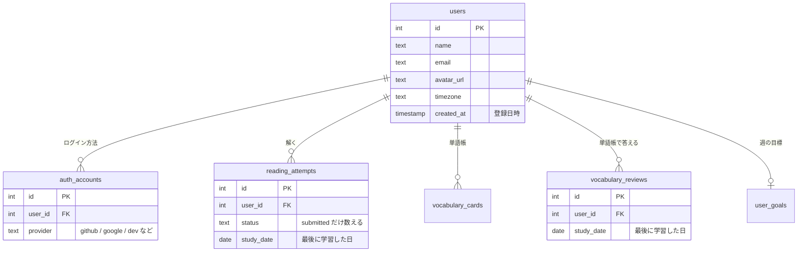
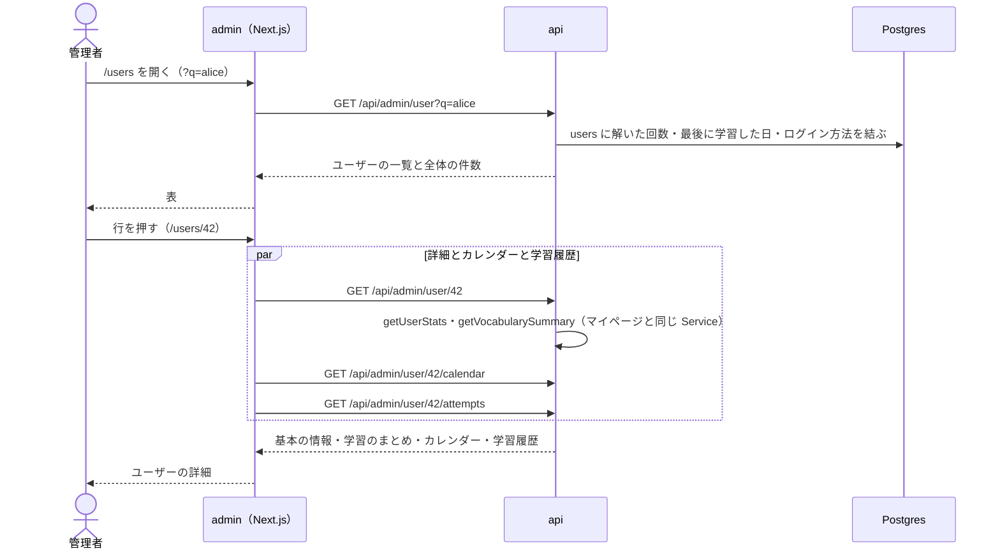

# admin のユーザー管理

管理者が、登録しているユーザーの一覧と、1 人のユーザーの学習の状況を見る画面。誰がどれくらい使っているかの把握と、問い合わせ（「記録が消えた」「連続学習日数がおかしい」など）の調査に使う。

MVP では **見るだけ** にする。ユーザーの情報の変更・削除・利用停止はしない（退会はユーザー自身がする）。学習の状況は、ユーザーのマイページと同じ集計を使い、同じ数字を出す。

このドキュメントは **仕様（What）** と **設計（How）** を分けて記述する：

- **仕様**：ユーザーから見える挙動・ルール・データの意味
- **設計**：実装にあたっての技術的な選択と制約

## 関連 spec

- [`../github-auth/README.md`](../github-auth/README.md) — ユーザー（`users`）とログイン方法（`auth_accounts`）の正本。退会（物理削除）
- [`../learning-record/README.md`](../learning-record/README.md) — 学習のまとめ・カレンダー・学習履歴の正本。詳細の画面は同じ集計（Service）を使う
- [`../vocabulary-cards/README.md`](../vocabulary-cards/README.md) — 単語帳の枚数（`GET /api/vocabulary/summary` と同じ集計）
- [`../reading-practice/README.md`](../reading-practice/README.md) — 「解いた」（提出済みの挑戦）
- [`../admin-dashboard/README.md`](../admin-dashboard/README.md) — ダッシュボード。同じ時期に作り、サイドバーに並べる
- [`../admin-template/README.md`](../admin-template/README.md#admin-認証) — 管理画面のアクセス制御（admin ごとのサインイン。`admins` テーブル + admin 専用の JWT）

## 目次

- [仕様](#仕様)
  - [ユーザー一覧](#ユーザー一覧)
  - [ユーザーの詳細](#ユーザーの詳細)
  - [見るだけにする](#見るだけにする)
  - [個人情報の扱い](#個人情報の扱い)
- [設計](#設計)
  - [学習の状況はマイページの Service を使い回す](#学習の状況はマイページの-service-を使い回す)
  - [一覧の集計](#一覧の集計)
  - [MVP 対象外（将来検討）](#mvp-対象外将来検討)
- [必要な画面](#必要な画面)
- [UI 設計](#ui-設計)
  - [ユーザー一覧](#ユーザー一覧-1)
  - [ユーザーの詳細](#ユーザーの詳細-1)
- [必要な API](#必要な-api)
- [必要な DB 設計](#必要な-db-設計)
- [フロー図](#フロー図)

---

## 仕様

### ユーザー一覧

- 列：アイコンと名前、メールアドレス、ログイン方法（GitHub・Google など）、登録日、最後に学習した日、解いた回数
- 名前・メールアドレスの部分一致で絞り込める
- 並べ替え：登録日（既定。新しい順）、最後に学習した日、解いた回数。同じ値の間はユーザー ID の順
- 50 件ずつページを分ける。全体の件数を出す
- 名前が無い（空白だけを含む）ユーザーは「（名前なし）」、一度も学習していないユーザーの最後に学習した日は「―」（既存の admin の画面と同じ）
- ユーザーの欄（アイコン・名前）を押すと、そのユーザーの詳細を開く

| 項目 | 意味 |
| --- | --- |
| 登録日 | アカウントを作った日（日本時間） |
| 最後に学習した日 | 最後に問題を解いた、または単語帳で答えた日。日付はマイページと同じく、学習したときのユーザーのタイムゾーンでの日付 |
| 解いた回数 | これまでに提出した挑戦の数（同じ問題を 2 回解けば 2 回） |

### ユーザーの詳細

マイページで本人が見ているものと同じ数字を、管理者が見られるようにする。

- 基本の情報：アイコン、名前、メールアドレス、ユーザー ID、ログイン方法、登録日時、タイムゾーン、最後に学習した日（一覧と同じ）
- 学習のまとめ（[learning-record](../learning-record/README.md) のマイページと同じ）：連続学習日数（今・最長）、解いた回数・解いた問題の数、正答率、学習時間、設問の種類ごとの正答率、アシストなしの正答率、週の目標と進み具合
- 学習カレンダー：マイページと同じ草（直近 1 年）
- 学習履歴：解いた問題を新しい順に（問題名・提出日時・点数・かかった時間・アシストの利用）。「さらに読み込む」で続きを出す。問題名を押すと問題の確認・修正を開く
- 単語帳：学習中・覚えた・まだ出ていない枚数、今日やる枚数、次に出る日
- 日付・「今日」は、マイページと同じくそのユーザーのタイムゾーンで決める（本人が見ている数字と揃えるため）。登録日時だけは日本時間

### 見るだけにする

- 名前・メールアドレス・学習の記録の変更、アカウントの削除、利用停止はできない
- 退会したユーザーは一覧から消える。詳細の URL を開くと「ユーザーが見つかりません」（404）

### 個人情報の扱い

- メールアドレスは管理画面（[admin のサインイン](../admin-template/README.md#admin-のサインイン)で守られている）でだけ見られる
- 一覧の絞り込みの文字（メールアドレスの一部が入りうる）は、API のログに出さない

---

## 設計

### 学習の状況はマイページの Service を使い回す

- 詳細の学習のまとめ・カレンダー・学習履歴・単語帳の枚数は、ユーザー向けの API と同じ Service（`learningRecord.getUserStats`・`getUserCalendar`・`getUserAttempts`、`vocabulary.getVocabularySummary`）に、パスの `:id` を `userId` として渡して求める。admin 用の集計は書かない
  - マイページと必ず同じ数字になり、学習記録の仕様が変わってもユーザー管理の画面がずれない
  - マイページの Service は、ユーザーが居ないと 401 を返す（本人のトークンの検査の一部のため）。admin では「ユーザーが見つからない」なので、admin の Service が先にユーザーが居るかを確かめ、居なければ 404 を返す
- レスポンスのスキーマは、ユーザー向けと同じ形のものは admin のスキーマから re-export する（`apps/api/CLAUDE.md` の「Admin API 設計方針」）
- 詳細の基本の情報と、学習のまとめ・単語帳の枚数は 1 回の API（`GET /api/admin/user/:id`）で返す。カレンダー（期間を変えられる）と学習履歴（ページ送り）は別の API にする（マイページと同じ分け方）

### 一覧の集計

- `users` に、ユーザーごとに束ねた解いた回数・最後に学習した日・ログイン方法を left join して 1 回の SQL で返す（SQL は [step1](./tasks/step1-api-admin-users.md)）
- 並べ替えの列が集計の結果なので、ページ分けは offset（ユーザーは 1 万人規模の想定で十分速い）。全体の件数は `count(*) OVER ()` で一緒に取る
- 絞り込みは `name ILIKE` または `email ILIKE`（`%`・`_`・`\` はエスケープする）。1 万人なら全件を走査しても速いので、インデックス（`pg_trgm`）は足さない
- インデックスは足さない。全員分を束ねるので、`reading_attempts`・`vocabulary_reviews` は全件を読んでハッシュで束ねる（1 万人・挑戦 50 万件・答え 200 万件で約 0.4 秒。実装時に計測）
- 最後に学習した日は `study_date`（ユーザーのタイムゾーンの日付）を使う。ダッシュボード（日本時間で区切る）とは基準が違うが、ユーザーごとの値なので本人のマイページに揃える方を取る
- 絞り込みの文字は GET のクエリ（`?q=`）で送る。api のリクエストログ（`request-logger.ts`）と admin の認証のログはパスだけを出してクエリを出さないので、メールアドレスはログに残らない。Service・Repository でも `q` をログに出さない

### MVP 対象外（将来検討）

以下は MVP では作らない。運用で必要になったときに着手する。

- 利用停止（停止中はログインと API を断る）
- 管理画面からのアカウントの削除
- 最終ログイン日時（今は記録していない）
- 管理者の操作の記録（誰が何を見た・変えた）と、管理者ごとの権限（[admin-template の MVP 対象外](../admin-template/README.md#mvp-対象外将来検討)）

詳細：[`./deferred-user-actions.md`](./deferred-user-actions.md)

---

## 必要な画面

| パス | 画面名 | 役割 |
| --- | --- | --- |
| `/users` | ユーザー一覧 | 絞り込み・並べ替え・ページ送りのできる表 |
| `/users/[id]` | ユーザーの詳細 | 基本の情報、学習のまとめ、学習カレンダー、学習履歴、単語帳の枚数 |

- サイドバーは「ダッシュボード」「ソース」「問題」「ユーザー」の順
- 具体的な UI は [UI 設計](#ui-設計) を参照

## UI 設計

`design-mock` skill で確定したデザイン。admin は既存の TailAdmin テンプレートのデザインを使う（[product-overview の admin のデザイン](../product-overview/README.md#admin-のデザイン)）。表・数字の書き方・並べ替えの見出しは [admin-dashboard の UI 設計](../admin-dashboard/README.md#ui-設計) と同じ。

| パス（admin） | 画面名 | モック |
| --- | --- | --- |
| `/users` | ユーザー一覧 | `/mock/users` |
| `/users/[id]` | ユーザーの詳細 | `/mock/users/1` |

**ユーザーのアイコン**：`avatar_url` があれば丸い画像、無ければ名前の頭文字（名前も無ければ「?」）を `brand-100` の丸に `brand-600` の文字で出す。**ログイン方法**：テンプレートの `Badge`（`light`）で「GitHub」「Google」「dev」（知らない値はそのまま）。

### ユーザー一覧

```
┌──────────────────────────────────────────────────────────────────────────────┐
│ ユーザー                                                       Home > ユーザー │
│ ┌──────────────────────────────────────────────────────────────────────────┐ │
│ │ 26 人                                      [🔍 名前・メールで絞り込む]   │ │
│ ├──────────────────────────────────────────────────────────────────────────┤ │
│ │ ユーザー        メールアドレス      ログイン方法    登録日▼    最後に学習した日 解いた回数│ ← ▼ は並べ替えの列と向き
│ │ (img) asahi     asahi@example.com  [GitHub][Google] 2026-09-28 2026-10-10   86 │ │
│ │       ID 26                                                              │ │
│ │ (E) emi.codes   emicodes@…         [GitHub]        2026-09-14 2026-09-14   28 │ │ ← 画像が無ければ頭文字
│ │ (?) （名前なし） ren-k@…            [GitHub]        2026-06-22 2026-09-30  160 │ │ ← 名前が無い
│ │ (img) kou       kou@example.com    [GitHub]        2026-09-07 ―             0 │ │ ← 学習していない
│ ├──────────────────────────────────────────────────────────────────────────┤ │
│ │ 1〜26 人目 / 26 人                               [Previous] [1] [Next]   │ │
│ └──────────────────────────────────────────────────────────────────────────┘ │
└──────────────────────────────────────────────────────────────────────────────┘
```

- 表はテンプレートの `DataTable` と同じ枠・余白。上に人数と、名前・メールの絞り込み
- 列：ユーザー（36px のアイコン、名前、下に「ID 26」）、メールアドレス（無ければ「―」）、ログイン方法、登録日、最後に学習した日（無ければ「―」）、解いた回数（太字）
- 並べ替えのできる列（登録日・最後に学習した日・解いた回数）は見出しがボタン（`aria-sort` 付き）。初期は登録日の新しい順
- 行にホバーすると地を薄くする。ユーザーの欄を押すと詳細を開く
- 下：「1〜26 人目 / 26 人」と `Pagination`。表が空のときは、絞り込みで 0 人なら「条件に合うユーザーがいません」と「名前かメールアドレスの一部で絞り込めます。」、ユーザーがまだいなければ「ユーザーがいません」、範囲外のページ（人数が減った後の古い URL など）なら「このページにはユーザーがいません」と、最後のページへの Previous

### ユーザーの詳細

```
┌──────────────────────────────────────────────────────────────────────────────┐
│ ユーザーの詳細                                           Home > ユーザーの詳細 │
│ ← ユーザー一覧に戻る                                                         │
│ ┌──────────────────────────────────────────────────────────────────────────┐ │
│ │ (72px)  alice                                                            │ │ ← プロフィール
│ │         alice@example.com                                                │ │
│ │         [dev]                                                            │ │
│ │ ──────────────────────────────────────────────────────────────────────── │ │
│ │ ユーザー ID   登録日時                  タイムゾーン   最後に学習した日   │ │
│ │ 1             2026-04-06 09:00（日本時間） Asia/Tokyo  2026-10-15         │ │
│ └──────────────────────────────────────────────────────────────────────────┘ │
│ ┌──────────────┐┌──────────────┐┌──────────────┐┌──────────────┐             │ ← 学習のまとめ（マイページと同じ数字）
│ │連続学習日数  ││解いた回数    ││正答率        ││学習時間      │             │
│ │6 日          ││87 回         ││74%           ││7 時間 54 分  │             │
│ │最長 19 日    ││解いた問題 61 ││アシストなし66%││問題と単語帳… │             │
│ └──────────────┘└──────────────┘└──────────────┘└──────────────┘             │
│ ┌──────────────────────────────────────────┐┌──────────────────────────┐     │
│ │ 学習カレンダー          直近 1 年で 146 日 ││ 週の目標                 │     │
│ │ 月 ▫▫▫▪▪▫▪▫▪▪▫▫▪▪▪▫▪▫▫▪▪▫▪▪▫▪▫▪▪▫▪…     ││ 今週 5 問   3 / 5        │     │
│ │ 水 ▫▪▫▪▫▪▪▫▪▫▪▪▫▪▫▫▪▪▫▪▫▪▪▫▪▫▪▪▫▫…      ││ ███████████░░░░░░        │     │ ← 緑の棒
│ │ 金 ▪▫▪▫▪▫▫▪▫▪▫▫▪▫▪▪▫▪▫▫▪▫▪▫▪▫▪▫…         │├──────────────────────────┤     │
│ │                       少ない ▫▫▪▪■ 多い  ││ 単語帳                   │     │
│ ├──────────────────────────────────────────┤│ 今日やる 12 枚 学習中 48 枚│    │
│ │ 設問の種類ごとの正答率                   ││ 覚えた 133 枚 まだ 9 枚  │     │
│ │ 要旨      ████████████████████░░   86%   ││ 次に出る日 2026-10-16    │     │
│ │ 詳細      ██████████████████░░░░   78%   │└──────────────────────────┘     │
│ └──────────────────────────────────────────┘                                 │
│ ┌──────────────────────────────────────────────────────────────────────────┐ │
│ │ 学習履歴                                                                 │ │
│ │ 解いた問題を新しい順に。日時はユーザーのタイムゾーン                     │ │
│ │ 提出日時          問題                 点数  時間         アシスト       │ │
│ │ 2026-10-15 21:00  What Is Ownership?   2 / 4 3:36         使った         │ │
│ │ 2026-10-15 18:17  Pod Lifecycle        3 / 4 6:40 [超過]  なし           │ │
│ │                         [さらに読み込む]                                 │ │ ← 10 件ずつ
│ └──────────────────────────────────────────────────────────────────────────┘ │
└──────────────────────────────────────────────────────────────────────────────┘
```

- 上部：「← ユーザー一覧に戻る」
- **プロフィール**：72px のアイコン、名前（無ければ灰色の「（名前なし）」）、メールアドレス（無ければ「メールアドレスなし」）、ログイン方法のバッジ。区切り線の下に、ユーザー ID・登録日時（日本時間）・タイムゾーン・最後に学習した日（`sm` で 2 列、`xl` で 4 列）
- **学習のまとめ**：数字のカード 4 枚（連続学習日数と最長、解いた回数と解いた問題の数、正答率とアシストなしの正答率、学習時間。学習時間は分を切り捨て、1〜59 秒は「1 分未満」とマイページと同じ）
- **学習カレンダー**：53 週 × 7 日の 11px の四角（月曜始まり、左に「月・水・金」。web のマイページ・API の期間と同じ）。色は学習の量で 5 段階（`gray-100` → `brand-100` → `brand-300` → `brand-500` → `brand-700`）。右上に「直近 1 年で 146 日」、右下に「少ない〜多い」の凡例。マスにホバーすると「2026-10-15・1 問・12 枚・7 分」。web のマイページの並びを admin の色で出す（月のラベル・今日の強調・日を選ぶ操作は出さない）。狭い画面では横にスクロールし、始めは直近の週（右端）を見せる
- **設問の種類ごとの正答率**：種類ごとの横棒（`brand-500`）と %
- **週の目標**：「今週 5 問」と進み具合「3 / 5」、緑（`success-500`）の棒（100% で止める）。単位は目標の種類で「問」（解いた問題の数）か「分」（学習した分）。今週達成していれば右に `success` のバッジ「達成」。目標が無ければ「目標は設定されていません」
- **単語帳**：今日やる・学習中・覚えた・まだ出ていないの枚数（2 列）と次に出る日
- **学習履歴**：表（提出日時・問題・点数・時間・アシスト）。提出日時は提出した瞬間をユーザーの今のタイムゾーンで出す。時間は制限を超えていれば右に `warning` のバッジ「超過」。アシストは 1 つでも使っていれば「使った」、使っていなければ「なし」（マイページと同じ学習履歴の API が、制限時間とアシストごとの回数を返さないため。モックの「時間 / 制限」「和訳 1・単語 3」から変えた）。問題名は問題の確認・修正へのリンク。10 件ずつ「さらに読み込む」（副のボタン。読み込み中は押せない）で続きを出し、最後まで出したらボタンを消す。読めなかったときはボタンの上に赤字で、一時的な失敗なら「続きを読み込めませんでした。もう一度押してください。」、ユーザーが居なくなっていれば「ユーザーが見つかりませんでした。一覧から開き直してください。」
- まだ学習していないユーザー：数字は 0 と「―」、カレンダーは空、履歴は「まだ問題を解いていません」
- ユーザーが居ない（退会・ID の誤り。`1e3`・`0x10` のような正の整数でない ID と、DB の ID の上限を超える ID も含む）：本実装は 404 の画面。モックは「ユーザーが見つかりません」「退会したか、ID が違います。」と一覧へ戻るリンク

**レスポンシブ・ダークモード**

- 数字のカードはスマホで 1 列、`sm` で 2 列、`xl` で 4 列。カレンダー・種類ごとの正答率（8/12）と、週の目標・単語帳（4/12）は `xl` で横に並べ、それより狭いと縦に積む
- 表とカレンダーはスマホで横にスクロールする（ページ全体ははみ出さない）
- ダークモードはテンプレートの配色に従う。カレンダーの色はダークで `gray-800` → `brand-500/25` → `brand-500/50` → `brand-500` → `brand-400`

## 必要な API

すべて `/api/admin/` 配下（admin の access token が必要。[admin-template](../admin-template/README.md#admin-認証)）。スキーマは `packages/schema/src/api-schema/admin/user.ts`。

| メソッド | パス | クエリ | 説明 |
| --- | --- | --- | --- |
| GET | `/api/admin/user` | `q`・`sort`・`order`・`page`・`limit` | ユーザー一覧 |
| GET | `/api/admin/user/:id` | | 基本の情報・学習のまとめ・単語帳の枚数 |
| GET | `/api/admin/user/:id/calendar` | `from`・`to` | 学習カレンダー（`GET /api/user/calendar` と同じ） |
| GET | `/api/admin/user/:id/attempts` | `cursor`・`limit`・`date` | 学習履歴（`GET /api/user/attempts` と同じ） |

- `sort` は `created_at` / `last_studied_date` / `solved_attempts`（既定 `created_at`）、`order` は `asc` / `desc`（既定 `desc`）
- 存在しないユーザーは 404
- レスポンスの項目は [step1](./tasks/step1-api-admin-users.md)

## 必要な DB 設計

テーブル・列・インデックスは足さない。使う既存のテーブル：



## フロー図


