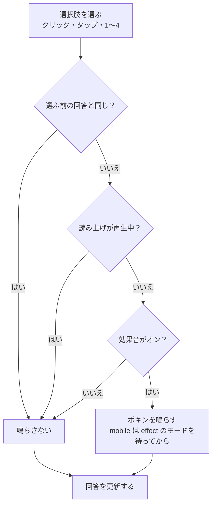

# 解答画面の効果音

解答画面で選択肢を選んだときに、「ポキン」という短い効果音を鳴らす。選んだ手応えを音でも返し、解答を少しゲームらしくする。web と mobile の両方。

鳴らすのは操作への反応だけで、自動では鳴らさない。解答画面の「集中を妨げない」方針（[product-overview の効果音](../product-overview/README.md#効果音)）の中に収める。

このドキュメントは **仕様（What）** と **設計（How）** を分けて記述する：

- **仕様**：ユーザーから見える挙動・ルール・データの意味
- **設計**：実装にあたっての技術的な選択と制約

## 関連 spec

- [`../reading-practice/README.md`](../reading-practice/README.md) — 解答画面。上部バーに効果音のボタンを足す（[問題を解く](../reading-practice/README.md#問題を解く)）
- [`../vocabulary-cards/README.md`](../vocabulary-cards/README.md) — 単語帳のめくる音。効果音のオン / オフを共有する
- [`../read-aloud/README.md`](../read-aloud/README.md) — 本文の読み上げ。読み上げの再生中は鳴らさない
- [`../vocabulary-pronunciation/README.md`](../vocabulary-pronunciation/README.md) — mobile の音声のモードの調停（`requestAudioMode`）の正本
- [`../product-overview/README.md`](../product-overview/README.md) — アプリ全体の効果音の方針

## 目次

- [仕様](#仕様)
  - [鳴らすとき](#鳴らすとき)
  - [音](#音)
  - [オン / オフ](#オン--オフ)
- [設計](#設計)
  - [音の作り](#音の作り)
  - [オン / オフの持ち方](#オン--オフの持ち方)
  - [鳴らすかの判定](#鳴らすかの判定)
  - [mobile の音声のモード](#mobile-の音声のモード)
- [必要な画面](#必要な画面)
- [必要な API](#必要な-api)
- [必要な DB 設計](#必要な-db-設計)
- [フロー図](#フロー図)
- [実装ステップ](#実装ステップ)

---

## 仕様

### 鳴らすとき

| 操作 | 鳴らすか |
| --- | --- |
| まだ答えていない設問で選択肢を選ぶ | 鳴らす |
| 別の選択肢に選び直す | 鳴らす |
| 選んでいる選択肢をもう一度押す | 鳴らさない（選択が変わらないため） |
| 本文の読み上げの再生中に選ぶ | 鳴らさない（一時停止中は鳴らす） |
| 設問の移動・提出・一時停止・結果画面 | 鳴らさない |

- クリック・タップ・キーボードの `1`〜`4` のどれで選んでも同じに扱う
- mobile は端末の消音モードでは鳴らさず、ほかのアプリの音楽も止めない（単語帳のめくる音と同じ）

### 音

- 木を軽く弾いたような「ポ」に、高く短い「キン」が重なる 0.16 秒の音。単語帳のめくる音と同じくらい控えめな音量にする
- web は鳴らすたびに高さを少し変える（同じ音が続いて機械的に聞こえないように。めくる音と同じ）

### オン / オフ

- 単語帳のめくる音と **共通の「効果音」の設定 1 つ** で切り替える。解答画面の上部バーのスピーカーのボタンと、単語帳の上部バーのボタンのどちらで切り替えても両方に効く。既定はオン
- 端末（ブラウザ）ごとに覚える。アカウントには保存しないので、web と mobile は別々に切り替える
- ボタンは解答画面の上部バーの「全文訳」の左に、スピーカーのアイコンだけで置く（[問題を解く](../reading-practice/README.md#問題を解く)）

---

## 設計

### 音の作り

**web は Web Audio で合成し、音源ファイルを持たない。mobile は同じ合成を書き出した WAV を同梱する**（単語帳のめくる音と同じやり方。素材のライセンスを確かめる必要が無い）。

| 部分 | 波形 | 高さ | 音量 |
| --- | --- | --- | --- |
| 「ポ」 | sine | 1760Hz から 0.045 秒で 830Hz へ指数で下げる | 4ms で 0.16 まで上げ、0.1 秒で 0.0001 まで指数で消す |
| 「キン」 | sine | 3320Hz | 0.01 秒後に始め、4ms で 0.05 まで上げ、0.16 秒で 0.0001 まで指数で消す |

- 音量の上げ始めに 4ms かけるのは、0 から一気に上げると始まりが「ブツッ」と鳴るため
- web は鳴らすたびに、すべての高さに 0.97〜1.03 の同じ倍率を掛ける
- 上の値は初期値。実装のときに web で聞いて決め、決めた値でこの表を更新する
- 合成は、サンプルの列を返す 1 つの純関数（web の `src/libs/choice-pop.ts` の `buildChoicePopSamples`）にする。web はその列を `AudioBuffer` に入れて鳴らし、mobile の WAV（`apps/mobile/assets/sounds/choice-pop.wav`、44.1kHz・16bit・モノラル。高さの揺らぎは付けない）は同じ関数からスクリプト（`apps/web/scripts/write-choice-pop-wav.ts`）で書き出す。合成を 2 か所に書かず、音を変えるときに web と mobile がずれないようにするため
- Web Audio のオシレーターとエンベロープ（`OscillatorNode` と `exponentialRampToValueAtTime`）で組む案は採らない。Node には Web Audio が無く、mobile の WAV を同じ関数から書き出せないため。高さと音量の変化は Web Audio のランプと同じ式（指数のランプは `v0 × (v1 / v0)^((t − t0) / (t1 − t0))`）で計算する

### オン / オフの持ち方

- 保存のキーは今の `tech-english:vocabulary-sound` のまま使う。キーを変えると、単語帳でオフにしている人の設定が消えるため。名前に `vocabulary` が残るので、定数名（`SOUND_EFFECT_STORAGE_KEY`）で全体の設定だと分かるようにする
- 単語帳専用だったモジュールを、効果音全体のモジュールにする

| | 今 | 変更後 |
| --- | --- | --- |
| web | `src/libs/paper-sound.ts` の `usePaperSound`（`isEnabled` / `play` / `toggle`） | `src/libs/sound-effects.ts` の `useSoundEffects`（`isEnabled` / `playChoice` / `playFlip` / `toggle`） |
| mobile | `src/features/vocabulary/use-flip-sound.ts` の `useFlipSound` | `src/features/sound-effect/use-sound-effects.ts` の `useSoundEffects`（同じ形） |

- web は今と同じく、モジュールに 1 つの設定のストア（`useSyncExternalStore`）と 1 つの `AudioContext` を持つ。解答画面と単語帳で同じストアを読むので、片方で切り替えると、開いている画面と別のタブにすぐ効く
- mobile も設定をモジュールに 1 つ持ち（`useSyncExternalStore`）、`AsyncStorage` には最初に使うときに 1 回だけ読みに行く。今は画面ごとに `useState` で読んでいて、スタックに 2 つの画面が残っているとき、片方で切り替えても、もう片方は開き直すまで古い設定のままになるため
- スピーカーのボタンは単語帳と解答画面で同じ部品にする（web `src/components/ui/SoundEffectToggle.tsx`、mobile `src/components/ui/SoundEffectToggle.tsx`）。解答画面の上部バーは要素が多いので、web も文字（「効果音」）を出さずアイコンだけにする

### 鳴らすかの判定

- 選択肢を選ぶ処理（web・mobile の `SolvingScreen` の `chooseAnswer`）で、**選ぶ前の回答と違う** ときだけ鳴らす。クリック・タップ・キーボードはどれもここを通るので、判定は 1 か所で済む
- **読み上げが再生中**（`readAloud.playback?.isPlaying`）なら鳴らさない
  - web：読み上げ（`HTMLAudioElement`）と効果音（`AudioContext`）が重なって鳴り、読み上げが聞き取りにくくなるため
  - mobile：効果音のために音声のモードを変えると、再生中の読み上げが消音モードで聞こえなくなるおそれがあるため（下の [mobile の音声のモード](#mobile-の音声のモード)）
- web はユーザーの操作の中（クリック・`keydown`）で鳴らすので、自動再生の制限に掛からない。`AudioContext` を作れない・鳴らせないときは何もしない（選ぶ操作は止めない）

### mobile の音声のモード

- 鳴らす前に `requestAudioMode("effect")`（消音モードでは鳴らさず、ほかのアプリの音楽と混ぜる）を待ってから鳴らす。めくる音と同じ（[vocabulary-pronunciation の再生の実装](../vocabulary-pronunciation/README.md#再生の実装)）
- 読み上げの再生中は鳴らさないので、再生中の読み上げのモードは変わらない
- 読み上げを一時停止して選択肢を選ぶと、モードが効果音のものに変わる。**読み上げの再開（`use-read-aloud.ts` の `toggle`）は、`requestAudioMode("readAloud")` を待ってから `play` する**。今は待たずに `play` しているので、効果音のモードのまま再開すると、消音モードで読み上げが鳴らない（設定が終わるまで鳴らない）おそれがある
- 再開のうち、画面を離れている間にパートが終わっていて次のパートから鳴らす分岐（`startNextPart`）は、今はモードを頼んでいないので頼むようにする。パートの mp3 を読み込む間に設定が終わるので待たない。最初から読む `start` も同じ理由で、今のまま待たない
- 上の「消音モードで鳴らないおそれ」はコードから読んだもので、実機では確かめていない。実装のときに iOS の実機で、消音モードのまま「読み上げ → 一時停止 → 選択肢を選ぶ → 再開」で読み上げが鳴ることを確かめる

---

## 必要な画面

| 画面 | 変わること |
| --- | --- |
| 解答画面（web / mobile） | 選択肢を選ぶと効果音が鳴る。上部バーに効果音のオン / オフのボタンが増える |
| 単語帳の 1 回分（web / mobile） | 見た目と動きは変わらない。効果音のボタンが解答画面と共通の設定になる |

## 必要な API

なし（設定は端末に保存する）。

## 必要な DB 設計

なし。

## フロー図

## 実装ステップ

| step | 内容 |
| --- | --- |
| [step1-web-choice-sound](./tasks/step1-web-choice-sound.md) | `paper-sound.ts` を `sound-effects.ts` にし、ポキンの合成と `SoundEffectToggle` を足す。解答画面の `chooseAnswer` と上部バー、単語帳の置き換え |
| [step2-mobile-choice-sound](./tasks/step2-mobile-choice-sound.md) | `choice-pop.wav` の書き出し、`useSoundEffects`（設定をモジュールに 1 つ）と `SoundEffectToggle`、解答画面の `chooseAnswer` と上部バー、読み上げの再開でモードを待つ |
