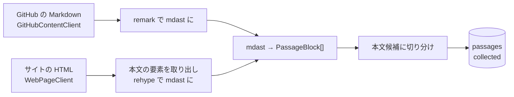
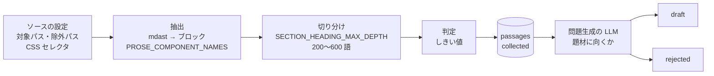
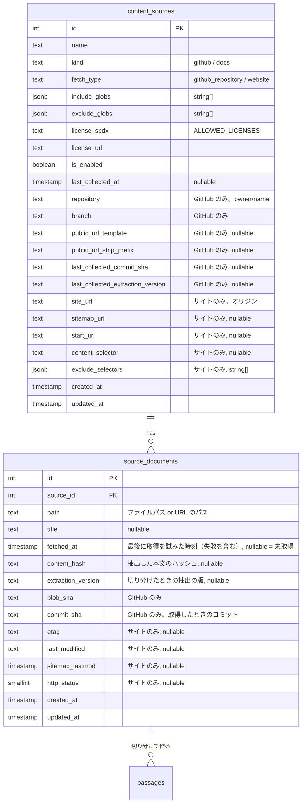
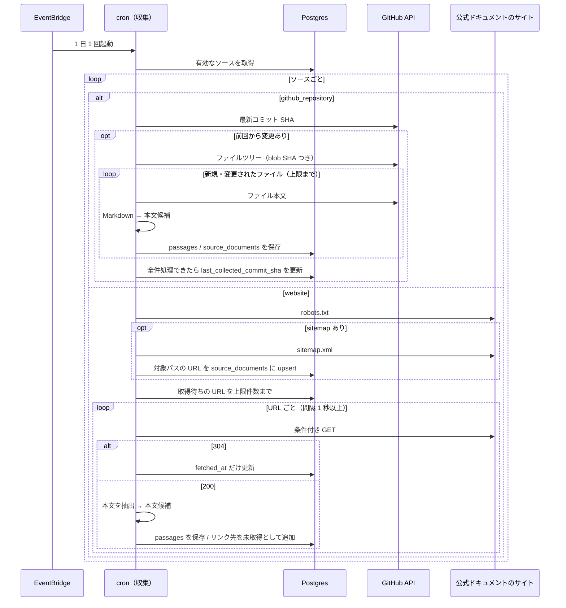

# 英文の収集

問題の本文になる英文を、管理者が登録した取得元（ソース）から定期的に集める。集めた英文は 200〜600 語の「本文候補」に切り分け、問題生成（[question-generation](../question-generation/README.md)）に渡す。

取得元は次の 2 種類で、どちらも **ライセンスが明確なもの** に限る。

- **GitHub リポジトリの Markdown**：README、RFC、`docs/` ディレクトリ、GitHub 上に Markdown のソースがある公式ドキュメント（react.dev、Kubernetes、Rust Book など）
- **公式ドキュメントのサイト（HTML）**：プロダクトの開発元が公開しているドキュメントのサイトを直接クロールする（Go、Python、Google Cloud など）

GitHub に Markdown のソースがあるドキュメントは GitHub から取る方が確実（構造が崩れず、変更をコミット単位で追える）なので、サイトのクロールは **GitHub にソースが無いドキュメント** に使う。

このドキュメントは **仕様（What）** と **設計（How）** を分けて記述する：

- **仕様**：使える英文の条件、ソースの登録、本文候補の条件、出典表示
- **設計**：GitHub API での取得、サイトのクロール、取得先の制限、本文の抽出と切り分け、実行の制限

## 関連 spec

- [`../product-overview/README.md`](../product-overview/README.md) — プロダクト全体像
- [`../question-generation/README.md`](../question-generation/README.md) — 本文候補（`passages`、`status = collected`）を受け取って問題にする。**`passages` の列定義と `PassageBlock` の型の正本はこちら**
- [`../reading-practice/README.md`](../reading-practice/README.md) — 問題画面で出典表示を出す
- [`./deferred-more-sources.md`](./deferred-more-sources.md) — MVP 対象外。JavaScript で描画するサイト、許諾を得たブログ、ShareAlike ライセンス、Issue / PR

## 目次

- [仕様](#仕様)
  - [使える英文の条件](#使える英文の条件)
  - [ソースの登録](#ソースの登録)
  - [本文候補の条件](#本文候補の条件)
  - [出典表示](#出典表示)
  - [取得元の文書が更新されたとき](#取得元の文書が更新されたとき)
- [設計](#設計)
  - [実行の仕組み](#実行の仕組み)
  - [GitHub API での取得と差分検出](#github-api-での取得と差分検出)
  - [サイトのクロール](#サイトのクロール)
  - [取得先の制限（SSRF 対策）](#取得先の制限ssrf-対策)
  - [本文の抽出と解析](#本文の抽出と解析)
  - [本文候補への切り分け](#本文候補への切り分け)
  - [調整できる箇所](#調整できる箇所)
  - [重複の排除](#重複の排除)
  - [実行の上限と失敗時の扱い](#実行の上限と失敗時の扱い)
  - [ソース登録時の確認](#ソース登録時の確認)
  - [MVP 対象外（将来検討）](#mvp-対象外将来検討)
- [必要な画面](#必要な画面)
- [UI 設計](#ui-設計)
  - [ソース一覧](#ソース一覧)
  - [ソースの登録・編集](#ソースの登録編集)
- [必要な API](#必要な-api)
- [必要な DB 設計](#必要な-db-設計)
- [フロー図](#フロー図)
- [実装ステップ](#実装ステップ)

---

## 仕様

### 使える英文の条件

以下をすべて満たす英文だけを使う。

1. **管理者が登録したソースの文書** であること
   - GitHub の公開リポジトリにある Markdown ファイル（`.md` / `.mdx`）
   - 公式ドキュメントのサイトの HTML ページ（プロダクトの開発元が公開しているもの）
2. その文書に適用されるライセンスが **許可リスト** にある
3. サイトの場合は、**利用規約でクロールや転載が禁止されておらず、`robots.txt` でも許可されている**
4. 本文候補の条件（[後述](#本文候補の条件)）を満たす

許可リスト（`ALLOWED_LICENSES`、SPDX 識別子）：

| ライセンス | 例 |
| --- | --- |
| `MIT` / `Apache-2.0` / `BSD-2-Clause` / `BSD-3-Clause` / `ISC` | 多くの OSS の README・docs ディレクトリ |
| `CC-BY-4.0` | react.dev、Kubernetes、Go、Google Cloud のドキュメント |
| `PSF-2.0` | Python のドキュメント |
| `CC0-1.0` / `Unlicense` | パブリックドメイン相当 |

**許可リストに入れないもの：**

| 対象 | 理由 |
| --- | --- |
| ShareAlike（`CC-BY-SA-*`、例：MDN） | 和訳や設問が派生物になり、それらも同じライセンスで公開する義務が生じる。扱いを決めるまで見送る（[deferred](./deferred-more-sources.md#sharealike-ライセンス)） |
| コピーレフト（`GPL-*` など） | 同上 |
| NonCommercial（`CC-BY-NC-*`） | 将来の有料化を妨げる |
| ライセンスの記載が無いサイト・リポジトリ | 再利用の許可が無い（「© 企業名」だけのドキュメントサイトもこれに当たる） |
| 技術ブログ | 多くは全文転載の許可が無い |
| Issue / Pull Request / Discussion のコメント | リポジトリのライセンスの対象外で、GitHub 利用規約上も GitHub の外での複製は許可されていない |

> - ドキュメントのライセンスがコードと別に定められているリポジトリがある（例：react.dev はコードが MIT、ドキュメントが CC-BY-4.0）。ソースには **ドキュメントに適用されるライセンス** を登録する
> - サイトのフッターに「Except as otherwise noted（特記の無い限り）CC-BY-4.0」と書かれている場合、ページによっては別のライセンスのことがある。そうしたページを含むパスは対象パスから外す

### ソースの登録

管理者が admin 画面でソースを登録する。登録されたソースだけが収集の対象になる。

**共通の項目**

| 項目 | 必須 | 例 | 説明 |
| --- | --- | --- | --- |
| 表示名 | ✅ | `Go 公式ドキュメント` | 問題一覧・出典表示に出る |
| 種別 | ✅ | `docs` | `github`（README / RFC などリポジトリそのものの文書）か `docs`（公式ドキュメント）。問題一覧の絞り込みに使う |
| 取得方法 | ✅ | `website` | `github_repository`（GitHub の Markdown）か `website`（サイトのクロール） |
| 対象パス | ✅ | `/doc/**` | glob。複数指定可。GitHub はリポジトリ内のファイルパス、サイトは URL のパスに対して判定する |
| 除外パス | | `/doc/devel/**` | glob。複数指定可 |
| ライセンス | ✅ | `CC-BY-4.0` | 許可リストから選ぶ |
| ライセンスの記載がある URL | ✅ | LICENSE ファイル、またはライセンスが書かれたページ | 出典表示に出す |
| 技術タグ | | `go`, `backend` | admin の「タグ」で登録したタグから選ぶ（[source-tags](../source-tags/README.md)）。問題一覧の絞り込みに使う |
| 有効 / 無効 | ✅ | 有効 | 無効にすると次回から収集しない。既に公開済みの問題は残る |

**取得方法が `github_repository` のときの項目**

| 項目 | 必須 | 例 | 説明 |
| --- | --- | --- | --- |
| リポジトリ | ✅ | `reactjs/react.dev` | `owner/name`。GitHub はリポジトリ名の大文字・小文字を区別しないので、小文字にそろえて保存する（大文字・小文字だけが違うリポジトリを別のソースとして登録できない） |
| ブランチ | ✅ | `main` | 既定はリポジトリの default branch |
| 公開ページの URL 規則 | | `https://react.dev/{path}`（`src/content/` を除き拡張子を外す） | 公式サイトのどのページか。未設定なら GitHub のファイルへのリンクを出す |

**取得方法が `website` のときの項目**

| 項目 | 必須 | 例 | 説明 |
| --- | --- | --- | --- |
| サイトの URL | ✅ | `https://go.dev` | このオリジン（スキーム + ホスト）の外には取りに行かない |
| sitemap の URL | どちらか一方 | `https://go.dev/sitemap.xml` | あればページの一覧をここから得る |
| 開始ページの URL | どちらか一方 | `https://go.dev/doc/` | sitemap が無いサイトは、ここからリンクをたどって対象パスのページを見つける |
| 本文の CSS セレクタ | | `main article` | 本文が入っている要素。未設定なら自動で本文を推定する |
| 除外する CSS セレクタ | | `.feedback`, `nav.toc` | 本文の中から取り除く要素（「このページは役に立ちましたか？」など） |

本文の CSS セレクタ・除外する CSS セレクタを変えると、そのソースの取得済みのページの `ETag` / `Last-Modified` / 本文のハッシュを消す。各ページは取り直しの順番が来たとき（取得から `COLLECT_WEB_REFETCH_DAYS` 日たったとき）に、304 や同じハッシュで止まらずに新しいセレクタで抽出して切り分け直す。取得した日時は消さないので、直近に取ったページはすぐには取り直さない。

**取得元（リポジトリ / サイトの URL）は、文書を 1 件でも取得したソースでは変えられない。** 過去の問題の出典は、ソースの今の取得元と、問題に記録したパス（GitHub はコミットも）を組み合わせて作るため、取得元を変えると過去の問題の出典が別のリポジトリ・サイトを指して 404 になる。取得元を変えたいときは別のソースとして登録する。ライセンスとライセンスの記載がある URL は変えられる（誤登録の訂正は過去の問題の出典にも反映されるのが正しい、という扱い）。

登録例（実際に登録するかは、管理者が各ソースのライセンスと利用規約を確認して決める）：

| 表示名 | 種別 | 取得方法 | 取得元 | 対象パスの例 | ライセンス |
| --- | --- | --- | --- | --- | --- |
| React 公式ドキュメント | docs | github_repository | `reactjs/react.dev` | `src/content/learn/**/*.md` | CC-BY-4.0 |
| Kubernetes ドキュメント | docs | github_repository | `kubernetes/website` | `content/en/docs/concepts/**/*.md` | CC-BY-4.0 |
| The Rust Programming Language | docs | github_repository | `rust-lang/book` | `src/**/*.md` | MIT / Apache-2.0 |
| Rust RFCs | github | github_repository | `rust-lang/rfcs` | `text/**/*.md` | MIT / Apache-2.0 |
| Go 公式ドキュメント | docs | website | `https://go.dev` | `/doc/**` | CC-BY-4.0 |
| Python ドキュメント | docs | website | `https://docs.python.org` | `/3/tutorial/**`, `/3/howto/**` | PSF-2.0 |
| Google Cloud ドキュメント | docs | website | `https://cloud.google.com` | `/run/docs/**` | CC-BY-4.0 |

### 本文候補の条件

1 つの文書（Markdown ファイル / HTML ページ）を見出し単位で区切り、以下を満たす塊だけを本文候補にする。

| 条件 | 値 | 理由 |
| --- | --- | --- |
| 英単語数 | 200〜600 語 | 5〜10 分で読める長さ。短すぎると設問が作れず、長すぎると mobile で読み切れない |
| コードの割合 | 行数の 40% 以下 | コードが主体の箇所は英語の読解にならない |
| 英語であること | 文字の大半が英字 | 翻訳版のページやディレクトリが混ざっても除外する |
| 文章であること | 段落・引用と、1 項目が 12 語以上の箇条書きの項目の英単語数が全体の半分以上 | 目次やリンク集のように、短い項目の箇条書きが主体の塊を除外する（数文の項目が並ぶ節は残す） |

- コードブロックとインラインコードは本文に残す（エンジニアが読む文書はコードを含むのが自然なため）が、英単語数には数えない
- 表・画像・埋め込みコンポーネント（MDX の `<Sandpack>` など）・サイトのナビゲーションやフッターは本文から除く。文章を包むコンポーネント（`<Intro>` / `<Note>` / `<Pitfall>` / `<DeepDive>`）はタグだけ除いて中の文章を残す。ページの目次（`<YouWillLearn>`）とページ全体のまとめ（`<Recap>`）は、見出しが無く隣の節の本文候補にくっつくので中身ごと除く
- 続き（例のコード・表・図など）を除いたために「:」で終わる段落は、末尾の「:」を「.」にする（文は消さない）。続きが本文に残るとき（コード・箇条書き・引用・段落・見出しが続く）は変えない（[passage-extraction-tuning](../passage-extraction-tuning/README.md#本文に残すもの捨てるもの)）

### 出典表示

問題を解く画面と結果画面に、必ず以下を表示する。

| 項目 | GitHub の Markdown | サイト |
| --- | --- | --- |
| ソースの表示名 | ✅ | ✅ |
| 取得元へのリンク | 公開ページの URL（無ければ GitHub のファイル） | ページの URL |
| 取得した時点 | **そのコミットに固定した GitHub のリンク**（パーマリンク） | **取得日**（「2026-10-10 時点の内容」） |
| ライセンス | ライセンス名とライセンスの記載がある URL | 同左 |
| 改変の表示 | 「一部を抜粋・改変しています」 | 同左 |

改変の表示は、CC-BY が改変の有無の表示を求めるため。

出典のリンクは、問題に記録したパス（`passages.source_path`。GitHub は `source_commit_sha` も）と **ソースの今の取得元**（`repository` / `site_url`）から組み立てる。そのため取得元は、文書を取得したあとは変えられない（[ソースの登録](#ソースの登録)）。ライセンスはソースの今の値を出す。

### 取得元の文書が更新されたとき

- **公開済みの問題は変えない。** 問題は取得した時点の内容のまま残る。出典表示もその時点（GitHub はコミット、サイトは取得日）を指す
- 更新された箇所は、次回以降の収集で新しい本文候補として取り込まれる（内容が変わっていない箇所は取り込み直さない）。ただし同じ見出しの下書き・公開済み・生成中の本文候補がある節は、新しい本文候補にしない（同じ節の問題を二重に作らないため。今ある下書き・公開済みを使い続ける）
- 切り分け直した文書の未生成（`collected`）の本文候補のうち、新しい本文候補に無いものは却下（`rejected`。理由「切り分け直したため、前の切り分けの本文候補を外した」）にする（[passage-extraction-tuning](../passage-extraction-tuning/README.md#前の切り分けで作った本文候補)）
- 取得元の文書が削除されても、公開済みの問題は残す。削除された文書・除外パスに入れた文書の `collected` の本文候補は、次の収集で却下する（理由「除外パスに入ったか取得元から消えたため、収集の対象から外した」。[passage-extraction-tuning](../passage-extraction-tuning/README.md#収集の対象から外れた文書の本文候補)）

---

## 設計

### 実行の仕組み

`apps/cron` のタスク `collect:passages` として実装する（run-once。[apps/cron/CLAUDE.md](../../../apps/cron/CLAUDE.md) の構成に従う）。

| 項目 | 内容 |
| --- | --- |
| 起動 | EventBridge Scheduler で 1 日 1 回（`generate:questions` の 1 時間前） |
| ローカル実行 | `pnpm collect:passages`（全ソース）、`pnpm collect:passages --source-id=3`（1 ソースだけ） |
| 試し実行 | `pnpm collect:passages --source-id=3 --dry-run`：文書を最大 5 件取得し、抽出した本文と切り分けの結果を表示する。**DB には書かない**。サイトのソースを登録した直後に、CSS セレクタが正しいかを確かめるのに使う |
| 外部クライアント | `src/client/github/`（`GitHubContentClient`）、`src/client/web/`（`WebPageClient`。`robots.txt`・間隔・取得先の制限を持つ）。どちらも env を直接読まずコンストラクタ DI |
| GitHub の認証 | `GITHUB_CONTENT_TOKEN`（公開リポジトリの読み取りだけを許可した fine-grained token）。認証すると rate limit が 60 → 5,000 req/h になる |

取得方法ごとの違いは **文書を取ってくるところまで** に閉じ込め、本文の抽出以降（mdast → `PassageBlock[]` → 切り分け → 保存）は共通にする。



ログイン用の OAuth App（[github-auth](../github-auth/README.md)）とはトークンを分ける。用途も権限も違うため。

### GitHub API での取得と差分検出

**ファイルの blob SHA で変更を検出し、変わったファイルだけ本文を取得する。** 毎回全ファイルを取り直すと rate limit と処理時間を無駄にするため。

1. `GET /repos/{owner}/{repo}/commits/{branch}` で最新コミットの SHA を得る（`Accept: application/vnd.github.sha` で SHA の文字列だけを受け取る。JSON はコミットの差分まで含んで大きいため）。`content_sources.last_collected_commit_sha` と同じで、`last_collected_extraction_version` が cron の抽出の版（`EXTRACTION_VERSION`）と同じならそのソースは処理を終える
2. `GET /repos/{owner}/{repo}/git/trees/{commit_sha}?recursive=1` でファイル一覧と各ファイルの blob SHA を 1 回で得る
3. 対象パス / 除外パスの glob で絞り込む。絞り込んだ一覧に無い文書（取得元から消えた・対象パスから外れた）の `collected` の本文候補を却下する（一覧が切り詰められたときは、対象パス・除外パスに合わない文書だけ）
4. `source_documents` の `blob_sha` と `extraction_version` と比べ、新規・変更されたファイルと抽出の版が古いファイルだけ `GET /repos/{owner}/{repo}/contents/{path}?ref={commit_sha}` で本文を取得する
5. ファイルごとに解析・切り分けして本文候補を保存し（前の切り分けの `collected` は却下する）、`source_documents` を upsert して blob SHA と抽出の版を記録する（本文の抽出に失敗したファイルも記録する）
6. 全ファイル処理後に `last_collected_commit_sha` と `last_collected_extraction_version` を更新する（途中で失敗した、または件数の上限で打ち切った場合は更新しない。次回、未処理のファイルだけを続きから処理する）。収集を始めたときに読んだ値のままのときだけ更新する（楽観ロック）。収集の途中で管理者が取得範囲を変えて api が `null` に戻していたら古い SHA を書き戻さず、次回の実行で新しい範囲を収集する

`trees` API は巨大なリポジトリで結果が切り詰められる（`truncated: true`）ことがある。その場合は対象パスの最上位ディレクトリごとに trees を取り直す。

### サイトのクロール

**`source_documents` をクロールの待ち行列として使う。** 見つけた URL を「未取得」の行として入れておき、毎回の実行では「未取得 → 取得から日がたったもの」の順に上限件数まで取得する。

| 手順 | 内容 |
| --- | --- |
| URL を見つける（sitemap） | 毎回 sitemap（sitemap index も可）を読み、対象パスに合う URL を `source_documents` に upsert する。`<lastmod>` が前回の取得より新しければ取得待ちにする |
| URL を見つける（リンク） | 初回は開始ページを未取得の行として入れる。ページを取得して **200 が返ったら、ページ内のリンクのうち同じオリジン・対象パスに合うものを未取得の行として入れる** |
| 取得する順番 | `fetched_at IS NULL` を先に、次に `fetched_at` が `COLLECT_WEB_REFETCH_DAYS`（既定 7 日）より古いものを古い順に。取得できなかったページ（ネットワークエラー・429 / 503）も `fetched_at` に試した時刻を入れて待ち行列から外し、`COLLECT_WEB_REFETCH_DAYS` 日後に取り直す（入れないと次回も同じページが先頭に来て、取得できないページが残りのページを塞ぐため） |
| 条件付きリクエスト | 前回の `ETag` / `Last-Modified` を `If-None-Match` / `If-Modified-Since` で送り、304 なら本文を取らずに `fetched_at` だけ更新する。切り分けたときの抽出の版（`extraction_version`）が今と違うページは送らない |
| 内容の比較 | 200 でも、抽出した本文のハッシュ（`source_documents.content_hash`）が前回と同じなら切り分けをしない（`ETag` を返さないサイト向け）。抽出の版が今と違うページは、ハッシュが同じでも切り分け直す。本文の抽出に失敗したページ（不正な CSS セレクタなど）は `ETag` / `Last-Modified` / ハッシュを保存しない（保存すると、セレクタを直してもページが変わるまで 304 で止まるため） |

毎回の実行では取得の前に、`collected` の本文候補を持つページのうち、対象パス・除外パスに合わなくなったものと 404 / 410 を返したものの `collected` を却下する。

304 のページからはリンクを読めないが、ページが変わっていなければリンクも変わっていないので、初回の取得で見つけた URL がすでに行として入っている。したがって 2 回目以降も取りこぼしは出ない。

URL の正規化：クエリ文字列とフラグメント（`#...`）を除く。`.pdf` / `.zip` / 画像などのファイルは対象にしない。

リダイレクトされたページは、行き先の URL のパスでも対象パス・除外パスと拡張子を確かめ、外れたら本文候補を作らない（ページ内のリンクの発見には使う）。除外パスへリダイレクトされたページの本文を、元のパスの出典で保存しないため。

**礼儀正しいクロール**：

| 項目 | 値 |
| --- | --- |
| `robots.txt` | 実行ごとに取得して守る。禁止されている URL は取得しない。`Crawl-delay` があればそれに従う。ただし 30 秒を超える `Crawl-delay` のサイトは、従うと処理が長時間止まるので今回の実行では打ち切る（失敗にしない） |
| リクエストの間隔 | 同じホストに `COLLECT_WEB_REQUEST_INTERVAL_MS`（既定 1,000ms）以上空ける。並列にしない |
| `User-Agent` | `TechEnglishBot/1.0 (+{サービスのトップの URL})`。サイトの管理者がどのサービスのボットか分かるようにする。止めたいときは robots.txt で `TechEnglishBot` を指定してもらう（守る）。ボットの説明ページは作らない |
| タイムアウト | 1 リクエスト 10 秒 |
| 受け取るもの | `Content-Type` が `text/html` で、2MB 以下のものだけ |

### 取得先の制限（SSRF 対策）

cron は AWS の VPC 内で動くため、登録された URL を経由して内部のエンドポイント（EC2 / ECS のメタデータ `169.254.169.254` など）に到達されないようにする。ソースを登録できるのは管理者だけだが、多層で防ぐ。

- `https` のみ
- 取得してよいのは **ソースに登録したサイトの URL と同じオリジン** だけ。リダイレクトも最大 3 回まで、同じオリジンの中だけ追う
- 名前解決した IP アドレスがプライベート・ループバック・リンクローカル（`10.0.0.0/8`、`172.16.0.0/12`、`192.168.0.0/16`、`127.0.0.0/8`、`169.254.0.0/16`、IPv6 の同等範囲）なら取得しない

### 本文の抽出と解析

**Markdown**：`unified` + `remark-parse` + `remark-frontmatter` + `remark-gfm`（`.mdx` は `remark-mdx`）で mdast にする。frontmatter の `title` があれば文書タイトルにする。`.md` に MDX の書き方が混ざっている場合（react.dev の `.md` など）に備え、`.md` でも MDX のコメント（`{/* ... */}`。見出しのアンカーなど）をコードの外で消し、HTML ブロックで書かれたコンポーネントは `.mdx` の JSX と同じ規則で扱う。

**HTML**：

1. `jsdom` で DOM にする
2. 本文の CSS セレクタがあればその要素を、無ければ `@mozilla/readability` で推定した本文を取り出す（`keepClasses` を指定する。Readability は既定で `class` を消し、コードの言語が分からなくなるため）
3. 除外する CSS セレクタに合う要素と、`nav` / `header` / `footer` / `aside` / `script` / `style` / `button` / `[aria-hidden="true"]` を取り除く
4. `rehype-parse` + `rehype-remark` で mdast にする（`<pre><code class="language-go">` は `lang` つきのコードになる）
5. `<title>` か最初の `h1` を文書タイトルにする

**共通（mdast → `PassageBlock[]`）**：型の正本は [question-generation](../question-generation/README.md#本文の構造passageblock)。

| mdast ノード | 扱い |
| --- | --- |
| `heading` | `heading` ブロック |
| `paragraph` | `paragraph` ブロック |
| `listItem` | `list_item` ブロック（ネストは 1 段に平坦化） |
| `code` | `code` ブロック（`lang` を保持） |
| `blockquote` | `quote` ブロック |
| `inlineCode` | ブロック内のテキストにバッククォートつきで残す（表示時にコードとして描画） |
| `link` | テキストだけ残し URL は捨てる |
| `mdxJsxFlowElement`（`.md` の HTML ブロックのコンポーネントを含む） | 文章を包むコンポーネント（許可リスト）はタグを除いて中身を変換する。それ以外は中身ごと捨てる |
| `table` / `image` / `html` / `yaml`（frontmatter） | 捨てる |

**JavaScript で本文を描画するサイトには対応しない**（ヘッドレスブラウザを cron に載せない）。取得した HTML に本文が入っていないサイトは、試し実行で英単語数がほぼ 0 になるので登録時に分かる（[deferred](./deferred-more-sources.md#javascript-で描画するサイト)）。

### 本文候補への切り分け

1. h1〜h3 の見出しの前で区切って「節」の列にする。最初の見出しより前のブロック（ページの導入）も 1 つの節にする。h4 以下では区切らない
2. 600 語を超える節は、ブロック（段落・箇条書きの項目・見出し・コード・引用）を前から足して 600 語を超える手前で分ける。1 ブロックで 600 語を超えるものは分けない（`too_long` で捨てる）
3. 前から順に、今の塊が 200 語未満で、次の塊を足しても 600 語以下なら結合する。200 語以上の塊はそこで確定し、次の塊と結合しない
4. [本文候補の条件](#本文候補の条件)を満たさない塊は捨てる
5. 残った塊を `passages` に `status = collected` で保存する（タイトルは塊の中の最初の見出し → 塊が属する節の見出し → 文書タイトルの順。600 語を超えて分けた節の 2 つめ以降の塊は、塊の中に見出しが無ければ「 (2)」のように番号を付ける）

- **200 語以上の塊を次と結合しない**のは、節の区切りで話題が変わるため。600 語に収まるまで前から結合すると、話題の混ざった本文や、末尾の「What's next?」のような案内文がくっついた本文が増える。react.dev の learn の 52 ページでは、600 語まで前から結合すると本文候補が 133 件から 98 件に減り、1 件あたりの節が 1.83 から 2.59 に増える
- 結合は今の塊に次の塊を足す向きだけなので、**最後の塊が 200 語未満でも、前の塊に足せない（前の塊が 200 語以上か、足すと 600 語を超える）なら `too_short` で捨てる**。文書の末尾は「Recap」「What's next?」など本文に向かない節が多い
- h1 でも区切る。HTML のページや README の h1 は先頭の文書タイトルのことが多く、区切っても塊は変わらない。`# Installation`・`# Usage` のように h1 を並べる README は、h1 で区切らないと 1 つの節になる
- 分割をブロック単位にするのは、箇条書きやコードが続く節も 600 語以下に分けられるようにするため。段落の境目だけで分けると、そうした節が `too_long` で丸ごと捨てられる

英単語数は、コードブロックとインラインコードを除いたテキストを空白で区切って数える。英語判定は、空白と記号を除いた文字に占める ASCII 英字の割合が 90% 以上であること。文章の判定は、段落・引用と、英単語数が 12 以上（`MIN_PROSE_LIST_ITEM_WORDS`）の箇条書きの項目の英単語数を、全体の英単語数で割った値が 0.5 以上であること。箇条書きの項目は 1 項目ごとに判定し、12 語未満の項目（目次・リンク集の数語の項目）は文章に数えない。表は抽出の段階で捨て、リンクは抽出の段階でテキストだけになるので、リンクだけの段落は文章として数える。

### 調整できる箇所

本文候補の出来を変えたいときに触る場所。抽出・切り分け・判定は LLM を使わず、`apps/cron/src/lib/document/` の純関数で決まる（下の表の `const.ts` などはこのディレクトリのファイル）。



| 変えたいこと | 変える場所 | 効く範囲 |
| --- | --- | --- |
| ソースのどの文書を対象にするか（章の概要ページを外す など） | admin のソースの「対象パス」「除外パス」 | そのソースの次回の収集から。除外した文書から作った未生成（`collected`）の本文候補は次の収集で却下する（下書き・公開済みは残る） |
| サイトのページのどこを本文にするか | admin のソースの「本文の CSS セレクタ」「除外する CSS セレクタ」 | 取り直しの順番が来たページ（取得から `COLLECT_WEB_REFETCH_DAYS` 日たったもの）から、新しいセレクタで抽出し直す（[ソースの登録](#ソースの登録)） |
| MDX / JSX のコンポーネントの中身を本文に残すか | `const.ts` の `PROSE_COMPONENT_NAMES`（ここに無いコンポーネントは中身ごと捨てる） | 全ソース（下の注意） |
| 長さ・コードの割合・英語・文章の判定のしきい値 | `const.ts` の `PASSAGE_MIN_WORDS` / `PASSAGE_MAX_WORDS` / `MAX_CODE_LINE_RATIO` / `MIN_ENGLISH_LETTER_RATIO` / `MIN_PROSE_WORD_RATIO` / `MIN_PROSE_LIST_ITEM_WORDS` | 全ソース（下の注意） |
| 区切る見出しの深さ | `const.ts` の `SECTION_HEADING_MAX_DEPTH` | 全ソース（下の注意） |
| 結合・分割のしかた | `split-into-chunks.ts` | 全ソース（下の注意） |
| 本文候補にしない条件そのもの（理由を足す など） | `passage-rules.ts` の `findRejectReasons`（理由を足すときは `ChunkRejectReason` にも足す） | 全ソース（下の注意） |
| mdast のノードをどのブロックにするか | `convert-mdast-to-blocks.ts` | 全ソース（下の注意） |
| LLM が題材に向かないとする基準 | `apps/cron/src/prompt/generate-questions.ts` の「Suitability」（変えたら `PROMPT_VERSION` を上げる。[question-generation](../question-generation/README.md)） | 次の `generate:questions` から、`collected` の本文候補に |

- **`lib/document` の変更のうち、ブロック・切り分け・本文候補の条件が変わるものは、`const.ts` の `EXTRACTION_VERSION` を上げる。** 上げると取得済みの文書も切り分け直す（GitHub は次の収集で、サイトは取り直しの順番が来たときに条件付きリクエストを送らずに）。前の切り分けの `collected` は却下する（[passage-extraction-tuning](../passage-extraction-tuning/README.md#抽出の版)）。上げないと、GitHub は blob SHA が同じファイルを取り直さず、サイトは 200 でも抽出したブロックのハッシュが前回と同じなら切り分け直さないので、取得済みの文書には効かない
- 変えた結果は `pnpm collect:passages --source-id={id} --dry-run` で確かめる（DB には書かない）。対象の文書を最大 5 件取得し、塊ごとに本文候補か、捨てた理由（`too_short` / `too_long` / `too_much_code` / `not_english` / `not_prose`）を出す

### 重複の排除

本文の正規化テキスト（空白の連続を 1 つにし、小文字化したもの）の SHA-256 を `passages.content_hash` に入れ、**unique 制約** をかける。

- 同じ内容の再取り込み（ファイルの別の箇所が変わって blob SHA だけ変わった場合など）を DB 側で弾く
- 複数のリポジトリにコピーされた同じ README や、GitHub とサイトの両方に登録してしまった同じドキュメントも 1 つにまとまる

### 実行の上限と失敗時の扱い

| env | 既定 | 説明 |
| --- | --- | --- |
| `COLLECT_MAX_DOCUMENTS_PER_SOURCE` | `100` | 1 回の実行で 1 ソースから取得する文書数の上限（GitHub はファイル、サイトはページ）。超えた分は次回に回す。ソースごとに上限を持つのは、大きなソース 1 つで実行時間を使い切らないため |
| `COLLECT_MAX_PASSAGES_PER_RUN` | `200` | 1 回の実行で作る本文候補の上限。生成側の処理量（LLM の費用）を超えて溜め込まないため |
| `COLLECT_WEB_REQUEST_INTERVAL_MS` | `1000` | 同じホストへのリクエストの間隔 |
| `COLLECT_WEB_REFETCH_DAYS` | `7` | サイトのページを取り直す間隔 |

サイト 1 つあたり 100 ページ × 1 秒で 2〜3 分。ソースが 10 個でも 30 分程度に収まる。

- 1 ソースの失敗（リポジトリ削除、rate limit、サイトの障害など）は、そのソースだけスキップしてログに出し、他のソースは続ける。タスク全体は最後に 1 件でも失敗があれば exit code 1 で終える（ECS のタスクの終了コードとログに失敗を残すため。EventBridge Scheduler は RunTask の成否しか見ないので、exit code での通知〈ECS の Task State Change → SNS など〉は MVP では持たない）
- GitHub の rate limit の残り（`x-ratelimit-remaining`）が 100 を切ったら、そのソースの処理を打ち切って次回に回す
- サイトが 429 / 503 を返したら、そのソースの処理をその回の実行では打ち切り、次回の実行（約 24 時間後）で再開する（失敗にはしない）。`Retry-After` は待たない。`Retry-After` が次回の実行より先を指していたら warn に出す
- ページの 404 / 410 は `http_status` に記録し、そのページは取り直しの対象から外す（sitemap やリンクで再び見つかったら対象に戻す）
- サイトの `last_collected_at`（最終収集）は、取得待ちのページを最後まで処理したとき（上限で打ち切ったときを含む）だけ進める。429 / 503・`Crawl-delay` が長すぎる・シグナルで中断されたときは進めない（最終収集の表示が実際より新しくならないように。収集はソースを `last_collected_at` の古い順に処理するので、次回の実行で先に処理される）
- 冪等：何度実行しても、`content_hash` の unique 制約と `source_documents` の upsert により結果は変わらない

### ソース登録時の確認

| 取得方法 | 確認の仕方 |
| --- | --- |
| `github_repository` | リポジトリを入力すると、api が `GET /repos/{owner}/{repo}/license` で GitHub が検出したライセンスを **初期値として表示する**。最終的には管理者が選ぶ（ドキュメントのライセンスが別ファイルで定められている場合、GitHub の検出結果はコードのライセンスになるため） |
| `website` | 自動では判定できないため、管理者が **フッター等のライセンスの記載・利用規約・`robots.txt`** を確認し、ライセンスの記載がある URL を登録する。登録後に試し実行で本文が正しく取れているかを確かめてから有効にする（**サイトのソースは無効の状態で登録する**） |

api は許可リストに無いライセンスでの登録を 400 で拒否する。

### MVP 対象外（将来検討）

詳細は [`deferred-more-sources.md`](./deferred-more-sources.md)。

- **JavaScript で本文を描画するサイト**（ヘッドレスブラウザが必要）
- **許諾を得た技術ブログ**
- **ShareAlike ライセンス**（MDN など）
- **管理画面からの収集の即時実行・抽出のプレビュー**（MVP は cron の手動実行と試し実行で代替）

---

## 必要な画面

すべて admin。

| 画面 | 概要 |
| --- | --- |
| ソース一覧 | 登録済みソースの一覧。表示名・取得方法・取得元・ライセンス・有効/無効・最終収集日時・本文候補の件数（状態別）・取得に失敗しているページの数（サイト） |
| ソースの登録・編集 | [ソースの登録](#ソースの登録) の項目を入力する。取得方法で入力欄を切り替える。GitHub はリポジトリを入力すると検出されたライセンスを初期値に入れる |

具体的な UI は [UI 設計](#ui-設計) を参照。

## UI 設計

`design-mock` skill で確定したデザイン。admin は既存の TailAdmin テンプレートのデザインを使う（[product-overview の admin のデザイン](../product-overview/README.md#admin-のデザイン)）。

| パス（admin） | 画面名 | モック |
| --- | --- | --- |
| `/content-sources` | ソース一覧 | `/mock/content-sources` |
| `/content-sources/new` | ソースの登録 | `/mock/content-sources/new` |
| `/content-sources/[id]` | ソースの編集 | `/mock/content-sources/1`（GitHub）、`/7`（サイト）、`/6`（未収集のサイト） |

### ソース一覧

```
┌──────────────────────────────────────────────────────────────────────────────┐
│ ソース                                                         Home > ソース │ ← PageBreadcrumb
│  ┌────────────────────────────────────────────────────────────────────────┐  │
│  │ 無効のサイトのソースがあります                                         │  │ ← info の案内（無効のサイトがあるときだけ）
│  │ Python ドキュメント。試し実行で…確認してから有効に                     │  │
│  └────────────────────────────────────────────────────────────────────────┘  │
│  ┌────────────────────────────────────────────────────────────────────────┐  │ ← ComponentCard
│  │ ソース一覧                                                             │  │
│  │ 英文の取得元。有効なソースだけを毎日の収集が取り込みます。             │  │
│  ├────────────────────────────────────────────────────────────────────────┤  │
│  │                                                         [ソースを登録] │  │ ← 主要ボタン
│  │ ┌────────────────────────────────────────────────────────────────────┐ │  │ ← DataTable（Basic Tables と同じ）
│  │ │                            [🔍 ソース名・リポジトリ・URL] [Filter] │ │  │
│  │ ├────────────────────────────────────────────────────────────────────┤ │  │
│  │ │ ソース            │ 取得方法│ ライセン…│ 状態│ 最終収集 / 本文候補…│ │  │
│  │ ├───────────────────┼─────────┼──────────┼─────┼─────────────────────┤ │  │
│  │ │ React 公式ドキュ… │ GitHub  │ CC-BY-4.0│ 有効│ 10-10 03:00 収12 下…│ │  │
│  │ │ reactjs/react.dev │ 公式Doc │          │     │                編集 │ │  │
│  │ ├───────────────────┼─────────┼──────────┼─────┼─────────────────────┤ │  │
│  │ │ Go 公式ドキュメン…│ サイト  │ CC-BY-4.0│ 有効│ 10-10 03:11 収18 下…│ │  │
│  │ │ https://go.dev    │ 公式Doc │          │     │ 失敗 2 ページ  編集 │ │  │
│  │ └───────────────────┴─────────┴──────────┴─────┴─────────────────────┘ │  │
│  └────────────────────────────────────────────────────────────────────────┘  │
└──────────────────────────────────────────────────────────────────────────────┘
```

- 無効のサイトのソースがあるときだけ、上部に info の案内「無効のサイトのソースがあります。（ソース名）。試し実行で本文が正しく取れていることを確認してから有効にしてください。」を出す
- 表は Basic Tables と同じ `DataTable`。検索はソース名・リポジトリ・URL、Filter は取得方法（GitHub / サイト）と状態（有効 / 無効）。ソースは数十件程度の想定なのでページ送りは付けない
- 列：ソース（表示名と、等幅の取得元）、取得方法（GitHub は `dark`、サイトは `info` のバッジ。下に種別「公式ドキュメント / GitHub の文書」）、ライセンス、状態（有効は `success`、無効は `light`）、最終収集（未収集なら「未収集」）、本文候補（収集済み・下書き・公開・却下の件数）、取得失敗（サイトのみ。1 件以上なら `error` の文字。GitHub は「―」）、編集
- ソース名と「編集」で編集画面へ。「ソースを登録」で登録画面へ
- ソースが 0 件のときは表の下に「まだソースがありません」と、登録すると翌日の収集から本文候補が作られることを書く

### ソースの登録・編集

左にフォームのカード、右に補助のカードを置く 2 カラム（1280px 未満は縦に並べる）。

```
┌──────────────────────────────────────────────────┬─────────────────────────┐
│ 基本情報                                         │ 収集の状況              │ ← 左：フォームのカード / 右：補助のカード（編集時）
│   表示名  [Google Cloud ドキュメント      ]      │ 最終収集 10-10 03:24    │
│   種別    ◉ 公式ドキュメント ○ GitHub の文書     │ 本文候補                │
│   取得方法 ┌──────────────┐┌──────────────┐      │ [収9][下2][公19][却2]   │ ← 取得方法はカードで選ぶ（編集時は変更不可）
│            │GitHub        ││サイト ✓      │      │ 取得に失敗しているページ│
│            └──────────────┘└──────────────┘      │ /run/docs/legacy… 404   │
│   技術タグ (gcp)(infra)(go)(python)…             │ /run/docs/fit-fo… 404   │
│──────────────────────────────────────────────────│─────────────────────────│
│ 取得元（サイト）                                 │ 試し実行                │
│   サイトの URL [https://cloud.google.com ]       │ ┌─────────────────────┐ │
│   ページの見つけ方 ◉ sitemap ○ 開始ページ        │ │pnpm collect:passages│ │ ← コマンドを表示
│   [https://cloud.google.com/sitemap.xml ]        │ │ --source-id=7       │ │
│   対象パス [/run/docs/**]  除外パス [   ]        │ │ --dry-run           │ │
│   本文の CSS セレクタ [article.devsite…]         │ └─────────────────────┘ │
│──────────────────────────────────────────────────│                         │
│ ライセンス                                       │                         │
│   ⚠ サイトのライセンスは自動で判定できません     │                         │ ← サイトのときだけ警告
│   [CC-BY-4.0 ▾]  [https://cloud.google.com/…]    │                         │
│──────────────────────────────────────────────────│                         │
│ 収集  このソースを収集する                  (●━) │                         │ ← スイッチ
│──────────────────────────────────────────────────│                         │
│                          [キャンセル] [保存する] │                         │
└──────────────────────────────────────────────────┴─────────────────────────┘
```

**フォーム（左）**

| カード | 項目 |
| --- | --- |
| 基本情報 | 表示名、種別（ラジオ：公式ドキュメント / GitHub の文書）、取得方法（2 枚のカードから選ぶ。選択中は `brand-500` の枠。**編集時は変更不可**で、選ばれていない方を薄く表示）、技術タグ（登録済みのタグを押して選ぶ。[source-tags](../source-tags/README.md)） |
| 取得元（GitHub リポジトリ） | リポジトリ（`owner/name`）と「ライセンスを検出」、ブランチ、対象パス・除外パス（テキストエリア。1 行に 1 つ）、公開ページの URL 規則と取り除くプレフィックス（URL 規則があるときは変換の例を表示） |
| 取得元（サイト） | サイトの URL、ページの見つけ方（ラジオ：sitemap / 開始ページからリンクをたどる。選んだ方の URL の入力欄を出す）、対象パス・除外パス、本文の CSS セレクタ（未設定なら自動で推定）、除外する CSS セレクタ |
| ライセンス | ライセンス（許可リストのセレクト）、ライセンスの記載がある URL。サイトのときは上に warning の囲み「サイトのライセンスは自動で判定できません」（フッター等の記載・利用規約・robots.txt を確認するよう案内） |
| 収集 | 「このソースを収集する」のスイッチ。**新規のサイトはオフで操作できない**（「サイトのソースは無効の状態で登録されます。試し実行で…確認してから有効にしてください。」） |

- 取得方法を切り替えると、取得元のカードとライセンスの警告がその場で切り替わる
- 「ライセンスを検出」を押すと、入力欄の下に「GitHub が検出したライセンス：MIT。ドキュメントのライセンスが別のファイルで定められていることがあります（例：react.dev はコードが MIT、ドキュメントが CC-BY-4.0）。」を出す
- 末尾に「キャンセル」（一覧へ）と「登録する」（編集時は「保存する」）

**補助のカード（右）**

| 場面 | カード |
| --- | --- |
| 新規 | 「登録の前に確認すること」：ライセンスが許可リストにある、ライセンスの記載がある URL を控えた。サイトでは利用規約・robots.txt・JavaScript で描画していないこと、GitHub では「GitHub に Markdown のソースがあるドキュメントはこちらで登録する」 |
| 編集 | 「収集の状況」：最終収集、取り込んだコミット（GitHub）、本文候補の件数のバッジ（収集済み `light`・下書き `primary`・公開 `success`・却下 `error`）、取得に失敗しているページ（サイト。パスと HTTP ステータスのバッジ） |
| 編集 | 「試し実行」：`pnpm collect:passages --source-id={id} --dry-run` を黒地の等幅で表示し、DB に書かずに最大 5 件の抽出結果を表示することを説明する |

## 必要な API

admin 向け。アクセス制御は [question-generation](../question-generation/README.md#管理画面のアクセス制御) を参照。

| メソッド | パス | 説明 |
| --- | --- | --- |
| GET | `/api/admin/content-source` | ソース一覧（状態別の本文候補件数つき） |
| GET | `/api/admin/content-source/:id` | ソース詳細 |
| POST | `/api/admin/content-source` | ソースの登録。取得方法ごとの必須項目を Zod の discriminated union で検証する。許可リスト外のライセンスは 400。`website` は無効の状態で作る |
| PUT | `/api/admin/content-source/:id` | ソースの更新（有効 / 無効の切り替えを含む）。取得方法は変更できない。文書を取得したソースの取得元（`repository` / `site_url`）の変更は 400。本文の CSS セレクタ・除外する CSS セレクタを変えると、そのソースの `source_documents` の `etag` / `last_modified` / `content_hash` を消す |
| GET | `/api/admin/content-source/license?repository=owner/name` | GitHub が検出したライセンスを返す（`github_repository` の登録フォームの初期値用） |

cron タスク：

| タスク | 説明 |
| --- | --- |
| `collect:passages` | 有効なソースから本文候補を集める。`--source-id` で 1 ソースに絞る、`--dry-run` で DB に書かずに結果を表示する |

## 必要な DB 設計

| テーブル | 主要カラム | 説明 |
| --- | --- | --- |
| `content_sources` | 共通：`id`, `name`, `kind`, `fetch_type`, `include_globs(jsonb)`, `exclude_globs(jsonb)`, `license_spdx`, `license_url`, `is_enabled`, `last_collected_at`<br/>GitHub：`repository`, `branch`, `public_url_template`, `public_url_strip_prefix`, `last_collected_commit_sha`, `last_collected_extraction_version`<br/>サイト：`site_url`, `sitemap_url`, `start_url`, `content_selector`, `exclude_selectors(jsonb)` | 取得元。管理者が登録する。技術タグは `content_source_tags` で `tags` に紐付ける（[source-tags](../source-tags/README.md#必要な-db-設計)） |
| `source_documents` | `id`, `source_id`, `path`, `title`, `fetched_at`, `content_hash`, `extraction_version`<br/>GitHub：`blob_sha`, `commit_sha`<br/>サイト：`etag`, `last_modified`, `sitemap_lastmod`, `http_status` | 取得した文書。差分検出・出典の組み立て・サイトのクロールの待ち行列に使う |
| `passages` | ― | 本文候補 / 問題。**列定義の正本は [question-generation](../question-generation/README.md#必要な-db-設計)**。この spec では `source_document_id` / `source_path` / `source_commit_sha`（GitHub のみ）/ `source_retrieved_at` / `title` / `blocks` / `word_count` / `content_hash` / `status = collected` を埋めて作る |



取得方法ごとに列を分けたテーブル（`github_sources` / `website_sources`）にする案もあるが、管理画面の一覧や収集タスクは両方をまとめて扱うことが多いため、1 テーブルに nullable の列を並べ、CHECK 制約で必須を保証する。

制約：

- `content_sources.kind` は `SOURCE_KINDS`、`fetch_type` は `SOURCE_FETCH_TYPES`、`license_spdx` は `ALLOWED_LICENSES` から CHECK 制約を作る（`@repo/domain` が正本）
- CHECK：`fetch_type = 'github_repository'` なら `repository` と `branch` が NOT NULL
- CHECK：`fetch_type = 'website'` なら `site_url` が NOT NULL、かつ `sitemap_url` と `start_url` の少なくとも一方が NOT NULL
- `content_sources.repository` と `content_sources.site_url` はそれぞれ unique（NULL は重複可）
- `source_documents (source_id, path)` は unique
- index：`source_documents (source_id, fetched_at)`（クロールの取得順）

## フロー図



## 実装ステップ

機能をまたぐ順番は [product-overview の実装の順番](../product-overview/README.md#実装の順番) を参照。

| step | 内容 |
| --- | --- |
| [step1-db-content-sources](./tasks/step1-db-content-sources.md) | `content_sources` / `source_documents` / `passages`（**全列**。列は question-generation の定義どおり）のスキーマとマイグレーション、`@repo/domain` の定数（ソース・`passages` の状態・難易度・ブロック種別）と `PassageBlock` 型 |
| [step2-api-admin-content-source](./tasks/step2-api-admin-content-source.md) | ソースの CRUD（取得方法ごとの検証）と検出ライセンス取得の API |
| [step3-admin-content-source](./tasks/step3-admin-content-source.md) | admin のソース一覧・登録画面 |
| [step4-cron-document-parser](./tasks/step4-cron-document-parser.md) | Markdown / HTML → mdast → `PassageBlock[]` の変換と本文候補への切り分け（純関数 + fixture を使ったテスト） |
| [step5-cron-collect-github](./tasks/step5-cron-collect-github.md) | `GitHubContentClient`、blob SHA での差分検出、`collect:passages` タスクの骨格と試し実行 |
| [step6-cron-collect-website](./tasks/step6-cron-collect-website.md) | `WebPageClient`（`robots.txt`・間隔・取得先の制限・条件付きリクエスト）、sitemap とリンクからの URL 発見、待ち行列での取得 |
