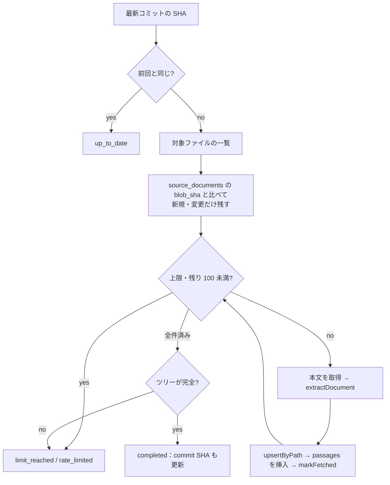

# step5-cron-collect-github

`GitHubContentClient` と blob SHA での差分検出を作り、`collect:passages` タスクの骨格（`--source-id` / `--dry-run`、ソースごとの失敗の扱い、上限）を組む。この step では `github_repository` のソースだけを収集し、`website` は [step6](./step6-cron-collect-website.md) で足す。仕様は [README の実行の仕組み](../README.md#実行の仕組み)・[GitHub API での取得と差分検出](../README.md#github-api-での取得と差分検出)・[実行の上限と失敗時の扱い](../README.md#実行の上限と失敗時の扱い)。

## 前提

- [step1-db-content-sources](./step1-db-content-sources.md)
- [step4-cron-document-parser](./step4-cron-document-parser.md)（`extractDocument`）
- [question-generation step1-db-questions](../../question-generation/tasks/step1-db-questions.md)（実装の順番）

## 対応内容

### 1. env・パッケージ・スクリプト

```bash
pnpm --filter cron add picomatch && pnpm --filter cron add -D @types/picomatch
```

- `src/env.ts` に足す：`GITHUB_CONTENT_TOKEN: z.string().optional()`、`COLLECT_MAX_DOCUMENTS_PER_SOURCE: z.coerce.number().int().positive().default(100)`、`COLLECT_MAX_PASSAGES_PER_RUN: z.coerce.number().int().positive().default(200)`。token は他のタスクでは不要なので optional にし、未設定なら task の起動時に `logger.warn` する（認証なしは 60 req/h で、残り 100 未満の打ち切りにすぐ掛かる）
- `package.json`：`"collect:passages": "dotenvx run -f .env.local -- tsx src/task/collect-passages.ts"`（`pnpm collect:passages --source-id=3 --dry-run` の引数はそのまま渡る）
- `apps/cron/CLAUDE.md` / `README.md` のタスク一覧と環境変数の表に追記する
- 定数は `src/const/collection.ts`：`COLLECTOR_USER_AGENT = "TechEnglishBot/1.0"`、`GITHUB_MIN_RATE_LIMIT_REMAINING = 100`、`DRY_RUN_MAX_DOCUMENTS = 5`、`MAX_MARKDOWN_FILE_BYTES = 1_000_000`

### 2. ファイル構成

| ファイル | 中身 |
| --- | --- |
| `src/client/github/github-content-client.ts`・`errors.ts`・`index.ts` | GitHub API の client と `GitHubNotFoundError` / `GitHubRateLimitError` |
| `src/lib/path-filter.ts` | `isTargetPath(path, { excludeGlobs, includeGlobs })`（picomatch。step6 も使う）、`findGlobBaseDirectories(globs)` |
| `src/lib/parse-collect-args.ts` | `parseCollectArgs(argv)` → `{ dryRun: boolean; sourceId: number \| null }` |
| `src/lib/format-dry-run.ts` | 試し実行の表示（純関数） |
| `src/repository/{content-source,source-document,passage}-repository.ts` と `drizzle/` | cron 用の Repository（api とは別） |
| `src/service/collection/types.ts` | `CollectionRepo`（3 つの Repository をまとめた型）と `SourceCollectionResult` |
| `src/service/collection/list-github-target-files.ts` | ツリーの取得と絞り込み（truncated 対応） |
| `src/service/collection/collect-github-source.ts` | 1 ソース分の収集 |
| `src/service/collection/collect-passages.ts` | 全ソースの実行と失敗の集約 |
| `src/service/collection/preview-source.ts` | 試し実行 |
| `src/task/collect-passages.ts` | env・DI・終了コードだけ |

### 3. `GitHubContentClient`

```ts
export type GitHubTreeEntry = { path: string; sha: string; size: number | null; type: "blob" | "commit" | "tree" }

export interface IGitHubContentClient {
  getFileContent(repository: string, path: string, ref: string): Promise<string>
  getLatestCommitSha(repository: string, branch: string): Promise<string>
  /** 最後のレスポンスの x-ratelimit-remaining。まだ呼んでいなければ null */
  getRateLimitRemaining(): number | null
  getTree(repository: string, treeSha: string, options: { isRecursive: boolean }): Promise<{ entries: GitHubTreeEntry[]; isTruncated: boolean }>
}

export class GitHubContentClient implements IGitHubContentClient {
  constructor(options: { fetch?: typeof fetch; token: string | undefined; userAgent: string }) { /* フィールドに保持 */ }

  private async _request(path: string, accept: string): Promise<Response> {
    const response = await this._fetch(`https://api.github.com${path}`, {
      headers: { Accept: accept, "User-Agent": this._userAgent, "X-GitHub-Api-Version": "2022-11-28", ...(this._token ? { Authorization: `Bearer ${this._token}` } : {}) },
      signal: AbortSignal.timeout(10_000),
    })
    const remaining = response.headers.get("x-ratelimit-remaining")
    if (remaining !== null) this._rateLimitRemaining = Number(remaining)
    if (response.status === 404) throw new GitHubNotFoundError(path)
    if ((response.status === 403 || response.status === 429) && (this._rateLimitRemaining === 0 || response.headers.has("retry-after"))) {
      throw new GitHubRateLimitError(path)
    }
    if (!response.ok) throw new Error(`GitHub request failed: ${response.status} ${path}`)
    return response
  }
}
```

| メソッド | リクエスト | 戻り値 |
| --- | --- | --- |
| `getLatestCommitSha` | `GET /repos/{owner}/{repo}/commits/{branch}`、`Accept: application/vnd.github.sha`（SHA の文字列だけを返す。JSON はコミットの差分まで含んで大きいため） | 本文を trim した SHA（16 進数の 40 桁か 64 桁を Zod で検証） |
| `getTree` | `GET /repos/{owner}/{repo}/git/trees/{sha}`（`isRecursive` なら `?recursive=1`） | `tree[]` と `truncated` |
| `getFileContent` | `GET /repos/{owner}/{repo}/contents/{path}?ref={sha}`、`Accept: application/vnd.github.raw+json` | 本文の文字列 |

- JSON と SHA の文字列は Zod で検証する（`apps/api/src/client/google-oauth.ts` と同じ）
- `path` はセグメントごとに `encodeURIComponent`、`branch` も encode する
- `fetch` はテストで差し替えるためにコンストラクタで受ける（既定はグローバルの `fetch`）

### 4. 対象ファイルの一覧（`listGitHubTargetFiles`）

```ts
export const listGitHubTargetFiles = async (
  input: { commitSha: string; source: GitHubRepositorySource },
  deps: { githubContentClient: IGitHubContentClient },
): Promise<{ files: GitHubTreeEntry[]; isComplete: boolean }>
```

1. `getTree(commitSha, { isRecursive: true })`。切り詰められていなければ 3 へ
2. `truncated: true` なら、`findGlobBaseDirectories(includeGlobs)`（`picomatch.scan(glob).base`。入れ子の重複を除く）のディレクトリごとに、コミットのツリーから非再帰でセグメントをたどって tree の SHA を求め、`getTree(subtreeSha, { isRecursive: true })` を取り直してパスに `{base}/` を前置する。base が空（`**/*.md` など）、または取り直しても切り詰められた場合は `isComplete: false`（`logger.warn`）
3. `type === "blob"`、拡張子が `.md` / `.mdx`、`isTargetPath`、`size <= MAX_MARKDOWN_FILE_BYTES` で絞り、path の昇順にする

### 5. Repository（cron 用。interface は `@repo/domain` の型か素の値だけ）

```ts
export interface ContentSourceRepository {
  findById(id: number): Promise<ContentSource | null>
  /** is_enabled = true を last_collected_at の古い順（未収集が先）。上限で後ろのソースが毎回あふれないように */
  findEnabled(): Promise<ContentSource[]>
  /**
   * 行を更新できたら true。lastCollectedCommitSha を省略したら変えない。
   * 渡したら、last_collected_commit_sha が expected（収集を始めたときに読んだ値。null も含む）のままのときだけ next に書き換える（楽観ロック）。
   * 合わなければ last_collected_at も含めて何も書かずに false
   */
  markCollected(id: number, input: { lastCollectedAt: Date; lastCollectedCommitSha?: { expected: string | null; next: string } }): Promise<boolean>
}

export type MarkFetchedInput = {
  blobSha: string | null
  commitSha: string | null
  contentHash: string | null
  etag: string | null
  fetchedAt: Date
  httpStatus: number | null
  lastModified: string | null
  title: string | null
}

export interface SourceDocumentRepository {
  findBySourceId(sourceId: number): Promise<SourceDocument[]>
  markFetched(id: number, input: MarkFetchedInput): Promise<void>
  /** (source_id, path) で upsert して行を返す。既存の行は title だけ更新する */
  upsertByPath(input: { path: string; sourceId: number; title: string | null }): Promise<SourceDocument>
}

export type CreatePassageInput = Pick<Passage, "blocks" | "contentHash" | "sourceCommitSha" | "sourceDocumentId" | "sourcePath" | "sourceRetrievedAt" | "title" | "wordCount">

export interface PassageRepository {
  /** content_hash が既にある行は飛ばし、挿入した件数を返す。status は DB の既定（collected） */
  insertIgnoringDuplicates(inputs: CreatePassageInput[]): Promise<number>
}
```

- `insert(passages).values(inputs).onConflictDoNothing({ target: passages.contentHash }).returning({ id: passages.id })` の件数。空配列ならクエリを投げず 0。`upsertByPath` は `onConflictDoUpdate({ set: { title }, target: [sourceDocuments.sourceId, sourceDocuments.path] }).returning()`
- `markCollected`：`where` に `eq(id)` と、SHA を渡したときは `expected === null ? isNull(lastCollectedCommitSha) : eq(lastCollectedCommitSha, expected)` を `and` でつなぎ、結果の `rowCount > 0` を返す
- `PassageRepository` は question-generation step3 も cron に作る。先に作られていればメソッドを足す

### 6. 1 ソース分の収集（`collectGitHubSource`）

```ts
/** src/service/collection/types.ts */
export type CollectionRepo = {
  contentSourceRepository: ContentSourceRepository
  passageRepository: PassageRepository
  sourceDocumentRepository: SourceDocumentRepository
}

export type SourceCollectionResult = {
  createdPassageCount: number
  fetchedDocumentCount: number
  status: "completed" | "limit_reached" | "rate_limited" | "up_to_date"
}

export const collectGitHubSource = async (
  input: { maxDocuments: number; maxPassages: number; now: Date; source: GitHubRepositorySource },
  repo: CollectionRepo,
  deps: { githubContentClient: IGitHubContentClient },
): Promise<SourceCollectionResult>
```



- **上限は文書の単位で判定する**：ループの先頭で `fetchedDocumentCount >= maxDocuments` か `createdPassageCount >= maxPassages` なら打ち切る。1 文書の本文候補は途中で切らずに全部保存する（途中で切ると blob SHA が記録され、残りが二度と取り込まれないため）
- `getRateLimitRemaining() < GITHUB_MIN_RATE_LIMIT_REMAINING` になったら、取得済みの文書を保存してから `rate_limited` で終える
- `extractDocument` が throw した文書（壊れた `.mdx` など）は `logger.warn` し、本文候補 0 件として `markFetched`（blob SHA を記録し、ファイルが変わるまで再試行しない）
- `markFetched` は passages の挿入の **後** に呼ぶ（`blobSha` / `commitSha` / `contentHash` / `fetchedAt: now` / `title`。サイトの列は null）。途中で落ちても blob SHA が古いままなので次回やり直され、挿入済みの本文候補は `content_hash` の unique で弾かれる（冪等）
- 本文候補は `{ blocks, contentHash, sourceCommitSha: commitSha, sourceDocumentId, sourcePath: file.path, sourceRetrievedAt: now, title, wordCount }`
- 終了時は必ず `markCollected(id, { lastCollectedAt: now })`。`completed` のときだけ `lastCollectedCommitSha: { expected: source.lastCollectedCommitSha, next: commitSha }` も渡す（楽観ロック）。収集の途中で admin が収集の範囲を変えて api が SHA を null に戻していると `false` が返るので、`logger.warn` を出して SHA は書かない（古い SHA を書き戻すと、変えた範囲が次のコミットまで収集されないため）
- 取得元から消えたファイルの `source_documents` / `passages` は何もしない（公開済みの問題は残す）

### 7. 全ソースの実行（`collectPassages`）

- `sourceId` 指定時は `findById`。無ければ throw、無効なら throw（無効のソースは `--dry-run` でだけ扱える）。指定が無ければ `findEnabled()`
- ソースを順に処理し、残りの本文候補数（`maxPassagesPerRun - 作成済み`）を `maxPassages` として渡す。0 以下になったら残りのソースは処理しない（失敗ではない）
- ソースごとに try-catch する。`GitHubRateLimitError` は失敗にせず、以降の GitHub のソースを飛ばす（rate limit は token 単位のため）。それ以外の例外は `logger.error` して `failedSourceIds` に入れ、次のソースへ進む
- この step では `website` のソースは `logger.warn` して飛ばす（step6 で置き換える）
- 戻り値 `{ createdPassageCount, failedSourceIds, results }`。ソースごとの `status` と件数を `logger.info` に出す

### 8. 試し実行（`previewSource`）とタスク

- `parseCollectArgs`：`node:util` の `parseArgs`（`strict: true`）で `--source-id`（`/^\d+$/`）と `--dry-run` を読む。`--dry-run` に `--source-id` が無ければ throw
- `previewSource({ maxDocuments: DRY_RUN_MAX_DOCUMENTS, sourceId }, repo, deps)`：無効のソースも対象。GitHub は最新コミットのツリーから **blob SHA に関係なく** 先頭 5 件を取得して `extractDocument` する。**Repository の書き込みメソッドは呼ばない**
- `formatDryRun(previews)`：文書ごとに path・タイトル・英単語数、塊ごとに `OK` か不採用の理由・タイトル・語数・本文の先頭 120 文字を並べたテキスト。task が `process.stdout.write` する

```ts
/** src/task/collect-passages.ts（cleanup-old-memos.ts と同じ形） */
runTask("collect-passages", async ({ db }) => {
  const args = parseCollectArgs(process.argv.slice(2))
  const repo = {
    contentSourceRepository: new DrizzleContentSourceRepository(db),
    passageRepository: new DrizzlePassageRepository(db),
    sourceDocumentRepository: new DrizzleSourceDocumentRepository(db),
  }
  const deps = { githubContentClient: new GitHubContentClient({ token: env.GITHUB_CONTENT_TOKEN, userAgent: COLLECTOR_USER_AGENT }) }
  if (args.dryRun && args.sourceId !== null) {
    process.stdout.write(formatDryRun(await service.collection.previewSource({ maxDocuments: DRY_RUN_MAX_DOCUMENTS, sourceId: args.sourceId }, repo, deps)))
    return
  }
  const result = await service.collection.collectPassages({
    maxDocumentsPerSource: env.COLLECT_MAX_DOCUMENTS_PER_SOURCE,
    maxPassagesPerRun: env.COLLECT_MAX_PASSAGES_PER_RUN,
    now: new Date(),
    sourceId: args.sourceId,
  }, repo, deps)
  if (result.failedSourceIds.length > 0) throw new Error(`collect-passages failed: ${result.failedSourceIds.join(", ")}`)
})
```

本番は ECS RunTask で `node dist/task/collect-passages.js` を起動する。EventBridge Scheduler への登録（command の上書き）と、Secrets Manager の `GITHUB_CONTENT_TOKEN` を cron の `secret_keys` に足す作業は [question-generation step7-infra-cron-schedules](../../question-generation/tasks/step7-infra-cron-schedules.md) が行う。

## 動作確認

```bash
pnpm --filter cron test
pnpm lint:fix
```

テスト（`describe` は「正常系」「異常系」。DB client と `fetch` は偽物）：

- `lib`
  - [ ] `isTargetPath`：対象パスに合い除外パスに合わないものだけ true。`findGlobBaseDirectories(["src/content/learn/**/*.md", "src/content/**/*.md"])` は `["src/content"]`
  - [ ] `parseCollectArgs`：引数なし / `--source-id=3` / `--source-id=3 --dry-run` を読める。`--source-id=abc`・未知のフラグ・`--dry-run` 単独は throw
- `GitHubContentClient`
  - [ ] token があるときだけ `Authorization` が付き、`User-Agent` と raw の `Accept` が付く。path のセグメントが encode される
  - [ ] `getLatestCommitSha` は `application/vnd.github.sha` で取得し、SHA でない本文（JSON・空・短い）は throw
  - [ ] `x-ratelimit-remaining` が `getRateLimitRemaining()` に反映される
  - [ ] 404 は `GitHubNotFoundError`、残り 0 の 403 は `GitHubRateLimitError`、500 と形の違う JSON は throw
- `collectGitHubSource`（Repository は `vi.fn()`、client は fake）
  - [ ] 最新コミットが前回と同じなら `up_to_date` で、ツリーを取らず commit SHA を渡さずに `markCollected` する
  - [ ] blob SHA が変わった・新しいファイルだけ本文を取り、変わっていないファイル・対象外のパス・`.md` / `.mdx` 以外は取らない
  - [ ] 本文候補が `sourceCommitSha` / `sourcePath` / `sourceRetrievedAt` つきで挿入され、その後に `markFetched` が呼ばれる
  - [ ] 全件処理すると `completed` で、収集を始めたときの SHA（null を含む）を `expected` に commit SHA が更新される。`markCollected` が `false` を返したら warn を出す
  - [ ] `maxDocuments` / `maxPassages` に達すると `limit_reached`、残り 100 未満で `rate_limited`。どちらも commit SHA を更新しない。本文候補は文書の途中で切られない
  - [ ] truncated のツリーで、glob の base ごとにサブツリーを取り直してパスを前置する。base が空なら `isComplete: false` で commit SHA を更新しない
  - [ ] `extractDocument` が throw する文書は本文候補 0 件で `markFetched` され、次の文書へ進む
  - [ ] 2 回目の実行（`findBySourceId` が今回の blob SHA を返す）では本文を取らない（冪等）
- `collectPassages`
  - [ ] 1 ソースが throw しても次のソースを処理し、`failedSourceIds` に入る
  - [ ] `GitHubRateLimitError` は失敗にならず、以降の GitHub のソースが飛ばされる
  - [ ] 本文候補の上限に達したら残りのソースを処理しない
  - [ ] `--source-id` が存在しない・無効（`--dry-run` なし）なら throw
- [ ] `previewSource` が Repository の書き込みメソッドを 1 回も呼ばない
- [ ] Repository：`insertIgnoringDuplicates([])` はクエリを投げない。重複スキップの指定（`onConflictDoNothing`）と戻り値の件数
- [ ] Repository：`markCollected` が SHA を渡したときだけ収集を始めたときの SHA（null は IS NULL）を条件に足し、条件に合わなければ `false` を返す

手動確認（ローカル DB、`GITHUB_CONTENT_TOKEN` を dotenvx で設定）：

1. admin か API で `rust-lang/book`（`src/**/*.md`、MIT）を登録する
2. `pnpm --filter cron collect:passages --source-id={id} --dry-run`：5 件の抽出結果が出て、DB の `source_documents` / `passages` が増えていない
3. `COLLECT_MAX_DOCUMENTS_PER_SOURCE=3 pnpm --filter cron collect:passages`：`limit_reached`、`last_collected_commit_sha` は null のまま。もう一度実行すると続きの 3 件が取られる
4. 上限を戻して最後まで実行すると `completed` になり、さらにもう一度実行すると `up_to_date` で本文候補が増えない
