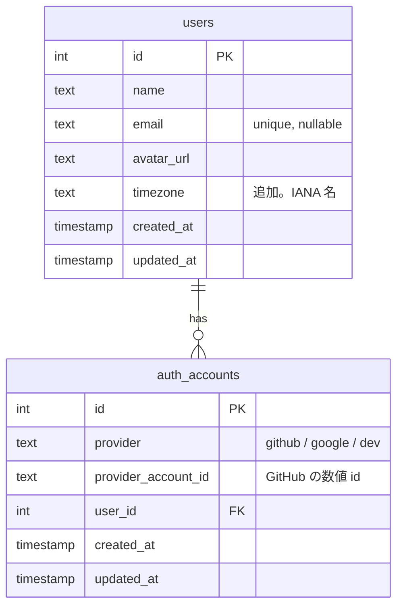
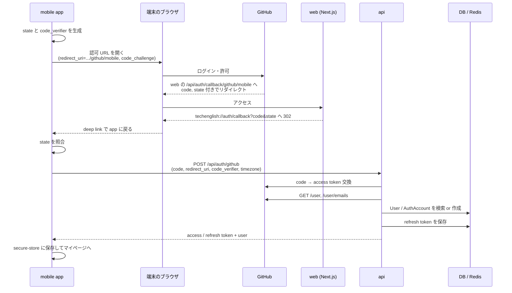
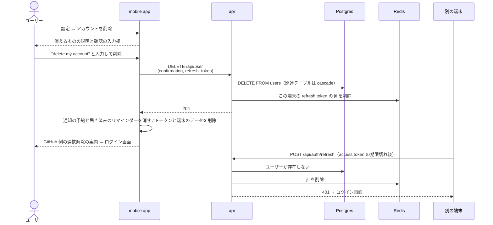

# GitHub ログインとアカウント削除

ユーザーが GitHub アカウントでログインできるようにする。あわせて、ユーザー自身がアカウントと学習データをすべて削除できるようにする。対象はエンジニアなので、ほぼ全員が持っている GitHub アカウントを唯一のログイン手段にし、パスワードやメールアドレスの登録を不要にする。web と mobile の両方に提供する。

既存の Google OAuth（[`docs/auth.md`](../../auth.md)）と同じ仕組み（OAuth の code を api が JWT に変換する）に GitHub を足す形で実装する。`auth_accounts.provider` は最初から複数プロバイダ前提の設計になっているため、テーブル構造は変えない。

このドキュメントは **仕様（What）** と **設計（How）** を分けて記述する：

- **仕様**：ログインできる手段、初回ログイン時に作られるもの、ログイン状態の持続、ユーザー情報、アカウントの削除
- **設計**：web / mobile それぞれの OAuth フロー、トークンの保管、既存実装との関係、削除の処理

## 関連 spec

- [`../product-overview/README.md`](../product-overview/README.md) — プロダクト全体像
- [`../dev-login/README.md`](../dev-login/README.md) — 開発環境専用ログイン。GitHub ログインを足した後も残す
- [`../learning-record/README.md`](../learning-record/README.md) — `users.timezone` を使って学習日を決める
- [`../question-generation/README.md`](../question-generation/README.md#管理画面のアクセス制御) — admin はこの spec のログインを使わない（共有シークレットで保護）
- [`../reading-practice/README.md`](../reading-practice/README.md#必要な-db-設計) / [`../learning-record/README.md`](../learning-record/README.md#必要な-db-設計) / [`../study-reminder/README.md`](../study-reminder/README.md#必要な-db-設計) — アカウント削除で消えるユーザーのデータ。`users` の削除で cascade する
- [`../study-reminder/README.md`](../study-reminder/README.md#通知の予約と同期) — アカウント削除時に端末の通知の予約を取り消す
- [`docs/auth.md`](../../auth.md) — 既存の Google OAuth の仕組み。トークン設計（access 15 分 / refresh 7 日）はそのまま使う

## 目次

- [仕様](#仕様)
  - [ログイン手段](#ログイン手段)
  - [初回ログイン](#初回ログイン)
  - [ログイン状態の持続とログアウト](#ログイン状態の持続とログアウト)
  - [ユーザー情報](#ユーザー情報)
  - [アカウントの削除](#アカウントの削除)
- [設計](#設計)
  - [web のフロー](#web-のフロー)
  - [mobile のフロー](#mobile-のフロー)
  - [GitHub OAuth App の構成](#github-oauth-app-の構成)
  - [GitHub から取得する情報](#github-から取得する情報)
  - [トークンの保管](#トークンの保管)
  - [既存の Google OAuth の扱い](#既存の-google-oauth-の扱い)
  - [アカウント削除の処理](#アカウント削除の処理)
  - [MVP 対象外（将来検討）](#mvp-対象外将来検討)
- [必要な画面](#必要な画面)
- [UI 設計](#ui-設計)
  - [ログイン](#ログイン)
  - [アカウント削除の確認](#アカウント削除の確認)
  - [mobile の画面](#mobile-の画面)
- [必要な API](#必要な-api)
- [必要な DB 設計](#必要な-db-設計)
- [フロー図](#フロー図)
- [実装ステップ](#実装ステップ)

---

## 仕様

### ログイン手段

- **GitHub ログインのみ**。web / mobile のログイン画面には「GitHub でログイン」ボタンだけを置く
- 未ログインで開けるのはログイン画面だけ。問題一覧も含めて、他の画面はすべてログインが必要
- 開発環境では既存の dev ログイン（[dev-login](../dev-login/README.md)）も使える

### 初回ログイン

- 初回ログイン時にユーザーを自動で作る。登録フォームは無い
- 作成時に **端末のタイムゾーン**（例：`Asia/Tokyo`）を記録する。学習記録の「何日に学習したか」はこのタイムゾーンで決める（設定画面で変更できる）
- 初回ログイン後はマイページに遷移する（学習記録が空の状態の表示は [learning-record](../learning-record/README.md) で扱う）

### ログイン状態の持続とログアウト

- 一度ログインすると **最後の利用から 7 日間** はログインし直さずに使える（既存の refresh token の有効期限と同じ）
- ログアウトすると、その端末のログイン状態だけが消える（他の端末はログインしたまま）

### ユーザー情報

GitHub アカウントから以下を取り込み、マイページに表示する。

| 項目 | 取得元 | 用途 |
| --- | --- | --- |
| 表示名 | GitHub の name（未設定なら login） | マイページ・ヘッダー |
| アイコン | GitHub の avatar | マイページ・ヘッダー |
| メールアドレス | GitHub の primary かつ verified のメール | 現状は表示しない（将来の連絡手段用に保存のみ） |

- 表示名とアイコンは **ログインのたびに最新化** する（GitHub 側で名前やアイコンを変えたら次回ログインで反映される）
- メールアドレスは **初回のログイン（ユーザーの作成）のときだけ** 保存し、以後は更新しない。現状は表示も連絡もしないうえ、更新すると別のユーザーのメールと unique で衝突したときの扱いを決める必要があるため
- GitHub のリポジトリや private な情報にはアクセスしない（要求する権限は読み取り専用のプロフィールとメールだけ）

### アカウントの削除

ユーザーは設定画面からいつでもアカウントを削除できる。web と mobile の両方に用意する（App Store はアカウントを作れる app に、**app の中から** 削除できることを求めるため、mobile でも web に誘導せず app 内で完結させる）。

- 設定画面の最下部に、他の設定と区別した「危険な操作」の区画を置き、そこに「アカウントを削除」ボタンを置く
- 押すと確認画面を出し、何が消えるかを示したうえで、**`delete my account` と入力しないと削除ボタンが押せない** ようにする（GitHub のリポジトリ削除と同じ方式。誤操作を防ぐ）
- 削除は **すぐに実行され、取り消せない**。猶予期間は設けない
- 削除されるもの：

| 削除されるもの | 説明 |
| --- | --- |
| アカウント情報 | 名前・アイコン・メールアドレス・タイムゾーン・GitHub アカウントとの紐づけ |
| 学習の記録 | すべての挑戦・回答・調べた単語（カレンダー・連続日数・統計も消える） |
| 目標 | 目標の設定 |
| リマインダー | 設定と、その端末に予約された通知 |

- 削除するとログイン画面に戻る。**他の端末も、遅くとも 15 分以内にログアウト状態になる**
- 完了の表示で「GitHub 側の連携の解除は GitHub の設定画面（Settings → Applications）から行えます」と案内する（本サービスは GitHub のアクセストークンを保存していないため、こちらから連携を解除できない）
- 同じ GitHub アカウントで再びログインすると、**新しい空のアカウント** として作られる（過去の記録は戻らない）

---

## 設計

### web のフロー

既存の Google OAuth（[`docs/auth.md`](../../auth.md)）と同じ構成にする。web（Next.js）がブラウザと GitHub の間を取り持ち、api は「code を受け取って JWT を返す」だけのステートレスな変換器にする。

- Server Action で `state` を httpOnly cookie に保存し、GitHub の認可 URL へリダイレクト
- GitHub から web の Route Handler（`/api/auth/callback/github`）に `code` と `state` が戻る
- `state` を照合して `code` を api の `POST /api/auth/github` に渡す
- api が JWT（access / refresh）を返し、web が httpOnly cookie に保存してマイページへリダイレクト

### mobile のフロー

`expo-auth-session` / `expo-web-browser` で端末のブラウザ（ASWebAuthenticationSession / Custom Tabs）を開いて GitHub にログインし、結果を app に戻す。

**GitHub OAuth App は callback URL を 1 つしか登録できない**ため、mobile も web と同じ OAuth App を使い、web の callback URL の **サブパス** を `redirect_uri` に指定する（GitHub は登録した callback URL 配下のサブパスを許可する）。

- mobile は `redirect_uri = https://{web}/api/auth/callback/github/mobile` で認可画面を開く
- GitHub が web の `/api/auth/callback/github/mobile` に `code` と `state` を付けて戻す
- web はそれを **そのまま** app の custom scheme（`techenglish://auth/callback?code=...&state=...`）へ 302 リダイレクトする。web は code を使わない
- app は `state` を照合し、`code` と `code_verifier` を api の `POST /api/auth/github` に送る
- api は JWT をレスポンスボディで返し、app は `expo-secure-store` に保存する

custom scheme は他の app に横取りされうるため、**PKCE（S256）を必須にする**。横取りされた code だけでは `code_verifier` が無いのでトークンに交換できない。web のフローでも PKCE を使う（実装を揃えるため）。

> 実装時の確認事項：GitHub OAuth App の PKCE 対応状況（`code_challenge` / `code_verifier` の受け付け）を最初に確認する。未対応だった場合は mobile 専用の GitHub App（callback URL を複数登録できる）に切り替える。

### GitHub OAuth App の構成

| 環境 | OAuth App | callback URL |
| --- | --- | --- |
| local | 開発用 App を 1 つ | `http://localhost:3000/api/auth/callback/github` |
| dev / 本番 | 環境ごとに 1 つ | `https://{web のドメイン}/api/auth/callback/github` |

- Client Secret は **api だけが持つ**（`GITHUB_OAUTH_CLIENT_SECRET`）。web / mobile は Client ID だけを持つ
- 要求する scope は `read:user user:email` のみ

### GitHub から取得する情報

api は code を access token に交換した直後に以下を取得し、**GitHub の access token は保存せず捨てる**（既存の Google と同じ方針。以降の認証はアプリの JWT だけで行う）。

| エンドポイント | 取り出す値 |
| --- | --- |
| `GET https://api.github.com/user` | `id`（`auth_accounts.provider_account_id`）、`login`、`name`、`avatar_url` |
| `GET https://api.github.com/user/emails` | `primary && verified` のメールアドレス（無ければ `null`） |

ユーザーの特定は **GitHub の数値 `id`** で行う。`login`（ユーザー名）は GitHub 側で変更できるため識別子に使わない。

**メールアドレスで既存ユーザーと自動で紐づけない。** 同じメールの別プロバイダのユーザーが既にいても、GitHub の `id` で見つからなければ新規ユーザーにする（メール一致での自動統合はアカウント乗っ取りの経路になるため）。`users.email` は unique のため、衝突した場合は `email = null` で作る。

### トークンの保管

| クライアント | 保管場所 | API 呼び出し |
| --- | --- | --- |
| web | httpOnly cookie（既存） | Server Component / Server Action から Bearer で api へ。access token が切れている（期限が近い）ときは、描画より前に proxy が `POST /api/auth/refresh` で更新して cookie を書き換える（Server Component は cookie を書き換えられないため）。ログイン不要のパス（`/api/events` など）でも refresh cookie があれば更新だけ行う |
| mobile | `expo-secure-store`（Keychain / Keystore） | app から直接 Bearer で api へ。401 なら `POST /api/auth/refresh` で更新して再試行 |

api の認証は既存の Bearer トークン（`authMiddleware`）のままで、web / mobile で区別しない。

**refresh token のローテーションと 30 秒の猶予**：api は refresh token を 1 回で失効させ、新しいペア（access / refresh）を発行する。旧 jti を破棄する前に、旧 jti → 発行したペアを Redis に 30 秒だけ残し、**その間に同じ旧 refresh token が来たら新しく発行せずに同じペアを返す**。猶予を過ぎたら 401。発行したペアがログアウトで失効している・ユーザーが削除済みなら猶予の間でも 401。次の場合に 2 回目の更新が 401 になってログアウトさせないため：

- 応答を受け取れなかったクライアント（web の refresh の 5 秒の timeout・mobile の通信断）。api はローテーションを終えているのに、クライアントには旧 token が残る
- 同じ token での同時の更新（ページと prefetch など）
- web を複数台にしたとき（web のプロセス内で同じ token の更新をまとめる仕組みは台をまたがない）

**web がログアウトさせる条件**：

| 状況 | web の動き |
| --- | --- |
| refresh API が 401 / 400（token が使えない） | cookie を消してログイン画面へ（Route Handler は 401）。ログイン不要のパスでは cookie を消すだけ |
| refresh API が 429（api のレート制限）・5xx・timeout | cookie を残して通し、次のリクエストで再試行する（429 は一時的なもので token が使えないわけではないため、ログアウトさせない。api のレート制限は body の refresh token が検証できればそのユーザー単位、できなければ IP 単位で数える） |
| 期限内の access token を api が 401 で拒む（別の端末でアカウントを削除した・JWT の secret を差し替えた） | ページのデータ取得（共通ヘッダーのユーザー取得、マイページ・設定・学習履歴・問題一覧・開始確認・ランダム・解答・結果のデータ取得）が `/api/auth/session-expired` へ redirect し、その Route Handler が cookie を消してからログイン画面へ移す（Server Component は cookie を書き換えられず、cookie を残したままでは同じ 401 を繰り返すため）。access token の期限（最長 15 分）が切れると proxy が更新し、更新できれば元どおり、refresh token も使えなければログイン画面へ移る |

### 既存の Google OAuth の扱い

- web のログイン画面から Google ボタンを外す
- api の `POST /api/auth/google` と `GoogleOAuthClient` は **残す**（削除は別タスク。本番で Google を有効にしていないため、残しても使われない）

### アカウント削除の処理

`DELETE /api/user` で、**`users` の行を物理削除し、関連するテーブルは外部キーの `ON DELETE CASCADE` で一緒に消す**。1 トランザクションで終わる。

| テーブル | `users` からのたどり方 | 削除のされ方 |
| --- | --- | --- |
| `auth_accounts` | `user_id` | cascade（既存） |
| `reading_attempts` | `user_id` | cascade |
| `attempt_answers` | `reading_attempts` 経由 | cascade |
| `attempt_word_lookups` | `user_id` / `reading_attempts` 経由 | cascade |
| `user_goals` | `user_id` | cascade |
| `reminder_settings` | `user_id` | cascade |
| `vocabulary_cards` | `user_id` | cascade（[vocabulary-cards](../vocabulary-cards/README.md#必要な-db-設計)） |
| `vocabulary_reviews` | `user_id` / `vocabulary_cards` 経由 | cascade |

**新しくユーザーに紐づくテーブルを足すときは、必ず `users` の削除で cascade するか、削除の処理に含める。** 各テーブルの正本の spec にもこの制約を書いておく。

論理削除（`deleted_at`）にしない理由：削除後にデータを使う予定が無く、論理削除だとすべての検索に条件を足す必要があり、消し忘れの温床になるため。

**DB の外に残るもの**：

| 場所 | 扱い |
| --- | --- |
| Redis の refresh token | jti 単位で保存していてユーザー単位で一括削除できない。代わりに **`POST /api/auth/refresh` でユーザーが存在するかを確認し、存在しなければ 401 を返して jti を消す**（ローテーションの猶予の間も 401）。残った jti も TTL（7 日）で消える。削除を実行した端末の refresh token は、リクエストに含めてもらいその場で消す |
| access token（最長 15 分） | JWT なので失効させられない。**ユーザー単位で書き込む API（挑戦の開始・提出、目標・リマインダーの保存）はユーザーの存在を確認し、無ければ 401** を返す（外部キー違反の 500 にしない）。読み取りの API は空の結果を返すだけなので扱いを変えない。ただし「今日」を決めるのに `users.timezone` が要る学習記録の API（stats / calendar / attempts）と `GET /api/user` は 401 を返す（`GET /api/user` は 404 にせず 401 にして、クライアントに refresh を試みさせ、それも 401 になってログイン画面に戻すため）。web はこの 401 を受けたページで cookie を消してログイン画面へ移す（[トークンの保管](#トークンの保管)） |
| 行動イベント（ClickHouse） | `user_id` しか持たず個人を特定する値を含まないため、消さない（[user-behavior-events](../user-behavior-events/README.md#記録しないもの)）。プライバシーポリシーに明記する |
| 運用ログ | 保持期間で消える。リクエストログに個人を特定する値を出さない既存方針のまま |

**クライアントの後始末**：

| | 処理 |
| --- | --- |
| web | Server Action で `DELETE /api/user` を呼び、成功したら cookie を消してログイン画面へ redirect |
| mobile | `DELETE /api/user`（15 秒で打ち切り）が成功したら、通知の予約をすべて取り消して通知センターに届き済みのリマインダーも消し、secure-store のトークンと端末に保存した解答途中のデータを消してログイン画面へ |

### MVP 対象外（将来検討）

- **admin の GitHub ログインと権限管理**（`users.role` による管理者判定）。管理者が複数人になったとき。MVP は共有シークレットで保護する（[question-generation](../question-generation/README.md#管理画面のアクセス制御)）
- **削除の猶予期間**（削除の申請から一定期間は取り消せる）。誤って削除したという問い合わせが出たとき
- **データのエクスポート**（削除前に学習記録をダウンロードする）

---

## 必要な画面

| 画面 | web | mobile | 概要 |
| --- | --- | --- | --- |
| ログイン | ✅ | ✅ | サービス名・一言の説明・「GitHub でログイン」ボタン |
| アカウント削除の確認 | ✅ | ✅ | 設定画面の「危険な操作」から開く。消えるものの説明と `delete my account` の入力欄。完了後は GitHub 側の連携解除の案内を出してログイン画面へ |

具体的な UI は [UI 設計](#ui-設計) を参照。

## UI 設計

`design-mock` skill で確定したデザイン。配色・書体・共通の部品は [product-overview の UI 設計](../product-overview/README.md#ui-設計) を正本とする。

| パス（web） | 画面名 | 認証 | モック |
| --- | --- | --- | --- |
| `/sign-in` | ログイン | 不要 | `/mock/sign-in` |
| `/settings/delete-account` | アカウント削除の確認 | 必要 | `/mock/settings/delete-account` |

mobile（Expo）も同じ構成・配色にする。

### ログイン

最初に目に入る場所に、このサービスで一番特徴的な体験（技術文書の英文を読み、単語を押すと文脈の意味が出る）を **実際に触れるデモ** として置く。

```
┌──────────────────────────────────────────────────────────────────────────────┐
│ ■ tech-english                         ┌───────────────────────────────────┐ │ ← ロゴ
│                                        │ [Docs] React 公式ドキ…  残り 4:12 │ │
│ 公式ドキュメントの英語で、             ├───────────────────────────────────┤ │ ← 見出し
│ 毎日 1 問。                            │  #  Synchronizing with Effects    │ │ ← 体験デモ（本物の部品）
│                                        │  1  When you do need an Effect,   │ │
│ GitHub の README や公式ドキュメント    │     React runs it after every     │ │
│ の実際の英文を読んで、4 択の設問に     │     render by default. ... opt out│ │
│ 答える長文読解です。                   │     of re-running it by ...       │ │
│                                        ├───────────────────────────────────┤ │
│ [ GitHub でログイン ]                  │ 単語をクリックすると、この文での  │ │ ← ボタン（fg の塗り）
│ 初回はアカウントが自動で作られます。   │ 意味が出ます。「訳」で和訳に切替。│ │
│                                        └───────────────────────────────────┘ │
└──────────────────────────────────────────────────────────────────────────────┘
```

- 左：ロゴ、見出し「公式ドキュメントの英語で、毎日 1 問。」（38px semibold。改行は「公式ドキュメントの」「英語で、」「毎日 1 問。」の切れ目でだけ起きるようにする）、説明、「GitHub でログイン」、注記「初回はアカウントが自動で作られます。GitHub のリポジトリにはアクセスしません。」
- 「GitHub でログイン」は `fg` の塗り・`canvas` の文字・GitHub のマーク（このサービスで唯一の白いボタン）
- 右：解答画面と同じ本文の部品を使った体験デモ。単語を押すと単語のカード、段落番号の下の「訳」で和訳に切り替わる。上端に種別バッジ・ソース名・残り時間（飾り。動かない）、下端に操作の説明
- デモのカードは、マウスを乗せている間だけカーソルの側が奥に沈むように傾く（最大 6°。カーソルの位置に薄い光を重ねる）。外れたら平らに戻る。タッチ・「視差効果を減らす」では傾けず、単語のカードを開いている間は今の角度のまま止める（傾きで単語が動くと、押した位置に出したカードとずれるため）
- スマホ幅では、説明とボタン → デモの順に縦に並べる
- 共通ヘッダーは出さず、左上にロゴだけを置く

### アカウント削除の確認

設定画面の「危険な操作」から開く。

```
┌────────────────────────────────────────────────────────────┐
│ 設定に戻る                                                 │
│ アカウントを削除                                           │ ← 見出し
│ 削除はすぐに実行され、取り消せません。次のデータがすべ     │
│ て削除されます。                                           │
│  ┌────────────────┬──────────────────────────────────────┐ │
│  │ アカウント情報 │ 名前・アイコン・メールアドレス・タイ…│ │ ← 消えるもの（4 行）
│  │ 学習の記録     │ すべての挑戦・回答・調べた単語       │ │
│  │ 目標           │ 目標の設定                           │ │
│  │ リマインダー   │ 設定と、各端末に予約された通知       │ │
│  └────────────────┴──────────────────────────────────────┘ │
│ 確認のため `delete my account` と入力してください          │
│  ┌──────────────────────────────────────────────────────┐  │
│  │                                                      │  │ ← 入力欄（等幅）
│  └──────────────────────────────────────────────────────┘  │
│                         キャンセル  [アカウントを削除する] │ ← 一致するまで無効
└────────────────────────────────────────────────────────────┘
```

- 消えるものを 4 行の表で示し、「削除はすぐに実行され、取り消せません。」と書く
- 入力欄は等幅フォント。フォーカス時の枠とリングは `wrong`
- 「アカウントを削除する」は `delete my account` と完全に一致するまで無効（無効の間は `raised` の塗りと `fg-faint` の文字）。一致すると `wrong` の塗りになる
- 「キャンセル」で設定画面に戻る

**削除が完了したとき**（共通ヘッダーは出さない。ログアウト状態のため）：

```
┌────────────────────────────────────────────────────────────┐
│ アカウントを削除しました                                   │
│ 学習の記録を含むすべてのデータを削除しました。同じ         │
│ GitHub アカウントで再びログインすると、新しいアカウント    │
│ として始まります。                                         │
│ GitHub 側の連携は、GitHub の Settings → Applications       │ ← 連携解除の案内
│ から解除できます。                                         │
│ [ログイン画面へ]                                           │
└────────────────────────────────────────────────────────────┘
```

### mobile の画面

mobile のモックは `apps/mobile/src/app/mock/`（`/mock/sign-in`、`/mock/delete-account`）。

**ログイン**：縦に並べ、「GitHub でログイン」と注記を下端に固定する。体験デモは解答画面と同じ本文の部品で、単語のタップと段落の長押し（押している間だけ和訳）を試せる。

```
┌────────────────────────────────────────┐
│ ■ tech-english                         │
│ 公式ドキュメントの                     │ ← 見出し（28px）
│ 英語で、毎日 1 問。                    │
│ GitHub の README や公式ドキュメントの… │
│  ┌──────────────────────────────────┐  │ ← 体験デモ（本物の本文の部品）
│  │ [Docs] React 公式ドキュメント    │  │
│  │ 1 When you do need an Effect, …  │  │
│  │ 単語をタップ / 段落を長押し      │  │
│  └──────────────────────────────────┘  │
├────────────────────────────────────────┤
│ [      GitHub でログイン       ]       │ ← 下端に固定（fg の塗り）
│ 初回はアカウントが自動で作られます。   │
└────────────────────────────────────────┘
```

**アカウント削除の確認**：設定の「危険な操作」から開くスタックの画面。上部に「‹ 設定」。内容は web と同じ（消えるもの 4 行・`delete my account` の入力・一致するまで無効の「アカウントを削除する」）で、ボタンは縦に「アカウントを削除する」→「キャンセル」。**App Store の要件どおり、web に誘導せずアプリ内で完結させる**。削除が完了したら上部バーを消し、完了の文言と「ログイン画面へ」を出す。リマインダーの説明は「この端末に予約された通知」とする。

## 必要な API

| メソッド | パス | 認証 | 説明 |
| --- | --- | --- | --- |
| POST | `/api/auth/github` | 不要 | `code` / `redirect_uri` / `code_verifier` / `timezone` を受け取り、JWT（access / refresh）とユーザー情報を返す。`timezone` は初回作成時だけ使う |
| GET | `/api/user` | 必要 | ログイン中のユーザー情報（既存）。レスポンスに `timezone` を足す |
| PATCH | `/api/user` | 必要 | タイムゾーンの変更（新規） |
| DELETE | `/api/user` | 必要 | アカウントの削除（新規）。`confirmation`（`"delete my account"` 以外は 400）と、任意で `refresh_token`（その場で失効させる）を受け取る。成功は 204 |
| POST | `/api/auth/refresh` | 不要 | 既存。ユーザーが存在しなければ 401 を返して jti を消すよう変更する。ローテーション後 30 秒は、同じ旧 refresh token に発行済みの同じペアを返す（[トークンの保管](#トークンの保管)） |
| POST | `/api/auth/logout` | 必要 | 既存 |

web 側の Next.js Route Handler：

| パス | 説明 |
| --- | --- |
| `/api/auth/callback/github` | web のログイン。`state` 照合 → api に code を渡す → cookie に保存 |
| `/api/auth/callback/github/mobile` | mobile のログイン。code と state を app の custom scheme にそのまま転送するだけ |

## 必要な DB 設計

既存テーブルに列を 1 つ足すだけ。GitHub のアカウントは既存の `auth_accounts` に `provider = "github"` で入れる。

| テーブル | 変更 | 説明 |
| --- | --- | --- |
| `users` | `timezone text NOT NULL DEFAULT 'Asia/Tokyo'` を追加 | IANA タイムゾーン名。学習日の判定に使う |
| `auth_accounts` | 変更なし | `provider = "github"`、`provider_account_id` = GitHub の数値 id（文字列で保存）。`users` の削除で cascade（既存） |



`timezone` は API の入力時に `Intl.DateTimeFormat` が受け付ける名前か（`UTC` や `Asia/Kolkata` のような別名も含む）を検証し、受け取ったまま保存する（DB の CHECK 制約にはしない。IANA の一覧は更新されるため）。`Intl.supportedValuesOf("timeZone")` の一覧は ICU の正規名だけで `UTC` も含まないため、検証には使わない。ログインの `timezone` が検証に通らないときはログインを失敗させず、未指定（DB の既定値）として扱う。

## フロー図

mobile のログイン（web は [`docs/auth.md`](../../auth.md) の Google と同じ流れで、プロバイダが GitHub になるだけ）。



アカウントの削除（mobile。web は後始末が cookie の削除になるだけ）。



別の端末が web の場合は、access token の期限内でも、ログイン後のページ（共通ヘッダー・マイページ・設定・学習履歴・問題・挑戦）を開いた時点で `GET /api/user` などが 401 になり、`/api/auth/session-expired` が cookie を消してログイン画面へ移す。

## 実装ステップ

機能をまたぐ順番は [product-overview の実装の順番](../product-overview/README.md#実装の順番) を参照。

| step | 内容 |
| --- | --- |
| [step1-db-user-timezone](./tasks/step1-db-user-timezone.md) | `users.timezone` の追加（Drizzle スキーマ + マイグレーション）、`@repo/domain` の `User` 型 |
| [step2-api-auth-github](./tasks/step2-api-auth-github.md) | `GitHubOAuthClient`、`authenticateWithGitHub` service、`POST /api/auth/github`、`PATCH /api/user` |
| [step3-web-github-login](./tasks/step3-web-github-login.md) | ログイン画面、Server Action、`/api/auth/callback/github` と `/mobile` の Route Handler |
| [step4-mobile-github-login](./tasks/step4-mobile-github-login.md) | mobile のログイン画面、PKCE、secure-store、401 時の refresh、ログアウト |
| [step5-api-delete-user](./tasks/step5-api-delete-user.md) | `DELETE /api/user`、refresh 時のユーザー存在確認、書き込み系 API の 401（全テーブルの cascade を確認するテストを含む） |
| [step6-web-delete-user](./tasks/step6-web-delete-user.md) | web の設定画面の「危険な操作」と削除の確認画面（learning-record の設定画面の後に実装） |
| [step7-mobile-delete-user](./tasks/step7-mobile-delete-user.md) | mobile の削除の確認画面と端末の後始末（同上） |
