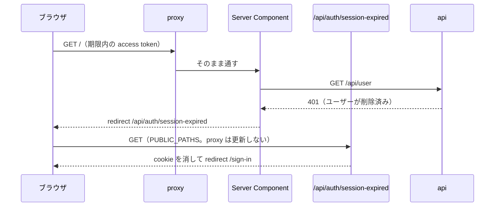

# step6-web-delete-user

web にアカウント削除の確認画面（`/settings/delete-account`）と完了画面を作る。削除は Server Action で `DELETE /api/user` を呼び、cookie を消してから完了を表示する。

## 前提

- [step5-api-delete-user](./step5-api-delete-user.md)（`DELETE /api/user`、`DELETE_ACCOUNT_CONFIRMATION_TEXT`）
- [step3-web-github-login](./step3-web-github-login.md)（ルートレイアウトのフォント・テーマ、ログイン画面）
- [learning-record step4](../../learning-record/tasks/step4-web-mypage.md)（設定画面 `/settings` と、その最下部の「危険な操作」区画。共通ヘッダー `AppHeader` の本番版）
- 仕様: [アカウントの削除](../README.md#アカウントの削除)、[アカウント削除の処理](../README.md#アカウント削除の処理) の「クライアントの後始末」
- デザイン: [UI 設計 > アカウント削除の確認](../README.md#アカウント削除の確認)。見た目の正本は `apps/web/src/app/mock/settings/delete-account/`（モックは消さない）

## 対応内容

### 1. `apiClient.delete` にボディと 204 を対応させる（`apps/web/src/libs/api-client.ts`）

現状の `delete` はボディを送れず、成功時に必ず `res.json()` するので 204 で落ちる。

```typescript
/** 204 No Content はボディが無いので json() を呼ばない */
const readJson = async <T>(res: Response): Promise<T> =>
  (res.status === 204 ? undefined : await res.json()) as T

export const apiClient = {
  delete: async <T = unknown>(path: string, body?: unknown): Promise<T> => {
    const res = await fetchWithAuth(path, {
      ...(body === undefined ? {} : { body: JSON.stringify(body) }),
      method: "DELETE",
    })
    if (!res.ok) await throwApiError(res)
    return readJson<T>(res)
  },
  /** get / post / put も readJson を使う形にそろえる */
}
```

既存のメモの削除（200 + JSON）はそのまま動く。

### 2. API 呼び出し（`apps/web/src/features/user/user.api.ts`）

ファイルが無ければ作る（`import "server-only"`）。あれば `delete` を足す。

```typescript
export const userApi = {
  /** DELETE /api/user。成功は 204 */
  delete: async (input: DeleteUserRequest): Promise<void> => {
    await apiClient.delete("/api/user", input)
  },
}
```

### 3. Server Action（`apps/web/src/app/settings/delete-account/actions.ts`）

```typescript
"use server"

export type DeleteAccountState = { isFailed: boolean }

/**
 * アカウントの削除。成功したらこの端末の cookie を消し、ログアウト状態で開ける完了画面へ移る
 */
export const deleteAccountAction = async (
  _prevState: DeleteAccountState,
  formData: FormData,
): Promise<DeleteAccountState> => {
  const confirmation = formData.get("confirmation")
  if (typeof confirmation !== "string" || confirmation.trim() !== DELETE_ACCOUNT_CONFIRMATION_TEXT) {
    return { isFailed: true }
  }

  try {
    /** この端末の refresh token も渡し、api 側でその場で失効させる */
    const refreshToken = await getRefreshToken()
    await userApi.delete({ confirmation: DELETE_ACCOUNT_CONFIRMATION_TEXT, refresh_token: refreshToken ?? undefined })
  } catch {
    return { isFailed: true }
  }

  await clearAuthCookies()
  /** redirect は例外で遷移するので try の外に置く */
  redirect("/settings/delete-account/done")
}
```

完了を同じページ内（`useActionState` の戻り値）で出さず別のパスに redirect するのは、cookie を変更した Server Action の後は現在のページ（ユーザーを取得する共通ヘッダーを含む）とレイアウトがサーバーで再描画され、削除済みユーザーで失敗するため。

### 4. 確認画面

| ファイル | 内容 |
| --- | --- |
| `app/settings/delete-account/page.tsx` | Server Component。`app/mock/settings/delete-account/page.tsx` から `MockStatePanel` と `state` の切り替えを除いて移植。共通ヘッダーは learning-record step4 の本番の `AppHeader`（`current="settings"`）、「設定に戻る」は `/settings` |
| `components/features/user/DeleteAccountForm.tsx` | Client Component。モックの `DeleteAccountForm.tsx` の「確認」側を移植する（下の差分）。完了の表示はこのコンポーネントから外す |

モックからの差分:

- `const CONFIRMATION_TEXT = "delete my account"` は `@repo/api-schema` の `DELETE_ACCOUNT_CONFIRMATION_TEXT` に替える。`DELETED_ITEMS` の 4 行はモックのまま（web は「各端末に予約された通知」）
- `<form onSubmit>` を `useActionState(deleteAccountAction, { isFailed: false })` の `<form action={formAction}>` に替え、入力欄に `name="confirmation"` を付ける。一致判定（`confirmation.trim() === DELETE_ACCOUNT_CONFIRMATION_TEXT`）でボタンを有効にするのはモックのまま
- 「アカウントを削除する」は `disabled={!isMatched || isPending}`（無効時の見た目はモックの `disabled:` の class のまま）
- `state.isFailed` のとき、ボタンの上に `<p className="mt-4 text-sm text-wrong" role="alert">削除できませんでした。時間をおいてもう一度お試しください。</p>`
- 「キャンセル」は `/settings` への `Link`

### 5. 完了画面（`/settings/delete-account/done`）

モックの `DeleteAccountForm.tsx` の `isDone` 側の JSX をそのまま移植した、データ取得の無い静的なページにする。共通ヘッダーは出さない（ログアウト状態のため）。「ログイン画面へ」は `/sign-in`。

- cookie を消した後に開くので、`src/proxy.ts` の `PUBLIC_PATHS` に `"/settings/delete-account/done"` を足す
- **ユーザーを取得するレイアウトの配下に置かない。** learning-record step4 がログイン後の画面の共通レイアウトをルートグループ（例: `app/(app)/layout.tsx`）で作っている場合は、完了画面をそのグループの外（例: `app/(public)/settings/delete-account/done/page.tsx`）に置く。URL は同じになる
- ページの外枠はモックの `<main className="mx-auto max-w-2xl px-4 py-8 sm:px-6 sm:py-10">` と同じ

### 6. 設定画面からの導線

learning-record step4 の設定画面の「危険な操作」区画にある「アカウントを削除」のリンク先が `/settings/delete-account` になっていることを確かめる（モックでは `/mock/settings/delete-account`）。

### 7. 別の端末で削除されたときのログアウト（期限内の access token が拒まれたとき）

別の端末でアカウントを削除すると、この端末の access token は期限内でも `GET /api/user` や学習記録の API で 401 になる。そのままだと access token の期限（最長 15 分）まで全ページがエラー画面になるので、401 を受けたページで cookie を消してログイン画面へ移す。



| ファイル | 内容 |
| --- | --- |
| `src/libs/session.ts` | `redirectIfSessionRejected(error)`。`ApiClientError` の 401 で、cookie の access token が期限内（`isAccessTokenUsable`）なら `/api/auth/session-expired` へ `redirect`。それ以外は投げ直す（access token が無い・期限が近いときの 401 は proxy の更新が api の障害で失敗した場合なので、ログアウトさせない） |
| `src/app/api/auth/session-expired/route.ts` | `GET`。`clearAuthCookies()` してから `/sign-in` へ redirect。Server Component は cookie を書き換えられず、cookie を残したまま `/sign-in` へ移すと次のページでも同じ 401 を繰り返すため、Route Handler で消す |
| `src/features/user/get-user.ts` | `apiClient.get("/api/user").catch(redirectIfSessionRejected)` |
| `src/components/ui/AppHeader.tsx` | `getUser().catch` で `unstable_rethrow(error)` してから `null` にする（redirect を握りつぶさない） |
| `src/app/page.tsx` / `src/app/settings/page.tsx` / `src/app/history/page.tsx` | ページのデータ取得にも `.catch(redirectIfSessionRejected)` を付ける（学習記録の API は削除済みユーザーで 401 になり、`getUser` より先に返る・共通ヘッダーまで描画が進まないため） |
| `src/proxy.ts` | `PUBLIC_PATHS` に `"/api/auth/session-expired"` を足し、public なパスでの token 更新の対象から外す（cookie を消すレスポンスと食い違わないように） |

## 動作確認

```bash
cd packages/schema && pnpm build
pnpm dev
pnpm --filter web build
pnpm lint:fix
```

`verify-web-page` skill で確認する（新規ページのため before なし）。認証は `pnpm --filter api issue-test-token <userId>` で発行した JWT を `app_access_token` / `app_refresh_token` に入れる。削除の確認は、使い捨てのユーザー（dev ログインの bob など）か、GitHub でログインし直したユーザーで行う。

- [ ] `/settings` の「アカウントを削除」から `/settings/delete-account` に移り、console の error が 0 件。モックの「確認」と見た目が一致する
- [ ] 入力が `delete my account` と一致するまでボタンが無効。前後の空白は許す、`Delete my account` では無効のまま
- [ ] 入力欄のフォーカスの枠とリングが `wrong` の色
- [ ] 「キャンセル」で `/settings` に戻る
- [ ] 削除すると完了画面（共通ヘッダーなし、GitHub の Settings → Applications の案内）が出て、cookie が消えている
- [ ] DB からユーザーと関連データが消え、Redis からこの端末の refresh token の jti が消えている
- [ ] 完了画面の「ログイン画面へ」で `/sign-in`。戻るボタンで `/settings` に行こうとしても `/sign-in` に飛ばされる
- [ ] 別のブラウザでログインしていた同じユーザーは、access token の期限内でも、次にマイページ・設定・学習履歴・問題一覧を開いた時点でログイン画面に戻り、cookie が消えている（`/sign-in` と `/api/auth/session-expired` の間でリダイレクトがループしない）
- [ ] 同じく、access token の期限（最長 15 分）が切れた後は proxy の refresh が 401 になってログイン画面に戻る（`JWT_ACCESS_EXPIRATION=1m` で api を起動して確認）
- [ ] api を止めた状態で削除 → エラーの文言が出て、cookie は消えずに確認画面のまま
- [ ] 既存のメモの削除が動く（`apiClient.delete` の変更の影響確認）
