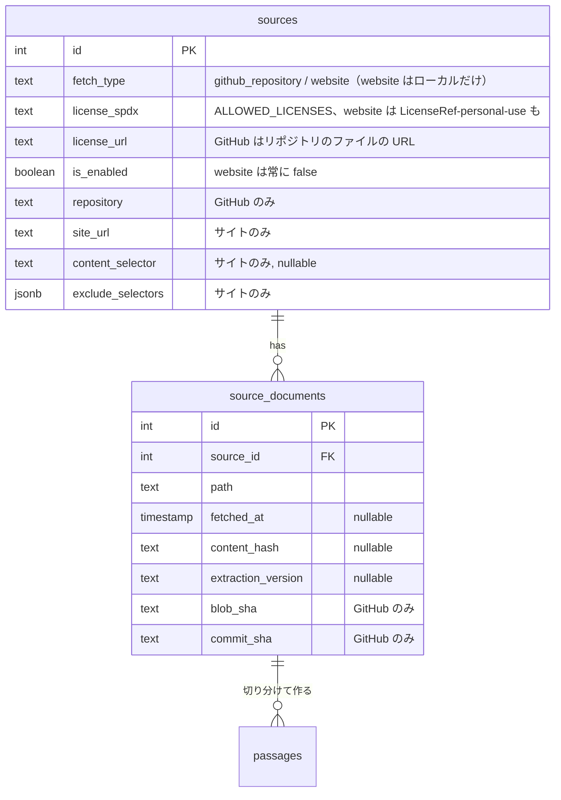
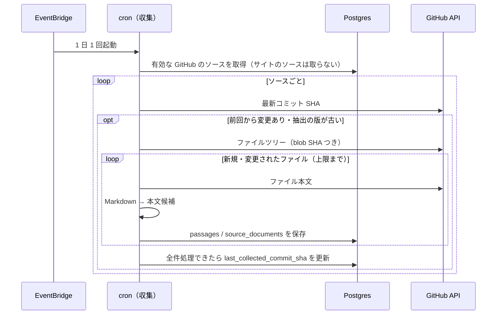
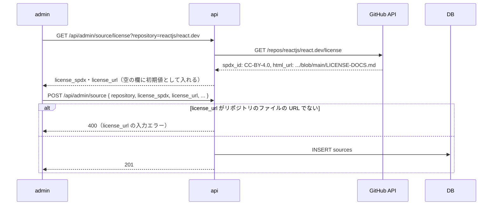

# 収集を GitHub に絞る

英文の収集（cron の `collect:passages`）の対象を、GitHub のリポジトリだけにする。対象にするのは、リポジトリの中にライセンスの記載があり、そのライセンスが文章（ドキュメント）に掛かっているリポジトリだけ。公式ドキュメントのサイト（取得方法が `website`）のクロールはやめる。サイトは、使ってよいかを管理者がサイトごとに確かめるしかなく（フッターのライセンスの記載・利用規約・robots.txt）、許可リストのライセンスで公開しているサイトも少ないため、一旦なしにする。cron で一番込み入っていたクロール（待ち行列・sitemap・robots.txt・条件付きリクエスト・429 / 503）もなくなる。

ただし、自分の学習のために好きなページを問題にする「URL から追加」（[url-import](../url-import/README.md)）は、ローカルでだけ残す。ローカルでは、ライセンスの記載が無いサイト（AWS のブログなど）も「個人の学習用」として取り込める。デプロイした環境（dev / min / prd）では、サイトのソースも URL から追加も使えない。

このドキュメントは **仕様（What）** と **設計（How）** を分けて記述する：

- **仕様**：ユーザーから見える挙動・ルール・データの意味
- **設計**：実装にあたっての技術的な選択と制約

## 関連 spec

- [`../content-collection/README.md`](../content-collection/README.md) — ソース・`source_documents`・収集の正本。この spec の step で、正本の記述も GitHub だけの形に直す
- [`../url-import/README.md`](../url-import/README.md) — URL から追加。この spec でローカルだけにする。受け付ける URL・確認と保存・生成の優先は変えない
- [`../passage-extraction-tuning/README.md`](../passage-extraction-tuning/README.md) — 抽出の版と切り分け直し。サイトの取り直しでの切り分け直しはなくなる（GitHub は変わらない）
- [`../content-collection/deferred-more-sources.md`](../content-collection/deferred-more-sources.md) — 「JavaScript で描画するサイト」「許諾を得た技術ブログ」はサイトの収集が前提なので、サイトの収集を戻すまで着手できない
- [`./deferred-website-collection.md`](./deferred-website-collection.md) — サイトの収集を戻すときの設計

## 目次

- [仕様](#仕様)
  - [収集の対象](#収集の対象)
  - [対象にできるリポジトリ](#対象にできるリポジトリ)
  - [サイトのソース（ローカルだけ）](#サイトのソースローカルだけ)
  - [個人の学習用のライセンス](#個人の学習用のライセンス)
  - [URL から追加（ローカルだけ）](#url-から追加ローカルだけ)
  - [既存のデータ](#既存のデータ)
- [設計](#設計)
  - [ローカルの判定](#ローカルの判定)
  - [収集（cron）](#収集cron)
  - [ライセンスの記載がある URL の検証](#ライセンスの記載がある-url-の検証)
  - [個人の学習用のライセンスの持ち方](#個人の学習用のライセンスの持ち方)
  - [クロールの列の削除](#クロールの列の削除)
  - [MVP 対象外（将来検討）](#mvp-対象外将来検討)
- [必要な画面](#必要な画面)
- [必要な API](#必要な-api)
- [必要な DB 設計](#必要な-db-設計)
- [フロー図](#フロー図)
- [実装ステップ](#実装ステップ)

---

## 仕様

### 収集の対象

- `collect:passages` は、取得方法が GitHub（`github_repository`）のソースだけを収集する。サイトのソースは、有効・無効にかかわらず収集しない
- `--source-id` にサイトのソースを指定したら、収集せずに失敗で終える。試し実行（`--dry-run`）も同じ
- GitHub の収集の仕方（差分の検出・上限・失敗の扱い・切り分け直し）は変えない

### 対象にできるリポジトリ

次の 3 つがそろうリポジトリだけを登録する。

1. リポジトリの中にライセンスの記載があり、GitHub がライセンスを検出できる（`LICENSE` などのファイル）
2. そのライセンスが文章（ドキュメント）に掛かっている。コードだけに掛かるライセンスでは登録しない
3. そのライセンスが許可リスト（`ALLOWED_LICENSES`）にある（今と同じ）

- 1 は登録のときに確かめる。**「ライセンスの記載がある URL」は、そのリポジトリのファイルの URL（`https://github.com/{owner}/{repo}/blob/{ブランチなど}/{パス}`）でなければ登録・保存できない**
- 2 は自動では判定できないので、管理者が確かめる。登録フォームで案内する

| リポジトリ | ライセンスの記載 | 文章に掛かっているか | 登録 |
| --- | --- | --- | --- |
| `reactjs/react.dev` | `LICENSE-DOCS.md`（CC-BY-4.0） | 掛かっている（README に「Content submitted to react.dev is CC-BY-4.0 licensed」） | できる |
| `kubernetes/website` | `LICENSE`（CC-BY-4.0） | 掛かっている（リポジトリ全体のライセンスで、文章とコードを分けていない） | できる |
| `rust-lang/book` | `LICENSE-MIT`・`LICENSE-APACHE` | 掛かっている（同上） | できる（GitHub の検出は `NOASSERTION` だが、[確認済みのリポジトリ](../official-docs-collection/README.md#確認済みのリポジトリ)の一覧で MIT として登録する） |
| `awsdocs/aws-lambda-developer-guide` | `LICENSE`（MIT-0） | 掛かっていない（README によるとサンプルコードのライセンス。ガイドの本文はリポジトリに無い） | しない |
| `mdn/content` | `LICENSE.md`（本文は CC-BY-SA-2.5） | 掛かっている | しない（許可リストに無い） |

- 「ライセンスを検出」を押すと、GitHub が見つけたライセンスのファイルの URL を「ライセンスの記載がある URL」の初期値に入れる（空のときだけ。ライセンスと同じ扱い）。[source-registration-by-url](../source-registration-by-url/README.md) で「ライセンスを検出」はやめ、登録の URL の読み込みが入れる
- 今ある GitHub のソースで URL がリポジトリの外を指すもの（ローカルの seed の「開発用サンプル」が当たる）は、[source-registration-by-url](../source-registration-by-url/README.md#編集の画面) で GitHub のライセンスを編集で変えられなくなったので、画面からは直せない。直すときは DB を直接書き換える

### サイトのソース（ローカルだけ）

- dev / min / prd では、サイトのソースを登録できない。登録フォームの取得方法に「サイト」を出さない
- ローカルでは今までどおり登録でき、URL から追加に使う
- 収集しないので、サイトのソースは有効にできない（常に無効）。フォームに「このソースを収集する」のスイッチを出さず、ソース一覧の状態は「収集しない」と出す
- 収集にだけ使っていた項目と表示をなくす
  - 登録の項目の「ページの見つけ方」（sitemap の URL・開始ページの URL）
  - ソース一覧の「取得失敗」の列と、編集の補助カードの「取得に失敗しているページ」
  - サイトのソースの「試し実行」のカード
  - ソース一覧の上の「無効のサイトのソースがあります」の案内

### 個人の学習用のライセンス

- ローカルのサイトのソースだけ、ライセンスに「個人の学習用（ライセンスなし）」を選べる。値は `LicenseRef-personal-use`
- ライセンスの記載が無いサイト（「© 企業名」だけのもの）を、自分で読むためだけに取り込む用。著作権法の私的使用（30 条）の範囲にとどめるため、デプロイした環境には入れない
- 「ライセンスの記載がある URL」は必須のまま。登録の画面で URL を読み込むと既定はサイトのトップになり、著作権・利用規約のページがあれば「詳細」で直す（[source-registration-by-url](../source-registration-by-url/README.md)）
- 出典表示は今と同じ形で、ライセンス名のところに `LicenseRef-personal-use` が出る（web / mobile は変えない）
- GitHub のソースでは選べない

### URL から追加（ローカルだけ）

- dev / min / prd では、admin の問題の一覧に「URL から追加」のボタンを出さず、画面を開くと 404 になる。API も 404 を返す
- ローカルでは今と同じ（受け付ける URL・確認と保存・生成の優先）
- 「取り込んだページは収集でも取得済みとして扱う」はなくなる（サイトを収集しないため）

### 既存のデータ

- dev / min / prd には、まだどの版もデプロイしていないので、データは無い
- ローカルのサイトのソースは残り、URL から追加で使える。有効にしていたものは無効になる。sitemap の URL・開始ページの URL は消える
- 取得済みのページの記録（`source_documents`）と、そこから作った本文候補・問題は残る

---

## 設計

### ローカルの判定

**`NODE_ENV !== "production"` をローカルとみなす。** dev / min / prd の api・cron は Terraform の env で `NODE_ENV=production`、admin は `next start` で `production` になる。api と admin の dev ログイン、api の `/media` と同じ判定にそろえる。

- api の URL から追加：production では Controller を作らず、admin の router に渡さない。router は渡された Controller のルートだけを登録するので 404 になる（dev ログインと同じ形）
- api のソースの登録・更新：サイトのソースを受け付けるかを Service に DI で渡し、production ではサイトのソースを 400 にする。env を Service で直接読まない（テストで切り替えるため）
- サイトのソースは常に無効（`is_enabled = false`）にする。api はサイトの `is_enabled` を受け取らず、DB も CHECK 制約 `sources_website_disabled_check`（`fetch_type <> 'website' OR is_enabled = false`）で守る。制約を足す migration で、今有効のサイトのソースを先に無効にする
- admin：`process.env.NODE_ENV` を `src/libs/environment.ts` の `isLocalEnvironment` で 1 か所にまとめ、問題の一覧の「URL から追加」のボタン・フォームの取得方法の選択肢・`/passages/url-import` の `notFound()` で使う。Next.js は `process.env.NODE_ENV` を build のときに値に置き換えるので、client component からも読める（`server-only` の `env.ts` は client component から import できない）。admin の proxy・サインイン画面の dev ログインも `process.env.NODE_ENV` を直接見ている

### 収集（cron）

- Repository の `findEnabledGitHubSources` を、SQL で GitHub のソースだけに絞る。戻り値も `GitHubRepositorySource[]` にして、以降の処理から取得方法の分岐をなくす
- `--source-id` で指定したソースがサイトなら throw する（タスクは exit 1）。無効のソースと同じ扱い
- 消すもの：`collectWebsiteSource`・試し実行のサイトの分岐・`createWebPageClient` の DI・サイトだけの終わり方（`throttled`・`crawl_delay_too_long`）・Repository のクロールのメソッド・env の `COLLECT_WEB_REQUEST_INTERVAL_MS` と `COLLECT_WEB_REFETCH_DAYS`
- `COLLECT_WEB_CONTACT_URL` は GitHub API の User-Agent にも使うので残す（名前は変えない。api の URL から追加も同じ名前の env を読む）
- 本文の抽出・切り分け（`@repo/content-extractor` の `document`）は、GitHub の収集と URL から追加で使うので残す。サイトの取得（`WebPageClient`）も URL から追加で使うので残し、収集にしか使っていなかった機能だけを消す。sitemap・ページのリンク・クロールのページの選び方は [step1](./tasks/step1-cron-github-only.md)、条件付きリクエスト（URL から追加が取得の結果の `ETag` などを DB に書いている）は列と一緒に [step5](./tasks/step5-db-drop-crawl-columns.md)

### ライセンスの記載がある URL の検証

**api-schema の取得方法ごとの検証（`validateCreateSourceInput`）で、GitHub のソースの `license_url` がそのリポジトリのファイルの URL かを確かめる。** admin のフォームは同じスキーマで入力エラーを出すので、画面にもそのまま出る。

- 条件：ホストが `github.com`、パスの 1・2 番目がリポジトリの `owner` と `name`（大文字・小文字を区別しない。GitHub が区別しないため）、3 番目が `blob`、その後にブランチなどとファイルのパスがある
- ブランチ・タグ・コミットは問わない。ソースのブランチと違う参照を指してもよい
- DB の CHECK 制約にはしない。大文字・小文字を区別しない比較と URL の分解を SQL で書くことになるため。ほかの入力の検証と同じく api が守る
- 検出の API は、GitHub の `/license` が返すライセンスのファイルの URL（`html_url`）も返す
- **比べた案**
  - GitHub の検出が成功したリポジトリだけにする：`rust-lang/book` のようにライセンスのファイルが 2 つあるリポジトリは、検出が `NOASSERTION` になって登録できない（その後、[確認済みのリポジトリ](../official-docs-collection/README.md#確認済みのリポジトリ)の一覧で登録できるようにした）。検出の結果はコードのライセンスのこともあり、文章に掛かっているかは結局管理者が確かめる（その後、手で選べると確かめていないライセンスで登録できるので、[source-registration-by-url](../source-registration-by-url/README.md#ライセンスの自動の取得) で検出できたリポジトリだけを登録する形に変えた）
  - 管理者の判断だけにする：リポジトリの外のページ（creativecommons.org のライセンスの説明など）を登録できてしまい、1 の条件を守れない

### 個人の学習用のライセンスの持ち方

- `@repo/domain` に `PERSONAL_USE_LICENSE`（`"LicenseRef-personal-use"`）を足す。`ALLOWED_LICENSES` には入れない（許可リストは「公開してよいライセンス」の一覧のまま）。`LicenseRef-` は SPDX で独自のライセンスを表す書き方（[deferred-more-sources](../content-collection/deferred-more-sources.md#許諾を得た技術ブログ) の許諾の案の `LicenseRef-permission` と同じ）
- ソースのライセンスの型は `SourceLicense`（`SOURCE_LICENSES` の値。GitHub のソースの型は今までどおり `AllowedLicense`）
- DB：`sources_license_spdx_check` を両方を許すように直し、`fetch_type = 'website' OR license_spdx <> 'LicenseRef-personal-use'` の CHECK（`sources_personal_use_license_check`）を足す。GitHub のソースに入らないことを DB でも守る
- api-schema：GitHub の入力は `ALLOWED_LICENSES` だけ、サイトの入力は両方。レスポンスは両方
- production ではサイトのソースそのものを拒否するので、個人の学習用の値もデプロイした環境には入らない
- web / mobile の出典表示は変えない。出るのはローカルだけで、見るのは開発者本人なので、表示名の対応表は作らない

### クロールの列の削除

消すもの：

| テーブル | 列・制約 | 使っていたところ |
| --- | --- | --- |
| `sources` | `sitemap_url`・`start_url` | サイトのページの見つけ方 |
| `sources` | `sources_website_check` の sitemap・開始ページの条件 | 同上。`site_url` が NOT NULL の条件だけ残す |
| `source_documents` | `etag`・`last_modified` | 条件付きリクエスト |
| `source_documents` | `sitemap_lastmod` | sitemap の更新日時での取り直し |
| `source_documents` | `http_status` | 404 / 410 のページを取り直しから外す・ソース一覧の「取得失敗」 |
| `source_documents` | `source_documents_source_id_fetched_at_idx` | クロールの取得順 |

残すもの：`sources.site_url`・`content_selector`・`exclude_selectors`（URL から追加が使う）、`source_documents.fetched_at`・`content_hash`・`extraction_version`（GitHub の収集と URL から追加が使う）。

- **expand / contract に分けず、列の定義を外す step で列を消す migration も作る。** どの環境にもまだデプロイしていないので、古い版の api・cron が消えた列を読む時間が無いため。step5 より前にどこかの環境へデプロイしたら、列の定義を外す PR と列を消す PR を分け、別々のデプロイで出す（[source-tags の既存のデータの移行](../source-tags/README.md#既存のデータの移行)と同じ）
- 列を消すのは、cron・api・admin が列を使わなくなった後の最後の step にする

### MVP 対象外（将来検討）

以下は作らない。GitHub に Markdown のソースが無いドキュメントを、デプロイした環境で題材にしたくなったら着手する。

- サイトの収集（クロール）を戻す
- 許諾を得た技術ブログ・JavaScript で描画するサイト（サイトの収集が前提）

詳細：[`./deferred-website-collection.md`](./deferred-website-collection.md)

---

## 必要な画面

すべて admin。新しい画面は無い。

| パス | 画面名 | 変更 |
| --- | --- | --- |
| `/sources` | ソース一覧 | 「取得失敗」の列と「無効のサイトのソースがあります」の案内をなくす。サイトのソースの状態は「収集しない」 |
| `/sources/new`・`/sources/[id]` | ソースの登録・編集 | 取得方法の「サイト」はローカルだけ。サイトのときは「ページの見つけ方」・収集のスイッチ・試し実行・取得に失敗しているページを出さず、ライセンスに「個人の学習用」を足す。GitHub のときは「ライセンスの記載がある URL」にリポジトリのファイルの URL を入れるよう案内し、検出で初期値を入れる |
| `/passages/url-import` | URL から追加 | ローカルだけ。production では問題の一覧のボタンを出さず、画面は 404 |

- 具体的な UI は今の画面から項目を減らすだけなので、`design-mock` skill のモックは作らない。admin の `/mock/sources` のモックも実装に合わせて項目を減らす

## 必要な API

admin 向け。

| メソッド | パス | 変更 |
| --- | --- | --- |
| POST | `/api/admin/source` | GitHub の `license_url` がリポジトリのファイルの URL でなければ 400。サイトは production で 400、ローカルでは常に無効で作る。サイトの `sitemap_url`・`start_url` をなくし、`license_spdx` に `LicenseRef-personal-use` を許す |
| PUT | `/api/admin/source/:id` | 登録と同じ。サイトの `is_enabled` を受け取らない |
| GET | `/api/admin/source` | `failed_page_count` をなくす |
| GET | `/api/admin/source/:id` | サイトの `sitemap_url`・`start_url` と、取得に失敗しているページをなくす |
| GET | `/api/admin/source/license` | `license_url`（GitHub が見つけたライセンスのファイルの URL。検出できなければ null）を足す |
| POST | `/api/admin/url-import/preview`・`/api/admin/url-import` | production では 404。ローカルは変えない |

cron タスク：

| タスク | 変更 |
| --- | --- |
| `collect:passages` | GitHub のソースだけを収集する。`--source-id` にサイトのソースを指定したら exit 1 |

## 必要な DB 設計

列の正本は [content-collection](../content-collection/README.md#必要な-db-設計)。[クロールの列の削除](#クロールの列の削除)の列を消し、ライセンスの CHECK を直す。

| テーブル | 変更 |
| --- | --- |
| `sources` | `sitemap_url`・`start_url` を削除（step5）。`sources_license_spdx_check` に `LicenseRef-personal-use` を足し、`sources_personal_use_license_check` と `sources_website_disabled_check` を追加（step2）。`sources_website_check` は `site_url` の NOT NULL だけにする（step5） |
| `source_documents` | `etag`・`last_modified`・`sitemap_lastmod`・`http_status` と `source_documents_source_id_fetched_at_idx` を削除 |

## フロー図

収集（GitHub だけ）：

GitHub のソースの登録：

---

## 実装ステップ

どの環境にもまだデプロイしていないので、PR はどの順でマージしてもデプロイで壊れない。CI が通る順に、上から出す。

| PR | step |
| --- | --- |
| cron | step1 |
| DB・api | step2〜3（step2 でライセンスの型を広げると、step3 の api-schema まで api の型チェックが通らないので、同じ PR にする） |
| admin | step4 |
| クロールの列の削除 | step5 |

| step | 内容 |
| --- | --- |
| [step1-cron-github-only](./tasks/step1-cron-github-only.md) | cron の収集を GitHub のソースだけにし、サイトの収集の処理・env・テストを消す |
| [step2-db-source-checks](./tasks/step2-db-source-checks.md) | `@repo/domain` の `PERSONAL_USE_LICENSE`・`SourceLicense`、ライセンスの CHECK とサイトのソースを無効に限る CHECK の migration |
| [step3-api-source-rules](./tasks/step3-api-source-rules.md) | api のソースの検証（`license_url` がリポジトリのファイル・サイトはローカルだけで常に無効・個人の学習用）、検出の API の `license_url`、URL から追加をローカルだけにする |
| [step4-admin-local-only](./tasks/step4-admin-local-only.md) | admin の「URL から追加」とサイトの取得方法をローカルだけにし、ソースのフォームに個人の学習用と `license_url` の初期値・案内を足す |
| [step5-db-drop-crawl-columns](./tasks/step5-db-drop-crawl-columns.md) | クロールの列を消す migration と、列を使う api・admin・cron・`@repo/content-extractor` の処理（条件付きリクエスト・取得失敗・ページの見つけ方）を消す。admin のモックを今の画面に合わせる |

content-collection・url-import などの設計書は、各 step で変えた挙動の分だけ、その step の PR で直す（どの PR の時点でも設計書がコードと合うように）。
