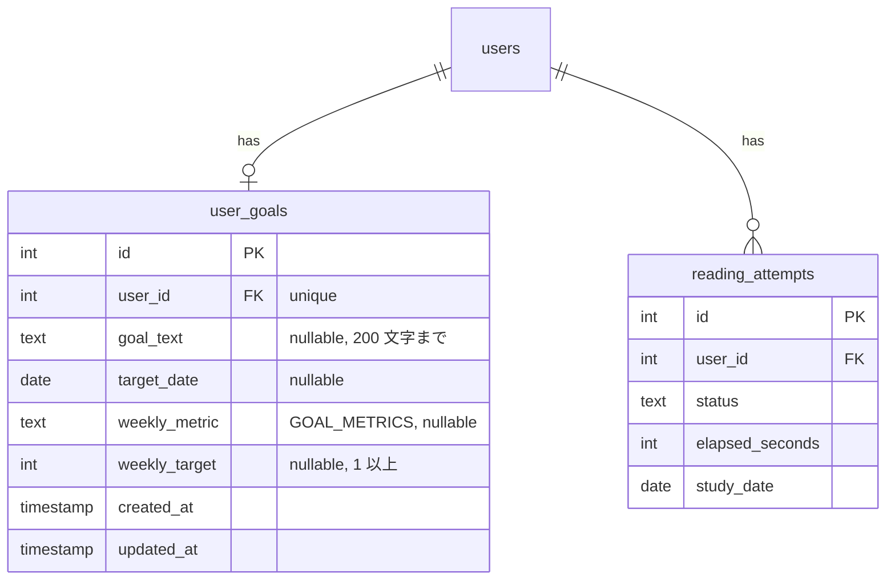
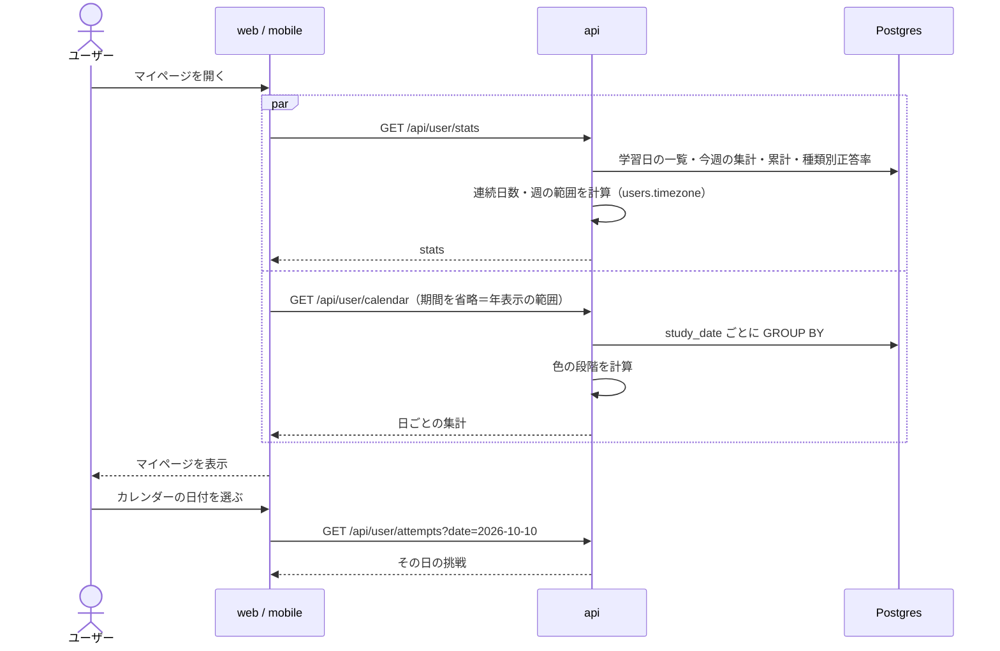

# 学習記録と目標

ユーザーが「いつ・どれだけ学習したか」をカレンダーで振り返り、自分で決めた目標に対する進み具合を確認できるようにする。マイページの中心になる機能で、web と mobile の両方に提供する。

英語学習は続けることが一番難しい。エンジニアには見慣れた **GitHub の草（Contribution graph）** のような表示で学習した日を可視化し、連続学習日数と週の目標で「今日も 1 問」を後押しする。

このドキュメントは **仕様（What）** と **設計（How）** を分けて記述する：

- **仕様**：マイページに出すもの、学習した日と学習時間の定義、カレンダー、連続学習日数、目標、学習履歴
- **設計**：集計の方法、タイムゾーンの扱い、API の分け方

## 関連 spec

- [`../product-overview/README.md`](../product-overview/README.md) — プロダクト全体像
- [`../reading-practice/README.md`](../reading-practice/README.md) — 集計元の `reading_attempts` / `attempt_answers` の正本。`study_date` と `elapsed_seconds` の決め方もこちら
- [`../github-auth/README.md`](../github-auth/README.md) — `users.timezone` の正本。プロフィール（名前・アイコン）を出す
- [`../study-reminder/README.md`](../study-reminder/README.md) — 設定画面にリマインダーの設定を並べる（mobile のみ）
- **この spec が正本のもの**：`user_goals`、`GOAL_METRICS`、カレンダーの色の段階、連続学習日数の定義

## 目次

- [仕様](#仕様)
  - [マイページに出すもの](#マイページに出すもの)
  - [学習した日と学習時間](#学習した日と学習時間)
  - [学習カレンダー](#学習カレンダー)
  - [連続学習日数](#連続学習日数)
  - [目標](#目標)
  - [学習履歴](#学習履歴)
  - [設定画面](#設定画面)
- [設計](#設計)
  - [集計の方法](#集計の方法)
  - [タイムゾーンの扱い](#タイムゾーンの扱い)
  - [API の分け方](#api-の分け方)
  - [MVP 対象外（将来検討）](#mvp-対象外将来検討)
- [必要な画面](#必要な画面)
- [UI 設計](#ui-設計)
  - [マイページ](#マイページ)
  - [学習カレンダー](#学習カレンダー-1)
  - [学習履歴](#学習履歴-1)
  - [設定](#設定)
  - [mobile の画面](#mobile-の画面)
- [必要な API](#必要な-api)
- [必要な DB 設計](#必要な-db-設計)
- [フロー図](#フロー図)
- [実装ステップ](#実装ステップ)

---

## 仕様

### マイページに出すもの

ログイン後の最初の画面。

| 区画 | 内容 |
| --- | --- |
| プロフィール | GitHub のアイコンと名前 |
| 連続学習日数 | 現在の連続日数と最長記録 |
| 目標 | 自由記述の目標と目標日までの残り日数、**今週の進捗**（例：`3 / 5 問`）。未設定なら設定を促す |
| 学習カレンダー | [後述](#学習カレンダー) |
| 累計 | 解いた問題数（重複なし）、挑戦回数、学習時間、正答率 |
| 設問の種類別の正答率 | 要旨 / 詳細 / 語義 / 推論 / 意図 ごとの正答率（苦手の把握用） |
| アシストなしの正答率 | アシスト（段落の和訳・単語の意味・[読み上げ](../read-aloud/README.md)）を一度も使わなかった挑戦だけの正答率 |
| 最近の挑戦 | 直近 5 件。タップで結果画面へ |
| 導線 | 「問題を解く」（問題一覧へ）、「ランダムに 1 問」 |

**まだ 1 問も解いていないとき** は、統計の代わりに「最初の 1 問を解いてみよう」と問題への導線を大きく出す。

### 学習した日と学習時間

- **学習した日**：挑戦を 1 回以上 **提出** した日。途中でやめた挑戦・期限切れの挑戦は数えない
- **日付** は提出した時点のユーザーのタイムゾーンで決める（日本時間の 23:59 に提出すればその日、0:01 なら翌日）
- **学習時間**：提出した挑戦の「かかった時間」の合計（画面を見ていた時間。[reading-practice の時間の計測](../reading-practice/README.md#時間の計測)）
- 一度記録された日付は、後からタイムゾーンを変えても動かない

### 学習カレンダー

**年間表示（草）**：直近 1 年を 1 マス 1 日で並べ、学習時間に応じて色の濃さを 5 段階で塗る。

| 段階 | 学習時間 |
| --- | --- |
| 0 | なし |
| 1 | 〜5 分 |
| 2 | 5〜15 分 |
| 3 | 15〜30 分 |
| 4 | 30 分〜 |

段階は固定の時間で決める（GitHub のように相対的な分位で決めると、学習量が増えたときに過去の日の色が薄くなって分かりにくいため）。

**月表示**：月のカレンダーに、日ごとの色と問題数を出す。前後の月に移動できる。

**日付を選ぶ** と、その日の挑戦の一覧（タイトル・スコア・時間）を出す。

### 連続学習日数

- **現在の連続日数**：今日から過去にさかのぼって、学習した日が途切れずに続いている日数。**今日まだ学習していなくても、昨日まで続いていれば途切れていない** とみなす（朝の時点で 0 に戻ると意欲を削ぐため）
- **最長記録**：これまでで最も長く続いた日数

### 目標

1 ユーザーにつき 1 つ設定できる。どれも任意。

| 項目 | 例 | 説明 |
| --- | --- | --- |
| 自由記述の目標 | 英語の公式ドキュメントを辞書なしで読めるようになる | 200 文字まで。マイページに表示 |
| 目標日 | 2027-03-31 | マイページに残り日数を表示 |
| 週の目標の指標 | 問題数 / 学習時間（分） | `GOAL_METRICS` |
| 週の目標値 | 5（問）/ 60（分） | 1 以上 |

- **週は月曜始まり**（ユーザーのタイムゾーン）
- 今週の進捗はマイページに `3 / 5 問` のように出し、達成したら達成の表示に変える
- 問題数は「提出した挑戦の数」で数える（同じ問題を 2 回解けば 2 と数える）
- 目標を変えると、今週の進捗は新しい目標で表示し直す（過去の週の達成状況は記録しない。[MVP 対象外](#mvp-対象外将来検討)）

### 学習履歴

提出した挑戦をすべて新しい順に並べる。各行：日付、問題のタイトル、スコア、かかった時間（超過していれば印）、アシストの使用の有無。タップで結果画面を開く。

### 設定画面

| 項目 | web | mobile |
| --- | --- | --- |
| 目標 | ✅ | ✅ |
| タイムゾーン | ✅ | ✅ |
| リマインダー | ― | ✅（[study-reminder](../study-reminder/README.md)） |
| ログアウト | ✅ | ✅ |
| アカウントの削除 | ✅ | ✅（最下部の「危険な操作」の区画。[github-auth](../github-auth/README.md#アカウントの削除)） |

---

## 設計

### 集計の方法

**日ごとの集計テーブルを持たず、`reading_attempts` から都度集計する。**

- 1 ユーザーの 1 年分の挑戦は多くても数千行で、`(user_id, study_date)` の index があれば `GROUP BY study_date` は十分速い
- 集計テーブルを持つと、提出のたびに二重に書く処理と、ずれたときの修復が必要になる
- 利用者が増えて遅くなったら、日ごとの集計テーブルを提出時に upsert する方式に切り替える（API の形は変わらない）

計算の置き場所：

| 計算 | 置き場所 |
| --- | --- |
| 連続学習日数（学習日の配列 → 現在 / 最長） | `@repo/domain` の `rules/`（純関数。今日の日付を引数で受ける） |
| カレンダーの色の段階（学習秒数 → 0〜4） | 同上。**web と mobile で同じ段階にするため api で計算してレスポンスに含める**（フロントは `@repo/domain` を import できない） |
| 週の範囲（今日の日付 → 月曜〜日曜） | 同上 |

### タイムゾーンの扱い

- 学習した日付は `reading_attempts.study_date`（提出時に `users.timezone` で確定）だけで決まる。集計時にタイムゾーン変換はしない
- 「今日」「今週」は、リクエスト時点の `users.timezone` で求める
- web はログイン時のブラウザ、mobile はログイン時の端末（`expo-localization`）のタイムゾーンを初期値にする。旅行などで端末のタイムゾーンが変わっても自動では変えない（日付が飛ぶのを防ぐため）。変えたいときは設定画面から変える

### API の分け方

| API | 用途 | 分ける理由 |
| --- | --- | --- |
| `GET /api/user/stats` | マイページの上部（連続日数・目標の進捗・累計・種類別正答率・最近の挑戦） | マイページを 1 回の取得で描画するため |
| `GET /api/user/calendar` | カレンダー（期間を指定） | 月の移動で期間だけ変えて取り直すため |
| `GET /api/user/attempts` | 学習履歴・日付を選んだときの一覧 | ページングが必要なため |

### MVP 対象外（将来検討）

- **過去の週の目標達成の記録**（「4 週連続で達成」など）。週の目標の利用率が高く、達成の履歴を見たい要望が出たとき。週ごとの目標と結果を保存するテーブルが必要になる
- **学習時間の推移グラフ**（週ごと・月ごと）
- **他のユーザーとの比較・ランキング**。競争要素を入れるなら時間の計測方法を見直す（[reading-practice の deferred](../reading-practice/deferred-assist-and-modes.md#厳格モード)）
- **GitHub のプロフィールに草を貼れるバッジ画像**

---

## 必要な画面

| 画面 | web | mobile | 概要 |
| --- | --- | --- | --- |
| マイページ | `/`（ログイン後） | マイページタブ | [マイページに出すもの](#マイページに出すもの) |
| 学習履歴 | `/history` | マイページからスタック | 提出した挑戦の一覧 |
| 設定 | `/settings` | 設定タブ | 目標・タイムゾーン・（mobile）リマインダー・ログアウト・アカウントの削除 |

具体的な UI は [UI 設計](#ui-設計) を参照。

## UI 設計

`design-mock` skill で確定したデザイン。配色・書体・共通の部品・共通ヘッダーは [product-overview の UI 設計](../product-overview/README.md#ui-設計) を正本とする。

| パス（web） | 画面名 | 認証 | モック |
| --- | --- | --- | --- |
| `/` | マイページ | 必要 | `/mock/home` |
| `/history` | 学習履歴 | 必要 | `/mock/history` |
| `/settings` | 設定 | 必要 | `/mock/settings` |

mobile（Expo）も同じ構成・配色にする（設定画面にはリマインダーの区画が加わる。[study-reminder](../study-reminder/README.md)）。

### マイページ

**PC（1024px 以上）**：左に学習カレンダーと統計、右に囲みのパネル（連続学習日数・目標・最近の挑戦）。

```
┌────────────────────────────────────────────────────────────────────────────┐
│ (共通ヘッダー)                                                             │
├────────────────────────────────────────────────────────────────────────────┤
│ (Y) Yuki Tanaka                            [問題一覧][ランダムに 1 問解く] │ ← 名前と主要な導線
├──────────────────────────────────────────────┬─────────────────────────────┤
│ 学習カレンダー                   [1 年|今月] │ 連続学習日数                │ ← 右列：囲みのパネル
│  10月 11月 12月 1月 …            9月 10月    │ 12 日            最長 21 日 │
│ 月 ▪▪▫▪▪▪▫▪▪▪▪▫▪▪▪▪▪▪▫▪▪▪▪▪▫▪▪▪▪▪▪▪▪▪        │ □□■■■■■■■■■■■■              │ ← 直近 14 日の灯り
│    ▪▫▪▪▪▪▪▫▪▪▪▪▪▪▪▪▫▪▪▪▪▪▪▪▪▫▪▪▪▪▪▪▪         │ 直近 14 日                  │
│ 水 ▪▪▪▫▪▪▪▪▪▪▫▪▪▪▪▪▪▪▪▫▪▪▪▪▪▪▪▪▫▪▪▪▪         │─────────────────────────────│
│    ▫▪▪▪▪▫▪▪▪▪▪▪▪▫▪▪▪▪▪▪▪▪▫▪▪▪▪▪▪▪▪▪▪         │ 目標                   編集 │
│ 金 ▪▪▪▪▪▪▪▪▫▪▪▪▪▪▪▪▫▪▪▪▪▪▪▪▪▫▪▪▪▪▪▪          │ 英語の公式ドキュメントを辞書│
│    ▪▪▫▪▪▪▪▪▪▪▪▫▪▪▪▪▪▪▪▪▪▫▪▪▪▪▪▪▪▪▪◆          │ なしで読めるようになる      │ ← ◆ 今日（光る）
│    ▪▪▪▪▫▪▪▪▪▪▪▪▪▪▪▫▪▪▪▪▪▪▪▪▪▪▫▪▪▪▪▪          │ 2027/03/31 まで あと 172 日 │
│  少 ▫▪▪▪■ 多  色の濃さは学習時間             │ 今週               3 / 5 問 │ ← 凡例 / 週の進捗
│──────────────────────────────────────────────│ ━━━━ ━━━━ ━━━━ ──── ────    │
│ 10月10日（土）                    1 問、5 分 │ あと 2 問で今週の目標を達成 │ ← 選んだ日の挑戦
│ 08:14 Synchronizing with Effects 3 / 4  5:12 │─────────────────────────────│
│──────────────────────────────────────────────│ 最近の挑戦       すべて見る │
│ 累計                 設問の種類別の正答率    │ Synchronizing with Effects  │
│ 解いた問題 挑戦した回数  要旨 ━━━━━━━━─ 86%  │ ■■■□ 3 / 4             5:12 │
│ 48         63            詳細 ━━━━━━━━─ 81%  │ Pod Lifecycle               │
│ 学習時間   正答率        語義 ━━━━━━━── 74%  │ ■■■■ 4 / 4             6:11 │
│ 9時間12分  78%           推論 ━━━━━──── 62%  │ …（5 件）                   │ ← 苦手な種類は淡い琥珀
│            アシストなし  意図 ━━━━━━─── 70%  │                             │
│            では 71%                          │                             │
└──────────────────────────────────────────────┴─────────────────────────────┘
```

- 上段：GitHub のアイコンと名前、右に「問題一覧」（副）と「ランダムに 1 問解く」（主要）
- **連続学習日数**：日数（30px）、最長記録、直近 14 日のマス（学習した日は琥珀、していない日は枠だけ。今日のマスは光る）
- **目標**：自由記述の目標、目標日と残り日数、今週の進捗（`3 / 5 問` と、目標値の数だけ並べた線を達成分だけ琥珀にする）、「あと 2 問で今週の目標を達成します。」。「編集」で設定画面へ
- **最近の挑戦**：5 件。タイトル（Literata）、スコアのマス、正答数、かかった時間。行を押すと結果画面。「すべて見る」で学習履歴へ
- **累計**：解いた問題・挑戦した回数・学習時間・正答率（24px）と「アシストなしでは 71%」
- **設問の種類別の正答率**：横棒。70% 未満の種類は淡い琥珀にし、下に「推論の設問が一番苦手です。」のように一番低い種類を書く。設問のある種類が 2 つ未満のとき・設問のある種類がすべて同じ正答率のとき（すべて 100% を含む）は、苦手と言えないのでこの文を出さない

**スマホ幅（1024px 未満）**：共通ヘッダー（2 段）→ 名前とボタン → 右列のパネル（連続学習日数・目標・最近の挑戦）→ 学習カレンダー → 統計、の順に縦に並べる。続ける動機になる連続日数と目標を先に見せるため。

**まだ 1 問も解いていないとき**は、名前の下に次の案内を出し、上段のボタンはここに移す。学習カレンダーは全マス `heat-0` で表示し、統計と最近の挑戦は出さない。連続学習日数は「まだ記録がありません。」、目標は「目標はまだありません。」と「目標を設定する」。

```
┌──────────────────────────────────────────────────────────────────┐
│ 最初の 1 問を解いてみましょう                                    │ ← 琥珀の枠と淡い琥珀の背景
│ 公式ドキュメントや GitHub の英文を読んで、4 択の設問に答えます。 │
│ 1 問 5〜10 分ほどです。解くと、今日のマスに色が付きます。        │
│ [問題一覧][ランダムに 1 問解く]                                  │
└──────────────────────────────────────────────────────────────────┘
```

### 学習カレンダー

**1 年（初期表示）**：GitHub の Contribution graph と同じ並び。色は琥珀の 5 段階（`heat-0`〜`heat-4`）。

- 1 列 = 1 週（**月曜始まり**）、直近 53 週。マスは 11px、間隔 3px、角丸 2px
- 上に月のラベル、左に「月」「水」「金」
- 今日のマスは光彩を付け、ページを開いたときに 1 回だけ灯る（400ms 後）
- 選んだ日のマスは白い輪で囲む。ホバーで日付・問題数・学習時間のツールチップ
- 横幅が足りないときは横にスクロールし、最初は右端（今日）を表示する
- 下に凡例「少 ▫▪▪▪■ 多」と「色の濃さは学習時間（5 分 / 15 分 / 30 分で段階が変わります）」

**今月**：

```
┌──────────────────────────────────────────────┐
│ 学習カレンダー                   [1 年|今月] │
│ 10月                                         │
│  月    火    水    木    金    土    日      │
│ ┌───┐ ┌───┐ ┌───┐ ┌───┐ ┌───┐ ┌───┐ ┌───┐    │
│ │   │ │   │ │ 1 │ │ 2 │ │ 3 │ │ 4 │ │ 5 │    │ ← 日付
│ │   │ │   │ │▪  │ │▪ 1│ │▪ 2│ │▫  │ │▪ 1│    │ ← 色のマスと問題数
│ └───┘ └───┘ └───┘ └───┘ └───┘ └───┘ └───┘    │
│ … 11 日以降（未来）は薄く表示して押せない    │
└──────────────────────────────────────────────┘
```

- 7 列（月〜日）のマス。各日に日付、色のマス、問題数（640px 以上）
- 今日より後の日は薄くして押せないようにする
- 前後の月への移動ボタンを上部に置く（[仕様](#学習カレンダー) どおり。モックでは省略している）

**選んだ日の挑戦**（両方の表示で共通。カレンダーの下）：日付（例「10月10日（土）」）と「1 問、5 分」、その日の挑戦の一覧（提出時刻・タイトル・正答数・かかった時間）。行を押すと結果画面。学習していない日は「この日の学習はありません。」。最初は今日を選んでおく。

### 学習履歴

```
┌──────────────────────────────────────────────────────────────────────┐
│ 学習履歴                                                             │
│ 提出した挑戦を新しい順に表示しています。                             │
│                                                                      │
│ 2026年10月10日（土）                                                 │ ← 日付ごとにまとめる
│ ──────────────────────────────────────────────────────────────────── │
│ 08:14  Synchronizing with Effects      ■■■□ 3/4   5:12  アシストあり │
│ ──────────────────────────────────────────────────────────────────── │
│ 2026年10月9日（金）                                                  │
│ ──────────────────────────────────────────────────────────────────── │
│ 22:41  Pod Lifecycle                   ■■■■ 4/4   6:11  アシストなし │
│ 07:58  Working with errors in Go    ■■□□ 2/4   6:42超過 アシストあり │ ← 超過はローズ
│ ──────────────────────────────────────────────────────────────────── │
└──────────────────────────────────────────────────────────────────────┘
```

- 日付（「2026年10月10日（土）」）ごとにまとめ、新しい順に並べる
- 各行：提出時刻、タイトル（Literata）、スコアのマスと正答数、かかった時間（超過した挑戦はローズの文字と「超過」）、「アシストあり / なし」
- 行を押すと結果画面。ホバーで背景が `surface`、タイトルが `amber-bright`
- スマホ幅ではかかった時間とアシストの有無をタイトルの下の行に回す

### 設定

```
┌────────────────────────────────────────────────────────────────┐
│ 設定                                                           │
│ 目標                                                           │ ← 区画の見出し
│ マイページに表示します。どれも空欄にできます。                 │
│  ┌──────────────────────────────────────────────────────────┐  │
│  │ 目標                                            25 / 200 │  │ ← 文字数
│  │ ┌──────────────────────────────────────────────────────┐ │  │
│  │ │ 英語の公式ドキュメントを辞書なしで読めるようになる   │ │  │
│  │ └──────────────────────────────────────────────────────┘ │  │
│  │ 目標日                                                   │  │
│  │ [ 2027/03/31        ▾ ]                                  │  │
│  │ 週の目標（週は月曜日から始まります）                     │  │
│  │ [設定しない|問題数|学習時間]  週に [   5 ] 問            │  │ ← 指標を選ぶと値の入力が出る
│  │ ──────────────────────────────────────────────────────── │  │
│  │ [目標を保存]  目標を保存しました                         │  │ ← 保存後に表示
│  └──────────────────────────────────────────────────────────┘  │
│ タイムゾーン                                                   │
│ 学習した日付はこのタイムゾーンで決まります。変えても、記録済み │
│ の日付は動きません。                                           │
│ [ Asia/Tokyo                ▾ ]                                │
│ リマインダー                                                   │
│ 学習のリマインダーはモバイルアプリの設定画面で設定できます。   │ ← web では案内だけ
│ アカウント                                                     │
│ [ログアウト]                                                   │
│  ┌──────────────────────────────────────────────────────────┐  │
│  │ 危険な操作                                               │  │ ← ローズの枠
│  ├──────────────────────────────────────────────────────────┤  │
│  │ アカウントを削除する                  [アカウントを削除] │  │
│  │ 学習の記録・目標・リマインダーの設定がすべて削除され、元…│  │
│  └──────────────────────────────────────────────────────────┘  │
└────────────────────────────────────────────────────────────────┘
```

- **目標**：目標（テキストエリア。文字数を `25 / 200` で表示し、超えたら `wrong`）、目標日（日付の入力）、週の目標（セグメントで「設定しない / 問題数 / 学習時間」を選び、問題数か学習時間を選んだら「週に [ ] 問 / 分」の入力を出す）。「目標を保存」で保存し、横に「目標を保存しました」（`correct`）
- **タイムゾーン**：セレクト。「学習した日付はこのタイムゾーンで決まります。変えても、記録済みの日付は動きません。」
- **リマインダー**：web では「学習のリマインダーはモバイルアプリの設定画面で設定できます。」の案内だけ。mobile ではここに設定の区画を置く
- **アカウント**：「ログアウト」（副ボタン）
- **危険な操作**：ローズの枠で他の区画と区別する。「アカウントを削除」でアカウント削除の確認画面へ（[github-auth](../github-auth/README.md#アカウント削除の確認)）

### mobile の画面

mobile のモックは `apps/mobile/src/app/mock/`（`/mock/home`、`/mock/history`、`/mock/settings`）。

**マイページ**（タブ）：上の「スマホ幅」の並び順（パネルを先に）をそのまま使い、共通ヘッダーの代わりにロゴとアイコンだけの上部を置く。

```
┌────────────────────────────────────────┐
│ ■ tech-english                     (Y) │ ← ロゴとアイコン（共通ヘッダーの代わり）
├────────────────────────────────────────┤
│ Yuki Tanaka                            │
│ [ 問題一覧 ] [ ランダムに 1 問解く ]   │
│  ┌──────────────────────────────────┐  │ ← パネル（連続日数・目標・最近の挑戦）を先に
│  │ 12 日            最長 21 日      │  │
│  │ □□■■■■■■■■■■■■                   │  │
│  │ 目標 … 今週 3 / 5 問 ━━━━ ━━━━ ━…│  │
│  │ 最近の挑戦（3 件）     すべて見る│  │ ← 「すべて見る」で学習履歴（スタック）
│  └──────────────────────────────────┘  │
│ 学習カレンダー            [1 年|今月]  │
│ 月 ▪▪▫▪▪▪▫▪▪▪▪▫▪▪▪▪▪▪▫▪▪▪▪▪▫▪▪▪▪▪◆     │ ← 曜日の列は固定、マスは横スクロール
│ 累計 / 設問の種類別の正答率            │
├────────────────────────────────────────┤
│ [マイページ]   [問題]    [設定]        │ ← タブバー
└────────────────────────────────────────┘
```

- パネルの「最近の挑戦」は 3 件（web は 5 件）
- 学習カレンダーの年表示は、曜日のラベルの列をスクロールの外に固定し、マスだけを横スクロールにする。最初は右端（今日）を表示する
- 今月の表示は 7 列のマス（日付と色のマス）

**学習履歴**：マイページの「すべて見る」から開くスタックの画面。上部に「‹ マイページ」と画面名。日付ごとの見出しの下に、提出時刻・タイトル・スコアのマスと正答数・かかった時間（超過は `wrong`）・アシストの有無を 2 行で並べる。

**設定**（タブ）：区画の順は「目標 → リマインダー → タイムゾーン → アカウント → 危険な操作」。各区画は小さな見出しとカード。

- 目標：テキストエリア（文字数）、目標日（押すと日付の選択）、週の目標のセグメントと値、「目標を保存」→「目標を保存しました」
- リマインダー：[study-reminder の UI 設計](../study-reminder/README.md#ui-設計)
- タイムゾーン：現在の値と説明、押すと選択画面へ（モックでは省略）
- アカウント：「ログアウト」
- 危険な操作：ローズの枠。「アカウントを削除」でアカウント削除の確認（スタック）へ

## 必要な API

| メソッド | パス | 説明 |
| --- | --- | --- |
| GET | `/api/user/stats` | 連続日数（現在・最長）、今週の進捗と目標、累計、設問の種類別正答率、アシストなしの正答率、最近の挑戦 5 件 |
| GET | `/api/user/calendar?from=&to=` | 日ごとの挑戦数・学習秒数・正答数・設問数・色の段階と、ユーザーのタイムゾーンでの `today`。期間は最大 366 日。`from` / `to` を省略すると年表示の範囲（今日まで、月曜始まりの 53 列に収まる日数。最初の列の範囲外の日は空のマス） |
| GET | `/api/user/attempts?date=&cursor=` | 提出した挑戦の一覧（新しい順、cursor ページング）。`date` を指定するとその日だけ |
| GET | `/api/user/goal` | 目標（未設定なら `null`） |
| PUT | `/api/user/goal` | 目標の保存（upsert）。すべての項目を送る。週の目標の指標と値は両方あるか両方無いか |

タイムゾーンの変更は `PATCH /api/user`（[github-auth](../github-auth/README.md#必要な-api)）。

## 必要な DB 設計

新規テーブルは `user_goals` だけ。集計は `reading_attempts` / `attempt_answers` / `questions` から行う（正本は [reading-practice](../reading-practice/README.md#必要な-db-設計) / [question-generation](../question-generation/README.md#必要な-db-設計)）。

| テーブル | 主要カラム | 説明 |
| --- | --- | --- |
| `user_goals` | `id`, `user_id`, `goal_text`, `target_date`, `weekly_metric`, `weekly_target` | ユーザーの目標。1 ユーザー 1 行 |



- `weekly_metric` は `GOAL_METRICS`（`passages` / `minutes`）から CHECK 制約を作る
- CHECK：`(weekly_metric IS NULL) = (weekly_target IS NULL)`
- `user_goals.user_id` は unique、`users` の削除で cascade（アカウント削除。[github-auth](../github-auth/README.md#アカウント削除の処理)）

## フロー図



## 実装ステップ

機能をまたぐ順番は [product-overview の実装の順番](../product-overview/README.md#実装の順番) を参照。

| step | 内容 |
| --- | --- |
| [step1-db-user-goals](./tasks/step1-db-user-goals.md) | `user_goals` のスキーマ、`@repo/domain` の `GOAL_METRICS` と連続日数・色の段階・週の範囲の純関数 |
| [step2-api-user-stats](./tasks/step2-api-user-stats.md) | stats / calendar / attempts の API |
| [step3-api-user-goal](./tasks/step3-api-user-goal.md) | 目標の取得・保存 API |
| [step4-web-mypage](./tasks/step4-web-mypage.md) | web のマイページ・学習履歴・設定 |
| [step5-mobile-mypage](./tasks/step5-mobile-mypage.md) | mobile のマイページ・学習履歴・設定 |
