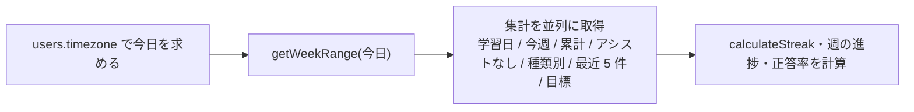

# step2-api-user-stats

マイページ用の `GET /api/user/stats`、カレンダー用の `GET /api/user/calendar`、挑戦の一覧用の `GET /api/user/attempts` を実装する。集計は `reading_attempts` から都度 `GROUP BY` する（[README の「集計の方法」](../README.md#集計の方法)）。

## 前提

- [step1-db-user-goals](./step1-db-user-goals.md)
- [reading-practice step1-db-reading-attempts](../../reading-practice/tasks/step1-db-reading-attempts.md)（`reading_attempts` / `attempt_answers`。`study_date` は `date` の `mode: "string"`）
- [github-auth step2-api-auth-github](../../github-auth/tasks/step2-api-auth-github.md)（`User.timezone` を `UserRepository.findById` が返す）
- [reading-practice step4-api-attempt-submit](../../reading-practice/tasks/step4-api-attempt-submit.md)（提出済みの挑戦が DB に入る。`src/lib/time-zone.ts` の `formatDateInTimeZone`）

## 対応内容

### 処理の流れ（stats）



1. `repo.userRepository.findById(userId)` が `null` なら `err(unauthorizedError(...))`。「今日」を求めるのにタイムゾーンが要るため、読み取りの API でも 401 にする（削除済みユーザーの access token。クライアントは refresh に失敗してログイン画面へ戻る）
2. 「今日」は `formatDateInTimeZone(deps.now, user.timezone)`。集計そのものは `study_date` だけで決まり、タイムゾーン変換はしない
3. 数えるのは `status = 'submitted'` の挑戦だけ（途中・期限切れは数えない。期限切れへの更新はこの API では行わない）

### api-schema（`packages/schema/src/api-schema/learning-record.ts`）

JSON は snake_case。日付は `z.string().date()`（`YYYY-MM-DD`。存在しない日付は弾かれる）。`index.ts` に `export * from "./learning-record"` を足す（ファイル名順）。

```typescript
import { GOAL_METRICS, QUESTION_TYPES } from "@repo/domain"

/** 正答率。設問が 0 問なら accuracy_percent は null（四捨五入した整数 %） */
const accuracySchema = z.object({
  accuracy_percent: z.number().int().nullable(),
  correct_count: z.number().int(),
  question_count: z.number().int(),
})

/** 挑戦の一覧の 1 行（stats の recent_attempts と attempts で共通） */
const learningRecordAttemptSchema = z.object({
  id: z.number(),
  correct_count: z.number().int(),
  elapsed_seconds: z.number().int(),
  is_overtime: z.boolean(),
  passage_id: z.number(),
  question_count: z.number().int(),
  study_date: z.string(),
  submitted_at: z.string(),
  /** 提出時刻 `HH:mm`（リクエスト時点の users.timezone） */
  submitted_time: z.string(),
  title: z.string(),
  used_assist: z.boolean(),
})

export const getUserStatsResponseSchema = z.object({
  goal: z.object({
    /** target_date − 今日。過ぎていれば負 */
    days_left: z.number().int().nullable(),
    goal_text: z.string().nullable(),
    is_weekly_achieved: z.boolean(),
    target_date: z.string().nullable(),
    weekly_metric: z.enum(GOAL_METRICS).nullable(),
    /** passages は今週の提出数、minutes は今週の学習秒数 ÷ 60 の切り捨て */
    weekly_progress: z.number().int().nullable(),
    weekly_target: z.number().int().nullable(),
  }).nullable(),
  no_assist: accuracySchema,
  recent_attempts: z.array(learningRecordAttemptSchema),
  streak: z.object({
    current: z.number().int(),
    longest: z.number().int(),
    /** 直近 14 日（今日が末尾） */
    recent_days: z.array(z.object({ date: z.string(), has_studied: z.boolean() })),
  }),
  today: z.string(),
  totals: accuracySchema.extend({
    attempt_count: z.number().int(),
    passage_count: z.number().int(),
    study_seconds: z.number().int(),
  }),
  type_accuracy: z.array(accuracySchema.extend({ type: z.enum(QUESTION_TYPES) })),
  /** 正答率が一番低い種類（設問のある種類だけで比べる。設問のある種類が 2 つ未満・すべて同率〈すべて 100% を含む〉なら null） */
  weakest_question_type: z.enum(QUESTION_TYPES).nullable(),
})

export const getUserCalendarQueryStringSchema = z.object({
  from: z.string().date().optional(),
  to: z.string().date().optional(),
})

export const getUserCalendarResponseSchema = z.object({
  /** from〜to の全日（学習していない日も level 0 で含める） */
  days: z.array(z.object({
    attempt_count: z.number().int(),
    correct_count: z.number().int(),
    date: z.string(),
    level: z.number().int().min(0).max(4),
    question_count: z.number().int(),
    study_seconds: z.number().int(),
  })),
  from: z.string(),
  to: z.string(),
  today: z.string(),
})

export const getUserAttemptsQueryStringSchema = z.object({
  cursor: z.coerce.number().int().positive().optional(),
  date: z.string().date().optional(),
  limit: z.coerce.number().int().min(1).max(50).default(20),
})

export const getUserAttemptsResponseSchema = z.object({
  attempts: z.array(learningRecordAttemptSchema),
  next_cursor: z.number().nullable(),
})
```

型（`GetUserStatsResponse` など）は `z.infer` で export する。

### Repository: 学習記録用の `LearningRecordRepository` を新設する

`ReadingAttemptRepository` に足さず、**集計専用（読み取りのみ）の Repository を作る**。理由:

- README の「集計の方法」は、遅くなったら日ごとの集計テーブルに切り替える（API の形は変えない）としている。集計を 1 つの Repository に閉じておけば、切り替えはこの実装の差し替えだけで済む
- `reading_attempts`・`attempt_answers`・`questions`・`passages` をまたぐ集計で、1 テーブルの CRUD ではない
- 挑戦の開始・提出（reading-practice）が使う `ReadingAttemptRepository` の interface を太らせない（Service のテストのモックが全メソッドを並べる必要があるため）

取り決め 5.3 の Repository の一覧に `LearningRecordRepository` を加える形になる。目標は step3 の `UserGoalRepository` を使うが、stats が目標を読むので **`UserGoalRepository`（`findByUserId` のみ）はこの step で作る**（step3 で upsert を足す）。

```typescript
/** apps/api/src/repository/learning-record-repository.ts */
export type DailyStudySummary = { attemptCount: number, correctCount: number, date: string, questionCount: number, studySeconds: number }
export type StudyTotals = { attemptCount: number, correctCount: number, passageCount: number, questionCount: number, studySeconds: number }
export type AccuracyCount = { correctCount: number, questionCount: number }
export type SubmittedAttempt = {
  id: number
  correctCount: number
  elapsedSeconds: number
  isOvertime: boolean
  passageId: number
  passageTitle: string
  questionCount: number
  studyDate: string
  submittedAt: Date
  translatedBlockCount: number
  wordLookupCount: number
}

export interface LearningRecordRepository {
  /** 学習した日（重複なし） */
  findStudyDates(userId: number): Promise<string[]>
  /** 提出済みの挑戦を新しい順（submitted_at desc, id desc）。cursor はその id より後ろ */
  findSubmittedAttempts(userId: number, options: { cursor?: number, date?: string, limit: number }): Promise<SubmittedAttempt[]>
  summarizeAccuracyByQuestionType(userId: number): Promise<(AccuracyCount & { type: QuestionType })[]>
  /** 期間内の日ごとの集計（学習した日だけ。日付の昇順） */
  summarizeByDate(userId: number, range: { from: string, to: string }): Promise<DailyStudySummary[]>
  /** translated_block_count = 0 かつ word_lookup_count = 0 の挑戦だけ */
  summarizeNoAssistAccuracy(userId: number): Promise<AccuracyCount>
  summarizeTotals(userId: number): Promise<StudyTotals>
}
```

Drizzle 実装（`src/repository/drizzle/learning-record-repository.ts`）の要点:

- すべて `eq(readingAttempts.userId, userId)` と `eq(readingAttempts.status, "submitted")` で絞る（`(user_id, study_date)` の index が効く）
- `summarizeByDate`: `groupBy(readingAttempts.studyDate)`。pg の `count` / `sum` は bigint の文字列で返るので `sql<number>\`coalesce(sum(...), 0)\`.mapWith(Number)` で数値にする
- `summarizeTotals`: `count()`・`countDistinct(readingAttempts.passageId)`・各 `sum`
- `summarizeAccuracyByQuestionType`: `attempt_answers` → `reading_attempts` → `questions` を join して `groupBy(questions.type)`、正答数は `count(*) FILTER (WHERE is_correct)`
- `findSubmittedAttempts`: `passages` を join してタイトルを取る。cursor は `sql\`(${readingAttempts.submittedAt}, ${readingAttempts.id}) < (SELECT submitted_at, id FROM reading_attempts WHERE id = ${cursor} AND user_id = ${userId})\``（他人の id なら 0 件）
- 足りない演算子（`count` / `countDistinct` / `gte` / `lte` など）は `packages/db/src/index.ts` の re-export に足す

Prisma 実装は `groupBy` / `aggregate` / `findMany({ distinct })` を使い、join の要る種類別は `$queryRaw` で書く。`@db.Date` は `Date` で返るので `toISOString().slice(0, 10)` で文字列にする。

`UserGoalRepository`（`findByUserId(userId): Promise<UserGoal | null>`）は Drizzle / Prisma の両方に作り、Prisma 実装の `_toDomain()` で `weeklyMetric` を `isGoalMetric` で検証する（未知の値は throw）。両 Repository を `src/repository/index.ts` と各実装の `index.ts` に足す（ファイル名順）。

### Service（`src/service/learning-record-service.ts`）

「今日」の計算には reading-practice step4 が作った `src/lib/time-zone.ts` の `formatDateInTimeZone(instant, timeZone)` を使い、同じファイルに `formatTimeInTimeZone`（`HH:mm`、`hourCycle: "h23"`）を足す。

```typescript
type LearningRecordRepo = {
  learningRecordRepository: LearningRecordRepository
  userGoalRepository: UserGoalRepository
  userRepository: UserRepository
}

/** カレンダーで一度に取れる日数（README: 最大 366 日） */
const CALENDAR_MAX_DAYS = 366
const RECENT_ATTEMPT_LIMIT = 5
const RECENT_DAY_COUNT = 14

export const getUserStats = async (
  userId: number,
  repo: LearningRecordRepo,
  deps: { now: Date },
): Promise<Result<UserStats>> => {
  const user = await repo.userRepository.findById(userId)
  if (!user) return err(unauthorizedError("User not found"))

  const today = formatDateInTimeZone(deps.now, user.timezone)
  const week = getWeekRange(today)
  const [studyDates, weekDays, totals, noAssist, byType, recent, goal] = await Promise.all([
    repo.learningRecordRepository.findStudyDates(userId),
    repo.learningRecordRepository.summarizeByDate(userId, { from: week.start, to: week.end }),
    repo.learningRecordRepository.summarizeTotals(userId),
    repo.learningRecordRepository.summarizeNoAssistAccuracy(userId),
    repo.learningRecordRepository.summarizeAccuracyByQuestionType(userId),
    repo.learningRecordRepository.findSubmittedAttempts(userId, { limit: RECENT_ATTEMPT_LIMIT }),
    repo.userGoalRepository.findByUserId(userId),
  ])
  /** 以降: calculateStreak、直近 14 日、週の進捗、種類別を QUESTION_TYPES の順に 0 埋め、最も低い種類 */
}
```

`UserStats` などの戻り値の型は service に camelCase で定義する（domain には置かない）。Controller が snake_case に詰め替える。


- 週の進捗: `passages` は `weekDays` の `attemptCount` の合計、`minutes` は `studySeconds` の合計 ÷ 60 の切り捨て。`is_weekly_achieved` は `progress >= weekly_target`（週の目標が無ければ `weekly_progress: null`・`false`）
- 正答率は `Math.round(correct / question * 100)`、`question === 0` なら `null`
- `weakest_question_type`（一番苦手な種類）は、設問のある種類だけを丸める前の比で比べて一番低い種類。一番低い比の種類が複数あれば `QUESTION_TYPES` の順で先のもの。ただし次のときは「他の種類より低い」と言えないので `null`（web / mobile は文を出さない）
  - 設問のある種類が 2 つ未満（1 種類だけでは比べられない）
  - 設問のある種類がすべて同率（一番低い比 = 一番高い比）。すべて 100%（初めての 1 問を全問正解したときなど）もここに入る
- `getUserCalendar(userId, range: { from?: string, to?: string }, repo: { learningRecordRepository, userRepository }, deps: { now: Date })`:
  - `from` と `to` は両方指定か両方省略。片方だけ・`from > to`・`countDaysBetween(from, to) + 1 > 366` は `err(badRequestError(...))`
  - 省略時は年表示の範囲: `to = 今日`、`from = max(getWeekRange(今日).start − 52 週, 今日 − 365 日)`（月曜始まりの 53 列に収まり、366 日を超えない）
  - `summarizeByDate` の結果を Map にし、`from`〜`to` の全日を `convertStudySecondsToLevel` 付きで返す（`to` が未来でもよい。月表示が月末まで要求するため）
- `getUserAttempts(userId, query: { cursor?: number, date?: string, limit: number }, repo: { learningRecordRepository, userRepository })`: `limit + 1` 件取り、余りがあれば最後に返した行の `id` を `nextCursor` にする
- 一覧の行は共通の変換で `submittedTime`（`formatTimeInTimeZone(submittedAt, user.timezone)`）と `usedAssist`（`translatedBlockCount > 0 || wordLookupCount > 0`）を足す
- `src/service/index.ts` に `export * as learningRecord from "./learning-record-service"` を足す（ファイル名順）

### Controller / Router / DI

- `src/controller/user/stats.ts`（`UserStatsController`）・`calendar.ts`（`UserCalendarController`）・`attempts.ts`（`UserAttemptsController`）。`controller/user/get.ts` と同じ形で、query は `parseRequest(get...QueryStringSchema, req.query)`、レスポンスは `parseResponse` で snake_case に組み立てる。stats と calendar は `{ now: new Date() }` を渡す
- `src/routes/user-router.ts` の `UserRouterControllers` に `attempts?` / `calendar?` / `stats?` を足し、`router.get("/attempts")`・`router.get("/calendar")`・`router.get("/stats")` を登録する
- `src/index.ts`: `DrizzleLearningRecordRepository` / `DrizzleUserGoalRepository` を生成し、3 つの Controller を組み立てて `userRouter({ ... })` に渡す（キーはアルファベット順）

## 動作確認

```bash
pnpm --filter @repo/api-schema build
pnpm --filter api test
pnpm lint:fix
```

テスト用の投入は `test/controller/helper.ts` に `createSubmittedAttempt({ elapsedSeconds, studyDate, userId, ... })` を足す（passage / question の作成は reading-practice の step のヘルパーがあれば使う）。

Repository の契約テスト（`test/repository/learning-record-repository.test.ts`・`user-goal-repository.test.ts`、Drizzle / Prisma の `describe.each`）:

- [ ] `in_progress` / `expired` の挑戦と他のユーザーの挑戦は、どのメソッドの結果にも入らない
- [ ] `summarizeByDate` は `from` と `to` の日を含み、範囲外の日を含まない（境界）
- [ ] `summarizeTotals` の `passageCount` は同じ問題を 2 回解いても 1
- [ ] `summarizeAccuracyByQuestionType` は種類ごとの設問数と正答数を返す
- [ ] `findSubmittedAttempts` は `submitted_at` の新しい順、同時刻は id の降順。cursor の続きから返し、`date` で絞れる

Service のユニットテスト（Repository は `vi.fn()`、`now` を固定）:

- [ ] `now = 2026-10-10T15:30:00Z`・`Asia/Tokyo` のとき今日は `2026-10-11`（日曜）、週は `2026-10-05`〜`2026-10-11`
- [ ] 挑戦が 0 件なら累計 0・正答率 null・`weakest_question_type` null・`goal` null
- [ ] 週の目標が minutes のとき `weekly_progress` は秒の合計 ÷ 60 の切り捨て、目標値ちょうどで `is_weekly_achieved` が true
- [ ] `type_accuracy` は 5 種類を `QUESTION_TYPES` の順で返し、設問の無い種類は null
- [ ] 一番苦手な種類は丸める前の比で比べ、一番低い比の種類が複数あれば `QUESTION_TYPES` の順で先のもの
- [ ] 設問のある種類がすべて 100%・1 種類だけ・すべて同率なら、一番苦手な種類は null
- [ ] ユーザーが存在しなければ 3 つとも `UNAUTHORIZED`
- [ ] calendar: 省略時は今日が月曜なら 365 日・日曜なら 366 日。`days` は全日で level が付く
- [ ] calendar: 366 日は ok、367 日・`from > to`・片方だけは `BAD_REQUEST`
- [ ] attempts: `limit + 1` 件返れば `nextCursor` が最後の行の id、`limit` 件以下なら null

Controller のインテグレーションテスト（supertest、実 DB）:

- [ ] `GET /api/user/stats` が 200 でスキーマどおりの全項目を返す（`toEqual` + `expect.any`）。トークン無しで 401
- [ ] `GET /api/user/calendar` が 200 で `days` の件数が範囲の日数と一致。`from=2026-02-30` は 400、範囲 367 日は 400
- [ ] `GET /api/user/attempts?date=` がその日の挑戦だけを返し、cursor で 2 ページ目が取れる。`limit=51` は 400
- [ ] 削除済みユーザーのトークンで 401
