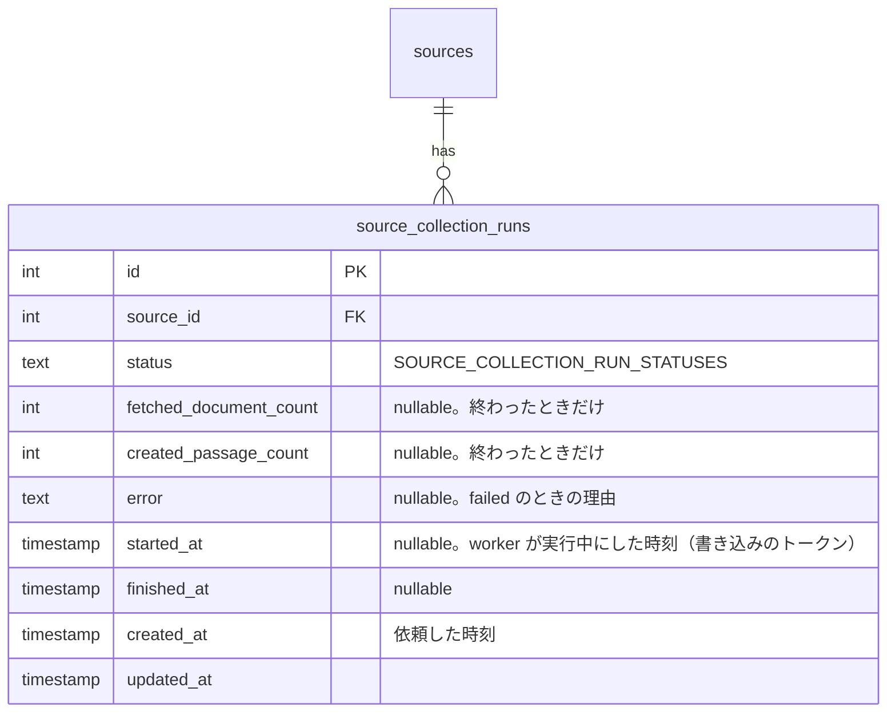
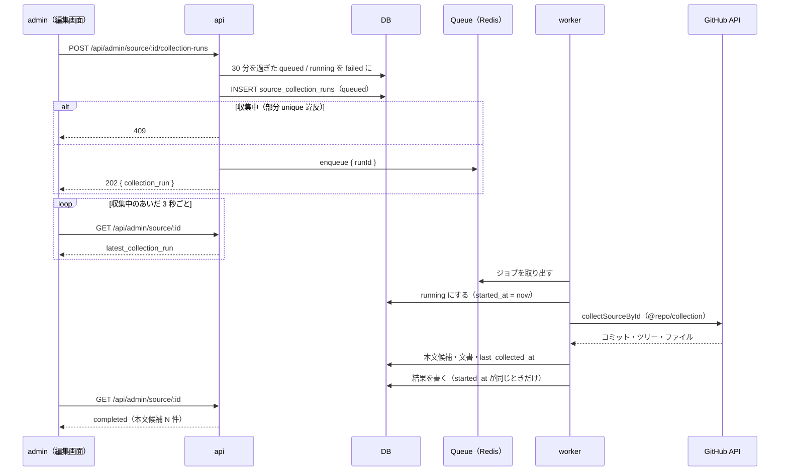

# 管理画面からの今すぐ収集

admin のソースの編集画面に「今すぐ収集」のボタンを置き、GitHub のソースを 1 つ、毎日の収集（cron の `collect:passages`）を待たずにその場で収集する。収集は裏の worker で行い、画面には「収集中」「完了（本文候補 N 件）」「上限で打ち切り」「rate limit で打ち切り」「失敗」を出す。

ソースを登録したら翌日の cron か CLI の手動実行を待つ必要があった（[content-collection の MVP 対象外](../content-collection/deferred-more-sources.md#管理画面からの収集の即時実行抽出のプレビュー)）。登録してすぐ本文候補まで確かめられるようにする。収集の処理は cron と worker の両方から使うので、`apps/cron` から共有パッケージ `@repo/collection` に移し、重複させない。

このドキュメントは **仕様（What）** と **設計（How）** を分けて記述する：

- **仕様**：ユーザーから見える挙動・ルール・データの意味
- **設計**：実装にあたっての技術的な選択と制約

## 関連 spec

- [`../content-collection/README.md`](../content-collection/README.md) — 収集の処理（対象のファイルの列挙・本文候補の切り分け・上限・rate limit・冪等性）の正本。この機能は同じ処理を 1 ソースに対して呼ぶだけ
- [`../content-collection/deferred-more-sources.md`](../content-collection/deferred-more-sources.md#管理画面からの収集の即時実行抽出のプレビュー) — 「管理画面からの収集の即時実行」の設計案（案 B：api が Queue に積み、worker が実行する）をこの機能で実装する
- [`../github-only-collection/README.md`](../github-only-collection/README.md) — 収集するのは GitHub のソースだけ。サイトのソースは収集しない
- [`../minimal-deploy/README.md`](../minimal-deploy/README.md#worker-を作るかどうかの切り替え) — worker を作らない minimal の構成では、この機能を使えない（`EVENT_TRACKER_TYPE` と同じ切り替え）

## 目次

- [仕様](#仕様)
  - [今すぐ収集できるソース](#今すぐ収集できるソース)
  - [収集の状態](#収集の状態)
  - [収集の中身](#収集の中身)
  - [使えない環境](#使えない環境)
- [設計](#設計)
  - [収集の処理の共有パッケージ](#収集の処理の共有パッケージ)
  - [api が Queue に積み、worker が実行する](#api-が-queue-に積みworker-が実行する)
  - [収集の実行の記録](#収集の実行の記録)
  - [終わらなかった実行の片付け](#終わらなかった実行の片付け)
  - [画面の更新](#画面の更新)
  - [MVP 対象外（将来検討）](#mvp-対象外将来検討)
- [必要な画面](#必要な画面)
- [必要な API](#必要な-api)
- [必要な DB 設計](#必要な-db-設計)
- [フロー図](#フロー図)

---

## 仕様

### 今すぐ収集できるソース

| ソース | ボタン |
| --- | --- |
| 有効な GitHub のソース | 押せる |
| 無効な GitHub のソース | 押せない（「無効のソースは収集しません。有効にして保存してから押してください」） |
| 収集中（キューに入っている・実行中）の GitHub のソース | 押せない（「収集中」） |
| サイトのソース | 出さない（サイトは収集しない） |

- 押せるのはソースの編集画面だけ（一覧からまとめて収集はしない）
- 同じソースの収集は 1 つしか同時に走らない。収集中に別の管理者が押しても「収集中」になる

### 収集の状態

編集画面の右の「収集の状況」に、最後に「今すぐ収集」で行った収集の結果を出す。

| 状態 | 表示 |
| --- | --- |
| キューに入っている（`queued`） | 収集中（押した時刻） |
| 実行中（`running`） | 収集中（始めた時刻） |
| 完了（`completed`） | 完了：文書 M 件を取得、本文候補 N 件を作成（終わった時刻） |
| 変更なし（`up_to_date`） | 前回の収集から変更なし（終わった時刻） |
| 上限で打ち切り（`limit_reached`） | 上限で打ち切り：文書 M 件・本文候補 N 件。残りは次の収集で続きから取り込む |
| rate limit で打ち切り（`rate_limited`） | GitHub の rate limit で打ち切り。残りは次の収集で続きから取り込む |
| 失敗（`failed`） | 失敗：理由（GitHub にリポジトリが無い・30 分を過ぎても終わらなかった など） |

- 収集中の間は、画面を開いたままで結果に切り替わる（数秒ごとに読み直す）
- cron の収集の結果はここには出さない（今までどおり「最終収集」の日時だけ）

### 収集の中身

cron の `collect:passages --source-id=N` と同じ収集を 1 ソースに対して行う。

- 作るのは本文候補（`collected`）だけで、問題は作らない（Claude API は呼ばない。生成は今までどおり `generate:questions`）
- 文書数・本文候補数の上限、GitHub の rate limit での打ち切り、前回から変わっていなければ何もしないこと、途中で止まっても次の収集で続きから取り込むことは cron と同じ
- 「最終収集」の日時（`last_collected_at`）も cron と同じく更新される

### 使えない環境

worker を動かしていない環境（minimal の構成で worker を作らないとき）では使えない。ボタンを押すと「この環境では今すぐ収集を使えません（worker がありません）。毎日の収集を待つか、cron を手動で実行してください」を出す。

---

## 設計

### 収集の処理の共有パッケージ

**`apps/cron` の収集の処理（`service/collection`・`client/github`・収集が使う Repository と定数）を、新しい共有パッケージ `@repo/collection`（`packages/collection`）に移す。cron と worker はどちらもこのパッケージの関数を呼ぶ。**

| 移すもの（cron から） | パッケージでの置き場所 |
| --- | --- |
| `service/collection/*`（`collectPassages`・`collectGitHubSource`・`previewSource` ほか） | `src/service/` |
| `client/github/*`（`GitHubContentClient`・`GitHubRateLimitError` など） | `src/github/` |
| `const/collection.ts`（rate limit の閾値・試し実行の件数・ファイルの大きさの上限・却下の理由） | `src/const.ts` |
| `repository/source-repository.ts`・`source-document-repository.ts` と drizzle の実装 | `src/repository/` |
| `repository/passage-repository.ts` のうち収集が使う 3 つ（`findGeneratedOrGeneratingTitles`・`insertIgnoringDuplicates`・`rejectCollected`）と drizzle の実装 | `src/repository/` |

- 「1 ソースを収集する」の入口を `collectSourceById` にまとめ、cron の `--source-id` と worker の両方がこれを呼ぶ。ソースが無い・サイト・無効のときの判定（今は `collectPassages` の中）もここに移す
- Repository は `createCollectionRepositories(db)` だけを export し、cron と worker の composition root で 1 回作る（`@repo/db` の client と同じ「factory だけを export」の流儀）。GitHub の client も `createGitHubContentClient({ contactUrl, token })` で作る
- token の有無で rate limit の閾値を選ぶ処理（今は cron の task の三項演算子）も `selectGitHubMinRateLimitRemaining(token)` としてパッケージに置く
- cron に残すのは CLI の都合だけのもの（`lib/parse-collect-args.ts`・`lib/format-dry-run.ts`・`task/collect-passages.ts`）と、問題の生成の `PassageRepository`（収集の 3 つのメソッドを除いたもの）
- パッケージは env も知らない（上限・token・連絡先は引数で受ける）。env は今までどおり各 app の `src/env.ts` に書く（cron と worker の両方に `GITHUB_CONTENT_TOKEN`・`COLLECT_MAX_*` を書く）。既定値は `@repo/collection` の定数（`DEFAULT_MAX_DOCUMENTS_PER_SOURCE` など）を使い、数字を 2 か所に書かない
- パッケージは `@repo/content-extractor` と同じく `module: nodenext` の CommonJS で build する。Drizzle の型を `src/repository/` の内側に閉じるため、パッケージの eslint にも `@repo/eslint-config/db-boundary` を入れる
- **比べた案**
  - worker が cron の task（`node dist/task/collect-passages.js --source-id=N`）を子プロセスで起動する：worker の image に cron の build を入れることになり、結果（件数・状態）も標準出力から読むことになる
  - api が AWS SDK で cron の ECS RunTask を起動する（deferred の案 A）：ローカル・dev に ECS が無く、ローカルでは動かせない。api の IAM ロールにも権限が要る
  - worker に収集の処理を写す：重複する（今回の要望で外した）

**Repository の interface を app ごとに分ける規約との関係**：収集の Repository は、収集の処理と一緒にパッケージに置く（収集の操作だけを持つ。cron の問題の生成や api の CRUD とは操作が違う）。収集の実行の記録（下）の Repository は、api（作る・最新を読む）と worker（実行中にする・結果を書く）で操作が違うので、今の規約どおり app ごとに持つ。

### api が Queue に積み、worker が実行する

**api は収集の実行の記録（`source_collection_runs`、状態 `queued`）を作ってから、`collect-source` の Queue にその id を積み、202 を返す。worker が取り出して `collectSourceById` を呼び、結果を記録に書く。**

- api の中では収集しない。1 ソースで最大 100 文書を GitHub API から取るので、api の応答時間（URL から追加で 15 秒に抑えたのと同じ制約。minimal の api は API Gateway と Lambda の 29 秒）に収まらない
- Queue の型（`COLLECT_SOURCE_QUEUE_NAME`・`CollectSourceJobData = { runId }`・`buildCollectSourceJobId`）は `@repo/queue` の `jobs/collect-source.ts` に置く（既存の `process-memo`・`track-event` と同じ）
- **ジョブの失敗とリトライ**：収集の失敗（GitHub にリポジトリが無い・ソースが無効になっていた など）は、ジョブの中で記録を `failed` にして正常に終える（BullMQ のリトライに回さない）。リトライして同じ失敗を 3 回繰り返すだけで、結果も記録に書けているため。DB に書けないなどの想定外のエラーだけを throw し、BullMQ のリトライ（3 回）に任せる
- **冪等性**：同じジョブが 2 回動いても（stalled の検出・リトライ）、収集は今までどおり冪等（本文候補は `content_hash` の unique、commit SHA の記録は楽観ロック）。記録の書き込みは「実行中にしたときの時刻」をトークンにして、古い実行が新しい結果を上書きしないようにする（`generate:questions` の `generation_started_at` と同じ）
- **cron との同時実行**：cron の収集と「今すぐ収集」が同じソースを同時に収集しても、上の冪等性で結果は壊れない。cron は記録を作らず、今すぐ収集の「収集中」も見ない（MVP）
- **worker の負荷**：収集は `@repo/content-extractor` の Markdown の抽出（unified / remark）を使う。パッケージの `index.ts` は jsdom（サイトの取得）も読むので、worker は `collect-source` のジョブで初めて使うときに `@repo/collection` を `import()` で読む（api の `client/page-fetcher.ts` と同じ。worker の他のジョブと起動を重くしない）
- **使えない環境**：api の env `SOURCE_COLLECTION_TYPE`（`queue` / `none`、既定 `queue`）で切り替える。`none` なら `POST` の Controller を作らない（ルートを登録しないので 404）。minimal の deploy の workflow で `EVENT_TRACKER_TYPE` と同じく、worker があれば `queue`、無ければ `none` にする

### 収集の実行の記録

**新しいテーブル `source_collection_runs` に、今すぐ収集の 1 回ごとの状態と結果を残す。**

- 状態の値は `@repo/domain` の `SOURCE_COLLECTION_RUN_STATUSES`（`queued`・`running`・`completed`・`limit_reached`・`rate_limited`・`up_to_date`・`failed`）を正本にし、DB の CHECK と api-schema の enum をここから作る。終わり方の 4 つ（`completed` など）は `SOURCE_COLLECTION_RESULT_STATUSES` として、`@repo/collection` の `SourceCollectionStatus` もこれを使う
- **同じソースの収集は 1 つだけ**：`(source_id) WHERE status IN ('queued', 'running')` の部分 unique index で DB が保証する。api は INSERT の unique 違反を 409 にする（先に SELECT して確かめる形だと、2 人が同時に押したときに両方通る）
- 記録は消さない（数が少ない。1 回押すと 1 行）。画面に出すのは最新の 1 件だけ
- Queue（BullMQ）のジョブの状態は使わない。Queue の抽象（`JobQueue<T>`）は enqueue しか持たず、状態を読むと BullMQ に依存する（SQS などに差し替えられなくなる）。ジョブは完了から 1 時間で Redis から消えるので、結果を後から見られない
- **比べた案**：`sources` に `collection_status` などの列を足す。1 ソース 1 行で済むが、ソースの更新（admin の保存）と worker の書き込みが同じ行を取り合い、`updated_at`（URL から追加のキャッシュのキー）も収集のたびに変わってしまう

### 終わらなかった実行の片付け

**`queued` / `running` のまま 30 分（`SOURCE_COLLECTION_RUN_TIMEOUT_MINUTES`）を過ぎた記録は、api が次に読むとき（編集画面を開く・ボタンを押す）に `failed`（「30 分を過ぎても終わらなかった」）にする。**

- worker が止まった（deploy の SIGKILL・Fargate Spot の中断）・Redis からジョブが消えた、などで記録が `queued` / `running` のまま残ると、ボタンを二度と押せなくなるため
- 30 分は、1 ソースの上限（100 文書）を GitHub API で取って抽出する時間に十分な余裕を持たせた値（`generate:questions` の回収と同じ長さ）
- worker の側でも、実行中にしたときの時刻をトークンにして書くので、片付けた後に遅れて終わった実行は結果を書かない（片付けた `failed` のまま）

### 画面の更新

- ボタンは Server Action で api の `POST` を呼び、成功したら編集画面を `revalidatePath` する
- 最新の記録が `queued` / `running` の間は、client component が 3 秒ごとに `router.refresh()` して読み直す。終わった状態になったら止める。画面を閉じても収集は続く
- 収集が終わったら、「本文候補」の件数のバッジも同じ読み直しで更新される

### MVP 対象外（将来検討）

- ソース一覧からの一括の収集、すべての有効なソースの収集（cron と同じもの）
- cron の収集の結果を記録に残して画面に出す（今は `last_collected_at` だけ）
- 収集の途中経過（何文書目か）の表示
- 試し実行（`--dry-run`）を画面から行う

---

## 必要な画面

| 画面 | 変えるところ |
| --- | --- |
| ソースの編集（`/sources/[id]`、GitHub のソース） | 右の「収集の状況」に「今すぐ収集」のボタンと、最後の今すぐ収集の状態・結果を出す。収集中は数秒ごとに読み直す |

具体的な UI は step5 で決める（admin のテンプレートのボタン・バッジを使う）。

## 必要な API

| メソッド | パス | 説明 |
| --- | --- | --- |
| POST | `/api/admin/source/:id/collection-runs` | 今すぐ収集を依頼する。記録（`queued`）を作って Queue に積み、202 と記録を返す。ソースが無ければ 404、サイト・無効のソースは 400、収集中なら 409。`SOURCE_COLLECTION_TYPE=none` ならルートが無い（404） |
| GET | `/api/admin/source/:id` | ソース詳細に `latest_collection_run`（最後の今すぐ収集の記録。無ければ null）を足す。30 分を過ぎた `queued` / `running` は `failed` にしてから返す |

Queue：

| Queue | ジョブ | producer | consumer |
| --- | --- | --- | --- |
| `collect-source` | `{ runId: number }`（jobId は `collect-source-run-{runId}`） | api | worker |

## 必要な DB 設計

| テーブル | 主要カラム | 説明 |
| --- | --- | --- |
| `source_collection_runs` | `id`, `source_id`, `status`, `fetched_document_count`, `created_passage_count`, `error`, `started_at`, `finished_at`, `created_at`, `updated_at` | 今すぐ収集の 1 回ごとの状態と結果 |

制約：

- `status` は `SOURCE_COLLECTION_RUN_STATUSES` から CHECK を作る（`@repo/domain` が正本）
- 部分 unique index：`(source_id) WHERE status IN ('queued', 'running')`（同じソースの収集は 1 つだけ）
- index：`(source_id, id)`（最新の 1 件を引く）
- `source_id` は `sources(id)` への外部キー（`ON DELETE CASCADE`）

## フロー図

## 実装の手順

| step | 内容 |
| --- | --- |
| [step1-packages-collection](./tasks/step1-packages-collection.md) | `@repo/collection` を作り、cron の収集の処理を移す（cron の挙動は変えない） |
| [step2-db-source-collection-runs](./tasks/step2-db-source-collection-runs.md) | `source_collection_runs` と domain の定数・型 |
| [step3-api-collection-runs](./tasks/step3-api-collection-runs.md) | `POST /api/admin/source/:id/collection-runs`、詳細の `latest_collection_run`、Queue の型、`SOURCE_COLLECTION_TYPE` |
| [step4-worker-collect-source](./tasks/step4-worker-collect-source.md) | worker の `collect-source` ジョブ |
| [step5-admin-collect-now](./tasks/step5-admin-collect-now.md) | 編集画面のボタンと状態の表示 |
