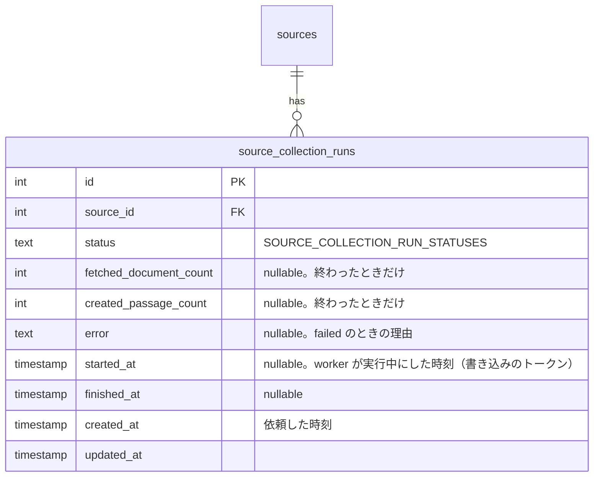
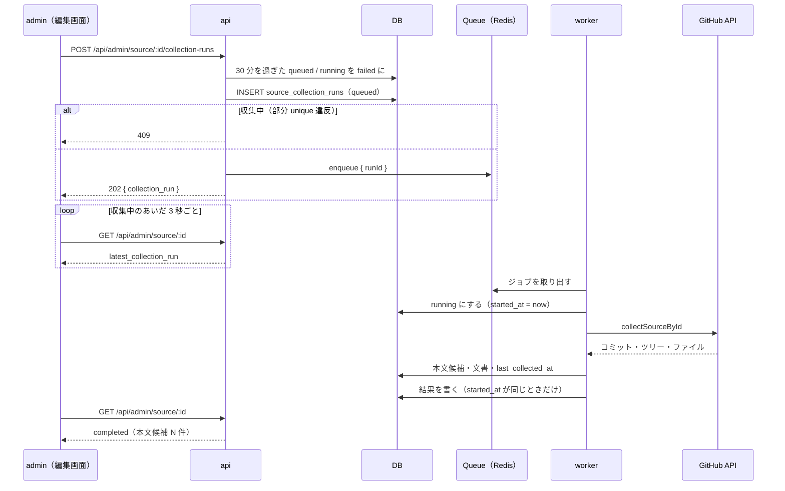

# 管理画面からの今すぐ収集

admin のソースの編集画面に「今すぐ収集」のボタンを置き、GitHub のソースを 1 つ、その場で収集する。収集は api が Queue に積み、worker が裏で行う。画面には「収集中」「完了（本文候補 N 件）」「上限で打ち切り」「rate limit で打ち切り」「失敗」を出す。

収集はこのボタンだけで行い、cron の毎日の収集（`collect:passages`）はやめる。ソースを登録してすぐ本文候補まで確かめられれば、毎日の自動の収集は要らないため。収集の処理は `apps/cron` から `apps/worker` に移す（使うのは worker だけなので、共有パッケージにはしない）。

このドキュメントは **仕様（What）** と **設計（How）** を分けて記述する：

- **仕様**：ユーザーから見える挙動・ルール・データの意味
- **設計**：実装にあたっての技術的な選択と制約

## 関連 spec

- [`../content-collection/README.md`](../content-collection/README.md) — 収集の処理（対象のファイルの列挙・本文候補の切り分け・上限・rate limit・冪等性）の正本。この機能は収集を動かす場所（cron → worker）ときっかけ（毎日 → ボタン）を変え、処理の中身は変えない
- [`../content-collection/deferred-more-sources.md`](../content-collection/deferred-more-sources.md#管理画面からの収集の即時実行抽出のプレビュー) — 「管理画面からの収集の即時実行」の設計案（案 B：api が Queue に積み、worker が実行する）をこの機能で実装する
- [`../github-only-collection/README.md`](../github-only-collection/README.md) — 収集するのは GitHub のソースだけ。サイトのソースは収集しない
- [`../passage-extraction-tuning/README.md`](../passage-extraction-tuning/README.md) — 抽出の規則を変えたときの確かめ方（今は `--dry-run`）が変わる
- [`../minimal-deploy/README.md`](../minimal-deploy/README.md#worker-を作るかどうかの切り替え) — worker を作らない minimal の構成では収集できない（`EVENT_TRACKER_TYPE` と同じ切り替え）

## 目次

- [仕様](#仕様)
  - [収集のきっかけ](#収集のきっかけ)
  - [今すぐ収集できるソース](#今すぐ収集できるソース)
  - [収集の状態](#収集の状態)
  - [収集の中身](#収集の中身)
  - [やめるもの](#やめるもの)
  - [使えない環境](#使えない環境)
- [設計](#設計)
  - [収集の処理を worker に移す](#収集の処理を-worker-に移す)
  - [api が Queue に積み、worker が実行する](#api-が-queue-に積みworker-が実行する)
  - [収集の実行の記録](#収集の実行の記録)
  - [終わらなかった実行の片付け](#終わらなかった実行の片付け)
  - [画面の更新](#画面の更新)
  - [MVP 対象外（将来検討）](#mvp-対象外将来検討)
- [必要な画面](#必要な画面)
- [必要な API](#必要な-api)
- [必要な DB 設計](#必要な-db-設計)
- [フロー図](#フロー図)

---

## 仕様

### 収集のきっかけ

| | 変更前 | 変更後 |
| --- | --- | --- |
| 毎日の収集 | cron の `collect:passages` が有効な GitHub のソースをすべて収集する（本番は定期実行の想定） | やめる |
| 1 ソースの収集 | CLI で `pnpm collect:passages --source-id=N` | admin の編集画面の「今すぐ収集」 |
| 試し実行（DB に書かずに抽出の結果を見る） | CLI で `--dry-run` | やめる（[MVP 対象外](#mvp-対象外将来検討)） |

- 取得元のリポジトリが更新されても、ボタンを押すまで取り込まない
- ソースの「収集する」（有効 / 無効）は、今すぐ収集を押せるかどうかを決めるスイッチになる

### 今すぐ収集できるソース

| ソース | ボタン |
| --- | --- |
| 有効な GitHub のソース | 押せる |
| 無効な GitHub のソース | 押せない（「無効のソースは収集しません。有効にして保存してから押してください」） |
| 収集中（キューに入っている・実行中）の GitHub のソース | 押せない（「収集中」） |
| サイトのソース | 出さない（サイトは収集しない） |

- 押せるのはソースの編集画面だけ（一覧からまとめて収集はしない）
- 同じソースの収集は 1 つしか同時に走らない。収集中に別の管理者が押しても「収集中」になる

### 収集の状態

編集画面の右の「収集の状況」に、最後の収集の結果を出す。

| 状態 | 表示 |
| --- | --- |
| キューに入っている（`queued`） | 収集中（押した時刻） |
| 実行中（`running`） | 収集中（始めた時刻） |
| 完了（`completed`） | 完了：文書 M 件を取得、本文候補 N 件を作成（終わった時刻） |
| 変更なし（`up_to_date`） | 前回の収集から変更なし（終わった時刻） |
| 上限で打ち切り（`limit_reached`） | 上限で打ち切り：文書 M 件・本文候補 N 件。残りはもう一度押すと続きから取り込む |
| rate limit で打ち切り（`rate_limited`） | GitHub の rate limit で打ち切り。時間をおいてもう一度押すと続きから取り込む |
| 失敗（`failed`） | 失敗：理由（GitHub にリポジトリが無い・30 分を過ぎても終わらなかった など） |

- 収集中の間は、画面を開いたままで結果に切り替わる（数秒ごとに読み直す）
- 押した後に画面を閉じても、収集は続く

### 収集の中身

今までの `collect:passages --source-id=N` と同じ収集を 1 ソースに対して行う。

- 作るのは本文候補（`collected`）だけで、問題は作らない（Claude API は呼ばない。生成は今までどおり cron の `generate:questions`）
- 1 回の上限（文書 100 件・本文候補 200 件）、GitHub の rate limit での打ち切り、前回から変わっていなければ何もしないこと、途中で止まっても次の収集で続きから取り込むことは今までと同じ
- 「最終収集」の日時（`last_collected_at`）も今までどおり更新される

### やめるもの

- cron のタスク `collect:passages`（`--source-id`・`--dry-run` を含む）
- admin の編集画面の「試し実行」のカード（`pnpm collect:passages --source-id=N --dry-run` のコマンドを出していた）
- 抽出の規則を変えたとき（[passage-extraction-tuning](../passage-extraction-tuning/README.md)）は、`--dry-run` の代わりに、ローカルで今すぐ収集を押して本文候補を確かめる（抽出の版を上げれば、取得済みの文書も切り分け直す）

### 使えない環境

worker を動かしていない環境（minimal の構成で worker を作らないとき）では収集できない。ボタンを押すと「この環境では今すぐ収集を使えません（worker がありません）」を出す。

---

## 設計

### 収集の処理を worker に移す

**`apps/cron` の収集の処理（`service/collection`・`client/github`・収集が使う Repository と定数）と、そのテストを `apps/worker` に移す。cron からは消す。**

| cron（移す前） | worker（移した後） |
| --- | --- |
| `src/service/collection/*`（`collect-github-source`・`list-github-target-files`・`extract-github-file`・`reject-out-of-target-passages`・`replace-passage-candidates`・`types`） | `src/service/collection/*` |
| `src/client/github/*` | `src/client/github/*` |
| `src/const/collection.ts` | `src/const/collection.ts` |
| `src/repository/source-repository.ts`・`source-document-repository.ts` と drizzle の実装 | `src/repository/` の同じ名前 |
| `src/repository/passage-repository.ts` のうち収集が使う 3 つ（`findGeneratedOrGeneratingTitles`・`insertIgnoringDuplicates`・`rejectCollected`）と drizzle の実装 | `src/repository/passage-repository.ts`（worker の新しい Repository） |

- cron で消すもの：`task/collect-passages.ts`・`service/collection/collect-passages.ts`・`preview-source.ts`・`lib/parse-collect-args.ts`・`lib/format-dry-run.ts`・`package.json` の `collect:passages`・env の `GITHUB_CONTENT_TOKEN`・`COLLECT_*`
- cron に残るのは問題の生成・音声・memo の掃除のタスク。`PassageRepository` は収集の 3 つのメソッドを除いたもの
- 1 ソースの入口は `collectSourceById`（ソースが無い・サイト・無効を `SourceNotCollectableError` で throw してから `collectGitHubSource` を呼ぶ）。今の `collectPassages`（全ソースのループ）は使わなくなるので消す
- **比べた案**
  - 共有パッケージ（`@repo/collection`）に切り出して cron と worker から使う：機能を足すたびに `packages/` に共通の処理が増えていく。cron で収集する理由が無くなったので、共有せずに worker に寄せる
  - `@repo/domain` に置く：domain は型・定数・純粋関数だけ（依存ゼロ）で、DB と GitHub API を使う収集は置けない
  - cron に残して、worker から cron の task を起動する・api から ECS RunTask で起動する：起動の仕組みが 2 つになり、ローカル・dev に ECS が無い

### api が Queue に積み、worker が実行する

**api は収集の実行の記録（`source_collection_runs`、状態 `queued`）を作ってから、`collect-source` の Queue にその id を積み、202 を返す。worker が取り出して `collectSourceById` を呼び、結果を記録に書く。**

- api の中では収集しない。1 ソースで最大 100 文書を GitHub API から取るので、api の応答時間（URL から追加で 15 秒に抑えたのと同じ制約。minimal の api は API Gateway と Lambda の 29 秒）に収まらない
- Queue の型（`COLLECT_SOURCE_QUEUE_NAME`・`CollectSourceJobData = { runId }`・`buildCollectSourceJobId`）は `@repo/queue` の `jobs/collect-source.ts` に置く（既存の `process-memo`・`track-event` と同じ。producer と consumer の契約なので、ここだけは共有する）
- **ジョブの失敗とリトライ**：収集の失敗（GitHub にリポジトリが無い・ソースが無効になっていた など）は、ジョブの中で記録を `failed` にして正常に終える（BullMQ のリトライに回さない）。リトライしても同じ失敗を繰り返すだけで、結果も記録に書けているため。記録の読み書きができないなどの想定外のエラーだけを throw し、BullMQ のリトライ（3 回）に任せる
- **冪等性**：同じジョブが 2 回動いても（stalled の検出・リトライ）、収集は今までどおり冪等（本文候補は `content_hash` の unique、commit SHA の記録は楽観ロック）。記録の書き込みは「実行中にしたときの時刻」をトークンにして、古い実行が新しい結果を上書きしないようにする（`generate:questions` の `generation_started_at` と同じ）
- **同時に 1 つ**：worker の `collect-source` は concurrency 1。GitHub の rate limit は token 単位で、並べても速くならない。別のソースの収集は順番待ちになる
- **worker の起動を重くしない**：収集は `@repo/content-extractor` の Markdown の抽出を使うが、パッケージの `index.ts` は jsdom（サイトの取得）も読む。worker は `collect-source` のジョブで初めて使うときに収集の service を `import()` で読む（api の `client/page-fetcher.ts` と同じ）。worker の他のジョブと起動を遅くせず、メモリ（512MB）も使わない
- **GitHub の token**：`GITHUB_CONTENT_TOKEN` は cron から worker の env に移す（任意。無ければ認証なしの 60 回 / 時で動き、起動時に warn）
- **使えない環境**：api の env `SOURCE_COLLECTION_TYPE`（`queue` / `none`、既定 `queue`）で切り替える。`none` なら `POST` の Controller を作らない（ルートを登録しないので 404）。minimal の deploy の workflow で `EVENT_TRACKER_TYPE` と同じく、worker があれば `queue`、無ければ `none` にする

### 収集の実行の記録

**新しいテーブル `source_collection_runs` に、収集の 1 回ごとの状態と結果を残す。**

- 状態の値は `@repo/domain` の `SOURCE_COLLECTION_RUN_STATUSES`（`queued`・`running`・`completed`・`limit_reached`・`rate_limited`・`up_to_date`・`failed`）を正本にし、DB の CHECK と api-schema の enum をここから作る。終わり方の 4 つは `SOURCE_COLLECTION_RESULT_STATUSES`、収集中の 2 つは `ACTIVE_SOURCE_COLLECTION_RUN_STATUSES` とし、worker の `SourceCollectionStatus`・admin の「収集中か」の判定もこれを使う
- `running` の `started_at`（書き込みのトークン・時間切れの判定に使う）と、終わった記録の `finished_at` は CHECK で必須にする（`passage_audios_generating_columns_check` と同じ）
- **同じソースの収集は 1 つだけ**：`(source_id) WHERE status IN ('queued', 'running')` の部分 unique index で DB が保証する。api は INSERT の unique 違反を 409 にする（先に SELECT して確かめる形だと、2 人が同時に押したときに両方通る）
- 記録は消さない（1 回押すと 1 行で、数が少ない）。画面に出すのは最新の 1 件だけ
- Queue（BullMQ）のジョブの状態は使わない。Queue の抽象（`JobQueue<T>`）は enqueue しか持たず、状態を読むと BullMQ に依存する（SQS などに差し替えられなくなる）。ジョブは完了から 1 時間で Redis から消えるので、結果を後から見られない
- Repository は api（作る・最新を読む・時間切れを片付ける）と worker（実行中にする・結果を書く）で操作が違うので、app ごとに持つ（今の規約どおり）
- **比べた案**：`sources` に `collection_status` などの列を足す。1 ソース 1 行で済むが、1 回ごとの結果（件数・失敗の理由）を残せず、同じソースの収集を 1 つに限る制約も「収集中の行は 1 つ」という部分 unique index で書けない（条件付きの UPDATE で取り合うことになる）

### 終わらなかった実行の片付け

**`queued` / `running` のまま 30 分（api の `SOURCE_COLLECTION_RUN_TIMEOUT_MINUTES`）を過ぎた記録は、api が次に読むとき（編集画面を開く・ボタンを押す）に `failed`（「30 分を過ぎても終わらなかった」）にする。**

- `queued` は依頼した時刻（`created_at`）、`running` は worker が始めた時刻（`started_at`）から数える。worker の `collect-source` は 1 つずつ処理するので、`queued` の 30 分には別のソースの順番待ちの時間も入る（ソースは数十件で、1 件の収集は数分なので、30 分の順番待ちは起きにくい）
- 分数を使うのは api だけなので、api の `src/const/` に置く（cron の `STALE_GENERATING_MINUTES` などと同じく、使う app の側に置く）
- 詳細の GET の中で UPDATE するので、収集中は 3 秒ごとの読み直しのたびに条件付きの UPDATE が 1 回走る（`source_id` で絞るので軽い）

- worker が止まった（deploy の SIGKILL・Fargate Spot の中断）・Redis からジョブが消えた、などで記録が `queued` / `running` のまま残ると、ボタンを二度と押せなくなるため
- 30 分は、1 回の上限（100 文書）を GitHub API で取って抽出する時間に十分な余裕を持たせた値（`generate:questions` の回収と同じ長さ）
- worker は実行中にしたときの時刻をトークンにして書くので、片付けた後に遅れて終わった実行は結果を書かない（片付けた `failed` のまま）

### 画面の更新

- ボタンは Server Action で api の `POST` を呼び、成功したら編集画面を `revalidatePath` する
- 最新の記録が `queued` / `running` の間は、client component が 3 秒ごとに `router.refresh()` して読み直す。終わった状態になったら止める
- 収集が終わったら、「本文候補」の件数のバッジと「最終収集」も同じ読み直しで更新される

### MVP 対象外（将来検討）

- 定期的な自動の収集。要るようになったら、worker の BullMQ の repeatable job か、EventBridge から api を呼ぶ形で足す（cron には戻さない）
- 試し実行（DB に書かずに抽出の結果を見る）を画面から行う
- ソース一覧からの一括の収集、収集の途中経過（何文書目か）の表示

---

## 必要な画面

| 画面 | 変えるところ |
| --- | --- |
| ソースの編集（`/sources/[id]`、GitHub のソース） | 右の「収集の状況」に「今すぐ収集」のボタンと、最後の収集の状態・結果を出す。収集中は数秒ごとに読み直す。「試し実行」のカードを消す |
| ソース一覧（`/sources`） | 説明の「毎日の収集（collect:passages）が取り込みます」を、編集画面の「今すぐ収集」で取り込むことに直す |
| ソースの登録・編集のフォーム | 「このソースを収集する」のスイッチの説明を、今すぐ収集を押せるかどうかに直す |

具体的な UI は step4 で決める（admin のテンプレートのボタン・バッジを使う）。

## 必要な API

| メソッド | パス | 説明 |
| --- | --- | --- |
| POST | `/api/admin/source/:id/collection-runs` | 今すぐ収集を依頼する。記録（`queued`）を作って Queue に積み、202 と記録を返す。ソースが無ければ 404、サイト・無効のソースは 400、収集中なら 409。`SOURCE_COLLECTION_TYPE=none` ならルートが無い（404） |
| GET | `/api/admin/source/:id` | ソース詳細に `latest_collection_run`（最後の収集の記録。無ければ null）を足す。30 分を過ぎた `queued` / `running` は `failed` にしてから返す |

Queue：

| Queue | ジョブ | producer | consumer |
| --- | --- | --- | --- |
| `collect-source` | `{ runId: number }`（jobId は `collect-source-run-{runId}`） | api | worker |

## 必要な DB 設計

| テーブル | 主要カラム | 説明 |
| --- | --- | --- |
| `source_collection_runs` | `id`, `source_id`, `status`, `fetched_document_count`, `created_passage_count`, `error`, `started_at`, `finished_at`, `created_at`, `updated_at` | 収集の 1 回ごとの状態と結果 |

制約：

- `status` は `SOURCE_COLLECTION_RUN_STATUSES` から CHECK を作る（`@repo/domain` が正本）
- 部分 unique index：`(source_id) WHERE status IN ('queued', 'running')`（同じソースの収集は 1 つだけ）
- index：`(source_id, id)`（最新の 1 件を引く）
- `source_id` は `sources(id)` への外部キー（`ON DELETE CASCADE`）

## フロー図

## 実装の手順

| step | 内容 |
| --- | --- |
| [step1-db-source-collection-runs](./tasks/step1-db-source-collection-runs.md) | `source_collection_runs` と domain の定数・型 |
| [step2-api-collection-runs](./tasks/step2-api-collection-runs.md) | `POST /api/admin/source/:id/collection-runs`、詳細の `latest_collection_run`、Queue の型、`SOURCE_COLLECTION_TYPE` |
| [step3-worker-collect-source](./tasks/step3-worker-collect-source.md) | 収集の処理を cron から worker に移し、`collect-source` のジョブを足す。cron の `collect:passages` を消す |
| [step4-admin-collect-now](./tasks/step4-admin-collect-now.md) | 編集画面のボタンと状態の表示、試し実行のカードを消す、文言 |
