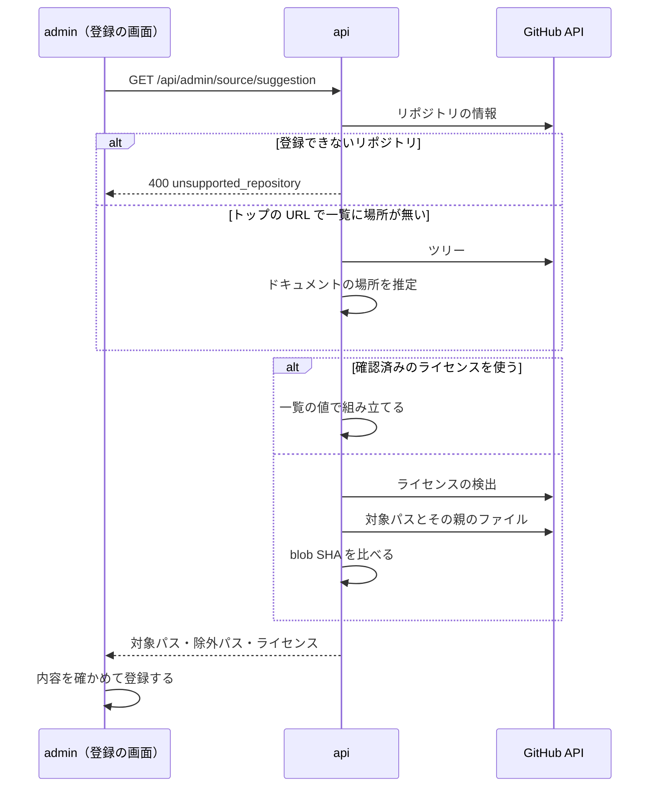

# 公式ドキュメントだけの収集

admin の GitHub のソースの登録で、リポジトリのトップの URL を入れてもリポジトリ全体を収集せず、公式ドキュメントのディレクトリだけを対象にする。変更履歴・翻訳・ブログ・貢献者向けの文書は既定で除外し、ドキュメントに別のライセンスがあるリポジトリは登録で止める。

今はトップの URL を入れると対象パスが `**` になる。ClickHouse を登録すると、対象が 26,161 ファイルになり、最初の 215 件の本文候補のうち 166 件が 1 つの変更履歴から作られた。リポジトリのトップのライセンス（Apache-2.0）で登録できたが、公式ドキュメントの `docs/` は別のライセンス（CC BY-NC-SA 4.0）で、問題の元にできなかった。

このドキュメントは **仕様（What）** と **設計（How）** を分けて記述する：

- **仕様**：ユーザーから見える挙動・ルール・データの意味
- **設計**：実装にあたっての技術的な選択と制約

## 関連 spec

- [`../source-registration-by-url/README.md`](../source-registration-by-url/README.md) — 表示名と URL で登録する流れと、`GET /api/admin/source/suggestion` の正本。この機能は読み込みで決める値を変える
- [`../content-collection/README.md`](../content-collection/README.md) — 許可するライセンスの正本（`ALLOWED_LICENSES`）。この機能はライセンスの条件を変えない
- [`../github-only-collection/README.md`](../github-only-collection/README.md) — 「ライセンスが文章に掛かっている」という収集の条件。この機能はこの条件を登録で確かめる範囲を広げる
- [`../passage-extraction-tuning/README.md`](../passage-extraction-tuning/README.md) — 本文の抽出の調整。この機能はサイト用の記法の行を消す

## 目次

- [仕様](#仕様)
  - [ドキュメントの場所](#ドキュメントの場所)
  - [既定の除外パス](#既定の除外パス)
  - [ライセンスの確認](#ライセンスの確認)
  - [確認済みのリポジトリ](#確認済みのリポジトリ)
  - [登録できないリポジトリ](#登録できないリポジトリ)
  - [本文の抽出](#本文の抽出)
  - [既存のソース](#既存のソース)
- [設計](#設計)
  - [対応できるプロジェクトの調査](#対応できるプロジェクトの調査)
  - [ドキュメントの場所の推定](#ドキュメントの場所の推定)
  - [既定の除外パスの持ち方](#既定の除外パスの持ち方)
  - [別のライセンスの検出](#別のライセンスの検出)
  - [確認済みのリポジトリの持ち方](#確認済みのリポジトリの持ち方)
  - [サイト用の記法の行を消す](#サイト用の記法の行を消す)
  - [MVP 対象外（将来検討）](#mvp-対象外将来検討)
- [必要な画面](#必要な画面)
- [必要な API](#必要な-api)
- [必要な DB 設計](#必要な-db-設計)
- [フロー図](#フロー図)
- [実装ステップ](#実装ステップ)

---

## 仕様

### ドキュメントの場所

| 入れた URL | 対象パス |
|---|---|
| リポジトリのトップ | ドキュメントのディレクトリを推定して入れる。推定できなければ `**` |
| ディレクトリ | そのディレクトリ（今と同じ） |
| ファイル | そのファイル（今と同じ） |

- 推定した場所は自動で確定しない。読み込んだ内容の「対象パス」で確かめ、違っていればディレクトリの URL を入れて読み込み直す（別のライセンスの確認は読み込んだ場所に対して行うので、「詳細」で対象パスを直すと確認されない）
- ドキュメントだけのリポジトリは、推定の結果が `**` になる（Deno など）

### 既定の除外パス

ディレクトリを対象にするとき（トップの URL を含む）は、次の除外パスを初期値に入れる。読み込んだ内容に件数を出し、「詳細」と編集の画面で外せる。

| 除外するもの | 例 |
|---|---|
| 翻訳（対象パスの直下の言語のディレクトリだけ） | `docs/ja/**`、`docs/zh/**` |
| 変更履歴 | `CHANGELOG.md`、`changelogs/`、`release-notes/`、`whats-new/` |
| ブログ | `blog/` |
| 貢献者向けの文書 | `README.md`、`CONTRIBUTING.md`、`AGENTS.md`、`contribute/` |
| ページの部品・サイトの内部用 | `_snippets/`、`_includes/`、`includes/`、`partials/`（`snippets/` は Cloudflare の製品のページがあるので除外しない） |
| 古い版のドキュメント | `7.22/`、`v1.55/`、`versioned_docs/`、`previous-versions/`（`1.1.1.1/` のような 4 要素は版として扱わない） |

- 翻訳を対象パスの直下に限るのは、MDN の `id/`（HTML の属性の説明）のように言語と同じ名前のページがあるため
- `README.md` はドキュメントのサイトに出ない案内のことが多い。ClickHouse の `docs/README.md` は貢献の手順で、製品の説明ではない

### ライセンスの確認

- 対象パスとその親のディレクトリに、リポジトリのトップと内容の違う `LICENSE` があれば登録できない。読み込んだ内容に赤字でそのファイルへのリンクを出す
- ファイルの内容までは読まない。ライセンスが許可リストにあっても止める（自動で判定できないため）
- 登録したいリポジトリは、確認して[確認済みのリポジトリ](#確認済みのリポジトリ)に足す

### 確認済みのリポジトリ

GitHub の自動の判定で分からないものや、判定がドキュメントのライセンスと違うものは、人が原文を読んで確かめた値をコードに持つ。管理者が画面でライセンスを選ぶことはない。

| リポジトリ | ドキュメント | ライセンス | 記載があるファイル | 確かめた理由 |
|---|---|---|---|---|
| `vuejs/docs` | `src` | CC-BY-4.0 | `LICENSE` | 自動の判定が NOASSERTION |
| `nodejs/node` | `doc/api` | MIT | `LICENSE` | 自動の判定が NOASSERTION（同梱物のライセンスを含む） |
| `rust-lang/book` | `src` | MIT | `COPYRIGHT` | ライセンスのファイルが 2 つ（MIT か Apache-2.0 を選べる） |
| `pytorch/pytorch` | `docs/source` | BSD-3-Clause | `LICENSE` | 自動の判定が NOASSERTION |
| `golang/website` | `_content` | CC-BY-4.0 | `_content/copyright.md` | 自動の判定（BSD-3-Clause）はコードのライセンス |
| `angular/angular` | `adev/src/content` | CC-BY-4.0 | `adev/src/app/core/layout/footer/footer.component.html` | 自動の判定（MIT）はコードのライセンス |

- default branch のドキュメントの中を登録するときだけ使う。ほかのブランチ・ドキュメントの外は、今までどおり自動の判定で決める
- 読み込んだ内容には「確認済みのライセンス」と出す

推定が難しいリポジトリも、ドキュメントの場所を同じ一覧に持つ（`microsoft/typescript-website` の `packages/documentation/copy/en`）。Angular のチュートリアルは `README.md` で書かれた本物のページなので、Angular だけ `README.md` を除外しない。Go の `_content/doc/go1*.md` はリリースノートなので除外に足す。

### 登録できないリポジトリ

`github/docs` は登録できない。本文の製品名などが `` のような変数で書かれている。消すと文章が欠け、値に置き換えるには変数の解決処理が別に要る。

### 本文の抽出

サイトのビルドで処理される記法の行を、本文候補から消す。

| 記法 | 使っているサイト | 扱い |
|---|---|---|
| `:::note`、`:::`、`::: tip NOTE`、`:::{note}` | VitePress・Docusaurus・Starlight・MyST | 記法の行だけ消し、中の本文は残す |
| `/// note`、`//// tab \| Python` | FastAPI（PyMdown） | 記法の行だけ消し、中の本文は残す |
| `{* ../../docs_src/app.py *}`、`{!> file !}` | FastAPI（MkDocs の取り込み） | 行を消す |
| `[[TOC]]` | VitePress | 行を消す |
| 見出しの `{#id}`、`{ #id }` | VitePress・FastAPI | 見出しの末尾から消す（タイトルにも出るため） |

- コードブロックの中は消さない
- 見出しの代わりに書かれたラベル（`::: tip NOTE` の `NOTE`）も消える

### 既存のソース

- 登録済みのソースの対象パスと除外パスは変えない
- 抽出の版が上がるので、次の収集で取得済みの文書も切り分け直す
- 見出しのアンカーを消すとタイトルが変わる。生成済みの節はタイトルで見分けるので、アンカー付きのタイトルで生成済みの節があると、同じ節がもう一度本文候補になる。この機能を入れる時点で該当する節は無い（dev で確認。本番は運用前）

---

## 設計

### 対応できるプロジェクトの調査

35 プロジェクトのリポジトリを調べ、ライセンスの原文を読み、20 プロジェクトの計 400 ページを実際の抽出に通して決めた（2026-10-30）。

| 結果 | 件数 | プロジェクト |
|---|---:|---|
| 既定の除外で使える | 10 | React、Go、Kubernetes、TypeScript、Next.js、Docker、Angular、Kafka、Nuxt、Svelte |
| 抽出の修正で使える | 5 | FastAPI、Vite、Deno、Astro、Cloudflare |
| 確認済みの一覧で使える | 4 | Vue、Node.js、Rust Book、PyTorch |
| 変数の解決が要る | 1 | GitHub Docs |
| 形式が未対応 | 3 | Python、Django（reStructuredText）、Spring Boot（AsciiDoc） |
| ライセンスで使えない | 12 | ClickHouse、Redis、MDN、Tailwind CSS、Prisma、MongoDB、Grafana、Elasticsearch、Terraform、Git、Linux、PostgreSQL |

### ドキュメントの場所の推定

`GET /repos/{repo}/git/trees/{branch}?recursive=1` の Markdown のパスから `findDocumentsDirectory`（`apps/api/src/lib/source-document-path.ts`）で決める。

1. 依存物・テスト（`node_modules`・`vendor`・`third_party`・`deps`・`contrib`・`test`・`tests`・`examples` など）とドット始まりのディレクトリを除く
2. トップに `docs`・`doc`・`documentation`・`content` があり、Markdown が 20 件以上あれば、この順で選ぶ
3. 無ければ、1 つのディレクトリに今の階層の Markdown の 70% 以上が集まっている間だけ降りる
4. `docs` などの中に入った後は、`docs`・`source`・`sources`・`src`・`content`・`en` にだけ降りる（Docker の `content/manuals` まで降りず、`content/guides` を残すため）
5. 言語のディレクトリが 2 つ以上並ぶ階層に `en` があれば `en` に降りる

- 23 件で試すと、この手順の前の版（2・4 が無い）は完全一致が 15 件で、Node.js を `deps` と誤った。自動で確定せず画面で確かめるのはこのため
- 切り詰められたツリー（ClickHouse）でも、取れた分で推定する

### 既定の除外パスの持ち方

`exclude_globs` に保存する。DB の変更は要らず、worker の `isTargetPath` がそのまま使う。

- **比べた案**：収集のときに足す。外せないので Angular のチュートリアルのような例外を救えず、画面の除外パスと実際の動きが食い違う
- glob はリポジトリのルートからのパスに当たるので、対象パスを頭に付ける。`**/_*/**/*` のままだと Go の `_content/**` がすべて除外される
- picomatch は `a/**` が `a` 自身にも一致する。ファイルの `_index.md`（Hugo のセクションのページ）を外さないよう、ディレクトリの除外は `/**/*` にする
- picomatch は大文字小文字を区別する（`isTargetPath` の既定を変えると管理者の書いた glob の意味が変わる）ので、`CHANGELOG` と `changelog` を並べて書く

### 別のライセンスの検出

`GET /repos/{repo}/contents/{dir}?ref=` で対象パスとその親のディレクトリのファイルを読み、`LICENSE`・`LICENCE`・`COPYING` で始まるファイルの blob SHA を、`GET /repos/{repo}/license` の `sha` と比べる。

- ファイル名は大文字だけを見る。`docs/license.md` のようなページ（製品のライセンスの説明）で止めないため
- 同じ内容の `LICENSE` は blob SHA が同じなので止めない
- トップの URL で推定できずに `**` になったときは親が無いので確かめない
- 登録の API では確かめない。URL の読み込みの結果で画面が止める（ライセンスの確認と同じ扱い）。そのため、「詳細」や編集の画面で対象パスを広げると、別のライセンスの確認も確認済みの範囲の制限も効かない

### 確認済みのリポジトリの持ち方

`apps/api/src/const/document-repository.ts` に持つ。使うのは api だけ。`license_url` はブランチ込みの URL をコードで組み立て、登録の検証（そのリポジトリのファイルの URL）を今のまま通す。

- **比べた案**：管理者が画面でライセンスを選ぶ。source-registration-by-url で「管理者はライセンスを操作しない」と決めたので採らない

### サイト用の記法の行を消す

`parseMarkdown` の入口で `removeSiteSyntax`（`packages/content-extractor/src/document/site-syntax.ts`）を通す。Markdown として読む前に行で消す。

- `.mdx` の `{* ... *}` や見出しの `{#id}` は式として読まれて構文エラーになるので、読む前に消す必要がある
- 対象の記法は、20 プロジェクト 400 ページの抜き取りと、Vite・FastAPI・Vue の 352 件の本文候補の全件の確認で決めた
- ` ``` ` と `~~~` のコードブロックの間は消さない
- 囲みのラベル（`::: tip For package authors`・`/// note | Technical Details`）も一緒に消える。本文の説明には不要なことが多く、行で消すほうが単純なため
- ブロック・本文候補が変わるので `EXTRACTION_VERSION` を上げる

### MVP 対象外（将来検討）

- reStructuredText・AsciiDoc・SGML の抽出（Python・Django・Spring Boot・PostgreSQL の形式。PostgreSQL は許可リストの判断も要る）
- GitHub Docs の変数の解決
- サイトのナビゲーションの設定（`docs.json`・`mkdocs.yml`・`SUMMARY.md` など）からページを辿ること。サイトごとに形式が違う
- 読み込んだ時点の対象ファイル数の表示

---

## 必要な画面

| 画面 | 変えるところ |
|---|---|
| ソースの登録（GitHub） | 読み込んだ内容に「除外パス」の件数と、別のライセンスの警告を出す。「詳細」の除外パスの初期値に既定の除外パスを入れる。確認済みのライセンスはそう出す |

## 必要な API

| メソッド | パス | 変えるところ |
|---|---|---|
| GET | `/api/admin/source/suggestion` | GitHub のレスポンスに `exclude_globs` を足す。`detected_license` に `conflict_url`（別のライセンスのファイルの URL。無ければ null）と `is_verified`（確認済みの一覧の値か）を足す。トップの URL の `include_globs` は推定した場所にする。登録できないリポジトリは 400 の `unsupported_repository` |

## 必要な DB 設計

変更なし。既定の除外パスは `sources.exclude_globs` に入る。

## フロー図



## 実装ステップ

| step | 内容 |
|---|---|
| [step1-api-document-suggestion](./tasks/step1-api-document-suggestion.md) | 推定・既定の除外・別のライセンス・確認済みのリポジトリ |
| [step2-admin-source-suggestion](./tasks/step2-admin-source-suggestion.md) | 登録の画面 |
| [step3-extractor-site-syntax](./tasks/step3-extractor-site-syntax.md) | サイト用の記法の行を消す |
