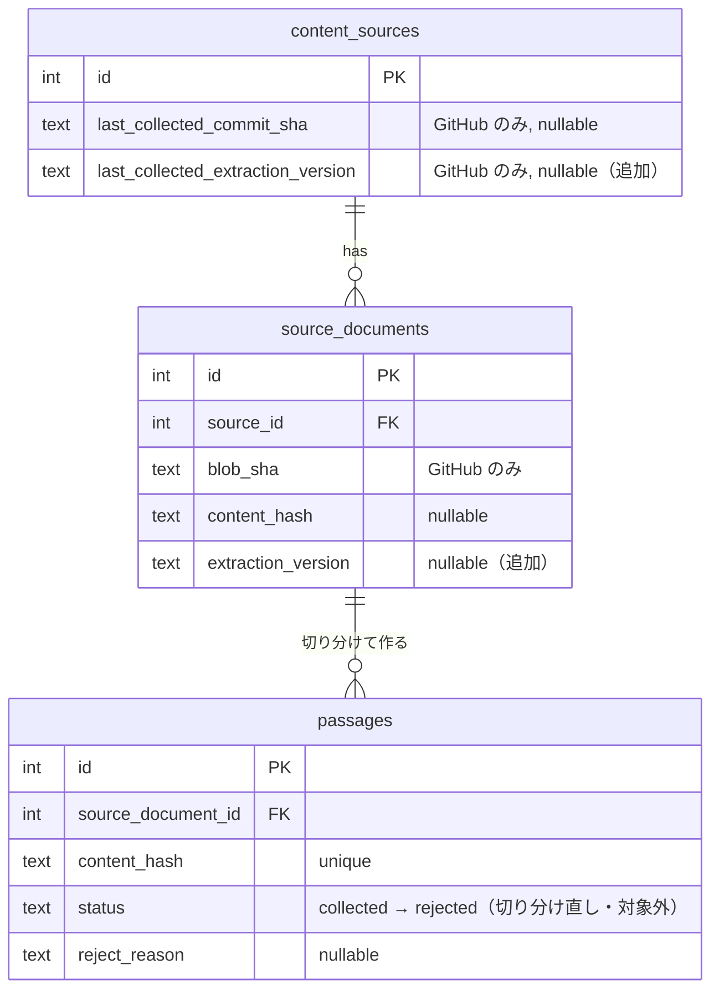
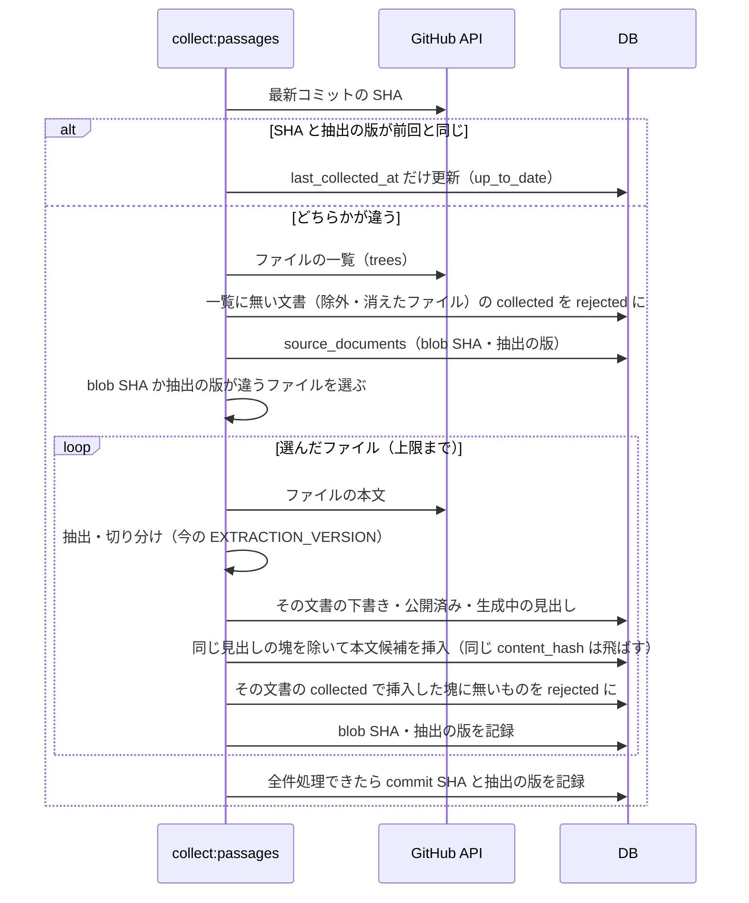

# 本文候補の切り出しの調整

#45 で整理した本文（問題文）の切り出しのロジックを、react.dev の `src/content/learn/**/*.md`（52 ページ）に通して測ると、本文に向かない内容が本文候補に入り、本文に向く節が捨てられていた（issue #53）。抽出と文章の判定の規則を直し、章の概要ページを除外パスで外す。

合わせて、抽出・切り分けの規則を変えたときに **取得済みの文書にも効く** ようにする。今は GitHub は blob SHA が同じファイルを取り直さず、サイトは本文のハッシュが同じなら切り分け直さないので、規則を変えても取得済みの文書の本文候補は変わらない。切り分け直したときは、問題にした節を二重に作らず、前の切り分けの未生成の本文候補を却下する。除外パスに入れた文書・取得元から消えた文書の未生成の本文候補も却下する。

このドキュメントは **仕様（What）** と **設計（How）** を分けて記述する：

- **仕様**：本文候補に残る内容・捨てる内容、取得済みの文書への反映、前の切り分けで作った本文候補と収集の対象から外れた文書の本文候補の扱い
- **設計**：抽出の規則の実装、しきい値、抽出の版、古い本文候補の却下、対象から外れた文書の却下

## 関連 spec

- [`../content-collection/README.md`](../content-collection/README.md) — 収集・本文の抽出・本文候補への切り分けの規則の正本。この機能の変更はそちらに反映する。`content_sources` / `source_documents` の列の正本もこちら
- [`../question-generation/README.md`](../question-generation/README.md) — `collected` の本文候補を問題にする。`passages` の列と状態の遷移の正本

## 目次

- [仕様](#仕様)
  - [本文に残すもの・捨てるもの](#本文に残すもの捨てるもの)
  - [文章の判定](#文章の判定)
  - [章の概要ページを外す](#章の概要ページを外す)
  - [取得済みの文書への反映](#取得済みの文書への反映)
  - [前の切り分けで作った本文候補](#前の切り分けで作った本文候補)
  - [収集の対象から外れた文書の本文候補](#収集の対象から外れた文書の本文候補)
  - [react.dev の learn での効果](#reactdev-の-learn-での効果)
- [設計](#設計)
  - [抽出の規則](#抽出の規則)
  - [文章の判定のしきい値](#文章の判定のしきい値)
  - [抽出の版](#抽出の版)
  - [古い本文候補の却下](#古い本文候補の却下)
  - [対象から外れた文書の却下](#対象から外れた文書の却下)
  - [MVP 対象外（将来検討）](#mvp-対象外将来検討)
- [必要な画面](#必要な画面)
- [必要な API](#必要な-api)
- [必要な DB 設計](#必要な-db-設計)
- [フロー図](#フロー図)
- [実装ステップ](#実装ステップ)

---

## 仕様

### 本文に残すもの・捨てるもの

| 対象 | 今 | 変更後 |
| --- | --- | --- |
| `<YouWillLearn>`（ページ冒頭の「このページで学ぶこと」のリンクの一覧） | 中の文章を残す。最初の節の本文候補の冒頭に一覧が入る | 中身ごと捨てる |
| `<Recap>`（ページ末尾のまとめ） | 中の文章を残す。見出しが無いので、最後の節の本文候補の末尾にくっつく | 中身ごと捨てる |
| 続き（例のコード・表・図など）が捨てられて「:」で終わる段落 | そのまま残る | 末尾の「:」を「.」にする |

「:」の段落の例：

| 今 | 変更後 |
| --- | --- |
| In this chat app, the `<Chat>` component contains the text input state: | In this chat app, the `<Chat>` component contains the text input state. |
| Here is how an image gallery uses and updates state on click: | Here is how an image gallery uses and updates state on click. |

- 本文候補の末尾でも途中でも同じ。文は消さないので、中身のある文（`This means that React components you write must always return the same JSX given the same inputs:`）も残る
- 捨てた例を指す文（`Here is the result.`）はそのまま残る
- 続きが本文に残るとき（コード・箇条書き・引用・段落が続く）と、見出しが続くときは変えない。見出しの手前で塊が切れるので、塊の末尾が「:」のままになることがある（react.dev の learn では、「:」で終わる段落の後に見出しが続くものが 3 件。`And here's how to build a component:` の後に「Step 1」の見出しが続くものなど）
- 文章を包むコンポーネント（`<Note>` / `<Pitfall>` / `<DeepDive>` / `<Intro>`）の中の段落も同じ。箇条書きの項目・引用の中の段落は変えない

### 文章の判定

- **1 項目が 12 語以上の箇条書きの項目を、文章に数える**（今は段落と引用だけを数え、箇条書きの項目は 1 項目が長い文でも数えない）
- 12 語未満の項目は今までどおり数えない。目次やリンク集のような短い項目が主体の塊は、今までどおり `not_prose` で捨てる
- 「Writing reducers well」「Use cases for context」のように、数文の項目が並ぶ節が本文候補になる

### 章の概要ページを外す

React 公式ドキュメントのソースの **除外パス** に、次のページを足す（admin のソースの編集。コードは変えない）。

| ページ | 外す理由 |
| --- | --- |
| `src/content/learn/adding-interactivity.md` | 章の概要。各節が個別のページの要約で、内容が個別のページと重なる |
| `src/content/learn/describing-the-ui.md` | 同上 |
| `src/content/learn/managing-state.md` | 同上 |
| `src/content/learn/escape-hatches.md` | 同上 |
| `src/content/learn/installation.md` | 「Installation」の章の概要。各節が個別のページへの案内 |
| `src/content/learn/rsc-sandbox-test.md` | Server Components の例を動かす確認用のページで、ドキュメントではない |

- dev と本番の両方で、ソースを登録・編集するときに設定する
- 除外したページから作った未生成の本文候補は、次の収集で却下する（[収集の対象から外れた文書の本文候補](#収集の対象から外れた文書の本文候補)）。下書き・公開済みは残る

### 取得済みの文書への反映

**抽出・切り分けの規則を変えたら、取得済みの文書も次の収集で切り分け直す。**

| 取得方法 | 切り分け直すタイミング |
| --- | --- |
| GitHub | 次の収集で、対象のファイルを取り直して切り分け直す（1 回の実行でソースあたり `COLLECT_MAX_DOCUMENTS_PER_SOURCE` 件まで。残りは次の回） |
| サイト | 各ページの取り直しの順番が来たとき（取得から `COLLECT_WEB_REFETCH_DAYS` 日たったとき）。そのときは 304 や同じハッシュで止まらずに切り分け直す。CSS セレクタを変えたときと同じ |

- 切り分け直して内容が同じ塊は、新しい本文候補にならない（今と同じく重複として弾く）。変わった塊だけが新しい本文候補になる
- 除外パスに入れた文書は切り分け直さない

### 前の切り分けで作った本文候補

**下書き・公開済み・生成中の本文候補と同じ見出しの塊は、切り分け直しても新しい本文候補にしない。** 今ある下書き・公開済みをそのまま使い、同じ節の問題を二重に作らない。

- react.dev の learn では、変更後の本文候補 119 件のうち今と同じ内容は 21 件で、98 件が新しい内容になる（うち 40 件は「:」が「.」になっただけ）。見出しで止めないと、問題にした節のほとんどがもう一度生成に回る
- 取得元の文書が更新された節も同じ。今ある下書き・公開済みを使い続け、直した内容では作り直さない
- 失敗（`failed`）・却下（`rejected`）の本文候補は数えない（その節の問題が無いので、新しい本文候補にする）

**切り分け直した文書の `collected`（まだ問題にしていない）本文候補のうち、新しい本文候補に無いものは却下（`rejected`）にする。**

- 理由には「切り分け直したため、前の切り分けの本文候補を外した」と残す。admin の「却下」に出て、却下を取り消せば `collected` に戻る
- 下書き（`draft`）・公開済み（`published`）・生成中（`generating`）・失敗（`failed`）は変えない
- 新しい切り分けと同じ内容のものは、そのまま `collected` で残る。同じ見出しの下書き・公開済みがある節の `collected` は、新しい本文候補に無いので却下する
- 取得元の文書が更新されて切り分け直したときも同じにする（今は前の内容の本文候補も残り、新旧の両方が生成に回る）
- 本文の抽出に失敗した文書（壊れた MDX・不正な CSS セレクタ）は却下しない

### 収集の対象から外れた文書の本文候補

**除外パス・対象パスから外した文書と、取得元から消えた文書の `collected` の本文候補を、次の収集で却下する。**

| 取得方法 | 対象から外れた文書 | 却下するとき |
| --- | --- | --- |
| GitHub | 除外パス・対象パスに合わなくなったファイル、ファイルの一覧に無いファイル（取得元から消えた、大きすぎるようになった） | ファイルの一覧を取ったとき。除外パス・対象パスを変えると、次の収集で一覧を取り直す |
| サイト | 対象パス・除外パスに合わなくなったページ、404 / 410 を返したページ | 各回の取得の前（404 / 410 は、返した回の次の回） |

- 理由には「除外パスに入ったか取得元から消えたため、収集の対象から外した」と残す
- 下書き・公開済み・生成中・失敗は変えない（公開済みの問題は、取得元から消えても残す。今と同じ）
- 除外パスから外して対象に戻しても、却下した本文候補は戻らない（文書が変わらなければ取り直さないため）。admin で却下を取り消す
- GitHub でファイルの一覧が大きすぎて途中で切れたときは、消えたかどうか分からないので、除外パス・対象パスに合わないファイルだけを却下する

### react.dev の learn での効果

`src/content/learn/**/*.md` を今の規則と変更後の規則に通して測った値。

| 測った値 | 今 | 変更後 |
| --- | --- | --- |
| 対象のページ | 52 | 46（概要ページなど 6 ページを除外） |
| 塊 | 241 | 211 |
| 本文候補 | 133 | 119 |
| 最初の見出しより前に箇条書きがある本文候補（`<YouWillLearn>` の一覧が入ったもの） | 32 | 2 |
| `<Recap>` がくっついた本文候補 | 19 | 0 |
| 捨てた塊（理由は重複あり） | `too_much_code` 71・`too_short` 32・`not_prose` 21 | `too_much_code` 72・`too_short` 27・`not_prose` 3 |
| 続きが捨てられて「:」で終わる段落（本文候補の中） | 末尾 6・途中 約 165 | 0（「.」になる） |

本文候補の増減の内訳（この順に変えていったときの値）：`<YouWillLearn>` を捨てて −4、`<Recap>` を捨てて −3、長い箇条書きを文章に数えて +8、6 ページの除外で −15。

---

## 設計

### 抽出の規則

**`apps/cron/src/lib/document/` の純関数を変える（LLM は使わない。今の切り出しと同じ）。**

- `const.ts` の `PROSE_COMPONENT_NAMES` から `YouWillLearn` と `Recap` を外す。ここに無いコンポーネントは中身ごと捨てる（今の規則）
  - どちらも見出しが無いので、隣の節の本文候補にくっつく。`<YouWillLearn>` はページの目次、`<Recap>` はページ全体のまとめで、節の話題と混ざる
- 「:」の置き換えは `convert-mdast-to-blocks.ts` で行う。段落の後ろの兄弟ノードを、ブロックを作るものまで順に見て、**その手前で内容のあるノードを捨てていたか、後ろにブロックを作るノードが無い** とき、段落の末尾の「:」を「.」にする
  - 内容のあるノードは、文章を包むもの以外のコンポーネント・表・テキストかメディアの要素がある HTML（コメントと、`
` のような囲みのタグだけのものを除く）・画像（リンクで包んだものを含む）のある段落。ショートコードやコメントだけの段落・区切り線は空になって捨てられるが内容は無いので、その先のノードまで見る（Kubernetes の `` の後ろのコードを続きとみなすため）
  - 対象は mdast の root の子と、文章を包むコンポーネントの子。Markdown（GitHub）と HTML（サイト）の両方に効く（サイトの例外は [MVP 対象外](#mvp-対象外将来検討)）
  - `.md` の自己終了のコンポーネント（`<Diagram name="x" />`）は、中身の無いコンポーネントのノードにして兄弟に残す。今は HTML ブロックを読み直すときに消すので、続きを捨てたことが分からない（`.mdx` は今もノードが残る）
  - 捨てられる続きは、react.dev の learn では `<Sandpack>` 206・`<TerminalBlock>` 10・表 8・`<DiagramGroup>` 6・`<ConsoleBlock>` 6 など（「:」で終わる段落の次のノードを数えた値。コード 411・箇条書き 148 は続きが残る）
  - 箇条書きの項目・引用の中は対象にしない。項目の中の段落はつないで 1 つのブロックにするため、段落の位置で判定できない
  - 末尾が GitHub の絵文字のショートコード（`Happy hacking :rocket:`）の「:」は変えない
  - **比べた案**
    - 導入の 1 文（「:」で終わる文）を消す：指す先の無い文は無くなるが、中身のある文も消える。続きが捨てられる段落の 117 件は 2 文以上で、文の区切りの判定（`e.g.` など）も要る
    - 本文候補の末尾のものだけ消す：issue で数えた末尾の 6〜7 件は直るが、途中の約 165 件が残る

### 文章の判定のしきい値

**`const.ts` に `MIN_PROSE_LIST_ITEM_WORDS = 12` を足し、`passage-rules.ts` の文章の割合で、英単語数がこれ以上の `list_item` を段落・引用と同じく文章に数える。**

- react.dev の learn の箇条書きの項目の英単語数は、中央値 9・上位 25% が 15 語以上
- 変更後のほかの規則（`<YouWillLearn>`・`<Recap>` を捨て、6 ページを除外）のうえで、しきい値を 8・10・12・15・20 のどれにしても、新たに本文候補になる塊は同じ 8 件。issue で挙げた 12 にする。中央値より上なので、目次・リンク集の数語の項目は文章に数えない
- 項目ごとに判定する（塊の中の箇条書き全体の平均にしない）。同じ箇条書きの短い項目は文章に数えないので、長い項目が 1 つあるだけのリンク集は文章にならない

### 抽出の版

**cron に抽出の版 `EXTRACTION_VERSION` を持ち、文書を切り分けたときの版を `source_documents` に記録する。版が今と違う文書は、次の収集で切り分け直す。**

| 項目 | 内容 |
| --- | --- |
| 版 | `apps/cron/src/lib/document/const.ts` の `EXTRACTION_VERSION`。生成の `PROMPT_VERSION` と同じ日付の形（`2026-10-20.1`）。`lib/document` の変更のうち、ブロック・切り分け・本文候補の条件が変わるものをしたら上げる |
| `source_documents.extraction_version` | 文書を切り分けたときの版。`NULL`（この列を足してから一度も切り分けていない文書。未取得、列を足す前に取得した文書、本文を抽出できなかったサイトのページ）は古い版として扱う |
| `content_sources.last_collected_extraction_version` | GitHub のみ。`last_collected_commit_sha` を記録したときの版 |

**GitHub**：

1. 最新コミットが `last_collected_commit_sha` と同じでも、`last_collected_extraction_version` が今の版と違えば、終えずにファイルを列挙する
2. 取り直すファイルは、blob SHA が違うものに加えて、`extraction_version` が今の版と違うもの
3. 全件を処理できたとき（`completed`）、`last_collected_commit_sha` と一緒に `last_collected_extraction_version` を記録する（楽観ロックも同じ。収集の途中で admin が `last_collected_commit_sha` を `NULL` に戻していたら、どちらも書かない）
4. 本文の抽出に失敗したファイルも版を記録する（今の blob SHA と同じく、ファイルか版が変わるまで再試行しない）
5. ファイルを列挙した後、対象から外れた文書の `collected` を却下する（[対象から外れた文書の却下](#対象から外れた文書の却下)）

- 版をソースの単位でも記録するのは、取得元から消えたファイルと除外したファイルは切り分け直されず、`source_documents` の版が古いまま残るため。文書の版だけで判定すると、毎回の実行でファイルを列挙し続ける

**サイト**：

- 版が今と違うページは、条件付きリクエスト（`If-None-Match` / `If-Modified-Since`）を送らず、本文のハッシュが前回と同じでも切り分け直す
- 取り直しの順番は変えない（未取得 → 取得から `COLLECT_WEB_REFETCH_DAYS` 日たったもの）。版を上げた直後の収集が全ページの取り直しで埋まり、新しいページの取得が遅れないように。CSS セレクタを変えたときと同じ
- 本文の抽出に失敗したページは版を記録しない（今と同じく ETag・Last-Modified・ハッシュも記録しないので、次の取り直しでもう一度試す）

**費用**：

- GitHub API：版を上げるたびに、対象のファイルを 1 回ずつ取り直す（react.dev の learn で 46 回。認証すると 5,000 req/h）
- 生成：内容が変わった塊のうち、下書き・公開済み・生成中と同じ見出しでないものだけが新しい本文候補になる。前の切り分けの `collected` は却下する（[次の節](#古い本文候補の却下)）ので、生成に回るのは、まだ問題にしていない節の分だけ

**比べた案**

- admin のソースの「切り分け直す」ボタン（blob SHA・ETag・ハッシュを消す）：規則を変えるたびに、管理者がソースごとに押す必要があり、押し忘れると古い切り分けのまま残る
- 今回だけ dev の DB を SQL で直す：本番に取得済みの文書があれば同じ作業が要り、次に規則を変えたときも同じことになる

### 古い本文候補の却下

**文書を切り分け直したら、同じ見出しの下書き・公開済み・生成中がある塊を除いて本文候補を挿入し、その文書の `collected` のうち、`content_hash` が挿入した塊のどれとも違うものを `rejected` にする。** GitHub とサイトで共有する 1 つの関数（`savePassageCandidates`）にする。

| 項目 | 内容 |
| --- | --- |
| 見出しの確認 | その文書の `generating`・`draft`・`published` の本文候補の `title` を読み、同じ `title` の塊は挿入しない |
| 却下の条件 | `source_document_id` がその文書、`status = 'collected'`、`content_hash` が挿入した塊のハッシュのどれでもない（1 文の `UPDATE`） |
| 更新 | `status = 'rejected'`、`reject_reason` に「切り分け直したため、前の切り分けの本文候補を外した」。生成の記録（`generated_at` など）は空のまま |
| 呼ぶところ | GitHub はファイルを取得して本文を抽出できたとき。サイトは本文候補を作るとき（対象パスのページで、ハッシュか版が変わったとき）だけ |
| 呼ばないとき | 本文の抽出に失敗した文書、本文候補を作らないページ（開始ページなど対象パス外・リダイレクトで対象パス外になったページ） |

- 見出しで比べるのは、切り分け直すと塊の内容（ハッシュ）はほとんど変わるが、見出しは変わらないため。塊の `title` は塊の最初の見出し（無ければ節・文書の見出し）で、今回の規則の変更では変わらない
  - **比べた案**：句読点を除いた内容で比べる（「:」が「.」になっただけの 40 件しか防げず、一覧を捨てた節などは作り直される）、何もしない（98 件がもう一度生成に回り、管理者が片方を却下する）
  - 文書の中に同じ見出しの節が 2 つあると、片方に下書きがあればもう片方も作られない。長い節を分けた塊は「— Part 1」「— Part 2」で見出しが違うので当たらない
- `status = 'collected'` を条件にするので、生成のタスクが取った行（`generating`）や、ほかの状態の行は変えない
- 挿入と却下は同じトランザクションにしない。間で落ちても、blob SHA・版は最後に記録するので次の収集でやり直し、却下は何度行っても結果が同じ
- 物理削除にしないのは、`passages` を物理削除しない今の方針に合わせ、admin の却下の取り消しで戻せるようにするため
- 却下した本文候補と同じ内容に戻ったとき（取得元の文書が元に戻った、版を戻した）は、`content_hash` の unique 制約で新しい本文候補にならない。必要なら admin で却下を取り消す

### 対象から外れた文書の却下

**`collected` の本文候補を持つ文書を読み、収集の対象から外れたものの `collected` を `rejected` にする。** GitHub とサイトで共有する 1 つの関数（`rejectOutOfTargetPassages`）に、対象から外れたかの判定を渡す。

| 取得方法 | 呼ぶところ | 対象から外れた文書 |
| --- | --- | --- |
| GitHub | ファイルを列挙した後（最新コミットと版が前回と同じで `up_to_date` のときは呼ばない） | 列挙したファイルに無い文書。列挙が切り詰められたときは、そのうち `isTargetPath`（対象パス・除外パス）に合わないものだけ |
| サイト | 各回の取得の前 | `isTargetPath` に合わない文書と、`http_status` が 404 / 410 の文書 |

- `reject_reason` は「除外パスに入ったか取得元から消えたため、収集の対象から外した」
- 今は「取得元から消えた文書は何もしない」だが、除外パスに入れた文書の本文候補が生成に回り、admin の却下は下書きからしかできない（`draft → rejected` だけ）ので、生成の前に外す
- `collected` を持つ文書だけを読むのは、サイトは対象パス外のページ（リンクをたどるための行）が多いため。GitHub は 1 回の列挙で 1 回、サイトは 1 回の実行で 1 回読む
- GitHub は、除外パス・対象パスを admin で変えると `last_collected_commit_sha` が `NULL` に戻る（今の仕組み）ので、次の収集で列挙して却下する。取得元から消えたファイルは、最新コミットが変わるので次の収集で列挙する
- サイトの 404 / 410 は、取得のループの中では却下せず、次の回の始めにまとめる（判定を GitHub と同じ「対象から外れた文書」にそろえるため）
- **比べた案**：admin の却下を `collected` にも広げる（除外したページの分を、管理者が 1 件ずつ却下する必要がある）

### MVP 対象外（将来検討）

- 下書き・公開済みにした節に、取得元の更新を取り込む（今は同じ見出しの塊を作らないので、直した内容では作り直さない）
- サイトの `<iframe>`・`<svg>` の手前の「:」を「.」にする（HTML を Markdown に変えるときにノードが残らないので、続きを捨てたことが分からず「:」のまま残る）
- `<TerminalBlock>`・`<ConsoleBlock>` を中身ごと捨てずに、コードのブロックとして残す（「:」の段落の続きの一部がこれ）
- 末尾の短い節を前の塊と結合する（issue #53 でも対象外。結合して本文候補になる 12 件の半分は「What's next?」「And more...」などの案内文）

---

## 必要な画面

変更なし。章の概要ページの除外は、admin のソースの編集画面の「除外パス」で設定する。

## 必要な API

変更なし。

## 必要な DB 設計

2 つの列を足す（どちらも nullable）。列の正本は [content-collection](../content-collection/README.md#必要な-db-設計)。

| テーブル | 列 | 型 | 説明 |
| --- | --- | --- | --- |
| `source_documents` | `extraction_version` | `text` nullable | 文書を切り分けたときの抽出の版。`NULL` はこの列を足してから一度も切り分けていない文書 |
| `content_sources` | `last_collected_extraction_version` | `text` nullable | GitHub のみ。`last_collected_commit_sha` を記録したときの抽出の版 |

- 既存の行はどちらも `NULL` になり、古い版として扱われる。デプロイ後の最初の収集で、取得済みの文書を切り分け直す
- `passages` の状態は増やさない。`collected → rejected` の遷移（切り分け直し・収集の対象外で外す）を足す（[question-generation の状態](../question-generation/README.md)）

## フロー図

## 実装ステップ

| step | 内容 |
| --- | --- |
| [step1](./tasks/step1-db-extraction-version.md) | db：`source_documents.extraction_version` と `content_sources.last_collected_extraction_version` を足し、ドメインの型と api・cron の読み込みに通す |
| [step2](./tasks/step2-cron-extraction-rules.md) | cron：`<YouWillLearn>`・`<Recap>` を捨てる、長い箇条書きの項目を文章に数える、「:」で終わる段落の置き換え |
| [step3](./tasks/step3-cron-reextraction.md) | cron：`EXTRACTION_VERSION` と、抽出の版が古い文書の切り分け直し（同じ見出しの下書き・公開済み・生成中がある塊は作らない）、前の切り分けと収集の対象から外れた文書の `collected` の却下。dev のソースに除外パスを足して確かめる |
