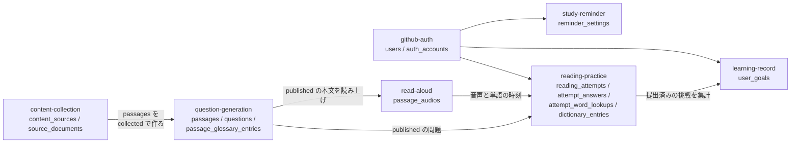
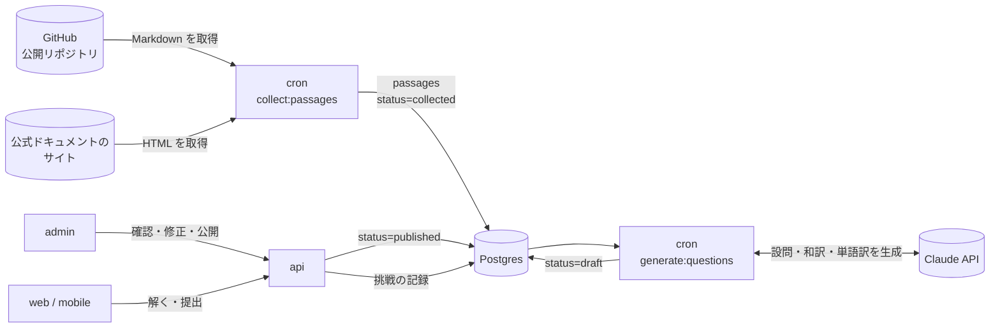
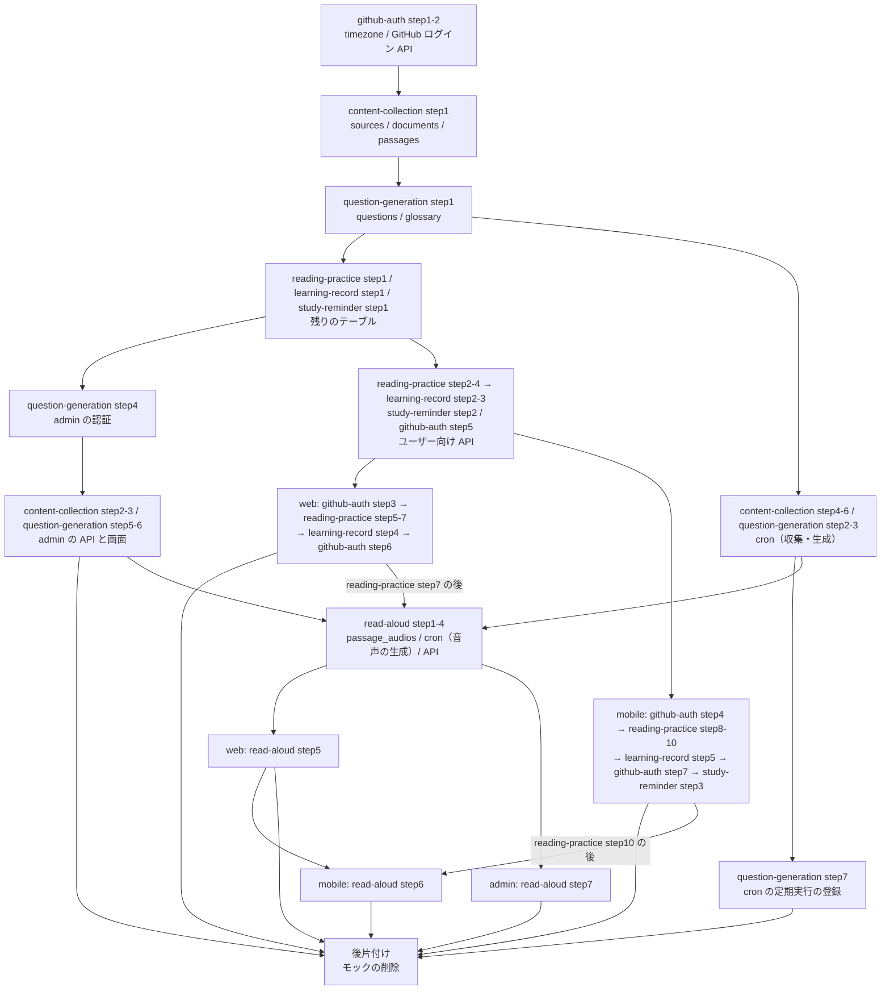
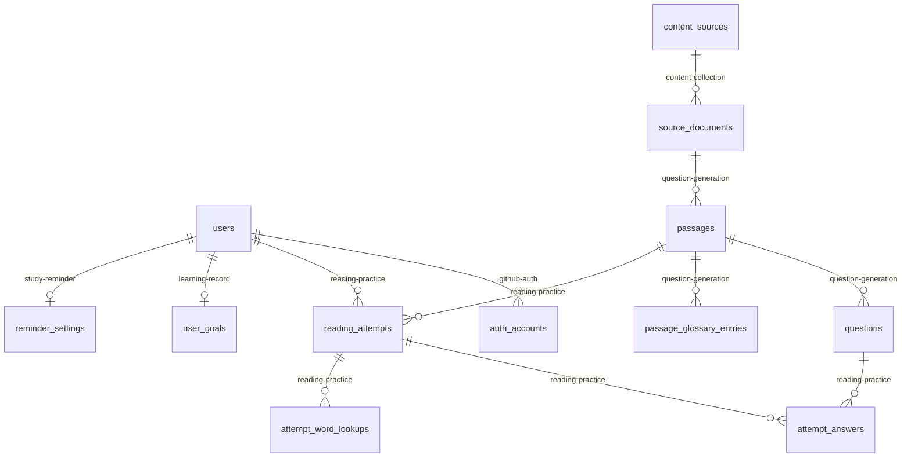
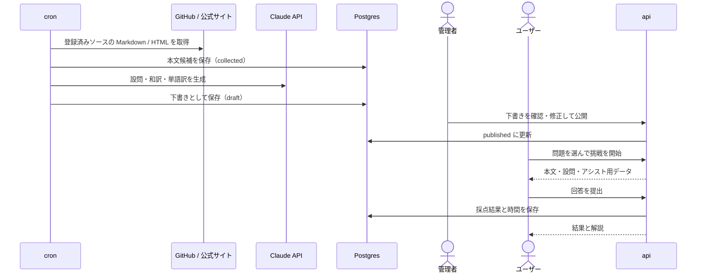

# プロダクト全体像（エンジニア向け英語長文読解）

エンジニアが実務で読む英文（GitHub の README / RFC、公式ドキュメント）をそのまま題材にした、英語長文読解の学習サービス。一般的な英語学習教材の英文は日常会話やビジネス文書が中心で、エンジニアが日々読む「API の説明」「設計の議論」「移行ガイド」とは語彙も文体も違う。このサービスでは **実在する技術文書の英文** を 4 択の読解問題にし、制限時間つきで解いて採点・解説を受けられるようにする。

このドキュメントは個々の機能 spec を束ねる **全体像** で、用語、機能の分割、MVP の範囲、アプリ間の役割分担だけを扱う。テーブル定義・API・画面の詳細は各機能 spec が正本で、ここからはリンクで参照する。

このドキュメントは **仕様（What）** と **設計（How）** を分けて記述する：

- **仕様**：誰のどんな課題を解くか、用語、MVP の範囲、プラットフォームごとの提供範囲
- **設計**：機能の分割、アプリ間の役割分担、データの流れ、インフラ上の配置

## 関連 spec

- [`../github-auth/README.md`](../github-auth/README.md) — GitHub ログインとアカウント削除（web / mobile）。`users` / `auth_accounts` の正本
- [`../content-collection/README.md`](../content-collection/README.md) — 英文の収集（GitHub の Markdown と公式ドキュメントのサイト）。`content_sources` / `source_documents` の正本
- [`../question-generation/README.md`](../question-generation/README.md) — LLM による問題生成と管理者承認。`passages` / `questions` / `passage_glossary_entries` の正本
- [`../reading-practice/README.md`](../reading-practice/README.md) — 問題を解く・採点・解説・アシスト。`reading_attempts` 系テーブルの正本
- [`../learning-record/README.md`](../learning-record/README.md) — 学習記録（カレンダー）と目標。`user_goals` の正本
- [`../study-reminder/README.md`](../study-reminder/README.md) — mobile のリマインダー通知。`reminder_settings` の正本
- [`../read-aloud/README.md`](../read-aloud/README.md) — 本文の読み上げ（Amazon Polly で事前生成）。`passage_audios` の正本
- [`../minimal-deploy/README.md`](../minimal-deploy/README.md) — 初期リリースのインフラ構成。本サービスは worker なし（`enable_worker = false`）で動くように設計する
- [`./deferred-grammar-vocabulary.md`](./deferred-grammar-vocabulary.md) — MVP 対象外。文法問題・単語問題

## 目次

- [仕様](#仕様)
  - [想定ユーザーと解く課題](#想定ユーザーと解く課題)
  - [用語](#用語)
  - [機能一覧と MVP の範囲](#機能一覧と-mvp-の範囲)
  - [プラットフォームごとの提供範囲](#プラットフォームごとの提供範囲)
  - [英文の権利の扱い](#英文の権利の扱い)
- [設計](#設計)
  - [機能 spec の分割](#機能-spec-の分割)
  - [アプリ間の役割分担](#アプリ間の役割分担)
  - [データの流れ](#データの流れ)
  - [インフラ上の配置](#インフラ上の配置)
  - [ドメイン定数の置き場所](#ドメイン定数の置き場所)
  - [実装の順番](#実装の順番)
  - [MVP 対象外（将来検討）](#mvp-対象外将来検討)
- [必要な画面](#必要な画面)
- [UI 設計](#ui-設計)
  - [モックの場所](#モックの場所)
  - [デザインのコンセプト](#デザインのコンセプト)
  - [カラーパレット](#カラーパレット)
  - [タイポグラフィ](#タイポグラフィ)
  - [角丸と余白](#角丸と余白)
  - [共通コンポーネント](#共通コンポーネント)
  - [共通ヘッダー](#共通ヘッダー)
  - [アニメーション](#アニメーション)
  - [ダークモード](#ダークモード)
  - [レスポンシブ](#レスポンシブ)
  - [文言のルール](#文言のルール)
  - [mobile のデザイン](#mobile-のデザイン)
  - [admin のデザイン](#admin-のデザイン)
- [必要な API](#必要な-api)
- [必要な DB 設計](#必要な-db-設計)
- [フロー図](#フロー図)

---

## 仕様

### 想定ユーザーと解く課題

| 想定ユーザー | 課題 | このサービスでできること |
| --- | --- | --- |
| 英語のドキュメントを読むのに時間がかかるエンジニア | 一般教材では技術文書特有の言い回し（"opt in", "deprecate", "under the hood" など）が身につかない | 実際の公式ドキュメント・README の英文で読解練習ができる |
| 英語に苦手意識があり学習が続かないエンジニア | 何をどれだけやったか見えず、習慣にならない | 学習記録をカレンダー（GitHub の草のような表示）で見られる。目標とリマインダーで習慣化を支える |
| 辞書を引きながらでないと読めないエンジニア | 辞書を引くたびに集中が切れる | 解答中に単語をタップすると、その文脈での意味がその場で出る。段落ごとに和訳も見られる |

利用シーン：通勤中に mobile で 1 問（5〜10 分）、または業務の合間に web で 1 問。

### 用語

| 用語 | 意味 |
| --- | --- |
| **問題** | 1 つの英文（長文）と、それに付く 3〜5 問の設問のまとまり。ユーザーが「1 問解く」と言うときの単位。内部名は `passage` |
| **本文** | 問題の英文。取得元の文書から 200〜600 語を抜き出したもの |
| **設問** | 本文について問う 4 択の質問 1 つ。内部名は `question` |
| **挑戦** | ユーザーが 1 つの問題を解き始めてから提出するまでの 1 回分。同じ問題に何度でも挑戦できる。内部名は `attempt` |
| **アシスト** | 解答中に使える補助。段落の和訳表示、単語の意味表示、本文の読み上げの 3 種類 |
| **ソース** | 英文の取得元として管理者が登録したもの。GitHub リポジトリか、公式ドキュメントのサイト |
| **出典表示** | 問題ごとに表示する取得元のリンク・ライセンス・改変の有無 |

### 機能一覧と MVP の範囲

| 分類 | 機能 | MVP | 担当 spec |
| --- | --- | --- | --- |
| ユーザー | GitHub ログイン | ✅ | [github-auth](../github-auth/README.md) |
| ユーザー | アカウント削除 | ✅ | [github-auth](../github-auth/README.md#アカウントの削除) |
| ユーザー | 学習記録（カレンダー表示） | ✅ | [learning-record](../learning-record/README.md) |
| ユーザー | 個人の目標 | ✅ | [learning-record](../learning-record/README.md) |
| ユーザー | リマインダー | ✅（mobile のみ） | [study-reminder](../study-reminder/README.md) |
| 問題作成 | 英文の収集（GitHub の Markdown） | ✅ | [content-collection](../content-collection/README.md) |
| 問題作成 | 英文の収集（公式ドキュメントのサイト） | ✅ | [content-collection](../content-collection/README.md#サイトのクロール) |
| 問題作成 | 4 択問題の生成（LLM）と管理者承認 | ✅ | [question-generation](../question-generation/README.md) |
| 学習 | 長文読解（制限時間・採点・解説・時間の記録） | ✅ | [reading-practice](../reading-practice/README.md) |
| 学習 | アシスト（段落の和訳・単語の意味） | ✅ | [reading-practice](../reading-practice/README.md) |
| 学習 | 読み上げ（全文・段落、単語のハイライト、再生速度） | ✅ | [read-aloud](../read-aloud/README.md) |
| 学習 | 文法問題 | ❌ 将来 | [deferred-grammar-vocabulary](./deferred-grammar-vocabulary.md) |
| 学習 | 単語問題 | ❌ 将来 | [deferred-grammar-vocabulary](./deferred-grammar-vocabulary.md) |

### プラットフォームごとの提供範囲

web と mobile を同時に提供する。admin は web のみ。

| 機能 | web | mobile | admin |
| --- | --- | --- | --- |
| GitHub ログイン | ✅ | ✅ | ―（共有シークレットで保護。[question-generation](../question-generation/README.md#管理画面のアクセス制御)） |
| 問題一覧・問題を解く・結果と解説 | ✅ | ✅ | ― |
| アシスト | ✅ | ✅ | ― |
| マイページ（学習記録・カレンダー） | ✅ | ✅ | ― |
| 目標の設定 | ✅ | ✅ | ― |
| アカウント削除 | ✅ | ✅ | ― |
| リマインダー | ❌ | ✅ | ― |
| ソースの登録 | ― | ― | ✅ |
| 問題の確認・修正・公開 | ― | ― | ✅ |

### 英文の権利の扱い

公開サービスで第三者の英文を全文表示するため、**再利用が明示的に許可されている英文だけを使う。**

- 取得元は **管理者が登録した GitHub リポジトリの Markdown ファイル** と **公式ドキュメントのサイト** だけ。登録時にライセンスを確認し、許可リストにあるライセンス（MIT / Apache-2.0 / BSD / CC-BY-4.0 など）のものだけを登録できる
- サイトは、利用規約でクロールや転載が禁止されておらず `robots.txt` でも許可されているものに限り、間隔を空けて取得する
- 技術ブログは使わない（多くは全文転載が許可されていない）。Issue / Pull Request のコメントも使わない（GitHub 利用規約上、GitHub の外での複製は許可されていない）
- すべての問題に **出典表示**（取得元のリンク、ライセンス、「一部抜粋・改変あり」の表記）を出す

詳細は [content-collection の「使える英文の条件」](../content-collection/README.md#使える英文の条件)。

---

## 設計

### 機能 spec の分割

機能ごとに spec を分け、テーブルの正本を 1 つの spec に寄せる。



`passages` は収集（content-collection）が作り、生成（question-generation）が中身を埋めて公開する。行を作るのは収集側だが、**列とステータスの定義は question-generation を正本にする**（問題データの意味を決めているのは生成と承認の側のため）。

### アプリ間の役割分担

| アプリ | 役割 |
| --- | --- |
| `apps/web` | ユーザー向け web。問題を解く画面、マイページ、目標設定 |
| `apps/mobile` | ユーザー向け mobile。web と同じ機能に加えてリマインダー（端末内の通知予約） |
| `apps/admin` | ソースの登録、生成された問題の確認・修正・公開 |
| `apps/api` | すべての読み書きの窓口。web / mobile / admin は DB を直接触らない（既存方針） |
| `apps/cron` | 英文の収集（`collect:passages`）と問題の生成（`generate:questions`）。どちらも run-once のタスク |
| `apps/worker` | **本サービスでは使わない。** 長時間の処理はすべて cron に寄せる |

収集と生成を worker ではなく cron に置く理由：

- どちらも「1 日 1 回まとめて処理すればよい」バッチで、ユーザー操作を起点にリアルタイムで動かす必要がない
- [minimal-deploy](../minimal-deploy/README.md) は worker を作らない構成（`enable_worker = false`、月 ~$7）を既定にしている。cron は ECS RunTask で動いた秒数しか課金されないため、この構成のまま運用できる
- LLM の呼び出しは 1 件数十秒かかりうるため、api（Lambda）の中で同期実行しない

### データの流れ



### インフラ上の配置

[minimal-deploy](../minimal-deploy/README.md) の構成に載せる。足すのは読み上げの音声を置く S3 の bucket と CloudFront だけ（[read-aloud](../read-aloud/README.md#音声の保存と配信)）。

| 処理 | 配置 | 起動 |
| --- | --- | --- |
| api | Lambda（minimal）/ ECS（prd） | HTTP リクエスト |
| `collect:passages` | ECS RunTask | EventBridge Scheduler で 1 日 1 回 |
| `generate:questions` | ECS RunTask | EventBridge Scheduler で 1 日 1 回（`collect:passages` の後） |
| `generate:audio` | ECS RunTask | EventBridge Scheduler で 1 時間ごと（公開された問題の読み上げの音声を作る） |
| リマインダー | **サーバー処理なし**（mobile 端末内のローカル通知） | ― |

外部サービスとして **GitHub API**（収集、ログイン）・**Claude API**（生成）・**Amazon Polly**（読み上げの音声）を新たに使い、cron から **公式ドキュメントのサイト** にも HTTP でアクセスする。いずれも外向きの通信なので、minimal（public subnet + public IP）でも prd（NAT Gateway）でも追加のネットワーク設定は要らない。

### ドメイン定数の置き場所

ステータスや種別のような値の集合は既存方針どおり `@repo/domain` を正本にし、`@repo/api-schema` の `z.enum` と DB の `CHECK` 制約をそこから作る。各定数の値の意味は担当 spec に書く。

| 定数 | 担当 spec |
| --- | --- |
| `SOURCE_KINDS` / `SOURCE_FETCH_TYPES` / `ALLOWED_LICENSES` | content-collection |
| `PASSAGE_STATUSES` / `PASSAGE_DIFFICULTIES` / `PASSAGE_BLOCK_TYPES` / `QUESTION_TYPES` | question-generation |
| `ATTEMPT_STATUSES` / `WORD_LOOKUP_SOURCES` | reading-practice |
| `GOAL_METRICS` | learning-record |
| `AUDIO_STATUSES` | read-aloud |

### 実装の順番

機能をまたいで step を進める順番。各 step の「前提」はこの図に合わせて書いてある。テーブルを先にすべて作り、admin・cron・ユーザー向け API を並行して進め、最後に web と mobile の画面を作る。読み上げ（read-aloud）は解答画面・結果画面ができた後に、テーブルから画面までを足す。



- `passages` は content-collection step1 で全列を作る（列の定義の正本は question-generation）
- learning-record の集計 API は、reading-practice の提出 API（`study_date` を決める `src/lib/time-zone.ts`）の後に作る
- read-aloud は reading-practice の提出 API（step4）・web の解答画面と結果画面（step6・7）と learning-record の集計 API（step2）の後に始める（`reading_attempts` に列を足し、解答画面・結果画面とアシストの判定に読み上げを足すため）。question-generation の admin（step5・6）と生成タスク（step3）も先に要る（公開の `published_at`・admin の問題の確認画面・同じ「状態で確保する」書き方を使う）。step8（S3・CloudFront・スケジュール）は AWS の設定後に infra の PR にまとめるので図に入れない
- web と mobile の画面は図の矢印の順に 1 本ずつ進める。モックの共通部品は、最初に使う step が本番の場所に移し、後の step はそれを使う

| 移す step | web | mobile |
| --- | --- | --- |
| github-auth step3・step4（ログイン） | フォントとダークの背景（root layout）、`components/ui/Wordmark.tsx`、本文リーダー（`components/features/passage/PassageReader.tsx`・`passage-text.ts`・`types.ts`） | テーマ（`src/const/design-theme.ts`）、フォントの読み込み、`components/ui/Wordmark.tsx`・`app-styles.ts`、本文リーダー（同上）、API クライアント（`src/libs/api-client.ts`） |
| reading-practice step5・step8（問題一覧） | `components/ui/AppHeader.tsx`・`ScoreSquares.tsx`、`src/libs/format.ts`、`components/features/passage/labels.ts`・`SourceMeta`・`DifficultyMeter`、`/passages/random` | タブのレイアウト、`components/ui/` のボタン・`Segment`・`Chip`・`ScoreSquares`、`src/libs/format.ts`、`labels.ts`・`SourceMeta`・`DifficultyMeter`、`passages/random`（マイページとリマインダーの通知の入口） |

- 設定画面は learning-record step4（web）・step5（mobile）が作る。アカウント削除の画面（github-auth step6・step7）とリマインダーの区画（study-reminder step3）はその後
- **後片付け**：全画面の本実装が終わったら、モックの画面とダミーデータを削除する（web の `src/app/mock/**`・`src/libs/mock-data.ts`・`src/proxy.ts` の `/mock`、admin の `src/app/(dashboard)/mock/**`・`src/libs/mock-data.ts`・サイドバーの「tech-english モック」、mobile の `src/app/mock/**`・`src/components/mock/**`・`src/const/mock-theme.ts`・`src/libs/mock-data.ts`・ルートレイアウトの `mock` の画面）。メモの画面は各 step で置き換え済み。`memos` テーブルと api のメモの実装を消すかは別途判断する

### MVP 対象外（将来検討）

以下は MVP では実装しない。それぞれの着手トリガーと設計案は deferred ドキュメントにまとめる。

- **文法問題・単語問題** → [`./deferred-grammar-vocabulary.md`](./deferred-grammar-vocabulary.md)
- **英文の取得元の拡大**（JavaScript で描画するサイト、許諾を得たブログ、ShareAlike ライセンス）→ [`../content-collection/deferred-more-sources.md`](../content-collection/deferred-more-sources.md)
- **アシストの拡張**（任意の文の翻訳、厳格モード）→ [`../reading-practice/deferred-assist-and-modes.md`](../reading-practice/deferred-assist-and-modes.md)
- **読み上げの拡張**（声の選択、単語ごとの発音、ユーザーの音読の評価）→ [`../read-aloud/deferred-voices-and-pronunciation.md`](../read-aloud/deferred-voices-and-pronunciation.md)
- **サーバーからのプッシュ通知・web のリマインダー** → [`../study-reminder/deferred-remote-push.md`](../study-reminder/deferred-remote-push.md)
- **ライトテーマ**。MVP はダークテーマのみ
- **課金・プラン**。MVP は全機能を無料で提供する

---

## 必要な画面

全画面の一覧。各画面の役割と中身は担当 spec に書く。共通のデザインは [UI 設計](#ui-設計)、画面ごとのワイヤーフレームは担当 spec の「UI 設計」を参照。

| 画面 | web | mobile | admin | 担当 spec |
| --- | --- | --- | --- | --- |
| ログイン | ✅ | ✅ | ― | github-auth |
| マイページ（学習記録・カレンダー・目標の進捗） | ✅ | ✅ | ― | learning-record |
| 問題一覧 | ✅ | ✅ | ― | reading-practice |
| 問題を解く | ✅ | ✅ | ― | reading-practice |
| 結果・解説 | ✅ | ✅ | ― | reading-practice |
| 学習履歴（過去の挑戦の一覧） | ✅ | ✅ | ― | learning-record |
| 設定（目標・タイムゾーン・リマインダー・アカウント削除） | ✅（リマインダーなし） | ✅ | ― | learning-record / study-reminder / github-auth |
| アカウント削除の確認 | ✅ | ✅ | ― | github-auth |
| ソース一覧・登録 | ― | ― | ✅ | content-collection |
| 問題の確認待ち一覧 | ― | ― | ✅ | question-generation |
| 問題の確認・修正 | ― | ― | ✅ | question-generation |

## UI 設計

`design-mock` skill で確定したデザイン。ここには **全画面に共通するデザイン（配色・書体・部品・動き・レスポンシブ）** をまとめ、各画面のワイヤーフレームは担当 spec の「UI 設計」に書く。

| 画面 | 担当 spec |
| --- | --- |
| ログイン、アカウント削除の確認 | [github-auth](../github-auth/README.md#ui-設計) |
| 問題一覧、開始確認、問題を解く、結果・解説 | [reading-practice](../reading-practice/README.md#ui-設計) |
| マイページ、学習履歴、設定 | [learning-record](../learning-record/README.md#ui-設計) |
| （admin）ソース一覧、ソースの登録・編集 | [content-collection](../content-collection/README.md#ui-設計) |
| （admin）問題一覧、問題の確認・修正 | [question-generation](../question-generation/README.md#ui-設計) |

### モックの場所

| 対象 | 場所 |
| --- | --- |
| モックの画面 | `apps/web/src/app/mock/**`（`/mock` で画面一覧。開発環境でだけ認証なしで開ける）。mobile は [mobile のデザイン](#mobile-のデザイン)、admin は [admin のデザイン](#admin-のデザイン) を参照 |
| ダミーデータ | `apps/web/src/libs/mock-data.ts` |
| デザイントークン | `apps/web/src/app/globals.css` の `@theme`（**本実装でもそのまま使う**） |

モックの画面とダミーデータは、本実装の画面ができたら削除する（[実装の順番](#実装の順番) の後片付け）。各画面の左下の「モック」から状態（空・時間超過など）を切り替えられる。

### デザインのコンセプト

**夜のエディタで、読書灯をつけて英文を読む。**

- 画面の枠はエディタ（段落番号の列、下端のステータスバー、キーボード操作の表示）、本文は読書のための組版にする
- 差し色は琥珀 1 色だけにし、「灯り」の意味を持たせる。学習した日は **灯ったマス** で表し、ロゴ・学習カレンダー・連続学習日数に同じ印を使う
- カードを並べ立てず、一覧や履歴は区切り線のリストにする。囲みを使うのは、まとまりに意味がある場所（設問パネル、マイページの右列、危険な操作）だけ

### カラーパレット

ダークテーマのみ。真っ黒は長文で目が疲れる（ハレーション）ため、背景は青みのある暗いグレーにする。

| トークン | 値 | 用途 |
| --- | --- | --- |
| `canvas` | `#12161f` | ページの背景 |
| `surface` | `#181d28` | パネル、設問パネル、ステータスバー、コードブロック |
| `raised` | `#202736` | ホバー、選択中のセグメント、単語のカード、ダイアログ |
| `line` | `#29303f` | 区切り線、パネルの枠 |
| `line-strong` | `#3a4356` | 入力欄・副ボタンの枠、未選択のマス |
| `fg` | `#dde2ea` | 本文、見出し |
| `fg-muted` | `#949db1` | 補足、ラベル、未選択のナビ |
| `fg-faint` | `#647086` | 注記、段落番号、時刻 |
| `amber` | `#f3b24c` | 主要ボタン、選択中、回答済みの印、進捗、今日のマス |
| `amber-bright` | `#ffca72` | 主要ボタンのホバー、残り 20% 未満のタイマー、単語のホバー |
| `amber-ink` | `#2a1c05` | 琥珀の上の文字 |
| `amber-wash` | `amber` の 12% | 選択中の選択肢・チップ・和訳ボタンの背景 |
| `correct` / `correct-wash` | `#6fcaa3` / 12% | 正解 |
| `wrong` / `wrong-wash` | `#f08c8c` / 12% | 不正解、時間超過、危険な操作 |
| `heat-0`〜`heat-4` | `#1d2331` → `#3b3122` → `#67502a` → `#a57a32` → `#f3b24c` | 学習カレンダーの 5 段階（[learning-record](../learning-record/README.md#学習カレンダー)） |
| `code-keyword` / `code-string` / `code-fn` / `code-comment` | `#d3a8f2` / `#a9d5a1` / `#90c6f0` / `#6d778d` | コードのシンタックスハイライト |

### ページの背景

`canvas` の単色だけだと平板なので、コンセプトの「夜の部屋の読書灯」を背景に描く（web の `globals.css` の `.app-backdrop`。ルートレイアウトの `body` とモックのレイアウトに付ける）。画面に固定し、スクロールしても動かない。

| 層（上が手前） | 中身 | 長文への配慮 |
| --- | --- | --- |
| 星 | 上半分に散らした小さな光の点 | 下ほどマスクで消す |
| ドットのグリッド | エディタの方眼（24px 間隔） | 同上。本文の下ではほぼ見えない |
| 読書灯 | 上の中央から落ちる `amber` の光と白のスポットライト | 光は画面の上端に寄せる |
| 夜の色 | 右下に青、左下に紫のにじみ | 差し色ではなく下地の色として薄く使う |
| 周辺減光と下地 | 四隅を暗くし、上ほど明るい縦のグラデーション | ― |

上部のナビ（`AppHeader`）は `canvas` の 60% とぼかしにし、背景の灯りを透かす。パネル（`surface`）は不透明のままにして、読む場所のコントラストを保つ。

### タイポグラフィ

書体は役割で 3 つに分ける。英文と日本語の UI で書体を変え、「読む対象」と「操作する部品」を見分けられるようにする。

| 役割 | 書体 | 大きさ・行間 |
| --- | --- | --- |
| 英文の本文 | **Literata**（画面での長文読書用に設計されたセリフ体） | 16 / 18 / 20px の 3 段階（スマホ幅の標準は 17px）、行間 1.8、1 行 68 文字まで、段落の間 1.15em |
| 本文中の見出し | Literata semibold | 本文の 1.55 倍 |
| 設問文 / 選択肢 | Literata | 17px / 15.5px |
| 問題のタイトル | Literata | 一覧 19px、開始確認 28px |
| 和訳 | IBM Plex Sans JP | 本文の 0.92 倍、行間 1.95、左に琥珀の線 |
| 画面の文字（UI） | **IBM Plex Sans JP** | ページ見出し 20px semibold、区画の見出し 16px semibold、本文 14px、補足 12px |
| 数値 | IBM Plex Sans JP（等幅数字 `tabular-nums`） | 統計 24px、連続日数 30px、スコア 34px（semibold） |
| コード | **IBM Plex Mono** | ブロック 13.5px・行間 1.7、インラインコードは本文の 0.82 倍で枠つき |
| ロゴ / キーキャップ | IBM Plex Mono | 15px medium / 11px |

ラベルを英大文字にしない。見出しの一語だけ色や太さを変える装飾はしない。

### 角丸と余白

角丸は部品の大きさで段階を付ける（すべて同じ角丸にしない）。

| 角丸 | 対象 |
| --- | --- |
| 2〜4px | 学習カレンダーのマス、スコアのマス、キーキャップ |
| 6px | セグメント、小さなボタン、設問の番号 |
| 8px | ボタン、入力欄、選択肢 |
| 12px | パネル、ダイアログ、単語のカード |
| 16px（上だけ） | スマホ幅の設問シート |

ページの横幅は最大 1152px（マイページ・問題一覧）、設定と履歴は 672〜768px、開始確認は 576px。左右の余白はスマホ 16px、タブレット以上 24px。

### 共通コンポーネント

| 部品 | 見た目 | 使う場所 |
| --- | --- | --- |
| 主要ボタン | 琥珀の塗り・`amber-ink` の文字・semibold。ホバーで `amber-bright`。**1 画面に 1 つ** | 開始する、提出する、ランダムに 1 問解く、目標を保存 |
| 副ボタン | `line-strong` の枠・`fg` の文字。ホバーで `raised` | 問題一覧、もう一度解く、ログアウト |
| 控えめなボタン | 枠なし・`fg-muted`。ホバーで `raised` | 中断、前の設問 / 次の設問、マイページへ |
| 危険なボタン | `wrong` の枠と文字。実行ボタンは `wrong` の塗り（条件を満たすまで無効） | アカウントを削除 |
| GitHub でログイン | `fg` の塗り・`canvas` の文字・GitHub のマーク | ログイン |
| セグメント | `line` の枠の中で、選択中だけ `raised` の塗り | 種別、文字サイズ、カレンダーの表示、週の目標の指標 |
| チップ | 丸い枠。選択中は琥珀の枠・`amber-wash`・琥珀の文字 | 難易度、技術タグ |
| 種別バッジ | GitHub は `line-strong` の枠と `fg` の文字、Docs は琥珀の枠と文字 | 問題一覧、開始確認、解答画面、出典 |
| 難易度メーター | 高さが 9 / 12 / 15px の 3 本のバー。難易度の数だけ琥珀 | 問題一覧、開始確認 |
| スコアのマス | 正解は `correct` の塗り、不正解は `wrong` の枠と `wrong-wash`。10 / 14 / 36px | 結果、一覧、履歴、最近の挑戦 |
| キーキャップ | 下枠が 2px の小さな箱 | ステータスバー、前の設問 / 次の設問、ショートカット一覧 |
| パネル | `surface` の塗り・`line` の枠・角丸 12px | 設問パネル、開始確認、マイページの右列 |
| ダイアログ | `raised`・角丸 12px。背景を黒 60% とぼかしで覆う | 提出の確認、ショートカット一覧 |
| 入力欄 | `canvas` の塗り・`line-strong` の枠。フォーカスで琥珀の枠と淡い琥珀のリング（削除の確認だけ `wrong`） | 設定、アカウント削除 |
| フォーカス | 琥珀 60% のリング 2px | すべての操作できる要素 |
| モック用パネル | 破線の枠で左下に畳んで置く。**製品の UI ではない** | モックのみ |

### 共通ヘッダー

ログイン後の画面（解答画面・結果画面を除く）の上部に固定する。解答画面と結果画面は集中のため専用の上部バーを使う（[reading-practice](../reading-practice/README.md#ui-設計)）。

```
┌────────────────────────────────────────────────────────────────────────┐
│ ■ tech-english   マイページ   問題   履歴   設定                   (Y) │ ← ロゴ・ナビ・アイコン
│                  ━━━━━━━━━━                                            │ ← 今いるページに琥珀の下線
└────────────────────────────────────────────────────────────────────────┘
```

スマホ幅（640px 未満）ではナビを 2 段目に移し、4 等分のタブにする。

```
┌──────────────────────────────────────┐
│ ■ tech-english                   (Y) │ ← 1 段目：ロゴとアイコン
├──────────────────────────────────────┤
│ マイページ   問題    履歴    設定    │ ← 2 段目：4 等分のタブ
│ ━━━━━━━━━━                           │
└──────────────────────────────────────┘
```

- ロゴは琥珀のマス（光彩つき）と `tech-english`。押すとマイページ
- 右端は GitHub のアイコン（モックでは頭文字）
- 背景は `canvas` の 60% とぼかし（[ページの背景](#ページの背景)の灯りを透かす）。スクロールしても上部に残る

### アニメーション

**動きは操作への反応と、2 か所の演出だけ**。解答画面では集中を妨げないよう、自動で動くものはタイマーの進捗線だけにする。

| 動き | 内容 | 場所 |
| --- | --- | --- |
| 灯る（`lamp-on`） | 420ms。縮小・透明から少し大きくなって戻る | 結果画面のスコアのマス（180ms 後から 140ms 間隔で順に）、マイページの今日のマス（400ms 後） |
| 進捗線 | 1 秒ごとに幅が線形に縮む | 解答画面の上部バーの下端 |
| 設問シートの開閉 | 高さが 300ms で変わる | スマホ幅の解答画面 |
| 色の変化 | ホバー・選択で色だけが変わる | ボタン、単語、選択肢、リストの行 |

単語のカードやダイアログは動きを付けずにすぐ出す。`prefers-reduced-motion` のときは「灯る」を止める（Tailwind の `motion-safe:`）。

### ダークモード

MVP は **ダークテーマのみ**。色はすべてトークンで参照し、ライトテーマはトークンの値の差し替えだけで足せるようにしてある（[deferred](../reading-practice/deferred-assist-and-modes.md#ライトテーマ)）。

### レスポンシブ

| 幅 | 変わること |
| --- | --- |
| 〜639px | 共通ヘッダーのナビを 2 段目のタブにする。解答画面は本文を全幅にし、設問は下から引き出すシート |
| 768px〜 | 解答画面の上部バーにタイトルと文字サイズの切り替えを出す |
| 1024px〜 | 解答画面・結果画面を 2 カラム（本文 / 設問・解説）にし、ステータスバーと上部バーの「提出する」を出す。マイページを 2 カラムにする |
| 1280px〜 | 解答画面の上部バーに出典（種別とソース名）を出す |

### 文言のルール

- ボタンには押すと何が起きるかを書き、完了の表示も同じ言葉にする（「目標を保存」→「目標を保存しました」、「アカウントを削除する」→「アカウントを削除しました」）
- 空の状態とエラーでは次の行動を示す（「最初の 1 問を解いてみましょう」、「条件に合う問題がありません」＋「絞り込みを解除する」）
- 情報を中黒（・）でつなげて並べない。要素を分けるか、区切り線を使う
- 数字は半角にし、単位の前に半角スペースを入れる（`332 語`、`3 / 4`、`5:30`）
- 英語の表示名は、難易度（Easy / Normal / Hard）と種別（GitHub / Docs）だけにする

### mobile のデザイン

mobile（`apps/mobile`、Expo）は **web と同じデザイン**（上のカラーパレット・角丸・共通コンポーネント・アニメーション・文言のルール）を使う。違いは次のとおり。

| 項目 | mobile での扱い |
| --- | --- |
| 書体 | 英文は Literata、コードは IBM Plex Mono（`@expo-google-fonts` から **使うウェイトだけ** を deep import して同梱）。**日本語の UI は OS の標準書体**（IBM Plex Sans JP はウェイトごとに数 MB あり、アプリに同梱すると重くなるため） |
| トークン | `src/const/mock-theme.ts` に web と同じ値を定義する（本実装では `src/const/` のテーマに移す） |
| 画面の構成 | タブ（マイページ / 問題 / 設定）＋スタック（解答・結果・学習履歴・アカウント削除）。開始確認はモーダル。ログインはタブの外 |
| ヘッダー | 共通ヘッダーは使わない。タブの画面は「ロゴとアイコン」または画面名だけの上部、スタックの画面は「‹ 戻り先」つきの上部バー |
| 押した反応 | `Pressable` の押下中に `raised` の塗り（主要ボタンは `amber-bright`）。段落の長押しが成立したら軽い振動（`expo-haptics`。web では鳴らさない） |
| 単語の選択 | 単語ごとの入れ子の `<Text onPress>`（RN の Text は選択範囲を取得できないため）。カードは画面の下端に全幅で出す |
| スイッチ | OS 標準の `Switch`（オンの色は琥珀） |

mobile の画面のモックは `apps/mobile/src/app/mock/**`（`/mock` で画面一覧）、部品は `src/components/mock/`、ダミーデータは `src/libs/mock-data.ts`（web と同じ内容）。

> Expo の web 表示は、`app.json` の `web.output: "static"`（サーバー側の描画）が、モノレポ内の React のバージョン違い（mobile 19.1 / web・admin 19.2）で 500 になる（モックに限らない既存の問題）。ブラウザで確認するときは一時的に `single` にする。実機・シミュレーターでは影響しない。

### admin のデザイン

admin（`apps/admin`）は **既存の TailAdmin テンプレートのデザインをそのまま使う**。上のカラーパレット・タイポグラフィ・共通コンポーネントはユーザー向けの web / mobile のもので、admin には適用しない。

| 項目 | admin での扱い |
| --- | --- |
| 配色 | テンプレートのブランド色 `brand-500`（青）、`gray-*`、`success` / `warning` / `error` / `blue-light`。ライト基調で、テンプレートのダークモード切り替えにも対応する |
| 書体 | テンプレートの Outfit（日本語は OS の書体）。等幅は `font-mono`（テンプレートが font の定義をリセットしているため `globals.css` に追加した） |
| ページの枠 | `PageBreadcrumb`（見出しとパンくず）＋カード（`ComponentCard`：角丸 16px・グレーの枠） |
| 一覧の表 | **Tables > Basic Tables と同じ構成**：`ComponentCard` の中に `DataTable`（上部に Show entries・検索・Filter、下部に Showing … entries とページ送り） |
| ボタン | 主要は `brand-500` の塗り、副は白地にグレーのリング、危険な操作は `error` の文字とリング |
| バッジ | テンプレートの `Badge`（`light` / `sm`）。色の割り当ては各画面の UI 設計に書く |
| 囲みの案内 | テンプレートの `Alert` と同じ配色（info / warning / error の枠と淡い背景） |
| ダイアログ | テンプレートの `Modal` |

例外として、問題の確認・修正画面のプレビューだけは **ユーザーの解答画面と同じ見た目**（ダーク・Literata・琥珀）にする。管理者が公開前に、ユーザーにどう見えるかを確かめるため（[question-generation](../question-generation/README.md#問題の確認修正)）。

admin の画面のモックは `apps/admin/src/app/(dashboard)/mock/**`（`/mock` で画面一覧、サイドバーの「tech-english モック」）、ダミーデータは `apps/admin/src/libs/mock-data.ts`。

## 必要な API

各 spec の「必要な API」を参照。パスの割り当ては以下。

パスは既存 API（`/api/user` / `/api/memo`）に合わせて単数形にする。

| パス | 担当 spec |
| --- | --- |
| `/api/auth/github`、`/api/user`（既存を拡張） | github-auth |
| `/api/passage/*`、`/api/attempt/*`、`/api/dictionary` | reading-practice |
| `/api/user/calendar`、`/api/user/stats`、`/api/user/attempts`、`/api/user/goal` | learning-record |
| `/api/user/reminder` | study-reminder |
| `/api/admin/content-source/*` | content-collection |
| `/api/admin/passage/*` | question-generation |

## 必要な DB 設計

テーブル間の関係だけを示す。列の定義は各 spec が正本。



`dictionary_entries`（英和辞書）は他テーブルと関係を持たない（reading-practice）。既存の `memos` は本サービスでは使わない（テンプレートの見本。削除するかは別途判断）。

## フロー図

問題ができてからユーザーが解くまでの全体の流れ。


