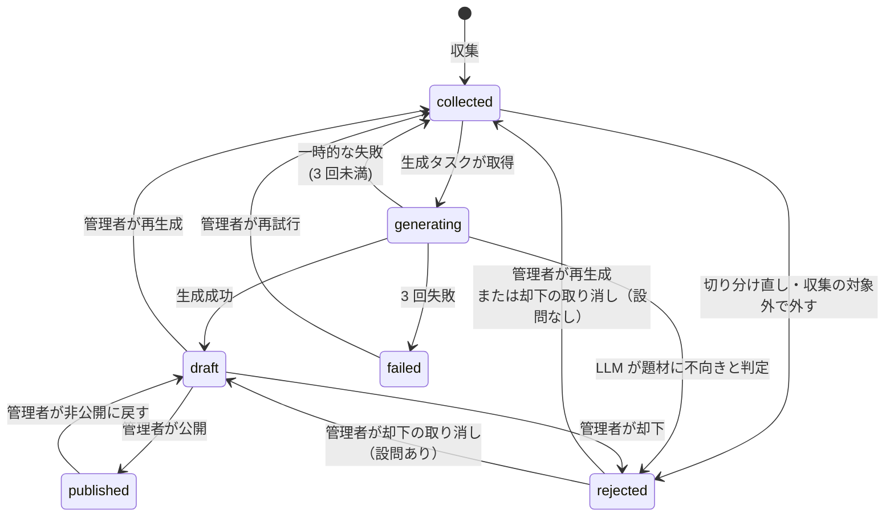
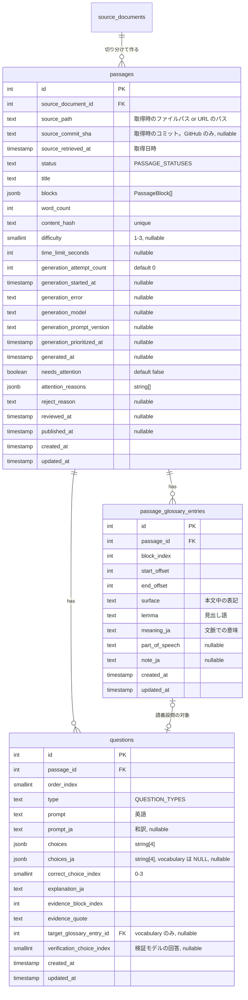
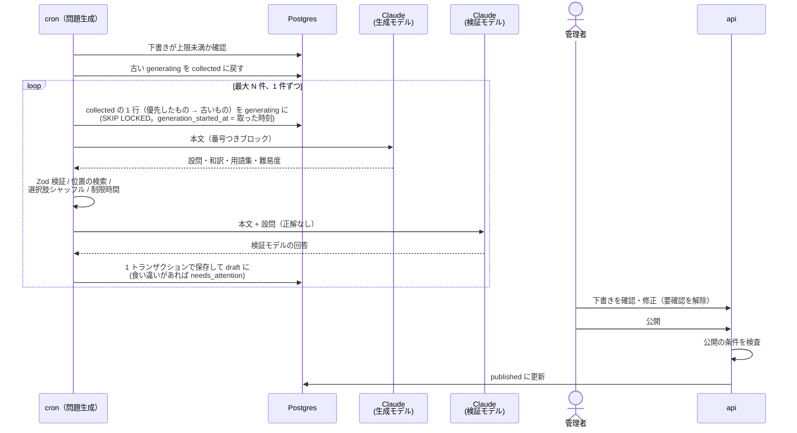

# 問題の生成と公開

収集した本文候補（[content-collection](../content-collection/README.md)）から、LLM（Claude API）で **4 択の設問・解説・段落ごとの和訳・単語の意味** を生成し、管理者が admin 画面で確認・修正してから公開する。

LLM が作った設問は、正解が誤っていたり、選択肢が本文と無関係だったりすることがある。誤った正解で採点される問題が 1 つでも混ざると学習サービスとして信頼を失うため、**人が確認するまで公開しない**。管理者の確認を楽にするため、生成時に別のモデルで「解答キーを見ずに解かせる」検証を行い、怪しい問題に印を付ける。

このドキュメントは **仕様（What）** と **設計（How）** を分けて記述する：

- **仕様**：問題が持つ情報、設問の作り方のルール、難易度と制限時間、問題の状態と公開までの流れ、管理者ができること
- **設計**：生成タスクの動き、LLM の呼び出し方と出力の検証、費用の上限、管理画面のアクセス制御

## 関連 spec

- [`../product-overview/README.md`](../product-overview/README.md) — プロダクト全体像
- [`../content-collection/README.md`](../content-collection/README.md) — 本文候補（`status = collected` の `passages`）を作る
- [`../reading-practice/README.md`](../reading-practice/README.md) — 公開された問題を解く。和訳と単語の意味をアシストで使う
- [`../question-translation/README.md`](../question-translation/README.md) — 設問（設問文と選択肢）の和訳。生成・admin での修正・公開の条件
- **この spec が正本のもの**：`passages` / `questions` / `passage_glossary_entries` の列定義、`PassageBlock` の型、`PASSAGE_STATUSES` / `PASSAGE_DIFFICULTIES` / `PASSAGE_BLOCK_TYPES` / `QUESTION_TYPES`、制限時間の計算式

## 目次

- [仕様](#仕様)
  - [問題が持つ情報](#問題が持つ情報)
  - [設問のルール](#設問のルール)
  - [和訳と単語の意味のルール](#和訳と単語の意味のルール)
  - [難易度と制限時間](#難易度と制限時間)
  - [問題の状態](#問題の状態)
  - [管理者ができること](#管理者ができること)
  - [公開済みの問題を直すとき](#公開済みの問題を直すとき)
- [設計](#設計)
  - [本文の構造（PassageBlock）](#本文の構造passageblock)
  - [生成タスクの動き](#生成タスクの動き)
  - [LLM の呼び出し](#llm-の呼び出し)
  - [出力の検証と後処理](#出力の検証と後処理)
  - [解答キーを見ない検証](#解答キーを見ない検証)
  - [失敗時の扱い](#失敗時の扱い)
  - [費用の上限](#費用の上限)
  - [管理画面のアクセス制御](#管理画面のアクセス制御)
  - [MVP 対象外（将来検討）](#mvp-対象外将来検討)
- [必要な画面](#必要な画面)
- [UI 設計](#ui-設計)
  - [問題一覧](#問題一覧)
  - [問題の確認・修正](#問題の確認修正)
- [必要な API](#必要な-api)
- [必要な DB 設計](#必要な-db-設計)
- [フロー図](#フロー図)
- [実装ステップ](#実装ステップ)

---

## 仕様

### 問題が持つ情報

| 情報 | 作るのは | 説明 |
| --- | --- | --- |
| 本文（英文） | 収集 | 見出し・段落・箇条書き・コードのブロック列 |
| タイトル | 収集（管理者が修正可） | 本文の先頭の見出し |
| 出典 | 収集 | ソース、ファイルのパス（サイトは URL）、取得時のコミット（GitHub のみ）、取得日 |
| 難易度 | LLM（管理者が修正可） | 3 段階。[後述](#難易度と制限時間) |
| 制限時間 | 計算式（管理者が修正可） | [後述](#難易度と制限時間) |
| 設問 | LLM（管理者が修正可） | 3〜5 問の 4 択。正解・解説・根拠つき。「文脈での語義」の設問は対象の語句も持つ |
| 段落ごとの和訳 | LLM（管理者が修正可） | コード以外の全ブロック |
| 設問の和訳 | LLM（管理者が修正可） | 設問文と選択肢。「文脈での語義」の設問は設問文だけ（[question-translation](../question-translation/README.md#和訳を付けるもの)） |
| 単語の意味（用語集） | LLM（管理者が修正可） | 本文中の難しい単語・熟語と、**この文脈での** 意味 |

### 設問のルール

**数**：本文の英単語数で決める。

| 英単語数 | 設問数 |
| --- | --- |
| 〜300 語 | 3 問 |
| 301〜450 語 | 4 問 |
| 451 語〜 | 5 問 |

**種類**（`QUESTION_TYPES`）：1 つの問題に 2 種類以上を混ぜる。種類ごとの正答率をマイページに出す（[learning-record](../learning-record/README.md)）。

| 種類 | 内部名 | 例 |
| --- | --- | --- |
| 要旨 | `main_idea` | What is the main purpose of this section? |
| 詳細 | `detail` | According to the passage, what happens when the cache is full? |
| 文脈での語義 | `vocabulary` | The word "opt in" in paragraph 2 is closest in meaning to ... |
| 推論 | `inference` | What can be inferred about the previous version of the API? |
| 筆者の意図 | `purpose` | Why does the author mention the `useEffect` hook? |

**形式**：

- 設問文と選択肢は **英語**、解説は **日本語**。設問文と選択肢には和訳も付ける（[question-translation](../question-translation/README.md)）
- 選択肢はちょうど 4 つで、正解は 1 つだけ
- 誤りの選択肢は「本文を読まないと誤りだと分からない」もっともらしいものにする。"All of the above" / "None of the above" は使わない
- 正解の位置（A〜D）は偏らないようにする
- 各設問に **根拠**（本文中の該当箇所の引用）を付ける。結果画面で本文の該当箇所をハイライトするのに使う
- 解説には「なぜ正解か」と「主な誤りの選択肢がなぜ誤りか」を書く

### 和訳と単語の意味のルール

**和訳**：

- コード以外のすべてのブロック（見出し・段落・箇条書き・引用）に付ける
- エンジニアが普段使う言い方にする。カタカナ語・英語のまま使うのが一般的な用語（props、デプロイ、コンポーネントなど）は無理に訳さない
- インラインコードは訳さずそのまま残す

**単語の意味（用語集）**：

- 1 問あたり 8〜20 語句。英語の中級者（CEFR B1〜B2 程度）のエンジニアが引っかかりそうな単語・熟語・技術英語の言い回しを選ぶ（例：`opt out of`、`idempotent`、`under the hood`、`caveat`）
- これとは別に、本文の **句動詞はすべて** 入れる（`set up` のような易しいものも。8〜20 語句には数えない）。語が離れる形（`set it up`）は入れない（[word-lookup-targets](../word-lookup-targets/README.md#句動詞)）
- 誰でも知っている単語（the, use, file など）は入れない
- 「文脈での語義」の設問の対象語句は **必ず用語集に入れ、設問と紐づける**。解答中はその語句を用語集から外して出し（答えがそのまま見えてしまうため）、結果画面では出す（[reading-practice](../reading-practice/README.md#アシスト)）
- 意味は **その文脈での意味を 1 つ** 書く（辞書のように全義を並べない）。必要なら一言の補足（例：「技術文書では『〜を無効にする』の意味でよく使う」）を付ける
- 用語集に無い単語をタップしたときは英和辞書の意味を出す（[reading-practice](../reading-practice/README.md#アシスト)）

### 難易度と制限時間

**難易度**（`PASSAGE_DIFFICULTIES`）：

| 値 | 表示 | 目安 |
| --- | --- | --- |
| `1` | Easy | 平易な文。チュートリアルや README の導入部 |
| `2` | Normal | 一般的な技術文書。API リファレンスの説明、概念の解説 |
| `3` | Hard | 抽象度が高い・一文が長い。RFC、設計の議論、仕様の厳密な説明 |

LLM が語彙・構文・抽象度から判定し、管理者が修正できる。

**制限時間**：難易度ごとの想定の読む速さ（WPM）と設問数から計算し、30 秒単位に切り上げる。管理者が修正できる。

```
制限時間（秒） = 英単語数 ÷ 想定 WPM × 60 ＋ 設問数 × 40
```

| 難易度 | 想定 WPM |
| --- | --- |
| 1 | 100 |
| 2 | 120 |
| 3 | 140 |

例：難易度 2・400 語・4 問 → 200 秒 + 160 秒 = 360 秒（6 分）。

> 想定 WPM は「日本人の中級者が技術文書を精読する速さ」として仮置きした値。公開後に実際の解答時間の分布を見て調整する。

### 問題の状態



| 状態 | 内部名 | ユーザーに見えるか | 意味 |
| --- | --- | --- | --- |
| 収集済み | `collected` | ❌ | 本文だけがある。生成待ち |
| 生成中 | `generating` | ❌ | 生成タスクが処理中 |
| 下書き | `draft` | ❌ | 生成済み。管理者の確認待ち |
| 公開 | `published` | ✅ | ユーザーが解ける |
| 却下 | `rejected` | ❌ | 題材に不向き（LLM または管理者が判断）か、収集が外した未生成の本文候補（切り分け直した文書の前の切り分け・除外パスに入った / 取得元から消えた文書。[passage-extraction-tuning](../passage-extraction-tuning/README.md#前の切り分けで作った本文候補)）。理由を残す。管理者が取り消せる |
| 失敗 | `failed` | ❌ | 生成が 3 回失敗した |

### 管理者ができること

- 下書きの一覧を見る（**要確認の印が付いたものを先頭に**、次に古い順）
- 下書きをユーザーが見るのと同じ見た目でプレビューする（和訳の切り替え、用語集のハイライトを含む）
- 下書きを修正する：タイトル、難易度、制限時間（計算式で再計算するボタンあり）、本文の英文の軽微な修正、和訳、設問（設問文・選択肢・それぞれの和訳・正解・解説・根拠）、用語集（追加・修正・削除）
- 公開する。公開前に [公開の条件](#出力の検証と後処理) を満たしているかを検査し、満たしていなければ公開できない
- 却下する（理由を入力）
- 却下を取り消す（誤って却下したとき。生成した設問があれば内容を残したまま下書きに、無ければ（LLM が不向きと判定したもの）生成待ちに戻す）
- 再生成する（生成した内容を捨てて生成待ちに戻す）
- 公開済みの問題を非公開に戻す
- 公開済みの問題の読み上げの音声の状態を見て、作成に失敗したものを再試行し、作成済みのものを作り直す（[read-aloud](../read-aloud/README.md#音声ができるまで)。失敗した音声は問題を公開し直しても作り直しの対象に戻る）
- 要確認の印を解除する（理由を確かめた・直した後に。一覧の要確認の先頭から外れる。生成し直すまで印は付かない）

### 公開済みの問題を直すとき

- **公開中の問題は直接編集できない。** いったん非公開（下書き）に戻して修正し、再度公開する
- 非公開に戻しても、それまでのユーザーの挑戦記録と採点結果は残る（提出時の正誤を保存しているため、後から正解を直しても過去の点数は変わらない）
- 非公開の間、その問題は問題一覧に出ない。挑戦中だったユーザーは提出でき、**提出時点の設問** で採点される
- **一度でも挑戦された問題は、設問の数を変えられず、再生成もできない**（過去の回答が指す設問を消さないため）。設問文・選択肢・正解・解説の修正はできる。設問を作り直したい場合は却下する

---

## 設計

### 本文の構造（PassageBlock）

本文はブロックの配列として `passages.blocks`（jsonb）に入れる。型は `@repo/domain`、検証用の Zod スキーマは `@repo/api-schema` に置く。

```ts
type PassageBlock = {
  /** PASSAGE_BLOCK_TYPES: "heading" | "paragraph" | "list_item" | "code" | "quote" */
  type: PassageBlockType
  /** 本文。インラインコードはバッククォートで囲んだまま保持する */
  text: string
  /** code のみ。シンタックスハイライトの言語 */
  lang?: string
  /** code 以外。生成で埋める */
  translationJa?: string
}
```

ブロックを行ではなく jsonb にした理由：

- 本文は常に問題単位でまとめて読み書きし、ブロック単位で検索・集計しない
- 管理者の修正は問題単位の保存なので、行に分けると差分更新の手間だけが増える

用語集と設問の根拠は、**ブロックの位置（`block_index`）とブロック内の文字位置** で本文の箇所を指す。管理者が英文を修正すると位置がずれるため、保存時に再計算する（[後述](#出力の検証と後処理)）。

### 生成タスクの動き

`apps/cron` のタスク `generate:questions` として実装する（run-once）。

| 項目 | 内容 |
| --- | --- |
| 起動 | EventBridge Scheduler で 1 日 1 回（`collect:passages` の 1 時間後） |
| ローカル実行 | `pnpm generate:questions`、`pnpm generate:questions --passage-id=42`（1 件だけ） |
| 外部 API クライアント | `src/client/anthropic/`（`@anthropic-ai/sdk` を包む。コンストラクタ DI） |

1 回の実行の流れ：

1. 下書きの件数が上限（`GENERATE_MAX_PENDING_DRAFTS`）以上なら何もせず終える（確認が追いつかないのに生成して費用を使わないため）
2. `generating` のまま 30 分以上たった行を `collected` に戻す（前回の実行が途中で落ちた場合の回収）
3. 最大 `GENERATE_MAX_PASSAGES_PER_RUN` 件まで、1 件ずつ次を繰り返す（取れる行が無くなったら終える）
   1. `collected` のうち、生成を優先したもの（`generation_prioritized_at` の古い順。URL から取り込んだ本文候補）→ 古いもの（`created_at`）の順で 1 行を `generating` に更新しながら取得する（`FOR UPDATE SKIP LOCKED`。実行が重なっても同じ行を二重に処理しない）。`generation_started_at` はその行を取った時刻
   2. 生成 → 検証と後処理 → 解答キーを見ない検証 → `passages` / `questions` / `passage_glossary_entries` を 1 トランザクションで保存して `draft` に更新

最初にまとめて取得しないのは、全件に同じ `generation_started_at` が入り、1 回の実行が 30 分を超えると後半の（まだ処理していない）行が次の実行に回収・再取得されて LLM の費用が二重にかかるため。保存は `id` + `status = generating` + `generation_started_at` が取得したときと同じ場合だけ行う（回収・再取得された行を古い実行が上書きしない）。

### LLM の呼び出し

| 項目 | 内容 |
| --- | --- |
| 生成モデル | `GENERATION_MODEL`（既定 `claude-sonnet-5-5`） |
| 検証モデル | `VERIFICATION_MODEL`（既定 `claude-haiku-4-5-20251001`） |
| 出力形式 | JSON Schema を指定した structured output で受け取り、Zod で検証する |
| thinking と effort | 生成は `thinking: { type: "adaptive" }` と `output_config.effort: "high"` を明示する。検証はどちらも送らない（検証モデルの Claude Haiku 4.5 は adaptive thinking を受け付けない） |
| 出力の上限（`max_tokens`） | 生成 16000、検証 2000。非ストリーミングで SDK のタイムアウトに収まる上限 |
| プロンプト | `apps/cron/src/prompt/generate-questions.ts` に置き、`PROMPT_VERSION` を持たせる。生成した問題に `generation_prompt_version` として記録する（プロンプト改善の前後で品質を比べるため） |
| プロンプトキャッシュ | 指示部分（system prompt）は全件共通なのでキャッシュを有効にする |

1 回の呼び出しで、本文に対する以下をまとめて生成させる。本文のブロックには番号を振って渡し、根拠や用語集の位置はブロック番号で答えさせる。

| 出力 | 内容 |
| --- | --- |
| `isSuitable` / `unsuitableReason` | 題材として不向きか（目次だけ、ライセンス文、コード主体、文脈が切れていて意味が通らない等） |
| `difficulty` | 1〜3 |
| `questions[]` | `type` / `prompt` / `promptJa` / `choices[4]` / `choicesJa[4]`（`vocabulary` のときだけ null） / `correctChoiceIndex` / `explanationJa` / `evidence: { blockIndex, quote }` / `vocabularyTarget?: { blockIndex, surface }`（`vocabulary` のときだけ） |
| `translations[]` | `{ blockIndex, translationJa }`（コード以外の全ブロック） |
| `glossary[]` | `{ blockIndex, surface, lemma, meaningJa, partOfSpeech, noteJa? }` |

**thinking と出力の上限**：思考（thinking）のトークンは、内容が返らなくても `max_tokens` に数えられる。`claude-sonnet-5-5` は `thinking` を省略すると adaptive thinking で動き、effort の既定は `high`（`budget_tokens` は指定できず、思考を止める設定は `between_tools`）。structured output では effort が low / medium のときに思考が `max_tokens` まで続くことがあり、high 以上ではほぼ起きない（Anthropic のドキュメント：[Effort](https://platform.claude.com/docs/en/build-with-claude/effort)・[Prompting Claude Sonnet 5.5](https://platform.claude.com/docs/en/build-with-claude/prompt-engineering/prompting-claude-sonnet-5-5)・[Steering thinking](https://platform.claude.com/docs/en/build-with-claude/thinking-steering-and-cost)）。

- 生成は adaptive thinking と effort `high` を明示する。既定と同じ値なので挙動もプロンプトキャッシュも変わらないが、`GENERATION_MODEL` を effort の既定が違うモデル（Claude Opus 5.5 は medium）に変えても下がらない
- `max_tokens` は非ストリーミングの上限に近いので上げない。思考を止める `between_tools` は、structured output では思考なしで答えることになり正解の質が下がるので使わない
- それでも `stop_reason` が `max_tokens` で止まったら（JSON として読めても）使わず、warn のログに `usage.output_tokens` を出して一時的な失敗にする（[失敗時の扱い](#失敗時の扱い)）

**文字位置（offset）は LLM に答えさせない。** LLM は文字数を数えるのが苦手で位置がずれやすいため、`surface`（本文中の表記そのまま）だけを答えさせ、位置はコードで本文から検索して求める。

### 出力の検証と後処理

LLM の出力を保存する前に、コードで以下を検査・加工する。

| 検査・加工 | 不合格のとき |
| --- | --- |
| Zod スキーマに合う | エラー内容を付けて 1 回だけ再生成させる。それでも不合格なら失敗扱い |
| 設問数が英単語数に応じた数と一致する | 同上 |
| 各設問の選択肢が 4 つとも空でなく、重複しない | 同上 |
| 根拠の `quote` が該当ブロックの本文に含まれる | 要確認の印を付ける（保存はする） |
| コード以外の全ブロックに和訳がある | 同上 |
| 用語集の `surface` を該当ブロックから検索し、文字位置を求める | 見つからない語句は捨てる（ログに出す） |
| `vocabulary` の設問の対象語句が用語集にあり、紐づけられる | 用語集に無ければ対象語句から用語集の項目を作って紐づける。本文に見つからなければ要確認の印を付ける |
| **選択肢をシャッフルして正解の位置を無作為にする**（選択肢の和訳も同じ順に並べ替える） | ― |
| 制限時間を計算式で求める | ― |

選択肢をコードでシャッフルするのは、LLM が正解を特定の位置（B や C）に置きがちなため。

公開時（`POST /api/admin/passage/:id/publish`）も同じ検査を api で行い、1 つでも不合格なら 400 で公開を拒否する（管理者の修正で壊れた場合を防ぐ）。公開の条件：

- 設問数が 3〜5、各設問の設問文あり・選択肢が 4 つ・重複なし・正解あり・解説あり（空白だけの設問文・解説は空とみなす）
- 各設問に設問文の和訳があり、`vocabulary` 以外は選択肢 4 つとも和訳がある（[question-translation](../question-translation/README.md#admin-での修正と公開の条件)）
- 各設問の根拠がブロックの本文に含まれる
- コード以外の全ブロックに和訳がある
- 用語集の全語句が、指しているブロックの位置に本文と同じ表記で存在し、文脈での意味がある（生成で語義設問の対象から足した、意味が空の項目を管理者が埋めずに公開しないように）
- `vocabulary` の設問はすべて対象語句（用語集の項目）と紐づいている
- 難易度と制限時間がある

### 解答キーを見ない検証

生成とは別のモデル（`VERIFICATION_MODEL`）に、本文と設問・選択肢だけを渡して解かせる。**正解と食い違った設問があれば要確認の印を付ける**（`needs_attention = true`、理由に「Q2：検証モデルは C を選択」のように残す）。

- 正解が誤っている、または正解が 2 つ読み取れる設問を、管理者が優先して見られるようにする
- 食い違っても自動で却下はしない（検証モデル側が誤っていることもあるため、判断は管理者に任せる）

### 失敗時の扱い

| 失敗 | 扱い |
| --- | --- |
| Claude API の一時的なエラー（429 / 5xx / タイムアウト） | SDK のリトライ（指数バックオフ、最大 2 回）。それでも失敗したら `collected` に戻し `generation_attempt_count` を +1 |
| 出力の検証に 2 回不合格 | 同上 |
| 出力が `max_tokens` で切れた（`stop_reason: max_tokens`） | その場で作り直さず（同じ上限では切れやすく、費用だけが増える）同上。warn のログに `usage.output_tokens` と上限を出す |
| `generation_attempt_count` が 3 に達した | `failed` にして `generation_error` に最後のエラーを残す |
| LLM が `isSuitable = false` と判定 | `rejected` にして `reject_reason` に理由を残す |

1 件の失敗で他の件は止めない。失敗した件は warn でログに出す。タスクは最後に、次のどちらかなら exit code 1 で終える。

- 1 件でも `failed` になったものがある
- 取得した全件が一時的な失敗で `collected` に戻った（下書き・却下が 0 件）。JSON Schema が API に受け付けられない（400）など、設定や実装の誤りで毎回全件が失敗するのを、3 回目の `failed` まで待たずに知らせるため

冪等：保存は 1 トランザクションで、`draft` への更新と設問・用語集の挿入を同時に行う。途中で落ちた行は `generating` のまま残り、次回の実行で `collected` に戻されてやり直される。1 件ずつ取得するので、途中で落ちても `generating` で残るのは処理中だった 1 行だけになる。

### 費用の上限

| env | 既定 | 説明 |
| --- | --- | --- |
| `GENERATE_MAX_PASSAGES_PER_RUN` | `10` | 1 回の実行で生成する件数の上限 |
| `GENERATE_MAX_PENDING_DRAFTS` | `50` | 確認待ちの下書きがこの件数以上なら生成しない |

1 日 1 回 × 10 件なので、生成される問題は最大で月 300 件。Claude API の利用額の上限は Anthropic Console 側でも設定しておく。

### 管理画面のアクセス制御

[admin-template](../admin-template/README.md#admin-認証) で、`admins` テーブル + admin 専用の JWT + Google のサインインに置き換えた。この spec で入れた Basic 認証（admin）と `X-Admin-Token`（api）は廃止した。

誰が承認したかは記録しない（`reviewed_at` だけ持つ）。admin の操作の記録は admin-template の [MVP 対象外](../admin-template/README.md#mvp-対象外将来検討)。

### MVP 対象外（将来検討）

- **公開後のユーザーからの問題報告**（「正解がおかしい」ボタン）。公開問題が増え、管理者が全件を見直せなくなったとき
- **問題の自動公開**（検証モデルと一致し、要確認の印が無いものは自動で公開）。下書きの確認が追いつかなくなったとき
- **管理画面からの生成の即時実行**

---

## 必要な画面

すべて admin。

| 画面 | 概要 |
| --- | --- |
| 問題一覧 | 状態・ソース・要確認の有無で絞り込める。状態ごとの件数を上部に出す。下書きは要確認 → 古い順 |
| 問題の確認・修正 | 左にユーザーと同じ見た目のプレビュー（和訳の切り替え・用語集のハイライト）、右に編集フォーム（設問・和訳・用語集・難易度・制限時間）。要確認の理由を上部に出す。操作：保存 / 公開 / 却下 / 却下の取り消し / 再生成 / 非公開に戻す / 要確認の解除。公開した問題には読み上げの音声のカード（状態・作成日時、失敗したときの「再試行」、作成済みのときの「作り直す」。[read-aloud](../read-aloud/README.md#音声ができるまで)）も出す |

具体的な UI は [UI 設計](#ui-設計) を参照。

## UI 設計

`design-mock` skill で確定したデザイン。admin は既存の TailAdmin テンプレートのデザインを使う（[product-overview の admin のデザイン](../product-overview/README.md#admin-のデザイン)）。プレビューだけはユーザーの解答画面と同じ見た目にする。

| パス（admin） | 画面名 | モック |
| --- | --- | --- |
| `/passages` | 問題一覧 | `/mock/passages` |
| `/passages/[id]` | 問題の確認・修正 | `/mock/passages/42` |

**状態のバッジの色**（テンプレートの `Badge`）：

| 状態 | 色 |
| --- | --- |
| 収集済み | `light` |
| 生成中 | `info` |
| 下書き | `primary` |
| 公開 | `success` |
| 却下 | `dark` |
| 失敗 | `error` |
| 要確認（下書きに付く印） | `warning` |

### 問題一覧

```
┌──────────────────────────────────────────────────────────────────────────────┐
│ 問題                                                             Home > 問題 │ ← PageBreadcrumb
│  ┌────────────┬────────────┬────────────┬────────────┬───────────┬────────┐  │ ← 状態ごとの件数（押すと切り替え）
│  │ 下書き     │ 公開       │ 収集済み   │ 生成中     │ 却下      │ 失敗   │  │
│  │ 16         │ 219        │ 118        │ 2          │ 34        │ 3      │  │
│  └────────────┴────────────┴────────────┴────────────┴───────────┴────────┘  │
│  ┌────────────────────────────────────────────────────────────────────────┐  │ ← ComponentCard（見出しは選んだ状態）
│  │ 下書き                                                                 │  │
│  │ 要確認の印が付いたものを先頭に、古い順に並べています。                 │  │
│  ├────────────────────────────────────────────────────────────────────────┤  │
│  │ ┌────────────────────────────────────────────────────────────────────┐ │  │ ← DataTable
│  │ │ Show [10▾] entries                [🔍 タイトル・ソース名] [Filter] │ │  │
│  │ ├────────────────────────────────────────────────────────────────────┤ │  │
│  │ │ タイトル          状態   難易度 語数 設問 要確認         更新日時  │ │  │
│  │ │ Synchronizing…    下書き Normal 332  4   • Q3：検証モデル… 10-09  …│ │  │ ← 要確認の理由（オレンジ）
│  │ │ Garbage Collect…  下書き Normal 411  4   • Q2 の根拠が…    10-09  …│ │  │
│  │ │ Defer, Panic, …   下書き Normal 389  4   ―                 10-08  …│ │  │
│  │ ├────────────────────────────────────────────────────────────────────┤ │  │
│  │ │ Showing 1 to 10 of 16 entries              [Previous] [1] 2 [Next] │ │  │ ← ページ送り
│  │ └────────────────────────────────────────────────────────────────────┘ │  │
│  └────────────────────────────────────────────────────────────────────────┘  │
└──────────────────────────────────────────────────────────────────────────────┘
```

- 上部に **状態ごとの件数のカード** を 6 枚（下書き・公開・収集済み・生成中・却下・失敗）並べる。押すとその状態の一覧に切り替わり、選択中のカードは `brand-500` の枠。初期表示は下書き
- 下に `ComponentCard`（見出しは選んだ状態の名前と並び順の説明）と、Basic Tables と同じ `DataTable`
- 検索はタイトル・ソース名。Filter はソース、下書きのときだけ要確認（あり / なし）。ページ送りは 10 / 20 / 50 件
- 並び順：下書きは **要確認の印があるもの → 古い順**、それ以外は新しい順
- 列：タイトル（下にソース名）、状態、難易度、英単語数、設問数、状態ごとの列（下書き＝要確認の理由をオレンジの点つきで列挙、公開＝挑戦の件数、却下＝却下の理由、失敗＝エラー、それ以外＝「―」）、更新日時、操作（下書きは「確認する」、それ以外は「表示」）
- 条件に合う行が無いときは「条件に合う問題がありません」と、検索・Filter・タブを変えるよう案内する

### 問題の確認・修正

```
┌────────────────────────────────────────────────────────────────────────────┐
│ [下書き][要確認]                            [再生成][却下][保存][公開する] │ ← 状態バッジと操作
│ Synchronizing with Effects                                                 │ ← タイトル
│ ソース / 取得元（パス@コミット） / 英単語数 / 生成モデル /                 │ ← 生成の記録
│ プロンプトの版 / 生成日時 / 制限時間                                       │
├────────────────────────────────────────────────────────────────────────────┤
│ ⚠ 要確認：Q3：検証モデルは A を選択（正解は B）             [要確認を解除] │ ← warning の囲み
├──────────────────────────────────────┬─────────────────────────────────────┤
│ プレビュー     ☑用語集の下線 ☐全文訳 │ 設問(4) 和訳 用語集(10) 本文 基本情…│ ← 左：ユーザーと同じ見た目 / 右：タブ
│ ┌───────────────────────────────────┐│         ━━━━━                       │
│ │ # Synchronizing with Effects      ││ ┌──────────────────────────────────┐│ ← ダーク・Literata
│ │ 1 Some components need to         ││ │ Q1 要旨                      ▾   ││
│ │   stay in sync with … They        ││ ├──────────────────────────────────┤│ ← …… 用語集の語句（琥珀の点線）
│ │   are an escape hatch: you        ││ │ Q3 文脈での語義 [検証:A]     ▴   ││ ← - - 語義設問の対象（青の破線）
│ │   use them to step outside        ││ │  種類 [文脈での語義▾]            ││ ← ▓▓ 開いている設問の根拠
│ │   of React's rendering …          ││ │  設問文 [In paragraph 1, …]      ││
│ │                                   ││ │  ○ A [a security vul…] 検証      ││ ← 検証モデルの回答
│ │ 2 Before reaching for …           ││ │  ◉ B [a way to leave…]           ││ ← ラジオ＝正解
│ │                                   ││ │  ○ C [...]  ○ D [...]            ││
│ │                                   ││ │  解説 [escape hatch は…]         ││
│ │                                   ││ │  根拠 [段落1▾] [They are an…]    ││
│ │                                   ││ │  ✓ 本文に見つかりました          ││
│ │                                   ││ │  対象の語句 [escape hatch▾]      ││
│ └───────────────────────────────────┘│ │                   この設問を削除 ││
│ ‥ 用語集  - - 語義の対象  ▓ 根拠     │ └──────────────────────────────────┘│ ← 凡例
│                                      │ 設問は 3〜5 問         [設問を追加] │
└──────────────────────────────────────┴─────────────────────────────────────┘
```

**上部**

- 状態のバッジ（下書き / 公開）と要確認のバッジ、タイトル
- 操作：下書きは「再生成」（副）・「却下」（危険）・「保存」（副）・「公開する」（主要）。公開中は「非公開に戻す」だけ。却下済みは「却下を取り消す」（副）・「再生成」（副）。失敗は「再生成」だけ
- 生成の記録：ソース、取得元（パスと `@コミット`）、英単語数、生成モデル、プロンプトの版、生成日時、制限時間
- 「保存」を押すと「下書きを保存しました」を出す

**囲みの案内**（上から順に、該当するものだけ）

| 場面 | 色 | 内容 |
| --- | --- | --- |
| 公開中 | info | 「公開中の問題は編集できません」：非公開に戻してから修正すること、挑戦があるため設問の数の変更と再生成はできないこと |
| 公開の条件を満たしていない（「公開する」で 400） | error | 「公開の条件を満たしていないため、公開できません」と、満たしていない条件の一覧（例「Q2：根拠の引用が段落 2 の本文に見つかりません」「段落 4 の和訳が空です」）。該当の設問には `error` のバッジ「根拠が見つかりません」、該当の和訳の入力欄は `error` の枠 |
| 要確認の印がある（下書き） | warning | 「要確認」と理由の一覧（例「Q3：検証モデルは A を選択（正解は B）」）。右上に「要確認を解除」（副）。押すと印と理由が消える（未保存の修正があれば先に保存する。ダイアログは出さない） |
| 却下済み | info | 「却下した問題です」と却下の理由。「却下を取り消す」「再生成」で戻せること |

**プレビュー（左、1280px 以上では画面に追従）**

- ユーザーの解答画面と同じ見た目（`#12161f` の背景、Literata、段落番号、段落ごとの「訳」）
- 管理者向けの表示：**用語集の語句に琥珀の点線**、**語義設問の対象語句に青の破線**、**開いている設問の根拠に琥珀の背景**。語句にホバーすると見出し語と意味のツールチップ
- 上部のチェックボックスで「用語集の下線」と「全文訳」を切り替える。下部に 3 種類の印の凡例

**編集（右、タブ）**

| タブ | 内容 |
| --- | --- |
| 設問（数） | 設問ごとの開閉できるカード。見出しに番号・種類・検証モデルとの食い違い（`warning` のバッジ「検証モデルは A を選択」）。開くと：種類、設問文（英語）と設問文（和訳）、選択肢 4 つ（左のラジオで正解を選ぶ。検証モデルが選んだ選択肢の右に「検証モデルの回答」。英語の下に和訳の入力。語義の設問は和訳の入力を出さず「語義の設問は選択肢を訳しません」と注記）、解説（日本語）、根拠の段落と引用（本文に見つかったかを表示）、語義設問なら対象の語句（用語集から選ぶ）、「この設問を削除」。**設問を開くとプレビューがその根拠までスクロールしてハイライトする**。末尾に「設問を追加」と目安の設問数 |
| 和訳 | コード以外の全ブロック。ブロックの英文（2 行まで）と和訳のテキストエリア |
| 用語集（数） | `DataTable`。列は語句（下に見出し語・品詞・段落、語義設問の対象なら `info` のバッジ）、文脈での意味（下に補足）、操作（編集・削除）。上に「語句を追加」 |
| 本文 | ブロックごとの英文のテキストエリア（コードは等幅）。上に warning の囲み：修正は軽微なものに留める、保存時に用語集の位置を再計算し、根拠の引用が本文にあるかを検査する |
| 基本情報 | タイトル、難易度（LLM の判定も表示）、制限時間と「計算式で再計算」（押すと「332 語 ÷ 120 WPM × 60 ＋ 4 問 × 40 秒 ＝ 326 秒 → 30 秒単位に切り上げて 5:30」のように計算の過程を出す） |

公開中は、設問タブ以外の入力をすべて無効にする（設問タブも各項目は無効）。

**ダイアログ**（テンプレートの `Modal`）

| 操作 | 内容 |
| --- | --- |
| 却下 | 「この問題を却下する」：却下するとユーザーに表示されないこと、誤って却下したときは「却下を取り消す」で下書きに戻せること。却下の理由（必須）。「キャンセル」「却下する」（`error` の塗り） |
| 却下を取り消す | 「却下を取り消す」：設問があれば下書きに戻ること（生成した内容と修正は残り、却下の理由は消える）、無ければ生成待ちに戻って次回の生成タスクで作られること。「キャンセル」「却下を取り消す」（主要） |
| 再生成 | 「問題を再生成する」：生成した設問・和訳・用語集を削除して生成待ちに戻すこと、修正した内容も消えること。「キャンセル」「再生成する」 |

## 必要な API

admin 向け（admin の access token が必要）。

| メソッド | パス | 説明 |
| --- | --- | --- |
| GET | `/api/admin/passage` | 問題一覧。`status` / `source_id` / `needs_attention` で絞り込み、cursor ページング。状態ごとの件数も返す |
| GET | `/api/admin/passage/:id` | 問題の全情報（本文・和訳・設問と正解・解説・用語集・要確認の理由・出典） |
| PUT | `/api/admin/passage/:id` | 下書きの保存（`draft` のときだけ。それ以外は 409。挑戦がある問題で設問の数を変えようとしたら 409）。用語集と根拠の文字位置を再計算する |
| POST | `/api/admin/passage/:id/publish` | 公開。公開の条件を満たさなければ 400 |
| POST | `/api/admin/passage/:id/reject` | 却下（`reason` 必須） |
| POST | `/api/admin/passage/:id/unpublish` | 公開 → 下書き |
| POST | `/api/admin/passage/:id/regenerate` | 生成した内容を削除して `collected` に戻す（`draft` / `rejected` / `failed` のとき。挑戦が 1 件でもあれば 409） |
| POST | `/api/admin/passage/:id/restore` | 却下の取り消し（`rejected` のときだけ。それ以外は 409）。設問があれば `draft`（設問・用語集・和訳・要確認は残し、`reject_reason` を消す）、無ければ再生成と同じく生成の記録を空にして `collected` に戻す。挑戦があっても取り消せる |
| POST | `/api/admin/passage/:id/attention/resolve` | 要確認の解除（`needs_attention = false`、`attention_reasons = []`）。状態は問わない。対象が無ければ 404、解除済みでも 200（冪等） |

cron タスク：

| タスク | 説明 |
| --- | --- |
| `generate:questions` | `collected` の本文候補から問題を生成して `draft` にする |

## 必要な DB 設計

| テーブル | 主要カラム | 説明 |
| --- | --- | --- |
| `passages` | `id`, `source_document_id`, `source_path`, `source_commit_sha`, `source_retrieved_at`, `status`, `title`, `blocks(jsonb)`, `word_count`, `content_hash`, `difficulty`, `time_limit_seconds`, 生成の記録, `generation_prioritized_at`（生成を優先した時刻。[url-import](../url-import/README.md#生成の優先)）, 確認の記録 | 本文候補 / 問題。状態で一生を表す |
| `questions` | `id`, `passage_id`, `order_index`, `type`, `prompt`, `prompt_ja`, `choices(jsonb)`, `choices_ja(jsonb)`, `correct_choice_index`, `explanation_ja`, `evidence_block_index`, `evidence_quote`, `target_glossary_entry_id`, `verification_choice_index` | 設問 |
| `passage_glossary_entries` | `id`, `passage_id`, `block_index`, `start_offset`, `end_offset`, `surface`, `lemma`, `meaning_ja`, `part_of_speech`, `note_ja` | 用語集（単語の文脈での意味） |



- `source_path` / `source_commit_sha` / `source_retrieved_at` を `passages` にも持つのは、`source_documents` が次回の収集で最新の状態に上書きされるため。問題は取得した時点（GitHub はコミットのパーマリンク、サイトは取得日）を指し続ける必要がある（[出典表示](../content-collection/README.md#出典表示)）
- `passages.status` は `PASSAGE_STATUSES`、`difficulty` は `PASSAGE_DIFFICULTIES`、`questions.type` は `QUESTION_TYPES` から CHECK 制約を作る
- `questions (passage_id, order_index)` は unique
- `questions.prompt_ja` / `choices_ja` の NULL は「和訳が無い」（設問の和訳より前に生成した設問）。`choices_ja` は `choices` と同じ順で、CHECK 制約 `questions_choices_ja_check`（`choices_ja IS NULL OR type <> 'vocabulary'`）で語義の設問には持たせない（[question-translation](../question-translation/README.md#データの持ち方)）
- index：`passages (status, created_at)`（生成タスクの取得と一覧）、`passage_glossary_entries (passage_id)`、`passage_glossary_entries (lemma)`（将来の単語問題で語彙を横断して引くため）
- `questions` / `passage_glossary_entries` は `passages` の削除で cascade。ただし `passages` は物理削除しない（挑戦記録が参照するため）

## フロー図



## 実装ステップ

機能をまたぐ順番は [product-overview の実装の順番](../product-overview/README.md#実装の順番) を参照。

| step | 内容 |
| --- | --- |
| [step1-db-questions](./tasks/step1-db-questions.md) | `questions` / `passage_glossary_entries` のスキーマ（`passages` は content-collection step1 で全列を作る）、`@repo/domain` の `QUESTION_TYPES` と `calculateTimeLimitSeconds` |
| [step2-cron-llm-client](./tasks/step2-cron-llm-client.md) | `AnthropicClient`（structured output）、プロンプト、出力の Zod スキーマ |
| [step3-cron-generate-questions](./tasks/step3-cron-generate-questions.md) | 検証と後処理（純関数 + テスト）、解答キーを見ない検証、`generate:questions` タスク |
| [step4-api-admin-auth](./tasks/step4-api-admin-auth.md) | `adminAuthMiddleware`、admin の Basic 認証、admin の api client にトークンを付与 |
| [step5-api-admin-passage](./tasks/step5-api-admin-passage.md) | 問題一覧・詳細・保存・公開・却下・却下の取り消し・非公開・再生成・要確認の解除の API と公開の条件の検査 |
| [step6-admin-passage-review](./tasks/step6-admin-passage-review.md) | admin の問題一覧と確認・修正画面 |
| [step7-infra-cron-schedules](./tasks/step7-infra-cron-schedules.md) | `collect:passages` / `generate:questions` の EventBridge Scheduler の登録と cron の secret の追加 |
