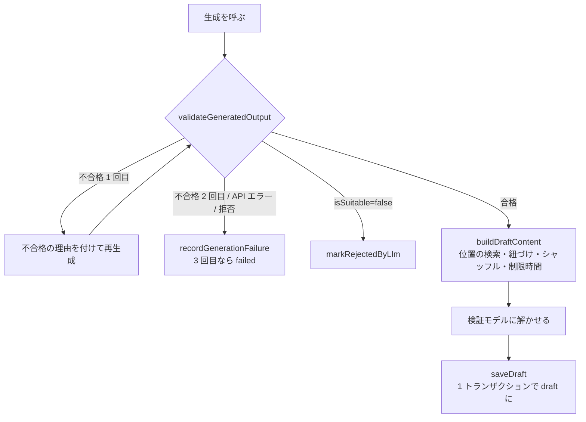

# step3-cron-generate-questions

LLM の出力の検証と後処理（純関数）、解答キーを見ない検証、`generate:questions` タスク（取得・保存・失敗の扱い）を作る。

## 前提

- [step1-db-questions](./step1-db-questions.md)、[step2-cron-llm-client](./step2-cron-llm-client.md)
- [content-collection step1-db-content-sources](../../content-collection/tasks/step1-db-content-sources.md)：`passages`
- 動きの理由は README の [生成タスクの動き](../README.md#生成タスクの動き)・[出力の検証と後処理](../README.md#出力の検証と後処理)・[解答キーを見ない検証](../README.md#解答キーを見ない検証)・[失敗時の扱い](../README.md#失敗時の扱い)・[費用の上限](../README.md#費用の上限)

## 対応内容

### 1. 1 件の処理の流れ



### 2. 純関数（`apps/cron/src/lib/question-generation/`）

env も DB も知らない。メッセージ中のブロックの表記は、段落は `numberParagraphs` の「段落 N」、見出しは `numberHeadings` の「見出し N」とする（api の公開の条件のメッセージと同じ規則。和訳の無い見出しが複数あっても理由を区別できるように）。

```typescript
/** validate-generated-output.ts：不合格なら再生成させる検査 */
export const validateGeneratedOutput = (
  json: unknown,
  passage: { blocks: PassageBlock[], wordCount: number },
): { ok: true, output: GenerateQuestionsOutput } | { errors: string[], ok: false }
```

| 検査（不合格 → 再生成） | 内容 |
| --- | --- |
| Zod | `generateQuestionsOutputSchema`。issue の path と message をエラーにする |
| ― | `isSuitable = false` なら以降を検査せず合格（却下にする） |
| 設問数 | `calculateQuestionCount(wordCount)` と一致 |
| 選択肢 | 前後の空白を除き小文字にして重複が無い |
| ブロック番号 | 根拠と `vocabularyTarget` の `blockIndex` が範囲内で、code ブロックでない |

```typescript
/** build-draft-content.ts：保存する形に加工し、要確認の理由を集める */
export const buildDraftContent = (input: {
  blocks: PassageBlock[]
  output: GenerateQuestionsOutput
  random: () => number
  wordCount: number
}): { content: GeneratedDraft, droppedGlossary: { blockIndex: number, surface: string }[] }
```

1. **和訳**：`translations` を code 以外のブロックの `translationJa` に入れる（code・範囲外は無視）。和訳の無いブロックごとに要確認「段落 4 の和訳がありません」「見出し 1 の和訳がありません」
2. **用語集**：code・範囲外のブロックを指すものと、`findSurfaceRange` で見つからないものは捨てて `droppedGlossary` に入れる（task がログに出す）。同じ位置の重複は 1 つにする
3. **根拠**：`hasQuote` が false なら要確認「Q2：根拠の引用が段落 2 の本文に見つかりません」
4. **語義設問の対象**：同じ `blockIndex` と `surface` の用語集の項目があれば紐づける。無ければ `findSurfaceRange` で探し、見つかれば `meaningJa: ""` の項目を足して紐づけ、要確認「Q3：対象の語句「opt in」を用語集に追加しました。意味を入力してください」。見つからなければ紐づけず要確認「Q3：対象の語句「opt in」が段落 2 に見つかりません」
5. **選択肢のシャッフル**：`shuffleChoices(choices, correctChoiceIndex, random)`（Fisher–Yates。`random` を DI してテストで固定する）
6. **制限時間**：`calculateTimeLimitSeconds(wordCount, difficulty, questions.length)`

`GeneratedDraft` は `DraftContent`（§4）から `generationModel` / `generationPromptVersion` を除いたもの。設問は `targetGlossaryIndex`（`glossary` 配列の index）で用語集を指す（insert 前で id が無いため）。

```typescript
/** find-verification-mismatches.ts */
export const findVerificationMismatches = (
  questions: { correctChoiceIndex: number }[],
  answers: { choiceIndex: number, questionNumber: number }[],
): { attentionReasons: string[], verificationChoiceIndexes: (number | null)[] }
/** 食い違いごとに「Q3：検証モデルは A を選択（正解は B）」 */

/** parse-args.ts：node:util の parseArgs で --passage-id を読み、Zod で正の整数に */
export const parseGenerateQuestionsArgs = (argv: string[]): { passageId?: number }
```

### 3. 検証モデルのプロンプト（`apps/cron/src/prompt/verify-questions.ts`）

- system prompt：本文を読んで各設問に最も適切な選択肢を 1 つ選ぶ。推測でもよいので必ず 1 つ選ぶ。全件共通（キャッシュする。短いと最小キャッシュ長に届かずキャッシュされないが、それでよい）
- user message：step2 と同じ形の番号つきブロック（和訳なし）と、シャッフル後の設問・選択肢（A〜D）。**正解・解説・根拠は渡さない**
- 出力：`verifyQuestionsOutputSchema = z.object({ answers: z.array(z.object({ choiceIndex: 0〜3, questionNumber: 1〜 })) })`。設問数と件数が合わない・API エラーのときは生成を捨てず、検証なし（`verificationChoiceIndex = null`）で保存して要確認「検証モデルでの確認に失敗しました」

### 4. Repository（`apps/cron/src/repository/`、api と分離）

content-collection の cron の step が `passage-repository.ts` を先に作っていればメソッドを足す。interface の引数・戻り値は `@repo/domain` の型か素の値。

```typescript
/** apps/cron/src/repository/passage-repository.ts */
export type PassageClaim = { generationStartedAt: Date, id: number }
/** 取得した直後なので generationStartedAt は必ずある */
export type ClaimedPassage = Pick<Passage, "blocks" | "generationAttemptCount" | "id" | "title" | "wordCount"> & { generationStartedAt: Date }

export type DraftContent = {
  attentionReasons: string[]
  blocks: PassageBlock[]
  difficulty: PassageDifficulty
  generationModel: string
  generationPromptVersion: string
  glossary: Pick<GlossaryEntry, "blockIndex" | "endOffset" | "lemma" | "meaningJa" | "noteJa" | "partOfSpeech" | "startOffset" | "surface">[]
  questions: (Pick<Question, "choices" | "correctChoiceIndex" | "evidenceBlockIndex" | "evidenceQuote" | "explanationJa" | "orderIndex" | "prompt" | "type" | "verificationChoiceIndex"> & { targetGlossaryIndex: number | null })[]
  timeLimitSeconds: number
}

export interface PassageRepository {
  /** collected を古い順に最大 limit 件、generating にしながら取る（FOR UPDATE SKIP LOCKED） */
  claimCollected(input: { limit: number, now: Date, passageId?: number }): Promise<ClaimedPassage[]>
  countByStatus(status: PassageStatus): Promise<number>
  markRejectedByLlm(claim: PassageClaim, input: { generationModel: string, generationPromptVersion: string, reason: string }, now: Date): Promise<boolean>
  /** attempt_count +1。maxAttempts に達したら failed、それ以外は collected。戻り値は更新後の状態 */
  recordGenerationFailure(claim: PassageClaim, input: { error: string, maxAttempts: number }): Promise<"collected" | "failed" | null>
  /** 失敗回数を増やさずに collected へ戻す（設定の誤りで止めるとき） */
  releaseClaim(claim: PassageClaim): Promise<void>
  /** generating のまま startedBefore より前の行を collected に戻し、件数を返す */
  releaseStaleGenerating(startedBefore: Date): Promise<number>
  /** passages の更新と questions / glossary の insert を 1 トランザクションで。claim が古ければ何もせず false */
  saveDraft(claim: PassageClaim, content: DraftContent, now: Date): Promise<boolean>
}
```

Drizzle 実装の要点（不足する演算子 `asc` / `inArray` 等は `@repo/db` の re-export に足す）：

```typescript
/** claimCollected：候補の select に行ロックを付け、同じ文で generating にする */
const candidates = this._db.select({ id: passages.id }).from(passages)
  .where(and(eq(passages.status, "collected"), input.passageId ? eq(passages.id, input.passageId) : undefined))
  .orderBy(asc(passages.createdAt), asc(passages.id))
  .limit(input.limit)
  .for("update", { skipLocked: true })
const rows = await this._db.update(passages)
  .set({ generationStartedAt: input.now, status: "generating" })
  .where(inArray(passages.id, candidates))
  .returning()
/** RETURNING の順序は保証されないので createdAt, id で並べ直す */
```

- **claim のガード**：`saveDraft` / `markRejectedByLlm` / `recordGenerationFailure` / `releaseClaim` は `WHERE id = ? AND status = 'generating' AND generation_started_at = ?` で更新する。処理が 30 分を超えて別の実行に回収・再取得された行を、古い実行が上書きしないため（`generation_started_at` を取得のトークンとして使う）
- `saveDraft`：トランザクション内で ① passages をガード付きで更新（`status = 'draft'`、和訳入りの `blocks`、`difficulty`、`time_limit_seconds`、生成の記録、`generated_at = now`、`needs_attention = attentionReasons.length > 0`、`attention_reasons`、`generation_error = null`）、0 行なら false で終える ② 残っている questions / glossary を消す ③ glossary を insert し、`(blockIndex, startOffset)` で id を引けるようにする ④ questions を insert（`targetGlossaryIndex` → id）
- `recordGenerationFailure`：`generation_attempt_count = generation_attempt_count + 1`、`status = CASE WHEN generation_attempt_count + 1 >= maxAttempts THEN 'failed' ELSE 'collected' END`、`generation_error = error` を 1 文で
- `.for("update", { skipLocked: true })` の書き方は実装時に Drizzle のドキュメントで確認する。書けなければ `sql` で同じ SQL を書く。Prisma 実装は `$queryRaw` と `$transaction` で同じ SQL・同じガードにする

### 5. Service（`apps/cron/src/service/passage/generate-questions.ts`）

```typescript
const STALE_GENERATING_MINUTES = 30
const MAX_GENERATION_ATTEMPTS = 3
const GENERATION_MAX_TOKENS = 16000
const VERIFICATION_MAX_TOKENS = 2000

export type GenerateQuestionsInput = {
  generationModel: string
  isShuttingDown: () => boolean
  maxPassagesPerRun: number
  maxPendingDrafts: number
  now: () => Date
  passageId?: number
  random: () => number
  verificationModel: string
}

export type GenerateQuestionsResult = {
  draftCount: number
  failedCount: number
  rejectedCount: number
  retryLaterCount: number
  skippedReason: "pending_drafts_limit" | null
}

export const generateQuestions = async (
  input: GenerateQuestionsInput,
  repo: { passageRepository: PassageRepository },
  deps: { llmClient: LlmClient },
): Promise<GenerateQuestionsResult>
```

1. `passageId` が無いとき：下書きの件数が `maxPendingDrafts` 以上なら `skippedReason: "pending_drafts_limit"` で何もせず返す。取る件数は `min(maxPassagesPerRun, maxPendingDrafts - 下書きの件数)`。`--passage-id` の手動実行では上限を見ない
2. `releaseStaleGenerating(now - 30 分)`
3. `claimCollected`。`passageId` 指定で 0 件なら throw（collected でない。状態をメッセージに含める）
4. 1 件ずつ（各回の頭で `isShuttingDown()` なら break。残りは次回に回収される）。**1 件の失敗で他の件は止めない**
   - 生成：`buildGenerateQuestionsUserContent` → `createStructuredMessage` → `validateGeneratedOutput`。不合格（`LlmOutputTruncatedError` / `LlmInvalidJsonError` を含む）なら `retryErrors` を付けて 1 回だけ再生成。2 回目も不合格 → `recordGenerationFailure`
   - `isSuitable = false` → `markRejectedByLlm`（理由が null なら「LLM が題材に不向きと判定」）
   - 合格 → `buildDraftContent` → 検証モデル → `findVerificationMismatches` の理由を要確認に足し、`verificationChoiceIndex` を入れる → `saveDraft`（生成の記録は `response.model` と `PROMPT_VERSION`）
   - API エラー（SDK のリトライ後）・`LlmRefusalError` → `recordGenerationFailure`（`error` は種類とメッセージ）。戻り値が `failed` なら `failedCount` を +1、`collected` なら `retryLaterCount` を +1
   - `isFatalLlmError` → `releaseClaim` して throw（設定の誤りで全件の失敗回数を増やさない）。他の取得済みの行は 30 分後に回収される
   - claim が古く保存が false → warn ログだけ出して数えない
5. 1 件ごとにログを出す（passageId、結果、`usage` のトークン数とキャッシュの読み込み数、捨てた用語集）。下書き・却下は `logger.info`（`passage processed`）、`recordGenerationFailure` にした失敗は `logger.warn`（`passage generation failed`。エラーの内容を含める）

### 6. Task（`apps/cron/src/task/generate-questions.ts`）

`cleanup-old-memos.ts` と同じ形で、env 読み込みと DI だけ。

- `env.ts` に `GENERATE_MAX_PASSAGES_PER_RUN`（既定 10）・`GENERATE_MAX_PENDING_DRAFTS`（既定 50）を `z.coerce.number().int().positive()` で足す。`ANTHROPIC_API_KEY` が無ければ throw
- `parseGenerateQuestionsArgs(process.argv.slice(2))`、`setupGracefulShutdown(db)` の `isShuttingDown` を渡す。`now: () => new Date()`、`random: Math.random`
- `DrizzlePassageRepository(db)`、`new AnthropicClient(new Anthropic({ apiKey, maxRetries: 2, timeout }))`
- 結果をログに出し、**`describeRunFailure(result)` が理由を返したら throw して exit code 1**（`failedCount > 0`、または `draftCount + rejectedCount === 0 && retryLaterCount > 0`＝取得した全件が一時的な失敗。判定は `lib/question-generation/describe-run-failure.ts` の純関数に置き、task に件数の判定を書かない）。`finally` で `db.$disconnect()`
- `package.json` に `"generate:questions": "dotenvx run -f .env.local -- tsx src/task/generate-questions.ts"`、`CLAUDE.md` のタスクと環境変数の表に追記。スケジュール（`collect:passages` の 1 時間後）の登録は [step7-infra-cron-schedules](./step7-infra-cron-schedules.md)

## 動作確認

```bash
pnpm --filter cron test
pnpm --filter cron lint
pnpm --filter cron generate:questions --passage-id=42   # ローカル DB と API キーがあるとき
```

`test/lib/question-generation/`（純関数。モック不要）：

- [ ] `validateGeneratedOutput`：設問数が語数（300 / 301 語の境界）に合わない / 選択肢が大文字小文字違いで重複 / 根拠が範囲外・code ブロック → 不合格。`isSuitable = false` は配列が空でも合格
- [ ] `buildDraftContent`：用語集の位置が本文から求まる / 見つからない語句が `droppedGlossary` に入る / 和訳の無いブロック・見つからない根拠が要確認になる / 和訳の無い見出しが 2 つあれば「見出し 1」「見出し 2」で区別される
- [ ] `buildDraftContent`：語義設問の対象が既存の項目に紐づく / 用語集に無ければ項目が足されて紐づく / 本文に無ければ紐づかず要確認
- [ ] `shuffleChoices`：固定した `random` で並びが変わり、正解の選択肢の **文字列** が `correctChoiceIndex` の位置にある
- [ ] `findVerificationMismatches`：一致は理由なし、食い違いだけ理由と `verificationChoiceIndex` が入る
- [ ] `parseGenerateQuestionsArgs`：`--passage-id=42` → 42、`abc` / `0` → throw、指定なし → undefined
- [ ] `describeRunFailure`：`failed` が 1 件 → 理由を返す / 下書き・却下が 0 件で `retryLaterCount` が 1 以上 → 理由を返す / 下書きか却下が 1 件でもあれば（他が失敗しても）null

`test/service/passage/generate-questions.test.ts`（Repository は `vi.fn()`、`LlmClient` は偽物）：

- [ ] 下書きが上限ちょうど → LLM も `claimCollected` も呼ばない。上限 - 1 → `limit` が 1
- [ ] `releaseStaleGenerating` が `now - 30 分` で呼ばれる
- [ ] 合格 → `saveDraft` に和訳・用語集・シャッフル後の設問・制限時間・要確認の理由が渡り、`draftCount` が 1
- [ ] 1 回目不合格・2 回目合格 → 2 回目の user message に不合格の理由が入る。2 回とも不合格 → `recordGenerationFailure`
- [ ] `isSuitable = false` → `markRejectedByLlm`、検証モデルは呼ばない
- [ ] API エラーで `recordGenerationFailure` が `failed` を返す → `failedCount` が 1。2 件目の処理は続く。失敗は warn でログに出る
- [ ] 検証モデルが失敗 → 検証なしで保存され、要確認に理由が入る
- [ ] `isFatalLlmError` → `releaseClaim` して throw
- [ ] `passageId` 指定で 0 件 → throw。指定時は下書きの上限を見ない

`test/repository/drizzle/passage-repository.test.ts`（既存と同じく偽の DB で、ガード条件と更新値を確認）。

手動確認（ローカル DB）：

- [ ] collected を 1 件用意して実行 → `draft` になり、`questions` / `passage_glossary_entries` が入る。`generation_prompt_version` が `PROMPT_VERSION`
- [ ] 2 つのターミナルで同時に実行しても同じ行が二重に処理されない
- [ ] `generating` で `generation_started_at` を 31 分前にした行が、次の実行で `collected` に戻る
- [ ] 不正な `ANTHROPIC_API_KEY` で実行すると exit 1 になり、行の `generation_attempt_count` が増えない
