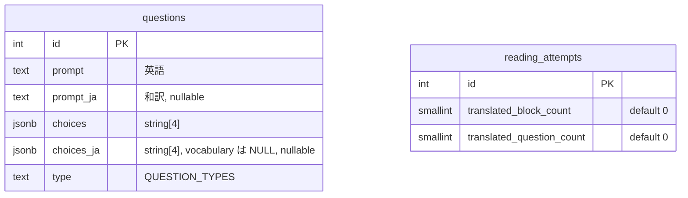
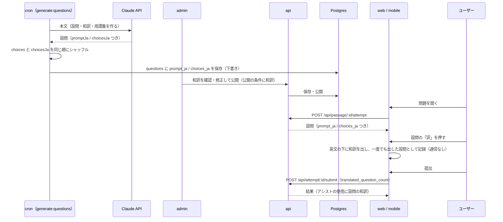

# 設問の和訳

解答画面で、本文の段落と同じように設問（設問文と選択肢）も和訳を見られるようにする。設問の英文が読めずに、本文は分かっているのに答えられない、ということを減らすため。web と mobile の両方。

和訳は問題の生成のときに、設問と一緒に LLM が作る。和訳を見たことは段落の和訳と同じく「アシスト」として記録し、「アシストなしで正解できた」かの判定に入れる。

このドキュメントは **仕様（What）** と **設計（How）** を分けて記述する：

- **仕様**：ユーザーから見える挙動・ルール・データの意味
- **設計**：実装にあたっての技術的な選択と制約

## 関連 spec

- [`../question-generation/README.md`](../question-generation/README.md) — 問題の生成・admin での確認と公開。`questions` の列の正本
- [`../reading-practice/README.md`](../reading-practice/README.md) — 解答画面・結果画面・アシストの正本。`reading_attempts` の列の正本
- [`../learning-record/README.md`](../learning-record/README.md) — 学習記録の「アシストなしの正答率」
- [`../admin-dashboard/README.md`](../admin-dashboard/README.md) — admin のダッシュボードの「アシストの利用率」

## 目次

- [仕様](#仕様)
  - [和訳を付けるもの](#和訳を付けるもの)
  - [解答画面での見せ方](#解答画面での見せ方)
  - [アシストとしての記録](#アシストとしての記録)
  - [結果画面](#結果画面)
  - [作り方と確認](#作り方と確認)
  - [これまでの問題](#これまでの問題)
- [設計](#設計)
  - [データの持ち方](#データの持ち方)
  - [生成](#生成)
  - [admin での修正と公開の条件](#admin-での修正と公開の条件)
  - [API](#api)
  - [画面の状態](#画面の状態)
- [必要な画面](#必要な画面)
- [必要な API](#必要な-api)
- [必要な DB 設計](#必要な-db-設計)
- [フロー図](#フロー図)
- [実装ステップ](#実装ステップ)

---

## 仕様

### 和訳を付けるもの

| 設問の種類 | 設問文 | 選択肢 |
| --- | --- | --- |
| 要旨・詳細・推論・筆者の意図 | 訳す | 訳す |
| 文脈での語義（`vocabulary`） | 訳す（対象の語句は英語のまま） | **訳さない** |

- 和訳の書き方は段落の和訳と同じ（[question-generation の和訳のルール](../question-generation/README.md#和訳と単語の意味のルール)）。エンジニアが普段使う言い方にし、インラインコードは訳さない
- 選択肢は英文に忠実に訳す。英文に無い言葉を足したり省いたりして、和訳で正解が目立ったり誤りの選択肢が不自然になったりしないようにする
- 文脈での語義の設問は、選択肢を訳すと日本語の意味の当てっこになり、答えが見えやすくなる。設問文は訳すが、対象の語句（例：`escape hatch`）は英語のまま残し、意味を書かない（例：「第 1 段落の "escape hatch" に最も意味が近いものはどれか」）。解答中に対象の語句を用語集から外しているのと同じ理由（[reading-practice のアシスト](../reading-practice/README.md#アシスト)）

### 解答画面での見せ方

- 設問パネル（mobile は設問シート）の設問番号（`Q2`）の行の右に「訳」を置く。押すと設問文と各選択肢の英文の **下に** 和訳を出す。もう一度押すと消える
- 英文は残したまま、和訳を小さめ・薄めの文字で添える（設問は短く、英文と見比べながら読めるようにするため）。語義の設問は設問文の下にだけ出す
- 設問ごとに切り替える。別の設問に移って戻っても、その設問の表示は保つ
- 全文訳・`T` キーには含めない（本文の和訳だけを見たい人に、設問の和訳まで出さないため。数え方も別）
- 和訳の無い設問（[これまでの問題](#これまでの問題)）には「訳」を出さない
- web と mobile で同じ。選択肢を選ぶ操作・キーボードの `1`〜`4` は和訳を出していても変わらない

### アシストとしての記録

- 和訳を一度でも出した設問の数を記録する。同じ設問で何度出し入れしても 1 と数える
- 解答中のステータスバー（web）に「設問訳 N 問」を出す
- 結果画面の「アシストの使用」に「設問の和訳 N 問」を足す
- 学習記録の「アシストなし」は、段落の和訳・設問の和訳・単語・読み上げのどれも使っていない挑戦にする（[learning-record](../learning-record/README.md)）
- アシストを使っても点数は変わらない（ほかのアシストと同じ）

### 結果画面

- 設問ごとの結果（自分の回答・正解・解説）にも「訳」を置き、自由に切り替えられる。結果画面での切り替えは記録しない（本文の和訳・用語集を自由に見られるのと同じ）

### 作り方と確認

- 問題の生成で、設問・解説と同じ呼び出しで LLM が和訳も作る（[question-generation の生成](../question-generation/README.md#llm-の呼び出し)）
- 管理者は admin の設問タブで和訳を直せる：設問文の和訳と、選択肢 4 つの和訳（語義の設問は設問文の和訳だけ）
- **公開の条件に入れる**：各設問に設問文の和訳があり、語義の設問以外は選択肢 4 つとも和訳がある

### これまでの問題

この機能を入れる前に生成した設問には和訳が無い。

| 状態 | 扱い |
| --- | --- |
| 下書き | admin の「再生成」で作り直すか、設問タブで和訳を手で入れる。挑戦のある問題（公開済みを非公開に戻したもの）は再生成できないので、手で入れる。和訳が無いままでは公開できない |
| 公開済み | 和訳が無いまま公開を続ける（解答画面に「訳」を出さない）。和訳を入れるときは非公開に戻して設問タブで入れ、公開し直す（公開し直すときは公開の条件として和訳が要る） |

- 公開済みの問題は再生成しない（一度でも挑戦された問題は再生成できないため。[公開済みの問題を直すとき](../question-generation/README.md#公開済みの問題を直すとき)）
- 和訳だけを作るタスクは作らない

---

## 設計

### データの持ち方

**`questions` に列を 2 つ足す**

| 列 | 型 | 意味 |
| --- | --- | --- |
| `prompt_ja` | `text NULL` | 設問文の和訳 |
| `choices_ja` | `jsonb NULL`（`string[4]`） | 選択肢の和訳。`choices` と同じ順（`choices_ja[i]` が `choices[i]` の訳） |

- NULL は「和訳が無い」。これまでの設問が NULL になる。NOT NULL にして空文字で埋めると、公開済みの設問に「訳」を出して空の和訳を見せてしまう
- `choices_ja` を `choices` と別の列にし、同じ添字で対応させる。`choices` の形（`string[]`）を変えると、検証モデル・採点・admin の選択肢の編集など、選択肢を読む箇所をすべて直すことになるため。生成のシャッフルでは同じ並べ替えを両方にかける
- CHECK 制約 `questions_choices_ja_check`：`choices_ja IS NULL OR type <> 'vocabulary'`（語義の設問は選択肢を訳さない、を DB でも守る。`questions_target_glossary_entry_check` と同じ形）
- 名前は `explanation_ja` と同じく `_ja` を付ける

**`reading_attempts` に列を 1 つ足す**

| 列 | 型 | 意味 |
| --- | --- | --- |
| `translated_question_count` | `smallint NOT NULL DEFAULT 0` | 和訳を一度でも出した設問の数 |

- `translated_block_count` の意味を広げず、別の列にする。`translated_block_count` はサーバーが code 以外のブロック数で上限をかけていて、結果画面・admin でも「和訳 N 段落」と表示しているため、設問を混ぜると上限と表示の両方の意味が崩れる
- これまでの挑戦は 0 になる（設問の和訳は無かったので正しい値）

### 生成

**出力のスキーマ**：設問ごとに 2 つ足す（[LLM の呼び出し](../question-generation/README.md#llm-の呼び出し)の `questions[]`）。

| キー | 型 | 説明 |
| --- | --- | --- |
| `promptJa` | `string` | 設問文の和訳 |
| `choicesJa` | `string[4] \| null` | 選択肢の和訳。`choices` と同じ順。`vocabulary` のときだけ null |

- 「`vocabulary` のときだけ null」は `vocabularyTarget` と同じく Zod の `superRefine` で検査する。合わなければ理由を付けて 1 回だけ再生成させる（ほかのスキーマ違反と同じ）
- 和訳の文字列は空でないことだけをスキーマで見る。和訳の中身（語義の設問で対象の語句の意味を書いていないか など）はコードでは検査せず、admin の確認に任せる

**同じ呼び出しで作る理由**

- LLM は設問を作るときに本文と段落の和訳を手元に持っているので、段落の和訳と言い回しをそろえた和訳を作れる
- 呼び出しの回数は増えない。増えるのは出力だけで、5 問で 1,000 トークン前後（設問文 1 つと選択肢 4 つの和訳で 200 トークン前後）。出力の上限（`GENERATION_MAX_TOKENS = 16000`、思考を含む）には収まる
- 別の呼び出し（和訳だけのタスク）にすると、設問を直したときの和訳とのずれや、呼び出しの失敗の扱いが増える

**プロンプト**（`GENERATE_QUESTIONS_SYSTEM_PROMPT` の「# 3. Questions」に足す）

- `promptJa` / `choicesJa` は段落の和訳と同じ書き方にする（自然な日本語、インラインコードはそのまま）
- `choicesJa[i]` は `choices[i]` の訳。英文に忠実に訳し、英文に無い手がかりを足さない・省かない
- `vocabulary` の設問は、`promptJa` で対象の語句を英語のまま残し、意味を書かない。`choicesJa` は null
- プロンプトを変えるので `PROMPT_VERSION` を上げる

**シャッフル**：`shuffleChoices` に `choicesJa` も渡し、`choices` と同じ並べ替えをかける（null はそのまま）。

**解答キーを見ない検証**：検証モデルには今までどおり英語の設問文と選択肢だけを渡す。英語の設問として答えが 1 つに決まるかを見る検査なので、和訳は渡さない。

### admin での修正と公開の条件

- 設問タブの各設問に「設問文（和訳）」と「選択肢（和訳）」の入力を足す。選択肢の和訳は英語の選択肢の下に並べる。語義の設問は選択肢の和訳の入力を出さず、「語義の設問は選択肢を訳しません」と添える
- 保存（`PUT /api/admin/passage/:id`）では、api が次のとおりに直してから保存する
  - 空白だけの `prompt_ja` は NULL
  - `vocabulary` の設問の `choices_ja` は NULL（種類を語義に変えたときに残った和訳を消す。CHECK 制約に当たらないように）
  - 4 つとも空白の `choices_ja` は NULL
- 公開の条件（`listPublishViolations`）に足す

| code | 条件 | メッセージ |
| --- | --- | --- |
| `prompt_translation_missing` | 設問文の和訳が空 | `Q1：設問文の和訳が空です` |
| `choice_translation_missing` | 語義以外で、選択肢の和訳が 4 つそろっていない（空白だけも空） | `Q1：選択肢の和訳を 4 つとも入力してください` |

- 公開の検査は下書きを公開するときだけ行うので、公開済みの問題はそのまま公開を続ける

### API

- 解答中・提出済みの設問（`attemptQuestionSchema`）に `prompt_ja` / `choices_ja`（どちらも nullable）を足す。選択肢と同じく解答中から渡す（和訳から正解は分からず、開始時にまとめて渡す方針も段落の和訳と同じ。[正解を提出前に渡さない](../reading-practice/README.md#正解を提出前に渡さない)）
- 提出（`POST /api/attempt/:id/submit`）に `translated_question_count` を足す。`listened_block_count` と同じく、送ってこない古いアプリのために省略時は 0。サーバーが設問の数で上限をかける（申告値を使い、改ざんは許容する。段落の和訳と同じ）
- 提出済みの挑戦のレスポンスに `translated_question_count` を足す（結果画面の「アシストの使用」）
- 学習記録の「アシストなし」の判定（`usedAssist` と、アシストなしの正答率を数える SQL）に `translated_question_count = 0` を足す
- admin のダッシュボードの「アシストの利用率」に、設問の和訳を使った挑戦の割合を足す（4 つめの横棒と、問題ごとの成績の列）

### 画面の状態

- 解答画面は、いま和訳を出している設問（表示用）と、一度でも出した設問（記録用）を、設問 ID の集合で別に持つ。段落の和訳の `translatedBlocks` / `viewedTranslationBlocks` と同じ分け方
- 一度でも出した設問は、解答の途中保存（web は localStorage、mobile は AsyncStorage）に入れ、再読み込みしても数が減らないようにする。復元するときは、この挑戦の和訳のある設問の ID だけを残す
- 結果画面の切り替えは表示用の集合だけを持ち、保存しない

---

## 必要な画面

| 画面 | アプリ | 変更 |
| --- | --- | --- |
| 解答画面 | web / mobile | 設問パネル（設問シート）に「訳」、和訳の表示。web のステータスバーに「設問訳 N 問」 |
| 結果画面 | web / mobile | 設問ごとの「訳」、「アシストの使用」に「設問の和訳 N 問」 |
| 問題の確認・修正 | admin | 設問タブに設問文と選択肢の和訳の入力 |
| ダッシュボード | admin | 「アシストの利用率」に設問の和訳 |
| デザインモック | web / mobile | 解答画面のモックに「訳」 |

## 必要な API

| メソッド | パス | 変更 |
| --- | --- | --- |
| POST | `/api/passage/:id/attempt` | 設問に `prompt_ja` / `choices_ja` |
| GET | `/api/attempt/:id` | 設問に `prompt_ja` / `choices_ja`。提出済みなら `translated_question_count` |
| POST | `/api/attempt/:id/submit` | リクエストに `translated_question_count`（省略時 0）。レスポンスは提出済みの挑戦と同じ |
| GET | `/api/admin/passage/:id` | 設問に `prompt_ja` / `choices_ja` |
| PUT | `/api/admin/passage/:id` | 設問に `prompt_ja` / `choices_ja`（保存前に [admin での修正と公開の条件](#admin-での修正と公開の条件) のとおり直す） |
| POST | `/api/admin/passage/:id/publish` | 公開の条件に設問の和訳 |

## 必要な DB 設計

列の正本は `questions` が [question-generation](../question-generation/README.md#必要な-db-設計)、`reading_attempts` が [reading-practice](../reading-practice/README.md#必要な-db-設計)。足す列だけを示す。

- `questions_choices_ja_check`：`choices_ja IS NULL OR type <> 'vocabulary'`
- マイグレーションは列の追加だけで、既存の行は NULL / 0 になる。データの移行は無い

## フロー図

## 実装ステップ

| step | 内容 |
| --- | --- |
| [step1](./tasks/step1-db-question-translation.md) | DB：`questions` と `reading_attempts` に列を足す。サンプルの問題に和訳を入れる |
| [step2](./tasks/step2-cron-generate-question-translation.md) | cron：生成の出力・プロンプト・シャッフル・保存に和訳を足す |
| [step3](./tasks/step3-api-question-translation.md) | api：admin の詳細・保存・公開の条件、挑戦の設問・提出・学習記録・ダッシュボード |
| [step4](./tasks/step4-admin-question-translation.md) | admin：設問タブの和訳の入力、ダッシュボードの表示 |
| [step5](./tasks/step5-web-question-translation.md) | web：解答画面・結果画面の「訳」とアシストの記録 |
| [step6](./tasks/step6-mobile-question-translation.md) | mobile：解答画面・結果画面の「訳」とアシストの記録 |
