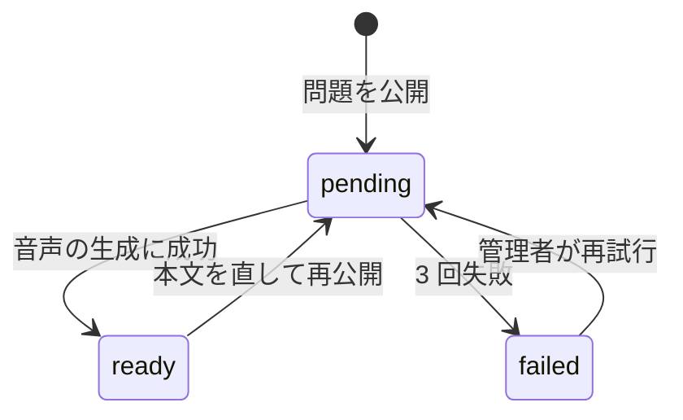
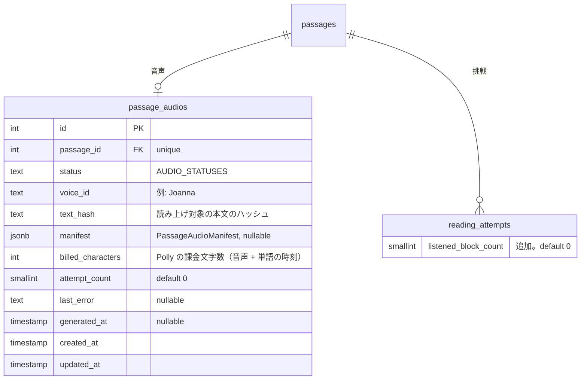
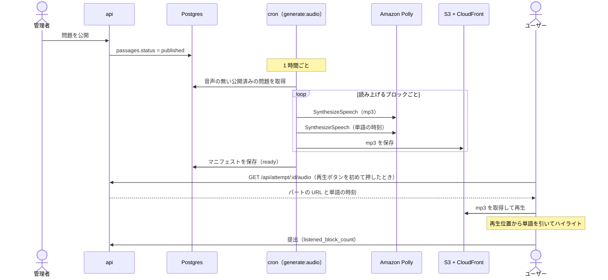

# 読み上げ

問題の英文を **自然な英語の音声で読み上げ**、読んでいる単語をハイライトする。エンジニアは英文を「読める」が「音で聞いたことがない」単語が多い（`cache`、`queue`、`idempotent` など）。目で読んでいる英文を同時に耳で確かめられるようにし、発音の確認とシャドーイングに使えるようにする。

声は問題の公開後にクラウドの音声合成（Amazon Polly）で 1 度だけ作って保存し、全ユーザーが同じ音声を聞く。端末の音声合成に頼らないので、どの端末でも同じ品質の声になり、単語のハイライトが音声と正確に合う。

このドキュメントは **仕様（What）** と **設計（How）** を分けて記述する：

- **仕様**：読み上げの操作、使える場面、アシストとしての扱い、音声ができるまで
- **設計**：音声合成サービスの選定と費用、音声の生成と保存、単語のハイライトの合わせ方、再生の実装

## 関連 spec

- [`../reading-practice/README.md`](../reading-practice/README.md) — 解答画面と結果画面に読み上げを置く。読み上げは 3 つめのアシストになる（`reading_attempts` に列を足す）
- [`../question-generation/README.md`](../question-generation/README.md) — 公開された問題の本文（`PassageBlock`）を読み上げる。本文の文字位置の定義の正本
- [`../learning-record/README.md`](../learning-record/README.md) — 「アシストなし」の判定に読み上げを含める
- [`../product-overview/README.md`](../product-overview/README.md) — 機能一覧・インフラ上の配置
- [`../minimal-deploy/README.md`](../minimal-deploy/README.md) — cron（ECS RunTask）と S3 の置き場所
- [`./deferred-voices-and-pronunciation.md`](./deferred-voices-and-pronunciation.md) — MVP 対象外。声の選択、単語の発音、ユーザーの音読の評価
- **この spec が正本のもの**：`passage_audios` の列定義、音声のマニフェスト（`PassageAudioManifest`）の型、`AUDIO_STATUSES`

## 目次

- [仕様](#仕様)
  - [できること](#できること)
  - [使える場面とアシストの扱い](#使える場面とアシストの扱い)
  - [再生の操作](#再生の操作)
  - [ハイライトとスクロール](#ハイライトとスクロール)
  - [タイマー・一時停止・和訳との関係](#タイマー一時停止和訳との関係)
  - [音声ができるまで](#音声ができるまで)
  - [読み上げない部分](#読み上げない部分)
- [設計](#設計)
  - [音声合成サービスの選定](#音声合成サービスの選定)
  - [費用](#費用)
  - [音声の生成タスク](#音声の生成タスク)
  - [読み上げ用のテキストと文字位置の対応](#読み上げ用のテキストと文字位置の対応)
  - [音声の保存と配信](#音声の保存と配信)
  - [再生の実装](#再生の実装)
  - [失敗時の扱い](#失敗時の扱い)
  - [MVP 対象外（将来検討）](#mvp-対象外将来検討)
- [必要な画面](#必要な画面)
- [必要な API](#必要な-api)
- [必要な DB 設計](#必要な-db-設計)
- [フロー図](#フロー図)
- [実装ステップ（予定）](#実装ステップ予定)

---

## 仕様

### できること

| 機能 | 内容 |
| --- | --- |
| 全文の読み上げ | 本文を最初から最後まで続けて読み上げる。一時停止・再開・停止ができる |
| 段落の読み上げ | 段落ごとのボタンで、その段落だけを読み上げる |
| 再生速度 | 0.75 倍・1 倍・1.25 倍から選ぶ。選んだ速度は端末に覚える |
| 単語のハイライト | 読み上げ中の単語に印を付ける |

声は 1 種類（米国英語の女性の声）。声や訛りの選択、単語ごとの発音、ユーザー自身の音読の評価は MVP に入れない（[deferred-voices-and-pronunciation](./deferred-voices-and-pronunciation.md)）。

### 使える場面とアシストの扱い

| 場面 | 使えるか | アシストに数えるか |
| --- | --- | --- |
| 解答画面 | ✅ | ✅ 数える |
| 結果画面 | ✅ | ― 数えない（提出後なので点数に関係しない） |
| ログイン画面の体験デモ | ❌ | ― |

- 解答中の読み上げは、段落の和訳・単語の意味と同じく **アシスト** として扱う。使っても点数は変わらないが、**読み上げを聞いた段落の数** を記録する
- 「アシストなし」の挑戦は、和訳・単語の意味・読み上げを **どれも使わなかった** 挑戦になる（[learning-record](../learning-record/README.md) の「アシストなしの正答率」と学習履歴の表示）
- 結果画面とステータスバーに「読み上げ n 段落」を出す（和訳・単語の回数と並べる）
- 1 秒以上再生した段落を「聞いた段落」に数える（押してすぐ止めた段落は数えない）

### 再生の操作

| 操作 | 解答画面（PC） | 解答画面（スマホ幅・mobile） | 結果画面 |
| --- | --- | --- | --- |
| 全文の読み上げ | 上部バーの再生ボタン、`R` キー | 上部バーの再生ボタン | 本文の見出しの横の再生ボタン |
| 段落の読み上げ | 段落番号の列の再生ボタン（「訳」の下） | 同左 | 同左 |
| 一時停止・再開 | 再生ボタンが一時停止ボタンに変わる。`R` キー | 同左 | 同左 |
| 停止 | 再生中に出る「停止」 | 同左 | 同左 |
| 再生速度 | 再生ボタンの横のメニュー | 同左 | 同左 |

- 全文の読み上げは **最初の見出しから** 始め、最後の段落で止まる。途中の段落から聞きたいときは段落の読み上げを使う
- 段落の読み上げは、その段落を読み終えたら止まる（次の段落に進まない）
- 別の段落の再生ボタンを押すと、今の再生を止めてその段落を読む
- 音声がまだできていない問題では、再生ボタンを無効にして「読み上げの音声を準備中です」と出す
- 具体的な見た目は `design-mock` skill で確定する（[必要な画面](#必要な画面)）

### ハイライトとスクロール

- 読み上げ中の単語に琥珀の下線と淡い背景を付ける（単語のカードの選択中の表示とは別の見た目）
- 読み上げ中の段落が画面の外にあるときは、その段落が見える位置まで自動でスクロールする。**ユーザーが自分でスクロールしたら自動スクロールを止め**、「読み上げ中の位置に戻る」ボタンを出す
- ハイライト中の単語もタップして意味を見られる（再生は止めない）

### タイマー・一時停止・和訳との関係

- 読み上げを聞いている間も **タイマーは進む**（読解の時間に含める）
- 解答画面の **一時停止** で読み上げも止まる。再開しても読み上げは自動で再開しない（再生ボタンで再開する）
- 画面を離れたとき（web はタブを切り替えたとき、mobile はアプリを閉じたとき）は読み上げを止める。タイマーが止まるのと合わせる
- 和訳を表示中の段落を読み上げると、**その段落を英文の表示に戻してから** 読む（音声とハイライトを英文に合わせるため）
- 提出すると読み上げは止まる
- mobile は端末の消音モードでも音を出す（学習アプリとして、マナーモード中でも聞けるようにする）

### 音声ができるまで

- 音声は **問題が公開された後** に作る。生成タスクは 1 時間ごとに動くので、公開から最大 1 時間ほどで聞けるようになる
- 下書き（未公開）の問題には音声を作らない（却下される問題に費用をかけないため）
- 公開済みの問題を非公開に戻して本文を直し、再公開すると、音声を作り直す。本文が変わっていなければ作り直さない
- 管理者は admin の問題の確認画面で、音声の状態（準備中・作成済み・失敗）と作成日時を見られる。失敗したものは「再試行」できる

### 読み上げない部分

| ブロック | 読み上げ |
| --- | --- |
| 見出し・段落・箇条書き・引用 | ✅ |
| コードブロック | ❌ 飛ばす（コードを音声で聞く意味が薄いため） |
| インラインコード | ✅ 書いてあるとおりに読む（`useEffect` など。読み方が不自然になることがある） |

---

## 設計

### 音声合成サービスの選定

単語のハイライトには、音声の中で各単語が何ミリ秒に読まれたか（単語の時刻）が要る。これを返せるか、費用、既存のインフラ（AWS）との相性で比べた。料金は 2026 年 10 月時点の公式・調査サイトの値。

| 方式 | 費用（100 万文字あたり） | 単語の時刻 | 備考 |
| --- | --- | --- | --- |
| **Amazon Polly（Neural）** | **$16** | ✅ Speech Marks | **採用**。AWS 内で完結（IAM・S3）。東京リージョン対応。最初の 12 か月は月 100 万文字まで無料 |
| Amazon Polly（Generative） | $30 | ❌ 非対応 | 声はより自然だが、単語の時刻が取れない |
| Google Cloud TTS（Neural2 / Chirp 3 HD） | $16 / $30 | △ SSML の mark を単語ごとに入れれば取れる | 月 100 万文字の無料枠に期限なし。GCP の認証情報を新たに持つことになる |
| Azure AI Speech（Neural） | $16 | ✅ word boundary | 月 50 万文字無料。Azure の契約を新たに持つことになる |
| OpenAI（tts-1 / gpt-4o-mini-tts） | $15 前後 | ❌ | 単語の時刻が取れない |
| ElevenLabs（Flash v2.5） | $20〜40 | ✅ | 声の品質は最も高いが割高 |
| 端末の音声合成（Web Speech API / `expo-speech`） | 無料 | △ | 声の品質が端末次第。Android の Chrome では単語の境界のイベントが来ず、Safari は文字数を返さないのでハイライトが合わない |

Polly の Neural は **単語の時刻（Speech Marks）を返せる最も安い選択肢** で、cron と S3 がある既存の AWS 構成にそのまま載る。声は `Joanna`（en-US、Neural）を既定にし、env で変えられるようにする。

### 費用

1 問の本文は平均 400 語（約 2,400 文字）。Polly は **音声と単語の時刻を別々のリクエストで作り、どちらも文字数で課金される** ので、1 問あたり約 4,800 文字になる。

| 項目 | 計算 | 金額 |
| --- | --- | --- |
| 音声の生成（1 問） | 4,800 文字 × $16 / 100 万文字 | **約 $0.077（約 12 円）**。公開時に 1 回だけ |
| 月 100 問を公開 | 48 万文字 | 約 $7.7。**最初の 12 か月は無料枠（月 100 万文字 ≒ 約 200 問）に収まる** |
| 月 300 問を公開（生成タスクの上限） | 144 万文字 | 約 $23（無料枠の期間中は約 $7） |
| 保存（S3） | 1 問 約 1MB（mp3、約 2.7 分）。1,000 問で 1GB × $0.025 | 月 約 $0.03 |
| 配信（CloudFront） | 1 回の全文再生で約 1MB | 月 1TB（約 100 万回の再生）まで無料。超過分は 1GB あたり $0.114 |
| 生成タスクの実行（ECS RunTask） | 1 時間ごと、1 回 1 分前後 | 月 $0.2 前後 |

- 費用は **公開した問題の数に比例** し、ユーザー数や再生回数にはほぼ比例しない（音声を作り置きして使い回すため）
- 本文を直して再公開したときだけ作り直す（本文のハッシュで判定）
- 1 回の実行で作る件数に上限を置く（`AUDIO_MAX_PASSAGES_PER_RUN`、既定 20）。AWS の Budgets で Polly の利用額にアラートを付ける

参考：[Amazon Polly の料金](https://aws.amazon.com/polly/pricing/)、[Polly の Speech Marks](https://docs.aws.amazon.com/polly/latest/dg/speechmarks.html)、[Polly の Generative の制約](https://docs.aws.amazon.com/polly/latest/dg/generative-voices.html)、[CloudFront の料金](https://aws.amazon.com/cloudfront/pricing/pay-as-you-go/)、[Google Cloud TTS の料金（調査サイト）](https://texttolab.com/blog/google-cloud-tts-pricing)、[Azure TTS の料金（調査サイト）](https://texttolab.com/blog/azure-text-to-speech-pricing)、[OpenAI TTS の料金（調査サイト）](https://texttolab.com/blog/openai-tts-pricing)、[ElevenLabs の料金](https://elevenlabs.io/pricing)

### 音声の生成タスク

cron に `generate:audio` タスクを足す。EventBridge Scheduler で **1 時間ごと** に起動する（`generate:questions` とは独立）。

1. `status = 'published'` の問題のうち、`passage_audios` が無い・`status = 'pending'`・本文のハッシュ（`text_hash`）が今の本文と違う問題を、古い順に `AUDIO_MAX_PASSAGES_PER_RUN` 件まで取る（`FOR UPDATE SKIP LOCKED`）
2. 問題ごとに、読み上げるブロック（[読み上げない部分](#読み上げない部分) を除く）を順に処理する
   - ブロックから読み上げ用のテキストを作る（[次節](#読み上げ用のテキストと文字位置の対応)）
   - Polly の `SynthesizeSpeech` を 2 回呼ぶ：mp3（`OutputFormat=mp3`）と単語の時刻（`OutputFormat=json`、`SpeechMarkTypes=["word"]`）
   - 1 リクエストの上限（課金対象 3,000 文字）を超えるブロックは文の区切りで分け、**パート** ごとに音声を作る（まれ）
   - mp3 を保存する（キー：`passages/{passage_id}/{text_hash}/{block_index}-{part}.mp3`）
3. 全ブロックが成功したら、マニフェスト（各パートの URL のキー・長さ・単語の時刻）を `passage_audios` に保存して `status = 'ready'`。前の `text_hash` の mp3 は削除する
4. 失敗したら `attempt_count` を増やし、3 回で `failed`（[失敗時の扱い](#失敗時の扱い)）

- Polly のクライアントは `apps/cron/src/client/polly/`（`@aws-sdk/client-polly`）。資格情報は ECS のタスクロール（IAM に `polly:SynthesizeSpeech`）。ローカルは AWS の資格情報が無ければタスクが「音声合成を使えない」として何もせず終わる（開発中は固定の無音の mp3 を作る `FakeTtsClient` を env で選べる）
- 冪等：同じ問題を 2 回処理しても、同じキーに上書きして同じマニフェストになる

### 読み上げ用のテキストと文字位置の対応

ハイライトは reading-practice の **セグメント**（本文の単語。位置は `PassageBlock.text` 上の UTF-16 の index、[question-generation step1](../question-generation/tasks/step1-db-questions.md) の定義）に付ける。Polly の単語の時刻は **読み上げ用テキスト上の UTF-8 のバイト位置** で返るので、元の本文の位置に戻す必要がある。

- 読み上げ用テキストは `PassageBlock.text` からインラインコードのバッククォートを除いたもの。除くときに「読み上げ用テキストの位置 → 元の本文の位置」の対応表を作る
- Polly が返す `start` / `end`（UTF-8 のバイト位置）→ 読み上げ用テキストの UTF-16 の位置 → 元の本文の位置、の順に変換し、マニフェストには **元の本文の位置** を保存する
- この変換は `apps/cron/src/lib/audio/` の純関数にし、絵文字・全角記号・インラインコードを含む本文でテストする
- クライアントは「再生位置（ミリ秒）→ 単語」を二分探索で引き、その単語の範囲と重なるセグメントにハイライトを付ける

### 音声の保存と配信

- 保存は `@repo/storage` の `Storage`（本番は S3、ローカルは `LocalStorage`）。音声用に 1 つのインスタンス（`audioStorage`）を作る
- 本番は S3 の専用 bucket を CloudFront（OAC）で配信する。音声は公開してよい英文の読み上げなので、署名付き URL にはしない（キーに本文のハッシュを含めるので推測されにくい）。キャッシュは長期（`Cache-Control: public, max-age=31536000, immutable`）。本文が変わるとキーが変わるので古いキャッシュは問題にならない
- ローカルは cron が `.storage/audio/` に書き、api が開発環境でだけ `/media/*` として配信する（`production` では配信しない）
- api はマニフェストのキーを `AUDIO_PUBLIC_URL_BASE` と組み合わせて URL にして返す

### 再生の実装

| | web | mobile |
| --- | --- | --- |
| 再生 | `HTMLAudioElement`（1 つを使い回し、パートごとに `src` を差し替える） | `expo-audio` の `useAudioPlayer` |
| 速度 | `playbackRate`（`preservesPitch = true`） | `setPlaybackRate`（ピッチ補正あり） |
| 時刻の取得 | `requestAnimationFrame` で `currentTime` を読む | `useAudioPlayerStatus` の `currentTime`（更新間隔を 100ms に） |
| 画面を離れたとき | `visibilitychange` で一時停止 | `AppState` が `background` で一時停止 |
| 消音モード | ― | `setAudioModeAsync({ playsInSilentMode: true })` |
| 次のパートの先読み | 次のパートを `<link rel="preload" as="audio">` | 次のパートの player を先に作る |

- 再生の状態（再生中のブロック・パート・単語、速度、モード〈全文 / 段落〉）は 1 つの hook（`useReadAloud`）にまとめ、解答画面と結果画面で共有する
- 「聞いた段落」の記録は、ブロックごとの再生時間が 1 秒を超えたら `listenedBlockIndexes` に足す。途中経過として端末に保存する値（web は `localStorage`、mobile は `AsyncStorage`）に含め、提出時に件数（`listened_block_count`）を送る
- マニフェストは再生ボタンを初めて押したときに取得する（挑戦の開始のレスポンスを重くしないため）

### 失敗時の扱い

- Polly の一時的なエラー（throttling・5xx）は SDK のリトライに任せる。それでも失敗した問題は `attempt_count` を増やして次の実行に回す
- 3 回失敗したら `failed` にして `last_error` を残す。管理者が admin で「再試行」すると `pending` に戻る（`attempt_count = 0`）
- 1 件でも失敗があればタスクは exit 1（ECS のタスクの終了コードとログに残す。通知は MVP では持たない。[content-collection](../content-collection/README.md#実行の上限と失敗時の扱い) と同じ）
- 音声が無い・失敗した問題でも、解答は普段どおりできる（読み上げのボタンが無効になるだけ）

### MVP 対象外（将来検討）

詳細は [`deferred-voices-and-pronunciation.md`](./deferred-voices-and-pronunciation.md)。

- **声の選択**（男女・英米の訛り）
- **単語ごとの発音**（単語のカードから、本文の中での発音を聞く）
- **ユーザー自身の音読の録音と発音の評価**
- **インラインコードの読み方の調整**（`useEffect` を "use effect" と読ませる辞書）
- **バックグラウンド再生**（アプリを閉じても聞き続ける）

---

## 必要な画面

新しい画面は作らない。既存の画面に読み上げの操作を足す。見た目は `design-mock` skill で確定してから実装する。

| 画面 | 変更 | 担当 spec |
| --- | --- | --- |
| 問題を解く（web・mobile） | 上部バーに再生ボタンと速度、段落番号の列に段落の再生ボタン、単語のハイライト、ステータスバーに「読み上げ n 段落」 | この spec / [reading-practice](../reading-practice/README.md#問題を解く) |
| 結果・解説（web・mobile） | 本文に同じ読み上げの操作。アシストの表示に「読み上げ n 段落」 | この spec / [reading-practice](../reading-practice/README.md#結果解説) |
| マイページ・学習履歴 | 「アシストなし」の判定に読み上げを含める（見た目は変えない） | [learning-record](../learning-record/README.md) |
| （admin）問題の確認・修正 | 音声の状態・作成日時・「再試行」 | [question-generation](../question-generation/README.md#問題の確認修正) |

## 必要な API

| メソッド | パス | 認証 | 説明 |
| --- | --- | --- | --- |
| GET | `/api/attempt/:id/audio` | 必要 | 自分の挑戦の問題の音声マニフェスト。`status`（`pending` / `ready` / `failed`）と、`ready` のときブロックごとのパート（`url`・`duration_ms`・単語の時刻 `[start_ms, end_ms, start_offset, end_offset][]`）。他人の挑戦は 404 |
| POST | `/api/attempt/:id/submit` | 必要 | 既存。リクエストに `listened_block_count`（0〜ブロック数）を足す。結果のレスポンスにも返す |
| GET | `/api/admin/passage/:id` | admin | 既存。`audio`（`status`・`generated_at`・`last_error`）を足す |
| POST | `/api/admin/passage/:id/audio/retry` | admin | 失敗した音声を `pending` に戻す（`failed` のときだけ。それ以外は 409） |

学習記録の API（`/api/user/stats`・`/api/user/attempts`）は、アシストの判定に `listened_block_count > 0` を含める（レスポンスの形は変えない）。

## 必要な DB 設計

| テーブル | 列 | 説明 |
| --- | --- | --- |
| `passage_audios`（新規） | `id`, `passage_id`（unique、`passages` の削除で cascade）, `status`, `voice_id`, `text_hash`, `manifest`, `billed_characters`, `attempt_count`, `last_error`, `generated_at`, timestamps | 問題ごとの読み上げの音声。1 問 1 行 |
| `reading_attempts`（列を追加） | `listened_block_count smallint NOT NULL DEFAULT 0` | 解答中に読み上げを聞いた段落の数 |

- `AUDIO_STATUSES = ["pending", "ready", "failed"]` は `@repo/domain` の `const/audio.ts`。DB の CHECK 制約はここから作る
- `PassageAudioManifest`（`@repo/domain` の `types/audio.ts`）：`{ blocks: { blockIndex: number; parts: { durationMs: number; key: string; words: [startMs, endMs, startOffset, endOffset][] }[] }[] }`。単語の時刻は容量を抑えるため配列のタプルにする（600 語で約 20KB）
- index：`(status)`（生成タスクの取得用）
- ユーザーに紐づかないテーブルなので、アカウント削除の cascade の対象外

## フロー図

## 実装ステップ（予定）

reading-practice（解答画面・結果画面）と learning-record の実装の後に進める。

| step | 内容 |
| --- | --- |
| step1-db-passage-audios | `passage_audios` と `reading_attempts.listened_block_count`、`@repo/domain` の `AUDIO_STATUSES` と `PassageAudioManifest` |
| step2-cron-tts-client | Polly のクライアント（`FakeTtsClient` を含む）、読み上げ用テキストと文字位置の変換（純関数 + テスト） |
| step3-cron-generate-audio | `generate:audio` タスク（取得・生成・保存・古い音声の削除・失敗の扱い）、`audioStorage`、ローカルの `/media` 配信 |
| step4-api-attempt-audio | `GET /api/attempt/:id/audio`、提出の `listened_block_count`、学習記録のアシストの判定、admin の音声の状態と再試行の API |
| step5-web-read-aloud | web の解答画面・結果画面の読み上げ（`useReadAloud`、ハイライト、速度、自動スクロール、聞いた段落の記録） |
| step6-mobile-read-aloud | mobile の解答画面・結果画面の読み上げ（`expo-audio`） |
| step7-admin-audio-status | admin の問題の確認画面に音声の状態と「再試行」 |
| step8-infra-audio | S3 の bucket と CloudFront、cron のタスクロールに Polly と S3 の権限、`generate:audio` のスケジュール（1 時間ごと）。AWS の設定後に infra の PR にまとめる |
