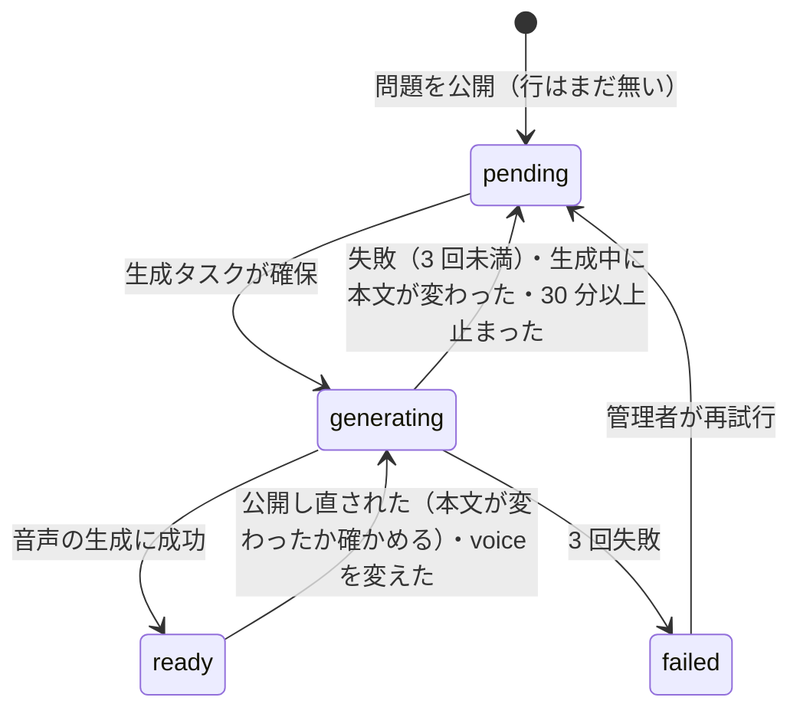
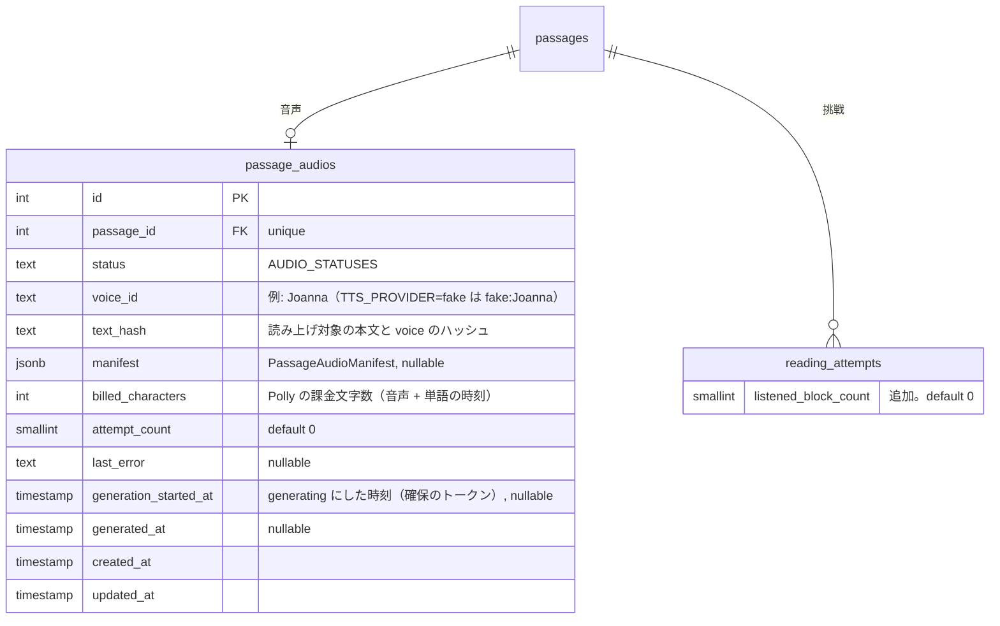
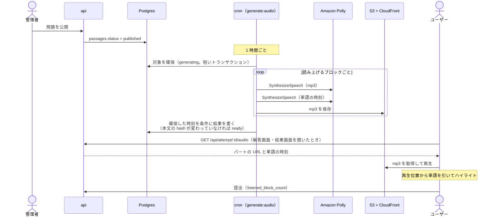

# 読み上げ

問題の英文を **自然な英語の音声で読み上げ**、読んでいる単語をハイライトする。エンジニアは英文を「読める」が「音で聞いたことがない」単語が多い（`cache`、`queue`、`idempotent` など）。目で読んでいる英文を同時に耳で確かめられるようにし、発音の確認とシャドーイングに使えるようにする。

声は問題の公開後にクラウドの音声合成（Amazon Polly）で 1 度だけ作って保存し、全ユーザーが同じ音声を聞く。端末の音声合成に頼らないので、どの端末でも同じ品質の声になり、単語のハイライトが音声と正確に合う。

このドキュメントは **仕様（What）** と **設計（How）** を分けて記述する：

- **仕様**：読み上げの操作、使える場面、アシストとしての扱い、音声ができるまで
- **設計**：音声合成サービスの選定と費用、音声の生成と保存、単語のハイライトの合わせ方、再生の実装

## 関連 spec

- [`../reading-practice/README.md`](../reading-practice/README.md) — 解答画面と結果画面に読み上げを置く。読み上げは 3 つめのアシストになる（`reading_attempts` に列を足す）
- [`../question-generation/README.md`](../question-generation/README.md) — 公開された問題の本文（`PassageBlock`）を読み上げる。本文の文字位置の定義の正本
- [`../learning-record/README.md`](../learning-record/README.md) — 「アシストなし」の判定に読み上げを含める
- [`../product-overview/README.md`](../product-overview/README.md) — 機能一覧・インフラ上の配置
- [`../minimal-deploy/README.md`](../minimal-deploy/README.md) — cron（ECS RunTask）と S3 の置き場所
- [`./deferred-voices-and-pronunciation.md`](./deferred-voices-and-pronunciation.md) — MVP 対象外。声の選択、単語の発音、ユーザーの音読の評価
- **この spec が正本のもの**：`passage_audios` の列定義、`reading_attempts.listened_block_count`（読み上げを聞いた段落の数）、音声のマニフェスト（`PassageAudioManifest`）の型、`AUDIO_STATUSES`

## 目次

- [仕様](#仕様)
  - [できること](#できること)
  - [使える場面とアシストの扱い](#使える場面とアシストの扱い)
  - [再生の操作](#再生の操作)
  - [ハイライトとスクロール](#ハイライトとスクロール)
  - [タイマー・一時停止・和訳との関係](#タイマー一時停止和訳との関係)
  - [音声ができるまで](#音声ができるまで)
  - [読み上げない部分](#読み上げない部分)
- [設計](#設計)
  - [音声合成サービスの選定](#音声合成サービスの選定)
  - [費用](#費用)
  - [音声の生成タスク](#音声の生成タスク)
  - [読み上げ用のテキストと文字位置の対応](#読み上げ用のテキストと文字位置の対応)
  - [音声の保存と配信](#音声の保存と配信)
  - [再生の実装](#再生の実装)
  - [失敗時の扱い](#失敗時の扱い)
  - [MVP 対象外（将来検討）](#mvp-対象外将来検討)
- [必要な画面](#必要な画面)
- [UI 設計](#ui-設計)
  - [問題を解く（PC）](#問題を解くpc)
  - [問題を解く（スマホ幅）](#問題を解くスマホ幅)
  - [結果・解説](#結果解説)
  - [mobile の画面](#mobile-の画面)
  - [見た目の決まり](#見た目の決まり)
- [必要な API](#必要な-api)
- [必要な DB 設計](#必要な-db-設計)
- [フロー図](#フロー図)
- [実装ステップ（予定）](#実装ステップ予定)

---

## 仕様

### できること

| 機能 | 内容 |
| --- | --- |
| 全文の読み上げ | 本文を最初から最後まで続けて読み上げる。一時停止・再開・停止ができる |
| 段落の読み上げ | 段落ごとのボタンで、その段落だけを読み上げる |
| 再生速度 | 0.75 倍・1 倍・1.25 倍から選ぶ。選んだ速度は端末に覚える |
| 単語のハイライト | 読み上げ中の単語に印を付ける |

声は 1 種類（米国英語の女性の声）。声や訛りの選択、単語ごとの発音、ユーザー自身の音読の評価は MVP に入れない（[deferred-voices-and-pronunciation](./deferred-voices-and-pronunciation.md)）。

### 使える場面とアシストの扱い

| 場面 | 使えるか | アシストに数えるか |
| --- | --- | --- |
| 解答画面 | ✅ | ✅ 数える |
| 結果画面 | ✅ | ― 数えない（提出後なので点数に関係しない） |
| ログイン画面の体験デモ | ❌ | ― |

- 解答中の読み上げは、段落の和訳・単語の意味と同じく **アシスト** として扱う。使っても点数は変わらないが、**読み上げを聞いた段落の数** を記録する
- 「アシストなし」の挑戦は、和訳・単語の意味・読み上げを **どれも使わなかった** 挑戦になる（[learning-record](../learning-record/README.md) の「アシストなしの正答率」と学習履歴の表示）
- 結果画面とステータスバーに「読み上げ n 段落」を出す（和訳・単語の回数と並べる）
- 1 秒以上再生した段落を「聞いた段落」に数える（押してすぐ止めた段落は数えない）

### 再生の操作

読み上げの操作は、本文の列の下端に固定した **ミニプレーヤー** と、段落番号の列の **段落の再生ボタン** にまとめる。

| 操作 | 解答画面（PC） | 解答画面（スマホ幅・mobile） | 結果画面 |
| --- | --- | --- | --- |
| 全文の読み上げ | ミニプレーヤーの再生ボタン、`R` キー | ミニプレーヤーの再生ボタン | ミニプレーヤーの再生ボタン |
| 段落の読み上げ | 段落番号の列の再生ボタン（「訳」の下） | 同左 | 同左 |
| 一時停止・再開 | ミニプレーヤーの再生ボタンが一時停止ボタンに変わる。`R` キー | ミニプレーヤーの再生ボタン | 同左 |
| 停止 | 再生中にミニプレーヤーに出る停止ボタン | 同左 | 同左 |
| 再生速度 | ミニプレーヤーの速度のメニュー | web はメニュー、mobile は押すたびに切り替わる | 解答画面と同じ |

- 全文の読み上げは **最初の見出しから** 始め、最後の段落で止まる。途中の段落から聞きたいときは段落の読み上げを使う
- 段落の読み上げは、その段落を読み終えたら止まる（次の段落に進まない）。その段落だけを読んでいる間は、段落の再生ボタンでも一時停止・再開できる
- 別の段落の再生ボタンを押すと、今の再生を止めてその段落を最初から読む。全文の読み上げ中に押すと、その段落だけの読み上げに切り替わる
- 最後まで読み終えるか停止すると、ミニプレーヤーは最初の表示（「全文を読み上げ」）に戻る
- `R` キーは解答画面だけ（結果画面にはキーボードの操作が無い）
- 音声がまだできていない問題では、ミニプレーヤーに「読み上げの音声を準備中です」と出し、再生ボタンと段落の再生ボタンを無効にする
- 見た目は [UI 設計](#ui-設計) のとおり

### ハイライトとスクロール

- 読み上げ中の単語に琥珀の下線と淡い背景を付ける（単語のカードの選択中の表示とは別の見た目）
- 読み上げ中の段落が画面の外にあるときは、その段落が見える位置まで自動でスクロールする。**ユーザーが自分でスクロールしたら自動スクロールを止め**、「読み上げ中の位置に戻る」ボタンを出す
- ハイライト中の単語もタップして意味を見られる（再生は止めない）

### タイマー・一時停止・和訳との関係

- 読み上げを聞いている間も **タイマーは進む**（読解の時間に含める）
- 解答画面の **一時停止** で読み上げも止まる。再開しても読み上げは自動で再開しない（再生ボタンで再開する）
- 画面を離れたとき（web はタブを切り替えたとき、mobile はアプリを閉じたときと、上に画面を積んだとき）は読み上げを止める。タイマーが止まるのと合わせる
- 和訳を表示中の段落（全文訳を含む）は、**読み上げている間だけ英文で表示** する（音声とハイライトを英文に合わせるため）。次の段落に進むか停止すると、和訳の表示に戻る。和訳の切り替えの状態そのものは変えない
- 提出すると読み上げは止まる
- mobile は端末の消音モードでも音を出す（学習アプリとして、マナーモード中でも聞けるようにする）

### 音声ができるまで



- 音声は **問題が公開された後** に作る。生成タスクは 1 時間ごとに動くので、公開から最大 1 時間ほどで聞けるようになる
- 下書き（未公開）の問題には音声を作らない（却下される問題に費用をかけないため）
- 公開済みの問題を非公開に戻して本文を直し、再公開すると、音声を作り直す。本文が変わっていなければ作り直さない（非公開の間と、再公開の後に作り直すかを確かめる間は「準備中」になる）
- 利用者には `pending` と `generating` をどちらも「準備中」と見せる。失敗した問題は、管理者が再試行するまで自動では作り直さない
- 管理者は admin の問題の確認画面で、音声の状態（準備中・生成中・作成済み・失敗）と作成日時を見られる。失敗したものは「再試行」できる

### 読み上げない部分

| ブロック | 読み上げ |
| --- | --- |
| 見出し・段落・箇条書き・引用 | ✅ |
| コードブロック | ❌ 飛ばす（コードを音声で聞く意味が薄いため） |
| インラインコード | ✅ 書いてあるとおりに読む（`useEffect` など。読み方が不自然になることがある） |

---

## 設計

### 音声合成サービスの選定

単語のハイライトには、音声の中で各単語が何ミリ秒に読まれたか（単語の時刻）が要る。これを返せるか、費用、既存のインフラ（AWS）との相性で比べた。料金は 2026 年 10 月時点の公式・調査サイトの値。

| 方式 | 費用（100 万文字あたり） | 単語の時刻 | 備考 |
| --- | --- | --- | --- |
| **Amazon Polly（Neural）** | **$16** | ✅ Speech Marks | **採用**。AWS 内で完結（IAM・S3）。東京リージョン対応。無料枠の条件は [費用](#費用) |
| Amazon Polly（Generative） | $30 | ❌ 非対応 | 声はより自然だが、単語の時刻が取れない |
| Google Cloud TTS（Neural2 / Chirp 3 HD） | $16 / $30 | △ SSML の mark を単語ごとに入れれば取れる | 月 100 万文字の無料枠に期限なし。GCP の認証情報を新たに持つことになる |
| Azure AI Speech（Neural） | $16 | ✅ word boundary | 月 50 万文字無料。Azure の契約を新たに持つことになる |
| OpenAI（tts-1 / gpt-4o-mini-tts） | $15 前後 | ❌ | 単語の時刻が取れない |
| ElevenLabs（Flash v2.5） | $20〜40 | ✅ | 声の品質は最も高いが割高 |
| 端末の音声合成（Web Speech API / `expo-speech`） | 無料 | △ | 声の品質が端末次第。Android の Chrome では単語の境界のイベントが来ず、Safari は文字数を返さないのでハイライトが合わない |

Polly の Neural は **単語の時刻（Speech Marks）を返せる最も安い選択肢** で、cron と S3 がある既存の AWS 構成にそのまま載る。声は `Joanna`（en-US、Neural）を既定にし、env で変えられるようにする。

### 費用

1 問の本文は平均 400 語（約 2,400 文字）。Polly は **音声と単語の時刻を別々のリクエストで作り、どちらも文字数で課金される** ので、1 問あたり約 4,800 文字になる。

| 項目 | 計算 | 金額 |
| --- | --- | --- |
| 音声の生成（1 問） | 4,800 文字 × $16 / 100 万文字 | **約 $0.077（約 12 円）**。公開時に 1 回だけ |
| 月 30 問を公開 | 14.4 万文字 | 約 $2.3 |
| 月 100 問を公開 | 48 万文字 | 約 $7.7 |
| 月 300 問を公開（[question-generation の生成の上限](../question-generation/README.md#費用の上限)） | 144 万文字 | 約 $23 |
| 保存（S3） | 1 問 約 1MB（mp3、約 2.7 分）。1,000 問で 1GB × $0.025 | 月 約 $0.03 |
| 配信（CloudFront） | 1 回の全文再生で約 1MB | 月 1TB（約 100 万回の再生）まで無料。超過分は 1GB あたり $0.114 |
| 生成タスクの実行（ECS RunTask） | 1 時間ごと、1 回 1 分前後 | 月 $0.2 前後 |

- **無料枠**：Polly の Neural は、AWS アカウントを作ってから 12 か月間、月 100 万文字（約 200 問）まで無料。ただし対象は **2025 年 7 月 15 日より前に作ったアカウント** だけで、それ以降に作ったアカウントは代わりに最大 $200 のクレジット（6 か月）が付く。どちらの期間も過ぎたアカウントは上の表のとおり課金される
- 費用は **公開した問題の数に比例** し、ユーザー数や再生回数にはほぼ比例しない（音声を作り置きして使い回すため）
- 本文を直して再公開したとき（本文のハッシュで判定）と、voice を変えたときだけ作り直す。読み上げ用テキストの作り方の版（`AUDIO_TEXT_VERSION`）を上げても自動では作り直さない（[音声の生成タスク](#音声の生成タスク)）
- 1 回の実行で作る件数に上限を置く（`AUDIO_MAX_PASSAGES_PER_RUN`、既定 20）。AWS の Budgets で Polly の利用額にアラートを付ける
- voice の変更・読み上げ用テキストの版の更新では、公開済みの問題数 × 約 $0.077 が 1 度にかかる（1 時間に最大 20 問ずつ作り直す。公開済みが 300 問なら約 $23）

参考：[Amazon Polly の料金](https://aws.amazon.com/polly/pricing/)、[Polly の Speech Marks](https://docs.aws.amazon.com/polly/latest/dg/speechmarks.html)、[Polly の Generative の制約](https://docs.aws.amazon.com/polly/latest/dg/generative-voices.html)、[CloudFront の料金](https://aws.amazon.com/cloudfront/pricing/pay-as-you-go/)、[Google Cloud TTS の料金（調査サイト）](https://texttolab.com/blog/google-cloud-tts-pricing)、[Azure TTS の料金（調査サイト）](https://texttolab.com/blog/azure-text-to-speech-pricing)、[OpenAI TTS の料金（調査サイト）](https://texttolab.com/blog/openai-tts-pricing)、[ElevenLabs の料金](https://elevenlabs.io/pricing)

### 音声の生成タスク

cron に `generate:audio` タスクを足す。EventBridge Scheduler で **1 時間ごと** に起動する（`generate:questions` とは独立）。

1. `generating` のまま 30 分以上たった行を `pending` に戻す（前回の実行が途中で落ちた場合の回収。[question-generation の生成タスク](../question-generation/README.md#生成タスクの動き) と同じ）
2. 対象を **状態で確保する**。`status = 'published'` の問題のうち、`passage_audios` が無い・`status = 'pending'`・`ready` で音声を作った後に公開し直された（`passage_audios.updated_at < passages.published_at`）・`ready` で `voice_id` が今の voice と違う問題を、古い順に `AUDIO_MAX_PASSAGES_PER_RUN` 件まで、短いトランザクションで `FOR UPDATE SKIP LOCKED` で取り、`status = 'generating'`・`generation_started_at = now()` にして commit する（行が無ければ作る）。実行が重なっても同じ問題を二重に処理しない
3. 1 件ずつ、**トランザクションの外で** 音声を作る。本文のハッシュ（`text_hash`）を求め、前の成功のマニフェストがあってそのハッシュと同じなら、行の状態を問わず作り直さない（`pending` に戻された行でも Polly を呼ばない。マニフェストの mp3 は別のハッシュの生成が成功して置き換わるまで消さないので、そのまま使える）。違えば、読み上げるブロック（[読み上げない部分](#読み上げない部分) を除く）を順に処理する
   - ブロックから読み上げ用のテキストを作る（[次節](#読み上げ用のテキストと文字位置の対応)）
   - Polly の `SynthesizeSpeech` を 2 回呼ぶ：mp3（`OutputFormat=mp3`）と単語の時刻（`OutputFormat=json`、`SpeechMarkTypes=["word"]`）
   - 1 リクエストの上限（課金対象 3,000 文字）を超えるブロックは文の区切りで分け、**パート** ごとに音声を作る（まれ）
   - mp3 を保存する（キー：`passages/{passage_id}/{text_hash}/{block_index}-{part}.mp3`）
4. 結果を短いトランザクションで書く。条件は `status = 'generating' AND generation_started_at = 確保した時刻`（30 分を過ぎて別の実行に取り直された行を、古い実行が上書きしない）。書くときに今の本文の `text_hash` を求め直し、確保した時と違えば（生成中に非公開 → 修正 → 再公開された）`ready` にせず `pending` に戻し、作った mp3 を消す
5. 成功したら、マニフェスト（各パートのキー・長さ・単語の時刻）を保存して `status = 'ready'`。前の `text_hash` の mp3 は削除する
6. 失敗したら `attempt_count` を増やし、3 回で `failed`（[失敗時の扱い](#失敗時の扱い)）

- Polly を呼ぶ間はトランザクションを開かない（本番〈minimal〉の DB は PgBouncer の transaction pooling なので、長いトランザクションを避ける）
- Polly のクライアントは `apps/cron/src/client/polly/`（`@aws-sdk/client-polly`）。資格情報は ECS のタスクロール（IAM に `polly:SynthesizeSpeech`）。音声合成は `TTS_PROVIDER` で選び、既定は `production` では `polly`、それ以外は `fake`（無音の mp3〈無音の MPEG フレームを並べたもの〉と等間隔の単語の時刻を返す `FakeTtsClient`。手元の AWS の資格情報で意図せず課金しないため。[step3 の env](./tasks/step3-cron-generate-audio.md#5-taskenvスクリプト)）。ローカルで `polly` を選んで AWS の資格情報が無ければ、タスクは「音声合成を使えない」として何もせず終わる
- 冪等：同じ問題を 2 回処理しても、同じキーに上書きして同じマニフェストになる
- 読み上げ用テキストの作り方を変えて `AUDIO_TEXT_VERSION` を上げても、`ready` の行は自動では作り直さない。作り直すときはデプロイの後に `UPDATE passage_audios SET status = 'pending' WHERE status = 'ready'` を流す（次の実行から `AUDIO_MAX_PASSAGES_PER_RUN` 件ずつ作り直す。その間は「準備中」になる。ハッシュが変わらない行は Polly を呼ばずに `ready` に戻る）

### 読み上げ用のテキストと文字位置の対応

ハイライトは reading-practice の **セグメント**（本文の単語。位置は `PassageBlock.text` 上の UTF-16 の index、[question-generation step1](../question-generation/tasks/step1-db-questions.md) の定義）に付ける。Polly の単語の時刻は **読み上げ用テキスト上の UTF-8 のバイト位置** で返るので、元の本文の位置に戻す必要がある。

- 読み上げ用テキストは `PassageBlock.text` からインラインコードのバッククォートを除いたもの。除くときに「読み上げ用テキストの位置 → 元の本文の位置」の対応表を作る
- Polly が返す `start` / `end`（UTF-8 のバイト位置）→ 読み上げ用テキストの UTF-16 の位置 → 元の本文の位置、の順に変換し、マニフェストには **元の本文の位置** を保存する
- この変換は `apps/cron/src/lib/audio/` の純関数にし、絵文字・全角記号・インラインコードを含む本文でテストする
- Polly の単語の時刻は開始の時刻だけなので、単語の終わりは次の単語の開始（最後の単語はパートの長さ）にする。Polly は音声の長さを返さないので、パートの長さ（`durationMs`）は mp3 のフレームを数えて求める
- クライアントは「再生位置（ミリ秒）→ 単語」を二分探索で引き、その単語の範囲と重なるセグメントにハイライトを付ける

### 音声の保存と配信

- 保存は `@repo/storage` の `Storage`（本番は S3、ローカルは `LocalStorage`）。音声用に 1 つのインスタンス（`audioStorage`）を作る。S3 の実装に、保存時の `Cache-Control` の指定と mp3 の Content-Type（`audio/mpeg`）を足す
- 本番は S3 の専用 bucket を CloudFront（OAC）で配信する。音声は公開してよい英文の読み上げなので、署名付き URL にはしない（キーに本文のハッシュを含めるので推測されにくい）。キャッシュは長期（`Cache-Control: public, max-age=31536000, immutable`）。本文や声が変わるとキーが変わるので（`text_hash` に voice も含める）古いキャッシュは問題にならない。CloudFront は独自ドメインにせず既定のドメインを使う（独自ドメインは us-east-1 の証明書が要るため）
- ローカルは cron が `.storage/audio/` に書き、api が開発環境でだけ `/media/*` として配信する（`production` では配信しない）。`production` で保存先が `local`（`AUDIO_STORAGE_TYPE` の既定）のままなら、生成タスクは起動時に throw する（コンテナの一時領域に mp3 を書いて `ready` にしないため。cron の他のタスクを止めないよう env の検証では弾かない）
- api はマニフェストのキーを `AUDIO_PUBLIC_URL_BASE` と組み合わせて URL にして返す。本番で未設定なら音声は「準備中」を返す（infra より先に api を出しても起動を止めない）
- api は `ready` でも、次のときは本文が変わって位置がずれているかもしれないので「準備中」として返す（利用者の API・admin の詳細の両方）
  - 問題が公開中でない（非公開に戻した）。非公開に戻しても `published_at` は残り、下書きのまま本文を直せるので、`updated_at` と `published_at` の比較では直した後の本文に古いマニフェストが重なる。再公開すると生成タスクが本文のハッシュを確かめて `ready` に戻す（本文が同じなら Polly を呼ばない）
  - 音声を作った（または同じ本文だと確かめた）後に問題が公開し直された（`updated_at < published_at`）。生成タスクが本文を確かめると `ready` に戻る
- infra（AWS の設定後）：cron のタスクロールを execution role から分けて Polly と bucket への書き込みの権限を付ける。min の deploy の role にそのタスクロールの `iam:PassRole` を足す。Polly の費用は環境ごとに分けられないので、Budgets のアラートはアカウントに 1 つ置く（[step8](./tasks/step8-infra-audio.md)）

### 再生の実装

| | web | mobile |
| --- | --- | --- |
| 再生 | `HTMLAudioElement`（1 つを使い回し、パートごとに `src` を差し替える） | `expo-audio` の `useAudioPlayer`（パートごとに `replace`） |
| 速度 | `playbackRate`（`preservesPitch = true`） | `setPlaybackRate`（`shouldCorrectPitch = true`） |
| 時刻の取得 | 再生中だけ `requestAnimationFrame` で `currentTime` を読む | `playbackStatusUpdate` の `currentTime`（更新間隔 100ms） |
| 画面を離れたとき | `visibilitychange` で一時停止 | `AppState` が `active` でなくなったとき、`useIsFocused` が false になったとき（上に画面を積んだとき）に一時停止 |
| 消音モード | ― | `setAudioModeAsync({ playsInSilentMode: true })` |
| 次のパートの先読み | 次のパートの `Audio` を `preload = "auto"` で先に作る | 行わない（段落の間に短い間が空くのは許容する） |

- 再生の状態（再生中のブロック・パート・単語、速度、モード〈全文 / 段落〉）は 1 つの hook（`useReadAloud`）にまとめ、解答画面と結果画面で共有する
- 再生位置は毎フレーム（mobile は 100ms ごと）読むが、**状態を更新するのは読み上げ中の単語が変わったときだけ** にする（解答画面全体を毎フレーム描き直さないため）。ミニプレーヤーの進捗も単語の単位で進め、web は幅の変化を補間する
- 単語の時刻の位置（`blocks[].text` 上の UTF-16 の位置）は、ブロックのセグメントを順に足した位置（インラインコードはバッククォートの 2 文字を足す）と重ねて、ハイライトするセグメントの範囲に変える
- 再生位置は音声の中の時刻なので、速度を変えても単語の時刻はそのまま使える
- 「聞いた段落」の記録は、ブロックの中の再生位置が 1 秒を超えたら `listenedBlockIndexes` に足す（シークの操作は無いので、再生位置で再生した時間を表せる）。途中経過として端末に保存する値（web は `localStorage`、mobile は `AsyncStorage`）に含め、提出時に件数（`listened_block_count`）を送る。途中経過の版は上げず、この値が無い古い保存も読む（解答中の挑戦の途中経過を消さないため）
- マニフェストは解答画面・結果画面を開いた後に、挑戦とは別のリクエストで取得する（挑戦の開始・取得のレスポンスを重くしない。押す前に「準備中」を出すため、押したときではなく開いたときに取る）。web は Route Handler（`/api/attempts/[id]/audio`）を経由する
- 外から止めた（一時停止の操作・上部バーの一時停止・画面を離れた）直後にパートの終わりが届いたら、次のパートは鳴らさずに用意だけして一時停止のままにする（再開すると次のパートの最初から鳴る。次が無ければ待機に戻る）。止める直前にパートが終わっていると、終わりの通知が後から届いて次のパートが勝手に鳴るため
- この「止めた」扱いは、アプリのボタンを通らない再開でも解く（web はメディアキー・AirPods・ブラウザのメディアコントロール〈`audio` の `play` イベント〉、mobile は割り込みの終わり・前面に戻ったときに OS が再生を戻したとき）。解かないと、パートの終わりで次のパートを用意するだけになり段落の境目で止まる
- 取得の失敗だけでなく再生の失敗（mp3 を読み込めない。mobile は 10 秒たっても読み込めない）でも時刻表を捨て、再生ボタンでマニフェストを取り直す（取り直したら待機に戻り、もう一度押すと再生する）。公開し直しで音声が作り直されて古い mp3 が消えていると、同じ時刻表の URL では失敗し続けるため
- mobile は、パートを `replace` した後に届く前のパートの再生状態の通知を、通知の音声の長さ（`duration`）が新しいパートの長さと合う（±250ms）まで捨てる（ネイティブからの通知は非同期で、前のパートの通知が何件も後から届くことがある）。詳細は [step6](./tasks/step6-mobile-read-aloud.md)
- mobile は、上に画面を積んでいる間の再生状態の通知を捨て、パートの終わりの通知は player の今の再生位置がパートの終わりにあるときだけ受ける（他の player の終わりの通知で、一時停止中のパートを次に差し替えないため）

### 失敗時の扱い

- Polly の一時的なエラー（throttling・5xx）は SDK のリトライに任せる。それでも失敗した問題は `attempt_count` を増やして次の実行に回す
- mp3 の保存の一時的なエラー（S3 の 5xx・throttling、ローカルの保存先の失敗）も、Polly の一時的なエラーと同じく `attempt_count` を増やして次の実行に回す
- 3 回失敗したら `failed` にして `last_error` を残す。管理者が admin で「再試行」すると `pending` に戻る（`attempt_count = 0`）
- 資格情報・権限・voice の設定の誤りのように、どの問題でも同じく失敗するエラーでは、失敗の回数を増やさずに確保を `pending` に戻してタスクを止める（全件が `failed` にならないように）。Polly だけでなく mp3 の保存先（S3 の権限が無い・bucket が無い・資格情報が無効・bucket のリージョンが違う）の誤りも同じ（保存は音声合成の後なので、1 件の失敗にすると Polly の料金をかけて全件が `failed` に進む）。前の mp3 の削除でこの誤りが起きたときも、その問題の結果は書き終えたままタスクを止める
- 1 件でも失敗があればタスクは exit 1（ECS のタスクの終了コードとログに残す。通知は MVP では持たない。[content-collection](../content-collection/README.md#実行の上限と失敗時の扱い) と同じ）
- 音声が無い・失敗した問題でも、解答は普段どおりできる（読み上げのボタンが無効になるだけ）

### MVP 対象外（将来検討）

詳細は [`deferred-voices-and-pronunciation.md`](./deferred-voices-and-pronunciation.md)。

- **声の選択**（男女・英米の訛り）
- **単語ごとの発音**（単語のカードから、本文の中での発音を聞く）
- **ユーザー自身の音読の録音と発音の評価**
- **インラインコードの読み方の調整**（`useEffect` を "use effect" と読ませる辞書）
- **バックグラウンド再生**（アプリを閉じても聞き続ける）

---

## 必要な画面

新しい画面は作らない。既存の画面に読み上げの操作を足す。見た目は [UI 設計](#ui-設計)。

| 画面 | 変更 | 担当 spec |
| --- | --- | --- |
| 問題を解く（web・mobile） | 本文の列の下端にミニプレーヤー（再生・停止・速度）、段落番号の列に段落の再生ボタン、単語のハイライト、ステータスバーに「読み上げ n 段落」と `R` キー | この spec / [reading-practice](../reading-practice/README.md#問題を解く) |
| 結果・解説（web・mobile） | 本文に同じミニプレーヤーと段落の再生ボタン。アシストの表示に「読み上げ n 段落」 | この spec / [reading-practice](../reading-practice/README.md#結果解説) |
| マイページ・学習履歴 | 「アシストなし」の判定に読み上げを含める（見た目は変えない） | [learning-record](../learning-record/README.md) |
| （admin）問題の確認・修正 | 音声の状態・作成日時・「再試行」 | [question-generation](../question-generation/README.md#問題の確認修正) |

## UI 設計

`design-mock` skill で確定したデザイン。配色・書体・共通の部品は [product-overview の UI 設計](../product-overview/README.md#ui-設計)、解答画面と結果画面の構成は [reading-practice の UI 設計](../reading-practice/README.md#ui-設計) を正本とし、ここには読み上げで足すものだけを書く。

| 画面 | モック（web・mobile 共通のパス） |
| --- | --- |
| 問題を解く：読み上げ中 | `/mock/attempts/42?state=reading` |
| 問題を解く：音声の準備中 | `/mock/attempts/42?state=audio_pending` |
| 結果・解説 | `/mock/attempts/42/result`（ミニプレーヤーの再生ボタンで擬似的に再生する） |

モックの再生は、単語を 1 分あたり 150 語の速さで順に進める擬似的なもの。実装は音声の再生位置と単語の時刻から今の単語を求める（[再生の実装](#再生の実装)）。

### 問題を解く（PC）

本文の列の下端にミニプレーヤーを固定し、段落番号の列の「訳」の下に段落の再生ボタンを足す。上部バーと設問パネルは変えない。

```
┌──────────────────────────────────────────────────────────────────────────────┐
│ ‹ 中断  Synchronizing with Effects       残り 3:51 AAA [全文訳][Ⅱ][提出する] │ ← 上部バー（変更なし）
│━━━━━━━━━━━━━━━━━━━━━━━━━━━━━━━━━━━━━━━━━━━━━━━━━━━━━━━━──────────────────────────│
├──────────────────────────────────────────────────┬───────────────────────────┤
│   #   Synchronizing with Effects                 │ 設問  1•  2•  [3]  4      │
│                                                  │───────────────────────────│
│   1   Some components need to stay in sync       │ Q3                        │
│  [訳] with systems that live outside of React,   │ In paragraph 1, the       │
│  [▶]  such as a browser API, a third-party       │ phrase "escape hatch" is  │ ← 読み上げ中の段落の再生ボタン（琥珀）
│       widget, or a network connection. ...       │ closest in meaning to     │
│       ══════                                     │                           │ ← 読み上げ中の単語（琥珀の下線と淡い背景）
│   2   Before reaching for an Effect, ask         │ [A] a security vulnera…   │
│       yourself whether the code is ...           │ [B] a way to leave the…   │
│     ┌────────────────────────────────────────┐   │ [C] a shortcut that im…   │
│     │ (Ⅱ) 段落 1 / 4  ━━━━━━────────  ■ 1x˄ R │   │ [D] a feature that is …   │ ← ミニプレーヤー（本文の列の下端に固定）
│     │     全文                               │   │───────────────────────────│
│     └────────────────────────────────────────┘   │ [K] 前の設問  次の設問 [J]│
├──────────────────────────────────────────────────┴───────────────────────────┤
│ ● 読解中 │ 332 語 │ 回答 2 / 4 │ 和訳 1 段落 単語 2 回 読み上げ 1 段落 [T][R]… │ ← ステータスバー
└──────────────────────────────────────────────────────────────────────────────┘
```

**ミニプレーヤー**（本文の列の下端に固定。本文と同じ幅で、段落番号の列の分だけ右から始める）

```
待機           ┌───────────────────────────────────────────────────┐
               │ (▶) 全文を読み上げ  ───────────────────────  1x˄ R │
               └───────────────────────────────────────────────────┘
全文の再生中   ┌───────────────────────────────────────────────────┐
               │ (Ⅱ) 段落 2 / 4  ━━━━━━━━━━━──────────────  ■ 1x˄ R │ ← 進捗は本文全体の中の位置
               │     全文                                          │
               └───────────────────────────────────────────────────┘
段落の再生中   ┌───────────────────────────────────────────────────┐
               │ (Ⅱ) 段落 3 / 4  ━━━━━━━━━━━━━━━━━━━━━━━━──────  ■ 1x˄ R │ ← 進捗はその段落の中の位置
               │     この段落だけ                                  │
               └───────────────────────────────────────────────────┘
一時停止中     │ (▶) 段落 2 / 4  ━━━━━━━━━━━──────────────  ■ 1x˄ R │ ← 再生ボタンで続きから
音声の準備中   ┌───────────────────────────────────────────────────┐
               │ (▷) 読み上げの音声を準備中です                    │ ← 灰の再生ボタン（押せない）
               └───────────────────────────────────────────────────┘
```

| 要素 | 内容 |
| --- | --- |
| 再生ボタン | 待機中は全文を最初の見出しから読む。再生中は一時停止、一時停止中は続きから再開 |
| ラベル | 待機中は「全文を読み上げ」。再生中・一時停止中は読み上げ中の位置を「段落 n / N」（段落番号の列と同じ番号。見出しは「見出し」）で出し、下の行に「全文」か「この段落だけ」 |
| 進捗 | 全文の再生は本文全体の中の位置、段落の再生はその段落の中の位置 |
| 停止 | 再生中・一時停止中だけ出す。押すと待機に戻る（ハイライトが消え、和訳中の段落は和訳に戻る） |
| 速度 | 今の速度（`1x`）。押すと上にメニューを開く |
| `R` | キーキャップ。1024px 以上の解答画面だけ出す |
| 音声の準備中 | 再生ボタン・停止・速度は出さず、灰の再生ボタンと「読み上げの音声を準備中です」だけ |
| 音声の作成に失敗した問題 | 準備中と同じ見た目で「この問題の読み上げは利用できません」 |
| 音声の情報を取得中 | 待機の見た目で、再生ボタンだけ押せない（画面を開いた直後の短い間） |
| 取得・再生の失敗（通信） | 待機の見た目で、ラベルを「読み上げを読み込めませんでした」にする。再生ボタンを押すと取り直す |

**速度のメニュー**（速度のボタンの上に開く）

```
                                         ┌──────────────┐
                                         │ 再生速度     │
                                         │ 0.75x        │
                                         │ 1x         ✓ │ ← 選択中は琥珀の文字とチェック
                                         │ 1.25x        │
                                         └──────────────┘
 ┌──────────────────────────────────────────────────────┐
 │ (Ⅱ) 段落 2 / 4  ━━━━━━━━━──────────────  ■ [1x˄]  R │
 └──────────────────────────────────────────────────────┘
```

- 選ぶとすぐに速度が変わり、メニューを閉じる（再生は止めない）。メニューの外を押しても閉じる
- 選んだ速度は端末に覚え、次の挑戦や結果画面でも使う

**段落の再生ボタン**

- 段落番号の列の「訳」の下に置く。見出しにも置き、コードブロックには置かない
- 出し方は「訳」と同じ：PC ではその段落にホバーするかフォーカスすると出る。タッチ端末では薄く常に出す。読み上げ中の段落では琥珀で常に出す
- その段落だけを再生している間はアイコンが一時停止になり、押すと一時停止・再開。それ以外のときは押すとその段落を最初から読む
- 音声の準備中は押せない

**ハイライトと自動スクロール**

```
      │   2   Before reaching for an Effect, ask         │
      │       yourself whether the code is ...           │
      │                                                  │
      │          ┌──────────────────────────┐            │
      │          │ ↓ 読み上げ中の位置に戻る │            │ ← 自分でスクロールしたら出る
      │          └──────────────────────────┘            │
      │     ┌────────────────────────────────────────┐   │
      │     │ (Ⅱ) 段落 4 / 4  ━━━━━━━━━━━━──  ■ 1x˄ R │   │
      │     └────────────────────────────────────────┘   │
```

- 読み上げ中の単語に琥珀の下線と淡い琥珀の背景を付ける。単語のカードを開いた単語の表示（淡い琥珀の背景と `amber-bright` の文字）とは別の見た目にする。根拠のハイライト（結果画面）の中でも同じ印を付ける
- 読み上げ中の段落が変わったら、その段落の始まりが画面の上の方に来るまでなめらかにスクロールする（モックは段落の中央を合わせていたが、画面より高い段落で読み始めが隠れないよう始まりに合わせる）
- ホイール・タッチでのスクロール・スクロールのキー（`↑` `↓` `PageUp` `PageDown` `Home` `End` `Space`）で、読み上げ中に本文を動かしたら自動スクロールを止め、ミニプレーヤーの上に「読み上げ中の位置に戻る」を出す
- 「読み上げ中の位置に戻る」を押すと、読み上げ中の段落までスクロールして自動スクロールを再開する。待機中に再生ボタンを押したときと、段落の再生ボタンを押したときも再開する

**和訳を表示中の段落**

```
   1  ┃ 一部のコンポーネントは、ブラウザの API、…      ← 和訳を表示中の段落
  [訳]┃ と同期させる必要があります。…
   2   Before reaching for an Effect, ask yourself    ← 読み上げ中の段落は、和訳中でも英文で出す
  [訳] whether the code is caused by rendering ...
  [▶]  ═══════
   3  ┃ よくある間違いは、…                            ← 全文訳がオンなら、読み終えた段落は和訳に戻る
```

**ステータスバーとショートカット**

- ステータスバーの左に「読み上げ n 段落」（和訳・単語の回数の後ろ）、右のキーボード操作に「`R` 読み上げ」（`T` 全文訳の後ろ）
- ショートカット一覧のダイアログに「`R` 読み上げの再生・一時停止」（`T` の後ろ）

### 問題を解く（スマホ幅）

ミニプレーヤーは本文の下端、閉じた設問シートのすぐ上に固定する。`R` のキーキャップは出さない。設問シートを開くとシートの下に隠れる。

```
┌──────────────────────────────────────┐
│ ‹ 中断         残り 3:51 [全文訳][Ⅱ] │
│━━━━━━━━━━━━━━━━━━━━━━━━━━────────────│
│  #  Synchronizing with Effects       │
│  1  Some components need to stay     │
│ [▶] in sync with systems that live   │ ← 段落の再生ボタン（タッチ端末では薄く常に表示）
│     outside of React, such as a ...  │
│     ═══════                          │
│  2  Before reaching for an Effect,   │
│ ┌──────────────────────────────────┐ │
│ │ (Ⅱ) 段落 1 / 4  ━━━━────  ■ 1x˄  │ │ ← ミニプレーヤー（設問シートのすぐ上）
│ └──────────────────────────────────┘ │
├──────────────────────────────────────┤
│ 設問  回答 2 / 4           Q3 を開く │ ← 設問シート（閉じた状態）
└──────────────────────────────────────┘
```

### 結果・解説

本文の列の下端に解答画面と同じミニプレーヤーを固定する（`R` のキーキャップは出さない）。スマホ幅では本文の区画が画面にある間だけ下端に出る。

```
┌──────────────────────────────────────────────────────────────────────────────┐
│ ‹ 問題一覧  Synchronizing with…  マイページへ [もう一度解く][次の問題を解く] │
├────────────────────────────────────────────┬─────────────────────────────────┤
│ 本文（根拠の箇所をハイライトしています。   │ ■ ■ □ ■                         │
│ 単語のタップ・和訳・読み上げはここでも使え │ 3 / 4 問正解                    │
│ ます）                                     │ …                               │
│                                            │ 読む速さ      アシストの使用    │
│   1  Some components need to stay in       │ 64 WPM        和訳 1 段落       │
│  [▶] sync with ... those systems.          │ 設問込み      単語 3 回         │
│      【They are an escape hatch: ...】     │               読み上げ 2 段落   │ ← 追加
│                                            │─────────────────────────────────│
│  ┌──────────────────────────────────────┐  │ ■ Q1 [要旨] 正解            ▾   │
│  │ (▶) 全文を読み上げ  ──────────  1x˄  │  │ …                               │ ← ミニプレーヤー
│  └──────────────────────────────────────┘  │                                 │
└────────────────────────────────────────────┴─────────────────────────────────┘
```

- 本文の上の注記を「本文（根拠の箇所をハイライトしています。単語のタップ・和訳・読み上げはここでも使えます）」にする（web だけ。mobile は「本文（根拠の箇所をハイライトしています）」のまま。[mobile の画面](#mobile-の画面)）
- アシストの使用に「読み上げ n 段落」（解答中に聞いた段落の数）を足す。結果画面で聞いた段落は数えない
- 結果画面を開いただけでは再生しない

### mobile の画面

構成は web のスマホ幅と同じ。web との違いだけを書く。

```
┌────────────────────────────────────────┐
│ ‹ 中断           残り 3:51 [全文訳][Ⅱ] │
│━━━━━━━━━━━━━━━━━━━━━━━━━━━━────────────│
│  1  Some components need to stay       │
│ [訳] in sync with systems that live    │
│ [▶] outside of React, such as a ...    │ ← 段落の再生ボタン（常に薄く表示）
│     ═══════                            │
│  2  Before reaching for an Effect, …   │
│ ┌────────────────────────────────────┐ │
│ │ (Ⅱ) 段落 1 / 4  ━━━━─────  ■ [1x]  │ │ ← ミニプレーヤー（設問シートの上に浮かべる）
│ │     全文                           │ │
│ └────────────────────────────────────┘ │
├────────────────────────────────────────┤
│ 設問  回答 2 / 4             Q3 を開く │
└────────────────────────────────────────┘
```

- ミニプレーヤーは左右 12px の余白で、閉じた設問シートの上に浮かべる。**設問シートを開いている間は出さない**。結果画面では下端に固定した「もう一度解く」「次の問題を解く」の上に浮かべる
- **速度はメニューを開かず、押すたびに 0.75x → 1x → 1.25x → 0.75x と切り替わる**（枠つきの小さな箱に `1x`）
- 単語のカードは、ミニプレーヤーに重ならないようその上に出す
- 本文の最後の段落がミニプレーヤーに隠れないよう、本文の下の余白を広げる
- 本文を指で動かし始めたら自動スクロールを止める。自動スクロールは読み上げ中の段落の始まりを「本文の根拠を見る」と同じ位置（画面の上の方）に合わせる
- 段落の長押し（押している間だけ和訳）は、読み上げ中の段落でも使える
- 結果画面の本文の上の注記は変えない（「本文（根拠の箇所をハイライトしています）」のまま。web は読み上げも使えることを書き足す）

### 見た目の決まり

| 要素 | web | mobile |
| --- | --- | --- |
| ミニプレーヤー | 高さ 48px、角丸 12px。`raised` 95% の背景にぼかし、`line-strong` の枠、下に影 | 高さ 52px、角丸 14px。同じ配色 |
| 再生ボタン | 直径 32px の `amber` の丸に `amber-ink` のアイコン。ホバーで `amber-bright` | 直径 36px。押している間 `amber-bright` |
| ラベル | 13px `fg`。下の行は 11px `fg-faint` | 同じ |
| 進捗 | 高さ 4px、`line` の地に `amber` 80% の塗り。幅の変化は 300ms で補間 | 同じ（補間なし） |
| 停止 | 32px 角のボタンに `fg-muted` の ■ | 28 × 32px |
| 速度 | `font-code` 12px `fg-muted` の「1x˄」。メニューは `raised` の背景、`line-strong` の枠、幅 144px | `line` の枠の箱（幅 46px 以上）に `font-code` 12px の「1x」 |
| 音声の準備中 | 枠は `line`。再生ボタンは `line` の丸に `fg-faint` のアイコン。文言は 13px `fg-muted` | 同じ |
| 段落の再生ボタン | 22px 角、`line-strong` の枠に `fg-muted` のアイコン。読み上げ中の段落は `amber` 50% の枠・`amber-wash` の背景・`amber` のアイコン | 20px 角（常に 70% の不透明度）。読み上げ中の段落は同じ配色 |
| 読み上げ中の単語 | `amber` 15% の背景と 2px の `amber` の下線 | `amber` 15% の背景と `amber` の下線 |
| 読み上げ中の位置に戻る | 丸い端のボタン。`amber` 40% の枠、`raised` 95% の背景、12px `amber` の文字と ↓ | 同じ |

- 動きは、進捗の補間と自動スクロールだけ。`prefers-reduced-motion` のとき（mobile は OS の「視差効果を減らす」）は自動スクロールをアニメーションさせない
- ダークテーマのみ（[product-overview](../product-overview/README.md#ui-設計) と同じ）

**インタラクションのまとめ**

| 操作 | 結果 |
| --- | --- |
| ミニプレーヤーの再生（待機中） / `R` | 最初の見出しから全文を読み上げ |
| 再生中に再生ボタン / `R` | 一時停止。もう一度押すと続きから |
| 停止 | 待機に戻る |
| 段落の再生ボタン | その段落だけを最初から読む。その段落を読んでいる間は一時停止・再開 |
| 速度 | 再生を止めずに速度を変える |
| 読み上げ中に本文を自分でスクロール | 自動スクロールを止め、「読み上げ中の位置に戻る」を出す |
| 読み上げ中の位置に戻る | 読み上げ中の段落までスクロールし、自動スクロールを再開 |
| 読み上げ中の単語を押す | 単語のカード（再生は止めない） |
| 上部バーの一時停止 | 読み上げも一時停止。解答を再開しても読み上げは止まったまま |
| 画面を離れる（タブの切り替え・アプリを閉じる・mobile で上に画面を積む） | 読み上げを一時停止 |
| 提出・中断 | 読み上げを止める |

## 必要な API

| メソッド | パス | 認証 | 説明 |
| --- | --- | --- | --- |
| GET | `/api/attempt/:id/audio` | 必要 | 自分の挑戦の問題の音声マニフェスト。`status`（`pending` / `ready` / `failed`。`generating`・非公開に戻された問題の `ready`・公開し直された後の確認待ちは `pending` として返す）と、`ready` のときブロックごとのパート（`url`・`duration_ms`・単語の時刻 `[start_ms, end_ms, start_offset, end_offset][]`）。他人の挑戦は 404 |
| POST | `/api/attempt/:id/submit` | 必要 | 既存。リクエストに `listened_block_count`（0〜ブロック数。省略時は 0、ブロック数を超えたら切り詰める）を足す。結果のレスポンスにも返す |
| GET | `/api/admin/passage/:id` | admin | 既存。`audio`（`status`・`generated_at`・`last_error`）を足す。`status` は `generating` もそのまま返す。非公開に戻された問題の `ready`・公開し直された後の確認待ちは `pending` |
| POST | `/api/admin/passage/:id/audio/retry` | admin | 失敗した音声を `pending` に戻す（`failed` のときだけ。それ以外は 409） |

学習記録の API（`/api/user/stats`・`/api/user/attempts`）は、アシストの判定に `listened_block_count > 0` を含める（レスポンスの形は変えない）。

## 必要な DB 設計



| テーブル | 列 | 説明 |
| --- | --- | --- |
| `passage_audios`（新規） | `id`, `passage_id`（unique、`passages` の削除で cascade）, `status`, `voice_id`, `text_hash`, `manifest`, `billed_characters`, `attempt_count`, `last_error`, `generation_started_at`, `generated_at`, timestamps | 問題ごとの読み上げの音声。1 問 1 行 |
| `reading_attempts`（列を追加） | `listened_block_count smallint NOT NULL DEFAULT 0` | 解答中に読み上げを聞いた段落の数 |

- `AUDIO_STATUSES = ["pending", "generating", "ready", "failed"]` は `@repo/domain` の `const/audio.ts`。DB の CHECK 制約はここから作る
- `PassageAudioManifest`（`@repo/domain` の `types/audio.ts`）：`{ blocks: { blockIndex: number; parts: { durationMs: number; key: string; words: [startMs, endMs, startOffset, endOffset][] }[] }[] }`。単語の時刻は容量を抑えるため配列のタプルにする（600 語で約 20KB）
- `generation_started_at` は生成タスクが確保したときの時刻。結果を書くときの条件（確保のトークン）と、30 分以上止まった `generating` の回収に使う。`generating` の行は必ず値を持つ（CHECK 制約）
- `voice_id` は生成に使った voice。`TTS_PROVIDER=fake`（無音の mp3）は `fake:<voice>` にして `text_hash` にも入れる（fake で作った問題を Polly に切り替えたときに、voice が違う行として作り直し、保存キーも変える。同じ値だと CloudFront の長期キャッシュに無音の mp3 が残る）
- `manifest` / `text_hash` は最後に成功した生成のもの。失敗しても前の値を残す（前の mp3 のキーを後で消すため。利用者には `ready` のときしかマニフェストを返さない）
- index：`(status)`（生成タスクの取得用）
- ユーザーに紐づかないテーブルなので、アカウント削除の cascade の対象外

## フロー図



## 実装ステップ（予定）

reading-practice（解答画面・結果画面）と learning-record の実装の後に進める。

| step | 内容 |
| --- | --- |
| [step1-db-passage-audios](./tasks/step1-db-passage-audios.md) | `passage_audios` と `reading_attempts.listened_block_count`、`@repo/domain` の `AUDIO_STATUSES` と `PassageAudioManifest` |
| [step2-cron-tts-client](./tasks/step2-cron-tts-client.md) | Polly のクライアント（`FakeTtsClient` を含む）、読み上げ用テキストと文字位置の変換（純関数 + テスト） |
| [step3-cron-generate-audio](./tasks/step3-cron-generate-audio.md) | `generate:audio` タスク（状態での確保・生成・保存・古い音声の削除・失敗の扱い）、`audioStorage` |
| [step4-api-attempt-audio](./tasks/step4-api-attempt-audio.md) | `GET /api/attempt/:id/audio`、提出の `listened_block_count`、学習記録のアシストの判定、admin の音声の状態と再試行の API、ローカルの `/media` 配信 |
| [step5-web-read-aloud](./tasks/step5-web-read-aloud.md) | web の解答画面・結果画面の読み上げ（`useReadAloud`、ミニプレーヤー、段落の再生ボタン、ハイライト、速度、自動スクロール、聞いた段落の記録） |
| [step6-mobile-read-aloud](./tasks/step6-mobile-read-aloud.md) | mobile の解答画面・結果画面の読み上げ（`expo-audio`） |
| [step7-admin-audio-status](./tasks/step7-admin-audio-status.md) | admin の問題の確認画面に音声の状態と「再試行」 |
| [step8-infra-audio](./tasks/step8-infra-audio.md) | S3 の bucket と CloudFront、cron のタスクロールに Polly と S3 の権限、`generate:audio` のスケジュール（1 時間ごと）。AWS の設定後に infra の PR にまとめる |
