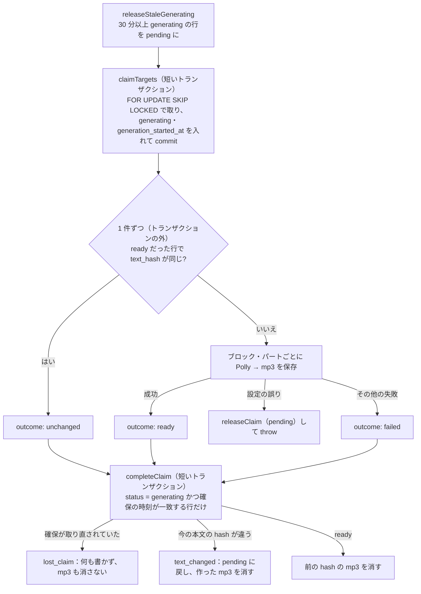

# step3-cron-generate-audio

公開済みの問題の読み上げの音声を作る `generate:audio` タスク（状態での確保・生成・保存・古い音声の削除・失敗の扱い）と、音声の保存先 `audioStorage` を作る。動きは [README の音声の生成タスク](../README.md#音声の生成タスク)・[音声の保存と配信](../README.md#音声の保存と配信)・[失敗時の扱い](../README.md#失敗時の扱い)。

## 前提

- [step1-db-passage-audios](./step1-db-passage-audios.md)、[step2-cron-tts-client](./step2-cron-tts-client.md)
- [question-generation step5-api-admin-passage](../../question-generation/tasks/step5-api-admin-passage.md)（公開で `published_at` が今の時刻になる。公開し直しの検出に使う）
- [question-generation step3-cron-generate-questions](../../question-generation/tasks/step3-cron-generate-questions.md)（同じ「状態で確保する」方式。`claimCollected`・claim のガード・30 分の回収の書き方を合わせる）
- 実装の順番は reading-practice・learning-record の後（[step1 の前提](./step1-db-passage-audios.md#前提)）
- 本番のスケジュール・S3・IAM は [step8-infra-audio](./step8-infra-audio.md)。この step はローカル（`TTS_PROVIDER=fake`、`.storage/audio/`）で完結させる

## 対応内容

### 1. 対象と流れ

対象は `passages.status = 'published'` で、次のどれかに当たる問題（`published_at` の古い順）。`failed` は対象にしない（管理者の再試行で `pending` に戻る）。

| 条件 | 意味 |
| --- | --- |
| `passage_audios` の行が無い | 初めての公開 |
| `status = 'pending'` | 失敗して次の実行に回った・管理者が再試行した・回収された |
| `status = 'ready'` かつ `passage_audios.updated_at < passages.published_at` | 音声を作った後に公開し直された（本文が変わったかもしれない） |



- Polly の呼び出しと mp3 の保存はトランザクションの外で行う（本番〈minimal〉の DB は PgBouncer の transaction pooling。長いトランザクションを開かない）
- 冪等：同じ本文・同じ voice なら同じキーに上書きし、同じマニフェストになる

### 2. `@repo/storage` に足すもの

- `s3-storage.ts` の `CONTENT_TYPE_BY_EXT` に `mp3: "audio/mpeg"` を足す
- `StorageConfig` の `s3` に `cacheControl?: string` を足し、`S3Storage` のコンストラクタの 4 つめの引数（既定は今の `"public, max-age=86400"`）にして `PutObjectCommand` の `CacheControl` に使う。`README.md` の factory の例に一言足す

### 3. Repository（`apps/cron/src/repository/passage-audio-repository.ts`。api の Repository とは分ける）

```ts
export type AudioClaim = { generationStartedAt: Date; passageId: number }
export type ClaimedAudioTarget = AudioClaim & {
  blocks: PassageBlock[]
  /** 確保する前の行（pending / ready）。確保で行を作ったときは null */
  previous: Pick<PassageAudio, "manifest" | "status" | "textHash"> | null
}
export type AudioClaimOutcome =
  | { billedCharacters: number; kind: "ready"; manifest: PassageAudioManifest; textHash: string; voiceId: string }
  | { kind: "unchanged"; textHash: string }
  | { error: string; kind: "failed"; maxAttempts: number }
export type AudioClaimResult = "failed" | "lost_claim" | "ready" | "retry_later" | "text_changed" | "unchanged"
/** 本文から text_hash を求める関数。service が voice を閉じ込めて渡す（Repository は lib を知らない） */
export type CalculateTextHash = (blocks: PassageBlock[]) => string

export interface PassageAudioRepository {
  /** generating のまま startedBefore より前の行を pending に戻し、件数を返す（前回の実行が途中で落ちた場合の回収） */
  releaseStaleGenerating(startedBefore: Date): Promise<number>
  /** 対象を古い順に最大 limit 件、generating にしながら取る。行が無ければ作る（text_hash は calculateTextHash の値） */
  claimTargets(input: { calculateTextHash: CalculateTextHash; limit: number; now: Date; voiceId: string }): Promise<ClaimedAudioTarget[]>
  /** 確保した行に結果を書く。ready / unchanged のときは今の本文の hash を求め直し、outcome.textHash と違えば pending に戻す */
  completeClaim(claim: AudioClaim, outcome: AudioClaimOutcome, options: { calculateTextHash: CalculateTextHash; now: Date }): Promise<AudioClaimResult>
  /** 失敗回数を増やさずに pending に戻す（設定の誤りで止めるとき） */
  releaseClaim(claim: AudioClaim): Promise<void>
}
```

Drizzle 実装の要点：

- **`claimTargets`**（`this._db.transaction` の短いトランザクション）
  1. `passages` に `passage_audios` を left join し、§1 の条件、`orderBy(asc(passages.publishedAt), asc(passages.id))`、`limit`、`.for("update", { of: passages, skipLocked: true })`。left join の nullable 側はロックできないので `of` で `passages` だけにする
  2. 取れた行を `insert(passageAudios).values([{ generationStartedAt: now, passageId, status: "generating", textHash: calculateTextHash(blocks), voiceId }])` し、`onConflictDoUpdate` で既存の行は `status = 'generating'`・`generation_started_at`・`updated_at` だけを更新する（`manifest` と `text_hash` は前の成功のまま）。conflict の更新に `passage_audios.status IN ('pending', 'ready')` の条件（`setWhere`）を付け、`returning` で返った行だけを確保できたものとして返す。ロックするのは `passages` で、更新するのは `passage_audios` なので、同時に動いた別の実行がほんの少し前に確保した行を、古いスナップショットで取り直さないため
  3. RETURNING の順序は保証されないので `published_at`, `id` の順に並べ直す。`previous` は 1 の select の `passage_audios` の値
- **`completeClaim`**（短いトランザクション）
  1. `passage_audios` を `passage_id = ? AND status = 'generating' AND generation_started_at = claim.generationStartedAt` で `FOR UPDATE` で読む。無ければ `"lost_claim"`（30 分を過ぎて回収・再確保された。何も書かない）
  2. `ready` / `unchanged` のときは `passages.blocks` を読み、`calculateTextHash(blocks) !== outcome.textHash` なら `status = 'pending'`・`generation_started_at = null` にして `"text_changed"`（生成中に非公開 → 修正 → 再公開された。`attempt_count` は増やさない）
  3. 書き込み（いずれも `generation_started_at = null`、`updated_at = now` を明示する）
     - `ready`：`status = 'ready'`・`manifest`・`text_hash`・`voice_id`・`billed_characters`・`attempt_count = 0`・`last_error = null`・`generated_at = now`
     - `unchanged`：`status = 'ready'` だけ（`updated_at` が進むので、api は公開し直しの後でも `ready` を返すようになる）
     - `failed`：`attempt_count = attempt_count + 1`、`status = CASE WHEN attempt_count + 1 >= maxAttempts THEN 'failed' ELSE 'pending' END`、`last_error`。**`manifest` と `text_hash` は前の成功のまま残す**（前の mp3 のキーを後で消すため）。`returning` の `status` が `failed` なら `"failed"`、`pending` なら `"retry_later"`
- **`releaseClaim`**・**`releaseStaleGenerating`**：`status = 'pending'`・`generation_started_at = null` に更新する。前者は 1 と同じガード付き
- `.for(...)` と `onConflictDoUpdate` の `setWhere` の書き方は実装時に Drizzle のドキュメントで確かめ、書けなければ `sql` で同じ SQL を書く（question-generation step3 と同じ）。不足する演算子は `@repo/db` の re-export に足す
- Prisma 実装は `$transaction` の中で `$queryRaw` / `$executeRaw` を使い、同じ SQL・同じガードにする。`status` は `isAudioStatus` で検証する

### 4. Service（`apps/cron/src/service/audio/generate-audio.ts`、`service/index.ts` に `audio` として足す）

```ts
const STALE_GENERATING_MINUTES = 30
const MAX_AUDIO_ATTEMPTS = 3

export type GenerateAudioInput = { isShuttingDown: () => boolean; maxPassagesPerRun: number; now: () => Date; voiceId: string }
export type GenerateAudioResult = { failedCount: number; lostClaimCount: number; readyCount: number; retryLaterCount: number; textChangedCount: number; unchangedCount: number }

export const generateAudio = async (
  input: GenerateAudioInput,
  repo: { passageAudioRepository: PassageAudioRepository },
  deps: { audioStorage: Storage; ttsClient: TtsClient },
): Promise<GenerateAudioResult>
```

1. `calculateTextHash = (blocks) => calculateAudioTextHash({ blocks, voiceId })` を作る。`releaseStaleGenerating(now - 30 分)` → `claimTargets({ calculateTextHash, limit: maxPassagesPerRun, now, voiceId })`
2. 確保した問題を 1 件ずつ（各回の頭で `isShuttingDown()` なら break。残りは 30 分後に回収される。**1 件の失敗で他の件は止めない**）、`buildPassageAudio(target, { calculateTextHash, maxAttempts, voiceId }, deps)`（非公開の関数）で outcome を作る
   - `textHash = calculateTextHash(target.blocks)`。`target.previous?.status === "ready"` で hash が同じなら `{ kind: "unchanged", textHash }`
   - `listReadAloudBlocks` の順に、`buildSpeechText` → `splitSpeechText(speechText, POLLY_MAX_BILLED_CHARACTERS)` → パートごとに `ttsClient.synthesize` → `measureMp3DurationMs` → `convertSpeechMarksToWordTimings` → `audioStorage.save(buildAudioKey(...), audio)`。課金文字数を足し上げる。パートは順番に呼ぶ。読み上げるブロックが無ければ `blocks: []` のマニフェスト
   - 例外：`isFatalTtsError` なら呼び出し側で `releaseClaim(target)` して throw（失敗回数を増やさない。他の確保済みの行は 30 分後に回収される）。それ以外は `{ error: "<name>: <message>", kind: "failed", maxAttempts }`
3. `completeClaim(target, outcome, { calculateTextHash, now: input.now() })` の結果で後始末する
   - `ready`：`listUnusedAudioKeys(target.previous?.manifest ?? null, outcome.manifest)` を `audioStorage.delete`
   - `text_changed`（outcome が `ready` のとき）：今回作った mp3 のうち前のマニフェストに無いもの（`listUnusedAudioKeys(outcome.manifest, target.previous?.manifest ?? null)`）を消す
   - `lost_claim`：`logger.warn` だけ。mp3 は消さない（取り直した実行が同じキーに書いているかもしれないため）
   - 削除の失敗は `logger.warn` だけ（残っても実害は無い）
4. 1 件ごとに `logger.info`（`passageId`、結果、パート数、課金文字数）

純関数を `src/lib/audio/audio-key.ts` に足す：`buildAudioKey({ blockIndex, partIndex, passageId, textHash })` → `passages/{passageId}/{textHash}/{blockIndex}-{partIndex}.mp3`、`listUnusedAudioKeys(from: PassageAudioManifest | null, keep: PassageAudioManifest | null): string[]`（`from` にあって `keep` に無いキー）。

### 5. Task・env・スクリプト

`src/const/audio.ts` に `AUDIO_CACHE_CONTROL = "public, max-age=31536000, immutable"` を足す。`src/env.ts` に足す（`CLAUDE.md` の環境変数の表にも）：

| 変数 | 既定 | 説明 |
| --- | --- | --- |
| `TTS_PROVIDER` | `production` は `polly`、それ以外は `fake`（手元の AWS の資格情報で意図せず課金しないため） | `polly` / `fake` |
| `TTS_VOICE_ID` | `Joanna` | Polly の voice（Neural に対応したもの） |
| `AWS_REGION` | `ap-northeast-1` | Polly と S3 のリージョン |
| `AUDIO_MAX_PASSAGES_PER_RUN` | `20` | 1 回の実行で確保する問題の上限 |
| `AUDIO_STORAGE_TYPE` | `local` | `local` / `s3` |
| `AUDIO_STORAGE_LOCAL_DIR` | `../../.storage/audio` | `local` の保存先（`apps/cron` からの相対。リポジトリ直下の `.storage/audio/` になり、api の `/media` 配信〈[step4](./step4-api-attempt-audio.md)〉と共有する） |
| `AUDIO_STORAGE_S3_BUCKET` | ― | `s3` のとき必須（`superRefine` で検査） |

`src/task/generate-audio.ts`（env の読み込みと DI だけ。`collect-passages.ts` と同じ形）：

- `TTS_PROVIDER=fake` なら `new FakeTtsClient()`。`polly` なら `new PollyClient({ region: env.AWS_REGION })` を作り、資格情報を解決できるか確かめる（`client.config.credentials()` を呼ぶ等。方法は実装時に確認）。解決できなければ、`production` では throw、それ以外は「AWS の資格情報が無いので音声を作らない」と `logger.warn` して何もせず終わる（exit 0）
- `audioStorage`：`s3` は `` createStorage({ bucket, cacheControl: AUDIO_CACHE_CONTROL, publicUrlBase: `s3://${bucket}`, region: env.AWS_REGION, type: "s3" }) ``、`local` は `createStorage({ baseDir: resolve(env.AUDIO_STORAGE_LOCAL_DIR), publicUrlPrefix: "/media", type: "local" })`。`save` の戻り値の URL は使わない（マニフェストにはキーだけを保存し、URL は api が組み立てる）
- `setupGracefulShutdown(db)` の `isShuttingDown`、`now: () => new Date()`、`DrizzlePassageAudioRepository(db)` を渡す
- 結果をログに出し、**`failedCount + retryLaterCount > 0` なら throw して exit 1**（`text_changed`・`lost_claim` は失敗に数えない）。`finally` で `db.$disconnect()`
- `package.json` の dependencies に `@repo/storage`、scripts に `"generate:audio": "dotenvx run -f .env.local -- tsx src/task/generate-audio.ts"`。`CLAUDE.md` のタスクの表に追記
- リポジトリ直下の `.gitignore` に `.storage/` を足す

## 動作確認

```bash
pnpm --filter @repo/storage build
pnpm --filter cron test
pnpm --filter cron lint
```

`test/lib/audio/audio-key.test.ts`：

- [ ] `buildAudioKey` が `passages/42/<hash>/3-0.mp3` / `listUnusedAudioKeys` は `from` が null なら空、hash が変われば `from` のキーをすべて返し、同じキーは返さない

`test/service/audio/generate-audio.test.ts`（Repository は `vi.fn()`、`FakeTtsClient`、`audioStorage` は `vi.fn`）：

- [ ] `releaseStaleGenerating` が `now - 30 分` で、`claimTargets` より先に呼ばれる。`claimTargets` の `limit` が `maxPassagesPerRun`
- [ ] 初めての問題：code のブロックを飛ばして読み上げるブロックごとに `save` され、`completeClaim` にマニフェスト（`blockIndex`・キー・`durationMs`・`text.slice` が単語になる位置）付きの `ready` が渡る
- [ ] 3,001 文字以上のブロックは 2 パートになり、キーが `-0` / `-1`
- [ ] `previous` が `ready` で hash が同じ → `unchanged`、`synthesize` も `save` も呼ばない。voice が違えば作り直す
- [ ] `completeClaim` が `ready` → 前のキーが `delete` される（`delete` が throw しても続く）/ `text_changed` → 今回作ったキーが消される / `lost_claim` → 何も消さない
- [ ] `synthesize` が普通のエラー → `failed` の outcome（`maxAttempts: 3`、`error` に name と message）、次の問題の処理は続く
- [ ] `isFatalTtsError` に当たるエラー → `releaseClaim` が呼ばれ、generateAudio が throw する
- [ ] `isShuttingDown` が true になったら残りを処理しない

`test/repository/drizzle/passage-audio-repository.test.ts`（既存と同じく偽の DB で、条件と更新値を確かめる）：

- [ ] `claimTargets`：取得の条件（published・行が無い / pending / 公開し直された ready、failed と generating は対象外）、`SKIP LOCKED`、conflict の更新の条件 `status IN ('pending', 'ready')`
- [ ] `completeClaim`：ガード（`status = 'generating' AND generation_started_at = ?`）に当たらなければ `lost_claim` / hash が違えば `text_changed` で `pending` / `failed` が `manifest` と `text_hash` を更新しない、3 回目で `failed`

手動確認（ローカル DB。`published` の問題を用意する。admin で公開するか、`UPDATE passages SET status = 'published', published_at = now() WHERE id = <id>`）：

```bash
TTS_PROVIDER=fake pnpm --filter cron generate:audio
psql "$DATABASE_URL" -c "SELECT passage_id, status, generation_started_at, text_hash, attempt_count, jsonb_array_length(manifest->'blocks') FROM passage_audios"
ls -R .storage/audio/passages
```

- [ ] `ready`（`generation_started_at` は NULL）の行ができ、`.storage/audio/passages/<id>/<hash>/` にブロックごとの mp3 がある。mp3 をブラウザで開くと（無音で）再生でき、長さがマニフェストの `durationMs` と合う
- [ ] もう一度実行しても何も処理されない。`UPDATE passages SET published_at = now()` の後に実行すると `unchanged` で `updated_at` だけ進み、ファイルは変わらない
- [ ] 段落の英文を書き換えて `published_at = now()` にして実行 → 新しい hash のディレクトリができ、前の hash の mp3 が消える（空のディレクトリは残る）
- [ ] `UPDATE passage_audios SET status = 'generating', generation_started_at = now() - interval '31 minutes'` の後に実行すると、回収されて処理される。`interval '5 minutes'` なら手を付けない
- [ ] 2 つのターミナルで同時に実行しても、同じ問題が二重に処理されない
- [ ] `TTS_PROVIDER=polly` で AWS の資格情報が無いと、warn を出して exit 0。資格情報がある環境なら 1 件だけ作り、mp3 を聞いて単語の時刻がずれていないか確かめる
