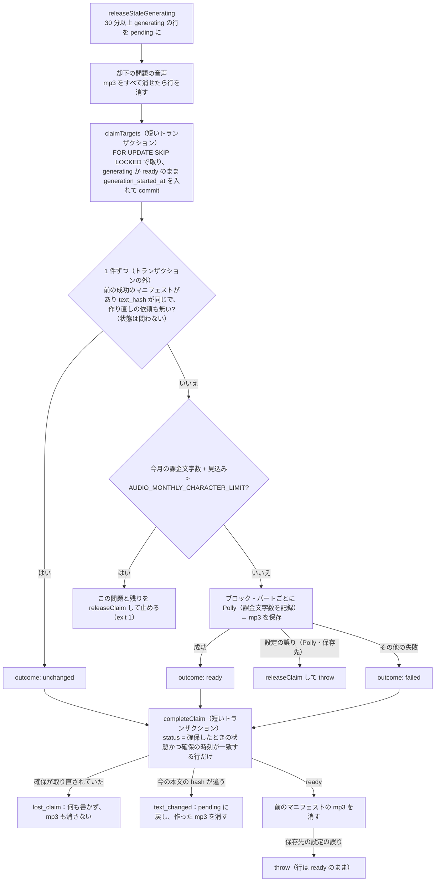

# step3-cron-generate-audio

公開済みの問題の読み上げの音声を作る `generate:audio` タスク（状態での確保・ready のままの作り直し・生成・保存・古い音声の削除・却下の問題の音声の削除・月の上限・失敗の扱い）と、音声の保存先 `audioStorage` を作る。動きは [README の音声の生成タスク](../README.md#音声の生成タスク)・[音声の保存と配信](../README.md#音声の保存と配信)・[却下した問題の音声](../README.md#却下した問題の音声)・[失敗時の扱い](../README.md#失敗時の扱い)・[費用](../README.md#費用)（月の上限）。

## 前提

- [step1-db-passage-audios](./step1-db-passage-audios.md)、[step2-cron-tts-client](./step2-cron-tts-client.md)
- [question-generation step5-api-admin-passage](../../question-generation/tasks/step5-api-admin-passage.md)（公開で `published_at` が今の時刻になる。公開し直しの検出に使う）
- [question-generation step3-cron-generate-questions](../../question-generation/tasks/step3-cron-generate-questions.md)（同じ「状態で確保する」方式。`claimCollected`・claim のガード・30 分の回収の書き方を合わせる）
- 実装の順番は reading-practice・learning-record の後（[step1 の前提](./step1-db-passage-audios.md#前提)）
- 本番のスケジュール・S3・IAM は [step8-infra-audio](./step8-infra-audio.md)。この step はローカル（`TTS_PROVIDER=fake`、`.storage/audio/`）で完結させる

## 対応内容

### 1. 対象と流れ

対象は `passages.status = 'published'` で、次のどれかに当たる問題（`published_at` の古い順）。`failed` は対象にしない（管理者の再試行・問題の再公開で `pending` に戻る）。`ready` は、別の実行が 30 分以内に確保した行（`generation_started_at >= now - 30 分`）を取らない。

| 条件 | 確保したときの状態（`claimedStatus`） | 意味 |
| --- | --- | --- |
| `passage_audios` の行が無い | `generating` | 初めての公開 |
| `status = 'pending'` | `generating` | 失敗して次の実行に回った・管理者が再試行した・問題を公開し直した（failed から戻った）・回収された・月の上限で確保を外した |
| `status = 'ready'` かつ `passage_audios.updated_at < passages.published_at` | `generating` | 音声を作った後に公開し直された（本文が変わったかもしれないので、前のマニフェストを返さない） |
| `status = 'ready'` かつ `passage_audios.voice_id <> 今の voice`（公開し直されていない・`attempt_count < 3`） | `ready` | voice を変えた（`text_hash` にも voice を含むので作り直しになる）。今の voice は `TTS_VOICE_ID`、`TTS_PROVIDER=fake` のときは `fake:<TTS_VOICE_ID>`（§5 の `buildAudioVoiceId`）なので、fake と Polly の切り替えでも作り直す |
| `status = 'ready'` かつ `regenerate_requested_at IS NOT NULL`（公開し直されていない・`attempt_count < 3`） | `ready` | admin が「作り直す」を押した（[step4](./step4-api-attempt-audio.md)。本文の hash が同じでも作り直す） |

`claimedStatus = 'ready'` の確保は、状態を `ready` のまま `generation_started_at` だけを入れる（作り直す間も api は前のマニフェストを返し続ける）。`updated_at` は進めない（api は `updated_at < published_at` で公開し直しを判定するため）。

`AUDIO_TEXT_VERSION` を上げただけでは `ready` の行は対象にならない（自動では作り直さない）。作り直すときは、デプロイの後に作り直しの依頼を入れる（`UPDATE passage_audios SET regenerate_requested_at = timezone('utc', now()), attempt_count = 0, last_error = NULL WHERE status = 'ready'`。日時の列は UTC なので `timezone('utc', ...)` にする。`updated_at` は変えない）。次の実行から `AUDIO_MAX_PASSAGES_PER_RUN` 件ずつ、前の音声を出しながら作り直す（月の上限を超えるなら、その月だけ `AUDIO_MONTHLY_CHARACTER_LIMIT` を上げる）。



- Polly の呼び出しと mp3 の保存はトランザクションの外で行う（本番〈minimal〉の DB は PgBouncer の transaction pooling。長いトランザクションを開かない）
- 冪等：同じ本文・同じ voice なら同じキーに上書きし、同じマニフェストになる（作り直しの依頼で hash が前と同じときだけは、キーのディレクトリに確保の時刻を足して別のキーにする。§4）

### 2. `@repo/storage` に足すもの

- `s3-storage.ts` の `CONTENT_TYPE_BY_EXT` に `mp3: "audio/mpeg"` を足す
- `StorageConfig` の `s3` に `cacheControl?: string` を足し、`S3Storage` のコンストラクタの 4 つめの引数（既定は今の `"public, max-age=86400"`）にして `PutObjectCommand` の `CacheControl` に使う。`README.md` の factory の例に一言足す

### 3. Repository（`apps/cron/src/repository/passage-audio-repository.ts`。api の Repository とは分ける）

```ts
/** generating：行が無い・pending・公開し直された ready。ready：voice が違う・作り直しの依頼がある ready（状態を ready のまま確保する） */
export type AudioClaimStatus = Extract<PassageAudio["status"], "generating" | "ready">
export type AudioClaim = { claimedStatus: AudioClaimStatus; generationStartedAt: Date; passageId: number }
export type ClaimedAudioTarget = AudioClaim & {
  blocks: PassageBlock[]
  /** regenerate_requested_at が null でない（本文の hash が同じでも作り直す） */
  isRegenerationRequested: boolean
  /** 確保する前の行（pending / ready）。確保で行を作ったときは null */
  previous: Pick<PassageAudio, "manifest" | "status" | "textHash"> | null
}
export type AudioClaimOutcome =
  | { billedCharacters: number; kind: "ready"; manifest: PassageAudioManifest; textHash: string; voiceId: string }
  | { kind: "unchanged"; textHash: string }
  | { error: string; kind: "failed"; maxAttempts: number }
/** failed：失敗が上限に達した（generating で確保した行は failed、ready のまま確保した行は ready のまま）。retry_later：上限未満 */
export type AudioClaimResult = "failed" | "lost_claim" | "ready" | "retry_later" | "text_changed" | "unchanged"
/** 本文から text_hash を求める関数。service が voice を閉じ込めて渡す（Repository は lib を知らない） */
export type CalculateTextHash = (blocks: PassageBlock[]) => string
export type RejectedPassageAudio = Pick<PassageAudio, "manifest" | "passageId">

export interface PassageAudioRepository {
  /** generating のまま startedBefore より前の行を pending に戻し、件数を返す（前回の実行が途中で落ちた場合の回収） */
  releaseStaleGenerating(startedBefore: Date): Promise<number>
  /** 対象（§1）を古い順に最大 limit 件取る。generating の行は作る・generating にする、ready のまま確保する行は generation_started_at だけを入れる */
  claimTargets(input: {
    calculateTextHash: CalculateTextHash; limit: number; maxAttempts: number; now: Date; staleBefore: Date; voiceId: string
  }): Promise<ClaimedAudioTarget[]>
  /** 確保した行に結果を書く。ready / unchanged のときは今の本文の hash を求め直し、outcome.textHash と違えば pending に戻す */
  completeClaim(claim: AudioClaim, outcome: AudioClaimOutcome, options: { calculateTextHash: CalculateTextHash; now: Date }): Promise<AudioClaimResult>
  /** 失敗回数を増やさずに確保を外す（設定の誤り・月の上限で止めるとき）。generating は pending に、ready のまま確保した行はトークンだけを外す */
  releaseClaim(claim: AudioClaim): Promise<void>
  /** 却下（rejected）の問題の音声の行（generation_started_at が staleBefore 以降の行は除く） */
  findRejected(staleBefore: Date): Promise<RejectedPassageAudio[]>
  /** 音声の行を消す（却下の問題の mp3 を消した後） */
  deleteByPassageId(passageId: number): Promise<void>
}

/** src/repository/audio-synthesis-usage-repository.ts（新規。audio_synthesis_usages は追記だけ） */
export interface AudioSynthesisUsageRepository {
  /** 1 回のリクエストで課金された文字数を 1 行書く */
  record(input: { characters: number; now: Date; passageId: number }): Promise<void>
  /** since 以降の文字数の合計。直前に書いた記録を数え落とさないよう primary（$primary）から読む */
  sumCharactersSinceFromPrimary(since: Date): Promise<number>
}
```

Drizzle 実装の要点：

- **`claimTargets`**（`this._db.transaction` の短いトランザクション）
  1. `passages` に `passage_audios` を left join し、§1 の条件、`orderBy(asc(passages.publishedAt), asc(passages.id))`、`limit`、`.for("update", { of: passages, skipLocked: true })`。left join の nullable 側はロックできないので `of` で `passages` だけにする。`passage_audios.updated_at`・`regenerate_requested_at` と `passages.published_at` も読む
  2. 取れた行を、`ready` で公開し直されていない（`published_at` が null か `updated_at >= published_at`）ものは `ready` のまま、それ以外は `generating` で確保すると決める
  3. `generating` の行を `insert(passageAudios).values([{ generationStartedAt: now, passageId, status: "generating", textHash: calculateTextHash(blocks), voiceId }])` し、`onConflictDoUpdate` で既存の行は `status = 'generating'`・`generation_started_at`・`updated_at` だけを更新する（`manifest` と `text_hash` は前の成功のまま）。conflict の更新に「`status = 'pending'`、または確保中でない（`generation_started_at` が null か `staleBefore` より前）`ready`」の条件（`setWhere`）を付け、`returning` で返った行だけを確保できたものとして返す。ロックするのは `passages` で、更新するのは `passage_audios` なので、同時に動いた別の実行がほんの少し前に確保した行を、古いスナップショットで取り直さないため
  4. `ready` のまま確保する行は ``update(passageAudios).set({ generationStartedAt: now, updatedAt: sql`${passageAudios.updatedAt}` })``（`updated_at` を明示しないと `$onUpdate` が今の時刻を入れる）を `status = 'ready'`・確保中でない・`voice_id <> voiceId OR regenerate_requested_at IS NOT NULL`・`attempt_count < maxAttempts` の条件で行い、`returning` で返った行だけを確保できたものとする
  5. RETURNING の順序は保証されないので `published_at`, `id` の順に並べ直す。`previous` と `isRegenerationRequested` は 1 の select の `passage_audios` の値
- **`completeClaim`**（短いトランザクション）
  1. `passage_audios` を `passage_id = ? AND status = claim.claimedStatus AND generation_started_at = claim.generationStartedAt` で `FOR UPDATE` で読む（`regenerate_requested_at` も）。無ければ `"lost_claim"`（30 分を過ぎて回収・再確保された。何も書かない）
  2. `ready` / `unchanged` のときは `passages.blocks` を読み、`calculateTextHash(blocks) !== outcome.textHash` なら `status = 'pending'`・`generation_started_at = null` にして `"text_changed"`（生成中に非公開 → 修正 → 再公開された。`attempt_count` は増やさない）
  3. 書き込み（`ready` / `unchanged` は `generation_started_at = null`、`updated_at = now` を明示する。`regenerate_requested_at` は、確保の時刻までに出された依頼〈`<= claim.generationStartedAt`〉なら null にし、確保の後に出された依頼なら残す〈次の実行でもう一度作り直す〉）
     - `ready`：`status = 'ready'`・`manifest`・`text_hash`・`voice_id`・`billed_characters`・`attempt_count = 0`・`last_error = null`・`generated_at = now`
     - `unchanged`：`status = 'ready'`・`attempt_count = 0`・`last_error = null`（`updated_at` が進むので、api は公開し直しの後でも `ready` を返すようになる。`pending` に戻された行〈失敗の後・再試行・手動の UPDATE〉からも来るので失敗の記録を消す。`manifest`・`text_hash`・`generated_at` は前の成功のまま。`manifest` と `generated_at` は `ready` の書き込みで一緒に入って消されないので、`ready` の CHECK 制約を満たす）
     - `failed`（`generating` で確保した行）：`attempt_count = attempt_count + 1`、`status = CASE WHEN attempt_count + 1 >= maxAttempts THEN 'failed' ELSE 'pending' END`、`last_error`、`generation_started_at = null`、`updated_at = now`。**`manifest` と `text_hash` は前の成功のまま残す**（前の mp3 のキーを後で消すため）。`returning` の `status` が `failed` なら `"failed"`、`pending` なら `"retry_later"`
     - `failed`（`ready` のまま確保した行）：`status` は変えずに `attempt_count = attempt_count + 1`・`last_error`・`generation_started_at = null`（`updated_at` は今の値のまま）。`returning` の `attempt_count` が `maxAttempts` 以上なら `"failed"`（以降は `claimTargets` が取らない）、未満なら `"retry_later"`
- **`releaseClaim`**：1 と同じガード付きで、`generating` は `status = 'pending'`・`generation_started_at = null`、`ready` は `generation_started_at = null` だけ（`updated_at` は今の値のまま）。**`releaseStaleGenerating`**：`status = 'pending'`・`generation_started_at = null`
- **`findRejected`**：`passage_audios` に `passages` を inner join し、`passages.status = 'rejected'` かつ確保中でない（`generation_started_at` が null か `staleBefore` より前）行の `passage_id`・`manifest` を `passage_id` の順に返す。**`deleteByPassageId`**：`passage_id` で行を消す
- `.for(...)` と `onConflictDoUpdate` の `setWhere` の書き方は実装時に Drizzle のドキュメントで確かめ、書けなければ `sql` で同じ SQL を書く（question-generation step3 と同じ）。不足する演算子は `@repo/db` の re-export に足す
- `AudioSynthesisUsageRepository` の Drizzle 実装は `insert(audioSynthesisUsages)`（`createdAt` と `updatedAt` に `now`）と ``this._db.$primary.select({ total: sql`COALESCE(SUM(characters), 0)` })``（`created_at >= since`。SUM は文字列で返るので数値にする）

### 4. Service（`apps/cron/src/service/audio/generate-audio.ts`、`service/index.ts` に `audio` として足す）

```ts
const STALE_CLAIM_MINUTES = 30
const MAX_AUDIO_ATTEMPTS = 3

export type GenerateAudioInput = {
  isShuttingDown: () => boolean; maxPassagesPerRun: number; monthlyCharacterLimit: number; now: () => Date; voiceId: string
}
export type GenerateAudioResult = {
  failedCount: number; isMonthlyLimitReached: boolean; lostClaimCount: number; purgedCount: number
  readyCount: number; retryLaterCount: number; textChangedCount: number; unchangedCount: number
}

export const generateAudio = async (
  input: GenerateAudioInput,
  repo: { audioSynthesisUsageRepository: AudioSynthesisUsageRepository; passageAudioRepository: PassageAudioRepository },
  deps: { audioStorage: Storage; ttsClient: TtsClient },
): Promise<GenerateAudioResult>
```

1. `calculateTextHash = (blocks) => calculateAudioTextHash({ blocks, voiceId })` を作る。`staleBefore = now - 30 分` で `releaseStaleGenerating(staleBefore)`
2. 却下の問題の音声を消す：`findRejected(staleBefore)` の行ごとに、`listUnusedAudioKeys(manifest, null)`（マニフェストのすべてのキー）を `audioStorage.delete` し、すべて消せたら `deleteByPassageId`（`purgedCount` を数える）。一時的な失敗（S3 の 5xx・throttling など）は `logger.warn` を出して行を残し、次の問題へ（次の実行でやり直す）。保存先の設定の誤り（`isFatalAudioGenerationError`）は throw（確保の前なので行は戻さなくてよい）
3. `claimTargets({ calculateTextHash, limit: maxPassagesPerRun, maxAttempts: MAX_AUDIO_ATTEMPTS, now, staleBefore, voiceId })`
4. 確保した問題を 1 件ずつ（各回の頭で `isShuttingDown()` なら break。残りは 30 分後に回収される。**1 件の失敗で他の件は止めない**）、方針を決める（`planPassageAudio`。非公開の関数）
   - `textHash = calculateTextHash(target.blocks)`。`target.previous` の `manifest` が null でなく、`textHash` が同じで、`isRegenerationRequested` でなければ（状態は問わない）`unchanged`。`manifest` がある行の `text_hash` はその `manifest` のもので、その mp3 は別の生成が成功して置き換わるまで消さないので、そのまま使える
   - それ以外は作る。見込みの課金文字数は `estimateBilledCharacters(target.blocks)`（`src/lib/audio/billed-characters.ts`。読み上げるブロックのパートの文字数〈UTF-16〉の合計 × 2）。作り直しの依頼で `textHash` が前と同じときは、保存キーの `revision` を確保の時刻のミリ秒にする（`buildAudioKey` が `passages/{id}/{textHash}-r{revision}/...` にする。同じキーに上書きすると CloudFront と端末のキャッシュ〈1 年・immutable〉に前の音声が残るため）
5. 作るときは、まず月の上限を確かめる：`sumCharactersSinceFromPrimary(getBillingMonthStart(input.now()))`（UTC の暦月の初め）+ 見込み > `monthlyCharacterLimit` なら、`logger.error` を出し、この問題と残りの確保をすべて `releaseClaim` して（失敗の回数は増やさない）`isMonthlyLimitReached = true` で終える。`unchanged` は Polly を呼ばないので上限を見ない
6. `generatePassageAudio`（非公開の関数）で outcome を作る
   - `listReadAloudBlocks` の順に、`buildSpeechText` → `splitSpeechText(speechText, POLLY_MAX_BILLED_CHARACTERS)` → パートごとに `ttsClient.synthesize({ recordBilledCharacters, text, voiceId })` → `measureMp3DurationMs` → `convertSpeechMarksToWordTimings` → `audioStorage.save(buildAudioKey(...), audio)`。課金文字数を足し上げる。パートは順番に呼ぶ。読み上げるブロックが無ければ `blocks: []` のマニフェスト
   - `recordBilledCharacters` は `audioSynthesisUsageRepository.record({ characters, now: input.now(), passageId })`（0 は記録しない。CHECK 制約 `> 0`）。Polly のリクエストごとに呼ばれるので、その問題が失敗に終わっても課金された分は記録が残る
   - 例外：設定の誤り（`isFatalAudioGenerationError`。下記）なら呼び出し側で `releaseClaim(target)` して throw（失敗回数を増やさない。他の確保済みの行は 30 分後に回収される）。それ以外（throttling・5xx・ローカルの保存先の失敗・記録の失敗など）は `{ error: "<name>: <message>", kind: "failed", maxAttempts }`
7. `completeClaim(target, outcome, { calculateTextHash, now: input.now() })` の結果で後始末する
   - `ready`：`listUnusedAudioKeys(target.previous?.manifest ?? null, outcome.manifest)` を `audioStorage.delete`
   - `text_changed`（outcome が `ready` のとき）：今回作った mp3 のうち前のマニフェストに無いもの（`listUnusedAudioKeys(outcome.manifest, target.previous?.manifest ?? null)`）を消す
   - `lost_claim`：`logger.warn` だけ。mp3 は消さない（取り直した実行が同じキーに書いているかもしれないため）
   - 削除の失敗は `logger.warn` だけ（残っても実害は無い）。ただし保存先の設定の誤り（`isFatalAudioGenerationError`）は `logger.error` を出して throw し、実行を止める（以降の問題でも同じく消せず、mp3 が残り続けるのに気づけないため。この行の結果は書き終えているので戻さない）
8. 1 件ごとに `logger.info`（`passageId`、確保したときの状態、結果、パート数、課金文字数）

`isFatalAudioGenerationError(error: unknown): error is Error`（`src/lib/audio/fatal-error.ts`）：音声の生成全体（音声合成・mp3 の保存・使わなくなった mp3 の削除）で、**どの問題でも同じように失敗する設定の誤り** なら true。`error.name` を 2 つの定数の配列と照らす。

| 対象 | `error.name` |
| --- | --- |
| 音声合成（Polly） | `CredentialsProviderError`（資格情報を解決できない）、`AccessDeniedException`、`UnrecognizedClientException` / `InvalidSignatureException` / `ExpiredTokenException` など（無効な資格情報）、`EngineNotSupportedException` / `LanguageNotSupportedException`、`ValidationException`（存在しない voice） |
| 保存先（S3 の `PutObject` / `DeleteObject`） | `AccessDenied`（権限が無い）、`NoSuchBucket`、`InvalidAccessKeyId` / `SignatureDoesNotMatch` / `ExpiredToken`（無効な資格情報）、`PermanentRedirect` / `AuthorizationHeaderMalformed`（bucket のリージョンが `AWS_REGION` と違う） |

throttling・5xx（Polly の `ServiceFailureException`、S3 の `InternalError` / `SlowDown`）・`TextLengthExceededException`・ローカルの保存先の失敗（ENOSPC など）は 1 件の失敗として扱う。保存は音声合成の後なので、保存先の誤りを 1 件の失敗にすると、毎回 `AUDIO_MAX_PASSAGES_PER_RUN` 件ずつ Polly の料金をかけて全件が `failed` に進んでしまう。

純関数を `src/lib/audio/audio-key.ts` に足す：`buildAudioKey({ blockIndex, partIndex, passageId, revision?, textHash })` → `passages/{passageId}/{textHash}/{blockIndex}-{partIndex}.mp3`（`revision` があれば `passages/{passageId}/{textHash}-r{revision}/...`）、`listUnusedAudioKeys(from: PassageAudioManifest | null, keep: PassageAudioManifest | null): string[]`（`from` にあって `keep` に無いキー）。`src/lib/audio/billed-characters.ts` に `estimateBilledCharacters(blocks)` と `getBillingMonthStart(now)`（UTC の暦月の初め。AWS の請求の月）。

### 5. Task・env・スクリプト

`src/const/audio.ts` に `AUDIO_CACHE_CONTROL = "public, max-age=31536000, immutable"` を足す。`src/env.ts` に足す（`CLAUDE.md` の環境変数の表にも）：

| 変数 | 既定 | 説明 |
| --- | --- | --- |
| `TTS_PROVIDER` | `production` は `polly`、それ以外は `fake`（手元の AWS の資格情報で意図せず課金しないため） | `polly` / `fake` |
| `TTS_VOICE_ID` | `Joanna` | Polly の voice（Neural に対応したもの）。変えると `voice_id` が違う `ready` の行が対象になり、次の実行から `AUDIO_MAX_PASSAGES_PER_RUN` 件ずつ作り直す。`passage_audios.voice_id` と `text_hash` には `buildAudioVoiceId` の値（`fake` のときは `fake:<TTS_VOICE_ID>`）が入る |
| `AWS_REGION` | `ap-northeast-1` | Polly と S3 のリージョン |
| `AUDIO_MAX_PASSAGES_PER_RUN` | `20` | 1 回の実行で確保する問題の上限 |
| `AUDIO_MONTHLY_CHARACTER_LIMIT` | `1800000` | 今月（UTC の暦月。Polly の請求の月）に Polly で課金してよい文字数（`audio_synthesis_usages` の合計）。既定は [README の費用](../README.md#費用) の「月 300 問を公開」（144 万文字・約 $23）に、失敗の再試行・作り直しの分として 25% の余裕を持たせ、Budgets の上限（$30。[step8](./step8-infra-audio.md)）の手前（約 $29）で止まる値。voice の変更などで公開済みの問題をまとめて作り直す月は一時的に上げる |
| `AUDIO_STORAGE_TYPE` | `local` | `local` / `s3`。`production` で `local` なら `generate:audio` は起動時に throw する（コンテナの一時領域に mp3 を書いて `ready` にしないため。cron の他のタスクを止めないよう env のスキーマでは検査しない） |
| `AUDIO_STORAGE_LOCAL_DIR` | `../../.storage/audio` | `local` の保存先（`apps/cron` からの相対。リポジトリ直下の `.storage/audio/` になり、api の `/media` 配信〈[step4](./step4-api-attempt-audio.md)〉と共有する） |
| `AUDIO_STORAGE_S3_BUCKET` | ― | `s3` のとき必須（`superRefine` で検査） |

`src/task/generate-audio.ts`（env の読み込みと DI だけ。`collect-passages.ts` と同じ形）：

- voice は `buildAudioVoiceId({ provider: env.TTS_PROVIDER, voiceId: env.TTS_VOICE_ID })`（`src/lib/audio/audio-voice-id.ts`）。`polly` は `TTS_VOICE_ID` のまま、`fake` は `fake:<TTS_VOICE_ID>`（例 `fake:Joanna`）。Polly と同じ値にすると、fake で `ready` にした問題を polly に切り替えても voice も hash も同じで作り直されず（`unchanged`）、保存キーも同じなので CloudFront の長期キャッシュに無音の mp3 が残るため。この値を service の `voiceId` に渡す（`passage_audios.voice_id`・`text_hash`・音声合成のすべてに使う。`FakeTtsClient` は voice を見ない）
- `TTS_PROVIDER=fake` なら `new FakeTtsClient()`。`polly` なら `new PollyClient({ region: env.AWS_REGION })` を作り、資格情報を解決できるか確かめる（`client.config.credentials()` を呼ぶ等。方法は実装時に確認）。解決できなければ、`production` では throw、それ以外は「AWS の資格情報が無いので音声を作らない」と `logger.warn` して何もせず終わる（exit 0）
- `audioStorage`：`s3` は `` createStorage({ bucket, cacheControl: AUDIO_CACHE_CONTROL, publicUrlBase: `s3://${bucket}`, region: env.AWS_REGION, type: "s3" }) ``、`local` は `createStorage({ baseDir: resolve(env.AUDIO_STORAGE_LOCAL_DIR), publicUrlPrefix: "/media", type: "local" })`。`save` の戻り値の URL は使わない（マニフェストにはキーだけを保存し、URL は api が組み立てる）
- `setupGracefulShutdown(db)` の `isShuttingDown`、`now: () => new Date()`、`monthlyCharacterLimit: env.AUDIO_MONTHLY_CHARACTER_LIMIT`、`DrizzlePassageAudioRepository(db)`・`DrizzleAudioSynthesisUsageRepository(db)` を渡す
- 結果をログに出し、**`isMonthlyLimitReached` か `failedCount + retryLaterCount > 0` なら throw して exit 1**（`text_changed`・`lost_claim` は失敗に数えない）。`finally` で `db.$disconnect()`
- `package.json` の dependencies に `@repo/storage`、scripts に `"generate:audio": "dotenvx run -f .env.local -- tsx src/task/generate-audio.ts"`。`CLAUDE.md` のタスクの表に追記
- リポジトリ直下の `.gitignore` に `.storage/` を足す

## 動作確認

```bash
pnpm --filter @repo/storage build
pnpm --filter cron test
pnpm --filter cron lint
```

`test/lib/audio/audio-key.test.ts`・`fatal-error.test.ts`・`audio-voice-id.test.ts`：

- [ ] `buildAudioKey` が `passages/42/<hash>/3-0.mp3`（`revision` があれば `passages/42/<hash>-r<revision>/3-0.mp3`）/ `listUnusedAudioKeys` は `from` が null なら空、hash が変われば `from` のキーをすべて返し、同じキーは返さない
- [ ] `estimateBilledCharacters`：読み上げ用テキスト（バッククォートを除く）の文字数 × 2、code は数えない、パートに分けたブロックは境目の空白を数えない / `getBillingMonthStart`：UTC の暦月の初め
- [ ] `isFatalAudioGenerationError`：上の表の `name` のエラーは true、throttling・5xx・`TextLengthExceededException`・ENOSPC・普通の `Error`・Error でない値は false
- [ ] `buildAudioVoiceId`：`polly` は `Joanna`、`fake` は `fake:Joanna`。fake と polly で `calculateAudioTextHash` が変わる

`test/service/audio/generate-audio.test.ts`（Repository は `vi.fn()`、`FakeTtsClient`、`audioStorage` は `vi.fn`）：

- [ ] `releaseStaleGenerating` が `now - 30 分` で、`claimTargets` より先に呼ばれる。`claimTargets` の `limit` が `maxPassagesPerRun`、`maxAttempts` が 3、`staleBefore` が `now - 30 分`
- [ ] 初めての問題：code のブロックを飛ばして読み上げるブロックごとに `save` され、`completeClaim` にマニフェスト（`blockIndex`・キー・`durationMs`・`text.slice` が単語になる位置）付きの `ready` が渡る
- [ ] 3,001 文字以上のブロックは 2 パートになり、キーが `-0` / `-1`
- [ ] `previous` にマニフェストがあり hash が同じ → `ready`・`pending` のどちらでも `unchanged`、`synthesize` も `save` も呼ばない。voice が違えば・マニフェストが無ければ作り直す
- [ ] `completeClaim` が `ready` → 前のキーが `delete` される（`delete` が throw しても続く）/ `text_changed` → 今回作ったキーが消される / `lost_claim` → 何も消さない
- [ ] `synthesize` が普通のエラー → `failed` の outcome（`maxAttempts: 3`、`error` に name と message）、次の問題の処理は続く
- [ ] `save` の一時的な失敗（S3 の 5xx・ローカルの容量不足）→ `failed` の outcome、次の問題の処理は続く
- [ ] 設定の誤り（音声合成の `CredentialsProviderError`、保存の `AccessDenied` / `NoSuchBucket` / `InvalidAccessKeyId` / `SignatureDoesNotMatch` / `ExpiredToken`）→ `releaseClaim` が呼ばれ、`completeClaim` は呼ばれず、generateAudio が throw する（2 件目の音声合成は呼ばない）
- [ ] 前の mp3 の `delete` が `AccessDenied` → generateAudio が throw し、2 件目は処理しない（`releaseClaim` は呼ばない）
- [ ] voice が違う（別の Polly の voice・`fake:Joanna` で作った）`ready` の行は作り直す
- [ ] `isShuttingDown` が true になったら残りを処理しない
- [ ] 作り直しの依頼があれば hash が同じでも作り直し、保存キーが `<hash>-r<確保の時刻のミリ秒>` で、前の（同じ hash の）キーが消される。hash が違えばふつうのキー
- [ ] `ready` のまま確保した行（`claimedStatus: "ready"`）も作り直し、`completeClaim`・設定の誤りの `releaseClaim` にその確保が渡る
- [ ] 課金文字数を Polly のリクエストごとに `record` する（0 は記録しない）
- [ ] 月の上限：`sumCharactersSinceFromPrimary` が UTC の月初めで呼ばれ、合計 + 見込みが上限ちょうどまでなら作る。超えるなら音声合成を呼ばずにその問題と残りを `releaseClaim` し、`isMonthlyLimitReached: true`（失敗に数えない）。途中の問題で超えたら、それまでの結果は書いたまま。`unchanged` は上限を見ない
- [ ] 却下の問題：確保より前に、`findRejected(now - 30 分)` の mp3 をすべて消してから `deleteByPassageId`（マニフェストが無い行は行だけ）。一時的に消せなかったら行を残して次へ。保存先の設定の誤りなら throw して確保もしない

`test/repository/drizzle/passage-audio-repository.test.ts`（既存と同じく偽の DB で、条件と更新値を確かめる）：

- [ ] `claimTargets`：取得の条件（published・行が無い / pending / 確保中でない ready のうち、公開し直された・`voice_id` が今の voice と違う・作り直しの依頼があり失敗が上限未満、failed と generating は対象外）、`SKIP LOCKED`、conflict の更新の条件（pending か確保中でない ready）、公開し直されていない ready は `update` で `generation_started_at` だけを入れて `updated_at` を今の値のままにする、返す確保の `claimedStatus`・`isRegenerationRequested`
- [ ] `completeClaim`：ガード（`status = <claimedStatus> AND generation_started_at = ?`）に当たらなければ `lost_claim` / hash が違えば `text_changed` で `pending` / `failed` が `manifest` と `text_hash` を更新しない、3 回目で `failed` / `ready` のまま確保した行の失敗は状態と `updated_at` を変えずに回数だけ増やす / 確保の時刻までの作り直しの依頼は消し、後の依頼は残す
- [ ] `releaseClaim`（ready のまま確保した行）・`findRejected`・`deleteByPassageId`、`AudioSynthesisUsageRepository`（`record`・primary から読む `sumCharactersSinceFromPrimary`）

手動確認（ローカル DB。`published` の問題を用意する。admin で公開するか、`UPDATE passages SET status = 'published', published_at = now() WHERE id = <id>`）：

```bash
TTS_PROVIDER=fake pnpm --filter cron generate:audio
psql "$DATABASE_URL" -c "SELECT passage_id, status, generation_started_at, text_hash, attempt_count, jsonb_array_length(manifest->'blocks') FROM passage_audios"
ls -R .storage/audio/passages
```

- [ ] `ready`（`generation_started_at` は NULL）の行ができ、`.storage/audio/passages/<id>/<hash>/` にブロックごとの mp3 がある。mp3 をブラウザで開くと（無音で）再生でき、長さがマニフェストの `durationMs` と合う
- [ ] もう一度実行しても何も処理されない。`UPDATE passages SET published_at = now()` の後に実行すると `unchanged` で `updated_at` だけ進み、ファイルは変わらない
- [ ] 段落の英文を書き換えて `published_at = now()` にして実行 → 新しい hash のディレクトリができ、前の hash の mp3 が消える（空のディレクトリは残る）
- [ ] `UPDATE passage_audios SET status = 'generating', generation_started_at = now() - interval '31 minutes'` の後に実行すると、回収されて処理される。`interval '5 minutes'` なら手を付けない
- [ ] 2 つのターミナルで同時に実行しても、同じ問題が二重に処理されない
- [ ] `TTS_PROVIDER=polly` で AWS の資格情報が無いと、warn を出して exit 0。資格情報がある環境なら 1 件だけ作り、mp3 を聞いて単語の時刻がずれていないか確かめる
- [ ] `TTS_PROVIDER=fake` で作った行の `voice_id` が `fake:Joanna`。資格情報がある環境で `TTS_PROVIDER=polly` にして実行すると、その行が `ready` のまま確保されて（作っている間も `status = 'ready'`・`updated_at` が変わらない）新しい hash のディレクトリに作り直され（`voice_id` が `Joanna`）、無音の mp3 が消える。Polly のリクエストごとに `audio_synthesis_usages` に行ができる
- [ ] `TTS_VOICE_ID=Matthew TTS_PROVIDER=fake` で実行すると、`ready` の行が `ready` のまま作り直される。`UPDATE passage_audios SET attempt_count = 3 WHERE ...` の行は確保されない
- [ ] `UPDATE passage_audios SET regenerate_requested_at = timezone('utc', now()) WHERE passage_id = <id>` の後に実行すると、本文が同じでも `<hash>-r<ミリ秒>` のディレクトリに作り直され、`regenerate_requested_at` が NULL に戻り、前の mp3 が消える
- [ ] `AUDIO_MONTHLY_CHARACTER_LIMIT=1` で、作り直す問題がある状態で実行すると、error のログを出して exit 1。確保した行は `pending`（ready のまま確保した行は `generation_started_at` が NULL）に戻り、`attempt_count` は増えない
- [ ] 音声のある問題を非公開に戻して却下（admin）してから実行すると、`.storage/audio/passages/<id>/` の mp3 と `passage_audios` の行が消える（非公開に戻しただけでは消えない）
