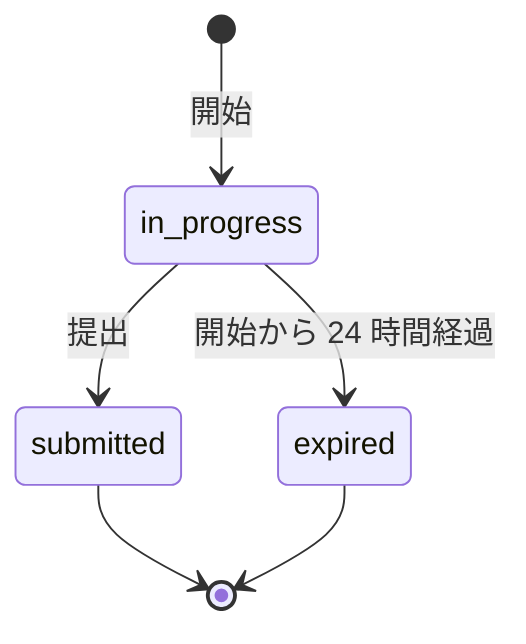
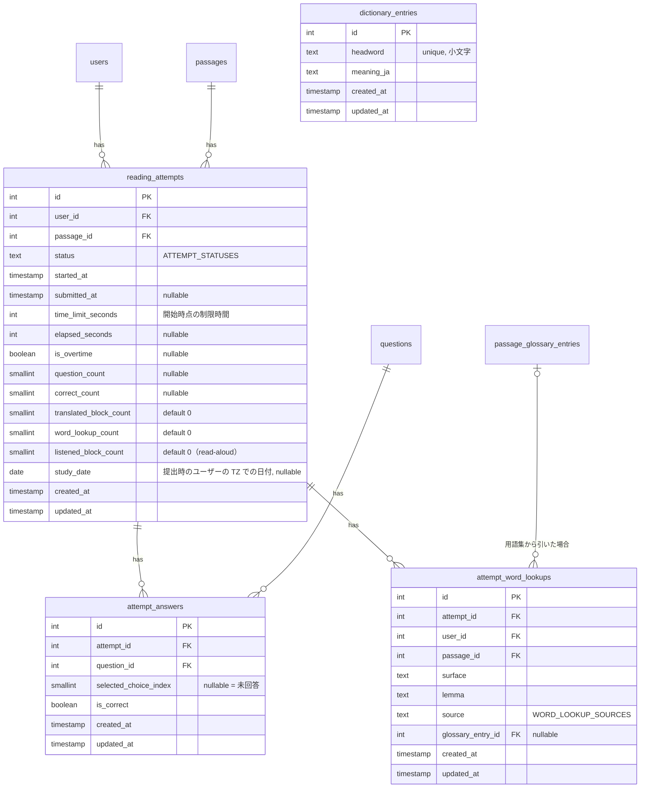
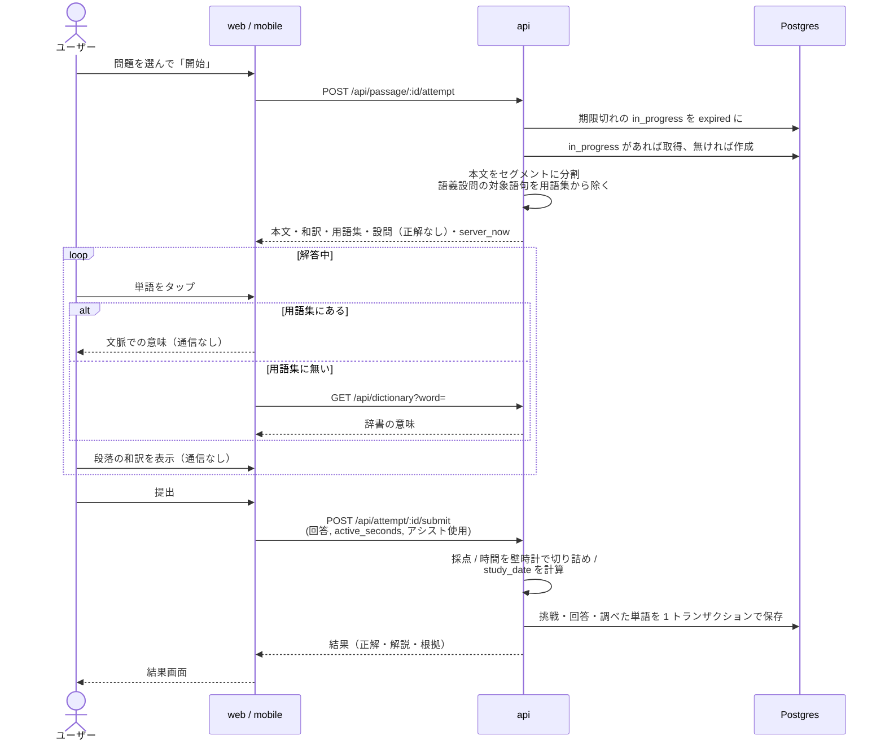

# 長文読解（問題を解く・採点・解説・アシスト）

公開された問題をユーザーが選び、制限時間を意識しながら英文を読んで 4 択の設問に答え、提出すると採点と解説を受けられる。解答中は **アシスト**（段落の和訳、単語の意味）を使える。このサービスの中心になる機能で、web と mobile の両方に提供する。

「問題を解く画面」は利用時間の大半を過ごす画面なので、**長い英文を疲れずに読めること** を最優先にする。対象はエンジニアなので、エディタや GitHub のようなダークテーマで、コードがコードとして読める見た目にする。

このドキュメントは **仕様（What）** と **設計（How）** を分けて記述する：

- **仕様**：問題の選び方、挑戦の流れ、タイマー、提出と採点、結果と解説、アシスト、解答画面の要件
- **設計**：時間の計測方法、正解を渡さない API 設計、アシストの実現方式（技術調査の結果）、英和辞書、web / mobile の実装構成

## 関連 spec

- [`../product-overview/README.md`](../product-overview/README.md) — プロダクト全体像
- [`../question-generation/README.md`](../question-generation/README.md) — 問題データ（`passages` / `questions` / `passage_glossary_entries`、`PassageBlock`、制限時間の計算式）の正本
- [`../content-collection/README.md`](../content-collection/README.md#出典表示) — 出典表示に出す内容の正本
- [`../learning-record/README.md`](../learning-record/README.md) — 提出済みの挑戦（`reading_attempts`）を集計してカレンダーと統計を出す
- [`../github-auth/README.md`](../github-auth/README.md) — すべての画面でログインが必要
- [`../read-aloud/README.md`](../read-aloud/README.md) — 解答画面と結果画面の読み上げ（3 つめのアシスト）。`reading_attempts.listened_block_count` の意味の正本
- [`./deferred-assist-and-modes.md`](./deferred-assist-and-modes.md) — MVP 対象外。任意の文の翻訳、範囲選択の翻訳、厳格モード、ライトテーマ
- **この spec が正本のもの**：`reading_attempts` / `attempt_answers` / `attempt_word_lookups` / `dictionary_entries`、`ATTEMPT_STATUSES` / `WORD_LOOKUP_SOURCES`

## 目次

- [仕様](#仕様)
  - [問題の選び方](#問題の選び方)
  - [挑戦の流れ](#挑戦の流れ)
  - [タイマー](#タイマー)
  - [回答と提出](#回答と提出)
  - [結果と解説](#結果と解説)
  - [アシスト](#アシスト)
  - [解答画面の要件](#解答画面の要件)
- [設計](#設計)
  - [挑戦の状態](#挑戦の状態)
  - [時間の計測](#時間の計測)
  - [正解を提出前に渡さない](#正解を提出前に渡さない)
  - [本文のトークン化](#本文のトークン化)
  - [アシストの実現方式（技術調査の結果）](#アシストの実現方式技術調査の結果)
  - [英和辞書](#英和辞書)
  - [web の実装構成](#web-の実装構成)
  - [mobile の実装構成](#mobile-の実装構成)
  - [MVP 対象外（将来検討）](#mvp-対象外将来検討)
- [必要な画面](#必要な画面)
- [UI 設計](#ui-設計)
  - [問題一覧](#問題一覧)
  - [開始確認](#開始確認)
  - [問題を解く](#問題を解く)
  - [結果・解説](#結果解説)
  - [mobile の画面](#mobile-の画面)
- [必要な API](#必要な-api)
- [必要な DB 設計](#必要な-db-設計)
- [フロー図](#フロー図)
- [実装ステップ](#実装ステップ)

---

## 仕様

### 問題の選び方

**問題一覧** に公開中の問題を新しい順に並べる。

各問題に表示する情報：タイトル、ソース名と種別（GitHub / Docs）、難易度、英単語数、制限時間、自分の挑戦状況（未挑戦 / 最高正答数 `3/4`）。

絞り込み：

| 条件 | 選択肢 |
| --- | --- |
| 種別 | すべて / GitHub / Docs |
| 技術タグ | ソースに付いたタグ（react / kubernetes / rust など） |
| 難易度 | Easy / Normal / Hard |
| 挑戦状況 | すべて / 未挑戦のみ |

「**ランダムに 1 問**」ボタンで、絞り込み条件に合う未挑戦の問題から 1 つを選んで開始確認に進む（全問挑戦済みなら挑戦済みから選ぶ）。

### 挑戦の流れ

1. 問題を選ぶと **開始確認** を出す（タイトル・ソース・難易度・英単語数・制限時間・設問数）。本文はまだ見せない
2. 「開始」でタイマーが動き、本文と設問が表示される
3. 設問に答えて「提出」する
4. 採点結果と解説が表示される

- **同じ問題に何度でも挑戦できる。** 毎回別の挑戦として記録される
- **途中でやめた挑戦は 24 時間以内なら再開できる。** 同じ問題を開くと、新しく始めずに続きから再開する（選んだ回答とタイマーの経過も戻る。ただし同じ端末の場合のみ。[設計](#時間の計測)）
- 24 時間を過ぎた挑戦は「期限切れ」になり、学習記録に数えない

### タイマー

- 画面上部に **残り時間** をカウントダウンで表示する
- 残り 20% を切ると警告の色に変わる
- **0 になっても解答は続けられる。** 表示は「超過時間」のカウントアップ（`+1:23`）に切り替わり、結果に「時間超過」と記録される（強制終了はしない。学習目的では、読み切って解く経験と実際にかかった時間の記録の方が価値があるため）
- **画面を見ていない間はタイマーが止まる。** アプリをバックグラウンドにした、ブラウザのタブを切り替えた、画面をロックした場合は止まり、戻ると再開する
- **一時停止ボタン** がある。一時停止中は本文と設問を隠す（止めた状態で読み進められないようにするため）

### 回答と提出

- 設問ごとに 4 つの選択肢から 1 つを選ぶ。提出前なら何度でも変えられる
- 未回答の設問があっても提出できる（確認ダイアログを出す）。未回答は不正解として採点する
- 提出したら回答は変えられない

### 結果と解説

結果画面に表示するもの：

| 項目 | 内容 |
| --- | --- |
| スコア | 正答数 / 設問数（例：`3 / 4`） |
| 時間 | かかった時間 / 制限時間。超過していれば超過時間 |
| 読む速さ | 英単語数 ÷ かかった時間（WPM。設問を解く時間を含む） |
| アシストの使用 | 和訳を見た段落数、単語を調べた回数 |
| 設問ごとの結果 | 自分の回答、正解、正誤、**解説（日本語）**、「本文の根拠を見る」 |
| 調べた単語 | この挑戦で調べた単語と意味の一覧（復習用） |
| 出典表示 | [content-collection の出典表示](../content-collection/README.md#出典表示) |

- 「本文の根拠を見る」を押すと、本文の該当箇所（設問の根拠）をハイライトしてスクロールする
- 結果画面では本文・和訳・用語集を自由に見られる（解答中に用語集から外していた語句も含む。[アシスト](#アシスト)）
- 操作：「もう一度解く」「次の問題（ランダム）」「マイページへ」
- 過去の挑戦の結果は学習履歴（[learning-record](../learning-record/README.md)）から開ける

### アシスト

解答中に使える補助は 3 種類。**アシストを使っても点数は変わらない** が、使用状況を記録して結果画面とマイページに出す（「アシストなしで正解できた」ことが分かるように）。

**① 段落の和訳**

| 操作 | web | mobile |
| --- | --- | --- |
| 段落ごとの「訳」ボタン | ✅ 押すと英文と和訳が切り替わる | ✅ 同左 |
| 段落の長押し | ― | ✅ **押している間だけ** 和訳になり、離すと英文に戻る |
| 全文の和訳切り替え | ✅ ヘッダーのボタン / `T` キー | ✅ ヘッダーのボタン |

- コードブロックは訳さない
- 和訳を一度でも見た段落の数を記録する

**② 単語の意味**

- 本文の単語を **タップ（クリック）** すると、その単語の意味を小さなカードで表示する
- 用語集にある語句（熟語を含む）は、**この文脈での意味** と補足を出す。熟語は構成するどの単語をタップしても熟語ごと出る（例：`opt` をタップすると `opt out of` の意味）
- 用語集に無い単語は **英和辞書の意味** を出す（文脈は考慮しない一般的な意味）。辞書にも無い単語は「見つかりませんでした」と出す
- インラインコードとコードブロックはタップしても何も出ない
- 調べた単語は記録し、結果画面の「調べた単語」に出す
- **「文脈での語義」を問う設問の対象語句は、解答中は用語集から外す**（タップすると辞書の一般的な意味だけが出る）。用語集の文脈の意味がそのまま設問の答えになってしまうため。結果画面では用語集の意味も見られる

**③ 読み上げ**

- 本文を音声で読み上げ、読んでいる単語をハイライトする（全文・段落ごと、再生速度の変更）。読み上げを聞いた段落の数を記録する
- 仕様の詳細は [read-aloud](../read-aloud/README.md)

### 解答画面の要件

ここではデザインの前提になる要件だけを決める。確定したデザインは [UI 設計](#ui-設計) を参照。

**見た目の方向性**

- **ダークテーマのみ**（MVP）。GitHub Dark / VS Code のようなエディタ系の配色。真っ黒な背景に真っ白な文字は長文だと目が疲れる（ハレーション）ため、背景は暗いグレー、文字はやや明度を落とした白にする
- 英文は読みやすいプロポーショナルフォント、コードは等幅フォント（シンタックスハイライトつき）
- 長文向けの組版：本文は 1 行あたり 60〜75 文字程度の幅、行間は広め（1.7〜1.8 倍）
- 文字サイズを 3 段階で変えられる（設定は端末に保存）
- 余計な装飾を置かず、本文に集中できる画面にする

**レイアウト**

| | web（PC 幅） | web（スマホ幅）/ mobile |
| --- | --- | --- |
| 本文と設問 | 左に本文、右に設問の 2 カラム。それぞれ独立してスクロール | 本文を全画面で表示し、設問は下から引き出すシートで表示 |
| 常に見えるもの | タイトル、残り時間、回答済み数（`2/4`）、一時停止、全文和訳の切り替え、提出 | 同左（ヘッダーに集約） |

**キーボード操作（web）**

| キー | 動作 |
| --- | --- |
| `1`〜`4` | 選択中の設問で選択肢 A〜D を選ぶ |
| `J` / `K` | 次 / 前の設問へ |
| `T` | 全文の和訳を切り替え |
| `Esc` | 単語のカードを閉じる |
| `Ctrl` / `⌘` + `Enter` | 提出（確認ダイアログを出す） |
| `?` | ショートカットの一覧を出す |

---

## 設計

### 挑戦の状態



- 1 ユーザー × 1 問題につき `in_progress` は最大 1 つ（部分 unique index）。開始 API は既存の `in_progress` があればそれを返す（二重に作らない）
- `expired` への更新はバッチを持たず **読み出し時に行う**（挑戦の開始・取得・提出の API の前に、そのユーザーの 24 時間を過ぎた `in_progress` を `expired` に更新する）。問題一覧などの読み取りは更新せず、`started_at` が 24 時間以内かで期限内を判定する。学習記録は提出済みだけを数えるので影響しない。cron を増やさないため

### 時間の計測

**かかった時間は「画面を見ていた時間」をクライアントで計測し、提出時にサーバーへ送る。** サーバーは壁時計の経過時間で上限をかける。

サーバーの壁時計（提出時刻 − 開始時刻）だけで測る案は採らなかった。mobile では電車の乗り換えなどで中断が頻繁に起き、そのまま測ると学習時間と「時間超過」の記録が実態とかけ離れるため。

| 項目 | 内容 |
| --- | --- |
| 計測 | クライアントが「画面が表示中かつ一時停止していない」間だけ 1 秒ごとに加算する。web は `visibilitychange`、mobile は `AppState` で表示状態を判定 |
| 送信 | 提出時に `active_seconds` として送る |
| サーバーの検証 | `0 ≤ active_seconds ≤ 提出時刻 − started_at` に切り詰めて `elapsed_seconds` に保存する |
| 時間超過 | `elapsed_seconds > time_limit_seconds` |
| 学習時間 | `elapsed_seconds` をそのまま学習記録の学習時間に使う |
| 再開 | 経過秒数と選んだ回答を端末に保存する（web は `localStorage`、mobile は `AsyncStorage`。キーは挑戦 ID）。**別の端末で再開すると経過秒数と回答は 0 からになる**（壁時計の上限は効いたまま） |

クライアントの申告値を使うため改ざんは防げないが、本サービスはランキングなどの競争要素を持たない自己学習なので許容する。競争要素を入れるときの扱いは [deferred](./deferred-assist-and-modes.md#厳格モード) にまとめる。

開始 API のレスポンスに `server_now` を含め、クライアントは端末時計とのずれを補正して「開始から 24 時間」の判定に使う。

### 正解を提出前に渡さない

| API | 本文・和訳・用語集 | 設問・選択肢 | 正解・解説・根拠 |
| --- | --- | --- | --- |
| 挑戦の開始 / 解答中の取得 | ✅ | ✅ | ❌ |
| 提出 / 提出済みの取得 | ✅ | ✅ | ✅ |

- 和訳と用語集は **開始時にまとめて渡す**。アシストを押してから取りに行くと、mobile の回線では待ち時間が出るため
- 「文脈での語義」設問の対象語句は、解答中のレスポンスの用語集から除く（[アシスト](#アシスト)）
- 採点は **提出時点の設問** で行い、正誤を `attempt_answers.is_correct` に保存する。後から管理者が正解を直しても、過去の点数は変わらない
- 提出 API は冪等：`submitted` の挑戦に再度提出されたら、保存済みの結果をそのまま返す（通信の再送で二重に記録しない）

### 本文のトークン化

単語のタップと用語集のハイライトのために、本文を **セグメント**（単語・空白・記号・インラインコード）に分けた形で返す。分割は **api で行う**。

- web と mobile の両方が同じ分割を必要とするが、フロントは `@repo/api-schema` 以外の `@repo/*` を import できない（lint の境界）。分割ロジックを両方に複製すると挙動がずれるため、api で 1 回だけ行ってレスポンスに含める
- 用語集の語句（熟語）は、構成する複数の単語を 1 つのセグメントにまとめ、`glossary_entry_id` を持たせる

```ts
type PassageSegment = {
  /** "word" | "space" | "punct" | "code" */
  kind: PassageSegmentKind
  text: string
  /** 用語集の語句のときだけ。解答中は語義設問の対象語句を除く */
  glossaryEntryId?: number
}
```

600 語の本文でセグメントは 1,500 程度、JSON で 50KB 前後。開始時に 1 回だけ取得するので問題にならない。

### アシストの実現方式（技術調査の結果）

要望は「長押しもしくはボタンタップで、日本文に切り替わる or 選択した単語の翻訳が出る」。web（PC）/ スマホのブラウザ / mobile アプリそれぞれで実現できる範囲を調べた結果、**MVP は「段落の和訳（ボタン + アプリでは長押し）」と「単語のタップ」の組み合わせにする**。

| 方式 | web（PC） | スマホのブラウザ | mobile アプリ | MVP |
| --- | --- | --- | --- | --- |
| 段落の和訳をボタンで切り替え | ✅ | ✅ | ✅ | ✅ |
| 段落を長押しして和訳を表示 | △ マウスの長押しは操作として不自然 | △ ブラウザ標準の長押し（文字選択・コピーのメニュー）と衝突する。`user-select: none` / `-webkit-touch-callout: none` で消せるが本文をコピーできなくなる | ✅ `Pressable` の `onLongPress` / `onPressOut` で自然に作れる | ✅ アプリのみ |
| 単語をタップして意味を表示 | ✅ | ✅ | ✅ 単語ごとに入れ子の `<Text onPress>` にする | ✅ |
| 範囲選択した語句の意味を表示 | ✅ `selectionchange` で取れる | △ 選択の UI と競合しやすい | ❌ RN の `<Text selectable>` は選択範囲を取得する手段が無い | ❌（熟語は用語集でタップ 1 回で出せる） |
| 任意の文をその場で翻訳 | ✅ LLM / 翻訳 API を呼べば可能 | ✅ | ✅ | ❌ 1 回 1〜3 秒の待ちと従量課金が発生する（[deferred](./deferred-assist-and-modes.md#任意の文の翻訳)） |

**意味の出どころ**：

| | 用語集（事前生成） | 英和辞書 | LLM にその場で聞く |
| --- | --- | --- | --- |
| 文脈に合った意味 | ✅ | ❌ 全義を並べるだけ | ✅ |
| 待ち時間 | なし（開始時に取得済み） | 100〜300ms（api 経由で DB を引く） | 1〜3 秒 |
| 費用 | 生成時のみ | なし | 1 回ごと |
| 網羅性 | 選ばれた 8〜20 語句だけ | 約 4.6 万語 | 全単語 |

→ **用語集を優先し、無ければ英和辞書**。LLM にその場で聞く方式は MVP では使わない。

**長押しとタップの割り当て**（mobile アプリ）：単語のタップと段落の長押しは同じ領域で起きる。単語の `<Text>` に `onPress`、段落を包む `Pressable` に `onLongPress` を付け、長押しが成立したら単語のタップを発火させない（RN の Responder は長押し成立で `onPress` を呼ばないため自然に排他になる）。実装の最初に実機で確認する。

**mobile の描画性能**：600 語を入れ子の `<Text>` にすると要素数が 1,500 程度になる。ブロック単位で `FlatList` に載せて画面外を描画しない、セグメントの要素を `memo` 化する、の 2 点で対応する。実装の最初に下位機種（Android の中級機）で 60fps を保てるか確認する。

### 英和辞書

用語集に無い単語の意味を引くための辞書を DB に持つ。

| 項目 | 内容 |
| --- | --- |
| データ | **EJDict-hand**（パブリックドメインの英和辞書、約 4.6 万語） |
| 格納 | `dictionary_entries`（見出し語 → 意味）。seed スクリプトで投入する（取得元のコミットを固定してダウンロード） |
| 引き方 | タップした単語を小文字化し、`見出し語そのまま` → `不規則変化の表` → `語尾の規則（-s / -es / -ies / -ed / -ing / -er / -est）を外した候補` の順に引き、最初に見つかったものを返す。ハイフンつきの語は全体 → 各部分の順 |
| 置き場所 | 引き方のロジックは api の `lib/` の純関数（DB を知らない） |
| キャッシュ | クライアントは同じ挑戦の間、引いた結果をメモリに持つ |

外部の翻訳 API（DeepL / Google 翻訳）を使わないのは、単語単位の訳は辞書の方が品質が高く、費用と外部依存も増えないため。

### web の実装構成

既存の API 通信ルール（[apps/web/CLAUDE.md](../../../apps/web/CLAUDE.md)）に従う。

| 処理 | 実装 |
| --- | --- |
| 問題一覧 | Server Component で取得。絞り込みは URL のクエリにして Server Component で再取得 |
| 挑戦の開始 | 開始確認の「開始」は Server Action（`POST /api/passage/:id/attempt`）→ 解答画面へ redirect |
| 解答画面 | Server Component で挑戦を取得して Client Component に props で渡す。タイマー・回答・アシストは Client Component の state |
| 辞書の検索 | Client Component から Route Handler（`/api/dictionary`）→ api |
| 提出 | Server Action（`POST /api/attempt/:id/submit`）→ 結果画面へ redirect |

### mobile の実装構成

| 処理 | 実装 |
| --- | --- |
| 画面 | expo-router。タブ（マイページ / 問題 / 設定）+ スタック（開始確認 / 解答 / 結果） |
| API 呼び出し | app から直接 api を Bearer で呼ぶ（[github-auth](../github-auth/README.md#トークンの保管)） |
| 本文 | ブロックごとに `FlatList` の 1 行。セグメントを入れ子の `<Text>` で描画 |
| 設問 | 下から引き出すシート（`@gorhom/bottom-sheet` 等。実装時に選定） |
| 長押しの和訳 | ブロックを `Pressable` で包み、`onLongPress` で和訳表示、`onPressOut` で戻す |
| 時間の計測 | `AppState` が `active` の間だけ加算 |

### MVP 対象外（将来検討）

詳細は [`deferred-assist-and-modes.md`](./deferred-assist-and-modes.md)。

- **任意の文・範囲選択した語句の翻訳**（LLM をその場で呼ぶ）
- **厳格モード**（時間切れで強制提出、アシスト禁止）。ランキングなど競争要素を入れるとき
- **ライトテーマ**
- **復習モード**（間違えた設問だけ解き直す、調べた単語の単語帳）→ 単語帳は [deferred-grammar-vocabulary](../product-overview/deferred-grammar-vocabulary.md) と合わせて検討

---

## 必要な画面

| 画面 | web | mobile | 概要 |
| --- | --- | --- | --- |
| 問題一覧 | `/passages` | 問題タブ | 公開中の問題の一覧と絞り込み、ランダムに 1 問 |
| 開始確認 | `/passages/[id]` | スタック（モーダル） | タイトル・ソース・難易度・英単語数・制限時間・設問数と「開始」。挑戦中なら「再開」 |
| 問題を解く | `/attempts/[id]` | スタック | 本文・設問・タイマー・アシスト。**最初にモックを作る画面** |
| 結果・解説 | `/attempts/[id]/result` | スタック | スコア・時間・アシストの使用・設問ごとの解説・根拠のハイライト・調べた単語・出典 |

具体的な UI は [UI 設計](#ui-設計) を参照。

## UI 設計

`design-mock` skill で確定したデザイン。配色・書体・共通の部品は [product-overview の UI 設計](../product-overview/README.md#ui-設計) を正本とし、ここには画面ごとの構成と動きを書く。

| パス（web） | 画面名 | 認証 | モック |
| --- | --- | --- | --- |
| `/passages` | 問題一覧 | 必要 | `/mock/passages` |
| `/passages/[id]` | 開始確認 | 必要 | `/mock/passages/57` |
| `/attempts/[id]` | 問題を解く | 必要 | `/mock/attempts/42` |
| `/attempts/[id]/result` | 結果・解説 | 必要 | `/mock/attempts/42/result` |

mobile（Expo）も同じ構成・配色にする。mobile だけの違い（段落の長押しで和訳を一時表示する）は [アシスト](#アシスト) のとおり。

### 問題一覧

```
┌────────────────────────────────────────────────────────────────────────────┐
│ 問題                                                 [ランダムに 1 問解く] │ ← 主要ボタン
│ GitHub と公式ドキュメントの英文から作った長文読解の問題です。              │
│                                                                            │
│ [すべて|GitHub|Docs]  (Easy)(Normal)(Hard)                   ○━ 未挑戦のみ │ ← 種別・難易度・トグル
│ (backend)(frontend)(gcp)(go)(infra)(kubernetes)(python)(react)(rust)       │ ← 技術タグ（横スクロール）
├────────────────────────────────────────────────────────────────────────────┤
│ 8 問                                                                       │ ← 絞り込み後の件数
│ Synchronizing with Effects              ▂▄▆ Normal  332 語  5:30  ■■■□ 3/4 │ ← 最高正答数
│ [Docs] React 公式ドキュメント  #react #frontend                            │
├────────────────────────────────────────────────────────────────────────────┤
│ What Is Ownership?                     ▂▄▆ Normal  418 語  7:00   [挑戦中] │ ← 途中でやめた挑戦がある
│ [Docs] The Rust Programming Language  #rust                                │
├────────────────────────────────────────────────────────────────────────────┤
│ RFC: Async closures                    ▂▄▆ Hard    540 語  7:30     未挑戦 │
│ [GitHub] Rust RFCs  #rust                                                  │
└────────────────────────────────────────────────────────────────────────────┘
```

- **種別**はセグメント、**難易度**と**技術タグ**はチップ（複数選択）、**未挑戦のみ**はトグル。選ぶとすぐに一覧が変わる（適用ボタンは無い）
- 技術タグが多いときは横にスクロールする
- 各行：タイトル（Literata 19px）、種別バッジとソース名、技術タグ、難易度メーター、英単語数、制限時間、挑戦状況
- 挑戦状況：最高正答数（スコアのマスと `3/4`）、途中でやめた挑戦があれば琥珀の枠の「挑戦中」、無ければ「未挑戦」
- 行を押すと開始確認へ（挑戦中の問題は再開の表示）。行のホバーで背景が `surface`、タイトルが `amber-bright`
- スマホ幅では、難易度・英単語数・制限時間・挑戦状況をタイトルの下の行に回す

**絞り込みの結果が 0 件のとき：**

```
┌────────────────────────────────────────────────────────┐
│                                                        │
│ 条件に合う問題がありません                             │
│ 絞り込みの条件を減らすと、ほかの問題が表示されます。   │
│ [絞り込みを解除する]                                   │ ← 副ボタン
│                                                        │
└────────────────────────────────────────────────────────┘
```

### 開始確認

```
┌──────────────────────────────────────────────────────────┐
│ 問題一覧に戻る                                           │
│  ┌────────────────────────────────────────────────────┐  │
│  │ [Docs] The Rust Programming Language               │  │ ← 種別とソース
│  │ What Is Ownership?                                 │  │ ← タイトル（Literata 28px）
│  ├────────────┬────────────┬────────────┬─────────────┤  │
│  │ 難易度     │ 英単語数   │ 制限時間   │ 設問        │  │ ← 4 項目
│  │ ▂▄▆ Normal │ 418 語     │ 7:00       │ 4 問        │  │
│  ├────────────┴────────────┴────────────┴─────────────┤  │
│  │ 「開始する」を押すとタイマーが動き、本文が         │  │ ← 新しく始めるときの説明
│  │ 表示されます。画面を離れている間と一時停止中は     │  │
│  │ タイマーが止まります。時間が過ぎても解き続け       │  │
│  │ られます（超過時間が記録されます）。               │  │
│  │                                                    │  │
│  │ [                 開始する                 ]       │  │ ← 主要ボタン（高さ 48px）
│  └────────────────────────────────────────────────────┘  │
│ 出典：The Rust Programming Language（MIT / Apache-2.0）。│ ← 出典
└──────────────────────────────────────────────────────────┘
```

**挑戦中（再開できる）とき**は、説明の部分が次の表示に変わり、ボタンが「再開する」になる。

```
┌──────────────────────────────────────────────────┐
│ 前回の続きから再開できます。                     │ ← 琥珀の枠と淡い琥珀の背景
│ 残り 3:12、回答 2 / 4。あと 18 時間で期限切れに  │
│ なります。                                       │
└──────────────────────────────────────────────────┘
  [                 再開する                 ]
```

- 本文はまだ見せない。押すと解答画面へ進み、そこでタイマーが動き始める
- 戻るリンクは「問題一覧に戻る」

### 問題を解く

**PC（1024px 以上）**：左に本文、右に設問の 2 カラム。それぞれ独立してスクロールする。共通ヘッダーは出さず、専用の上部バーと下端のステータスバーで挟む。

```
┌──────────────────────────────────────────────────────────────────────────────┐
│ ‹ 中断  Synchronizing with Effects       残り 4:12 AAA [全文訳][Ⅱ][提出する] │ ← 上部バー
│━━━━━━━━━━━━━━━━━━━━━━━━━━━━━━━━━━━━━━━━━━━━━━━━━━━━──────────────────────────│ ← 残り時間の進捗線（琥珀）
├──────────────────────────────────────────────────┬───────────────────────────┤
│   #   Synchronizing with Effects                 │ 設問  1•  2•  [3]  4      │ ← 段落番号の列 / 設問の番号（• は回答済み）
│                                                  │───────────────────────────│
│   1   Some components need to stay in sync       │ Q3                        │
│  [訳] with systems that live outside of          │ In paragraph 1, the       │ ← 段落の「訳」（ホバーで表示）
│       React, such as a browser API, a            │ phrase "escape hatch" is  │
│       third-party widget, or a network ...       │ closest in meaning to     │
│                                                  │                           │
│   2   Before reaching for an Effect, ask         │ [A] a security vulnera…   │ ← 選択肢（A〜D）
│       yourself whether the code is ...           │┃[B] a way to leave the…┃  │ ← 選択中：琥珀の枠
│                                                  │ [C] a shortcut that im…   │
│   3   A common mistake is to use `fullName`      │ [D] a feature that is …   │ ← インラインコード
│       ┌──────────────────────────────────┐       │                           │
│       │ function Form() { ...            │       │                           │ ← コードブロック
│       └──────────────────────────────────┘       │───────────────────────────│
│   4   When you do need an Effect, ...            │ [K] 前の設問  次の設問 [J]│
├──────────────────────────────────────────────────┴───────────────────────────┤
│ ● 読解中 │ 332 語 │ 回答 2 / 4 │ 和訳 1 段落 単語 2 回 [T] [J][K] [⌘][↵] [?] │ ← ステータスバー
└──────────────────────────────────────────────────────────────────────────────┘
```

**上部バー**

| 要素 | 内容 |
| --- | --- |
| 中断 | 問題一覧へ戻る。挑戦は残り、24 時間以内なら再開できる |
| タイトル / 出典 | タイトルは 768px 以上、種別とソース名は 1280px 以上で出す |
| タイマー | 下表の状態で表示が変わる。等幅数字 |
| 文字サイズ | `A` を 3 つ並べたセグメント（小 16px / 中 18px / 大 20px）。768px 以上で出す |
| 全文訳 | 全段落を和訳にする。オンの間は琥珀の枠と文字 |
| 一時停止 | 押すと一時停止の表示に変わり、もう一度押すと再開 |
| 提出する | 主要ボタン。1024px 以上で出す（未満は設問シートの中） |
| 進捗線 | 上部バーの下端の線。残り時間の割合で琥珀の部分が縮む |

| タイマーの状態 | 表示 | 色（文字 / 進捗線） |
| --- | --- | --- |
| 通常 | `残り 4:12` | `fg` / `amber` 70% |
| 残り 20% 未満 | `残り 0:48` | `amber` / `amber-bright` |
| 時間超過 | `超過 +1:23`（カウントアップ） | `wrong` / `wrong` の全幅 |
| 一時停止中・画面を離れている間 | 止まる | 変わらない |

**本文の列**

- 左に段落番号の列を置く。見出しは `#`、段落は 1 から番号を振り、コードブロックには振らない。番号は設問の "paragraph 1" と対応する
- 段落番号の下に「訳」ボタン。PC ではその段落にホバーするかフォーカスすると出る。タッチ端末では薄く常に出す。和訳中は琥珀で常に出す
- 単語はホバーで淡い琥珀の背景と `amber-bright` の文字になり、押すと単語のカードを出す。インラインコードとコードブロックは押しても何も出ない
- 本文の下に出典の注記（ソース名・ライセンス・一部を抜粋・改変）

**設問パネル**（`surface`、左に枠線）

- 上部に設問の番号。現在の設問は `raised` の塗りと枠、回答済みは番号の下に琥珀の点
- 設問文（Literata 17px）と選択肢 4 つ。選択肢は A〜D の小さな箱つきで、選ぶと琥珀の枠・淡い琥珀の背景・箱が琥珀の塗りになる
- 下部に「前の設問」「次の設問」（キーキャップ `K` / `J` つき）

**ステータスバー**（1024px 以上、高さ 32px）

- 左：状態（読解中は琥珀の点、一時停止中は灰、時間超過はローズ）、英単語数、回答数、和訳を見た段落の数、単語を調べた回数
- 右：キーボード操作の一覧（`T` 全文訳、`J` `K` 設問、`⌘` `↵` 提出、`?` ショートカット）。`?` は押すと一覧のダイアログを出す

#### 単語のカード

```
┌──────────────────────────────────────────┐
│ reaching for                         [×] │ ← 語句（Literata 20px）
│ reach for  熟語                          │ ← 見出し語と品詞
│                                          │
│ （解決策として）〜を使おうとする         │ ← 意味
│ 「手を伸ばす」から転じて、ある道具や手   │ ← 補足（あれば）
│ 段に頼ろうとすることを表す。             │
│                                          │
│ ● この文での意味                         │ ← 出どころ
└──────────────────────────────────────────┘
```

- PC では押した単語のすぐ下（下に余白が無ければ上）に出す。スマホ幅では画面の下端に全幅で出す
- 出どころは、用語集なら琥珀の点と「この文での意味」、辞書なら灰の点と「英和辞書（一般的な意味）」。辞書にも無ければ「辞書に見つかりませんでした。」
- 押した単語は、カードを開いている間だけ淡い琥珀で強調する
- `Esc`、カードの外のクリック、`×` で閉じる

#### 段落の和訳

「訳」を押すと、その段落が和訳に置き換わる（左に琥珀の線、IBM Plex Sans JP、行間 1.95）。もう一度押すと英文に戻る。

```
   2  ┃ エフェクトを使おうとする前に、そのコードがレンダーによって
  [訳]┃ 起きるのか、特定の操作によって起きるのかを考えてください。
      ┃ ユーザーがボタンをクリックしたために実行されるロジックなら、…
```

#### 一時停止

本文と設問を **覆い隠す**（透かさない）。キーボード操作も止める。

```
┌────────────────────────────────────────────────────┐
│                                                    │
│                       □                            │ ← 消えたマス
│                   一時停止中                       │
│     本文と設問を隠しています。再開するとタイマーが │
│     動きます。                                     │
│                  [ 再開する ]                      │ ← 主要ボタン
│                                                    │
└────────────────────────────────────────────────────┘
```

#### 提出の確認

「提出する」または `⌘` + `Enter` で出す。

```
┌────────────────────────────────────────────────────┐
│ 未回答の設問が 1 問あります                        │ ← 全問回答済みなら「回答を提出しますか？」
│ 未回答の設問は不正解として採点されます。提出する   │
│ と回答は変更できません。                           │
│                                                    │
│                        [戻って回答する] [提出する] │ ← 副ボタン / 主要ボタン
└────────────────────────────────────────────────────┘
```

- 「提出する」で結果画面へ進む。`Esc` または「戻って回答する」で閉じる
- `?` で出すショートカット一覧も同じダイアログの形にする

#### スマホ幅（1024px 未満）

本文を全幅で表示し、設問は下から引き出すシートにする。

```
┌──────────────────────────────────────┐
│ ‹ 中断         残り 4:12 [全文訳][Ⅱ] │ ← 上部バー（タイトルは出さない）
│━━━━━━━━━━━━━━━━━━━━━━━━━━────────────│
│  #  Synchronizing with Effects       │
│  1  Some components need to stay     │ ← 本文は全幅
│     in sync with systems that ...    │
│  2  Before reaching for an ...       │
│                                      │
├──────────────────────────────────────┤
│ 設問  回答 2 / 4           Q3 を開く │ ← 設問シート（閉じた状態）
└──────────────────────────────────────┘
```

シートのバーを押すと開く（もう一度押すと閉じる）。

```
┌──────────────────────────────────────┐
│ ‹ 中断         残り 3:59 [全文訳][Ⅱ] │
│  #  Synchronizing with Effects       │
├──────────────────────────────────────┤
│ 設問  回答 2 / 4          本文に戻る │ ← 画面の高さの 78% まで開く
│ 1•  2•  [3]  4                       │
│ Q3                                   │
│ In paragraph 1, the phrase ...       │
│ [A] a security vulnerability         │
│ [B] a way to leave the usual ...     │
│ [C] a shortcut that improves ...     │
│ [D] a feature that is no longer      │
│ 前の設問                    次の設問 │
│ [             提出する             ] │ ← 提出はシートの中
└──────────────────────────────────────┘
```

- シートには設問パネルと同じ内容に加えて、最下部に「提出する」を置く
- ステータスバーは出さない

**インタラクションのまとめ**

| 操作 | 結果 |
| --- | --- |
| 単語を押す | 単語のカード |
| 段落の「訳」 / 全文訳 / `T` | 段落 / 全段落を和訳に切り替え |
| 選択肢を押す / `1`〜`4` | 回答を選ぶ（提出前なら何度でも変えられる） |
| 設問の番号 / 前の設問・次の設問 / `J` `K` | 設問を移動 |
| 一時停止 | 本文と設問を隠してタイマーを止める |
| 提出する / `⌘` + `Enter` | 提出の確認 → 結果画面 |
| `?` | ショートカット一覧 |
| 中断 | 問題一覧へ |

### 結果・解説

**PC（1024px 以上）**：解答画面と同じ 2 カラムで、左に本文、右に結果と解説。

```
┌──────────────────────────────────────────────────────────────────────────────┐
│ ‹ 問題一覧  Synchronizing with…  マイページへ [もう一度解く][次の問題を解く] │ ← 上部バー
├────────────────────────────────────────────┬─────────────────────────────────┤
│ 本文（根拠の箇所をハイライトしています）   │ ■ ■ □ ■                         │ ← 正誤のマス（順に灯る）
│                                            │ 3 / 4 問正解                    │
│   #  Synchronizing with Effects            │ かかった時間                    │
│   1  Some components need to stay in       │ 5:12 ／ 制限 5:30               │
│      sync with ... those systems.          │ ━━━━━━━━━━━━━━━━━━━━━│───       │ ← 時間のバー（│ が制限時間）
│      【They are an escape hatch: you       │ 読む速さ      アシストの使用    │
│      use them to step outside of           │ 64 WPM        和訳 1 段落       │
│      React's rendering model】 when        │ 設問込み      単語 3 回         │
│      there is no other way to ...          │─────────────────────────────────│
│                                            │ ■ Q1 [要旨] 正解            ▾   │ ← 正解の設問は閉じる
│   2  Before reaching for an Effect,        │ ■ Q2 [詳細] 正解            ▾   │
│      ask yourself whether the code         │ □ Q3 [語義] 不正解          ▴   │ ← 不正解の設問は開く
│      is caused by rendering or by a        │   In paragraph 1, the phrase…   │
│      specific interaction. ...             │   [A] a security vulnerability  │
│                                            │  ┃[B] a way to leave… 正解   ┃  │ ← 正解：ミントの枠
│   3  A common mistake is to use an         │  ┃[C] a shortcut… あなたの回答┃ │ ← あなたの回答：ローズの枠
│      Effect to keep one piece of ...       │   [D] a feature that is …       │
│                                            │   escape hatch は直訳すると…    │ ← 解説
│                                            │   [● 本文で根拠を表示中]        │ ← 根拠のボタン
│                                            │ ■ Q4 [推論] 正解            ▾   │
│                                            │─────────────────────────────────│
│                                            │ 調べた単語                      │
│                                            │ reaching for 〜を使おうと…  文脈│
│                                            │ hatch        昇降口、ハッチ 辞書│
│                                            │─────────────────────────────────│
│                                            │ 出典  [Docs] React 公式ドキュメ…│
│                                            │   ページ / 取得時点 / ライセンス│
└────────────────────────────────────────────┴─────────────────────────────────┘
```

- **正誤のマス**：設問の数だけ並べ、180ms 後から 140ms 間隔で順に灯る（結果画面で唯一の演出）。正解はミントの塗り、不正解はローズの枠
- **スコア**：`3 / 4`（34px）と「問正解」
- **かかった時間**：`5:12 ／ 制限 5:30`。時間のバーは制限時間の 1.25 倍までを全幅とし、制限時間の位置に縦線を引く。超過したら横に「1:12 超過」のバッジを出し、バーをローズにする
- **読む速さ**：WPM と「設問を解く時間を含む」の注記。**アシストの使用**：和訳を見た段落の数、単語を調べた回数
- **設問ごとの結果**：番号・種類のバッジ・正誤を並べた行。不正解の設問は最初から開き、正解の設問は閉じておく（行を押すと開閉）。開くと設問文、選択肢（正解はミントの枠と「正解」、あなたの回答は「あなたの回答」。誤りならローズの枠）、解説、「本文の根拠を見る」
- **本文の根拠を見る**：押すと本文の該当箇所を琥珀の背景と枠でハイライトし、その段落を画面の中央までスクロールする。押した設問のボタンは「本文で根拠を表示中」になる。最初は最初の不正解の設問の根拠をハイライトしておく
- **本文**：解答画面と同じ部品。単語のカードと段落の和訳も使える。語義設問の対象語句も、ここでは用語集の意味を出す
- **調べた単語**：語句（Literata）・意味・出どころ（文脈 / 辞書）
- **出典**：種別バッジとソース名、ページの URL、取得時点（コミットのリンク）、ライセンス、改変の表示
- 上部バーの操作：「マイページへ」（控えめ）、「もう一度解く」（副）、「次の問題を解く」（主要。ランダムに 1 問の開始確認へ）

**スマホ幅（1024px 未満）**：上部バー → スコアと時間 → 設問ごとの結果 → 調べた単語 → 出典 → 本文、の順に縦に並べる。「もう一度解く」「次の問題を解く」は画面の下端に固定する。「本文の根拠を見る」は本文の該当段落までスクロールする。

### mobile の画面

mobile（Expo）は上の「スマホ幅（1024px 未満）」と同じ構成で、mobile のモックは `apps/mobile/src/app/mock/`（`/mock/passages`、`/mock/passages/57`、`/mock/attempts/42`、`/mock/attempts/42/result`）。web との違いだけを書く。

**問題一覧**（タブ）：上部に画面名と「ランダムに 1 問」（主要の小さなボタン）。種別のセグメントと「未挑戦のみ」のスイッチを 1 行に、難易度と技術タグのチップは 1 本の横スクロールにまとめる（間に区切り線）。各行はタイトル（Literata 18px、2 行まで）→ 種別とソース → 難易度・英単語数・制限時間・挑戦状況の順。

**開始確認**：モーダルで下から出す。右上に「閉じる」、主要ボタンは下端に固定。

```
┌────────────────────────────────────────┐
│                 ────                   │ ← モーダル（下から出る）
│                                 閉じる │
│ [Docs] The Rust Programming Language   │
│ What Is Ownership?                     │ ← Literata 28px
│ ────────────────────────────────────── │
│ 難易度 ▂▄▆ Normal │ 英単語数 418 語    │ ← 2 × 2 の表
│ 制限時間 7:00     │ 設問 4 問          │
│ ────────────────────────────────────── │
│ ・タイマーは「開始する」で動きます     │ ← 説明（挑戦中なら再開の案内）
│ ・アプリを閉じている間は止まります     │
│                                        │
│ [            開始する            ]     │ ← 主要ボタン（下端に固定）
└────────────────────────────────────────┘
```

**問題を解く**

```
┌────────────────────────────────────────┐
│ ‹ 中断           残り 3:50 [全文訳][Ⅱ] │ ← 上部バー（タイトル・文字サイズは出さない）
│━━━━━━━━━━━━━━━━━━━━━━━━━━━━────────────│
│  1  Some components need to stay       │
│     in sync with systems that …        │
│  2  ┃エフェクトを使おうとする前に、    │ ← 長押し中の段落：英文の上に和訳を重ねる
│ [訳]┃そのコードがレンダーによって起    │ ← 「訳」は常に薄く表示
│     ┃きるのか、特定の操作によって…     │
│                                        │
├────────────────────────────────────────┤
│ 設問  回答 2 / 4             Q3 を開く │ ← 設問シート（閉じた状態）
└────────────────────────────────────────┘
```

- 上部バーは「‹ 中断」・残り時間・全文訳・一時停止だけ（タイトル・出典・文字サイズは出さない）。ステータスバーは無い
- 段落番号の下の「訳」は **常に薄く表示** する（ホバーが無いため）
- **段落を長押しすると、押している間だけ和訳を重ねて表示** し、指を離すと英文に戻る。英文の要素は残したまま上に和訳を重ねる（英文を差し替えると押している要素が消えて、指を離したことを検知できなくなるため）。長押しが成立したら軽く振動する
- 単語のタップは入れ子の `<Text onPress>`。長押しは単語の上でも段落の和訳になる（単語の `onLongPress` から段落の長押しとして扱う）
- 単語のカードは画面の下端（設問シートの上）に全幅で出す
- 設問シートは上の「スマホ幅」と同じ（閉じた状態は高さ 60px、開くと画面の 78%、「提出する」はシートの中）
- 一時停止は本文と設問を覆い隠す全面の表示、提出の確認は OS のモーダルの上のダイアログ（「提出する」を上、「戻って回答する」を下に縦に並べる）
- 本文の下に「段落を長押しすると、押している間だけ和訳を表示します。」のヒント

**結果・解説**：縦に並べ、「もう一度解く」「次の問題を解く」を下端に固定する。「本文の根拠を見る」は本文の該当段落までスクロールしてハイライトする。

```
┌────────────────────────────────────────┐
│ ‹ 問題一覧                マイページへ │
├────────────────────────────────────────┤
│ Synchronizing with Effects             │ ← surface の区画
│ ■ ■ □ ■                                │ ← 36px のマス（順に灯る）
│ 3 / 4 問正解                           │
│ 5:12 ／ 制限 5:30  ━━━━━━━━━━━━│──     │
│ 64 WPM        和訳 1 段落 / 単語 3 回  │
├────────────────────────────────────────┤
│ ■ Q1 [要旨] 正解                    ▾  │ ← 設問ごとの結果
│ □ Q3 [語義] 不正解                  ▴  │
│   … 選択肢・解説・[本文の根拠を見る]   │
├────────────────────────────────────────┤
│ 調べた単語 / 出典 / 本文（ハイライト） │
├────────────────────────────────────────┤
│ [ もう一度解く ] [ 次の問題を解く ]    │ ← 下端に固定
└────────────────────────────────────────┘
```

## 必要な API

| メソッド | パス | 説明 |
| --- | --- | --- |
| GET | `/api/passage` | 公開中の問題一覧。`kind` / `tag` / `difficulty` / `unattempted_only` で絞り込み、cursor ページング。各問題に自分の挑戦状況（挑戦回数・最高正答数・挑戦中の挑戦 ID）を付ける |
| GET | `/api/passage/random` | 絞り込み条件に合う未挑戦の問題を 1 つ返す（無ければ挑戦済みから） |
| GET | `/api/passage/:id` | 開始確認用の概要（本文は含まない） |
| POST | `/api/passage/:id/attempt` | 挑戦の開始。挑戦中のものがあればそれを返す。レスポンス：挑戦 ID、`started_at`、`server_now`、制限時間、本文（セグメント・和訳）、用語集、設問と選択肢（正解なし）、出典 |
| GET | `/api/attempt/:id` | 自分の挑戦を取得。`in_progress` なら開始時と同じ形、`submitted` なら結果の形 |
| POST | `/api/attempt/:id/submit` | 提出。`answers[]`（`question_id`, `selected_choice_index | null`）、`active_seconds`、`translated_block_count`、`listened_block_count`（[read-aloud](../read-aloud/README.md)）、`word_lookups[]`（`surface`, `lemma`, `source`, `glossary_entry_id`）。レスポンスは結果（正解・解説・根拠を含む）。冪等 |
| GET | `/api/dictionary?word=` | 英和辞書の検索。見つからなければ 404 |

いずれも認証必須。他人の挑戦 ID を指定したら 404（存在を明かさない）。挑戦の開始・提出は、ユーザーが存在しない（アカウント削除済みで access token だけ残っている）場合に 401 を返す（[github-auth](../github-auth/README.md#アカウント削除の処理)）。

web 側の Next.js Route Handler：

| パス | 説明 |
| --- | --- |
| `/api/dictionary` | Client Component からの辞書検索を api に中継する |

## 必要な DB 設計

| テーブル | 主要カラム | 説明 |
| --- | --- | --- |
| `reading_attempts` | `id`, `user_id`, `passage_id`, `status`, `started_at`, `submitted_at`, `time_limit_seconds`, `elapsed_seconds`, `is_overtime`, `question_count`, `correct_count`, `translated_block_count`, `word_lookup_count`, `listened_block_count`, `study_date` | 挑戦。提出時に採点結果と時間を入れる。`listened_block_count` は [read-aloud](../read-aloud/README.md) が足す |
| `attempt_answers` | `id`, `attempt_id`, `question_id`, `selected_choice_index`, `is_correct` | 設問ごとの回答と正誤（提出時点の正誤を固定して保存） |
| `attempt_word_lookups` | `id`, `attempt_id`, `user_id`, `passage_id`, `surface`, `lemma`, `source`, `glossary_entry_id` | 調べた単語。結果画面の一覧と、将来の単語帳・単語問題に使う |
| `dictionary_entries` | `id`, `headword`, `meaning_ja` | 英和辞書（EJDict-hand） |



- `reading_attempts.status` は `ATTEMPT_STATUSES`（`in_progress` / `submitted` / `expired`）、`attempt_word_lookups.source` は `WORD_LOOKUP_SOURCES`（`glossary` / `dictionary`）から CHECK 制約を作る
- 部分 unique index：`reading_attempts (user_id, passage_id) WHERE status = 'in_progress'`
- index：`reading_attempts (user_id, study_date)`（カレンダーの集計）、`reading_attempts (user_id, passage_id)`（問題一覧の挑戦状況）、`attempt_word_lookups (user_id, lemma)`
- `study_date` は提出時に `users.timezone` で求めた日付。学習記録の日付はこの列だけで決まる（集計時にタイムゾーン変換しない。後からタイムゾーンを変えても過去の日付は動かない）
- `attempt_answers (attempt_id, question_id)` は unique
- `reading_attempts.user_id` / `attempt_word_lookups.user_id` は `users` の削除で cascade、`attempt_answers` / `attempt_word_lookups` の `attempt_id` は `reading_attempts` の削除で cascade（アカウント削除で学習の記録をすべて消すため。[github-auth](../github-auth/README.md#アカウント削除の処理)）
- `attempt_word_lookups.glossary_entry_id` の外部キーは `ON DELETE SET NULL`（非公開に戻した問題の用語集を管理者が消しても、調べた単語の記録は語句と見出し語で残る）
- `attempt_answers.question_id` の外部キーは `ON DELETE RESTRICT`。挑戦された設問を消せないようにする（question-generation の [公開済みの問題を直すとき](../question-generation/README.md#公開済みの問題を直すとき) を参照）

## フロー図



## 実装ステップ

機能をまたぐ順番は [product-overview の実装の順番](../product-overview/README.md#実装の順番) を参照。

| step | 内容 |
| --- | --- |
| [step1-db-reading-attempts](./tasks/step1-db-reading-attempts.md) | `reading_attempts` / `attempt_answers` / `attempt_word_lookups` / `dictionary_entries` のスキーマ、`@repo/domain` の定数、辞書の seed スクリプト |
| [step2-api-passage-list](./tasks/step2-api-passage-list.md) | 問題一覧・ランダム・概要の API |
| [step3-api-attempt-start](./tasks/step3-api-attempt-start.md) | 挑戦の開始・取得 API、セグメント分割（純関数 + テスト）、期限切れの更新 |
| [step4-api-attempt-submit](./tasks/step4-api-attempt-submit.md) | 提出 API（採点・時間の切り詰め・`study_date`・冪等）、辞書検索 API と引き方の純関数 |
| [step5-web-passage-list](./tasks/step5-web-passage-list.md) | web の問題一覧・開始確認 |
| [step6-web-attempt](./tasks/step6-web-attempt.md) | web の解答画面（タイマー・回答・アシスト・キーボード操作・一時停止・端末保存） |
| [step7-web-result](./tasks/step7-web-result.md) | web の結果・解説画面 |
| [step8-mobile-passage-list](./tasks/step8-mobile-passage-list.md) | mobile の問題一覧・開始確認 |
| [step9-mobile-attempt](./tasks/step9-mobile-attempt.md) | mobile の解答画面（入れ子 Text・長押し・シート・AppState） |
| [step10-mobile-result](./tasks/step10-mobile-result.md) | mobile の結果・解説画面 |
