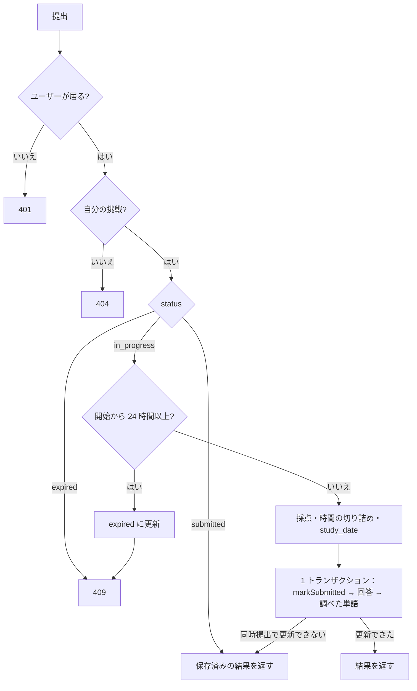

# step4-api-attempt-submit

提出 API（`POST /api/attempt/:id/submit`：採点・時間の切り詰め・`study_date`・調べた単語の保存・冪等）と、辞書の検索 API（`GET /api/dictionary?word=`）と引き方の純関数を作る。`GET /api/attempt/:id` に提出済みの形を足す。設計は [時間の計測](../README.md#時間の計測)・[正解を提出前に渡さない](../README.md#正解を提出前に渡さない)・[英和辞書](../README.md#英和辞書)。

## 前提

- [step3-api-attempt-start](./step3-api-attempt-start.md)（`attempt-service.ts`・`attempt-router.ts`・`lib/segment-passage.ts`・`controller/attempt/mapper.ts`）
- [step1-db-reading-attempts](./step1-db-reading-attempts.md) の辞書の seed（手動確認に使う）
- [github-auth step1-db-user-timezone](../../github-auth/tasks/step1-db-user-timezone.md)（`User.timezone`。`UserRepository.findById` が返す）

## 対応内容

### 1. api-schema

`attempt.ts` に足す（`WORD_LOOKUP_SOURCES`・`MAX_QUESTIONS_PER_PASSAGE` は `@repo/domain` から）:

```ts
/** 提出で受け取る調べた単語の件数の上限。web / mobile もこの件数を超えた分を記録しない */
export const SUBMIT_ATTEMPT_MAX_WORD_LOOKUPS = 300
/** 提出で受け取る surface / lemma の長さの上限。web / mobile もこれを超える記録を送らない */
export const SUBMIT_ATTEMPT_MAX_WORD_LENGTH = 100

export const submitAttemptRequestSchema = z.object({
  /** 画面を見ていた秒数（クライアントの計測値）。サーバーが壁時計で切り詰める */
  active_seconds: z.number().int().nonnegative(),
  answers: z.array(z.object({
    question_id: z.number().int().positive(),
    /** null = 未回答 */
    selected_choice_index: z.number().int().min(0).max(3).nullable(),
  })).max(MAX_QUESTIONS_PER_PASSAGE),
  translated_block_count: z.number().int().nonnegative(),
  /** 調べた 1 回ごとに 1 要素（同じ単語を 2 回調べたら 2 要素） */
  word_lookups: z.array(z.object({
    glossary_entry_id: z.number().int().positive().nullable(),
    lemma: z.string().trim().min(1).max(SUBMIT_ATTEMPT_MAX_WORD_LENGTH),
    source: z.enum(WORD_LOOKUP_SOURCES),
    surface: z.string().trim().min(1).max(SUBMIT_ATTEMPT_MAX_WORD_LENGTH),
  }).refine((lookup) => (lookup.source === "glossary") === (lookup.glossary_entry_id !== null))).max(SUBMIT_ATTEMPT_MAX_WORD_LOOKUPS),
})

const resultQuestionSchema = attemptQuestionSchema.extend({
  correct_choice_index: z.number(),
  /** 根拠のセグメントの範囲（segment_end は含まない）。引用が本文に見つからなければ null */
  evidence: z.object({ block_index: z.number(), quote: z.string(), segment_end: z.number(), segment_start: z.number() }).nullable(),
  explanation_ja: z.string(),
  /** 提出後に正解が直されたか（保存した is_correct と「selected_choice_index === いまの correct_choice_index」が食い違うとき true） */
  is_answer_key_changed: z.boolean(),
  /** 提出時点の正誤（保存値） */
  is_correct: z.boolean(),
  selected_choice_index: z.number().nullable(),
})

export const submittedAttemptSchema = z.object({
  id: z.number(),
  attribution: passageAttributionSchema,
  /** 語義設問の対象語句も含む用語集で分割する */
  blocks: z.array(attemptBlockSchema),
  correct_count: z.number(),
  elapsed_seconds: z.number(),
  glossary: z.array(attemptGlossaryEntrySchema),
  is_overtime: z.boolean(),
  passage: attemptPassageSchema,
  question_count: z.number(),
  questions: z.array(resultQuestionSchema),
  started_at: z.string(),
  status: z.literal("submitted"),
  study_date: z.string(),
  submitted_at: z.string(),
  time_limit_seconds: z.number(),
  translated_block_count: z.number(),
  word_lookup_count: z.number(),
  /** 結果画面の「調べた単語」。(source, 用語集の ID か見出し語) で重複を除き、最初に調べた順 */
  word_lookups: z.array(z.object({ lemma: z.string(), meaning_ja: z.string().nullable(), source: z.enum(WORD_LOOKUP_SOURCES), surface: z.string() })),
  /** 英単語数 ÷ かかった分。elapsed_seconds が 0 なら null（web / mobile で同じ値にするため api で計算） */
  words_per_minute: z.number().nullable(),
})
```

- `submitAttemptPathParamSchema`（`{ id }`）、`submitAttemptResponseSchema = submittedAttemptSchema`
- `getAttemptResponseSchema` の discriminatedUnion に `submittedAttemptSchema` を足す
- `dictionary.ts`（新規）：`lookupDictionaryQueryStringSchema = z.object({ word: z.string().trim().min(1).max(64).regex(/^[A-Za-z][A-Za-z'’-]*$/) })`、`lookupDictionaryResponseSchema = z.object({ headword: z.string(), meaning_ja: z.string() })`

### 2. 採点と時間の純関数（`apps/api/src/lib/grade-attempt.ts`）

ユーザーのタイムゾーンでの日付は `apps/api/src/lib/time-zone.ts` に置く（learning-record step2 が「今日」の計算に使い、`formatTimeInTimeZone` を足す）。

```ts
/** apps/api/src/lib/time-zone.ts */

/** ユーザーの TZ での日付（YYYY-MM-DD）。Intl.DateTimeFormat の formatToParts で year / month / day を取り出して組み立てる */
export const formatDateInTimeZone = (instant: Date, timeZone: string): string
```

```ts
/** 0 ≤ elapsed ≤ 壁時計（提出時刻 − started_at、秒の切り捨て）に切り詰める */
export const clampElapsedSeconds = (activeSeconds: number, startedAt: Date, now: Date): number =>
  Math.min(activeSeconds, Math.max(0, Math.floor((now.getTime() - startedAt.getTime()) / 1000)))

/** 制限時間ちょうどは超過ではない */
export const isOvertime = (elapsedSeconds: number, timeLimitSeconds: number): boolean => elapsedSeconds > timeLimitSeconds

/** 全設問について回答を返す。回答が無い設問・null は不正解 */
export const gradeAnswers = (
  questions: Pick<Question, "correctChoiceIndex" | "id">[],
  answers: { questionId: number; selectedChoiceIndex: number | null }[],
): { answers: { isCorrect: boolean; questionId: number; selectedChoiceIndex: number | null }[]; correctCount: number }

/** 提出後に正解が直されたか。保存した正誤と、保存した回答をいまの正解で採点し直した正誤が食い違えば true（未回答は常に false） */
export const hasAnswerKeyChanged = (
  storedAnswer: { isCorrect: boolean; selectedChoiceIndex: number | null },
  correctChoiceIndex: number,
): boolean => storedAnswer.isCorrect !== (storedAnswer.selectedChoiceIndex === correctChoiceIndex)
```

### 3. 辞書の引き方（`apps/api/src/lib/lookup-dictionary.ts`）

DB を知らない純関数。不規則変化の表は `apps/api/src/const/irregular-word-forms.ts`（`IRREGULAR_WORD_FORMS: Readonly<Record<string, string>>`。不規則動詞の過去形・過去分詞、不規則な複数形〈`children` / `indices` / `criteria` など〉、不規則な比較級〈`better` / `worse` など〉→ 原形）。

```ts
/** 引く順の候補（重複なし）。最初に辞書にあったものを使う */
export const generateLookupCandidates = (word: string): string[]
export const pickFirstEntry = (candidates: string[], entries: DictionaryEntry[]): DictionaryEntry | null
```

1. 小文字化し、`’` を `'` に、末尾の `'s` と `'` を除く
2. 見出し語そのまま → `IRREGULAR_WORD_FORMS` → 語尾の規則の順に候補を並べる
   - `-ies` → `y` / `-es` → なし / `-s` → なし（`-ss` は除く）
   - `-ied` → `y` / `-ed` → なし・`e`・子音の重なりを 1 つに（`stopped` → `stop`）
   - `-ing` → なし・`e`・子音の重なりを 1 つに（`running` → `run`）
   - `-ier` / `-iest` → `y` / `-er` / `-est` → なし・`e`・子音の重なりを 1 つに
3. ハイフンつきの語は、全体の候補 → 各部分の候補（前から）の順につなげる

### 4. Repository

```ts
/** reading-attempt-repository.ts に足す */
export type SubmitReadingAttemptInput = { attemptId: number; correctCount: number; elapsedSeconds: number; isOvertime: boolean; questionCount: number; studyDate: string; submittedAt: Date; translatedBlockCount: number; wordLookupCount: number }
export type WordLookupWithMeaning = AttemptWordLookup & { meaningJa: string | null }

/** status = 'in_progress' のときだけ submitted に更新する（UPDATE ... WHERE status = 'in_progress' RETURNING）。更新できなければ null */
markSubmitted(input: SubmitReadingAttemptInput, tx?: TransactionContext): Promise<ReadingAttempt | null>
insertAnswers(answers: Omit<AttemptAnswer, "createdAt" | "id" | "updatedAt">[], tx?: TransactionContext): Promise<void>
/** 空配列なら何もしない */
insertWordLookups(lookups: Omit<AttemptWordLookup, "createdAt" | "id" | "updatedAt">[], tx?: TransactionContext): Promise<void>
findAnswersByAttemptId(attemptId: number): Promise<AttemptAnswer[]>
/** glossary は passage_glossary_entries.meaning_ja、dictionary は dictionary_entries（headword = lemma）を left join。id の昇順 */
findWordLookupsWithMeaning(attemptId: number): Promise<WordLookupWithMeaning[]>

/** dictionary-repository.ts（新規。Drizzle / Prisma の両方に実装） */
export interface DictionaryRepository {
  findByHeadwords(headwords: string[]): Promise<DictionaryEntry[]>
}
```

書き込みは `resolveDrizzleClient(this._db, tx)` / `resolvePrismaClient(this._prisma, tx)` で `tx` を解決する（既存の `UserRepository.create` と同じ）。

### 5. Service

`attempt-service.ts` に `submitAttempt` を足す。`repo` は step3 の `AttemptRepo` に `transactionRunner` を足したもの。

```ts
export const submitAttempt = async (
  input: { activeSeconds: number; answers: AnswerInput[]; attemptId: number; now: Date; translatedBlockCount: number; userId: number; wordLookups: WordLookupInput[] },
  repo: AttemptRepo & { transactionRunner: TransactionRunner },
): Promise<Result<SubmittedAttemptView>>
```



1. `userRepository.findById` が null なら 401
2. `findByIdForUser` が null なら 404。`findAttemptContentById` で問題を読む
3. **すでに `submitted` なら、保存済みの回答と調べた単語から結果を作って返す**（入力は無視する。通信の再送で二重に記録しない）
4. `expired`、または `isAttemptExpired(startedAt, now)` なら（後者は `expireStale` してから）`err(conflictError(...))`
5. 入力の検証：同じ `question_id` が 2 回ある・この問題に無い `question_id` がある → 400
6. 計算（いまの設問 = 提出時点の設問で採点する）
   - `gradeAnswers(content.questions, input.answers)`、`questionCount = content.questions.length`
   - `elapsedSeconds = clampElapsedSeconds(...)`、`isOvertime(elapsedSeconds, attempt.timeLimitSeconds)`（開始時点の制限時間）
   - `studyDate = formatDateInTimeZone(input.now, user.timezone)`
   - `translatedBlockCount` は code 以外のブロック数で上限をかける
   - 調べた単語：`glossary` はこの問題の用語集にある ID だけ残して `lemma` を用語集の値に置き換える（無い ID は捨てて `logger.warn`）。`dictionary` は `lemma` を小文字にする。`wordLookupCount` は残った件数
7. `transactionRunner.run` の中で `markSubmitted` → `insertAnswers`（全設問）→ `insertWordLookups`。`markSubmitted` が null（同時に提出された）なら挿入せずに抜ける
8. 7 で null だったら挑戦を読み直し、`submitted` なら 3 と同じく保存済みの結果を返す
9. `buildSubmittedView(attempt, content, answers, lookups)` を返す

`buildSubmittedView`：用語集は全件（語義設問の対象も含む）で `segmentPassage` し、各設問の根拠を `findEvidenceSegmentRange(blocks[evidenceBlockIndex].text, segments[evidenceBlockIndex], evidenceQuote)` で範囲にする。`isCorrect` は保存値、正解・解説・選択肢はいまの設問。提出後に管理者が正解を直すと両者が食い違う（B を選んで不正解だった設問の正解を B に直すと「あなたの回答 B・正解 B・不正解」になる）ので、提出時の採点は変えずに `isAnswerKeyChanged = hasAnswerKeyChanged(answer, question.correctChoiceIndex)` を付け、結果画面で注記させる。`getAttempt` の `submitted` もこれで返す（step3 の仮の 409 を置き換える）。提出・`getAttempt` とも、挑戦・回答・調べた単語は `PRIMARY_READ`（primary）から読む（提出の直後の行を read replica の遅れで見失わないため）。

`dictionary-service.ts`（新規）：`lookupWord({ word }, { dictionaryRepository })` → `generateLookupCandidates` → `findByHeadwords`（1 クエリ）→ `pickFirstEntry`。無ければ `err(notFoundError(...))`。

### 6. Controller・Router・DI

- `controller/attempt/submit.ts`（200。保存済みを返す場合も 200）、`mapper.ts` に `toSubmittedAttemptResponse(view)`
- `controller/dictionary/lookup.ts`、`routes/dictionary-router.ts`（`GET /`）
- `attempt-router.ts` に `POST /:id/submit`、`src/index.ts` に `DrizzleDictionaryRepository` と `app.use("/api/dictionary", dictionaryRouter({ lookup }))`。`transactionRunner` は既存のものを渡す

## 動作確認

```bash
cd packages/schema && pnpm build
pnpm --filter api test
pnpm lint:fix
```

lib（境界値）:

- [ ] `formatDateInTimeZone`（`test/lib/time-zone.test.ts`）：`Asia/Tokyo` で `2026-10-10T14:59:59.999Z` → `2026-10-10`、`15:00:00.000Z` → `2026-10-11` / `America/Los_Angeles` で夏時間の切り替え日 / `UTC`
- [ ] `clampElapsedSeconds`：申告 > 壁時計 → 壁時計 / 申告 = 壁時計 / 申告 < 壁時計 → 申告 / 開始が未来（時計のずれ）→ 0
- [ ] `isOvertime`：制限時間ちょうどは false、1 秒超えで true
- [ ] `gradeAnswers`：未回答（null・回答なし）は不正解、`correctCount`
- [ ] `hasAnswerKeyChanged`：正解のまま・不正解のままは false / 不正解だった回答がいまの正解・正解だった回答がいまは不正解なら true / 不正解の回答のまま正解が別の選択肢に変わっても false / 未回答は false
- [ ] `generateLookupCandidates`：`Libraries` → `library` / `rendered` → `render` / `used` → `use` / `running` → `run` / `went` → `go` / `React's` → `react` / `re-render` → 全体の後に `re`・`render` / 重複が無い
- [ ] `pickFirstEntry` は候補の順で最初に見つかったものを返す

Service（ユニット）:

- [ ] 401（トランザクションを開始しない）/ 他人の挑戦は 404 / `expired` は 409 / 開始から 24 時間たった `in_progress` は `expireStale` して 409、23:59:59 なら提出できる
- [ ] すでに `submitted` なら `markSubmitted` を呼ばず、保存済みの結果を返す（冪等）
- [ ] `markSubmitted` が null（同時提出）なら挿入せず、保存済みの結果を返す
- [ ] 重複・知らない `question_id` で 400。回答の無い設問も `isCorrect: false` で挿入される
- [ ] `studyDate` に `user.timezone` が使われる。`translatedBlockCount` の上限、この問題に無い用語集 ID の単語は捨てられる
- [ ] `getAttempt`：提出後に正解が直された設問は `isCorrect` が保存値のまま `isAnswerKeyChanged: true`（直されていない設問・未回答は false）

Controller（インテグレーション）:

- [ ] 認証なし・削除済みユーザーで 401、他人の挑戦で 404、`answers` の `selected_choice_index: 4` で 400
- [ ] 提出すると 200。DB の `reading_attempts`（`status`・`elapsed_seconds`・`is_overtime`・`question_count`・`correct_count`・`study_date`・各件数）、全設問の `attempt_answers`、`attempt_word_lookups` を `toMatchObject` で確かめる
- [ ] レスポンスに正解・解説・根拠の範囲・`words_per_minute`、調べた単語の意味（用語集と辞書の両方）が入る。全体を `toEqual` + `expect.any(...)` で検証
- [ ] 冪等：回答を変えて 2 回目を送っても 200 で 1 回目と同じ結果、DB の行数が変わらない。`Promise.all` で同時に 2 回送っても回答の行は 1 組
- [ ] `active_seconds` を壁時計より大きく送ると切り詰められる。開始から 24 時間たった挑戦は 409 で DB が `expired`
- [ ] 提出後の `GET /api/attempt/:id` が提出のレスポンスと同じ形（`submitted`）を返し、語義設問の対象語句が用語集に含まれる
- [ ] 提出後に `questions.correct_choice_index` を直すと、`GET /api/attempt/:id` の `correct_count`・`is_correct` は提出時のまま、食い違う設問だけ `is_answer_key_changed: true`
- [ ] `GET /api/dictionary`：`Rendering` → `render` の意味で 200 / 辞書に無い語で 404 / `123`・空・65 文字で 400 / 認証なしで 401

Repository（Drizzle / Prisma の両方）:

- [ ] `markSubmitted` は `in_progress` でない行を更新せず null / `insertWordLookups([])` が例外にならない / `findWordLookupsWithMeaning` が用語集と辞書の意味を引き、用語集が消された行は `meaningJa: null` / `findByHeadwords`
