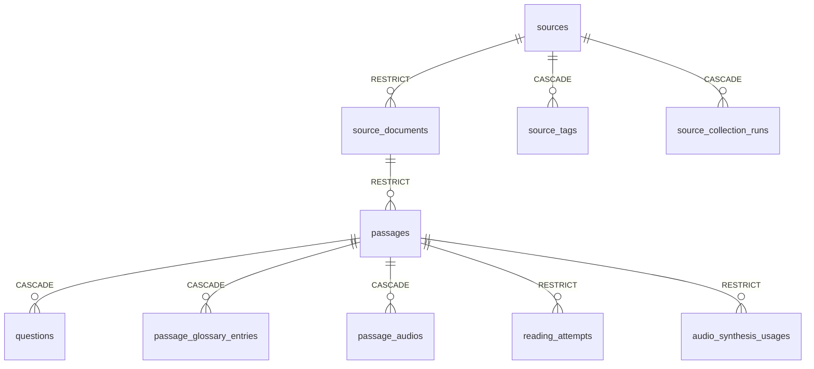
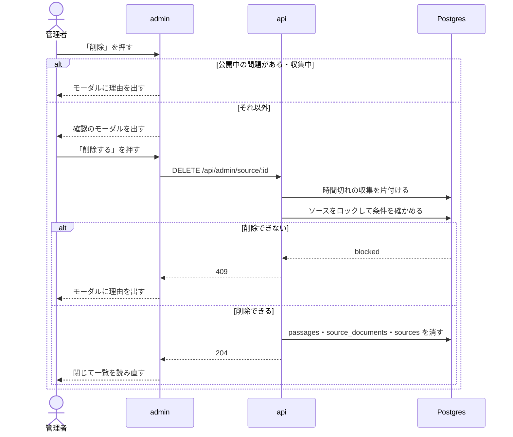

# ソースの削除

admin のソース一覧からソースを削除する機能。試しに登録したソースやライセンスの確認で使わないと決めたソースは、今は無効にするしかなく、一覧に残り続ける。削除の前に確認のモーダルを出し、学習者に関わるデータがあるソースは削除させない。

このドキュメントは **仕様（What）** と **設計（How）** を分けて記述する：

- **仕様**：ユーザーから見える挙動・ルール・データの意味
- **設計**：実装にあたっての技術的な選択と制約

## 関連 spec

- [`../source-registration-by-url/README.md`](../source-registration-by-url/README.md) — ソースの一覧と登録の画面
- [`../manual-collection/README.md`](../manual-collection/README.md) — 収集の記録（`source_collection_runs`）と収集中の状態
- [`../question-generation/README.md`](../question-generation/README.md) — 問題の状態。非公開に戻した問題の `published_at` は残る
- [`../read-aloud/README.md`](../read-aloud/README.md) — 問題の音声と課金文字数の記録

## 目次

- [仕様](#仕様)
  - [削除の操作](#削除の操作)
  - [削除できないソース](#削除できないソース)
  - [消えるものと残るもの](#消えるものと残るもの)
- [設計](#設計)
  - [物理削除にする](#物理削除にする)
  - [判定と削除を 1 トランザクションで行う](#判定と削除を-1-トランザクションで行う)
  - [収集・生成との競合](#収集生成との競合)
  - [画面の事前の判定](#画面の事前の判定)
  - [MVP 対象外（将来検討）](#mvp-対象外将来検討)
- [必要な画面](#必要な画面)
- [必要な API](#必要な-api)
- [必要な DB 設計](#必要な-db-設計)
- [フロー図](#フロー図)

---

## 仕様

### 削除の操作

- ソース一覧の各行の「編集」の横に「削除」を置く。GitHub・サイトのどちらのソースにも出す
- 「削除」を押すと確認のモーダルを開く。モーダルにはソース名、取得元、消える本文候補の件数（下書きの件数を含む）と、取り消せないことを出す
- 「削除する」を押すと削除し、モーダルを閉じて一覧を読み直す
- 「キャンセル」で閉じれば何も変わらない

### 削除できないソース

次のどれかに当たるソースは削除できない。モーダルに理由を出し、削除は行わない。

| 条件 | 理由 |
| --- | --- |
| 公開中の問題がある | 学習者が解いている問題が消えてしまう |
| 解答の記録がある問題がある（非公開に戻した問題も含む） | 学習者の履歴と正答率が変わってしまう |
| 音声がある問題がある | 保存した音声と課金の記録が残る |
| 収集中 | 収集中のソースを消すと収集の結果を書けない |

公開中の問題と収集中は、モーダルを開いた時点で理由を出し、「削除する」を出さない。解答の記録と音声は一覧のデータでは分からないので、「削除する」を押したときに API が止める。

使わなくなったソースのうち削除できないものは、これまでどおり無効にする。

### 消えるものと残るもの

| 消える | 残る |
| --- | --- |
| ソース | タグ（ソースとの紐付けだけが消える） |
| すべての状態の本文候補（下書き・却下を含む）と、その設問・和訳・用語集 | 取得元のリポジトリ・サイト |
| 取得した文書の記録 | |
| 収集の記録 | |

同じリポジトリ・サイトはもう一度登録できる。登録し直したソースは収集からやり直しになり、下書きに加えた修正は戻らない。

---

## 設計

### 物理削除にする

学習者に関わるデータが無いソースだけを消すので、残す理由が無い行を物理削除する。

論理削除（`deleted_at`）は採らなかった。公開中の問題も残せるが、`sources.repository` の unique 制約を部分 index に変える必要があり、残った本文候補の `passages.content_hash`（unique）で再登録後の収集が同じ本文を作れなくなる。

学習記録ごと消す案も採らなかった。外部キーの `RESTRICT`（`reading_attempts.passage_id`・`attempt_answers.question_id`）は、学習記録を守るための既存の制約である。

### 判定と削除を 1 トランザクションで行う

`SourceRepository.deleteWithContent` が、次の順で 1 トランザクションで行う。

1. `sources` の行を `FOR UPDATE` でロックする。無ければ `not_found`
2. 削除できない条件を確かめる。当たれば何も消さずに `blocked`
3. `passages`、`source_documents`、`sources` の順に消す

`source_documents.source_id` と `passages.source_document_id` が `RESTRICT` なので、この順で消す。設問・用語集・`source_tags`・`source_collection_runs` は `CASCADE` で一緒に消える。

ロックが要るのは、判定の後に収集の記録が作られないようにするため。`source_collection_runs` の INSERT は外部キーの検査で親の行に `FOR KEY SHARE` を取るので、削除が終わるまで待ち、ソースが消えていれば外部キー違反で失敗する。

判定で見るのは次の通り。

| 理由（`SourceDeletionBlockReason`） | 見るもの |
| --- | --- |
| `collecting` | `source_collection_runs` の `queued`・`running` |
| `published` | `passages.status = 'published'` |
| `attempted` | `reading_attempts`（`attempt_word_lookups` と `attempt_answers` は解答の記録に付くので、これだけ見れば足りる） |
| `audio` | `passage_audios`、`audio_synthesis_usages` |

判定を通った後に外部キー違反が起きても（判定の直後に解答の記録ができたなど）、トランザクションごと取り消されて 500 になるだけで、データは壊れない。もう一度押せば 409 になる。起きにくいので変換しない。

時間切れの収集が記録に残っていると削除できないままになるので、service は削除の前に `failTimedOutCollectionRuns` で片付ける（一覧・依頼と同じ）。

取り消せない操作なので、消した本文候補の件数を info のログに残す。

### 収集・生成との競合

- **収集**：`queued`・`running` の記録があるソースは消さないので、worker が消えたソースを処理することはない
- **問題の生成**：`generating` の本文候補があっても止めない。cron の書き込みは `status = 'generating'` のガードが付いていて、行が消えていれば 0 行で warn を出すだけで、データは壊れない。その 1 件の LLM の費用だけが無駄になる

### 画面の事前の判定

モーダルの事前の判定には、一覧のレスポンス（`passage_counts.published`・`latest_collection_run`）をそのまま使い、削除の可否を返す API は足さない。普段止まる条件はこの 2 つで、一覧のデータで分かる。解答の記録と音声の判定のために、モーダルの開閉に読み込み中と失敗の状態を持たせるほどの価値が無い。

正しい判定は API にある。画面の判定が古くても、API が 409 を返す。409 はどの条件でも同じ文言をモーダルに出す。

### MVP 対象外（将来検討）

- 公開中の問題があるソースをライセンスの問題で取り下げる操作。今は問題ごとに非公開に戻して却下する（[`apps/cron/CLAUDE.md`](../../../apps/cron/CLAUDE.md) の「ライセンスなどで問題の音声を取り下げるとき」）
- ソースの編集画面からの削除

---

## 必要な画面

| 画面 | 変更 |
| --- | --- |
| ソース一覧（`/sources`） | 各行の「編集」の横に「削除」を足す |
| 削除の確認のモーダル（新規） | タグの削除のモーダル（`TagDeleteModal`）と同じ見た目 |

## 必要な API

| メソッド | パス | 成功 | 失敗 |
| --- | --- | --- | --- |
| DELETE | `/api/admin/source/:id` | 204（ボディなし） | 400 id が不正、404 ソースが無い、409 削除できない |

## 必要な DB 設計

変更なし。既存の外部キーを前提にする。

## フロー図

実装の手順は [`tasks/step1-api-delete-source.md`](./tasks/step1-api-delete-source.md)、[`tasks/step2-admin-source-delete-modal.md`](./tasks/step2-admin-source-delete-modal.md)。
