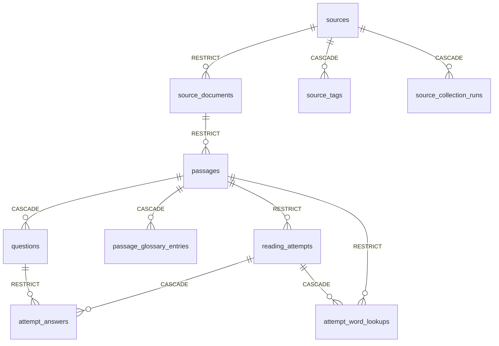
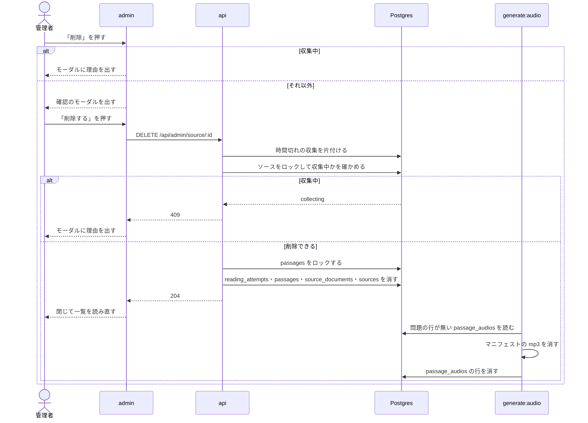

# ソースの削除

admin のソース一覧からソースを削除する機能。試しに登録したソース、ライセンスの確認で使わないと決めたソース、誤って公開した問題を持つソースは、今は無効にするしかなく、一覧にも問題にも残り続ける。削除の前に確認のモーダルを出し、問題と解答の記録まで含めて消す。

このドキュメントは **仕様（What）** と **設計（How）** を分けて記述する：

- **仕様**：ユーザーから見える挙動・ルール・データの意味
- **設計**：実装にあたっての技術的な選択と制約

## 関連 spec

- [`../source-registration-by-url/README.md`](../source-registration-by-url/README.md) — ソースの一覧と登録の画面
- [`../manual-collection/README.md`](../manual-collection/README.md) — 収集の記録（`source_collection_runs`）と収集中の状態
- [`../question-generation/README.md`](../question-generation/README.md) — 問題の状態
- [`../read-aloud/README.md`](../read-aloud/README.md) — 問題の音声と課金文字数の記録、却下の問題の音声の片付け
- [`../vocabulary-cards/README.md`](../vocabulary-cards/README.md) — 単語帳のカードの中身の組み立て

## 目次

- [仕様](#仕様)
  - [削除の操作](#削除の操作)
  - [削除できないソース](#削除できないソース)
  - [消えるものと残るもの](#消えるものと残るもの)
  - [学習者への影響](#学習者への影響)
- [設計](#設計)
  - [物理削除にする](#物理削除にする)
  - [判定と削除を 1 トランザクションで行う](#判定と削除を-1-トランザクションで行う)
  - [音声と課金の記録](#音声と課金の記録)
  - [収集・生成との競合](#収集生成との競合)
  - [画面の事前の判定](#画面の事前の判定)
  - [MVP 対象外（将来検討）](#mvp-対象外将来検討)
- [必要な画面](#必要な画面)
- [必要な API](#必要な-api)
- [必要な DB 設計](#必要な-db-設計)
- [フロー図](#フロー図)

---

## 仕様

### 削除の操作

- ソース一覧の各行の「編集」の横に「削除」を置く。GitHub・サイトのどちらのソースにも出す
- 「削除」を押すと確認のモーダルを開く。モーダルにはソース名、取得元、消える本文候補の件数（公開中と下書きの件数を含む）、解答の記録と音声も消えること、取り消せないことを出す
- 公開中の問題があるときは、学習者の画面から消えることを目立つ色で出す
- 「削除する」を押すと削除し、モーダルを閉じて一覧を読み直す
- 「キャンセル」で閉じれば何も変わらない

### 削除できないソース

収集中のソースだけは削除できない。モーダルを開いた時点で理由を出し、「削除する」を出さない。収集が終われば削除できる。

### 消えるものと残るもの

| 消える | 残る |
| --- | --- |
| ソース | タグ（ソースとの紐付けだけが消える） |
| すべての状態の本文候補（公開中・下書き・却下を含む）と、その設問・和訳・用語集 | 取得元のリポジトリ・サイト |
| 解答の記録（解いている途中のものを含む）と、その回答・調べた単語の記録 | 単語帳のカードと復習の記録 |
| 音声（mp3 は次の `generate:audio` で消える） | 音声の課金の記録 |
| 取得した文書の記録 | |
| 収集の記録 | |

同じリポジトリ・サイトはもう一度登録できる。登録し直したソースは収集からやり直しになり、下書きに加えた修正は戻らない。

### 学習者への影響

- 公開中の問題は一覧から消える
- 解いている途中の問題は続けられなくなる（開くと「見つからない」になり、提出は失敗する）
- マイページの解いた数・正答率などから、消えた解答の分が減る
- 単語帳のカードは残るが、中身を作る本文が消えた語は出題されなくなる。別の問題でまた出会えば、前の段階の続きから出題される
- 出題されなくなったカードも、単語帳の「復習中」の数と「次の復習」の日には数えられたまま残る。実害が小さいので直さない

---

## 設計

### 物理削除にする

残す理由が無い行を物理削除する。

論理削除（`deleted_at`）は採らなかった。`sources.repository` の unique 制約を部分 index に変える必要があり、残った本文候補の `passages.content_hash`（unique）で再登録後の収集が同じ本文を作れなくなる。

公開中の問題や解答の記録があるソースを削除できなくする案も採らなかった。誤って公開した問題とそのソースを消せず、運用しづらい。学習者の履歴が減ることより、消せることを優先する。

### 判定と削除を 1 トランザクションで行う

`SourceRepository.deleteWithContent` が、次の順で 1 トランザクションで行う。

1. `sources` の行を `FOR UPDATE` でロックする。無ければ `not_found`
2. `source_collection_runs` に `queued`・`running` があれば、何も消さずに `collecting`
3. そのソースの `passages` の行を `FOR UPDATE` でロックする
4. `reading_attempts`、`passages`、`source_documents`、`sources` の順に消す

`reading_attempts.passage_id`・`attempt_word_lookups.passage_id`・`attempt_answers.question_id`・`passages.source_document_id`・`source_documents.source_id` が `RESTRICT` なので、この順で消す。`RESTRICT` は緩めない。ほかの経路で学習記録が気づかないうちに消えないようにする制約で、消すのは解答の記録を明示して消すこの処理だけにする。回答と調べた単語の記録は `reading_attempts` の、設問・用語集は `passages` の、`source_tags`・`source_collection_runs` は `sources` の `CASCADE` で一緒に消える。

ロックが要るのは次の 2 つのため。INSERT は外部キーの検査で親の行に `FOR KEY SHARE` を取るので、削除が終わるまで待ち、親が消えていれば外部キー違反で失敗する。

- `sources`：判定の後に収集の記録が作られないようにする
- `passages`：解答の記録を消した後に、新しい挑戦や調べた単語の記録が作られないようにする

外部キー違反が起きても（削除の途中で URL からの取り込みが本文候補を足したなど）、トランザクションごと取り消されて 500 になるだけで、データは壊れない。起きにくいので変換しない。

時間切れの収集が記録に残っていると削除できないままになるので、service は削除の前に `failTimedOutCollectionRuns` で片付ける（一覧・依頼と同じ）。

取り消せない操作なので、消した解答の記録と本文候補の件数を info のログに残す。

`attempt_answers.question_id`・`attempt_word_lookups.passage_id` には外部キーの検査に使える index が無いので、学習記録が増えると、消す行ごとの検査で表を読む時間が延びる。トランザクションの間は、そのソースの問題の開始と提出が待たされる。まれな管理操作で今の件数なら実害が無いので、index は足さない。遅くなったら `attempt_answers.question_id` から足す。

### 音声と課金の記録

`passage_audios` と `audio_synthesis_usages` は、問題を消しても行を残す。どちらも `passage_id` の外部キーを外す。

**`passage_audios`**：mp3 の保存キーは行のマニフェストにしか無い。行が一緒に消えると、公開の URL で配信できる mp3 が S3 に残り続け、消す手がかりも無くなる。そこで行を残し、`generate:audio` の既存の片付け（却下の問題の mp3 を消してから行を消す）の対象に「問題の行が無い」を足す。

- 読み取りはどれも `passages` を起点に left join するので、問題の無い行は api からも `claimTargets` からも見えない
- 生成中に問題が消えたら、`completeClaim` が本文を読めず `text_changed` になり、今回作った mp3 を消して行を `pending` に戻す。行は次の実行で片付く
- CloudFront のキャッシュは 1 年残る。ライセンスで取り下げるときの無効化の手順は却下と同じ（[`apps/cron/CLAUDE.md`](../../../apps/cron/CLAUDE.md) の「ライセンスなどで問題の音声を取り下げるとき」）

api から保存先の mp3 を直接消す案は採らなかった。api は保存先を持たないので env と IAM の権限を足すことになり、DB を消した後に失敗すると消すキーが分からなくなる。消す mp3 の一覧を別のテーブルに積む案も、既存の片付けで足りるので採らなかった。

**`audio_synthesis_usages`**：月の上限（`AUDIO_MONTHLY_CHARACTER_LIMIT`）は今月の行の合計で判定する。問題と一緒に行を消すと合計が減り、請求は変わらないのに上限が緩む。`ON DELETE SET NULL` は、CHECK 制約（`passage_id` と `word_audio_id` のどちらか一方）と「追記だけで更新しない」の両方に反するので採らなかった。外部キーを外すと、生成中に問題が消えても課金の記録を書ける。

### 収集・生成との競合

- **収集**：`queued`・`running` の記録があるソースは消さない。ただし 30 分の時間切れで `failed` にした後も worker が動いていると、ソースを消せる。そのときは worker の書き込みが外部キー違反で失敗し、収集の結果が残らないだけでデータは壊れない。worker に停止の確認を足すほどの実害は無いので、そのままにする
- **問題の生成**：`generating` の本文候補があっても止めない。cron の書き込みは `status = 'generating'` のガードが付いていて、行が消えていれば 0 行で warn を出すだけで、データは壊れない。その 1 件の LLM の費用だけが無駄になる

### 画面の事前の判定

モーダルの事前の判定には、一覧のレスポンス（`latest_collection_run`）をそのまま使い、削除の可否を返す API は足さない。正しい判定は API にある。画面の判定が古くても、API が 409 を返す。

消える解答の記録の件数はモーダルに出さない。一覧のレスポンスに足すと全ソース分の集計が要り、件数が変わっても確認の判断は変わらない。

### MVP 対象外（将来検討）

- ソースの編集画面からの削除
- 消える解答の記録の件数の表示

---

## 必要な画面

| 画面 | 変更 |
| --- | --- |
| ソース一覧（`/sources`） | 各行の「編集」の横に「削除」を足す |
| 削除の確認のモーダル（新規） | タグの削除のモーダル（`TagDeleteModal`）と同じ見た目 |

## 必要な API

| メソッド | パス | 成功 | 失敗 |
| --- | --- | --- | --- |
| DELETE | `/api/admin/source/:id` | 204（ボディなし） | 400 id が不正、404 ソースが無い、409 収集中 |

## 必要な DB 設計

`passage_audios.passage_id` と `audio_synthesis_usages.passage_id` の外部キーを外す（マイグレーション `20261102013242_drop_passage_foreign_keys_of_audio`）。列と index は変えない。

`passage_audios` と `audio_synthesis_usages` は `passage_id` を持つが、外部キーは張らない。

## フロー図

実装の手順は [`tasks/step1-api-delete-source.md`](./tasks/step1-api-delete-source.md)、[`tasks/step2-admin-source-delete-modal.md`](./tasks/step2-admin-source-delete-modal.md)、[`tasks/step3-cron-purge-deleted-passage-audios.md`](./tasks/step3-cron-purge-deleted-passage-audios.md)。
