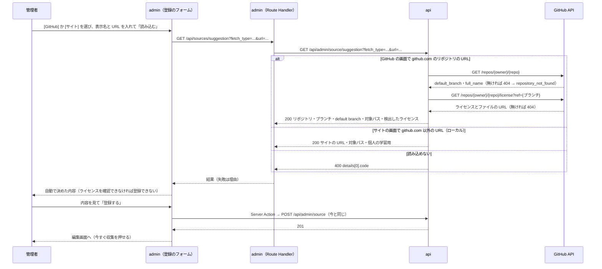

# 表示名と URL だけでのソース登録

admin のソースの登録を、GitHub とサイトで画面を分け、表示名と URL を入れて「読み込む」を押し、出てきた内容を見て「登録する」を押すだけにする。どちらの画面かは画面の上のボタン（[GitHub] [サイト]）で切り替え、ソース一覧も同じボタンで GitHub とサイトに分ける。リポジトリ・ブランチ・対象パス・ライセンスとライセンスの記載がある URL は、URL と GitHub から自動で決める。自動で決めた値を直したいときだけ「詳細」を開く。GitHub のブランチとライセンスは管理者が操作せず、ライセンスを確認できないリポジトリは登録できない。登録で決まる値（取得方法・取得元・GitHub のライセンス）は、編集の画面では変えられず、読み取り専用で出す。

今は 1 つのソースを登録するのに、取得方法・種別を選び、リポジトリ・ブランチ・対象パス・ライセンス・ライセンスの記載がある URL を手で埋め、ライセンスは「ライセンスを検出」を押してから選ぶ。取得方法は最初に画面で選び、残りは URL と GitHub の情報から決まるので、入力を表示名と URL の 2 つにする。

このドキュメントは **仕様（What）** と **設計（How）** を分けて記述する：

- **仕様**：ユーザーから見える挙動・ルール・データの意味
- **設計**：実装にあたっての技術的な選択と制約

## 関連 spec

- [`../content-collection/README.md`](../content-collection/README.md#ソースの登録) — ソースの項目と「ソース登録時の確認」の正本。この機能はライセンスの決め方を「検出した値を初期値にして管理者が選ぶ」から「検出した値をそのまま使い、管理者は画面で見て登録するだけにする（確認できなければ登録できない）」に変え、登録と一覧の画面を GitHub とサイトに分ける。登録の検証は変えない
- [`../github-only-collection/README.md`](../github-only-collection/README.md) — サイトのソースはローカルだけで、ライセンスの記載が無いサイトは「個人の学習用」。この機能のサイトの画面と初期値はこれに従う
- [`../manual-collection/README.md`](../manual-collection/README.md) — 登録すると編集画面に移り、「今すぐ収集」で収集する（変えない）
- [`../url-import/README.md`](../url-import/README.md) — サイトのソースを使う側。対象パスはそのページを取り込めるかの判定に使う
- [`../source-tags/README.md`](../source-tags/README.md) — 技術タグは「詳細」で選ぶ

## 目次

- [仕様](#仕様)
  - [GitHub とサイトの画面](#github-とサイトの画面)
  - [登録の流れ](#登録の流れ)
  - [URL から決める値](#url-から決める値)
  - [ライセンスの自動の取得](#ライセンスの自動の取得)
  - [読み込めないとき](#読み込めないとき)
  - [編集の画面](#編集の画面)
  - [変えないもの](#変えないもの)
- [設計](#設計)
  - [URL の読み込みは api で行う](#url-の読み込みは-api-で行う)
  - [URL の解釈](#url-の解釈)
  - [GitHub の呼び出し](#github-の呼び出し)
  - [登録は今の API のまま](#登録は今の-api-のまま)
  - [画面の分け方](#画面の分け方)
  - [登録のフォーム](#登録のフォーム)
  - [編集は変えられる項目だけを受ける](#編集は変えられる項目だけを受ける)
  - [MVP 対象外（将来検討）](#mvp-対象外将来検討)
- [必要な画面](#必要な画面)
- [必要な API](#必要な-api)
- [必要な DB 設計](#必要な-db-設計)
- [フロー図](#フロー図)

---

## 仕様

### GitHub とサイトの画面

ソース一覧と登録の画面の上に [GitHub] [サイト] のボタンを置き、押すと GitHub のソースの画面とサイトのソースの画面を切り替える。

| 画面 | GitHub | サイト（ローカルだけ） |
| --- | --- | --- |
| ソース一覧 | `/sources`（GitHub のソースだけを出す） | `/sources?fetch_type=website`（サイトのソースだけを出す） |
| ソースの登録 | `/sources/new/github` | `/sources/new/website` |

- [サイト] のボタンはローカルでだけ出す（サイトのソースはローカルだけ）。ローカル以外で `/sources/new/website` を開くと 404、`/sources?fetch_type=website` は GitHub の一覧を出す
- 一覧の「ソースを登録」は、いま選んでいる方の登録の画面を開く。`/sources/new` は GitHub の登録の画面に移る
- 登録・編集の画面の「キャンセル」と、編集の画面の「保存する」の後は、そのソースの取得方法の一覧に戻る
- 一覧のボタンには、それぞれのソースの件数を出す
- 一覧は取得方法で分かれているので、今の「取得方法」の列と絞り込みはやめる。サイトの一覧では、常に同じ値になる「状態」（収集しない）と「最終収集」の列を出さない
- 取得方法は画面で決まるので、登録の画面では選ばない

### 登録の流れ

1. ソースの登録の画面で、[GitHub] か [サイト] を選ぶ（一覧で選んでいた方が開く）
2. 表示名と URL を入れて「読み込む」を押す（URL の欄で Enter でもよい）
3. URL から決めた内容（取得元・ブランチ・対象パス・ライセンス・ライセンスの記載がある URL）が出る
4. 内容を見て「登録する」を押す。登録すると編集画面に移り、「今すぐ収集」を押せる（今と同じ）

- 読み込む前と、読み込んだ後に URL を変えたときは「登録する」を押せない（「URL を読み込んでください」）
- 読み込み直すと、取得元と、「詳細」の取得元とサイトのライセンスの欄（対象パス・除外パス・ライセンスなど）は読み込み直した値で作り直す。表示名・技術タグは残す
- 読み込みに失敗しても、前に読み込んだ内容は残る（URL の欄が違うので、そのままでは登録できない）
- 「詳細」を開くと、対象パス・除外パスなどを直せる。GitHub のブランチとライセンスの欄は出さない。ライセンスは読み込んだブランチで検出するので、ブランチだけを直せると確かめていないライセンスで登録できてしまうため。取得元やブランチを変えたいときは URL を変えて読み込み直す
- 「詳細」の欄に入力の誤りがあるときは、「詳細」が開いた状態で出る
- [GitHub] [サイト] を切り替えると、入力は消える（別の画面に移る）

### URL から決める値

**GitHub の登録の画面（`github.com` の URL）**

| URL の形 | 例 | リポジトリ | ブランチ | 対象パス |
| --- | --- | --- | --- | --- |
| リポジトリのトップ | `https://github.com/rust-lang/book` | `rust-lang/book` | default branch | `**`（リポジトリ全体） |
| ディレクトリ | `https://github.com/reactjs/react.dev/tree/main/src/content/learn` | `reactjs/react.dev` | `main` | `src/content/learn/**` |
| ファイル | `https://github.com/rust-lang/rfcs/blob/master/README.md` | `rust-lang/rfcs` | `master` | `README.md` |

- 収集するのは今と同じく `.md` / `.mdx` だけなので、対象パスに拡張子は付けない
- リポジトリは改名後の名前（GitHub の `full_name`）にそろえ、今と同じく小文字で保存する
- ブランチが default branch でないとき（URL で別のブランチ・タグ・コミットを指したとき）は、読み込んだ内容に「default branch（`main`）ではありません」と出す。ブランチの区切りを取り違えたとき（下の「URL の解釈」）や、default branch が変わった古い URL・コミットの permalink の URL で登録しかけたときに気付けるようにするため
- URL の末尾の `/`・`.git`・`?` 以降・`#` 以降は見ない。`http://` と `www.github.com` も受け付ける
- `tree` / `blob` の無い URL（`/issues`・`/wiki` など）は、リポジトリのトップとして扱う

**サイトの登録の画面（`github.com` 以外の URL。ローカルだけ）**

| URL の形 | 例 | サイトの URL | 対象パス |
| --- | --- | --- | --- |
| サイトのトップ | `https://go.dev` | `https://go.dev` | `/**` |
| パス付き | `https://go.dev/doc/` | `https://go.dev` | `/doc/**`（`/doc` 自身も含む） |

- `http://` の URL は `https://` にそろえる（サイトのソースは https だけ）
- ページの URL（`/3/tutorial/index.html`）を入れると、対象パスはそのページだけ（`/3/tutorial/index.html/**`）になる。ディレクトリにしたいときは「詳細」で直す

**どちらも同じ値**

| 項目 | 値 |
| --- | --- |
| 収集する（GitHub だけ） | 有効 |
| 除外パス・技術タグ・本文の CSS セレクタ | 空 |

- 種別は選ばない。URL の形では決まらず（react.dev のようにリポジトリでもドキュメントのことがある）、学習者の絞り込みもやめたので、`docs` で保存する

### ライセンスの自動の取得

**GitHub**：読み込んだときに GitHub が検出したライセンスを取り、そのまま使う。管理者はライセンスを操作しない（「詳細」にもライセンスの欄を出さない）。URL でブランチを指定したときは、そのブランチのライセンスだけを見る。default branch のライセンスは見ない（無いブランチや確かめていないブランチの文章を登録できてしまい、登録の後は直せないため）。

| GitHub の検出の結果 | ライセンス | ライセンスの記載がある URL | 登録 |
| --- | --- | --- | --- |
| 許可リストのライセンス | 検出したライセンス | ライセンスのファイルの URL | そのまま登録できる |
| 許可リストに無いライセンス（CC-BY-SA・GPL など） | 検出したライセンスと「許可リストに無いライセンスです」 | ライセンスのファイルの URL | 登録できない |
| ライセンスのファイルはあるが種類が分からない | 「ライセンスを確認できませんでした」 | ライセンスのファイルの URL | 登録できない |
| ライセンスのファイルが無い | 「ライセンスを確認できませんでした」 | 空 | 登録できない |

- 読み込んだ内容と一緒に、今の画面にもある注意（コードとドキュメントでライセンスが分かれているリポジトリでは、GitHub の検出はコードのライセンスのことがある）を出す。ドキュメントの文章に掛かっているライセンスかを確かめるのは今と同じく管理者で、違えば登録しない
- 手で選べると、確かめていないライセンスの文章を公開できてしまうので、確認できないリポジトリは登録の画面で止める。ドキュメントだけ許可リストのライセンスのリポジトリ（ライセンスのファイルが複数あるものなど）も、自動で確認できなければ登録できない。止めるのは画面だけで、`POST /api/admin/source` は今と同じくリクエストの値を検証する

**サイト**：ライセンスは自動では判定できないので、「個人の学習用」と、ライセンスの記載がある URL にサイトのトップ（`https://go.dev`）を入れる。サイトのソースはローカルで自分で読むためだけのもの（[github-only-collection](../github-only-collection/README.md#個人の学習用のライセンス)）なので、それより広く使えるライセンスを自動で選ばない。

- 入力を表示名と URL だけにするため、github-only-collection の「ライセンスの記載がある URL にはサイトの著作権や利用規約のページを入れる」を「既定はサイトのトップ。著作権・利用規約のページがあれば「詳細」で直す」に改める（[step2](./tasks/step2-admin-source-create-form.md) で github-only-collection も書き換える）。出典表示のリンクがトップになるのはローカルだけ
- 許可リストのライセンスのサイトは、「詳細」でライセンスを選び直し、ライセンスの記載がある URL もそのライセンスのページに直す

### 読み込めないとき

| 状況 | 表示 |
| --- | --- |
| URL の形が正しくない（http / https でない、など） | URL の形が正しくありません |
| GitHub の画面で、`github.com` 以外の URL・リポジトリまで無い URL（`https://github.com/reactjs`） | GitHub はリポジトリの URL（`https://github.com/{owner}/{repo}`）を入れてください |
| GitHub の画面で、リポジトリが無い・非公開 | リポジトリが見つかりませんでした（非公開のリポジトリも同じ表示です） |
| サイトの画面で、`github.com` の URL | GitHub のリポジトリは GitHub の画面で登録してください |
| GitHub の rate limit・障害 | 読み込めませんでした。時間をおいて再度お試しください |
| サインインの期限切れ | サインインの期限が切れました。ページを開き直してサインインしてください |

- すでに登録済みのリポジトリ・サイトは、今と同じく「登録する」を押したときに「同じリポジトリ・サイトがすでに登録されています」を出す

### 編集の画面

登録で決まる値は、編集の画面（`/sources/[id]`）では変えられない。欄にせず、右の「収集の状況」に読み取り専用で出す。

| 項目 | GitHub | サイト（ローカルだけ） |
| --- | --- | --- |
| 表示名・技術タグ | 直せる | 直せる |
| 対象パス・除外パス | 直せる | 直せる |
| 本文の CSS セレクタ・除外する CSS セレクタ | ― | 直せる |
| 収集する（有効 / 無効） | 直せる | ―（常に無効） |
| ライセンス・ライセンスの記載がある URL | 「収集の状況」に出す（ライセンスの名前を、その URL へのリンクで） | 直せる |
| 取得方法 | 「収集の状況」に出す | 「収集の状況」に出す |
| 取得元 | リポジトリ（GitHub へのリンク）とブランチを「収集の状況」に出す | サイトの URL（サイトへのリンク）を「収集の状況」に出す |

- 取得元・ブランチ・GitHub のライセンスは、URL と GitHub から決めた値なので変えない。取得元を変えたいときは、今と同じく別のソースとして登録する
- ソースを消す機能は無く、同じリポジトリ・サイトは 2 つ登録できない。登録で収集の範囲を誤ったとき（CHANGELOG・翻訳の md まで入る など）に直せるよう、対象パス・除外パスは編集でも直せる
- サイトのライセンスは自動で判定できず、管理者がサイトの規約を見て選ぶ値なので、編集でも直せる
- 編集の画面の「ライセンスを検出」はやめる（リポジトリの欄が無くなるため）
- 「キャンセル」と「保存する」の後は、そのソースの取得方法の一覧に戻る

### 変えないもの

- ソースの項目・登録の検証・登録の API（[content-collection](../content-collection/README.md#ソースの登録)）
- サイトのソースはローカルでだけ登録できる

---

## 設計

### URL の読み込みは api で行う

URL の読み込みは、api の新しいエンドポイント `GET /api/admin/source/suggestion?fetch_type=...&url=...` が行い、登録のフォームの初期値（取得元・ブランチ・default branch・対象パス・ライセンスの検出の結果）を返す。admin はブラウザから Route Handler（`GET /api/sources/suggestion`）経由で呼ぶ（ブラウザから api を直接呼ばないため）。

- **api で行う理由**：default branch とライセンスは GitHub の API から取る。GitHub の token（`GITHUB_LICENSE_TOKEN`）を持つのは api で、admin は api しか呼ばない（[admin の CLAUDE.md](../../../apps/admin/CLAUDE.md#api-接続の下地)）。URL の解釈も、GitHub の結果と合わせないと決まらない（ブランチと対象パスの区切り）ので、同じ場所に置く
- **画面の取得方法（`fetch_type`）を受け取る理由**：取得方法は画面で決まるので、api はその取得方法の URL かを確かめる。サイトの画面に GitHub の URL が来たとき、GitHub の API を呼ばずに `github_url` で返せる（URL だけから取得方法を決めて admin が後で食い違いを見ると、無駄に GitHub を呼ぶ）
- **Server Action にしない理由**：Server Action から api を呼ぶと、サインインの期限が切れていたとき（api の 401）に `apiClient` がサインイン画面に redirect し、入力中の表示名と URL が消える。Route Handler なら `apiClient.get(path, { onUnauthorized: "throw" })` で 401 を受けて 401 を返し、フォームは入力を残したまま「サインインの期限が切れました」を出せる。admin の CLAUDE.md の「ブラウザの `fetch` から呼ばれる Route Handler」の形にする（この中継がその見本。「画面を開いた後に続きを読む」Server Action〈ユーザーの詳細の「さらに読み込む」〉は、入力中のフォームが無いので redirect されても失うものが無い）
- proxy（`src/proxy.ts`）がセッション切れで先に返す 401 は、ボディが Route Handler の形（`{ reason }`）でない。フォームは status で 401 を見分け、ボディの `reason` が読めないときは「読み込めませんでした」にする
- **読み込めない理由は 400 の `details[0].code`** で返す（`github_url`・`not_repository_url`・`repository_not_found`・`website_unavailable`）。admin が文言を分けるために読む。値の集合は `@repo/domain` の `SOURCE_SUGGESTION_ERROR_CODES` に置く（URL から追加の `URL_IMPORT_ERROR_CODES` と同じ形）。リポジトリが無いのも 404 ではなく 400 にする（URL から追加の `source_not_found` と同じく、入力した URL の誤りとして扱う）。`website_unavailable` はローカル以外でサイトの画面を通さずに呼ばれたとき（画面は出さないが、api でも守る）
- GitHub の rate limit・障害は throw して 500 にし、admin の Route Handler が 502 にする

### URL の解釈

URL の解釈は api の `lib/source-url.ts` の純粋関数にする（api しか使わないので `@repo/domain` には置かない）。

- `github.com`（と `www.github.com`）なら GitHub、それ以外はサイト。`http:` は `https:` として扱う
- GitHub はパスを `/{owner}/{repo}/{tree|blob}/{ブランチとパス}` に分ける。owner / repo がリポジトリ名の形（`@repo/domain` の `GITHUB_REPOSITORY_PATTERN`）に合わなければ `not_repository_url`
- **リポジトリ名の形は `@repo/domain` に置く**：登録の検証（api-schema の `githubRepositorySchema`）と URL の解釈で同じ形を使う。api-schema のスキーマを api の lib・service から使うと、service がリクエストのスキーマに依存する（今の service は api-schema を import していない）ため、規則の正本の `@repo/domain` に置いて両方から使う
- **ブランチとパスの区切り**：ブランチ名は `/` を含められる（`release/v2`）ので、URL だけでは `tree/release/v2/docs` のブランチが `release` か `release/v2` か決まらない。default branch で始まればそれをブランチにし、そうでなければ最初の区切り（`release`）までをブランチにする。ブランチの候補ごとに GitHub に問い合わせれば正確に決まるが、ドキュメントの URL のほとんどは default branch（`main` / `master`）で、`/` を含むブランチを取り違えると、無いブランチになってライセンスを確認できず、登録の画面で止まるため、呼び出しを増やさない。取り違えたときに困るのは、ブランチ・対象パスが違うことで、default branch でないことを画面に出して気付けるようにする
- 対象パスは、ディレクトリなら `{パス}/**`、ファイルならそのパス、トップなら `**`。`{パス}/**` は picomatch でディレクトリ自身にも一致する。拡張子は収集（worker の `listGitHubTargetFiles`）が `.md` / `.mdx` に絞るので付けない
- `**`（リポジトリ全体）は glob の固定部分が無いので、trees API が切り詰められる巨大なリポジトリでは収集が `isComplete: false` になる（[manual-collection](../manual-collection/README.md)・worker の `listGitHubTargetFiles`）。そうしたリポジトリはディレクトリの URL で登録する。登録の画面では止めない

### GitHub の呼び出し

GitHub の画面の 1 回の読み込みで GitHub の API を 2 回呼ぶ。サイトの画面では呼ばない。

| 呼び出し | 使う値 | 404 のとき |
| --- | --- | --- |
| `GET /repos/{owner}/{repo}` | `default_branch`（ブランチの既定と、ブランチとパスの区切り）・`full_name`（改名後の名前） | `repository_not_found` |
| `GET /repos/{owner}/{repo}/license?ref={ブランチ}` | 検出したライセンスと、ライセンスのファイルの URL | ライセンスのファイルが無い、またはブランチが無い |

- GitHub は無いブランチの `?ref=` にも 404 を返すので、ブランチの区切りを取り違えるとライセンスを確認できず、登録できない
- token が無いと 60 回 / 時なので、読み込みは 20〜30 回 / 時まで。登録の頻度なら足りる
- client は今の `GitHubLicenseClient`（`client/github-license.ts`）を `GitHubRepositoryClient`（`client/github-repository.ts`）に改め、`findRepository` を足し、`detectLicense` に `ref` を足す。ライセンスだけを扱う client ではなくなるため名前を変える。env の `GITHUB_LICENSE_TOKEN` は名前を変えない（各環境の secret の登録〈`scripts/deploy/seed-secrets.sh`〉を変えずに済ませるため）
- 許可リストかどうかの判定は service の `buildRepositoryLicense` で行う

### 登録は今の API のまま

「登録する」は今と同じ `POST /api/admin/source` に全項目を送る。読み込みの結果は初期値でしかなく、登録の検証（許可リスト・ライセンスの記載がある URL がそのリポジトリのファイルか・サイトはローカルだけ・重複）は今の 1 か所のまま。読み込みの後に「詳細」で値を変えても、変えた値で検証する。

- 読み込みの結果を api 側に覚えておいて登録で使う（トークンなど）形にはしない。初期値を管理者が直せる以上、登録の時に検証し直すことは変わらず、状態を増やすだけになるため

### 画面の分け方

- **登録の画面はパスで分ける**（`/sources/new/github`・`/sources/new/website`）。フォームの中身（GitHub は収集のスイッチがある・サイトは CSS セレクタがある・注意書きが違う）と読み込みの取得方法が画面で決まり、ページで `notFound()`（ローカル以外のサイト）を分けやすいため。`/sources/new` は今のリンクを残すため GitHub の画面に redirect する
- **一覧はクエリで分ける**（`/sources?fetch_type=website`）。問題一覧の状態（`/passages?status=`）と同じ形。API（`GET /api/admin/source`）は全件を返したまま、admin が取得方法で分ける（ソースは数十件までの想定で、件数もボタンに出すため）
- [GitHub] [サイト] のボタンは、一覧と登録で同じ部品（`SourceFetchTypeTabs`）を使い、リンク先だけを変える。ローカルかどうかは `isLocalEnvironment`（今のサイトのソースと URL から追加と同じ）で見る

### 登録のフォーム

- 登録用のフォーム（`SourceCreateForm`）を、取得方法を受け取る 1 つの部品にし、2 つの画面から使う。編集とは別にするのは、編集は登録で決まる値を変えられず、URL の読み込みが要らないため。「詳細」の中の欄（GitHub の取得元・サイトの取得元・サイトのライセンス）は部品に切り出して登録と編集で共有する
- 「詳細」は `
` にする。閉じていても中の欄はフォームの一部で、「登録する」で送られる
- 取得方法は画面のもの、リポジトリ・サイトの URL と GitHub のブランチ・ライセンスは読み込みの結果を、hidden の欄で送る（「詳細」でも直せない）
- 読み込み直したら、取得元の欄は `key` を読み込みのたびに変えて作り直し、サイトのライセンスの欄は state を置き換える。除外パスも作り直すのは、別の取得元を読み込んだのなら前の値は合わないため。表示名・技術タグは作り直す欄の外に置いて残す。「詳細」はライセンスを確認できないリポジトリでも unmount せずに隠す（選んだ技術タグを消さない）
- 「登録する」は、読み込んだ URL と今の URL の欄が同じで、ライセンスを確認できたときだけ押せる
- 送信は今と同じく `onSubmit` から `startTransition(() => formAction(formData))`（入力エラーのときに値を消さないため。[admin の CLAUDE.md](../../../apps/admin/CLAUDE.md#api-接続の下地)）。入力エラーが「詳細」の欄にあるときは「詳細」を開く

### 編集は変えられる項目だけを受ける

更新の API（`PUT /api/admin/source/:id`）は、登録と同じスキーマで全項目を置き換えるのをやめ、編集の画面で直せる項目だけを受ける（ほかの項目は送っても捨てる）。画面から欄を消すだけでは、admin が消した値を hidden で送り返すことになり、別のタブで保存した値を古い値で戻しうる。変えても意味が無い値なら API でも変えられない方が、画面と API の振る舞いが一致する。

- 取得元を受け取らないので、今の「取得した文書があるソースの取得元の変更は 400」と「別のソースと同じ取得元にすると 409」は起きなくなり、消す
- 対象パス・除外パスが変わったら、今と同じく `last_collected_commit_sha` を null に戻す
- 編集の画面だけが使っていた「ライセンスを検出」の API（`GET /api/admin/source/license`）と admin の中継は消す。検出の結果は URL の読み込みが返す
- 詳細は [step3](./tasks/step3-admin-source-edit-fields.md)

### MVP 対象外（将来検討）

以下は MVP では実装しない。登録の手間がまだ問題になったときに検討する。

- 読み込みの時点で、登録済みのリポジトリ・サイトかを出す（今は登録のときの 409）
- ブランチ名に `/` を含む URL の正確な区切り（ブランチの候補ごとに GitHub に問い合わせる）
- ドキュメント用のライセンスのファイル（`LICENSE-DOCS.md` など）を対象パスやルートから探して、GitHub の検出より先に使う
- 表示名をリポジトリ名・ページのタイトルから自動で入れる
- サイトのページの URL（`/3/tutorial/index.html`）から、そのディレクトリを対象パスにする
- glob の特殊文字（`(` `)` `[` `]` `{` `}` `*` `?` `!`）を含むパスの URL（`docs/(group)/`・`/wiki/Foo_(bar)` など）。そのまま `{パス}/**` にすると picomatch で一致せず、収集は 0 件で終わる。エスケープすると `findGlobBaseDirectories` の固定部分に `\` が残るので、worker の対象ファイルの列挙と合わせて直す必要がある。今は「詳細」で対象パスを直す
- 一覧の API を取得方法で絞り込む（ソースが増えて全件を返すのが重くなったとき）

---

## 必要な画面

| 画面 | 概要 |
| --- | --- |
| ソース一覧（`/sources`・`/sources?fetch_type=website`） | 上の [GitHub] [サイト] で、その取得方法のソースだけを出す。「ソースを登録」は選んでいる方の登録の画面を開く |
| ソースの登録（`/sources/new/github`・`/sources/new/website`） | 上の [GitHub] [サイト] で切り替える。表示名と URL を入れて読み込み、自動で決めた内容を見て登録する。直すときは「詳細」を開く |
| ソースの編集（`/sources/[id]`） | 取得方法・取得元・GitHub のライセンスの欄と「ライセンスを検出」を消し、「収集の状況」に読み取り専用で出す（[step3](./tasks/step3-admin-source-edit-fields.md)）。欄の部品は登録と共有する |

具体的な UI 仕様は `design-mock` skill で確定後に追記される（今の画面の欄の並べ替えとボタンの追加なので、モックを作らずに実装してもよい）。

## 必要な API

| メソッド | パス | 説明 |
| --- | --- | --- |
| GET | `/api/admin/source/suggestion?fetch_type=...&url=...` | 新規。画面の取得方法と URL から、登録の初期値（取得元・ブランチ・default branch・対象パス・ライセンスの検出の結果）を返す。読み込めない理由は 400 の `details[0].code` |
| GET | `/api/admin/source` | 変えない（一覧。admin が取得方法で分ける） |
| POST | `/api/admin/source` | 変えない（登録） |
| PUT | `/api/admin/source/:id` | 編集の画面で直せる項目だけを受ける（[step3](./tasks/step3-admin-source-edit-fields.md)） |
| GET | `/api/admin/source/license?repository=...` | 消す（編集の画面の「ライセンスを検出」をやめる） |
| GET（admin の Route Handler） | `/api/sources/suggestion?fetch_type=...&url=...` | 新規。ブラウザから api の `/api/admin/source/suggestion` を呼ぶための中継 |

詳細（リクエスト・レスポンスのスキーマ）は [step1](./tasks/step1-api-source-suggestion.md)・[step3](./tasks/step3-admin-source-edit-fields.md)。

## 必要な DB 設計

なし（ソースのテーブルと項目は変えない）。

## フロー図

