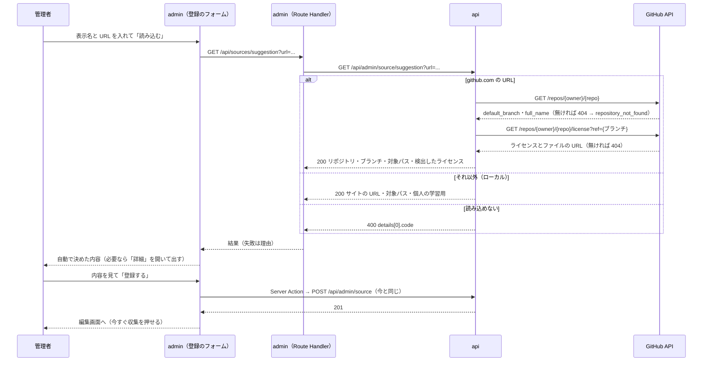

# 表示名と URL だけでのソース登録

admin のソースの登録を、表示名と URL を入れて「読み込む」を押し、出てきた内容を見て「登録する」を押すだけにする。取得方法・リポジトリ・ブランチ・対象パス・ライセンスとライセンスの記載がある URL は、URL と GitHub から自動で決める。自動で決めた値を直したいとき・自動で決められなかったときだけ「詳細」を開く。

今は 1 つのソースを登録するのに、取得方法・種別・リポジトリ・ブランチ・対象パス・ライセンス・ライセンスの記載がある URL を手で埋め、ライセンスは「ライセンスを検出」を押してから選ぶ。どれも URL と GitHub の情報から決まるので、入力を表示名と URL の 2 つにする。

このドキュメントは **仕様（What）** と **設計（How）** を分けて記述する：

- **仕様**：ユーザーから見える挙動・ルール・データの意味
- **設計**：実装にあたっての技術的な選択と制約

## 関連 spec

- [`../content-collection/README.md`](../content-collection/README.md#ソースの登録) — ソースの項目と「ソース登録時の確認」の正本。この機能はライセンスの決め方を「検出した値を初期値にして管理者が選ぶ」から「検出した値を自動で入れ、管理者は画面で見て登録する」に変える。ソースの項目と登録の検証は変えない
- [`../github-only-collection/README.md`](../github-only-collection/README.md) — サイトのソースはローカルだけで、ライセンスの記載が無いサイトは「個人の学習用」。この機能のサイトの初期値はこれに従う
- [`../manual-collection/README.md`](../manual-collection/README.md) — 登録すると編集画面に移り、「今すぐ収集」で収集する（変えない）
- [`../url-import/README.md`](../url-import/README.md) — サイトのソースを使う側。対象パスはそのページを取り込めるかの判定に使う
- [`../source-tags/README.md`](../source-tags/README.md) — 技術タグは「詳細」で選ぶ

## 目次

- [仕様](#仕様)
  - [登録の流れ](#登録の流れ)
  - [URL から決める値](#url-から決める値)
  - [ライセンスの自動の取得](#ライセンスの自動の取得)
  - [読み込めないとき](#読み込めないとき)
  - [変えないもの](#変えないもの)
- [設計](#設計)
  - [URL の読み込みは api で行う](#url-の読み込みは-api-で行う)
  - [URL の解釈](#url-の解釈)
  - [GitHub の呼び出し](#github-の呼び出し)
  - [登録は今の API のまま](#登録は今の-api-のまま)
  - [登録のフォーム](#登録のフォーム)
  - [MVP 対象外（将来検討）](#mvp-対象外将来検討)
- [必要な画面](#必要な画面)
- [必要な API](#必要な-api)
- [必要な DB 設計](#必要な-db-設計)
- [フロー図](#フロー図)

---

## 仕様

### 登録の流れ

1. ソースの登録の画面で、表示名と URL を入れて「読み込む」を押す（URL の欄で Enter でもよい）
2. URL から決めた内容（取得方法・取得元・ブランチ・対象パス・ライセンス・ライセンスの記載がある URL）が出る
3. 内容を見て「登録する」を押す。登録すると編集画面に移り、「今すぐ収集」を押せる（今と同じ）

- 読み込む前と、読み込んだ後に URL を変えたときは「登録する」を押せない（「URL を読み込んでください」）
- 読み込み直すと、取得方法・取得元と、「詳細」の取得元とライセンスの欄（ブランチ・対象パス・除外パス・公開ページの URL 規則・ライセンスなど）は読み込み直した値で作り直す。表示名・種別・技術タグは残す
- 読み込みに失敗しても、前に読み込んだ内容は残る（URL の欄が違うので、そのままでは登録できない）
- 「詳細」を開くと、自動で決めた値を含めて、取得元（リポジトリ・サイトの URL）以外の全項目を直せる。取得元を変えたいときは URL を変えて読み込み直す
- 「詳細」の欄に入力の誤りがあるとき・ライセンスを自動で決められなかったときは、「詳細」が開いた状態で出る

### URL から決める値

**GitHub のリポジトリ（`github.com` の URL）**

| URL の形 | 例 | リポジトリ | ブランチ | 対象パス |
| --- | --- | --- | --- | --- |
| リポジトリのトップ | `https://github.com/rust-lang/book` | `rust-lang/book` | default branch | `**`（リポジトリ全体） |
| ディレクトリ | `https://github.com/reactjs/react.dev/tree/main/src/content/learn` | `reactjs/react.dev` | `main` | `src/content/learn/**` |
| ファイル | `https://github.com/rust-lang/rfcs/blob/master/README.md` | `rust-lang/rfcs` | `master` | `README.md` |

- 収集するのは今と同じく `.md` / `.mdx` だけなので、対象パスに拡張子は付けない
- リポジトリは GitHub での正式な名前（大文字・小文字・改名後の名前）にそろえる
- URL の末尾の `/`・`.git`・`?` 以降・`#` 以降は見ない。`http://` と `www.github.com` も受け付ける
- `tree` / `blob` の無い URL（`/issues`・`/wiki` など）は、リポジトリのトップとして扱う

**サイト（`github.com` 以外の URL。ローカルだけ）**

| URL の形 | 例 | サイトの URL | 対象パス |
| --- | --- | --- | --- |
| サイトのトップ | `https://go.dev` | `https://go.dev` | `/**` |
| パス付き | `https://go.dev/doc/` | `https://go.dev` | `/doc/**`（`/doc` 自身も含む） |

- `http://` の URL は `https://` にそろえる（サイトのソースは https だけ）

**どちらも同じ値**

| 項目 | 値 |
| --- | --- |
| 種別 | 公式ドキュメント（Docs） |
| 収集する（GitHub だけ） | 有効 |
| 除外パス・公開ページの URL 規則・技術タグ・本文の CSS セレクタ | 空 |

### ライセンスの自動の取得

**GitHub のリポジトリ**：読み込んだときに GitHub が検出したライセンスを取り、結果に応じて入れる。URL でブランチを指定したときは、そのブランチのライセンスを見る。

| GitHub の検出の結果 | ライセンス | ライセンスの記載がある URL | 登録 |
| --- | --- | --- | --- |
| 許可リストのライセンス | 検出したライセンス | ライセンスのファイルの URL | そのまま登録できる |
| 許可リストに無いライセンス（CC-BY-SA・GPL など） | 空 | ライセンスのファイルの URL | 「詳細」で選ぶまで登録できない（「許可リストに無いライセンスです」） |
| ライセンスのファイルはあるが種類が分からない | 空 | ライセンスのファイルの URL | 「詳細」で選ぶまで登録できない |
| ライセンスのファイルが無い | 空 | 空 | 「詳細」で選び、ライセンスの記載がある URL（README など）を入れるまで登録できない |

- 読み込んだ内容と一緒に、今の画面にもある注意（コードとドキュメントでライセンスが分かれているリポジトリでは、GitHub の検出はコードのライセンスのことがある）を出す。ドキュメントの文章に掛かっているライセンスかを確かめるのは今と同じく管理者で、違えば「詳細」で選び直す
- 許可リストに無いライセンスのリポジトリでも、ドキュメントだけ許可リストのライセンスのことがある。その場合は「詳細」でライセンスとそのファイルの URL を入れれば登録できる（今と同じ）

**サイト**：ライセンスは自動では判定できないので、「個人の学習用」と、ライセンスの記載がある URL にサイトのトップ（`https://go.dev`）を入れる。サイトのソースはローカルで自分で読むためだけのもの（[github-only-collection](../github-only-collection/README.md#個人の学習用のライセンス)）なので、それより広く使えるライセンスを自動で選ばない。許可リストのライセンスのサイトは、「詳細」で選び直してもよい。

### 読み込めないとき

| 状況 | 表示 |
| --- | --- |
| URL の形が正しくない（http / https でない、など） | URL の形が正しくありません |
| `github.com` の URL だが、リポジトリまで無い（`https://github.com/reactjs`） | GitHub はリポジトリの URL（`https://github.com/{owner}/{repo}`）を入れてください |
| リポジトリが無い・非公開 | リポジトリが見つかりませんでした（非公開のリポジトリも同じ表示です） |
| ローカル以外で、`github.com` 以外の URL | GitHub のリポジトリの URL を入れてください（サイトはローカルでだけ登録できます） |
| GitHub の rate limit・障害 | 読み込めませんでした。時間をおいて再度お試しください |
| サインインの期限切れ | サインインの期限が切れました。ページを開き直してサインインしてください |

- すでに登録済みのリポジトリ・サイトは、今と同じく「登録する」を押したときに「同じリポジトリ・サイトがすでに登録されています」を出す

### 変えないもの

- 編集画面（`/sources/[id]`）。今と同じく全項目を並べたフォームで、リポジトリの欄と「ライセンスを検出」も残す
- ソースの項目・登録の検証・登録の API（[content-collection](../content-collection/README.md#ソースの登録)）
- サイトのソースはローカルでだけ登録できる

---

## 設計

### URL の読み込みは api で行う

URL の読み込みは、api の新しいエンドポイント `GET /api/admin/source/suggestion?url=...` が行い、登録のフォームの初期値（取得方法・取得元・ブランチ・対象パス・ライセンスの検出の結果）を返す。admin はブラウザから Route Handler（`GET /api/sources/suggestion`）経由で呼ぶ（今の「ライセンスを検出」と同じ）。

- **api で行う理由**：default branch とライセンスは GitHub の API から取る。GitHub の token（`GITHUB_LICENSE_TOKEN`）を持つのは api で、admin は api しか呼ばない（[admin の CLAUDE.md](../../apps/admin/CLAUDE.md#api-接続の下地)）。URL の解釈も、GitHub の結果と合わせないと決まらない（ブランチと対象パスの区切り）ので、同じ場所に置く
- **Server Action にしない理由**：状態を変えない GET で、ブラウザの `fetch` から呼んでフォームの入力を保ったまま結果を受けたい。今の「ライセンスを検出」の Route Handler と同じ形にする
- **読み込めない理由は 400 の `details[0].code`** で返す（`not_repository_url`・`repository_not_found`・`website_unavailable`）。admin が文言を分けるために読む。値の集合は `@repo/domain` の `SOURCE_SUGGESTION_ERROR_CODES` に置く（URL から追加の `URL_IMPORT_ERROR_CODES` と同じ形）。リポジトリが無いのも 404 ではなく 400 にする（URL から追加の `source_not_found` と同じく、入力した URL の誤りとして扱う）
- GitHub の rate limit・障害は throw して 500 にし、admin の Route Handler が 502 にする（今のライセンスの検出と同じ）

### URL の解釈

URL の解釈は api の `lib/source-url.ts` の純粋関数にする（api しか使わないので `@repo/domain` には置かない）。

- `github.com`（と `www.github.com`）なら GitHub、それ以外はサイト。`http:` は `https:` として扱う
- GitHub はパスを `/{owner}/{repo}/{tree|blob}/{ブランチとパス}` に分ける。owner / repo が登録のスキーマ（`githubRepositorySchema`）の形に合わなければ `not_repository_url`
- **ブランチとパスの区切り**：ブランチ名は `/` を含められる（`release/v2`）ので、URL だけでは `tree/release/v2/docs` のブランチが `release` か `release/v2` か決まらない。default branch で始まればそれをブランチにし、そうでなければ最初の区切り（`release`）までをブランチにする。ブランチの候補ごとに GitHub に問い合わせれば正確に決まるが、ドキュメントの URL のほとんどは default branch（`main` / `master`）で、間違えても「詳細」で直せるため、呼び出しを増やさない
- 対象パスは、ディレクトリなら `{パス}/**`、ファイルならそのパス、トップなら `**`。`{パス}/**` は picomatch でディレクトリ自身にも一致する。拡張子は収集（worker の `listGitHubTargetFiles`）が `.md` / `.mdx` に絞るので付けない
- `**`（リポジトリ全体）は glob の固定部分が無いので、trees API が切り詰められる巨大なリポジトリでは収集が `isComplete: false` になる（[manual-collection](../manual-collection/README.md)・worker の `listGitHubTargetFiles`）。そうしたリポジトリはディレクトリの URL で登録する。登録の画面では止めない

### GitHub の呼び出し

1 回の読み込みで GitHub の API を 2 回呼ぶ。

| 呼び出し | 使う値 | 404 のとき |
| --- | --- | --- |
| `GET /repos/{owner}/{repo}` | `default_branch`（ブランチの既定と、ブランチとパスの区切り）・`full_name`（正式な名前） | `repository_not_found` |
| `GET /repos/{owner}/{repo}/license?ref={ブランチ}` | 検出したライセンスと、ライセンスのファイルの URL（今の「ライセンスを検出」と同じ） | ライセンスのファイルが無い |

- token が無いと 60 回 / 時なので、読み込みは 30 回 / 時まで。登録の頻度なら足りる（今のライセンスの検出と同じ token を使う）
- client は今の `GitHubLicenseClient`（`client/github-license.ts`）を `GitHubRepositoryClient`（`client/github-repository.ts`）に改め、`findRepository` を足し、`detectLicense` に `ref` を足す。ライセンスだけを扱う client ではなくなるため名前を変える。env の `GITHUB_LICENSE_TOKEN` は名前を変えない（各環境の secret の登録〈`scripts/README.md`〉を変えずに済ませるため）
- 許可リストかどうかの判定は今の `detectRepositoryLicense`（service）を使い回す

### 登録は今の API のまま

「登録する」は今と同じ `POST /api/admin/source` に全項目を送る。読み込みの結果は初期値でしかなく、登録の検証（許可リスト・ライセンスの記載がある URL がそのリポジトリのファイルか・サイトはローカルだけ・重複）は今の 1 か所のまま。読み込みの後に「詳細」で値を変えても、変えた値で検証する。

- 読み込みの結果を api 側に覚えておいて登録で使う（トークンなど）形にはしない。初期値を管理者が直せる以上、登録の時に検証し直すことは変わらず、状態を増やすだけになるため

### 登録のフォーム

- 登録の画面（`/sources/new`）は、編集とは別の登録用のフォームにする。編集は取得元を変えられず（文書を取得した後）、URL の読み込みが要らないため。「詳細」の中の欄（GitHub の取得元・サイトの取得元・ライセンスの各セクション）は、今の `SourceForm` から部品に切り出して登録と編集で共有する
- 「詳細」は `
` にする。閉じていても中の欄はフォームの一部で、「登録する」で送られる
- 取得方法・リポジトリ・サイトの URL は、読み込みの結果を hidden の欄で送る（「詳細」でも直せない）
- 読み込み直したら、取得元の欄は `key` を読み込みのたびに変えて作り直し、ライセンスの欄は state を置き換える。除外パス・公開ページの URL 規則も作り直すのは、別の取得元を読み込んだのなら前の値は合わないため。表示名・種別・技術タグは作り直す欄の外に置いて残す
- 「登録する」は、読み込んだ URL と今の URL の欄が同じときだけ押せる
- 送信は今と同じく `onSubmit` から `startTransition(() => formAction(formData))`（入力エラーのときに値を消さないため。[admin の CLAUDE.md](../../apps/admin/CLAUDE.md#api-接続の下地)）。入力エラーが「詳細」の欄にあるときは「詳細」を開く

### MVP 対象外（将来検討）

以下は MVP では実装しない。登録の手間がまだ問題になったときに検討する。

- 編集画面も「詳細」にまとめる（編集は登録より少なく、全項目を見て直すことが多い）
- 読み込みの時点で、登録済みのリポジトリ・サイトかを出す（今は登録のときの 409）
- ブランチ名に `/` を含む URL の正確な区切り（ブランチの候補ごとに GitHub に問い合わせる）
- ドキュメント用のライセンスのファイル（`LICENSE-DOCS.md` など）を対象パスやルートから探して、GitHub の検出より先に使う
- 表示名をリポジトリ名・ページのタイトルから自動で入れる

---

## 必要な画面

| 画面 | 概要 |
| --- | --- |
| ソースの登録（`/sources/new`） | 表示名と URL を入れて読み込み、自動で決めた内容を見て登録する。直すときは「詳細」を開く |
| ソースの編集（`/sources/[id]`） | 変えない（「詳細」の欄の部品を登録と共有するだけ） |

具体的な UI 仕様は `design-mock` skill で確定後に追記される（今の登録の画面の欄の並べ替えなので、モックを作らずに実装してもよい）。

## 必要な API

| メソッド | パス | 説明 |
| --- | --- | --- |
| GET | `/api/admin/source/suggestion?url=...` | 新規。URL から登録の初期値（取得方法・取得元・ブランチ・対象パス・ライセンスの検出の結果）を返す。読み込めない理由は 400 の `details[0].code` |
| POST | `/api/admin/source` | 変えない（登録） |
| GET | `/api/admin/source/license?repository=...` | 変えない（編集画面の「ライセンスを検出」） |
| GET（admin の Route Handler） | `/api/sources/suggestion?url=...` | 新規。ブラウザから api の `/api/admin/source/suggestion` を呼ぶための中継 |

詳細（リクエスト・レスポンスのスキーマ）は [step1](./tasks/step1-api-source-suggestion.md)。

## 必要な DB 設計

なし（ソースのテーブルと項目は変えない）。

## フロー図

