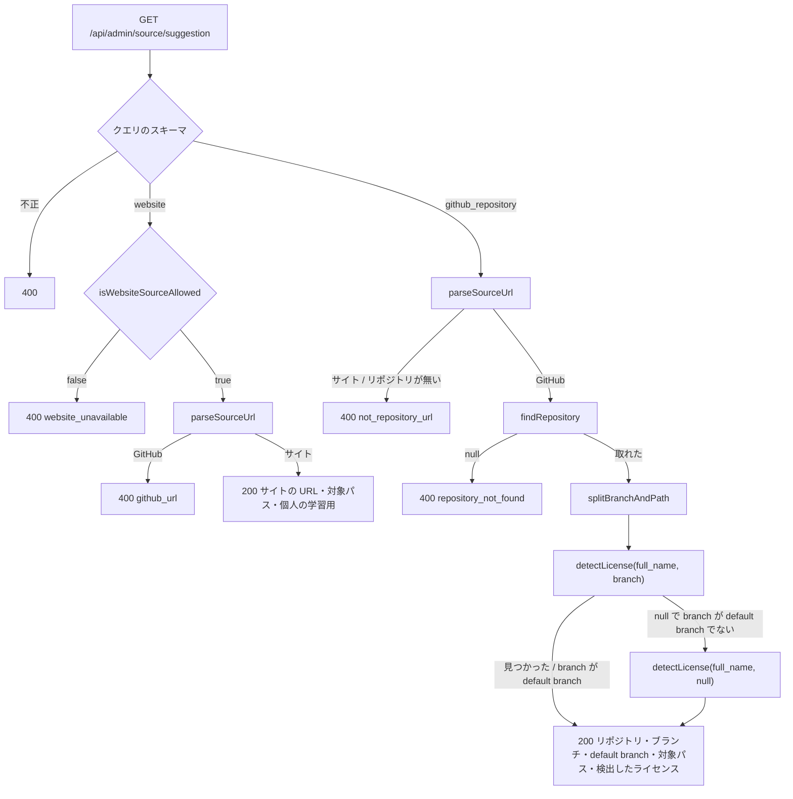

# step1: api — URL からのソースの登録の初期値（GET /api/admin/source/suggestion）

[README](../README.md) の「URL の読み込みは api で行う」「URL の解釈」「GitHub の呼び出し」を実装する。admin の画面は変えない（[step2](./step2-admin-source-create-form.md)）。

## 対象 API

| メソッド | パス | 説明 |
| --- | --- | --- |
| GET | `/api/admin/source/suggestion?fetch_type=...&url=...` | 画面の取得方法と URL から登録の初期値を返す。admin の認証が要る（ほかの `/api/admin/source` と同じ） |

## リクエスト / レスポンス

**リクエスト（クエリ）**

| 項目 | 型 | 説明 |
| --- | --- | --- |
| `fetch_type` | `"github_repository"` \| `"website"` | 登録の画面の取得方法 |
| `url` | string | http / https の URL（2048 文字まで） |

**レスポンス（200）**：`fetch_type` で形が変わる（リクエストの `fetch_type` と同じ）。

```json
{
  "branch": "main",
  "default_branch": "main",
  "detected_license": { "is_allowed": true, "license_spdx": "CC-BY-4.0", "license_url": "https://github.com/reactjs/react.dev/blob/main/LICENSE-DOCS.md" },
  "fetch_type": "github_repository",
  "include_globs": ["src/content/learn/**"],
  "repository": "reactjs/react.dev"
}
```

```json
{
  "fetch_type": "website",
  "include_globs": ["/doc/**"],
  "license_spdx": "LicenseRef-personal-use",
  "license_url": "https://go.dev",
  "site_url": "https://go.dev"
}
```

**エラー**

| status | `details[0].code` | 状況 |
| --- | --- | --- |
| 400 | （無し） | `fetch_type` が無い・値が違う、`url` が無い・URL でない・http / https でない |
| 400 | `not_repository_url` | `github_repository` で、`github.com` 以外の URL・owner / repo が無い・形が違う |
| 400 | `repository_not_found` | `github_repository` で、GitHub にリポジトリが無い（非公開を含む） |
| 400 | `github_url` | `website` で、`github.com` の URL |
| 400 | `website_unavailable` | `website` で、ローカル以外 |
| 401 | | admin の token が無い・不正 |
| 500 | | GitHub の rate limit・障害 |

## 処理フロー



## 処理サマリー

1. Controller が `suggestSourceQueryStringSchema` でクエリを検証する
2. `website` は、ローカルでなければ `website_unavailable`。`parseSourceUrl` が GitHub と判定したら `github_url`。サイトなら対象パス・個人の学習用・ライセンスの記載がある URL（オリジン）を返す
3. `github_repository` は、`parseSourceUrl` がサイト・null（リポジトリが無い）と判定したら `not_repository_url`
4. `findRepository` で default branch と改名後の名前を取り、`splitBranchAndPath` でブランチとパスに分ける
5. `detectLicense(改名後の名前, ブランチ)` でライセンスを取る。null で、ブランチが default branch でなければ `detectLicense(改名後の名前, null)`（default branch）を見直す
6. 結果を、今の「ライセンスを検出」と同じ規則（`buildRepositoryLicense`）で許可リストかどうかに直し、default branch と一緒に返す

## 設計方針

理由は README の「## 設計」に書いた。ここでは置き場所だけまとめる。

- 読み込めない理由の値の集合は `@repo/domain` の `SOURCE_SUGGESTION_ERROR_CODES`（型は `SourceSuggestionErrorCode`）、api-schema はそこから `sourceSuggestionErrorCodeSchema`（型は同じ名前の `SourceSuggestionErrorCode`）を作る（`URL_IMPORT_ERROR_CODES`・`urlImportErrorCodeSchema`・`UrlImportErrorCode` と同じ形）
- リポジトリ名の形は `@repo/domain` の `GITHUB_REPOSITORY_PATTERN`。api-schema の `githubRepositorySchema`（登録の検証）と api の `lib/source-url.ts`（URL の解釈）がこれを使う
- 取得方法のクエリは api-schema の `sourceFetchTypeSchema`（`SOURCE_FETCH_TYPES` の `z.enum`）。admin も一覧のクエリ（`?fetch_type=`）の解釈に使う
- URL の解釈は `apps/api/src/lib/source-url.ts`
- GitHub の client は `client/github-license.ts` を `client/github-repository.ts`（`GitHubRepositoryClient`）に改める。env の `GITHUB_LICENSE_TOKEN` はそのまま
- サイトを受け付けるかは今の `SourceWritePolicy`（`isWebsiteSourceAllowed`）を使い回す

## 対応内容

### packages/domain

`src/const/source.ts` に足す（JSDoc は既存の `URL_IMPORT_ERROR_CODES` と同じく値ごとの意味を書く。`GITHUB_REPOSITORY_PATTERN` の JSDoc は今の api-schema の `githubRepositorySchema` の説明〈owner は英数字とハイフン 39 文字まで、name は英数字と `.` `_` `-`、`.` と `..` は不可〉を移す）。

```ts
export const GITHUB_REPOSITORY_PATTERN = /^[A-Za-z0-9][A-Za-z0-9-]{0,38}\/(?!\.{1,2}$)[A-Za-z0-9._-]{1,100}$/

export const SOURCE_SUGGESTION_ERROR_CODES = ["github_url", "not_repository_url", "repository_not_found", "website_unavailable"] as const
```

`src/types/source.ts`：

```ts
export type SourceSuggestionErrorCode = (typeof SOURCE_SUGGESTION_ERROR_CODES)[number]
```

`src/index.ts` の `./const/source` と `./types/source` の export に名前順で足す。

### packages/schema（`src/api-schema/admin/source.ts`）

`githubRepositorySchema` の `.regex(...)` を `.regex(GITHUB_REPOSITORY_PATTERN)` にする（JSDoc は大文字・小文字をそろえる理由だけを残す。export しない）。末尾に足す。

```ts
export const sourceFetchTypeSchema = z.enum(SOURCE_FETCH_TYPES)

// ========================================================
// GET /api/admin/source/suggestion?fetch_type=...&url=... - URL からの登録の初期値
// ========================================================

export const suggestSourceQueryStringSchema = z.object({
  fetch_type: sourceFetchTypeSchema,
  url: z.string().trim().max(2048).url().refine((value) => isWebUrl(value), { message: "Must be an http(s) URL" }),
})

export const sourceSuggestionErrorCodeSchema = z.enum(SOURCE_SUGGESTION_ERROR_CODES)

export const suggestSourceResponseSchema = z.discriminatedUnion("fetch_type", [
  z.object({
    branch: z.string(),
    default_branch: z.string(),
    detected_license: detectSourceLicenseResponseSchema,
    fetch_type: z.literal("github_repository"),
    include_globs: z.array(z.string()),
    repository: z.string(),
  }),
  z.object({
    fetch_type: z.literal("website"),
    include_globs: z.array(z.string()),
    license_spdx: personalUseLicenseSchema,
    license_url: z.string(),
    site_url: z.string(),
  }),
])

export type SourceSuggestionErrorCode = z.infer<typeof sourceSuggestionErrorCodeSchema>
export type SuggestSourceQueryString = z.infer<typeof suggestSourceQueryStringSchema>
export type SuggestSourceResponse = z.infer<typeof suggestSourceResponseSchema>
```

`sourceFetchTypeSchema` は「共通: ソースの入力・出力の部品」の節に置き、一覧のレスポンスの `fetch_type: z.enum(SOURCE_FETCH_TYPES)` もこれにする。変更後に `cd packages/schema && pnpm build`。

### apps/api: client（`src/client/github-repository.ts`）

`src/client/github-license.ts` を移して改める（`git mv`）。

```ts
import { z } from "zod"

export type DetectedLicense = {
  licenseSpdx: string | null
  licenseUrl: string | null
}

export type GitHubRepository = {
  defaultBranch: string
  fullName: string
}

export interface IGitHubRepositoryClient {
  detectLicense(repository: string, ref: string | null): Promise<DetectedLicense | null>
  findRepository(repository: string): Promise<GitHubRepository | null>
}

const GITHUB_API_BASE_URL = "https://api.github.com"

const NO_ASSERTION_SPDX_ID = "NOASSERTION"

const REQUEST_TIMEOUT_MS = 10_000

const githubLicenseResponseSchema = z.object({
  html_url: z.string().nullable(),
  license: z.object({ spdx_id: z.string().nullable() }).nullable(),
})

const githubRepositoryResponseSchema = z.object({
  default_branch: z.string(),
  full_name: z.string(),
})

const buildRepositoryPath = (repository: string): string => {
  const [owner, name] = repository.split("/").map(encodeURIComponent)
  return `/repos/${owner}/${name}`
}

export class GitHubRepositoryClient implements IGitHubRepositoryClient {
  private _token: string | undefined

  constructor(token: string | undefined) {
    this._token = token
  }

  public async detectLicense(repository: string, ref: string | null): Promise<DetectedLicense | null> {
    const query = ref === null ? "" : `?ref=${encodeURIComponent(ref)}`
    const response = await this._request(`${buildRepositoryPath(repository)}/license${query}`)
    if (response.status === 404) return null
    if (!response.ok) throw new Error(`GitHub license request failed: ${response.status}`)

    const body = githubLicenseResponseSchema.parse(await response.json())
    const spdxId = body.license?.spdx_id ?? null
    return { licenseSpdx: spdxId === NO_ASSERTION_SPDX_ID ? null : spdxId, licenseUrl: body.html_url }
  }

  public async findRepository(repository: string): Promise<GitHubRepository | null> {
    const response = await this._request(buildRepositoryPath(repository))
    if (response.status === 404) return null
    if (!response.ok) throw new Error(`GitHub repository request failed: ${response.status}`)

    const body = githubRepositoryResponseSchema.parse(await response.json())
    return { defaultBranch: body.default_branch, fullName: body.full_name }
  }

  private async _request(path: string): Promise<Response> {
    return fetch(`${GITHUB_API_BASE_URL}${path}`, {
      headers: {
        Accept: "application/vnd.github+json",
        "User-Agent": "TechEnglishBot/1.0",
        "X-GitHub-Api-Version": "2022-11-28",
        ...(this._token ? { Authorization: `Bearer ${this._token}` } : {}),
      },
      signal: AbortSignal.timeout(REQUEST_TIMEOUT_MS),
    })
  }
}
```

- 今の JSDoc（`DetectedLicense` の各項目、token は任意）は残す。`findRepository` には「リポジトリが無い（非公開を含む）なら null。改名したリポジトリは GitHub の redirect を `fetch` がたどり、改名後の `full_name` を返す」を、`detectLicense` には「`ref` が null なら default branch。ライセンスのファイル・リポジトリ・ブランチが無いなら null」を書く
- `IGitHubLicenseClient` / `GitHubLicenseClient` を import しているところ（`controller/admin/source/detect-license.ts`・`service/source-service.ts`・`src/index.ts`・テスト）を新しい名前に変える

### apps/api: URL の解釈（`src/lib/source-url.ts`）

```ts
import { GITHUB_REPOSITORY_PATTERN } from "@repo/domain"

export type GitHubUrlTarget = "directory" | "file" | "root"

export type SourceUrl =
  | { fetchType: "github_repository"; refAndPath: string[]; repository: string; target: GitHubUrlTarget }
  | { fetchType: "website"; path: string; siteUrl: string }

const GITHUB_HOSTNAMES = ["github.com", "www.github.com"]

const GIT_SUFFIX_PATTERN = /\.git$/

const TRAILING_SLASHES_PATTERN = /\/+$/

const decodePathSegment = (segment: string): string => {
  try {
    return decodeURIComponent(segment)
  } catch {
    return segment
  }
}

const splitPathSegments = (pathname: string): string[] =>
  pathname.split("/").filter((segment) => segment !== "").map(decodePathSegment)

const findGitHubUrlTarget = (kind: string | undefined, refAndPath: string[]): GitHubUrlTarget => {
  if (refAndPath.length === 0) return "root"
  if (kind === "tree") return "directory"
  if (kind === "blob") return "file"
  return "root"
}

export const parseSourceUrl = (url: string): SourceUrl | null => {
  const parsed = new URL(url)
  if (!GITHUB_HOSTNAMES.includes(parsed.hostname)) {
    return { fetchType: "website", path: parsed.pathname, siteUrl: `https://${parsed.host}` }
  }

  const [owner, name, kind, ...rest] = splitPathSegments(parsed.pathname)
  if (owner === undefined || name === undefined) return null
  const repository = `${owner}/${name.replace(GIT_SUFFIX_PATTERN, "")}`
  if (!GITHUB_REPOSITORY_PATTERN.test(repository)) return null

  const target = findGitHubUrlTarget(kind, rest)
  return { fetchType: "github_repository", refAndPath: target === "root" ? [] : rest, repository: repository.toLowerCase(), target }
}

export const splitBranchAndPath = (refAndPath: string[], defaultBranch: string): { branch: string; path: string } => {
  if (refAndPath.length === 0) return { branch: defaultBranch, path: "" }
  const defaultBranchSegments = defaultBranch.split("/")
  const isDefaultBranch = defaultBranchSegments.every((segment, index) => refAndPath[index] === segment)
  const branchLength = isDefaultBranch ? defaultBranchSegments.length : 1
  return { branch: refAndPath.slice(0, branchLength).join("/"), path: refAndPath.slice(branchLength).join("/") }
}

export const buildGitHubIncludeGlob = (target: GitHubUrlTarget, path: string): string => {
  if (path === "") return "**"
  return target === "file" ? path : `${path}/**`
}

export const buildWebsiteIncludeGlob = (path: string): string => `${path.replace(TRAILING_SLASHES_PATTERN, "")}/**`
```

JSDoc は README の「URL の解釈」の要点だけを各関数に書く（`parseSourceUrl` の null は「`github.com` だがリポジトリが無い・形が違う」、`splitBranchAndPath` の区切りの規則とそう決めた理由、`buildGitHubIncludeGlob` で拡張子を付けない理由）。

### apps/api: service（`src/service/source-service.ts`）

```ts
type RepositoryLicense = { isAllowed: boolean; licenseSpdx: string | null; licenseUrl: string | null }

export type SourceSuggestion =
  | {
      branch: string
      defaultBranch: string
      detectedLicense: RepositoryLicense
      fetchType: "github_repository"
      includeGlobs: string[]
      repository: string
    }
  | {
      fetchType: "website"
      includeGlobs: string[]
      licenseSpdx: typeof PERSONAL_USE_LICENSE
      licenseUrl: string
      siteUrl: string
    }

const SOURCE_SUGGESTION_ERROR_MESSAGE = "Cannot suggest a source from the URL"

const buildSourceSuggestionError = (code: SourceSuggestionErrorCode) =>
  badRequestError(SOURCE_SUGGESTION_ERROR_MESSAGE, [{ code, message: code, path: ["url"] }])

const buildRepositoryLicense = (detected: DetectedLicense | null): RepositoryLicense => {
  const licenseSpdx = detected?.licenseSpdx ?? null
  return {
    isAllowed: licenseSpdx !== null && isAllowedLicense(licenseSpdx),
    licenseSpdx,
    licenseUrl: detected?.licenseUrl ?? null,
  }
}

export const detectRepositoryLicense = async (
  repository: string,
  deps: { githubRepositoryClient: IGitHubRepositoryClient },
): Promise<Result<RepositoryLicense>> =>
  ok(buildRepositoryLicense(await deps.githubRepositoryClient.detectLicense(repository, null)))

const suggestWebsiteSource = (url: string, policy: SourceWritePolicy): Result<SourceSuggestion> => {
  if (!policy.isWebsiteSourceAllowed) {
    logger.debug("SourceService: Website source is not available")
    return err(buildSourceSuggestionError("website_unavailable"))
  }
  const sourceUrl = parseSourceUrl(url)
  if (sourceUrl?.fetchType !== "website") {
    logger.debug("SourceService: GitHub URL is given for a website source")
    return err(buildSourceSuggestionError("github_url"))
  }
  return ok({
    fetchType: "website",
    includeGlobs: [buildWebsiteIncludeGlob(sourceUrl.path)],
    licenseSpdx: PERSONAL_USE_LICENSE,
    licenseUrl: sourceUrl.siteUrl,
    siteUrl: sourceUrl.siteUrl,
  })
}

const suggestGitHubRepositorySource = async (
  url: string,
  deps: { githubRepositoryClient: IGitHubRepositoryClient },
): Promise<Result<SourceSuggestion>> => {
  const sourceUrl = parseSourceUrl(url)
  if (sourceUrl?.fetchType !== "github_repository") {
    logger.debug("SourceService: URL is not a GitHub repository URL")
    return err(buildSourceSuggestionError("not_repository_url"))
  }

  const githubRepository = await deps.githubRepositoryClient.findRepository(sourceUrl.repository)
  if (githubRepository === null) {
    logger.debug("SourceService: GitHub repository not found", { repository: sourceUrl.repository })
    return err(buildSourceSuggestionError("repository_not_found"))
  }

  const repository = githubRepository.fullName.toLowerCase()
  const { defaultBranch } = githubRepository
  const { branch, path } = splitBranchAndPath(sourceUrl.refAndPath, defaultBranch)
  const detectedOnBranch = await deps.githubRepositoryClient.detectLicense(repository, branch)
  const detected = detectedOnBranch === null && branch !== defaultBranch
    ? await deps.githubRepositoryClient.detectLicense(repository, null)
    : detectedOnBranch
  return ok({
    branch,
    defaultBranch,
    detectedLicense: buildRepositoryLicense(detected),
    fetchType: "github_repository",
    includeGlobs: [buildGitHubIncludeGlob(sourceUrl.target, path)],
    repository,
  })
}

export const suggestSourceFromUrl = async (
  input: { fetchType: SourceFetchType; url: string },
  deps: { githubRepositoryClient: IGitHubRepositoryClient },
  policy: SourceWritePolicy,
): Promise<Result<SourceSuggestion>> =>
  input.fetchType === "website"
    ? suggestWebsiteSource(input.url, policy)
    : suggestGitHubRepositorySource(input.url, deps)
```

- `detectRepositoryLicense` の deps のキーが `githubLicenseClient` から `githubRepositoryClient` に変わるので、`AdminSourceDetectLicenseController` も合わせる
- `PERSONAL_USE_LICENSE`・`SourceFetchType`・`SourceSuggestionErrorCode` は `@repo/domain` から import する
- JSDoc：`suggestSourceFromUrl` に「登録のフォームの初期値。登録の検証は `createSource` が行うので、ここでは許可リストのライセンスかどうかを返すだけで拒否しない」、サイトのライセンスの初期値に「サイトは自動で判定できないので、ローカルの用途（個人の学習用）にそろえる」、default branch の見直しに「GitHub は無いブランチの `?ref=` にも 404 を返すので、ブランチの区切りを取り違えたときにライセンスを見失わないよう default branch を見直す」を書く

### apps/api: Controller（`src/controller/admin/source/suggest.ts`）

```ts
import { Request, Response } from "express"

import { suggestSourceQueryStringSchema, suggestSourceResponseSchema } from "@repo/api-schema"

import type { IGitHubRepositoryClient } from "../../../client/github-repository"
import { parseRequest, parseResponse } from "../../../lib/parse-schema"
import { sendError } from "../../../lib/send-error"
import * as service from "../../../service"
import type { SourceWritePolicy } from "../../../service/source-service"

import { convertSourceSuggestionToResponse } from "./source-mapper"

export class AdminSourceSuggestController {
  constructor(
    private _githubRepositoryClient: IGitHubRepositoryClient,
    private _policy: SourceWritePolicy,
  ) {}

  public async execute(req: Request, res: Response) {
    const { fetch_type: fetchType, url } = parseRequest(suggestSourceQueryStringSchema, req.query)

    const result = await service.source.suggestSourceFromUrl(
      { fetchType, url },
      { githubRepositoryClient: this._githubRepositoryClient },
      this._policy,
    )

    if (!result.ok) {
      return sendError(req, res, result.error)
    }

    const response = parseResponse(suggestSourceResponseSchema, convertSourceSuggestionToResponse(result.value))
    return res.status(200).json(response)
  }
}
```

`source-mapper.ts` に足す：

```ts
export const convertSourceSuggestionToResponse = (suggestion: SourceSuggestion): SuggestSourceResponse => {
  if (suggestion.fetchType === "website") {
    return {
      fetch_type: "website",
      include_globs: suggestion.includeGlobs,
      license_spdx: suggestion.licenseSpdx,
      license_url: suggestion.licenseUrl,
      site_url: suggestion.siteUrl,
    }
  }
  return {
    branch: suggestion.branch,
    default_branch: suggestion.defaultBranch,
    detected_license: {
      is_allowed: suggestion.detectedLicense.isAllowed,
      license_spdx: suggestion.detectedLicense.licenseSpdx,
      license_url: suggestion.detectedLicense.licenseUrl,
    },
    fetch_type: "github_repository",
    include_globs: suggestion.includeGlobs,
    repository: suggestion.repository,
  }
}
```

### apps/api: Router と DI

`src/routes/admin-router.ts`：`source` に `suggest?: AdminSourceSuggestController` を足し（キーは名前順）、`GET /source/suggestion` を `/source/license` と同じく `/source/:id` より前に登録する（既存の `/license` の JSDoc の理由と同じ）。

```ts
if (source.suggest) {
  const controller = source.suggest
  router.get("/source/suggestion", async (req, res) => controller.execute(req, res))
}
```

`src/index.ts`：

```ts
const gitHubRepositoryClient = new GitHubRepositoryClient(env.GITHUB_LICENSE_TOKEN)

const adminSourceDetectLicenseController = new AdminSourceDetectLicenseController(gitHubRepositoryClient)
const adminSourceSuggestController = new AdminSourceSuggestController(gitHubRepositoryClient, sourceWritePolicy)
```

`adminRouter({ source: { ..., suggest: adminSourceSuggestController, ... } })` に足す。

### ドキュメント

- `apps/api/src/env.ts` の `GITHUB_LICENSE_TOKEN` の JSDoc：「admin のソース登録で GitHub（リポジトリの default branch・ライセンスの検出）を呼ぶときの token。名前は各環境の secret に合わせて変えない」
- `apps/api/CLAUDE.md` の `GITHUB_LICENSE_TOKEN` の説明、`scripts/README.md` の `GITHUB_LICENSE_TOKEN` の行、`scripts/deploy/seed-secrets.sh` の先頭のコメント（`GITHUB_LICENSE_TOKEN` の行）を同じ内容にする。`apps/api/CLAUDE.md` の「Admin API 設計方針」に、URL からの登録の初期値の 1 行を足す
- `docs/spec/content-collection/README.md` の「必要な API」の表に `GET /api/admin/source/suggestion?fetch_type=...&url=...`（画面の取得方法と URL から登録の初期値を返す。リンクは `../source-registration-by-url/README.md`）を足し、`/license` の行の説明を「編集フォームの「ライセンスを検出」用」に直す

## 動作確認

テストは `cd apps/api && pnpm test`（vitest を直接叩かない。dev DB が消える）。GitHub は `fetch`（client のテスト）か client の偽物（service・Controller のテスト）に差し替え、実在のリポジトリにリクエストを送らない。

### `test/lib/source-url.test.ts`

- `parseSourceUrl`
  - 正常系（GitHub）：トップ・末尾の `/` と `.git`・大文字と `www` と `http`（小文字にそろえる）・ディレクトリ・ファイル・`?` と `#` は見ない・パスの `%` エンコードは戻す・`tree` / `blob` 以外はトップ・`tree` だけはトップ
  - 正常系（サイト）：トップ・パス付き・`http` は `https` にする・`docs.github.com` はサイト
  - 異常系：owner だけ・GitHub のトップ・owner の形が違う・name が `.git` だけ → null
- `splitBranchAndPath`：空なら default branch・default branch で始まる・`/` を含む default branch・default branch でなければ最初の区切りまで・default branch の一部だけ一致・ブランチだけ
- `buildGitHubIncludeGlob`・`buildWebsiteIncludeGlob`：表のとおり

### `test/client/github-repository.test.ts`

`test/client/github-license.test.ts` を移して改め、`findRepository` と `detectLicense` の `ref` のケースを足す。

- `findRepository`：200 なら `{ defaultBranch, fullName }`（`GET https://api.github.com/repos/{owner}/{repo}` を token 付きで呼ぶ）、404 なら null、403 / 500 なら throw、レスポンスの形が違えば throw
- `detectLicense(repository, "release/v2")` は `.../license?ref=release%2Fv2` を呼ぶ。`ref` が null なら今と同じ URL（クエリ無し）

### `test/service/source-service/suggestSourceFromUrl.test.ts`

client の偽物（`findRepository`・`detectLicense` を `vi.fn()`）で確かめる。結果は `Result` の構造で比べ、文言は比べない。

- 正常系（`github_repository`）
  - ディレクトリの URL：`branch: "main"`・`defaultBranch: "main"`・`includeGlobs: ["src/content/learn/**"]`・`repository: "reactjs/react.dev"` を返し、`detectLicense` を `("reactjs/react.dev", "main")` で 1 回だけ呼ぶ
  - トップの URL：ブランチは default branch、`includeGlobs: ["**"]`
  - 改名・大文字：`fullName` が `"ReactJS/React.dev"` なら `repository` は `"reactjs/react.dev"` で、その名前でライセンスを見る
  - ライセンスの検出の 4 通り（許可リスト・許可リスト外・判定できない・ファイルが無い）が `detectedLicense` にそのまま入り、`detectLicense` は 1 回だけ
  - default branch でないブランチでライセンスが見つからない：1 回目（`ref: "release"`）は null、2 回目（`ref: null`）は MIT なら MIT を返す（呼び出しは 2 回）
  - default branch でないブランチで、default branch にもライセンスが無い：2 回とも null なら、ファイルが無いときの値を返す（呼び出しは 2 回）
  - default branch でないブランチでライセンスが見つかる：`detectLicense` は 1 回だけ
- 正常系（`website`）：ローカルならサイトの URL・対象パス・個人の学習用・ライセンスの記載がある URL（= サイトの URL）を返し、GitHub を呼ばない
- 異常系
  - `github_repository` で `https://github.com/reactjs`・サイトの URL：400・`not_repository_url`、GitHub を呼ばない
  - `github_repository` で `findRepository` が null：400・`repository_not_found`、`detectLicense` を呼ばない
  - `website` で github.com の URL：400・`github_url`、GitHub を呼ばない
  - `website` で `isWebsiteSourceAllowed: false`：400・`website_unavailable`
  - `findRepository` が throw：例外が伝播する

`detectRepositoryLicense.test.ts` は deps のキー（`githubRepositoryClient`）と `detectLicense` の呼び出し（`("owner/name", null)`）を直す。

### `test/controller/admin/source/suggest.test.ts`

`detect-license.test.ts` と同じく、GitHub の client だけを偽物にし、`/suggestion` が `/:id` に吸われないことも確かめるため詳細の Controller も登録する。

- 正常系
  - `github_repository` でディレクトリの URL：200 と、スキーマどおりのボディ（`toEqual`）
  - `website` でサイトの URL（policy で許可）：200
- 異常系
  - `fetch_type` が無い・値が違う、`url` が無い・`ftp://` ・URL でない：400、GitHub を呼ばない
  - `not_repository_url`・`repository_not_found`・`github_url`・`website_unavailable`（policy で不許可）：400 と `details[0].code`
  - GitHub の呼び出しが throw：500
  - token が無い：401

`detect-license.test.ts` は client の型と `toHaveBeenCalledWith("reactjs/react.dev", null)` を直す。

### 手元での確認

dev の api を起動した状態で、admin の dev ログイン（`POST /api/admin/auth/dev-login`。seed の `admin@dev.local`）で access token を取り、実際の GitHub に問い合わせる。

```bash
ADMIN_TOKEN=$(curl -s -X POST http://localhost:8080/api/admin/auth/dev-login -H 'Content-Type: application/json' -d '{"email":"admin@dev.local"}' | node -p 'JSON.parse(require("fs").readFileSync(0, "utf8")).access_token')
curl -s -H "Authorization: Bearer $ADMIN_TOKEN" \
  "http://localhost:8080/api/admin/source/suggestion?fetch_type=github_repository&url=$(node -p 'encodeURIComponent(process.argv[1])' 'https://github.com/reactjs/react.dev/tree/main/src/content/learn')"
```

- `branch: "main"`・`include_globs: ["src/content/learn/**"]`・`detected_license` が返る
- `https://github.com/reactjs` は 400 の `not_repository_url`、存在しないリポジトリは 400 の `repository_not_found`
- `fetch_type=website` で `https://go.dev/doc/` はローカルでは 200、`https://github.com/reactjs/react.dev` は 400 の `github_url`

`pnpm lint:fix`（root）を通し、コミット前に `coding-style` skill で差分を見直す。
