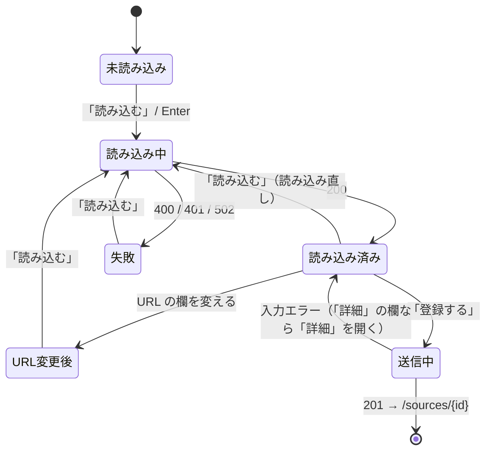

# step2: admin — GitHub とサイトに分けた一覧と、表示名と URL だけで登録するフォーム

[README](../README.md) の「GitHub とサイトの画面」「登録の流れ」「画面の分け方」「登録のフォーム」を実装する。api は [step1](./step1-api-source-suggestion.md) の `GET /api/admin/source/suggestion` を使う。登録の API・Server Action（`createSourceAction`）は変えない。

## 対象画面

| パス | 変更 |
| --- | --- |
| `/sources`・`/sources?fetch_type=website` | 上に [GitHub] [サイト]（件数つき）を置き、選んだ取得方法のソースだけを出す。「ソースを登録」は選んでいる方の登録の画面へ |
| `/sources/new` | `/sources/new/github` に redirect |
| `/sources/new/github`・`/sources/new/website` | 新規。上に [GitHub] [サイト] を置き、登録用のフォーム（`SourceCreateForm`）を出す。`website` はローカル以外で `notFound()` |
| `/sources/[id]` | 見た目は変えない。欄の部品を登録と共有し、`SourceForm` を編集だけの `SourceEditForm` にする |
| `GET /api/sources/suggestion?fetch_type=...&url=...`（Route Handler） | 新規。api の `/api/admin/source/suggestion` の中継 |

## リクエスト / レスポンス

**Route Handler（ブラウザの `fetch` から呼ぶ）**

| status | ボディ | 状況 |
| --- | --- | --- |
| 200 | `SuggestSourceResponse`（api のレスポンスをそのまま） | 読み込めた |
| 400 | `{ "reason": "invalid_url" \| "github_url" \| "not_repository_url" \| "repository_not_found" \| "website_unavailable" }` | URL の誤り。api の 400 の `details[0].code`、無ければ `invalid_url` |
| 401 | `{ "reason": "unauthorized" }` | サインインの期限切れ（redirect しない。フォームの入力を消さないため） |
| 502 | `{ "reason": "failed" }` | GitHub の rate limit・障害など |

セッションが切れて refresh もできないときは、Route Handler に届く前に `src/proxy.ts` が `{ "error": "Unauthorized" }` の 401 を返す（ボディに `reason` が無い）。フォームは 401 を status で見分け、それ以外でボディの `reason` が読めなければ `failed` にする。

## 処理フロー



- 「登録する」を押せるのは「読み込み済み」で、読み込んだ URL と今の URL の欄が同じときだけ
- 「失敗」でも、前に読み込んだ内容と「詳細」の欄は残す（URL が違うので登録はできない）
- [GitHub] [サイト] は別のページへのリンクなので、押すとフォームは初めからになる

## 処理サマリー

1. 管理者が一覧か登録の画面で [GitHub] か [サイト] を選び、登録の画面で表示名と URL を入れて「読み込む」（URL の欄で Enter でもよい）を押す
2. フォームが Route Handler に画面の取得方法と URL を送り、Route Handler が api の `/api/admin/source/suggestion` を呼ぶ
3. 読み込めたら、読み込んだ内容（取得元・ブランチ・対象パス・ライセンス）を出し、「詳細」の取得元とライセンスの欄を読み込んだ値で作り直す。ライセンスを自動で決められなかったら「詳細」を開く
4. 管理者が内容を見て「登録する」を押すと、今と同じ `createSourceAction` で登録し、編集画面に移る
5. 入力エラーが「詳細」の欄にあれば「詳細」を開く

## 設計方針

理由は README の「## 設計」に書いた。ここでは置き場所だけまとめる。

- [GitHub] [サイト] は 1 つの部品（`SourceFetchTypeTabs`）で、一覧と登録でリンク先だけを変える。リンク先は `features/source/source.paths.ts`（`SOURCE_LIST_PATHS`・`SOURCE_CREATE_PATHS`）に置く。[サイト] はローカルだけ（`isLocalEnvironment`）
- 一覧の `?fetch_type=` は `features/source/source.params.ts` の `parseSourceListFetchType` で読む（api-schema の `sourceFetchTypeSchema`。不正・未指定・ローカル以外のサイトは GitHub）。問題一覧の `?status=` と同じく page で読む
- 欄の部品（`Section`・`Field`・種別・GitHub の取得元・サイトの取得元・ライセンス・収集のスイッチ）は `SourceForm.tsx` から `SourceFormParts.tsx` に切り出し、登録と編集で共有する。GitHub / サイトの取得元の欄は `defaultValue`（`defaults` で受ける）、ライセンスの欄は今と同じく state で持つ（編集の「ライセンスを検出」と、登録の読み込みが値を入れるため）
- 登録用のフォーム（`SourceCreateForm`）は取得方法を props で受け、取得方法は hidden の欄で、リポジトリ・サイトの URL は読み込みの結果を hidden の欄で送る
- 「詳細」は `<details>`。閉じていても中の欄は送られる
- 読み込み直したら、取得元の欄は `key` を変えて作り直し、ライセンスの欄は state を置き換える。表示名・種別・技術タグは作り直さない
- 「詳細」を開く条件（入力エラー）は、`useActionState` の state が変わったときに描画中に判定する（React の「前の値と比べて state を直す」形。`useEffect` で setState しない）
- 読めない理由の文言・取得方法の表示名は `source.labels.ts` の 1 か所に置く

## 対応内容

### `src/features/source/source.paths.ts`

```ts
type SourceFetchType = GetSourceResponse["source"]["fetch_type"]

export const SOURCE_LIST_PATHS: Record<SourceFetchType, string> = {
  github_repository: "/sources",
  website: "/sources?fetch_type=website",
}

export const SOURCE_CREATE_PATHS: Record<SourceFetchType, string> = {
  github_repository: "/sources/new/github",
  website: "/sources/new/website",
}
```

### `src/features/source/source.params.ts`

```ts
import "server-only"

import { sourceFetchTypeSchema } from "@repo/api-schema"

import { isLocalEnvironment } from "@/libs/environment"

export const parseSourceListFetchType = (value: string | string[] | undefined): SourceFetchType => {
  const parsed = sourceFetchTypeSchema.safeParse(value)
  if (!parsed.success) return "github_repository"
  return parsed.data === "website" && !isLocalEnvironment ? "github_repository" : parsed.data
}
```

### `src/features/source/source.api.ts`

`sourceApi` に名前順で足す。

```ts
suggest: async (query: SuggestSourceQueryString): Promise<SuggestSourceResponse> => {
  const params = new URLSearchParams({ fetch_type: query.fetch_type, url: query.url })
  const raw = await apiClient.get<unknown>(`${BASE_PATH}/suggestion?${params.toString()}`, { onUnauthorized: "throw" })
  return suggestSourceResponseSchema.parse(raw)
},
```

### `src/features/source/source.labels.ts`

```ts
export const SOURCE_FETCH_TYPE_LABELS: Record<SourceFetchType, string> = {
  github_repository: "GitHub リポジトリ",
  website: "サイト（URL から追加）",
}

export type SourceSuggestionFailureReason = SourceSuggestionErrorCode | "failed" | "invalid_url" | "unauthorized"

export const SOURCE_SUGGESTION_FAILURE_MESSAGES: Record<SourceSuggestionFailureReason, string> = {
  failed: "読み込めませんでした。時間をおいて再度お試しください。",
  github_url: "GitHub のリポジトリは GitHub の画面で登録してください。",
  invalid_url: "URL の形が正しくありません。",
  not_repository_url: "GitHub はリポジトリの URL（https://github.com/{owner}/{repo}）を入れてください。",
  repository_not_found: "リポジトリが見つかりませんでした（非公開のリポジトリも同じ表示です）。",
  unauthorized: "サインインの期限が切れました。ページを開き直してサインインしてください。",
  website_unavailable: "サイトのソースはローカルでだけ登録できます。",
}
```

`SOURCE_FETCH_TYPE_LABELS` は編集フォームの取得方法のカード（今の `FETCH_TYPE_OPTIONS` の `label`）と、読み込んだ内容の両方で使う。`SourceSuggestionErrorCode` は `@repo/api-schema` から `import type` する（このファイルは Client Component からも読むので、スキーマの値は import しない）。

### `src/app/api/sources/suggestion/route.ts`

```ts
import "server-only"

import { type NextRequest, NextResponse } from "next/server"

import { errorResponseSchema, sourceSuggestionErrorCodeSchema, suggestSourceQueryStringSchema } from "@repo/api-schema"

import { sourceApi } from "@/features/source/source.api"
import type { SourceSuggestionFailureReason } from "@/features/source/source.labels"
import { ApiClientError } from "@/libs/api-client"

const convertApiErrorToFailureReason = (error: ApiClientError): SourceSuggestionFailureReason => {
  const body = errorResponseSchema.safeParse(error.body)
  const code = sourceSuggestionErrorCodeSchema.safeParse(body.success ? body.data.details?.[0]?.code : undefined)
  return code.success ? code.data : "invalid_url"
}

const respondFailure = (reason: SourceSuggestionFailureReason, status: number) => NextResponse.json({ reason }, { status })

export const GET = async (request: NextRequest) => {
  const { searchParams } = request.nextUrl
  const parsed = suggestSourceQueryStringSchema.safeParse({ fetch_type: searchParams.get("fetch_type"), url: searchParams.get("url") })
  if (!parsed.success) return respondFailure("invalid_url", 400)

  try {
    return NextResponse.json(await sourceApi.suggest(parsed.data))
  } catch (error) {
    if (error instanceof ApiClientError && error.status === 401) return respondFailure("unauthorized", 401)
    if (error instanceof ApiClientError && error.status === 400) return respondFailure(convertApiErrorToFailureReason(error), 400)
    console.error("Source suggestion failed", error)
    return respondFailure("failed", 502)
  }
}
```

JSDoc は `app/api/sources/license/route.ts` と同じ内容（GET なので Route Handler、ブラウザから api を直接呼ばないための中継、401 を redirect しない理由）に、「失敗は理由（`reason`）で返し、文言は画面が決める」を足す。

### `src/components/features/source/SourceFetchTypeTabs.tsx`

```tsx
import Link from "next/link"

import { SOURCE_FETCH_TYPE_TAB_LABELS } from "@/features/source/source.labels"
import { isLocalEnvironment } from "@/libs/environment"

const FETCH_TYPES: SourceFetchType[] = ["github_repository", "website"]

export function SourceFetchTypeTabs({
  counts,
  current,
  hrefs,
}: {
  counts?: Record<SourceFetchType, number>
  current: SourceFetchType
  hrefs: Record<SourceFetchType, string>
}) {
  const fetchTypes = FETCH_TYPES.filter((fetchType) => isLocalEnvironment || fetchType !== "website")
  return (
    <nav aria-label="取得方法" className="inline-flex rounded-lg bg-gray-100 p-0.5 dark:bg-gray-900">
      {fetchTypes.map((fetchType) => (
        <Link
          key={fetchType}
          aria-current={fetchType === current ? "page" : undefined}
          className={fetchType === current ? ACTIVE_TAB_CLASS : TAB_CLASS}
          href={hrefs[fetchType]}
        >
          {SOURCE_FETCH_TYPE_TAB_LABELS[fetchType]}
          {counts && <span className="ml-1.5 tabular-nums">{counts[fetchType]}</span>}
        </Link>
      ))}
    </nav>
  )
}
```

- 見た目は問題一覧の状態の切り替え・TailAdmin のタブ（選んでいる方を白地に浮かせる）に合わせる。`ACTIVE_TAB_CLASS`・`TAB_CLASS` はこのファイルに置く
- ボタンの文字は短く「GitHub」「サイト」にする（`source.labels.ts` の `SOURCE_FETCH_TYPE_TAB_LABELS`。`SOURCE_FETCH_TYPE_LABELS` は説明に使う長い方）

### `src/app/(dashboard)/sources/page.tsx`

- `searchParams` の `fetch_type` を `parseSourceListFetchType` で読み、`sourceApi.getList()` の結果を取得方法で分ける。ボタンの件数は分ける前の件数
- `ComponentCard` の上の右に「ソースを登録」（`SOURCE_CREATE_PATHS[fetchType]`）、左に `SourceFetchTypeTabs`（`hrefs={SOURCE_LIST_PATHS}`）を置く
- `SourceTable` に `fetchType` を渡す

### `src/components/features/source/SourceTable.tsx`

- `fetchType` を props で受け、列と絞り込みを取得方法で変える（`createColumns(fetchType)`・`createFilters(fetchType)`。問題一覧の `PassageTable` と同じ形）
- 「取得方法」の列は「種別」にし、種別（公式ドキュメント / GitHub の文書）だけを出す。絞り込みの「取得方法」はやめる
- サイトの一覧では「状態」「最終収集」の列と「状態」の絞り込みを出さない（常に「収集しない」・「―」のため）
- 空のときの文言は取得方法ごとにする（GitHub：「GitHub のリポジトリを登録し、編集画面の「今すぐ収集」で本文候補を作ります。」、サイト：「サイトを登録すると、URL から追加でそのサイトのページを取り込めます。」）

### `src/components/features/source/SourceFormParts.tsx`（切り出し）

`SourceForm.tsx` から次を移す。中身（JSX・クラス）は今のまま。

| 部品 | props | 今の `SourceForm.tsx` の場所 |
| --- | --- | --- |
| `Section` / `Field` / `errorHintClass` / `LICENSE_NOTE` | 今と同じ | 先頭の部品と定数 |
| `SourceKindField` | `defaultKind: GetSourceResponse["source"]["kind"]`, `error?: string` | 「種別」の `Field` |
| `GitHubTargetFields` | `defaults: { branch, excludeGlobs, includeGlobs, publicUrlStripPrefix, publicUrlTemplate }`, `getFieldError` | 「取得元（GitHub リポジトリ）」のうち、リポジトリの欄より下（ブランチ・対象パス・除外パス・公開ページの URL 規則・取り除くプレフィックス・変換例） |
| `WebsiteTargetFields` | `defaults: { contentSelector, excludeGlobs, excludeSelectors, includeGlobs }`, `getFieldError` | 「取得元（サイト）」のうち、サイトの URL の欄より下 |
| `LicenseFields` | `fetchType`, `licenseOptions`, `licenseSpdx`, `licenseUrl`, `getFieldError`, `onLicenseSpdxChange`, `onLicenseUrlChange` | 「ライセンス」のセクションの中身（サイトの注意書きを含む） |
| `CollectionToggle` | `isEnabled`, `onToggle` | 「収集」のセクションの中身 |

`getFieldError` は `(key: string) => string | undefined`。リポジトリの欄と「ライセンスを検出」、サイトの URL の欄は編集だけが使うので `SourceEditForm` に残す。

### `src/components/features/source/SourceEditForm.tsx`（`SourceForm.tsx` を改名）

- `detail` を必須にし、登録の分岐（`createSourceAction`・取得方法の切り替え・「登録の前に確認すること」）を消す。取得方法は今の編集と同じく、押せない表示だけ残す（ローカルなら 2 枚とも出す）。`FETCH_TYPE_OPTIONS` の `label` は `SOURCE_FETCH_TYPE_LABELS` から取る
- 切り出した部品を使う。見た目と挙動は今の編集画面のまま
- `/sources/[id]/page.tsx` の import を直す

### `src/components/features/source/SourceCreateForm.tsx`

`fetchType` を props で受ける 1 つの部品にし、2 つのページから使う。

```tsx
export function SourceCreateForm({
  allowedLicenses,
  fetchType,
  personalUseLicense,
  tags,
}: {
  allowedLicenses: readonly string[]
  fetchType: SourceFetchType
  personalUseLicense: string
  tags: GetTagListResponse["tags"]
}) {
  const [state, formAction, isPending] = useActionState<SourceFormState, FormData>(createSourceAction, {})
  const [prevState, setPrevState] = useState(state)
  const [url, setUrl] = useState("")
  const [loadStatus, setLoadStatus] = useState<LoadStatus>({ status: "idle" })
  const [loaded, setLoaded] = useState<LoadedSuggestion | null>(null)
  const [revision, setRevision] = useState(0)
  const [isDetailsOpen, setIsDetailsOpen] = useState(false)
  const [isEnabled, setIsEnabled] = useState(true)
  const [licenseSpdx, setLicenseSpdx] = useState("")
  const [licenseUrl, setLicenseUrl] = useState("")

  if (state !== prevState) {
    setPrevState(state)
    if (hasDetailFieldErrors(state)) setIsDetailsOpen(true)
  }

  const suggestion = loaded?.suggestion ?? null
  const isLoadedUrl = loaded !== null && loaded.url === url.trim()
  const licenseOptions = fetchType === "website" ? [...allowedLicenses, personalUseLicense] : allowedLicenses
  const getFieldError = (key: string): string | undefined => state.errors?.[key]?.[0]

  const loadSuggestion = async () => {
    const target = url.trim()
    if (target === "") {
      setLoadStatus({ message: SOURCE_SUGGESTION_FAILURE_MESSAGES.invalid_url, status: "failed" })
      return
    }

    setLoadStatus({ status: "loading" })
    try {
      const result = await fetchSourceSuggestion(fetchType, target)
      if (!result.ok) {
        setLoadStatus({ message: SOURCE_SUGGESTION_FAILURE_MESSAGES[result.reason], status: "failed" })
        return
      }
      const initialLicense = buildInitialLicense(result.suggestion)
      setLoaded({ suggestion: result.suggestion, url: target })
      setRevision((value) => value + 1)
      setLicenseSpdx(initialLicense.licenseSpdx)
      setLicenseUrl(initialLicense.licenseUrl)
      setIsDetailsOpen(!isLicenseResolved(result.suggestion))
      setLoadStatus({ status: "idle" })
    } catch {
      setLoadStatus({ message: SOURCE_SUGGESTION_FAILURE_MESSAGES.failed, status: "failed" })
    }
  }
}
```

- `fetchSourceSuggestion(fetchType, url)` は `/api/sources/suggestion?fetch_type=...&url=...` を `URLSearchParams` で組み立てて呼ぶ。401 は status で `unauthorized` にし、それ以外でボディの `reason` が読めなければ `failed` にする（README の「URL の読み込みは api で行う」の proxy の 401）
- `buildInitialLicense`：サイトは読み込んだ `license_spdx`・`license_url`、GitHub は許可リストのライセンスならそのライセンス（それ以外は空）と、ライセンスのファイルの URL（無ければ空）
- `isLicenseResolved`：サイトは常に true、GitHub は許可リストのライセンスでライセンスのファイルの URL があるとき true
- hidden の欄：`fetch_type`（props の値。読み込む前からある）、読み込んだら `repository`（GitHub）か `site_url`（サイト）、GitHub は `is_enabled`
- URL の欄の placeholder と説明は取得方法ごと（GitHub：`https://github.com/reactjs/react.dev/tree/main/src/content/learn`・「リポジトリ・ディレクトリ・ファイルの URL」、サイト：`https://go.dev/doc/`・「サイトのトップか、取り込みたいページのディレクトリの URL」）
- Enter は読み込み中なら何もしない（`if (loadStatus.status !== "loading") void loadSuggestion()`）
- 「詳細」の中は、種別と技術タグ（作り直さない）・「取得元」（GitHub は `GitHubTargetFields`、サイトは `WebsiteTargetFields`。`key={revision}`）・「ライセンス」（`LicenseFields`）・「収集」（GitHub だけ `CollectionToggle`）の順に並べる
- 右の「登録の前に確認すること」は取得方法ごと（GitHub：自動で入ったライセンスが文章に掛かっている・ライセンスが許可リストにある・対象パスが問題にしたいドキュメントのディレクトリ。サイト：今の 3 つ）
- 入力エラーの全体の文言（「入力内容を確認してください。各欄の下に理由を表示しています。」）は今の `SourceForm` と同じく出し、エラーが無く読み込んでいないときは「URL を読み込んでください。」を出す
- JSDoc：`fetchSourceSuggestion` に proxy の 401、`SourceCreateForm` に「読み込んだ値は初期値で、登録の検証は Server Action と api が行う」、`loadSuggestion` に「読み込みに失敗しても前に読み込んだ内容は消さない（URL が違うので登録はできない）」、描画中の `prevState` の比較に「入力エラーが「詳細」の欄にあれば開く。useActionState の state が変わったときだけ判定する」を書く

### `src/components/features/source/SourceSuggestionSummary.tsx`

読み込んだ内容を `dl` で出す。

| 項目 | GitHub | サイト |
| --- | --- | --- |
| 取得元 | `{repository}`（ブランチ `{branch}`）。`branch` が `default_branch` と違えば、その下に「default branch（`{default_branch}`）ではありません。違っていれば詳細で直してください」 | `{site_url}` |
| 対象パス | `include_globs` を `, ` でつなぐ | 同左 |
| ライセンス | 下の表 | 個人の学習用（ライセンスなし） |
| ライセンスの記載がある URL | `license_url` のリンク（無ければ「―」） | `license_url` のリンク |

取得方法は画面で決まっているので出さない。GitHub のライセンスの表示（`detected_license` から決める。`formatLicenseLabel` は今のものを使う）：

| 検出の結果 | 表示 |
| --- | --- |
| 許可リスト | `{license_spdx}`（GitHub が検出したライセンス） |
| 許可リスト外 | `{license_spdx}`：許可リストに無いライセンスです。ドキュメントのライセンスが別にあれば、詳細で選んでください |
| 種類が分からない | ライセンスの種類を判定できませんでした。詳細で選んでください |
| ファイルが無い | ライセンスのファイルが見つかりませんでした。詳細でライセンスと、その記載がある URL を入れてください |

GitHub のときは、その下に `LICENSE_NOTE`（今の画面の注意）を出す。

### 登録のページ

- `src/app/(dashboard)/sources/new/page.tsx`：`redirect(SOURCE_CREATE_PATHS.github_repository)`
- `src/app/(dashboard)/sources/new/github/page.tsx`・`website/page.tsx`：タグの一覧を取り、`PageBreadcrumb`（「ソースの登録」）の下に `SourceFetchTypeTabs`（`hrefs={SOURCE_CREATE_PATHS}`）と `SourceCreateForm`（`fetchType` はそのページのもの）を出す。`website` は `isLocalEnvironment` でなければ `notFound()`。2 つのページの共通部分は `SourceCreatePage`（`components/features/source/`。Server Component）にまとめ、ページは `fetchType` を渡すだけにする

### ドキュメント

- `apps/admin/CLAUDE.md` の接続済みの画面の `/sources`・`/sources/new`・`/sources/[id]` の行：一覧は `?fetch_type=` で GitHub とサイトに分ける（`SourceFetchTypeTabs`・`source.params.ts`）、登録は `/sources/new/github`・`/sources/new/website` の `SourceCreateForm`（表示名と URL を読み込み、`app/api/sources/suggestion/route.ts` 経由で api の `/api/admin/source/suggestion` を呼ぶ。読めない理由の文言は `source.labels.ts`）、編集は `SourceEditForm`、欄の部品は `SourceFormParts.tsx`
- `docs/spec/content-collection/README.md` の登録の画面の説明を書き換える。登録は source-registration-by-url（GitHub とサイトで画面を分け、表示名と URL を読み込む。リンク：`../source-registration-by-url/README.md`）、編集は今のまま、とする
  - 「ソース登録時の確認」の表の `github_repository`：URL を読み込むと、api が GitHub の default branch と、検出したライセンス・ライセンスのファイルの URL を取り、許可リストのライセンスなら自動で入れる。ドキュメントの文章に掛かっているかは管理者が画面で確かめ、違えば「詳細」で選び直す
  - 同じ表の `website`：URL を読み込むと「個人の学習用」とサイトのトップを入れる。許可リストのライセンスのサイトは「詳細」で選び直す。ほかは今のまま
  - 「必要な画面」の「ソース一覧」の行に GitHub とサイトで分けること、「ソースの登録・編集」の行の「GitHub はリポジトリを入力すると検出されたライセンス…を初期値に入れる」を、登録は GitHub とサイトの画面で表示名と URL を読み込む、編集は今のまま（リポジトリを入力して「ライセンスを検出」）に直す
  - 「UI 設計 > ソースの登録・編集」：図と「フォーム（左）」の表は編集の画面の説明として残し、登録の画面は source-registration-by-url の形（[GitHub] [サイト]・表示名と URL・読み込んだ内容・「詳細」）に変わったことを、図の上の説明に足す。右の「登録の前に確認すること」の中身も新しいものに直す
- `docs/spec/github-only-collection/README.md` の「個人の学習用のライセンス」の「「ライセンスの記載がある URL」は必須のまま。サイトの著作権や利用規約のページを入れる」を「必須のまま。登録で URL を読み込むと既定はサイトのトップになり、著作権・利用規約のページがあれば「詳細」で直す」に直す
- `docs/spec/README.md` の source-registration-by-url を「完了」にする

## 動作確認

`apps/admin/CLAUDE.md` の「動作確認（必須）」に従い、Playwright MCP で実画面を確かめる（port 3030。dev の api・admin が起動していること。verify-web-page skill の Step 1）。GitHub には実際に問い合わせる（手元の `GITHUB_LICENSE_TOKEN` が無ければ 60 回 / 時なので、確かめる URL を絞る）。

**before のスクショは実装の前に撮る**：`/sources/new` を `docs/screenshots/source-registration-by-url/before.png`、`/sources` を `docs/screenshots/source-registration-by-url/before-list.png`。

dev admin でサインインし（`/api/dev/login`）、次を確かめる。

| 操作 | 期待 |
| --- | --- |
| `/sources` | [GitHub n] [サイト n] が出て、GitHub のソースだけが出る。「ソースを登録」は `/sources/new/github` |
| 一覧の [サイト] | `/sources?fetch_type=website` に移り、サイトのソースだけが出る。「状態」「最終収集」の列が無い。「ソースを登録」は `/sources/new/website` |
| `/sources/new` | `/sources/new/github` に移る |
| GitHub の登録で、表示名と `https://github.com/reactjs/react.dev/tree/main/src/content/learn` を入れて「読み込む」 | 取得元 `reactjs/react.dev`（ブランチ `main`）・対象パス `src/content/learn/**`・検出したライセンスが出る。許可リストのライセンスなら「詳細」は閉じたまま |
| 登録済みでないリポジトリを読み込んで「登録する」 | `/sources/{id}` に移り、編集画面のブランチ・対象パス・ライセンス・ライセンスの記載がある URL が読み込んだ値になっている |
| 登録済みのリポジトリを読み込んで「登録する」 | 「同じリポジトリ・サイトがすでに登録されています」が出て、入力は残る |
| 読み込んだ後に URL の欄を 1 文字変える | 「登録する」が押せず、「URL を読み込んでください」が出る |
| URL の欄で Enter | 読み込む（フォームは送信されない） |
| GitHub の登録で `https://github.com/reactjs`・`https://go.dev/doc/` | 「GitHub はリポジトリの URL…」 |
| 存在しないリポジトリ（`https://github.com/tech-english-not-found/none`） | 「リポジトリが見つかりませんでした…」 |
| default branch でないブランチの URL（`https://github.com/reactjs/react.dev/tree/tech-english-not-found/src`） | 取得元の下に「default branch（`main`）ではありません…」が出る。ライセンスは default branch のものが入る |
| 許可リストに無いライセンスのリポジトリ（GPL など） | ライセンスの表示が「許可リストに無いライセンスです…」になり、「詳細」が開いて、ライセンスが未選択 |
| 「詳細」で対象パスを空にして「登録する」 | 「詳細」が開いたまま、対象パスの下にエラー |
| 登録の画面の [サイト] | `/sources/new/website` に移り、入力は初めから |
| サイトの登録で `https://go.dev/doc/` | `https://go.dev`・対象パス `/doc/**`・個人の学習用。「登録の前に確認すること」がサイトの内容になる |
| サイトの登録で `https://github.com/reactjs/react.dev` | 「GitHub のリポジトリは GitHub の画面で登録してください」 |
| admin の cookie（`admin_access_token`・`admin_refresh_token`）を消してから「読み込む」 | 「サインインの期限が切れました…」が出て、表示名と URL の入力は残る |
| 編集画面（既存の GitHub とサイトのソース） | 見た目と挙動が今と同じ（「ライセンスを検出」・保存・今すぐ収集） |

- `browser_console_messages` にエラーが無いこと（400 を返す読み込みでは、ブラウザが「Failed to load resource: 400」を出す。今の「ライセンスを検出」の 400 と同じで、画面のエラーではない）
- after のスクショ：読み込んだ後の `/sources/new/github` を `docs/screenshots/source-registration-by-url/after.png`、`/sources` を `after-list.png`（`fullPage: true`）
- 確認で登録したソースは、本文候補が無いことを確かめてから psql で消す（`docker exec -i tech-english-postgres psql -U postgres -d tech-english_dev`）

`pnpm lint:fix`（root）と `cd apps/admin && pnpm build` を通し、コミット前に `coding-style` skill で差分を見直す。PR には before / after のスクショを載せる（verify-web-page skill）。
