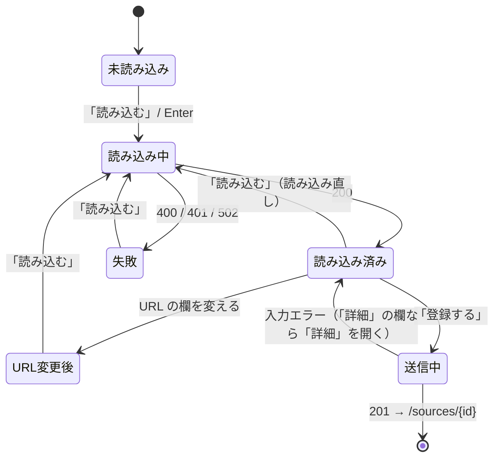

# step2: admin — 表示名と URL だけで登録するフォーム（/sources/new）

[README](../README.md) の「登録の流れ」「登録のフォーム」を実装する。api は [step1](./step1-api-source-suggestion.md) の `GET /api/admin/source/suggestion` を使う。登録の API・Server Action（`createSourceAction`）は変えない。

## 対象画面

| パス | 変更 |
| --- | --- |
| `/sources/new` | 登録用のフォーム（`SourceCreateForm`）に替える |
| `/sources/[id]` | 見た目は変えない。欄の部品を登録と共有し、`SourceForm` を編集だけの `SourceEditForm` にする |
| `GET /api/sources/suggestion?url=...`（Route Handler） | 新規。api の `/api/admin/source/suggestion` の中継 |

## リクエスト / レスポンス

**Route Handler（ブラウザの `fetch` から呼ぶ）**

| status | ボディ | 状況 |
| --- | --- | --- |
| 200 | `SuggestSourceResponse`（api のレスポンスをそのまま） | 読み込めた |
| 400 | `{ "reason": "invalid_url" \| "not_repository_url" \| "repository_not_found" \| "website_unavailable" }` | URL の誤り。api の 400 の `details[0].code`、無ければ `invalid_url` |
| 401 | `{ "reason": "unauthorized" }` | サインインの期限切れ（redirect しない。フォームの入力を消さないため） |
| 502 | `{ "reason": "failed" }` | GitHub の rate limit・障害など |

## 処理フロー



- 「登録する」を押せるのは「読み込み済み」で、読み込んだ URL と今の URL の欄が同じときだけ
- 「失敗」でも、前に読み込んだ内容と「詳細」の欄は残す（URL が違うので登録はできない）

## 処理サマリー

1. 管理者が表示名と URL を入れて「読み込む」（URL の欄で Enter でもよい）を押す
2. フォームが Route Handler に URL を送り、Route Handler が api の `/api/admin/source/suggestion` を呼ぶ
3. 読み込めたら、読み込んだ内容（取得方法・取得元・ブランチ・対象パス・ライセンス）を出し、「詳細」の取得元とライセンスの欄を読み込んだ値で作り直す。ライセンスを自動で決められなかったら「詳細」を開く
4. 管理者が内容を見て「登録する」を押すと、今と同じ `createSourceAction` で登録し、編集画面に移る
5. 入力エラーが「詳細」の欄にあれば「詳細」を開く

## 設計方針

理由は README の「## 設計」に書いた。ここでは置き場所だけまとめる。

- 欄の部品（`Section`・`Field`・種別・GitHub の取得元・サイトの取得元・ライセンス・収集のスイッチ）は `SourceForm.tsx` から `SourceFormParts.tsx` に切り出し、登録と編集で共有する。GitHub / サイトの取得元の欄は `defaultValue`（`defaults` で受ける）、ライセンスの欄は今と同じく state で持つ（編集の「ライセンスを検出」と、登録の読み込みが値を入れるため）
- 取得方法・リポジトリ・サイトの URL は、読み込みの結果を hidden の欄で送る
- 「詳細」は `<details>`。閉じていても中の欄は送られる
- 読み込み直したら、取得元の欄は `key` を変えて作り直し、ライセンスの欄は state を置き換える。表示名・種別・技術タグは作り直さない
- 「詳細」を開く条件（入力エラー）は、`useActionState` の state が変わったときに描画中に判定する（React の「前の値と比べて state を直す」形。`useEffect` で setState しない）
- 読めない理由の文言は `source.labels.ts` の `SOURCE_SUGGESTION_FAILURE_MESSAGES` の 1 か所に置く

## 対応内容

### `src/features/source/source.api.ts`

`sourceApi` に名前順で足す。

```ts
suggest: async (url: string): Promise<SuggestSourceResponse> => {
  const raw = await apiClient.get<unknown>(`${BASE_PATH}/suggestion?url=${encodeURIComponent(url)}`, { onUnauthorized: "throw" })
  return suggestSourceResponseSchema.parse(raw)
},
```

### `src/features/source/source.labels.ts`

```ts
export type SourceSuggestionFailureReason = SuggestSourceErrorCode | "failed" | "invalid_url" | "unauthorized"

export const SOURCE_SUGGESTION_FAILURE_MESSAGES: Record<SourceSuggestionFailureReason, string> = {
  failed: "読み込めませんでした。時間をおいて再度お試しください。",
  invalid_url: "URL の形が正しくありません。",
  not_repository_url: "GitHub はリポジトリの URL（https://github.com/{owner}/{repo}）を入れてください。",
  repository_not_found: "リポジトリが見つかりませんでした（非公開のリポジトリも同じ表示です）。",
  unauthorized: "サインインの期限が切れました。ページを開き直してサインインしてください。",
  website_unavailable: "GitHub のリポジトリの URL を入れてください（サイトはローカルでだけ登録できます）。",
}
```

`SuggestSourceErrorCode` は `@repo/api-schema` から `import type` する（このファイルは Client Component からも読むので、スキーマの値は import しない）。

### `src/app/api/sources/suggestion/route.ts`

```ts
import "server-only"

import { type NextRequest, NextResponse } from "next/server"

import { errorResponseSchema, suggestSourceErrorCodeSchema, suggestSourceQueryStringSchema } from "@repo/api-schema"

import { sourceApi } from "@/features/source/source.api"
import type { SourceSuggestionFailureReason } from "@/features/source/source.labels"
import { ApiClientError } from "@/libs/api-client"

const convertApiErrorToFailureReason = (error: ApiClientError): SourceSuggestionFailureReason => {
  const body = errorResponseSchema.safeParse(error.body)
  const code = suggestSourceErrorCodeSchema.safeParse(body.success ? body.data.details?.[0]?.code : undefined)
  return code.success ? code.data : "invalid_url"
}

const respondFailure = (reason: SourceSuggestionFailureReason, status: number) => NextResponse.json({ reason }, { status })

export const GET = async (request: NextRequest) => {
  const parsed = suggestSourceQueryStringSchema.safeParse({ url: request.nextUrl.searchParams.get("url") })
  if (!parsed.success) return respondFailure("invalid_url", 400)

  try {
    return NextResponse.json(await sourceApi.suggest(parsed.data.url))
  } catch (error) {
    if (error instanceof ApiClientError && error.status === 401) return respondFailure("unauthorized", 401)
    if (error instanceof ApiClientError && error.status === 400) return respondFailure(convertApiErrorToFailureReason(error), 400)
    console.error("Source suggestion failed", error)
    return respondFailure("failed", 502)
  }
}
```

JSDoc は `app/api/sources/license/route.ts` と同じ内容（GET なので Route Handler、ブラウザから api を直接呼ばないための中継、401 を redirect しない理由）に、「失敗は理由（`reason`）で返し、文言は画面が決める」を足す。

### `src/components/features/source/SourceFormParts.tsx`（切り出し）

`SourceForm.tsx` から次を移す。中身（JSX・クラス）は今のまま。

| 部品 | props | 今の `SourceForm.tsx` の場所 |
| --- | --- | --- |
| `Section` / `Field` / `errorHintClass` / `LICENSE_NOTE` | 今と同じ | 先頭の部品と定数 |
| `SourceKindField` | `defaultKind: GetSourceResponse["source"]["kind"]`, `error?: string` | 「種別」の `Field` |
| `GitHubTargetFields` | `defaults: { branch, excludeGlobs, includeGlobs, publicUrlStripPrefix, publicUrlTemplate }`, `getFieldError` | 「取得元（GitHub リポジトリ）」のうち、リポジトリの欄より下（ブランチ・対象パス・除外パス・公開ページの URL 規則・取り除くプレフィックス・変換例） |
| `WebsiteTargetFields` | `defaults: { contentSelector, excludeGlobs, excludeSelectors, includeGlobs }`, `getFieldError` | 「取得元（サイト）」のうち、サイトの URL の欄より下 |
| `LicenseFields` | `fetchType`, `licenseOptions`, `licenseSpdx`, `licenseUrl`, `getFieldError`, `onLicenseSpdxChange`, `onLicenseUrlChange` | 「ライセンス」のセクションの中身（サイトの注意書きを含む） |
| `CollectionToggle` | `isEnabled`, `onToggle` | 「収集」のセクションの中身 |

`getFieldError` は `(key: string) => string | undefined`。リポジトリの欄と「ライセンスを検出」、サイトの URL の欄は編集だけが使うので `SourceEditForm` に残す。

### `src/components/features/source/SourceEditForm.tsx`（`SourceForm.tsx` を改名）

- `detail` を必須にし、登録の分岐（`createSourceAction`・取得方法の切り替えのボタン・「登録の前に確認すること」）を消す。取得方法は今の編集と同じく、押せない表示だけ残す
- 切り出した部品を使う。見た目と挙動は今の編集画面のまま
- `/sources/[id]/page.tsx` の import を直す

### `src/components/features/source/SourceCreateForm.tsx`

```tsx
"use client"

import Link from "next/link"
import { type FormEvent, type KeyboardEvent, startTransition, useActionState, useState } from "react"

import type { GetTagListResponse, SuggestSourceResponse } from "@repo/api-schema"

import { createSourceAction, type SourceFormState } from "@/app/(dashboard)/sources/actions"
import {
  CollectionToggle,
  Field,
  GitHubTargetFields,
  LicenseFields,
  Section,
  SourceKindField,
  WebsiteTargetFields,
} from "@/components/features/source/SourceFormParts"
import { SourceSuggestionSummary } from "@/components/features/source/SourceSuggestionSummary"
import { TagPicker } from "@/components/features/source/TagPicker"
import { SOURCE_SUGGESTION_FAILURE_MESSAGES, type SourceSuggestionFailureReason } from "@/features/source/source.labels"
import { cardBodyClass, cardClass, inputClass, outlineButtonClass, primaryButtonClass, titleClass } from "@/libs/ui-classes"

type LoadStatus =
  | { status: "idle" }
  | { status: "loading" }
  | { message: string, status: "failed" }

type LoadedSuggestion = { suggestion: SuggestSourceResponse, url: string }

type SuggestionResult =
  | { ok: false, reason: SourceSuggestionFailureReason }
  | { ok: true, suggestion: SuggestSourceResponse }

const DETAIL_FIELD_KEYS = [
  "branch",
  "content_selector",
  "exclude_globs",
  "exclude_selectors",
  "include_globs",
  "kind",
  "license_spdx",
  "license_url",
  "public_url_strip_prefix",
  "public_url_template",
  "tag_ids",
]

const hasDetailFieldErrors = (state: SourceFormState): boolean =>
  DETAIL_FIELD_KEYS.some((key) => (state.errors?.[key]?.length ?? 0) > 0)

const isLicenseResolved = (suggestion: SuggestSourceResponse): boolean =>
  suggestion.fetch_type === "website"
  || (suggestion.detected_license.is_allowed && suggestion.detected_license.license_url !== null)

const buildInitialLicense = (suggestion: SuggestSourceResponse): { licenseSpdx: string, licenseUrl: string } => {
  if (suggestion.fetch_type === "website") return { licenseSpdx: suggestion.license_spdx, licenseUrl: suggestion.license_url }
  const { is_allowed: isAllowed, license_spdx: licenseSpdx, license_url: licenseUrl } = suggestion.detected_license
  return { licenseSpdx: isAllowed && licenseSpdx !== null ? licenseSpdx : "", licenseUrl: licenseUrl ?? "" }
}

const fetchSourceSuggestion = async (url: string): Promise<SuggestionResult> => {
  const res = await fetch(`/api/sources/suggestion?url=${encodeURIComponent(url)}`)
  if (!res.ok) return { ok: false, reason: ((await res.json()) as { reason: SourceSuggestionFailureReason }).reason }
  return { ok: true, suggestion: (await res.json()) as SuggestSourceResponse }
}

function SuggestionHiddenFields({ suggestion }: { suggestion: SuggestSourceResponse }) {
  return (
    <>
      <input name="fetch_type" type="hidden" value={suggestion.fetch_type} />
      {suggestion.fetch_type === "github_repository"
        ? <input name="repository" type="hidden" value={suggestion.repository} />
        : <input name="site_url" type="hidden" value={suggestion.site_url} />}
    </>
  )
}

export function SourceCreateForm({
  allowedLicenses,
  personalUseLicense,
  tags,
}: {
  allowedLicenses: readonly string[]
  personalUseLicense: string
  tags: GetTagListResponse["tags"]
}) {
  const [state, formAction, isPending] = useActionState<SourceFormState, FormData>(createSourceAction, {})
  const [prevState, setPrevState] = useState(state)
  const [url, setUrl] = useState("")
  const [loadStatus, setLoadStatus] = useState<LoadStatus>({ status: "idle" })
  const [loaded, setLoaded] = useState<LoadedSuggestion | null>(null)
  const [revision, setRevision] = useState(0)
  const [isDetailsOpen, setIsDetailsOpen] = useState(false)
  const [isEnabled, setIsEnabled] = useState(true)
  const [licenseSpdx, setLicenseSpdx] = useState("")
  const [licenseUrl, setLicenseUrl] = useState("")

  if (state !== prevState) {
    setPrevState(state)
    if (hasDetailFieldErrors(state)) setIsDetailsOpen(true)
  }

  const suggestion = loaded?.suggestion ?? null
  const isLoadedUrl = loaded !== null && loaded.url === url.trim()
  const licenseOptions = suggestion?.fetch_type === "website" ? [...allowedLicenses, personalUseLicense] : allowedLicenses
  const getFieldError = (key: string): string | undefined => state.errors?.[key]?.[0]

  const loadSuggestion = async () => {
    const target = url.trim()
    if (target === "") {
      setLoadStatus({ message: SOURCE_SUGGESTION_FAILURE_MESSAGES.invalid_url, status: "failed" })
      return
    }

    setLoadStatus({ status: "loading" })
    try {
      const result = await fetchSourceSuggestion(target)
      if (!result.ok) {
        setLoadStatus({ message: SOURCE_SUGGESTION_FAILURE_MESSAGES[result.reason], status: "failed" })
        return
      }
      const initialLicense = buildInitialLicense(result.suggestion)
      setLoaded({ suggestion: result.suggestion, url: target })
      setRevision((value) => value + 1)
      setLicenseSpdx(initialLicense.licenseSpdx)
      setLicenseUrl(initialLicense.licenseUrl)
      setIsDetailsOpen(!isLicenseResolved(result.suggestion))
      setLoadStatus({ status: "idle" })
    } catch {
      setLoadStatus({ message: SOURCE_SUGGESTION_FAILURE_MESSAGES.failed, status: "failed" })
    }
  }

  const handleUrlKeyDown = (event: KeyboardEvent<HTMLInputElement>) => {
    if (event.key !== "Enter") return
    event.preventDefault()
    void loadSuggestion()
  }

  const handleSubmit = (event: FormEvent<HTMLFormElement>) => {
    event.preventDefault()
    if (!isLoadedUrl) return
    const formData = new FormData(event.currentTarget)
    startTransition(() => formAction(formData))
  }

  return (
    <div className="grid gap-6 xl:grid-cols-3">
      <form className="space-y-6 xl:col-span-2" noValidate onSubmit={handleSubmit}>
        {suggestion && <SuggestionHiddenFields suggestion={suggestion} />}
        {suggestion?.fetch_type === "github_repository" && <input name="is_enabled" type="hidden" value={String(isEnabled)} />}

        {state.message && (
          <div className="rounded-xl border border-error-500 bg-error-50 p-4 text-sm dark:border-error-500/30 dark:bg-error-500/15" role="alert">
            <p className="font-medium text-gray-800 dark:text-white/90">{state.message}</p>
          </div>
        )}

        <Section desc="表示名と URL を入れて読み込むと、取得方法・ブランチ・対象パス・ライセンスを自動で決めます。" title="ソース">
          <Field error={getFieldError("name")} htmlFor="name" label="表示名">
            <input className={inputClass} id="name" name="name" placeholder="例：React 公式ドキュメント" />
          </Field>
          <Field
            error={loadStatus.status === "failed" ? loadStatus.message : undefined}
            hint="GitHub のリポジトリ・ディレクトリ・ファイルの URL。ローカルではサイトの URL も入れられます。"
            htmlFor="source-url"
            label="URL"
          >
            <div className="flex gap-2">
              <input
                className={`${inputClass} font-mono`}
                id="source-url"
                placeholder="https://github.com/reactjs/react.dev/tree/main/src/content/learn"
                value={url}
                onChange={(event) => setUrl(event.target.value)}
                onKeyDown={handleUrlKeyDown}
              />
              <button className={`${outlineButtonClass} shrink-0`} disabled={loadStatus.status === "loading"} type="button" onClick={loadSuggestion}>
                {loadStatus.status === "loading" ? "読み込んでいます…" : "読み込む"}
              </button>
            </div>
          </Field>
          {suggestion && <SourceSuggestionSummary suggestion={suggestion} />}
        </Section>

        {suggestion && (
          <details className={cardClass} open={isDetailsOpen} onToggle={(event) => setIsDetailsOpen(event.currentTarget.open)}>
            <summary className={`cursor-pointer px-6 py-5 ${titleClass}`}>詳細</summary>
            <div className={`${cardBodyClass} space-y-5`}>
              <SourceKindField defaultKind="docs" error={getFieldError("kind")} />
              <Field error={getFieldError("tag_ids")} hint="ユーザーの問題一覧の絞り込みに使います。タグはタグの画面で登録します。" label="技術タグ" labelId="source-tags-label">
                <TagPicker defaultSelectedIds={[]} tags={tags} />
              </Field>
              {suggestion.fetch_type === "github_repository" ? (
                <GitHubTargetFields
                  key={revision}
                  defaults={{ branch: suggestion.branch, excludeGlobs: [], includeGlobs: suggestion.include_globs, publicUrlStripPrefix: null, publicUrlTemplate: null }}
                  getFieldError={getFieldError}
                />
              ) : (
                <WebsiteTargetFields
                  key={revision}
                  defaults={{ contentSelector: null, excludeGlobs: [], excludeSelectors: [], includeGlobs: suggestion.include_globs }}
                  getFieldError={getFieldError}
                />
              )}
              <LicenseFields
                fetchType={suggestion.fetch_type}
                getFieldError={getFieldError}
                licenseOptions={licenseOptions}
                licenseSpdx={licenseSpdx}
                licenseUrl={licenseUrl}
                onLicenseSpdxChange={setLicenseSpdx}
                onLicenseUrlChange={setLicenseUrl}
              />
              {suggestion.fetch_type === "github_repository" && <CollectionToggle isEnabled={isEnabled} onToggle={() => setIsEnabled((value) => !value)} />}
            </div>
          </details>
        )}

        <div className="flex flex-wrap items-center justify-end gap-3">
          {!isLoadedUrl && <p className="mr-auto text-sm text-gray-500 dark:text-gray-400">URL を読み込んでください。</p>}
          <Link className={outlineButtonClass} href="/sources">キャンセル</Link>
          <button className={primaryButtonClass} disabled={!isLoadedUrl || isPending} type="submit">登録する</button>
        </div>
      </form>

      <aside className="space-y-6">
        <section className={cardClass}>
          <div className="px-6 py-5">
            <h3 className={titleClass}>登録の前に確認すること</h3>
          </div>
          <ul className={`${cardBodyClass} list-disc space-y-2 pl-10 text-sm text-gray-600 dark:text-gray-300`}>
            {suggestion?.fetch_type === "website" ? (
              <>
                <li>ローカルでだけ使う（自分で読むためのページ）</li>
                <li>robots.txt で対象パスが許可されている</li>
                <li>本文が JavaScript で描画されていない（取得した HTML に本文がある）</li>
              </>
            ) : (
              <>
                <li>自動で入ったライセンスが、ドキュメントの文章に掛かっている（コードだけのライセンスではない）</li>
                <li>ライセンスが許可リストにある</li>
                <li>対象パスが、問題にしたいドキュメントのディレクトリになっている</li>
              </>
            )}
          </ul>
        </section>
      </aside>
    </div>
  )
}
```

- 入力エラーの全体の文言（「入力内容を確認してください。各欄の下に理由を表示しています。」）は今の `SourceForm` と同じく足す
- JSDoc：`SourceCreateForm` に「読み込んだ値は初期値で、登録の検証は Server Action と api が行う」、`loadSuggestion` に「読み込みに失敗しても前に読み込んだ内容は消さない（URL が違うので登録はできない）」、描画中の `prevState` の比較に「入力エラーが「詳細」の欄にあれば開く。useActionState の state が変わったときだけ判定する」を書く

### `src/components/features/source/SourceSuggestionSummary.tsx`

読み込んだ内容を `dl` で出す（`cardBodyClass` の中の表示。「収集の状況」のカードと同じ並べ方）。

| 項目 | GitHub | サイト |
| --- | --- | --- |
| 取得方法 | GitHub リポジトリ | サイト（URL から追加） |
| 取得元 | `{repository}`（ブランチ `{branch}`） | `{site_url}` |
| 対象パス | `include_globs` を `, ` でつなぐ | 同左 |
| ライセンス | 下の表 | 個人の学習用（ライセンスなし） |
| ライセンスの記載がある URL | `license_url` のリンク（無ければ「―」） | `license_url` のリンク |

GitHub のライセンスの表示（`detected_license` から決める。`formatLicenseLabel` は今のものを使う）：

| 検出の結果 | 表示 |
| --- | --- |
| 許可リスト | `{license_spdx}`（GitHub が検出したライセンス） |
| 許可リスト外 | `{license_spdx}`：許可リストに無いライセンスです。ドキュメントのライセンスが別にあれば、詳細で選んでください |
| 種類が分からない | ライセンスの種類を判定できませんでした。詳細で選んでください |
| ファイルが無い | ライセンスのファイルが見つかりませんでした。詳細でライセンスと、その記載がある URL を入れてください |

GitHub のときは、その下に `LICENSE_NOTE`（今の画面の注意）を出す。

### `src/app/(dashboard)/sources/new/page.tsx`

`SourceForm` を `SourceCreateForm` に替える（props は `allowedLicenses`・`personalUseLicense`・`tags`）。JSDoc の「初期の取得方法は GitHub」を「表示名と URL を読み込んで登録する」に直す。

### ドキュメント

- `apps/admin/CLAUDE.md` の接続済みの画面の `/sources/new`・`/sources/[id]` の行：登録は `SourceCreateForm`（表示名と URL を読み込み、`app/api/sources/suggestion/route.ts` 経由で api の `/api/admin/source/suggestion` を呼ぶ。読めない理由の文言は `source.labels.ts`）、編集は `SourceEditForm`、欄の部品は `SourceFormParts.tsx`
- `docs/spec/content-collection/README.md` の「ソース登録時の確認」の表を書き換える
  - `github_repository`：URL を読み込むと、api が GitHub の default branch と、検出したライセンス・ライセンスのファイルの URL を取り、許可リストのライセンスなら自動で入れる。ドキュメントの文章に掛かっているかは管理者が画面で確かめ、違えば「詳細」で選び直す（リンク：`../source-registration-by-url/README.md`）
  - `website`：URL を読み込むと「個人の学習用」とサイトのトップを入れる。許可リストのライセンスのサイトは「詳細」で選び直す。ほかは今のまま
- `docs/spec/README.md` の source-registration-by-url を「完了」にする

## 動作確認

`apps/admin/CLAUDE.md` の「動作確認（必須）」に従い、Playwright MCP で実画面を確かめる（port 3030。dev の api・admin が起動していること。verify-web-page skill の Step 1）。GitHub には実際に問い合わせる（手元の `GITHUB_LICENSE_TOKEN` が無ければ 60 回 / 時なので、確かめる URL を絞る）。

**before のスクショは実装の前に撮る**：`/sources/new` を `docs/screenshots/source-registration-by-url/before.png`。

dev admin でサインインし（`/signin` の「dev admin でログイン」）、`/sources/new` で次を確かめる。

| 操作 | 期待 |
| --- | --- |
| 表示名と `https://github.com/reactjs/react.dev/tree/main/src/content/learn` を入れて「読み込む」 | 取得元 `reactjs/react.dev`（ブランチ `main`）・対象パス `src/content/learn/**`・検出したライセンスが出る。許可リストのライセンスなら「詳細」は閉じたまま |
| そのまま「登録する」 | `/sources/{id}` に移り、編集画面のブランチ・対象パス・ライセンス・ライセンスの記載がある URL が読み込んだ値になっている |
| 読み込んだ後に URL の欄を 1 文字変える | 「登録する」が押せず、「URL を読み込んでください」が出る |
| URL の欄で Enter | 読み込む（フォームは送信されない） |
| `https://github.com/reactjs` | 「GitHub はリポジトリの URL…」 |
| 存在しないリポジトリ（`https://github.com/tech-english-not-found/none`） | 「リポジトリが見つかりませんでした…」 |
| 許可リストに無いライセンスのリポジトリ（GPL など） | ライセンスの表示が「許可リストに無いライセンスです…」になり、「詳細」が開いて、ライセンスが未選択 |
| 「詳細」で対象パスを空にして「登録する」 | 「詳細」が開いたまま、対象パスの下にエラー |
| `https://go.dev/doc/` | サイト・`https://go.dev`・対象パス `/doc/**`・個人の学習用。「登録の前に確認すること」がサイトの内容になる |
| 読み込み直し（GitHub → 別の GitHub の URL） | 取得元・対象パス・ライセンスが置き換わり、表示名・種別・技術タグは残る |
| 編集画面（既存のソース） | 見た目と挙動が今と同じ（「ライセンスを検出」・保存・今すぐ収集） |

- `browser_console_messages` にエラーが無いこと
- after のスクショ：読み込んだ後の `/sources/new` を `docs/screenshots/source-registration-by-url/after.png`（`fullPage: true`）
- 確認で登録したソースは、本文候補が無いことを確かめてから psql で消す（`docker exec -i tech-english-postgres psql -U postgres -d tech-english_dev`）

`pnpm lint:fix`（root）と `cd apps/admin && pnpm build` を通し、コミット前に `coding-style` skill で差分を見直す。PR には before / after のスクショを載せる（verify-web-page skill）。
