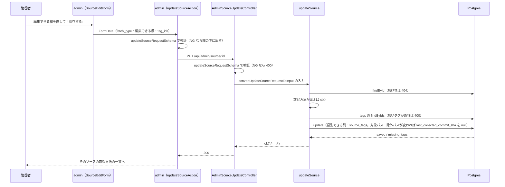

# step3: ソースの編集で、登録で決まる値を変えられないようにする

[README](../README.md) の「編集の画面」を実装する。[step1](./step1-api-source-suggestion.md) と [step2](./step2-admin-source-create-form.md) で、取得方法・取得元（リポジトリとブランチ・サイトの URL）・GitHub のライセンスは登録のときに URL と GitHub から決まるようになった。編集の画面には今もそれらの欄と「ライセンスを検出」が残り、更新の API（`PUT /api/admin/source/:id`）も登録と同じスキーマで全項目を置き換える。

この step では、更新の API が受け取る項目を編集で変えられるものだけにし、admin の編集の画面から取得方法・種別・取得元・GitHub のライセンスの欄を消して、右の「収集の状況」に読み取り専用で出す。リポジトリの欄が無くなるので、編集の画面だけが使っていた「ライセンスを検出」（api の `GET /api/admin/source/license` と admin の中継）もやめる。

スキーマを変えると admin の Server Action の型がすぐ合わなくなるので、schema・api・admin を 1 つの step（1 つの PR）にまとめる。

## 目次

- [対象 API](#対象-api)
- [対象画面・呼び出し API](#対象画面呼び出し-api)
- [参考モック](#参考モック)
- [リクエスト](#リクエスト)
  - [Body](#body)
- [レスポンス](#レスポンス)
  - [200 OK](#200-ok)
  - [エラー](#エラー)
- [処理フロー](#処理フロー)
  - [処理の流れ](#処理の流れ)
- [編集の画面の欄](#編集の画面の欄)
- [設計方針](#設計方針)
- [対応内容](#対応内容)
- [動作確認](#動作確認)
- [次の step での利用](#次の-step-での利用)

## 対象 API

| 項目 | 値 |
|---|---|
| メソッド / パス | `PUT /api/admin/source/:id`（変える）・`GET /api/admin/source/license`（消す） |
| 認証 | 必須（Bearer の admin の JWT） |
| 副作用 | `sources` の編集できる列と `source_tags` を書く。GitHub の対象パス・除外パスが変わったら `last_collected_commit_sha` を null に戻す |
| 冪等性 | 冪等（同じ body を何度送っても同じ状態になる） |
| 呼び出し元 | admin の編集の画面（`/sources/[id]`）の Server Action `updateSourceAction` |
| 連携 step | 登録（`POST /api/admin/source`）と URL の読み込み（step1）は変えない |

## 対象画面・呼び出し API

### 画面（Next.js Route）

| Route | コンポーネント | 概要 |
|---|---|---|
| `/sources/[id]` | Server（`page.tsx`）+ Client（`SourceEditForm`） | 取得方法・種別・取得元・GitHub のライセンスの欄と「ライセンスを検出」を消し、「収集の状況」に読み取り専用で出す |
| `/sources/new/github` | Client（`SourceCreateForm`） | 見た目は変えない。ブランチの欄を `GitHubTargetFields` から `GitHubBranchField` に分けたので、登録のフォームが自分で並べる |
| `/api/sources/license`（Route Handler） | ― | 消す |

### 呼び出す API

| メソッド / パス | 呼び出すタイミング | 経路 | 認証 |
|---|---|---|---|
| `PUT /api/admin/source/:id` | 編集の「保存する」 | Server Action（`updateSourceAction`） | 必須 |

## 参考モック

**モックなし**（理由：今の編集の画面から欄を消し、今の「収集の状況」のカードに定義リストの行を足すだけ。見た目は after のスクショ〈`docs/screenshots/source-edit-fields/`〉で確かめる）。

## リクエスト

### Body

GitHub のソース：

```json
{
  "exclude_globs": ["src/content/blog/**"],
  "fetch_type": "github_repository",
  "include_globs": ["src/content/learn/**"],
  "is_enabled": true,
  "name": "React 公式ドキュメント",
  "public_url_strip_prefix": "src/content/",
  "public_url_template": "https://react.dev/{path}",
  "tag_ids": [1, 2]
}
```

サイトのソース（ローカルだけ）：

```json
{
  "content_selector": "main article",
  "exclude_globs": ["/doc/devel/**"],
  "exclude_selectors": [".feedback"],
  "fetch_type": "website",
  "include_globs": ["/doc/**"],
  "license_spdx": "LicenseRef-personal-use",
  "license_url": "https://go.dev",
  "name": "Go 公式ドキュメント",
  "tag_ids": []
}
```

| フィールド | 型 | 必須 | 制約 | 説明 |
|---|---|---|---|---|
| `fetch_type` | `"github_repository" \| "website"` | ○ | 今のソースと同じ値（違えば service が 400） | どちらのスキーマで読むかを決める |
| `name` | string | ○ | trim 後 1〜100 文字 | 表示名 |
| `tag_ids` | number[] | ○ | 正の整数・重複なし・10 個まで | 付けるタグ |
| `include_globs` | string[] | ○ | 1〜50 個。GitHub は `/` で始めない、サイトは `/` で始める | 対象パス |
| `exclude_globs` | string[] | ○ | 0〜50 個。`/` の規則は対象パスと同じ | 除外パス |
| `is_enabled` | boolean | GitHub だけ ○ | ― | 収集するか（サイトは受け取らない） |
| `public_url_template` | string \| null | GitHub だけ ○ | http(s) の URL で `{path}` を含む | 公開ページの URL 規則 |
| `public_url_strip_prefix` | string \| null | GitHub だけ ○ | trim 後 1〜500 文字 | 取り除くプレフィックス |
| `content_selector` | string \| null | サイトだけ ○ | trim 後 1〜500 文字 | 本文の CSS セレクタ |
| `exclude_selectors` | string[] | サイトだけ ○ | 20 個まで | 除外する CSS セレクタ |
| `license_spdx` | string | サイトだけ ○ | 許可リストか個人の学習用 | ライセンス |
| `license_url` | string | サイトだけ ○ | http(s) の URL | ライセンスの記載がある URL |

- 上にない項目（`kind`・`repository`・`branch`・`site_url`、GitHub の `license_spdx`・`license_url`）は送っても捨てる（Zod の object の既定）

## レスポンス

### 200 OK

今と同じ（`updateSourceResponseSchema` = `sourceSchema`。更新した後のソース）。

### エラー

| Status | type | 条件 | クライアント挙動 |
|---|---|---|---|
| 400 | BAD_REQUEST | body がスキーマに合わない | フォームの各欄の下に出す（Server Action が先に同じスキーマで検証する） |
| 400 | BAD_REQUEST | `fetch_type` が今のソースと違う | 「保存に失敗しました」（フォームは hidden で今の値を送るので、画面からは起きない） |
| 400 | BAD_REQUEST | 存在しないタグの id（`details[0].path` が `["tag_ids"]`） | 技術タグの欄に「削除されたものがあります」 |
| 400 | BAD_REQUEST | production でサイトのソース | 「保存に失敗しました」（production ではサイトの編集の画面に入れない） |
| 401 | UNAUTHORIZED | admin の token が無い・期限切れ | `apiClient` がサインイン画面へ |
| 404 | NOT_FOUND | ソースが無い | 「このソースは見つかりませんでした」 |

- 今の 400（取得した文書があるソースの取得元の変更）と 409（別のソースと同じ取得元にした）は、取得元を受け取らないので起きなくなる

## 処理フロー



### 処理の流れ

1. `SourceEditForm` が hidden の `fetch_type`（GitHub は `is_enabled` も）と編集できる欄を送る
2. `updateSourceAction` が `updateSourceRequestSchema` で検証する（NG なら各欄の下に出す）
3. `AdminSourceUpdateController` が同じスキーマで検証し、`convertUpdateSourceRequestToInput` で `SourceUpdateInput` にする（NG なら 400）
4. `updateSource` が production のサイトのソースを拒否する（400）
5. `SourceRepository.findById` でソースを読む（無ければ 404）
6. 取得方法が今のソースと違えば 400
7. `TagRepository.findByIds` でタグがあるかを確かめる（無いタグがあれば 400 と `tag_ids` の details）
8. GitHub は対象パス・除外パスが変わったかで `shouldResetCollectedCommit` を決める
9. `SourceRepository.update` で編集できる列と `source_tags` を 1 トランザクションで書く（外部キー違反なら `missing_tags` → 400）
10. 更新した後のソースを 200 で返し、admin はそのソースの取得方法の一覧へ移る

## 編集の画面の欄

| 欄 | GitHub | サイト（ローカルだけ） |
|---|---|---|
| 表示名・技術タグ | 欄（基本情報） | 欄（基本情報） |
| 対象パス・除外パス | 欄（取得元） | 欄（取得元） |
| 公開ページの URL 規則・取り除くプレフィックス | 欄（取得元） | ― |
| 本文の CSS セレクタ・除外する CSS セレクタ | ― | 欄（取得元） |
| ライセンス・ライセンスの記載がある URL | 収集の状況（ライセンスの名前を、その URL へのリンクで） | 欄（ライセンス） |
| 収集する | 欄（収集） | ―（常に無効） |
| 取得方法・種別 | 収集の状況 | 収集の状況 |
| リポジトリ・ブランチ | 収集の状況（リポジトリは GitHub へのリンク） | ― |
| サイトの URL | ― | 収集の状況（サイトへのリンク） |

「収集の状況」の並び：取得方法 → リポジトリ・ブランチ（サイトはサイトの URL）→ 種別 → ライセンス（GitHub だけ）→ 最終収集（GitHub だけ）→ 取り込んだコミット（GitHub だけ）→ 本文候補。

## 設計方針

- **API も編集できる項目だけを受ける**：画面から欄を消すだけで API が全項目を受けたままだと、admin は消した値を hidden で送り返すことになり、別のタブで保存した値を古い値で戻しうる。変えても意味が無い値なら API でも変えられない方が、画面と API の振る舞いが一致する
- **`fetch_type` は body に残す**：どちらの取得方法のスキーマで読むかを決めるため。今のソースと違えば今と同じく service が 400 にする（discriminated union の判別に使うだけで、取得方法は変わらない）
- **登録と編集でスキーマを分け、登録は編集のスキーマを extend する**：編集で変えられる項目は登録の項目の部分集合なので、`githubRepositoryInputSchema = githubRepositoryUpdateInputSchema.extend({ branch, kind, license_spdx, license_url, repository })` にして、同じ項目の制約を 2 か所に書かない
- **編集で受けない項目は捨てる（400 にしない）**：Zod の object の既定（strip）。admin のフォームは登録と同じ `convertFormDataToSourceRequest` で FormData を変換するので、欄の無い項目は空の値で入るが、スキーマが捨てる。変換を編集用に分けると、取得方法ごとの項目の振り分けが 2 か所になる
- **取得元の変更の拒否と更新の重複（409）の判定を消す**：取得元を受け取らないので起きない。使わなくなる `hasSourceDocuments` も Repository から消す。Repository の `update` は unique 制約の違反（`duplicate`）を返さなくなるので、戻り値を `SourceUpdateResult`（`saved` / `missing_tags`）に絞り、unique 制約の違反が起きたら throw する（起きないはずのことが起きたので 500 にする）
- **対象パス・除外パスは編集でも直せる**：ソースを消す機能は無く、同じリポジトリは 2 つ登録できない（409）。登録のときの自動の初期値が外れたとき（CHANGELOG・翻訳の md まで入る など）に直す手段を残す。変わったら今と同じく `last_collected_commit_sha` を null に戻す（ブランチ・リポジトリは変わらないので、範囲の比較は対象パス・除外パスだけ）
- **サイトのライセンスは編集でも直せる**：GitHub のライセンスは GitHub が検出した値で、変えても意味が無い。サイトのライセンスは自動で判定できず、管理者がサイトの規約を見て選ぶ値なので、選び直せるようにする
- **「ライセンスを検出」をやめる**：リポジトリの欄が無くなり、編集の画面から使う場面が無い。登録の画面は URL の読み込み（`GET /api/admin/source/suggestion`）が検出の結果を返すので要らない。api の `GET /api/admin/source/license`・`detectRepositoryLicense`、admin の `/api/sources/license`・`sourceApi.detectLicense` を消す。検出の結果のスキーマは URL の読み込みのレスポンスの一部として残す（エンドポイントの名前の `detectSourceLicenseResponseSchema` から、export しない `detectedLicenseSchema` にする）
- **直せない値は「収集の状況」に文字で出す**：ブランチは一覧にも出ないので、欄を消すだけだと画面から見えなくなる。リポジトリは GitHub のリポジトリのトップへのリンクにする（ブランチ名は `#` などを含められ、`tree/{branch}` の URL を組み立てるとエスケープが要るため、ブランチは文字だけ）
- **種別の表示名は `source.labels.ts` に置く**：一覧の種別の列と編集の「収集の状況」の 2 か所で使うため（今は一覧に直接書いている）
- **ブランチの欄は登録のフォームだけが出す**：`GitHubTargetFields` からブランチを `GitHubBranchField` に分ける。登録は読み込み直したときに作り直すので、2 つを `Fragment` の `key` でまとめて作り直す

## 対応内容

### `packages/schema/src/api-schema/admin/source.ts`（変更）

入力の部品を、登録と編集の共通 → 編集 → 登録（編集を extend）の順に組み直す。

```typescript
const sourceInputBaseSchema = z.object({
  exclude_globs: globListSchema,
  include_globs: globListSchema.min(1),
  name: z.string().trim().min(1).max(100),
  tag_ids: tagIdListSchema,
})

const githubRepositoryUpdateInputSchema = sourceInputBaseSchema.extend({
  fetch_type: z.literal("github_repository"),
  is_enabled: z.boolean(),
  public_url_strip_prefix: nullableTextSchema,
  public_url_template: webUrlSchema
    .refine((value) => value.includes("{path}"), { message: "Must include {path}" })
    .nullable(),
})

const githubRepositoryInputSchema = githubRepositoryUpdateInputSchema.extend({
  branch: z.string().trim().min(1).max(255),
  kind: z.enum(SOURCE_KINDS),
  license_spdx: allowedLicenseSchema,
  license_url: webUrlSchema,
  repository: githubRepositorySchema,
})

const websiteUpdateInputSchema = sourceInputBaseSchema.extend({
  content_selector: nullableTextSchema,
  exclude_selectors: z.array(z.string().trim().min(1).max(200)).max(20),
  fetch_type: z.literal("website"),
  license_spdx: sourceLicenseSchema,
  license_url: webUrlSchema,
})

const websiteInputSchema = websiteUpdateInputSchema.extend({
  kind: z.enum(SOURCE_KINDS),
  site_url: httpsOriginSchema,
})

type SourceCreateInput =
  | z.infer<typeof githubRepositoryInputSchema>
  | z.infer<typeof websiteInputSchema>

type SourceUpdateInput =
  | z.infer<typeof githubRepositoryUpdateInputSchema>
  | z.infer<typeof websiteUpdateInputSchema>
```

検証は glob の規則（登録と編集）と、ライセンスの記載がある URL（登録の GitHub だけ）に分ける。

```typescript
const validateSourceGlobs = (value: SourceCreateInput | SourceUpdateInput, ctx: z.RefinementCtx): void => {
  const shouldStartWithSlash = value.fetch_type === "website"
  for (const key of ["include_globs", "exclude_globs"] as const) {
    value[key].forEach((glob, index) => {
      if (glob.startsWith("/") === shouldStartWithSlash) return
      ctx.addIssue({
        code: z.ZodIssueCode.custom,
        message: shouldStartWithSlash ? "Glob must start with /" : "Glob must not start with /",
        path: [key, index],
      })
    })
  }
}

const validateCreateSourceInput = (value: SourceCreateInput, ctx: z.RefinementCtx): void => {
  validateSourceGlobs(value, ctx)
  if (value.fetch_type === "github_repository" && !isRepositoryFileUrl(value.license_url, value.repository)) {
    ctx.addIssue({
      code: z.ZodIssueCode.custom,
      message: "Must be a file URL in the repository (https://github.com/{owner}/{repo}/blob/...)",
      path: ["license_url"],
    })
  }
}
```

```typescript
export const updateSourceRequestSchema = z
  .discriminatedUnion("fetch_type", [githubRepositoryUpdateInputSchema, websiteUpdateInputSchema])
  .superRefine(validateSourceGlobs)
```

`GET /api/admin/source/license` のセクション（`detectSourceLicenseQueryStringSchema`・`detectSourceLicenseResponseSchema` と型）を消し、検出の結果のスキーマを URL の読み込みのセクションに移す。

```typescript
const detectedLicenseSchema = z.object({
  is_allowed: z.boolean(),
  license_spdx: z.string().nullable(),
  license_url: z.string().nullable(),
})

export const suggestSourceResponseSchema = z.discriminatedUnion("fetch_type", [
  z.object({
    branch: z.string(),
    default_branch: z.string(),
    detected_license: detectedLicenseSchema,
    fetch_type: z.literal("github_repository"),
    include_globs: z.array(z.string()),
    repository: z.string(),
  }),
  z.object({
    fetch_type: z.literal("website"),
    include_globs: z.array(z.string()),
    license_spdx: personalUseLicenseSchema,
    license_url: z.string(),
    site_url: z.string(),
  }),
])
```

### `apps/api/src/repository/source-repository.ts`（変更）

```typescript
type SourceEditableInputBase = Pick<Source, "excludeGlobs" | "includeGlobs" | "name"> & {
  tagIds: number[]
}

type SourceCreateInputBase = SourceEditableInputBase & Pick<Source, "isEnabled" | "kind" | "licenseUrl">

export type SourceCreateInput =
  | (SourceCreateInputBase & Pick<GitHubRepositorySource, "branch" | "fetchType" | "licenseSpdx" | "publicUrlStripPrefix" | "publicUrlTemplate" | "repository">)
  | (SourceCreateInputBase & Pick<WebsiteSource, "contentSelector" | "excludeSelectors" | "fetchType" | "licenseSpdx" | "siteUrl">)

export type SourceUpdateInput =
  | (SourceEditableInputBase & Pick<GitHubRepositorySource, "fetchType" | "isEnabled" | "publicUrlStripPrefix" | "publicUrlTemplate">)
  | (SourceEditableInputBase & Pick<WebsiteSource, "contentSelector" | "excludeSelectors" | "fetchType" | "licenseSpdx" | "licenseUrl">)

export type SourceUpdateResult = Exclude<SourceCreateResult, { kind: "duplicate" }>

export interface SourceRepository {
  update(id: number, input: SourceUpdateInput, options: SourceUpdateOptions): Promise<SourceUpdateResult>
}
```

`hasSourceDocuments` を interface から消す。

### `apps/api/src/repository/drizzle/source-repository.ts`（変更）

今の `buildColumnValues` は登録だけが使うので `buildCreateColumnValues` に名前を変え、編集の列の値を作る関数を足す。

```typescript
const buildUpdateColumnValues = (input: SourceUpdateInput) => {
  const common = {
    excludeGlobs: input.excludeGlobs,
    includeGlobs: input.includeGlobs,
    name: input.name,
  }
  if (input.fetchType === "github_repository") {
    return {
      ...common,
      isEnabled: input.isEnabled,
      publicUrlStripPrefix: input.publicUrlStripPrefix,
      publicUrlTemplate: input.publicUrlTemplate,
    }
  }
  return {
    ...common,
    contentSelector: input.contentSelector,
    excludeSelectors: input.excludeSelectors,
    licenseSpdx: input.licenseSpdx,
    licenseUrl: input.licenseUrl,
  }
}
```

```typescript
  public async update(
    id: number,
    input: SourceUpdateInput,
    options: SourceUpdateOptions,
  ): Promise<SourceUpdateResult> {
    try {
      const source = await this._db.transaction(async (tx) => {
        const [updated] = await tx
          .update(sources)
          .set({
            ...buildUpdateColumnValues(input),
            ...(options.shouldResetCollectedCommit ? { lastCollectedCommitSha: null } : {}),
          })
          .where(and(eq(sources.id, id), eq(sources.fetchType, input.fetchType)))
          .returning()
        if (!updated) throw new Error(`Source not found: id=${id}, fetchType=${input.fetchType}`)
        await replaceSourceTags(tx, id, input.tagIds)
        const [saved] = await attachTags(tx, [this._toDomain(updated)])
        return saved
      })
      return { kind: "saved", source }
    } catch (error) {
      if (isForeignKeyViolation(error)) return { kind: "missing_tags" }
      throw error
    }
  }
```

`hasSourceDocuments` を消す。`convertWriteErrorToResult` は登録だけが使う。

### `apps/api/src/service/source-service.ts`（変更）

`hasOriginChanged`・`detectRepositoryLicense` を消し、収集の範囲の比較を対象パス・除外パスだけにする。

```typescript
type GitHubRepositoryUpdateInput = Extract<SourceUpdateInput, { fetchType: "github_repository" }>

const hasCollectionScopeChanged = (existing: GitHubRepositorySource, input: GitHubRepositoryUpdateInput): boolean =>
  !isSameStringList(existing.includeGlobs, input.includeGlobs)
  || !isSameStringList(existing.excludeGlobs, input.excludeGlobs)

export const updateSource = async (
  id: number,
  input: SourceUpdateInput,
  repo: SourceWriteRepo,
  policy: SourceWritePolicy,
): Promise<Result<SourceWithTags>> => {
  if (input.fetchType === "website" && !policy.isWebsiteSourceAllowed) {
    logger.debug("SourceService: Website source is not available", { id })
    return err(badRequestError(WEBSITE_SOURCE_UNAVAILABLE_MESSAGE))
  }
  const existing = await repo.sourceRepository.findById(id)
  if (!existing) {
    logger.debug("SourceService: Source not found for update", { id })
    return err(notFoundError("Source not found"))
  }
  if (existing.fetchType !== input.fetchType) return err(badRequestError("fetch_type cannot be changed"))

  const missingTagIds = await findMissingTagIds(input.tagIds, repo)
  if (missingTagIds.length > 0) {
    logger.debug("SourceService: Tag not found for update", { id, missingTagIds })
    return err(buildTagNotFoundError(`Tag not found: id=${missingTagIds.join(", ")}`))
  }

  const shouldResetCollectedCommit = existing.fetchType === "github_repository"
    && input.fetchType === "github_repository"
    && hasCollectionScopeChanged(existing, input)
  const result = await repo.sourceRepository.update(id, input, { shouldResetCollectedCommit })
  if (result.kind === "missing_tags") {
    logger.debug("SourceService: Tag deleted during the request", { id })
    return err(buildTagNotFoundError("Tag was deleted during the request"))
  }
  logger.info("SourceService: Source updated", { id, shouldResetCollectedCommit })
  return ok(result.source)
}
```

### `apps/api/src/controller/admin/source/source-mapper.ts`（変更）

`convertSourceRequestToInput` を `convertCreateSourceRequestToInput`（`CreateSourceRequest` だけを受ける）にし、編集の変換を足す。

```typescript
export const convertUpdateSourceRequestToInput = (request: UpdateSourceRequest): SourceUpdateInput => {
  const base = {
    excludeGlobs: request.exclude_globs,
    includeGlobs: request.include_globs,
    name: request.name,
    tagIds: request.tag_ids,
  }
  if (request.fetch_type === "github_repository") {
    return {
      ...base,
      fetchType: request.fetch_type,
      isEnabled: request.is_enabled,
      publicUrlStripPrefix: request.public_url_strip_prefix,
      publicUrlTemplate: request.public_url_template,
    }
  }
  return {
    ...base,
    contentSelector: request.content_selector,
    excludeSelectors: request.exclude_selectors,
    fetchType: request.fetch_type,
    licenseSpdx: request.license_spdx,
    licenseUrl: request.license_url,
  }
}
```

### `apps/api/src/controller/admin/source/update.ts`・`create.ts`（変更）

```typescript
    const result = await service.source.updateSource(
      id,
      convertUpdateSourceRequestToInput(data),
      { sourceRepository: this._sourceRepository, tagRepository: this._tagRepository },
      this._policy,
    )
```

`create.ts` は `convertCreateSourceRequestToInput` に名前を変えるだけ。

### `apps/api/src/controller/admin/source/detect-license.ts`（削除）・`src/routes/admin-router.ts`・`src/index.ts`（変更）

- `AdminSourceDetectLicenseController` のファイルと、router の `source.detectLicense`・`GET /source/license` の登録、`index.ts` の生成と DI を消す
- router の `/source/suggestion` を `/:id` より先に登録する理由（`"suggestion"` が `:id` に一致して 400 になる）は、`/license` を参照していたので suggestion の側に書き直す

### `apps/admin/src/components/features/source/SourceFormParts.tsx`（変更）

```tsx
export function GitHubBranchField({ defaultBranch, error }: { defaultBranch: string, error?: string }) {
  return (
    <Field error={error} hint="既定はリポジトリの default branch。" htmlFor="branch" label="ブランチ">
      <input className={`${inputClass} font-mono sm:w-60`} defaultValue={defaultBranch} id="branch" name="branch" />
    </Field>
  )
}

export function GitHubTargetFields({
  defaults,
  getFieldError,
}: {
  defaults: {
    excludeGlobs: string[]
    includeGlobs: string[]
    publicUrlStripPrefix: string | null
    publicUrlTemplate: string | null
  }
  getFieldError: GetFieldError
}) {
  return (
    <>
      <div className="grid gap-5 sm:grid-cols-2">
        <Field error={getFieldError("include_globs")} hint="リポジトリ内のファイルパスに対する glob。1 行に 1 つ。" htmlFor="include" label="対象パス">
          <textarea className={`${textareaClass} font-mono`} defaultValue={defaults.includeGlobs.join("\n")} id="include" name="include_globs" placeholder="src/content/learn/**/*.md" rows={3} />
        </Field>
        <Field error={getFieldError("exclude_globs")} hint="1 行に 1 つ。" htmlFor="exclude" label="除外パス">
          <textarea className={`${textareaClass} font-mono`} defaultValue={defaults.excludeGlobs.join("\n")} id="exclude" name="exclude_globs" placeholder="**/CHANGELOG.md" rows={3} />
        </Field>
      </div>
      <div className="grid gap-5 sm:grid-cols-[minmax(0,2fr)_minmax(0,1fr)]">
        <Field
          error={getFieldError("public_url_template")}
          hint="{path} にファイルパス（取り除くプレフィックスと拡張子を除いたもの）が入ります。未設定なら GitHub のファイルへのリンクを出します。"
          htmlFor="url-template"
          label="公開ページの URL 規則（任意）"
        >
          <input className={`${inputClass} font-mono`} defaultValue={defaults.publicUrlTemplate ?? undefined} id="url-template" name="public_url_template" placeholder="https://react.dev/{path}" />
        </Field>
        <Field error={getFieldError("public_url_strip_prefix")} htmlFor="strip-prefix" label="取り除くプレフィックス">
          <input className={`${inputClass} font-mono`} defaultValue={defaults.publicUrlStripPrefix ?? undefined} id="strip-prefix" name="public_url_strip_prefix" placeholder="src/content/" />
        </Field>
      </div>
      {defaults.publicUrlTemplate && (
        <p className="rounded-lg bg-gray-50 px-3 py-2 font-mono text-theme-xs text-gray-600 dark:bg-white/5 dark:text-gray-300">
          {buildPublicUrlExample(defaults.publicUrlTemplate, defaults.publicUrlStripPrefix)}
        </p>
      )}
    </>
  )
}
```

### `apps/admin/src/components/features/source/SourceCreateForm.tsx`（変更）

```tsx
                {suggestion.fetch_type === "github_repository" ? (
                  <Fragment key={revision}>
                    <GitHubBranchField defaultBranch={suggestion.branch} error={getFieldError("branch")} />
                    <GitHubTargetFields
                      defaults={{
                        excludeGlobs: [],
                        includeGlobs: suggestion.include_globs,
                        publicUrlStripPrefix: null,
                        publicUrlTemplate: null,
                      }}
                      getFieldError={getFieldError}
                    />
                  </Fragment>
                ) : (
```

### `apps/admin/src/features/source/source.labels.ts`・`SourceTable.tsx`（変更）

```typescript
type SourceKind = GetSourceResponse["source"]["kind"]

export const SOURCE_KIND_LABELS: Record<SourceKind, string> = {
  docs: "公式ドキュメント",
  github: "GitHub の文書",
}
```

```tsx
const KIND_COLUMN: Column<SourceRow> = {
  className: "px-5 py-4 text-theme-sm whitespace-nowrap text-gray-500 dark:text-gray-400",
  header: "種別",
  render: (row) => SOURCE_KIND_LABELS[row.kind],
}
```

### `apps/admin/src/components/features/source/SourceEditForm.tsx`（変更）

「ライセンスを検出」（`LicenseDetection`・`LicenseDetectionMessage`・`detectLicense`）、取得方法のカード（`FETCH_TYPE_OPTIONS`）、種別・リポジトリ・サイトの URL の欄、GitHub のライセンスのセクションを消す。

```tsx
const externalLinkClass = "font-mono text-brand-500 hover:text-brand-600"

function StatusRow({ children, label }: { children: React.ReactNode, label: string }) {
  return (
    <div className="flex justify-between gap-4">
      <dt className="shrink-0 text-gray-500 dark:text-gray-400">{label}</dt>
      <dd className="min-w-0 text-right break-all text-gray-800 dark:text-white/90">{children}</dd>
    </div>
  )
}

export function SourceEditForm({
  activeCollectionRunStatuses,
  allowedLicenses,
  detail,
  personalUseLicense,
  tags,
}: {
  activeCollectionRunStatuses: readonly SourceCollectionRunStatus[]
  allowedLicenses: readonly string[]
  detail: GetSourceResponse
  personalUseLicense: string
  tags: GetTagListResponse["tags"]
}) {
  const { source } = detail
  const githubSource = source.fetch_type === "github_repository" ? source : null
  const websiteSource = source.fetch_type === "website" ? source : null

  const [state, formAction, isPending] = useActionState<SourceFormState, FormData>(updateSourceAction.bind(null, source.id), {})

  const [licenseSpdx, setLicenseSpdx] = useState<string>(source.license_spdx)
  const [licenseUrl, setLicenseUrl] = useState<string>(source.license_url)
  const [isEnabled, setIsEnabled] = useState(source.is_enabled)

  const getFieldError = (key: string): string | undefined => state.errors?.[key]?.[0]
  const hasFieldErrors = Object.values(state.errors ?? {}).some((messages) => (messages?.length ?? 0) > 0)

  const handleSubmit = (event: FormEvent<HTMLFormElement>) => {
    event.preventDefault()
    const formData = new FormData(event.currentTarget)
    startTransition(() => formAction(formData))
  }

  return (
    <div className="grid gap-6 xl:grid-cols-3">
      <form className="space-y-6 xl:col-span-2" noValidate onSubmit={handleSubmit}>
        <input name="fetch_type" type="hidden" value={source.fetch_type} />
        {githubSource && <input name="is_enabled" type="hidden" value={String(isEnabled)} />}

        {state.message && (
          <div className="rounded-xl border border-error-500 bg-error-50 p-4 text-sm dark:border-error-500/30 dark:bg-error-500/15" role="alert">
            <p className="font-medium text-gray-800 dark:text-white/90">{state.message}</p>
          </div>
        )}

        <Section desc="問題一覧と出典表示に出る情報です。" title="基本情報">
          <Field error={getFieldError("name")} htmlFor="name" label="表示名">
            <input className={inputClass} defaultValue={source.name} id="name" name="name" placeholder="例：React 公式ドキュメント" />
          </Field>
          <Field error={getFieldError("tag_ids")} hint="ユーザーの問題一覧の絞り込みに使います。タグはタグの画面で登録します。" label="技術タグ" labelId="source-tags-label">
            <TagPicker defaultSelectedIds={source.tags.map((tag) => tag.id)} tags={tags} />
          </Field>
        </Section>

        {websiteSource ? (
          <>
            <Section desc="このサイトのオリジンの外には取りに行きません。robots.txt を守り、1 秒以上の間隔を空けて取得します。" title="取得元（サイト）">
              <WebsiteTargetFields
                defaults={{
                  contentSelector: websiteSource.content_selector,
                  excludeGlobs: websiteSource.exclude_globs,
                  excludeSelectors: websiteSource.exclude_selectors,
                  includeGlobs: websiteSource.include_globs,
                }}
                getFieldError={getFieldError}
              />
            </Section>
            <Section desc="ライセンスの記載が無いサイトは「個人の学習用」を選びます（ローカルでだけ使えます）。" title="ライセンス">
              <LicenseFields
                fetchType={websiteSource.fetch_type}
                getFieldError={getFieldError}
                licenseOptions={[...allowedLicenses, personalUseLicense]}
                licenseSpdx={licenseSpdx}
                licenseUrl={licenseUrl}
                onLicenseSpdxChange={setLicenseSpdx}
                onLicenseUrlChange={setLicenseUrl}
              />
            </Section>
          </>
        ) : githubSource && (
          <>
            <Section desc="ファイルの blob SHA で変更を検出し、変わったファイルだけを取り込みます。" title="取得元（GitHub リポジトリ）">
              <GitHubTargetFields
                defaults={{
                  excludeGlobs: githubSource.exclude_globs,
                  includeGlobs: githubSource.include_globs,
                  publicUrlStripPrefix: githubSource.public_url_strip_prefix,
                  publicUrlTemplate: githubSource.public_url_template,
                }}
                getFieldError={getFieldError}
              />
            </Section>
            <Section title="収集">
              <CollectionToggle isEnabled={isEnabled} onToggle={() => setIsEnabled((value) => !value)} />
            </Section>
          </>
        )}

        <div className="flex flex-wrap items-center justify-end gap-3">
          {hasFieldErrors && <p className="mr-auto text-sm text-error-500" role="alert">入力内容を確認してください。各欄の下に理由を表示しています。</p>}
          <Link className={outlineButtonClass} href={SOURCE_LIST_PATHS[source.fetch_type]}>キャンセル</Link>
          <button className={primaryButtonClass} disabled={isPending} type="submit">保存する</button>
        </div>
      </form>

      <aside className="space-y-6">
        <section className={cardClass}>
          <div className="px-6 py-5">
            <h3 className={titleClass}>収集の状況</h3>
          </div>
          <dl className={`${cardBodyClass} space-y-4 text-sm`}>
            <StatusRow label="取得方法">{SOURCE_FETCH_TYPE_LABELS[source.fetch_type]}</StatusRow>
            {githubSource && (
              <>
                <StatusRow label="リポジトリ">
                  <a className={externalLinkClass} href={`https://github.com/${githubSource.repository}`} rel="noreferrer" target="_blank">{githubSource.repository}</a>
                </StatusRow>
                <StatusRow label="ブランチ"><span className="font-mono">{githubSource.branch}</span></StatusRow>
              </>
            )}
            {websiteSource && (
              <StatusRow label="サイトの URL">
                <a className={externalLinkClass} href={websiteSource.site_url} rel="noreferrer" target="_blank">{websiteSource.site_url}</a>
              </StatusRow>
            )}
            <StatusRow label="種別">{SOURCE_KIND_LABELS[source.kind]}</StatusRow>
            {githubSource && (
              <>
                <StatusRow label="ライセンス">
                  <a className={externalLinkClass} href={githubSource.license_url} rel="noreferrer" target="_blank">{formatLicenseLabel(githubSource.license_spdx)}</a>
                </StatusRow>
                <StatusRow label="最終収集">{githubSource.last_collected_at ? formatDateTime(githubSource.last_collected_at) : "未収集"}</StatusRow>
                {githubSource.last_collected_commit_sha && (
                  <StatusRow label="取り込んだコミット"><span className="font-mono">{githubSource.last_collected_commit_sha.slice(0, 7)}</span></StatusRow>
                )}
              </>
            )}
            <div>
              <dt className="text-gray-500 dark:text-gray-400">本文候補</dt>
              <dd className="mt-2 flex flex-wrap gap-2">
                <Badge color="light" size="sm">収集済み {detail.passage_counts.collected}</Badge>
                <Badge color="primary" size="sm">下書き {detail.passage_counts.draft}</Badge>
                <Badge color="success" size="sm">公開 {detail.passage_counts.published}</Badge>
                <Badge color="error" size="sm">却下 {detail.passage_counts.rejected}</Badge>
              </dd>
            </div>
          </dl>
        </section>
        {githubSource && (
          <SourceCollectionCard
            activeStatuses={activeCollectionRunStatuses}
            isEnabled={githubSource.is_enabled}
            run={detail.latest_collection_run}
            sourceId={githubSource.id}
          />
        )}
      </aside>
    </div>
  )
}
```

### `apps/admin/src/app/(dashboard)/sources/actions.ts`（変更）

取得元の変更の 400（`ORIGIN_LOCKED_MESSAGE`）を消す。

```typescript
  try {
    await sourceApi.update(id, parsed.data)
  } catch (error) {
    unstable_rethrow(error)
    if (error instanceof ApiClientError && error.status === 404) return { message: "このソースは見つかりませんでした。" }
    return convertApiErrorToFormState(error, "保存に失敗しました。時間をおいて再度お試しください。", [`/sources/${id}`])
  }
```

### `apps/admin/src/features/source/source.api.ts`（変更）・`app/api/sources/license/route.ts`（削除）

`sourceApi.detectLicense` と、その中継の Route Handler を消す。

### ドキュメント（変更）

- `apps/api/CLAUDE.md`：「ソースの登録・更新」に、編集は編集できる項目だけを受けることを書く
- `apps/admin/CLAUDE.md`：`onUnauthorized: "throw"` の見本を `app/api/sources/suggestion/route.ts` に変え、「接続済みの画面」の編集の説明から「ライセンスを検出」を消す
- [content-collection](../../content-collection/README.md)：ソースの登録・編集の画面の説明と API の一覧から「ライセンスを検出」を消し、編集の画面の欄をこの step に合わせる

## 動作確認

| 区分 | 内容 |
|---|---|
| Service ユニットテスト | `apps/api/test/service/source-service/updateSource.test.ts` を編集の入力（`buildGitHubUpdateInput`・`buildWebsiteUpdateInput`）で書き直す。取得元の変更・重複の 409 のケースを消す。`detectRepositoryLicense.test.ts` を消す |
| Controller インテグレーションテスト | `apps/api/test/controller/admin/source/update.test.ts` を編集の body（`GITHUB_UPDATE_REQUEST`・`WEBSITE_UPDATE_REQUEST`）で書き直し、取得元などを送っても DB が変わらないことを足す。`detect-license.test.ts` を消す |
| Repository テスト | `apps/api/test/repository/source-repository.test.ts` の update を編集の入力にし、編集できない列が変わらないことを確かめる。`hasSourceDocuments` と update の duplicate のケースを消す |
| スキーマのテスト | `apps/api/test/schema/admin-source-schema.test.ts` の更新のケースを編集の body にし、編集できない項目を捨てることを足す |
| Admin | Playwright MCP で `/sources/66`（GitHub）・`/sources/68`（サイト）を開き、欄・「収集の状況」・保存を確かめ、after を撮る（`verify-web-page` skill） |
| Lint / Build | `pnpm lint && pnpm build && pnpm test` |

Service（正常系・異常系の抜粋）：

```typescript
it("対象パスを変えると shouldResetCollectedCommit: true で update する", async () => {
  const existing = buildGitHubSource({ id: 1, includeGlobs: ["a/**"] })
  const input = buildGitHubUpdateInput({ includeGlobs: ["b/**"] })
  const updated = buildGitHubSource({ id: 1, includeGlobs: ["b/**"], lastCollectedCommitSha: null })
  sourceRepository.findById.mockResolvedValue(existing)
  sourceRepository.update.mockResolvedValue({ kind: "saved", source: updated })

  const result = await updateSource(1, input, { sourceRepository, tagRepository }, LOCAL_POLICY)

  expect(result).toEqual({ ok: true, value: updated })
  expect(sourceRepository.update).toHaveBeenCalledWith(1, input, { shouldResetCollectedCommit: true })
})

it("取得方法を変えると 400 BAD_REQUEST を返し、update を呼ばない", async () => {
  sourceRepository.findById.mockResolvedValue(buildGitHubSource({ id: 1 }))

  const result = await updateSource(1, buildWebsiteUpdateInput(), { sourceRepository, tagRepository }, LOCAL_POLICY)

  expect(result.ok).toBe(false)
  if (!result.ok) {
    expect(result.error.statusCode).toBe(400)
    expect(result.error.type).toBe("BAD_REQUEST")
  }
  expect(sourceRepository.update).not.toHaveBeenCalled()
})
```

Controller（正常系・異常系の抜粋）：

```typescript
it("github に repository・branch・kind・ライセンスを送っても捨て、DB のそれらは変わらない", async () => {
  const github = await insertGitHubSource()

  const res = await request(app)
    .put(`/api/admin/source/${github.id}`)
    .set("Authorization", `Bearer ${adminToken}`)
    .send({
      ...GITHUB_UPDATE_REQUEST,
      branch: "canary",
      kind: "github",
      license_spdx: "MIT",
      license_url: "https://github.com/vercel/next.js/blob/canary/license.md",
      repository: "vercel/next.js",
    })

  expect(res.status).toBe(200)
  expect(await selectSource(github.id)).toMatchObject({
    branch: github.branch,
    kind: github.kind,
    licenseSpdx: github.licenseSpdx,
    licenseUrl: github.licenseUrl,
    repository: github.repository,
  })
})

it("github の include_globs が / で始まると 400 を返し、DB は変わらない", async () => {
  const github = await insertGitHubSource()

  const res = await request(app)
    .put(`/api/admin/source/${github.id}`)
    .set("Authorization", `Bearer ${adminToken}`)
    .send({ ...GITHUB_UPDATE_REQUEST, include_globs: ["/src/**"] })

  expect(res.status).toBe(400)
  expect(await selectSource(github.id)).toMatchObject({ includeGlobs: github.includeGlobs })
})
```

## 次の step での利用

- 後続の step は無い。これで source-registration-by-url の画面（一覧・登録・編集）は揃う
- 意図的に入れないもの：ソースの削除（取得元を誤ったソースは今と同じく直せない。対象パス・除外パスで収集の範囲だけは直せる）、GitHub のライセンスの検出し直し（リポジトリのライセンスが後で変わったときの追従）、種別を編集で変えること
