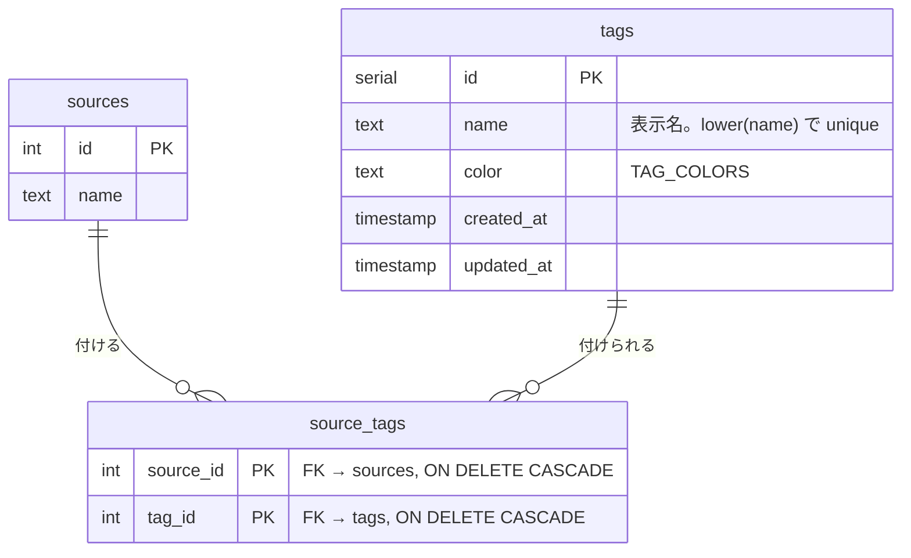
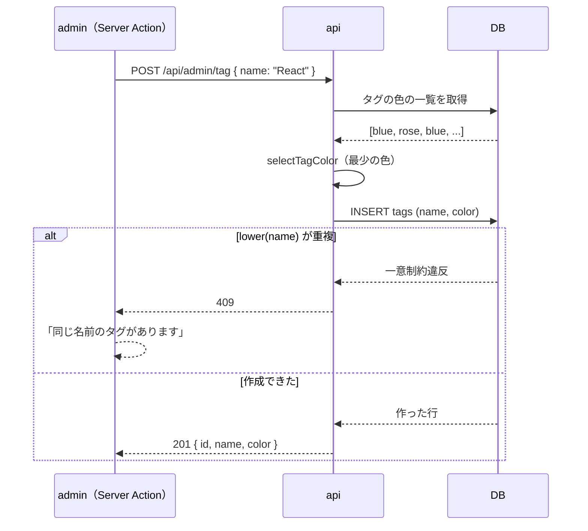
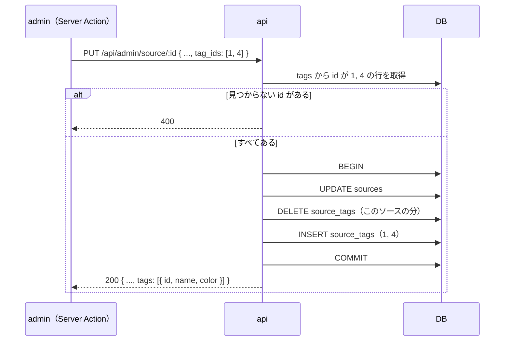

# ソースの技術タグ

ソースに付ける技術タグを、admin の「タグ」で登録したものから選ぶようにする。今はソースの登録フォームにカンマ区切りで自由に書いているため、`React` と `react` のような表記ゆれが別のタグとして登録され、ユーザーの問題一覧の絞り込みのチップが 2 つに分かれてしまう。タグを先に 1 か所で登録し、ソースではそこから選ぶだけにして、表記ゆれを入口で防ぐ。

タグには色を付けて admin で見分けやすくする。色はタグを作ったときに自動で割り当て、気に入らなければ選び直せる。色を出すのは admin だけで、ユーザー向けの web / mobile は今の見た目のまま変えない。

このドキュメントは **仕様（What）** と **設計（How）** を分けて記述する：

- **仕様**：ユーザーから見える挙動・ルール・データの意味
- **設計**：実装にあたっての技術的な選択と制約

## 関連 spec

- [`../content-collection/README.md`](../content-collection/README.md) — ソース（`sources`）の正本。ソースの登録項目のうち技術タグの扱いだけをこの spec が持つ
- [`../reading-practice/README.md`](../reading-practice/README.md) — 問題一覧の技術タグでの絞り込み（web / mobile）。この spec では API のレスポンスの形を変えない
- [`../admin-template/README.md`](../admin-template/README.md#admin-認証) — 管理画面のアクセス制御（admin ごとのサインイン。`admins` テーブル + admin 専用の JWT）
- [`../admin-users/README.md`](../admin-users/README.md) — admin のサイドバーの並び（「ダッシュボード」「問題」「ソース」「ユーザー」）。この spec で「ソース」の後に「タグ」を足す

## 目次

- [仕様](#仕様)
  - [タグの管理](#タグの管理)
  - [タグの名前](#タグの名前)
  - [タグの色](#タグの色)
  - [ソースへのタグ付け](#ソースへのタグ付け)
  - [タグの変更・削除の影響](#タグの変更削除の影響)
  - [既存のタグの移行](#既存のタグの移行)
- [設計](#設計)
  - [テーブルの構成](#テーブルの構成)
  - [表記ゆれの防ぎ方](#表記ゆれの防ぎ方)
  - [色の持ち方と自動の割り当て](#色の持ち方と自動の割り当て)
  - [既存のデータの移行](#既存のデータの移行)
  - [api の変更点](#api-の変更点)
  - [MVP 対象外（将来検討）](#mvp-対象外将来検討)
- [必要な画面](#必要な画面)
- [必要な API](#必要な-api)
- [必要な DB 設計](#必要な-db-設計)
- [フロー図](#フロー図)
- [実装ステップ](#実装ステップ)

---

## 仕様

### タグの管理

- admin のサイドバーに「タグ」を足す。並びは「ダッシュボード」「問題」「ソース」「タグ」「ユーザー」
- タグの画面では、登録済みのタグを色付きで一覧にし、使っているソースの数を並べる。名前の順（大文字・小文字を区別しない）
- タグの追加・名前と色の変更・削除ができる
- タグは admin でしか作れない。ソースの登録フォームから新しいタグは作らない

### タグの名前

- 前後の空白を除いて 1〜30 文字
- **大文字・小文字だけが違う名前は同じタグとみなし、登録できない**。`React` があれば `react` や `REACT` は「同じ名前のタグがあります」になる。名前の変更でも同じ
- 表示は登録したとおりの書き方（`React` と登録すれば `React` と出る）
- `,`（カンマ）は使えない。ユーザーの問題一覧の URL がタグをカンマ区切りで持つため（`?tag=react,rust`）

### タグの色

- 色は admin のライト / ダークのどちらでも読みやすい 10 色のパレットから選ぶ
- タグを作るときに色を選ばなければ（既定は「自動」）、**今いちばん使われていない色** を自動で割り当てる。同じ数の色が複数あれば、パレットの先頭に近い方
- パレットは隣り合う色の色相が離れる順に並べてあり、続けて作ったタグが似た色にならない
- 色はあとから選び直せる。違うタグが同じ色になってもよい（色は見分けやすくするためのもので、識別には使わない）

### ソースへのタグ付け

- ソースの登録・編集フォームでは、登録済みのタグを色付きのチップで全部並べ、押して選ぶ。選んだものは塗りつぶし、選んでいないものは薄く出す
- 1 ソースに付けられるのは 10 個まで（今と同じ）
- タグが 1 つも無いときは「タグがまだありません」と出し、タグの画面へのリンクを置く
- ソースの一覧の各行に、付いているタグを色付きで出す

### タグの変更・削除の影響

- **名前の変更** は、そのタグを付けたすべてのソースに反映される。ユーザーの問題一覧の絞り込みのチップの表示も新しい名前になる
- **削除** するときは確認を出す。使われていれば「3 件のソースで使われています。削除するとソースから外れます」のように件数を出す。削除するとソースから外れ、ユーザーの問題一覧の絞り込みのチップからも消える
- 公開済みの問題そのものは、タグを変えても消したりしても残る
- ユーザーの問題一覧の各問題に出るタグは、名前の順（大文字・小文字を区別しない）に並ぶ。今は登録したときの順なので、この機能を入れると並びだけが変わる

### 既存のタグの移行

- 今ソースに付いているタグは、この機能を入れるときにタグとして自動で登録し、ソースとの紐付けも残す
- 大文字・小文字だけが違うものは 1 つにまとめる。書き方は最も古く登録されたソースでの書き方を採る
- 色は名前の順にパレットを順番に割り当てる
- 書き方がまとまったタグ（`react` が `React` になった など）は、古い書き方の絞り込みの URL（`?tag=react`）では問題が出なくなる

---

## 設計

### テーブルの構成

- `tags` と、ソースとタグをつなぐ中間テーブル `source_tags` を作る。`sources.tags`（jsonb の文字列の配列）は移行の後に消す
- 中間テーブルにする理由
  - 登録済みのタグしか付けられないことを外部キーで保証できる（jsonb の配列だと、存在しない名前が入っても DB は気づかない）
  - 名前の変更は `tags` の 1 行を変えるだけで全ソースに反映される
  - 削除は `ON DELETE CASCADE` でソースからも外れる（仕様の「削除するとソースから外れる」をそのまま実現できる）
  - 使っているソースの数を `count` で求められる
- タグの id の配列を `sources` に持つ案は、外部キーを張れず、削除のたびに全ソースの配列を書き換える処理が要るので採らない

### 表記ゆれの防ぎ方

- `tags` に `lower(name)` の unique index を張り、大文字・小文字だけが違う名前を DB で拒否する。api-schema の検証（trim・1〜30 文字・カンマ禁止）を通った後の重複は、この index の一意制約違反を Repository が `duplicate` として返し、api が 409 にする（同時に 2 人が登録しても DB が止める）
- 名前のルール（前後の空白なし・1〜30 文字・カンマなし）は、DB の CHECK 制約 `tags_name_check` でも守る。api を通らない書き込み（移行・seed）でも崩れないようにするため。移行で既存のタグがこの制約に掛かれば、migration 全体が戻ってデプロイが止まる（黙って捨てない）
- 大文字・小文字以外の揺れ（`Next.js` と `NextJS` など）は防がない（[MVP 対象外](#mvp-対象外将来検討)）
- ユーザーの問題一覧のタグでの絞り込みは、今までどおりタグの名前の完全一致で比べる。web の絞り込みのチップは API が返すタグの名前から URL を作るので、画面から操作する限り表記はそろう。大文字・小文字を区別せずに比べると、URL の `?tag=react` と API の `React` が別のチップとして 2 つ出てしまい、web を変えずには済まないため

### 色の持ち方と自動の割り当て

- 色の一覧は `@repo/domain` の定数 `TAG_COLORS` を正とする（CLAUDE.md の「enum 的な値の集合はここが SSOT」）。値は Tailwind の既定のパレットの色の名前で、色相が離れる順に並べる

  ```
  blue, rose, emerald, amber, violet, teal, orange, pink, lime, sky
  ```

- DB には色の名前（`blue` など）を入れ、`CHECK (color IN (...))` を `TAG_COLORS` から作る。api-schema の `z.enum` も同じ定数から作る
- 自動の割り当ては `@repo/domain` の純関数 `selectTagColor(usedColors)` が決める。今のタグの色の一覧を受け取り、使われている数が最少の色（同数ならパレットの先頭に近い方）を返す。api の Service が、作成のリクエストに色が無いときだけ呼ぶ
- 2 人が同時にタグを作ると同じ色になりうるが、色は識別に使わないので許す（ロックは取らない）
- admin では、色の名前を Tailwind のクラスに変換する対応表を `TagChip` に 1 つだけ持つ。Tailwind はソースに書かれたクラス名しか CSS にしないので、`bg-${color}-50` のように組み立てず、色ごとにクラス名をそのまま書く

### 既存のデータの移行

expand → contract の 2 段に分け、**別々のデプロイで出す**。deploy workflow は migration をアプリより先に流すので、列を消す migration を新しい api と同じデプロイに入れると、その間だけ古い api が消えた列を読んで失敗する（ユーザー向けの問題一覧も含む）。

1. **追加と移行**（step1。api・admin の変更と同じデプロイ）：`tags` と `source_tags` を作り、`sources.tags` の名前を `lower(trim(name))` ごとに 1 つにまとめて `tags` に入れ、紐付けを `source_tags` に入れる。書き方は id が最小のソースのもの、色は `lower(name)` の順にパレットを順番に割り当てる。`db:generate` で作った SQL に移行の SQL を書き足す（SQL は [step1](./tasks/step1-db-tags.md)）
2. **古い列の削除**（step6。1 のデプロイの後の、別のデプロイ）：列を消す migration を出す（[step6](./tasks/step6-db-drop-sources-tags.md)）

1 のデプロイの api と cron が `sources.tags` を SQL に書かないよう、step3 で Drizzle のスキーマから列の定義だけを外す（migration は作らず、DB の列は残す。insert には DB の既定値が入る）。Drizzle の `select()`・`returning()` はスキーマにある全列を SQL に書くので、スキーマに残すと列を消した後に古い api の admin のソース API と cron の収集が失敗するため。step3 から step6 までの間は、スキーマと DB がずれている。その間にほかの機能で `db:generate` を流すと列を消す SQL が混ざるので、流さない（混ざったら消す）

移行は step1 の migration を流した時点の `sources.tags` を写す。migration から新しい api・admin が出るまでの間に古い admin でソースのタグを変えると写らないので、デプロイの間はソースを編集しない（管理者は 1 人）。

### api の変更点

- タグの CRUD を `/api/admin/tag` に足す。既存の admin の API（`/api/admin/source`）と同じく、Controller は `src/controller/admin/tag/`、Service は `src/service/tag-service.ts`
- ソースの登録・更新は、タグの名前の配列（`tags`）の代わりに id の配列（`tag_ids`）を受け取る。省略はできない（古いフォームから保存してタグが黙って全部外れるのを防ぐ）。存在しない id が含まれていたら 400 で、admin が取得元の変更の 400 と見分けられるよう `details` の `path` を `["tag_ids"]` にする。ソースの更新とタグの付け替えは 1 トランザクションで行う
- ソースのレスポンスの `tags` は `{ id, name, color }` の配列にする（名前の順）。ソースの一覧のレスポンスにも `tags` を足す
- `@repo/domain` の `Source` 型から `tags` を外す。cron はタグを使わないため。api ではソースとタグを一緒に返す型を api の Repository の interface に置く
- **ユーザー向けの問題一覧・ランダムの API のレスポンスは変えない**（`tags` はタグの名前の配列のまま）。内部の SQL を `sources.tags` から中間テーブルの JOIN に直すだけなので、web / mobile には手を入れない

### MVP 対象外（将来検討）

以下は作らない。タグが増えて運用でつらくなったら着手する。

- タグの統合（`Reactjs` を `React` にまとめる）。今は、ソースのタグを付け替えてから古いタグを消す
- 大文字・小文字以外の表記ゆれ（`Next.js` と `NextJS`）の検出や、似た名前の警告
- web / mobile での色付きのタグ（API のレスポンスに色を足す）
- タグの並び順の手動の指定、タグの説明文

---

## 必要な画面

すべて admin。

| パス | 画面名 | 役割 |
| --- | --- | --- |
| `/tags`（新規） | タグ | タグの一覧（色付きのタグ・使っているソースの数）。追加・編集はモーダル、削除は確認のモーダル |
| `/sources` | ソース一覧 | 各行に色付きのタグを足す |
| `/sources/new`・`/sources/[id]` | ソースの登録・編集 | 技術タグのカンマ区切りの入力欄を、色付きのチップを押して選ぶ形に変える |

- サイドバーは「ダッシュボード」「問題」「ソース」「タグ」「ユーザー」の順
- 色付きのタグは、admin の共通のコンポーネント `TagChip` で出す（ライト：薄い背景と濃い文字、ダーク：半透明の背景と明るい文字）
- 具体的な UI は `design-mock` skill で確定後に追記する

## 必要な API

admin 向け。アクセス制御は [question-generation](../question-generation/README.md#管理画面のアクセス制御) を参照。

| メソッド | パス | 説明 |
| --- | --- | --- |
| GET | `/api/admin/tag` | タグの一覧。`id`・`name`・`color`・`source_count`（使っているソースの数）。名前の順（大文字・小文字を区別しない） |
| POST | `/api/admin/tag` | タグの作成。`{ name, color? }`。`color` を省くと自動で割り当てる。大文字・小文字を区別しない重複は 409 |
| PUT | `/api/admin/tag/:id` | タグの名前と色の変更。`{ name, color }`。無ければ 404、重複は 409 |
| DELETE | `/api/admin/tag/:id` | タグの削除。紐付いたソースからも外れる。無ければ 404 |
| POST | `/api/admin/source` | （変更）`tags`（名前）の代わりに `tag_ids`（最大 10・重複なし）。存在しない id は 400。レスポンスの `tags` は `{ id, name, color }` |
| PUT | `/api/admin/source/:id` | （変更）登録と同じ |
| GET | `/api/admin/source` | （変更）各ソースに `tags`（`{ id, name, color }`）を足す |
| GET | `/api/admin/source/:id` | （変更）`source.tags` を `{ id, name, color }` にする |

ユーザー向けの `GET /api/passage`・`GET /api/passage/random` はリクエストもレスポンスも変えない。

## 必要な DB 設計

| テーブル | 主要カラム | 説明 |
| --- | --- | --- |
| `tags`（新規） | `id`, `name`, `color`, `created_at`, `updated_at` | 技術タグ。`lower(name)` に unique index。`color` は `TAG_COLORS` の CHECK 制約 |
| `source_tags`（新規） | `source_id`, `tag_id` | ソースとタグの紐付け。2 列で主キー。どちらの外部キーも `ON DELETE CASCADE` |
| `sources` | `tags(jsonb)` を削除（step6） | ほかの列は変えない（正本は [content-collection](../content-collection/README.md#必要な-db-設計)） |



- `source_tags` の主キーは `(source_id, tag_id)`。タグからソースを引く（使っているソースの数）ために `tag_id` に index を張る
- `source_tags` には `created_at` を持たない（紐付けの時刻は使わない）

## フロー図

タグの作成（色の自動の割り当て）：



ソースの登録・更新（タグの付け替え）：



---

## 実装ステップ

PR は 3 つに分ける。

| PR | step | 出し方 |
| --- | --- | --- |
| DB・api | step1〜3 | admin の PR と両方を main に入れてから、まとめてデプロイする。api だけを先に出すと、admin のソースの登録・保存が `tag_ids` が無くて失敗するため |
| admin | step4〜5 | 同上 |
| 列の削除 | step6 | 上の 2 つのデプロイの後に、別にデプロイする（[既存のデータの移行](#既存のデータの移行)） |

| step | 内容 |
| --- | --- |
| [step1-db-tags](./tasks/step1-db-tags.md) | `@repo/domain` の `TAG_COLORS`・`Tag` 型・`selectTagColor`、`tags` / `source_tags` のスキーマと、既存のタグを移す migration |
| [step2-api-admin-tag](./tasks/step2-api-admin-tag.md) | タグの CRUD の API（`/api/admin/tag`） |
| [step3-api-source-tags](./tasks/step3-api-source-tags.md) | ソースの API の `tag_ids`・`tags` の形の変更、問題一覧の絞り込みとタグ一覧を中間テーブルから読む、cron・seed の修正。Drizzle のスキーマから `sources.tags` の定義を外す（DB の列は step6 まで残す） |
| [step4-admin-tags](./tasks/step4-admin-tags.md) | admin のサイドバーの「タグ」、`/tags` の画面、`TagChip` |
| [step5-admin-source-tags](./tasks/step5-admin-source-tags.md) | ソースの登録・編集フォームのタグの選択、ソース一覧のタグ |
| [step6-db-drop-sources-tags](./tasks/step6-db-drop-sources-tags.md) | `sources.tags` 列を消す migration と、列に依存するテストの片付け |
