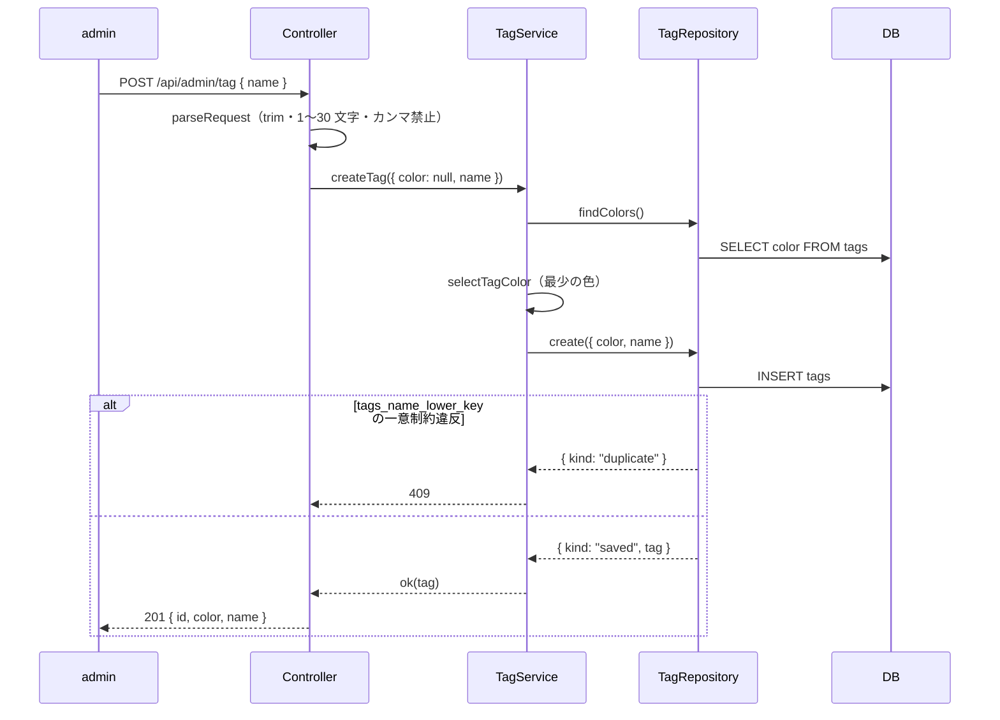

# step2-api-admin-tag

admin 向けのタグの一覧・作成・更新・削除の API（`/api/admin/tag`）を作る。仕様は README の [タグの管理](../README.md#タグの管理)・[タグの名前](../README.md#タグの名前)・[タグの色](../README.md#タグの色)、作り方は [表記ゆれの防ぎ方](../README.md#表記ゆれの防ぎ方)・[色の持ち方と自動の割り当て](../README.md#色の持ち方と自動の割り当て)。

ソースへのタグ付け（`tag_ids`）はこの step では触らない（[step3](./step3-api-content-source-tags.md)）。

## 前提

- [step1-db-tags](./step1-db-tags.md)：`tags` / `content_source_tags`、`@repo/domain` の `TAG_COLORS`・`Tag`・`TagColor`・`selectTagColor`
- 既存の admin の API の形（`src/routes/admin-router.ts`・`src/controller/admin/content-source/*`）。方針は `apps/api/CLAUDE.md` の「Admin API 設計方針」

## 対応内容

| メソッド | パス | 成功 | 業務エラー |
| --- | --- | --- | --- |
| GET | `/api/admin/tag` | 200 | ― |
| POST | `/api/admin/tag` | 201 | 400（スキーマ）/ 409（大文字・小文字を区別しない重複） |
| PUT | `/api/admin/tag/:id` | 200 | 400（スキーマ）/ 404 / 409 |
| DELETE | `/api/admin/tag/:id` | 204（ボディなし） | 400（`:id` が不正）/ 404 |

ステータスは既存の content-source に合わせる（作成は 201・更新は 200）。admin に削除の API はまだ無いので、ボディの要らない削除は `DELETE /api/user` と同じ 204 にする。



### API スキーマ

`packages/schema/src/api-schema/admin/tag.ts` を足し、`src/api-schema/index.ts` に `export * from "./admin/tag"` を足す（ファイル名順で `./admin/passage` の後）。`tagSchema` は step3 でソースのレスポンスの `tags` にも使う。

```typescript
/** packages/schema/src/api-schema/admin/tag.ts */
import { z } from "zod"

import { TAG_COLORS } from "@repo/domain"

// ========================================================
// 共通: タグの入力・出力の部品
// ========================================================

/**
 * タグの色のスキーマ。admin の色の選択肢は tagColorSchema.options から作る
 */
export const tagColorSchema = z.enum(TAG_COLORS)

/**
 * タグの名前のスキーマ。前後の空白を除いて 1〜30 文字。
 * カンマはユーザーの問題一覧の URL がタグをカンマ区切りで持つ（?tag=react,rust）ので使えない
 */
export const tagNameSchema = z
  .string()
  .trim()
  .min(1)
  .max(30)
  .refine((value) => !value.includes(","), { message: "Tag name must not contain a comma" })

/**
 * 1 つのタグのレスポンス（ソースのレスポンスの tags にも使う）
 */
export const tagSchema = z.object({
  id: z.number().int(),
  color: tagColorSchema,
  name: z.string(),
})

export type TagResponse = z.infer<typeof tagSchema>

// ========================================================
// GET /api/admin/tag - タグの一覧
// ========================================================

/**
 * タグの一覧のレスポンススキーマ。名前の順（大文字・小文字を区別しない）
 */
export const getTagListResponseSchema = z.object({
  tags: z.array(
    tagSchema.extend({
      /**
       * このタグを付けているソースの数
       */
      source_count: z.number().int(),
    }),
  ),
})

export type GetTagListResponse = z.infer<typeof getTagListResponseSchema>

// ========================================================
// POST /api/admin/tag - タグの作成
// ========================================================

/**
 * タグの作成のリクエストスキーマ。color を省くと api が自動で割り当てる
 */
export const createTagRequestSchema = z.object({
  color: tagColorSchema.optional(),
  name: tagNameSchema,
})

/**
 * タグの作成のレスポンススキーマ
 */
export const createTagResponseSchema = tagSchema

export type CreateTagRequest = z.infer<typeof createTagRequestSchema>
export type CreateTagResponse = z.infer<typeof createTagResponseSchema>

// ========================================================
// PUT /api/admin/tag/:id - タグの名前と色の変更
// ========================================================

/**
 * タグの更新のパスパラメータスキーマ
 */
export const updateTagPathParamSchema = z.object({
  id: z.coerce.number().int().positive(),
})

/**
 * タグの更新のリクエストスキーマ。名前と色の両方を送る
 */
export const updateTagRequestSchema = z.object({
  color: tagColorSchema,
  name: tagNameSchema,
})

/**
 * タグの更新のレスポンススキーマ
 */
export const updateTagResponseSchema = tagSchema

export type UpdateTagPathParam = z.infer<typeof updateTagPathParamSchema>
export type UpdateTagRequest = z.infer<typeof updateTagRequestSchema>
export type UpdateTagResponse = z.infer<typeof updateTagResponseSchema>

// ========================================================
// DELETE /api/admin/tag/:id - タグの削除
// ========================================================

/**
 * タグの削除のパスパラメータスキーマ。成功は 204（ボディなし）なのでレスポンススキーマは無い
 */
export const deleteTagPathParamSchema = z.object({
  id: z.coerce.number().int().positive(),
})

export type DeleteTagPathParam = z.infer<typeof deleteTagPathParamSchema>
```

### unique 制約違反の判定を共有する

`src/repository/drizzle/content-source-repository.ts` の中にある `isUniqueViolation`（と `UNIQUE_VIOLATION`）を `src/repository/drizzle/pg-error.ts` に移し、content-source とタグの Repository の両方から import する。content-source 側の挙動は変えない。

```typescript
/** apps/api/src/repository/drizzle/pg-error.ts */

/**
 * Postgres の unique 制約違反の SQLSTATE
 */
const UNIQUE_VIOLATION = "23505"

/**
 * unique 制約違反か。Drizzle は pg のエラーを DrizzleQueryError の cause に入れる。
 * どの制約かは見ないので、呼び出し側は「そのテーブルの unique 制約が重複の登録しか表さない」ときだけ使う
 * （content_sources は repository / site_url、tags は lower(name)）
 */
export const isUniqueViolation = (error: unknown): boolean => {
  const cause = typeof error === "object" && error !== null && "cause" in error ? error.cause : undefined
  return typeof cause === "object" && cause !== null && "code" in cause && cause.code === UNIQUE_VIOLATION
}
```

`pg-error.ts` は Repository の実装の内側の部品なので、`drizzle/index.ts` のバレルには足さない。

### 行の変換を共有する

タグの行 → ドメインの変換は、[step3](./step3-api-content-source-tags.md) の `DrizzleContentSourceRepository`（ソースのタグを返す）でも使う。`passage-audio-row.ts` と同じ形で `src/repository/drizzle/tag-row.ts` に置く。`pg-error.ts` と同じく `drizzle/index.ts` のバレルには足さない。

```typescript
/** apps/api/src/repository/drizzle/tag-row.ts */
import type { tags } from "@repo/db"
import type { Tag } from "@repo/domain"

/**
 * Drizzleの型
 */
export type TagRow = typeof tags.$inferSelect

/**
 * Drizzleの型 → ドメインの型。TagRepository と ContentSourceRepository（ソースのタグ）で共有する
 */
export const convertTagRowToDomain = (row: TagRow): Tag => ({
  id: row.id,
  color: row.color,
  name: row.name,
  createdAt: row.createdAt,
  updatedAt: row.updatedAt,
})
```

### Repository

```typescript
/** apps/api/src/repository/tag-repository.ts */
import type { Tag, TagColor } from "@repo/domain"

/**
 * タグの作成・更新の入力
 */
export type TagInput = Pick<Tag, "color" | "name">

/**
 * 一覧の 1 行。sourceCount はこのタグを付けているソースの数
 */
export type TagWithSourceCount = Tag & { sourceCount: number }

/**
 * 作成・更新の結果。lower(name) の unique 制約に違反したら duplicate（大文字・小文字だけが違う名前を含む）
 */
export type TagSaveResult = { kind: "duplicate" } | { kind: "saved"; tag: Tag }

/**
 * 技術タグ（tags）のリポジトリ
 */
export interface TagRepository {
  create(input: TagInput): Promise<TagSaveResult>
  /**
   * 消せたら true、無ければ false。紐付いた content_source_tags は CASCADE で消える
   */
  delete(id: number): Promise<boolean>
  /**
   * 名前の順（lower(name)）。同じなら id の順
   */
  findAll(): Promise<TagWithSourceCount[]>
  /**
   * 渡した id のうち存在するものだけ（順不同）。空の配列なら空の配列
   */
  findByIds(ids: number[]): Promise<Tag[]>
  /**
   * 全タグの色（重複あり）。色の自動の割り当てに使う
   */
  findColors(): Promise<TagColor[]>
  /**
   * 無ければ not_found
   */
  update(id: number, input: TagInput): Promise<TagSaveResult | { kind: "not_found" }>
}
```

```typescript
/** apps/api/src/repository/drizzle/tag-repository.ts */
import { asc, contentSourceTags, count, DrizzleClient, eq, inArray, sql, tags } from "@repo/db"
import type { Tag, TagColor } from "@repo/domain"

import type { TagInput, TagRepository, TagSaveResult, TagWithSourceCount } from "../tag-repository"

import { isUniqueViolation } from "./pg-error"
import { convertTagRowToDomain } from "./tag-row"

/**
 * Drizzle 実装の TagRepository
 */
export class DrizzleTagRepository implements TagRepository {
  private _db: DrizzleClient

  constructor(db: DrizzleClient) {
    this._db = db
  }

  public async create(input: TagInput): Promise<TagSaveResult> {
    try {
      const [row] = await this._db.insert(tags).values({ color: input.color, name: input.name }).returning()
      return { kind: "saved", tag: convertTagRowToDomain(row) }
    } catch (error) {
      if (isUniqueViolation(error)) return { kind: "duplicate" }
      throw error
    }
  }

  public async delete(id: number): Promise<boolean> {
    const rows = await this._db.delete(tags).where(eq(tags.id, id)).returning({ id: tags.id })
    return rows.length > 0
  }

  public async findAll(): Promise<TagWithSourceCount[]> {
    const rows = await this._db
      .select({
        id: tags.id,
        color: tags.color,
        name: tags.name,
        sourceCount: count(contentSourceTags.contentSourceId),
        createdAt: tags.createdAt,
        updatedAt: tags.updatedAt,
      })
      .from(tags)
      .leftJoin(contentSourceTags, eq(contentSourceTags.tagId, tags.id))
      .groupBy(tags.id)
      .orderBy(sql`lower(${tags.name})`, asc(tags.id))
    return rows.map(({ sourceCount, ...row }) => ({ ...convertTagRowToDomain(row), sourceCount }))
  }

  public async findByIds(ids: number[]): Promise<Tag[]> {
    if (ids.length === 0) return []
    const rows = await this._db.select().from(tags).where(inArray(tags.id, ids))
    return rows.map((row) => convertTagRowToDomain(row))
  }

  public async findColors(): Promise<TagColor[]> {
    const rows = await this._db.select({ color: tags.color }).from(tags)
    return rows.map((row) => row.color)
  }

  public async update(id: number, input: TagInput): Promise<TagSaveResult | { kind: "not_found" }> {
    try {
      const [row] = await this._db
        .update(tags)
        .set({ color: input.color, name: input.name })
        .where(eq(tags.id, id))
        .returning()
      return row ? { kind: "saved", tag: convertTagRowToDomain(row) } : { kind: "not_found" }
    } catch (error) {
      if (isUniqueViolation(error)) return { kind: "duplicate" }
      throw error
    }
  }
}
```

- `count(contentSourceTags.contentSourceId)` は left join で紐付けが無いタグを 0 にする（`count()` だと 1 になる）
- `src/repository/index.ts` に `export * from "./tag-repository"`、`drizzle/index.ts` に `export * from "./tag-repository"` を足す（ファイル名順で `./reminder-setting-repository` の後）

### Service

`src/service/tag-service.ts` を足し、`service/index.ts` に `export * as tag from "./tag-service"` を足す（ファイル名順で `./reminder-service` の後）。

```typescript
/** apps/api/src/service/tag-service.ts */
import { selectTagColor, type Tag, type TagColor } from "@repo/domain"
import { conflictError, err, notFoundError, ok, Result } from "@repo/errors"
import { logger } from "@repo/logger"

import { TagInput, TagRepository, TagWithSourceCount } from "../repository"

type TagRepo = { tagRepository: TagRepository }

const DUPLICATE_TAG_MESSAGE = "Tag already exists"

/**
 * タグの作成の入力。color が null なら自動で割り当てる
 */
export type CreateTagInput = { color: TagColor | null; name: string }

/**
 * タグの一覧（使っているソースの数つき）
 */
export const getTags = async (repo: TagRepo): Promise<Result<TagWithSourceCount[]>> =>
  ok(await repo.tagRepository.findAll())

/**
 * タグを作る。色の指定が無ければ、今いちばん使われていない色を割り当てる。
 * 2 つのリクエストが同時に来ると同じ色になりうるが、色は識別に使わないので許す（ロックは取らない）
 */
export const createTag = async (input: CreateTagInput, repo: TagRepo): Promise<Result<Tag>> => {
  const color = input.color ?? selectTagColor(await repo.tagRepository.findColors())
  /**
   * 重複の事前の検査はしない。lower(name) の unique index が同時のリクエストも含めて止める
   */
  const result = await repo.tagRepository.create({ color, name: input.name })
  if (result.kind === "duplicate") {
    logger.debug("TagService: Tag already exists")
    return err(conflictError(DUPLICATE_TAG_MESSAGE))
  }
  logger.info("TagService: Tag created", { color, id: result.tag.id })
  return ok(result.tag)
}

/**
 * タグの名前と色を変える。名前の変更は、このタグを付けたすべてのソースに反映される
 */
export const updateTag = async (id: number, input: TagInput, repo: TagRepo): Promise<Result<Tag>> => {
  const result = await repo.tagRepository.update(id, input)
  if (result.kind === "not_found") {
    logger.debug("TagService: Tag not found for update", { id })
    return err(notFoundError("Tag not found"))
  }
  if (result.kind === "duplicate") {
    logger.debug("TagService: Tag already exists", { id })
    return err(conflictError(DUPLICATE_TAG_MESSAGE))
  }
  logger.info("TagService: Tag updated", { id })
  return ok(result.tag)
}

/**
 * タグを消す。付けていたソースからも外れる（content_source_tags の CASCADE）
 */
export const deleteTag = async (id: number, repo: TagRepo): Promise<Result<{ deleted: true }>> => {
  if (!(await repo.tagRepository.delete(id))) {
    logger.debug("TagService: Tag not found for deletion", { id })
    return err(notFoundError("Tag not found"))
  }
  logger.info("TagService: Tag deleted", { id })
  return ok({ deleted: true })
}
```

- 重複は事前に `findByName` で調べず、Repository の `duplicate` だけで判定する（content-source は取得元で重複を事前に調べているが、タグは unique index が `lower(name)` そのものなので 1 回で済む）
- タグの名前はログに出さない理由は無いが、出す必要も無いので id だけを出す

### Controller

`src/controller/admin/tag/` に置く。書き方は `controller/admin/content-source/` と同じ（`parseRequest` → service → `sendError` / `parseResponse`）。

```typescript
/** apps/api/src/controller/admin/tag/tag-mapper.ts */
import type { GetTagListResponse, TagResponse } from "@repo/api-schema"
import type { Tag } from "@repo/domain"

import type { TagWithSourceCount } from "../../../repository"

/**
 * ドメインの Tag → レスポンス
 */
export const convertTagToResponse = (tag: Tag): TagResponse => ({
  id: tag.id,
  color: tag.color,
  name: tag.name,
})

/**
 * 一覧の 1 行 → レスポンス
 */
export const convertTagWithSourceCountToResponse = (
  tag: TagWithSourceCount,
): GetTagListResponse["tags"][number] => ({
  ...convertTagToResponse(tag),
  source_count: tag.sourceCount,
})
```

```typescript
/** apps/api/src/controller/admin/tag/create.ts */
import { Request, Response } from "express"

import { createTagRequestSchema, createTagResponseSchema } from "@repo/api-schema"

import { parseRequest, parseResponse } from "../../../lib/parse-schema"
import { sendError } from "../../../lib/send-error"
import { TagRepository } from "../../../repository"
import * as service from "../../../service"

import { convertTagToResponse } from "./tag-mapper"

/**
 * admin のタグの作成API。color を省くと自動で割り当てる
 */
export class AdminTagCreateController {
  constructor(private _tagRepository: TagRepository) {}

  public async execute(req: Request, res: Response) {
    const data = parseRequest(createTagRequestSchema, req.body)

    const result = await service.tag.createTag(
      { color: data.color ?? null, name: data.name },
      { tagRepository: this._tagRepository },
    )

    if (!result.ok) {
      return sendError(req, res, result.error)
    }

    const response = parseResponse(createTagResponseSchema, convertTagToResponse(result.value))
    return res.status(201).json(response)
  }
}
```

```typescript
/** apps/api/src/controller/admin/tag/delete.ts */
import { Request, Response } from "express"

import { deleteTagPathParamSchema } from "@repo/api-schema"

import { parseRequest } from "../../../lib/parse-schema"
import { sendError } from "../../../lib/send-error"
import { TagRepository } from "../../../repository"
import * as service from "../../../service"

/**
 * admin のタグの削除API。付けていたソースからも外れる。成功は 204（ボディなし）
 */
export class AdminTagDeleteController {
  constructor(private _tagRepository: TagRepository) {}

  public async execute(req: Request, res: Response) {
    const { id } = parseRequest(deleteTagPathParamSchema, req.params)

    const result = await service.tag.deleteTag(id, { tagRepository: this._tagRepository })

    if (!result.ok) {
      return sendError(req, res, result.error)
    }

    return res.status(204).end()
  }
}
```

- `list.ts`（`AdminTagListController`）：`service.tag.getTags` → `parseResponse(getTagListResponseSchema, { tags: result.value.map(convertTagWithSourceCountToResponse) })` → 200
- `update.ts`（`AdminTagUpdateController`）：`updateTagPathParamSchema` / `updateTagRequestSchema` → `service.tag.updateTag(id, { color: data.color, name: data.name }, ...)` → `parseResponse(updateTagResponseSchema, convertTagToResponse(...))` → 200

### Router / DI

```typescript
/** src/routes/admin-router.ts の AdminRouterControllers に足す（キーはアルファベット順で passage の後） */
tag?: {
  create?: AdminTagCreateController
  delete?: AdminTagDeleteController
  list?: AdminTagListController
  update?: AdminTagUpdateController
}
```

```typescript
/** adminRouter の中（passage のルートの後） */
const tag = controllers.tag ?? {}

/**
 * GET /api/admin/tag
 */
if (tag.list) {
  const controller = tag.list
  router.get("/tag", async (req, res) => controller.execute(req, res))
}

/**
 * POST /api/admin/tag
 */
if (tag.create) {
  const controller = tag.create
  router.post("/tag", async (req, res) => controller.execute(req, res))
}

/**
 * PUT /api/admin/tag/:id
 */
if (tag.update) {
  const controller = tag.update
  router.put("/tag/:id", async (req, res) => controller.execute(req, res))
}

/**
 * DELETE /api/admin/tag/:id
 */
if (tag.delete) {
  const controller = tag.delete
  router.delete("/tag/:id", async (req, res) => controller.execute(req, res))
}
```

`src/index.ts`：`const tagRepository = new DrizzleTagRepository(db)` を作り、4 つの Controller を `adminRouter({ ..., tag: { create, delete, list, update } })` に渡す。`/api/admin` 配下なので `adminAuthMiddleware`（`X-Admin-Token`）を通る（別の router に足さない）。

## 動作確認

```bash
pnpm --filter @repo/domain build && cd packages/schema && pnpm build && cd -
pnpm --filter api test      # vitest を直接叩かない（dev DB が消える）
pnpm lint:fix
```

api のテストは必ず `pnpm --filter api test` で流す。`vitest` を直接実行すると dev DB に繋がり、`cleanupTestData` が dev DB を全部消す。

Service のユニットテスト（`test/service/tag-service/{getTags,createTag,updateTag,deleteTag}.test.ts`。`fixtures.ts` に `createMockTagRepository`（`vi.fn<TagRepository["create"]>()` などをメソッド名の順に）と `buildTag(overrides)` を置く）：

- `getTags`
  - 正常系
    - [ ] `findAll` の結果をそのまま `ok` で返す。0 件なら空の配列
- `createTag`
  - 正常系
    - [ ] `color: null` なら `findColors` の結果から選んだ色で `create` が呼ばれる（`findColors` が `["blue"]` なら `rose`）
    - [ ] `color` を指定したら `findColors` を呼ばずに、その色で `create` が呼ばれる
    - [ ] `create` が `saved` を返したら `ok(tag)`
  - 異常系
    - [ ] `create` が `duplicate` を返したら 409（`ok: false`・`statusCode: 409`・`type: "CONFLICT"`）
- `updateTag`
  - 正常系
    - [ ] 渡した `{ color, name }` で `update` が呼ばれ、`ok(tag)` を返す
  - 異常系
    - [ ] `not_found` で 404、`duplicate` で 409
- `deleteTag`
  - 正常系
    - [ ] `delete` が true なら `ok({ deleted: true })`
  - 異常系
    - [ ] `delete` が false なら 404

Repository のテスト（`test/repository/tag-repository.test.ts`。実 DB）：

- 正常系
  - [ ] `create` → `findByIds` で同じ値が返る（`toEqual`。`createdAt` / `updatedAt` は `expect.any(Date)`）
  - [ ] `findAll` が名前の順（`apple` → `Banana` → `cherry`。大文字・小文字を区別しない）で返し、`sourceCount` が紐付けの数になる（紐付けの無いタグは 0）
  - [ ] `findColors` が全タグの色を重複込みで返す。タグが 0 個なら空の配列
  - [ ] `findByIds` は存在する id だけを返す。空の配列なら DB に問い合わせずに空の配列
  - [ ] `update` が名前と色を書き、`updatedAt` が進む。自分自身の名前の大文字・小文字だけを変える（`react` → `React`）のは `duplicate` にならない
  - [ ] `delete` が true を返し、そのタグの `content_source_tags` の行も消える（ソースとほかのタグの紐付けは残る）
- 異常系
  - [ ] `React` があると、`create({ name: "react" })` は throw せず `{ kind: "duplicate" }` を返し、行は増えない
  - [ ] ほかのタグと同じ名前（大文字・小文字違いを含む）への `update` は `{ kind: "duplicate" }` を返し、行は変わらない
  - [ ] 存在しない id の `update` は `{ kind: "not_found" }`、`delete` は false

Controller のインテグレーションテスト（`test/controller/admin/tag/{list,create,update,delete}.test.ts`。実 DB。`X-Admin-Token` は `content-source` のテストと同じく `.set(ADMIN_TOKEN_HEADER, env.ADMIN_API_TOKEN)`。タグとソースの投入は `fixtures.ts` にまとめる）：

- 正常系
  - [ ] GET：200。`testDb` で入れたタグが名前の順に、`source_count` 付きで返る（`toEqual`）
  - [ ] POST：`color` を省くと 201 で、自動で割り当てた色が返り DB に保存される（タグが 0 個なら `blue`）
  - [ ] POST：`color: "pink"` を送ると `pink` で保存される。`name: "  React  "` は `React` で保存される
  - [ ] POST：`name` が 30 文字ちょうどなら 201（境界）
  - [ ] PUT：名前と色が変わり、200 で変更後のタグが返る
  - [ ] DELETE：204 でボディが空。タグを付けていたソースの紐付けが消える（ソースは残る）
- 異常系
  - [ ] POST が 400：`name` が空・空白だけ・31 文字・`react,vue`、`color: "red"`、`name` が無い
  - [ ] POST が 409：`React` があるときの `react`・`REACT`
  - [ ] PUT が 400（`color` が無い、`:id` が数値でない）/ 404（存在しない id）/ 409（ほかのタグと同じ名前）
  - [ ] DELETE が 404（存在しない id）/ 400（`:id` が数値でない）
  - [ ] `X-Admin-Token` が無いと 401（`/api/admin/tag` が admin-router の認証を通っていることの確認。1 ケースでよい）
