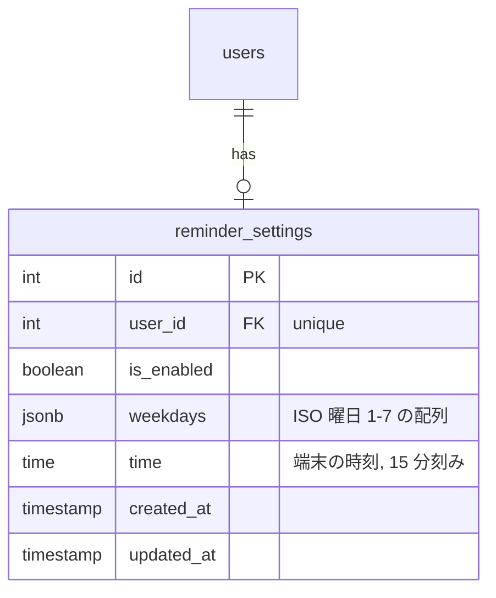
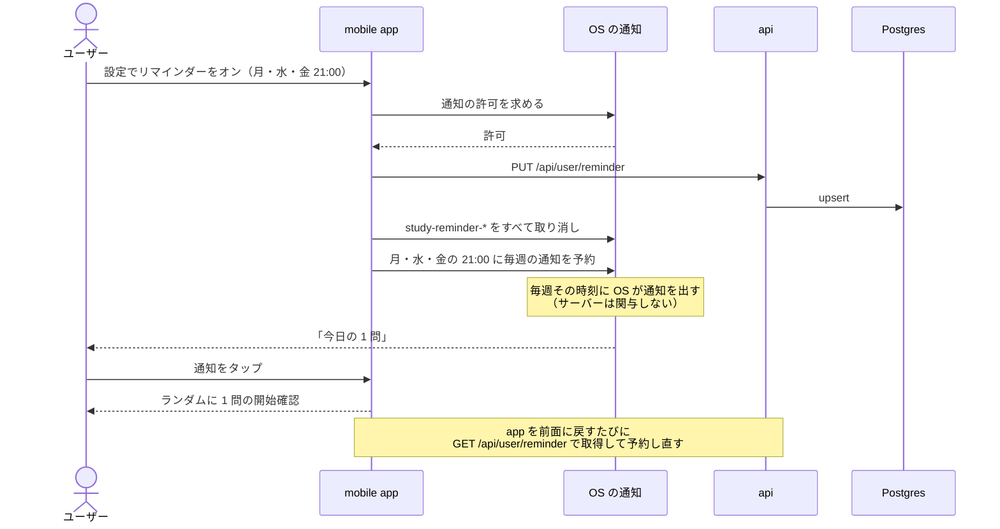

# 学習リマインダー

ユーザーが決めた曜日・時刻に「今日の 1 問」を促す通知を mobile に出す。学習を習慣にするための機能で、**mobile のみ** に提供する（web にはリマインダーを作らない）。

通知は **端末内で予約するローカル通知** にする。サーバーからプッシュを送る仕組み（端末トークンの管理、APNs / FCM の資格情報、定期実行のジョブ）を作らずに済み、[minimal-deploy](../minimal-deploy/README.md) の構成にも何も足さない。設定はアカウントに保存し、機種変更や再インストールのあとも同じ設定で通知が再開されるようにする。

このドキュメントは **仕様（What）** と **設計（How）** を分けて記述する：

- **仕様**：設定できる項目、通知の内容とタップしたときの動き、制約
- **設計**：ローカル通知を選んだ理由、予約と同期の方法、権限の扱い

## 関連 spec

- [`../product-overview/README.md`](../product-overview/README.md) — プロダクト全体像
- [`../learning-record/README.md`](../learning-record/README.md#設定画面) — 設定画面に目標と並べて置く
- [`../reading-practice/README.md`](../reading-practice/README.md) — 通知をタップすると「ランダムに 1 問」の開始確認を開く
- [`./deferred-remote-push.md`](./deferred-remote-push.md) — MVP 対象外。サーバーからのプッシュ通知（今日学習済みなら送らない等）、web のリマインダー
- **この spec が正本のもの**：`reminder_settings`

## 目次

- [仕様](#仕様)
  - [設定できる項目](#設定できる項目)
  - [通知の内容](#通知の内容)
  - [通知をタップしたとき](#通知をタップしたとき)
  - [制約（MVP）](#制約mvp)
- [設計](#設計)
  - [ローカル通知を選んだ理由](#ローカル通知を選んだ理由)
  - [通知の予約と同期](#通知の予約と同期)
  - [通知の権限](#通知の権限)
  - [曜日の表現](#曜日の表現)
  - [MVP 対象外（将来検討）](#mvp-対象外将来検討)
- [必要な画面](#必要な画面)
- [UI 設計](#ui-設計)
  - [リマインダーの区画](#リマインダーの区画)
  - [通知が許可されていないとき](#通知が許可されていないとき)
- [必要な API](#必要な-api)
- [必要な DB 設計](#必要な-db-設計)
- [フロー図](#フロー図)
- [実装ステップ](#実装ステップ)

---

## 仕様

### 設定できる項目

| 項目 | 既定値 | 説明 |
| --- | --- | --- |
| オン / オフ | オフ | オンにするときに通知の許可を求める |
| 曜日 | 毎日 | 複数選択。1 つ以上 |
| 時刻 | 21:00 | 15 分刻み。**端末の時刻** で通知する |

- 設定はアカウントに保存する。ログインしている端末すべてで同じ設定の通知が出る
- 通知の許可が OS で拒否されているときは、設定画面に「通知が許可されていません」と OS の設定画面を開くボタンを出す

### 通知の内容

固定の文言をいくつか用意し、日ごとに順番に使う。

| タイトル | 本文の例 |
| --- | --- |
| 今日の 1 問 | 5 分で読める技術英語を 1 問解きませんか？ |
| 英語のドキュメント、読んでますか？ | 公式ドキュメントの英文で、今日も少しだけ。 |
| 今日のマスを灯そう | 1 問解くと、学習カレンダーの今日のマスが灯ります。 |

連続学習日数のような、通知の時点で変わる情報は入れない（通知は前もって予約するため。[制約](#制約mvp)）。

### 通知をタップしたとき

app を開き、**「ランダムに 1 問」の開始確認** を表示する（問題を選ぶ手間をなくし、すぐ始められるようにする）。ログインが切れていればログイン画面を出し、ログイン後に開始確認へ進む。

### 制約（MVP）

ローカル通知にしたことによる制約。サーバーからのプッシュ通知（[deferred](./deferred-remote-push.md)）で解消できる。

- **今日すでに学習していても通知は届く**
- 通知の文言に連続学習日数などの最新の情報を入れられない
- 設定を変えた内容は、各端末で app を開いたときに反映される（開くまでは前の設定で通知が出る）

---

## 設計

### ローカル通知を選んだ理由

| | ローカル通知（採用） | サーバーからのプッシュ通知 |
| --- | --- | --- |
| サーバー側の実装 | 設定の保存 API だけ | 端末トークンの保存、送信ジョブ（cron を 15 分ごと等）、送信結果の処理 |
| 外部の準備 | なし | APNs のキー、FCM の設定、EAS の push 資格情報 |
| インフラの費用 | なし | cron の起動回数が増える（1 日 96 回など） |
| 「今日学習済みなら送らない」 | ❌ | ✅ |
| 最新の情報を文言に入れる | ❌ | ✅ |
| オフラインの端末 | ✅ 届く | ❌ 届かない（OS が後から配送） |

MVP では「決まった時刻に促す」ことが目的なので、実装と運用が最も軽いローカル通知で始める。「今日学習済みなら送らない」などが必要になったらプッシュ通知に移行する。設定をサーバーに保存しておくのは、この移行のときにそのまま使えるようにするため。

### 通知の予約と同期

`expo-notifications`（導入済み）の `scheduleNotificationAsync` で、選んだ曜日ごとに **毎週繰り返す** 通知を 1 つずつ予約する（最大 7 件）。

- 予約の識別子は `study-reminder-{曜日}` とし、**予約し直すときは同じ識別子の予約をすべて取り消してから作り直す**（冪等。何度同期しても重複しない）
- 同期するタイミング：
  - ログイン直後と、app を前面に戻したとき（`GET /api/user/reminder` で最新の設定を取得）
  - 設定画面で保存したとき
- 取得に失敗したとき（オフライン・通信の打ち切り）は、通知が許可されていれば **最後に取得・保存できた設定** で予約を作り直す（拒否中に OS の設定で許可し、オフラインで app に戻した場合も、案内が消えて予約もされる）。このログインでまだ一度も取得・保存できていなければ予約に触れない
- ログアウトしたとき・アカウントを削除したとき（[github-auth](../github-auth/README.md#アカウント削除の処理)）は、その端末の予約をすべて取り消し、通知センターに届き済みのリマインダーも消す（[ログアウト・強制ログアウト・ログイン](#ログアウト強制ログアウトログイン)）
- 通知に `data.url = "techenglish://passages/random"` を入れ、タップ時は `addNotificationResponseReceivedListener`（起動中）と `getLastNotificationResponse`（app が終了していた場合。`getLastNotificationResponseAsync` は deprecated）で受けて expo-router の画面に遷移する
- 通知の文言は予約時に曜日ごとに割り当てる（毎週同じ曜日に同じ文言になる）

毎週繰り返す予約ではなく「今後 2 週間分を 1 件ずつ予約し、学習した日の分を取り消す」方式も検討したが、採らなかった。この方式でも web で学習した日は取り消せないうえ、app を 2 週間開かないと通知が止まってしまい、**離れかけたユーザーを呼び戻すという目的と逆になる** ため。

#### ログアウト・強制ログアウト・ログイン

| きっかけ | 予約 | 通知センターに届き済みのリマインダー | 画面の設定（store） |
| --- | --- | --- | --- |
| ユーザーが押したログアウト・アカウント削除 | すべて取り消す | 消す | 空にする |
| ログイン切れ（refresh の失敗による強制ログアウト） | 残す | 残す | 空にする |
| ログインの成功（GitHub でログイン・Dev Login） | 同期の前にすべて取り消す | 触れない | （空のまま。同期で取得） |

- 強制ログアウトで予約を残すのは、ログインが切れても通知を届け、タップでログイン画面 → ログイン後に開始確認へ進めるため（[通知をタップしたとき](#通知をタップしたとき)）
- ログインに成功したら、同期の前にその端末の予約を取り消す。強制ログアウトのあとに **別のユーザー** がログインし、最初の取得に失敗したときに、前のユーザーの予約が残らないようにするため。同じユーザーでも次の同期（取得の成功）で作り直される（取得に失敗し続ける間は通知が出ない）
- ログアウト（refresh token の失効）とアカウント削除の通信には打ち切り（15 秒）を付ける。ログアウトは応答が無くても予約の取り消しまで進み、アカウント削除は失敗の表示に戻る（何も消さず、そのまま再試行できる）

### 通知の権限

| OS | 扱い |
| --- | --- |
| iOS | リマインダーをオンにした時点で `requestPermissionsAsync` を呼ぶ。app の起動時には求めない（理由が分からないまま許可を求めると拒否されやすいため） |
| Android 13 以上 | 同上（`POST_NOTIFICATIONS` の実行時権限） |
| Android | 起動時に通知チャンネル `study-reminder`（重要度：既定）を作る |

拒否されたら設定はオンのまま保存し、設定画面に許可を促す表示を出す（OS の設定で許可したら、次に app を前面に戻したときの同期で予約される）。

ローカル通知は Expo Go でも動くが、本番と同じ挙動を確認するため development build で動作確認する。

### 曜日の表現

- DB と API では **ISO の曜日番号（1 = 月曜 〜 7 = 日曜）** で持つ（`learning-record` の「月曜始まりの週」と揃える）
- `expo-notifications` の週次の予約は 1 = 日曜 〜 7 = 土曜なので、予約する箇所でだけ変換する

### MVP 対象外（将来検討）

詳細は [`deferred-remote-push.md`](./deferred-remote-push.md)。

- **サーバーからのプッシュ通知**（今日学習済みなら送らない、連続日数が途切れそうなときに送る、文言に最新の情報を入れる）
- **web のリマインダー**（Web Push / メール）

---

## 必要な画面

| 画面 | web | mobile | 概要 |
| --- | --- | --- | --- |
| 設定（リマインダーの区画） | ― | ✅ | オン / オフ、曜日、時刻。許可が無いときの案内 |

設定画面そのものは [learning-record](../learning-record/README.md#設定画面) に含まれる。具体的な UI は [UI 設計](#ui-設計) を参照。

## UI 設計

`design-mock` skill で確定したデザイン。配色・書体・共通の部品は [product-overview の UI 設計](../product-overview/README.md#mobile-のデザイン) を正本とする。

| 画面 | 場所 | モック |
| --- | --- | --- |
| 設定（リマインダーの区画） | mobile の設定タブ | `apps/mobile/src/app/mock/(tabs)/settings.tsx`（`/mock/settings`、`/mock/settings?state=denied`） |

web にはリマインダーの区画を置かず、設定画面に「学習のリマインダーはモバイルアプリの設定画面で設定できます。」の案内だけを出す（[learning-record](../learning-record/README.md#設定)）。

### リマインダーの区画

```
┌────────────────────────────────────────────┐
│ リマインダー                               │ ← 設定画面の区画
│  ┌──────────────────────────────────────┐  │
│  │ 学習のリマインダー              (━●) │  │ ← オン / オフ（OS のスイッチ）
│  │ 決めた曜日と時刻に「今日の 1 問」…   │  │
│  ├──────────────────────────────────────┤  │ ← オンのときだけ下を出す
│  │ 曜日                                 │  │
│  │ (月)(火)(水)(木)(金)( 土 )( 日 )     │  │ ← 選択中は琥珀の塗り。1 つ以上
│  │ 時刻                                 │  │
│  │  [ − ]    21:00    [ ＋ ]            │  │ ← 15 分刻み
│  │ 端末の時刻で通知します。今日すでに…  │  │
│  └──────────────────────────────────────┘  │
└────────────────────────────────────────────┘
```

- 「学習のリマインダー」のスイッチ（OS 標準の `Switch`、オンの色は琥珀）。**オンにした時点で通知の許可を求める**
- オンのときだけ曜日と時刻を出す
- 曜日：月〜日の丸いボタン（ISO の順。月曜始まり）。選択中は琥珀の塗りと `amber-ink` の文字。**最後の 1 つは外せない**
- 時刻：「−」「＋」で 15 分ずつ動かす（0:00 をまたいで循環）。値は等幅数字 26px
- 下に「端末の時刻で通知します。今日すでに学習していても通知は届きます。」（[制約](#制約mvp)を利用者に伝える）
- 変更は保存ボタンを置かずにその場で保存し、端末の通知の予約を作り直す

### 通知が許可されていないとき

リマインダーがオンなのに OS で通知が許可されていないときは、カードの上部に案内を出す。

```
┌────────────────────────────────────────────┐
│ ⚠ 通知が許可されていません                 │ ← 淡い琥珀の帯（カードの上部）
│   リマインダーを受け取るには、OS の設定で  │
│   このアプリの通知を許可してください。     │
│   [設定を開く]                             │ ← OS の設定画面を開く
├────────────────────────────────────────────┤
│ 学習のリマインダー                    (━●) │ ← オンのまま保存されている
└────────────────────────────────────────────┘
```

- 「設定を開く」で OS のこのアプリの設定画面を開く。許可されたかどうかは、アプリを前面に戻したときに確認して案内を消す

## 必要な API

| メソッド | パス | 説明 |
| --- | --- | --- |
| GET | `/api/user/reminder` | リマインダーの設定。未保存なら既定値（オフ・毎日・21:00）を返す |
| PUT | `/api/user/reminder` | 設定の保存（upsert）。`is_enabled`、`weekdays`（1〜7 の配列、1 つ以上、重複なし）、`time`（`HH:mm`、15 分刻み） |

## 必要な DB 設計

| テーブル | 主要カラム | 説明 |
| --- | --- | --- |
| `reminder_settings` | `id`, `user_id`, `is_enabled`, `weekdays(jsonb)`, `time` | リマインダーの設定。1 ユーザー 1 行 |



- `user_id` は unique、`users` の削除で cascade（アカウント削除）
- `weekdays` の値域（1〜7・1 つ以上・重複なし）と `time` の 15 分刻みは API の Zod で検証する

## フロー図



## 実装ステップ

機能をまたぐ順番は [product-overview の実装の順番](../product-overview/README.md#実装の順番) を参照。

| step | 内容 |
| --- | --- |
| [step1-db-reminder-settings](./tasks/step1-db-reminder-settings.md) | `reminder_settings` のスキーマとマイグレーション |
| [step2-api-user-reminder](./tasks/step2-api-user-reminder.md) | 設定の取得・保存 API |
| [step3-mobile-reminder](./tasks/step3-mobile-reminder.md) | 設定画面のリマインダー区画、権限、予約と同期、通知タップの遷移、ログアウト時の取り消し |
