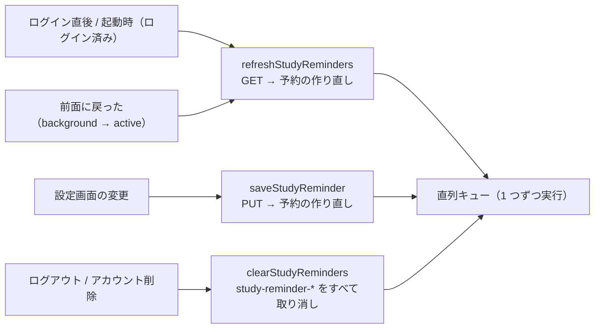

# step3-mobile-reminder

mobile の設定画面にリマインダーの区画を移植し、`expo-notifications` のローカル通知の予約と同期、権限、通知タップの遷移、ログアウト時の取り消しを実装する。既存の `src/hooks/use-notification.ts` を置き換える。

## 前提

- [study-reminder step2-api-user-reminder](./step2-api-user-reminder.md)（`GET`/`PUT /api/user/reminder`、`@repo/api-schema` の `reminder.ts`）
- [github-auth step4-mobile-github-login](../../github-auth/tasks/step4-mobile-github-login.md)（ログイン状態、認証つきの API クライアント、ログアウト、`app.json` の `scheme: "techenglish"`）
- [learning-record step5-mobile-mypage](../../learning-record/tasks/step5-mobile-mypage.md)（設定タブ `src/app/(tabs)/settings.tsx`。区画の順は「目標 → **リマインダー** → タイムゾーン → アカウント → 危険な操作」）
- [reading-practice step8-mobile-passage-list](../../reading-practice/tasks/step8-mobile-passage-list.md)（開始確認のモーダル `passages/[id]` と、通知の遷移先 `passages/random`）
- [github-auth step7-mobile-delete-user](../../github-auth/tasks/step7-mobile-delete-user.md) とは順不同。先に実装済みなら削除の後始末にこの step の取り消しを足し、未実装なら step7 が呼ぶ
- 仕様と理由は README の [通知の予約と同期](../README.md#通知の予約と同期)・[通知の権限](../README.md#通知の権限)・[曜日の表現](../README.md#曜日の表現)・[UI 設計](../README.md#ui-設計)

> **`expo-notifications`（導入済み `~0.32`、Expo SDK 54）の API の細部は、実装時にインストール済みのバージョンの公式ドキュメントと型定義で確認する。** 下のコード例の関数名・引数は 0.32 の型定義に合わせているが、挙動（権限の状態、Android の配信の正確さ、終了状態からのタップの扱い）はバージョンで変わりうる。例えば README の `getLastNotificationResponseAsync` は 0.32 では deprecated で、同期版の `getLastNotificationResponse` が推奨になっている。

## 対応内容

### 1. ファイル構成

| ファイル | 役割 |
| --- | --- |
| `src/features/study-reminder/study-reminder.api.ts` | `GET` / `PUT /api/user/reminder` |
| `src/features/study-reminder/study-reminder.schedule.ts` | 純関数（曜日の変換、識別子、文言の割り当て、時刻の加減、予約の組み立て） |
| `src/features/study-reminder/study-reminder.notification.ts` | `expo-notifications` の呼び出し（チャンネル、権限、取り消し、予約） |
| `src/features/study-reminder/study-reminder.sync.ts` | 同期・保存・取り消しを 1 本の直列キューで実行する |
| `src/features/study-reminder/study-reminder.store.ts` | zustand。画面の設定値・最後に保存できた値・権限・タップ後の遷移待ち |
| `src/hooks/use-study-reminder-sync.ts` | 起動時のチャンネル作成、ログイン直後と前面復帰の同期 |
| `src/hooks/use-notification-redirect.ts` | 通知タップの遷移（`use-notification.ts` を置き換える） |
| `src/components/features/study-reminder/` | `ReminderSection.tsx`・`ReminderPermissionNotice.tsx`・`WeekdaySelector.tsx`・`ReminderTimeStepper.tsx` |



### 2. 純関数（`study-reminder.schedule.ts`）

```typescript
export const STUDY_REMINDER_CHANNEL_ID = "study-reminder"
export const STUDY_REMINDER_URL = "techenglish://passages/random"
const STUDY_REMINDER_ID_PREFIX = "study-reminder-"

/**
 * README「通知の内容」の 3 種
 */
const STUDY_REMINDER_MESSAGES = [
  { body: "5 分で読める技術英語を 1 問解きませんか？", title: "今日の 1 問" },
  { body: "公式ドキュメントの英文で、今日も少しだけ。", title: "英語のドキュメント、読んでますか？" },
  { body: "1 問解くと、学習カレンダーの今日のマスが灯ります。", title: "今日のマスを灯そう" },
] as const

/**
 * ISO（1 = 月 〜 7 = 日）→ expo の週次トリガー（1 = 日 〜 7 = 土）。変換はここだけで行う
 */
export const convertIsoWeekdayToExpoWeekday = (isoWeekday: number): number => (isoWeekday % 7) + 1

/**
 * 識別子は ISO の曜日番号で作る（study-reminder-1 = 月曜）
 */
export const buildStudyReminderIdentifier = (isoWeekday: number): string => `${STUDY_REMINDER_ID_PREFIX}${isoWeekday}`
```

- `isStudyReminderIdentifier(identifier)`: `STUDY_REMINDER_ID_PREFIX` で始まるか

- `shiftReminderTime(time, minutes)`: モックの `shiftTime` をそのまま移す（0:00 をまたいで循環）
- `toggleWeekday(weekdays, isoWeekday)`: 選択中なら外す（**最後の 1 つは外さない**）、未選択なら足して昇順にする
- `convertNotificationUrlToHref(url: unknown)`: `url === STUDY_REMINDER_URL` なら `"/passages/random"`、それ以外は `null`（知らない URL では遷移しない）
- `buildStudyReminderRequests(setting: GetUserReminderResponse): Notifications.NotificationRequestInput[]`: 曜日を昇順に並べ、**選んだ曜日の中での順番** で文言を割り当てる（`STUDY_REMINDER_MESSAGES[index % 3]`。設定が同じなら毎週同じ曜日に同じ文言になり、月・木のような選び方でも同じ文言が続かない）

```typescript
{
  content: { ...STUDY_REMINDER_MESSAGES[index % STUDY_REMINDER_MESSAGES.length], data: { url: STUDY_REMINDER_URL } },
  identifier: buildStudyReminderIdentifier(isoWeekday),
  trigger: {
    channelId: STUDY_REMINDER_CHANNEL_ID,
    hour,
    minute,
    type: Notifications.SchedulableTriggerInputTypes.WEEKLY,
    weekday: convertIsoWeekdayToExpoWeekday(isoWeekday),
  },
}
```

### 3. OS の通知の操作（`study-reminder.notification.ts`）

```typescript
export type NotificationPermission = Pick<Notifications.NotificationPermissionsStatus, "canAskAgain" | "status">

/**
 * Android の通知チャンネル。起動時に作る（iOS では何もしない）
 */
export const ensureStudyReminderChannel = async (): Promise<void> => {
  if (Platform.OS !== "android") return
  await Notifications.setNotificationChannelAsync(STUDY_REMINDER_CHANNEL_ID, {
    importance: Notifications.AndroidImportance.DEFAULT,
    name: "学習のリマインダー",
  })
}

/**
 * この端末の study-reminder-* の予約をすべて取り消す（他の通知には触れない）
 */
export const cancelScheduledStudyReminders = async (): Promise<void> => {
  const requests = await Notifications.getAllScheduledNotificationsAsync()
  await Promise.all(
    requests
      .filter((request) => isStudyReminderIdentifier(request.identifier))
      .map((request) => Notifications.cancelScheduledNotificationAsync(request.identifier)),
  )
}

/**
 * 全取り消し → 作り直し（冪等）。オフ、または通知が許可されていなければ作らない
 */
export const rescheduleStudyReminders = async (setting: GetUserReminderResponse, permission: NotificationPermission): Promise<void> => {
  await cancelScheduledStudyReminders()
  if (!setting.is_enabled || permission.status !== "granted") return
  for (const request of buildStudyReminderRequests(setting)) {
    await Notifications.scheduleNotificationAsync(request)
  }
}
```

- `fetchNotificationPermission()` は `getPermissionsAsync()`、`requestNotificationPermission()` は `requestPermissionsAsync()` の結果から `{ canAskAgain, status }` を返す。iOS の provisional などの細かい状態の扱いは公式ドキュメントで確認する
- 許可が無いときに予約しないのは、許可された後の前面復帰の同期で予約されるため（README「通知の権限」）

### 4. API・store・直列キュー

`study-reminder.api.ts` は github-auth step4 の認証つきクライアント（名前は step4 に合わせる）で呼び、レスポンスを `getUserReminderResponseSchema.parse` / `updateUserReminderResponseSchema.parse` で検証して返す。型は `@repo/api-schema` から（ローカルで定義しない）。

`study-reminder.store.ts`（既存の `memo.store.ts` と同じく zustand）:

| state / action | 中身 |
| --- | --- |
| `setting` | 画面に出す値（`GetUserReminderResponse \| null`）。変更時は保存の完了を待たずに先に変える |
| `savedSetting` | 最後に API と一致した値。保存に失敗したら `setting` をこれに戻す |
| `permission` | `NotificationPermission \| null` |
| `pendingHref` | 通知タップ後、ログインを待っている遷移先（`"/passages/random" \| null`） |
| `applyFetchedSetting(setting, permission)` / `applySavedSetting(setting)` | `setting` と `savedSetting`（と `permission`）を API の値にする |
| `editSetting(setting)` / `revertSetting()` / `setPermission` / `setPendingHref` / `reset()` | 楽観的な変更・失敗時の巻き戻し・各 setter・ログアウト時の初期化 |

`study-reminder.sync.ts`。同期と保存が並行すると「取り消し → 予約」が交互に走って古い設定の予約が残るので、**取得・保存・取り消しは同じ直列キューで 1 つずつ実行する**。

```typescript
let queue: Promise<void> = Promise.resolve()
let pendingSave: UpdateUserReminderRequest | null = null

const runSerially = (task: () => Promise<void>): Promise<void> => {
  const result = queue.then(task)
  queue = result.catch(() => undefined)
  return result
}

/**
 * ログイン直後・前面復帰。取得に失敗したら予約に触れない（オフラインでも前の予約で通知を出す）
 */
export const refreshStudyReminders = (): Promise<void> =>
  runSerially(async () => {
    const setting = await studyReminderApi.get()
    const permission = await fetchNotificationPermission()
    useStudyReminderStore.getState().applyFetchedSetting(setting, permission)
    await rescheduleStudyReminders(setting, permission)
  })

/**
 * 設定画面の変更。連打されたら最後の値だけを PUT する（キューに積まれた古い保存は何もしない）
 */
export const saveStudyReminder = (setting: UpdateUserReminderRequest): Promise<void> => {
  useStudyReminderStore.getState().editSetting(setting)
  pendingSave = setting
  return runSerially(async () => {
    const target = pendingSave
    if (!target) return
    pendingSave = null
    const saved = await studyReminderApi.put(target).catch(() => null)
    if (!saved) {
      useStudyReminderStore.getState().revertSetting()
      Alert.alert("保存できませんでした", "通信できる状態で、もう一度お試しください。")
      return
    }
    useStudyReminderStore.getState().applySavedSetting(saved)
    await rescheduleStudyReminders(saved, await fetchNotificationPermission())
  })
}

/**
 * ログアウト・アカウント削除。この端末の予約をすべて取り消して store を空にする
 */
export const clearStudyReminders = (): Promise<void> =>
  runSerially(async () => {
    await cancelScheduledStudyReminders()
    useStudyReminderStore.getState().reset()
  })
```

### 5. 同期のタイミング（`use-study-reminder-sync.ts`）とログアウト

```typescript
export function useStudyReminderSync() {
  /** github-auth step4 のログイン状態（store の名前は step4 に合わせる） */
  const isSignedIn = useAuthStore((state) => state.isSignedIn)

  useEffect(() => {
    ensureStudyReminderChannel().catch((error) => console.warn("Failed to create notification channel:", error))
  }, [])

  useEffect(() => {
    if (!isSignedIn) return
    refreshStudyReminders().catch((error) => console.warn("Failed to sync study reminders:", error))
    let previous = AppState.currentState
    const subscription = AppState.addEventListener("change", (next) => {
      /** inactive → active（iOS の許可ダイアログを閉じたとき）では同期しない。保存中の PUT と競合させないため */
      if (previous === "background" && next === "active") {
        refreshStudyReminders().catch((error) => console.warn("Failed to sync study reminders:", error))
      }
      previous = next
    })
    return () => subscription.remove()
  }, [isSignedIn])
}
```

- 前面復帰の同期で `permission` も更新されるので、OS の設定で許可して戻ると案内が消え、予約が作られる
- **ログアウト**: github-auth step4 の「ユーザーがログアウトを押したとき」の処理に `await clearStudyReminders()` を足す。**refresh の失敗による強制ログアウトでは呼ばない**（ログインが切れても通知は届き、タップでログイン画面 → 開始確認に進む仕様のため。README「通知をタップしたとき」）。次にログインしたときの同期で、そのユーザーの設定に作り直される
- **アカウント削除**: `DELETE /api/user` の成功後に `await clearStudyReminders()`（github-auth step7。[クライアントの後始末](../../github-auth/README.md#アカウント削除の処理)）

### 6. 通知のタップ

`use-notification-redirect.ts`。タップを受けたら遷移先を store の `pendingHref` に入れ、**ログイン済みになった時点で** 遷移する（ログインが切れていれば github-auth step4 のガードでログイン画面が出て、ログイン後にここで遷移する）。

```typescript
export function useNotificationRedirect() {
  const isSignedIn = useAuthStore((state) => state.isSignedIn)
  const pendingHref = useStudyReminderStore((state) => state.pendingHref)
  const setPendingHref = useStudyReminderStore((state) => state.setPendingHref)
  const handledKeys = useRef(new Set<string>())

  useEffect(() => {
    const handleResponse = (response: Notifications.NotificationResponse) => {
      /** 終了状態からの起動では、初回の取得とリスナーの両方に同じタップが来ることがあるので 1 回だけ扱う */
      const key = `${response.notification.request.identifier}:${response.notification.date}`
      if (handledKeys.current.has(key)) return
      handledKeys.current.add(key)
      const href = convertNotificationUrlToHref(response.notification.request.content.data?.url)
      if (href) setPendingHref(href)
    }
    /** app が終了していた場合（README の getLastNotificationResponseAsync は 0.32 で deprecated） */
    const lastResponse = Notifications.getLastNotificationResponse()
    if (lastResponse) handleResponse(lastResponse)
    /** 起動中（前面・背景）の場合 */
    const subscription = Notifications.addNotificationResponseReceivedListener(handleResponse)
    return () => subscription.remove()
  }, [setPendingHref])

  useEffect(() => {
    if (!isSignedIn || !pendingHref) return
    setPendingHref(null)
    router.push(pendingHref)
  }, [isSignedIn, pendingHref, setPendingHref])
}
```

- 処理済みのタップを再マウントで拾い直さないよう、扱った後に `clearLastNotificationResponse()` を呼ぶかを公式ドキュメントで確認して決める
- ログイン状態に「確認中」がある場合（secure-store の読み込み中）は確認が終わってから判断する

遷移先の `passages/random`（ランダムに 1 問選んで開始確認に置き換える画面）は reading-practice step8 が作ってある。

`src/app/_layout.tsx` で `useStudyReminderSync()` と `useNotificationRedirect()` を呼ぶ（step4 がログイン状態を Provider で配るなら、その内側の部品で呼ぶ）。既存の `Notifications.setNotificationHandler`（前面にいるときもバナーを出す）は残し、キーをアルファベット順に直す。

### 7. 設定画面のリマインダーの区画（モックの移植）

`apps/mobile/src/app/mock/(tabs)/settings.tsx` の「リマインダー」の部分（`SectionTitle` から曜日・時刻・ヒント文まで、`styles.permission*` / `weekday*` / `time*` / `hint` / `rowTitle` / `label` / `cardBody`）を見た目の正本として `src/components/features/study-reminder/` に移し、`(tabs)/settings.tsx` の目標とタイムゾーンの間に `<ReminderSection />` を置く（learning-record step5 の仮置きがあれば置き換える）。`MOCK_COLORS` / `mockStyles` は `src/const/` 等に移した本実装のトークンと共通の部品に置き換える。

| 部品 | 中身 | ダミー → 本実装 |
| --- | --- | --- |
| `ReminderSection` | カード、スイッチ、オンのときだけ曜日と時刻とヒント文 | `MOCK_REMINDER` → store の `setting`（取得前はスイッチを `disabled`） |
| `ReminderPermissionNotice` | カード上部の淡い琥珀の帯と「設定を開く」 | `?state=denied` → `setting.is_enabled && permission && permission.status !== "granted"` |
| `WeekdaySelector` | 月〜日の丸いボタン（ISO の順） | `setWeekdays` → `toggleWeekday` の結果で `saveStudyReminder` |
| `ReminderTimeStepper` | 「−」「＋」と等幅数字 26px | `setTime` → `shiftReminderTime(time, ±15)` の結果で `saveStudyReminder` |

- **スイッチをオンにしたとき**: 表示を先に切り替え、`requestNotificationPermission()` の結果を store に入れてから `saveStudyReminder({ ...setting, is_enabled: true })`。拒否されてもオンのまま保存する（案内が出る）。オフは許可を求めずに保存する
- 保存ボタンは置かない（変更はその場で保存し、予約を作り直す）
- 「設定を開く」: `permission.canAskAgain` なら `requestNotificationPermission()` → `refreshStudyReminders()`（まだ一度も求めていない端末。例えば別の端末でオンにした場合）、そうでなければ `Linking.openSettings()`（`react-native`）
- アクセシビリティはモックのまま（曜日の `accessibilityState.selected`、時刻のボタンの `accessibilityLabel`）

### 8. 置き換え・設定

- `src/hooks/use-notification.ts` を削除する（利用箇所が残っていないこと。旧 `(tabs)/setting.tsx` は learning-record step5 で置き換え済みの前提）。旧実装が開発端末に残した毎日の通知（識別子が自動採番）は消えないので、確認前に app を入れ直す
- `app.json` の `scheme` が `techenglish` であること（github-auth step4。未変更ならこの step で変える）
- Android 13 以上の `POST_NOTIFICATIONS` がビルドに入っていることを prebuild の `AndroidManifest.xml` または公式ドキュメントで確認し、無ければ `expo-notifications` の config plugin / `android.permissions` で足す。通知アイコンを変える場合も config plugin（任意）

## 動作確認

```bash
pnpm --filter @repo/api-schema build
pnpm --filter mobile exec tsc --noEmit
pnpm lint:fix
```

mobile には test runner が無いので、純関数は次の表どおりかを確認する（一時的な `console.log` で確かめ、コミットしない）。

| 入力 | 期待 |
| --- | --- |
| `convertIsoWeekdayToExpoWeekday(1 / 6 / 7)` | `2 / 7 / 1` |
| `shiftReminderTime("23:45", 15)` / `("00:00", -15)` | `"00:00"` / `"23:45"` |
| `toggleWeekday([3], 3)` / `([5, 1], 3)` | `[3]` / `[1, 3, 5]` |
| `buildStudyReminderRequests({ is_enabled: true, time: "07:45", weekdays: [4, 1] })` | 2 件。`study-reminder-1`（weekday 2・1 つ目の文言）と `study-reminder-4`（weekday 5・2 つ目の文言）、hour 7・minute 45 |

**development build** で iOS・Android の実機を 1 台ずつ確認する（README「通知の権限」。作り方は公式ドキュメントに従い、`eas.json` の `development` プロファイルを使うなら `expo-dev-client` が必要。ローカルなら `npx expo run:ios` / `run:android`）。予約の中身は、一時的に同期の後で `Notifications.getAllScheduledNotificationsAsync()` を `console.log` して確かめる。

- 設定と予約
  - [ ] 区画の見た目がモック（`/mock/settings`、`/mock/settings?state=denied`）と同じ。区画は目標とタイムゾーンの間
  - [ ] app の起動時には許可を求めず、初回のスイッチのオンで OS の許可ダイアログが出る
  - [ ] 許可後、選んだ曜日の数だけ `study-reminder-{ISO}` が予約され、`weekday` が expo の番号、時刻が設定どおり。`GET /api/user/reminder` も同じ値
  - [ ] 曜日の付け外し・時刻の ± で予約が作り直され、件数が常に選んだ曜日の数と一致する（重複しない）。最後の 1 つは外せない
  - [ ] 「＋」を連打しても api のログの PUT が数回で済み、最後の値で保存・予約される
  - [ ] オフにすると予約が 0 件になり、曜日と時刻は保持される
  - [ ] 次の 15 分刻みに合わせて待つと通知が出る（タイトル・本文が README の文言）。Android は OS の設定に通知チャンネル「学習のリマインダー」がある
- 権限
  - [ ] 許可しないとオンのまま保存され、案内の帯が出る。「設定を開く」→ OS の設定で許可 → app に戻ると案内が消え、予約される
- 同期
  - [ ] curl で `PUT /api/user/reminder` して app を前面に戻すと、画面と予約が新しい設定になる
  - [ ] 機内モードで前面に戻しても既存の予約が消えない
- タップ
  - [ ] app が前面・背景・終了状態のそれぞれで、通知のタップでランダムな 1 問の開始確認が **1 回だけ** 開く
  - [ ] `npx uri-scheme open "techenglish://passages/random" --ios`（`--android`）でも開始確認が開く。公開中の問題が無ければ問題タブに戻る
  - [ ] ログイン切れ: api を `JWT_ACCESS_EXPIRATION=1m JWT_REFRESH_EXPIRATION=2m` で起動してログインし、リマインダーを設定 → 期限が切れた後に届いた通知をタップ → ログイン画面 → ログイン後に開始確認。期限切れで予約が消えていない
- 取り消し
  - [ ] ログアウトで予約が 0 件になる。別のユーザーでログインすると、そのユーザーの設定で予約される
  - [ ] アカウント削除で予約が 0 件になる（github-auth step7 の実装後）
