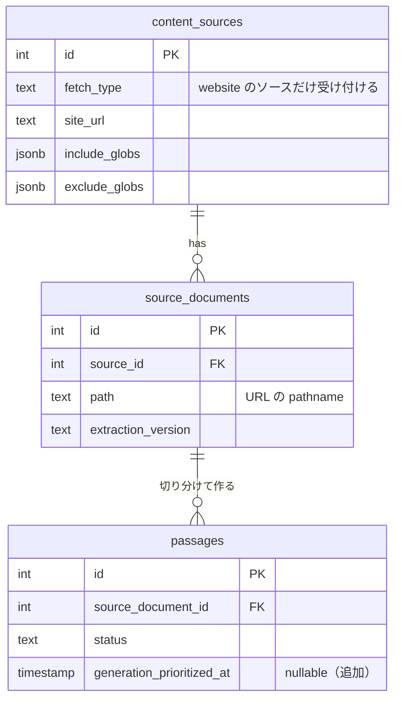
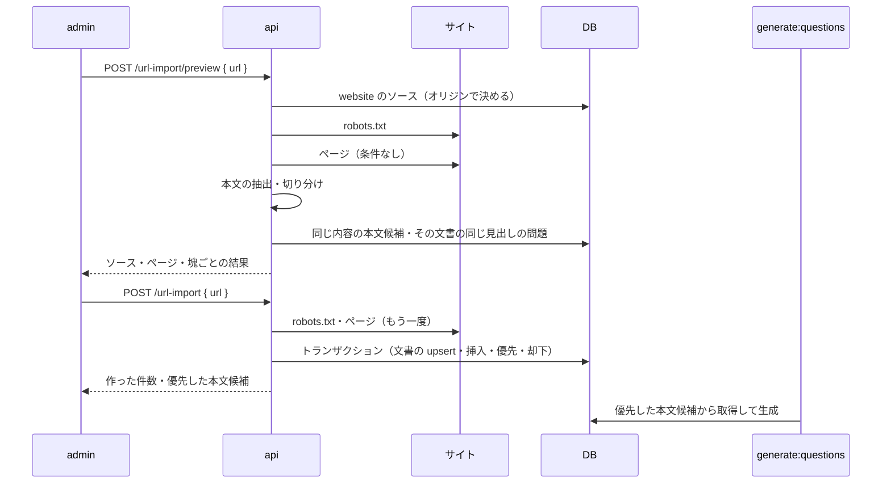

# URL から本文候補を作る

admin で URL を 1 つ入れると、そのページを取得して本文を抽出し、本文候補（`collected`）として保存する。保存した本文候補は、次の問題の生成（`generate:questions`）でほかの本文候補より先に生成する（issue #76）。

今は、ソースを登録して有効にし、cron の収集（`collect:passages`）が sitemap か開始ページからリンクをたどって取得するのを待つ必要がある。「このページを題材にしたい」と思ったページを、すぐ本文候補にできるようにする。

このドキュメントは **仕様（What）** と **設計（How）** を分けて記述する：

- **仕様**：受け付ける URL、確認と保存の流れ、本文候補の扱い、生成の優先
- **設計**：抽出の処理の共有パッケージ、api での取得と抽出、保存のトランザクション、生成の優先の列

## 関連 spec

- [`../content-collection/README.md`](../content-collection/README.md) — ソース・`source_documents`・本文の抽出と切り分けの規則の正本。サイトの取得（礼儀正しさ・取得先の制限）もこちら。この機能は MVP 対象外にしていた「管理画面からの収集の即時実行・抽出のプレビュー」（[deferred](../content-collection/deferred-more-sources.md#管理画面からの収集の即時実行抽出のプレビュー)）の一部
- [`../passage-extraction-tuning/README.md`](../passage-extraction-tuning/README.md) — 抽出の版、切り分け直したときの本文候補の置き換え（同じ見出しの問題がある塊を作らない・前の切り分けの `collected` を却下する）。この機能の保存も同じ規則にする
- [`../question-generation/README.md`](../question-generation/README.md) — `passages` の列と状態の遷移の正本。生成タスクが本文候補を取る順番

## 目次

- [仕様](#仕様)
  - [受け付ける URL](#受け付ける-url)
  - [確認と保存](#確認と保存)
  - [本文候補の扱い](#本文候補の扱い)
  - [問題の生成](#問題の生成)
  - [取り込めないとき](#取り込めないとき)
- [設計](#設計)
  - [抽出の処理の共有パッケージ](#抽出の処理の共有パッケージ)
  - [api での取得と抽出](#api-での取得と抽出)
  - [ソースの決め方](#ソースの決め方)
  - [保存](#保存)
  - [生成の優先](#生成の優先)
  - [MVP 対象外（将来検討）](#mvp-対象外将来検討)
- [必要な画面](#必要な画面)
- [必要な API](#必要な-api)
- [必要な DB 設計](#必要な-db-設計)
- [フロー図](#フロー図)
- [実装ステップ](#実装ステップ)

---

## 仕様

### 受け付ける URL

**登録済みの公式ドキュメントのサイト（取得方法が `website`）のソースの、対象パスに合うページの URL だけを受け付ける。** ライセンスはそのソースのものを使う（収集と同じく、許可リストのライセンスのソースからしか取得しない）。

- `https` で、ソースのサイトの URL と同じオリジン、対象パスに合い除外パスに合わない、ページの拡張子（`.pdf` などは対象外）であること
- ソースの有効・無効は問わない（有効・無効は cron の収集の対象かどうかで、取り込みは管理者が URL を選んで行うため）
- 入れた URL の 1 ページだけを取得する。ページ内のリンクはたどらない
- robots.txt で禁止されたページは取得しない
- クエリ文字列とフラグメント（`#...`）は除く（収集と同じ）
- GitHub リポジトリのソースのページ（react.dev など。公開ページの URL 規則のオリジンが同じもの）は対象外で、「GitHub のソースで収集しているサイト」と案内する（収集で取り込む）

### 確認と保存

1. URL を入れて「確認する」を押すと、ページを取得して本文を抽出し、切り分けた塊ごとの結果を出す（DB には書かない）
   - 当たったソース（表示名・ライセンス）、ページのタイトル、英単語数
   - 塊ごとに、見出し・英単語数・冒頭の文と、保存したときにどうなるか
2. 「本文候補として保存」を押すと、もう一度ページを取得して保存する（確認と保存の間にページが変わっていれば、保存したときの内容になる）
3. 保存した本文候補の数と、問題の画面へのリンクを出す

塊ごとの「保存したときにどうなるか」：

| 表示 | 意味 |
| --- | --- |
| 本文候補になる | 新しい本文候補として保存する |
| 本文候補がすでにある | 同じ内容の未生成の本文候補がある（別の URL の文書のものも含む）。増えないが、生成を優先する |
| 同じ内容の問題がある | 同じ内容の本文候補が、生成中・下書き・公開済み・却下・失敗のどれかにある。何もしない |
| 同じ見出しの問題がある | 同じ文書に同じ見出しの、生成中・下書き・公開済み・生成した後に却下した本文候補がある。作らない |
| 本文候補にならない | 本文候補の条件を満たさない。理由（短すぎる・コードが多い・文章でない など）を出す |

### 本文候補の扱い

- ページはソースの文書（`source_documents`）として記録し、本文候補の出典は収集と同じ形（ソースのサイト + パス、取得日）で出す
- 本文候補の条件・切り分け・抽出の版は収集と同じ（[content-collection](../content-collection/README.md#本文候補の条件)）
- 収集で取得済みのページを取り込んだときは、切り分け直したときと同じにする。同じ見出しの問題がある塊は作らず、その文書の未生成の本文候補のうち新しい切り分けに無いものは却下する（[passage-extraction-tuning](../passage-extraction-tuning/README.md#前の切り分けで作った本文候補)）
- 取り込んだページは、収集でも取得済みとして扱う（次の取り直しは `COLLECT_WEB_REFETCH_DAYS` 日後）

### 問題の生成

**保存した本文候補（同じ内容で既にあった未生成のものを含む）は、次の `generate:questions` でほかの本文候補より先に生成する。** その場では生成しない（生成は数分かかり、cron の生成タスクが行う）。

- 優先する本文候補どうしは、保存した順
- 確認待ちの下書きが `GENERATE_MAX_PENDING_DRAFTS`（50）件以上あると、今と同じく生成しない
- 生成に一時的に失敗して未生成に戻ったときも、優先は残る（3 回目で失敗になるのは今と同じ）

### 取り込めないとき

| 状況 | 出す内容 |
| --- | --- |
| URL の形が不正・`https` でない | URL を確かめるよう案内する（admin のフォームで止める） |
| 同じオリジンのサイトのソースが無い | 先にソースを登録するよう案内する（ソースの登録へのリンク） |
| GitHub のソースで収集しているサイト | 収集で取り込むよう案内する |
| ソースはあるが対象パス・除外パス・拡張子に合わない | どのソースの対象パスに合わないかを出す |
| robots.txt で禁止されている | 取得できないことを出す |
| ページを取得できない（404 などの HTTP エラー・タイムアウト・HTML でない・2MB を超える・リダイレクトでサイトの外や対象パスの外に出る・429 / 503・20 秒以内に終わらない） | 理由ごとの文言を出す |
| 本文を抽出できない（ソースの CSS セレクタが不正） | ソースの CSS セレクタを確かめるよう案内する |
| 本文候補になる塊が 0 | 確認の結果は出すが、保存のボタンは押せない |

---

## 設計

### 抽出の処理の共有パッケージ

**cron の本文の抽出（`lib/document`）とサイトの取得（`client/web` など）を、共有パッケージ `@repo/content-extractor` に移し、cron と api の両方から使う。**

| 移すもの（cron から） | 内容 |
| --- | --- |
| `lib/document/*` | 本文の抽出・切り分け・本文候補の条件・抽出の版（`EXTRACTION_VERSION`） |
| `client/web/*` | `WebPageClient`（robots.txt・リクエストの間隔・取得先の制限〈SSRF 対策〉・条件付きリクエスト・sitemap）とエラー |
| `lib/url.ts`・`lib/parse-sitemap.ts`・`lib/path-filter.ts` | URL の正規化、sitemap の解析、対象パス・除外パスの判定 |
| `service/collection/website-pages.ts` | 取得してよいページの判定、ページの本文の抽出（`extractWebPage`） |
| `const/collection.ts` のうち取得の定数 | User-Agent・タイムアウト・HTML の上限・リダイレクトの上限・Crawl-delay の上限など |

- api と cron で同じ規則・同じ取得先の制限を使う（二重に持つと、片方だけ直したときに出典や安全性がずれる）。deferred の設計案どおり
- cron の収集の service・Repository・タスクは cron に残す。パッケージは env も DB も知らない
- パッケージは cron と同じく `module: nodenext` の CommonJS で build する（unified・remark・rehype は ESM だけで配布されている）。実行時は Node の `require(esm)` で読むので、Node 20.19 以上が要る（api の Docker は `node:20-slim`、cron は `node:22-slim`）
- **比べた案**
  - api が cron のタスク（`collect:passages`）を ECS RunTask や Queue で起動する：取得から結果を見るまでが非同期になり、確認の画面を作れない。dev には ECS が無い
  - api に抽出の処理を写す：同じ規則と SSRF 対策を 2 か所で持つことになる

### api での取得と抽出

**1 ページの取得と抽出は api の中で行い、取得は始めてから 20 秒で打ち切る。** API Gateway と Lambda の 29 秒に収めるため。

- 取得は `WebPageClient` をソースのサイトのオリジンで作り、robots.txt を読んでから条件なしで取得する。取得先の制限・リダイレクトの扱い（同じオリジンの中で最大 3 回）・大きさの上限は収集と同じ
- リクエストは robots.txt・ページ・リダイレクト（最大 3 回）で最大 5 回。それぞれタイムアウト 10 秒で、前のリクエストから max(1 秒, Crawl-delay) 空ける。最悪の場合は 29 秒を超えるので、`WebPageClient` に期限（始めてから 20 秒）を渡す。期限を過ぎるリクエストは送らず、各リクエストのタイムアウトも期限までに縮める。期限を過ぎたら `deadline_exceeded` にする
  - 残りの 9 秒は、抽出（jsdom で 1〜2 秒）・DB・コールドスタートの分
- api では robots.txt の `Crawl-delay` の上限を 10 秒にする（`WebPageClient` の上限を設定できるようにする）。収集と同じ 30 秒だと、1 回待つだけで期限を過ぎる
- User-Agent は収集と同じ（`TechEnglishBot/1.0 (+COLLECT_WEB_CONTACT_URL)`）。api の env に `COLLECT_WEB_CONTACT_URL`（任意）を足す
- `@repo/content-extractor` は api のクライアント（`client/page-fetcher`）の中で、使うときに `import()` で読む。jsdom などが重く、ほかの API のコールドスタートを遅くしないため。URL の正規化・対象パスの判定・抽出の版もクライアントが返し、service は値として import しない
- 入れた URL は、クエリ文字列とフラグメントを除いて正規化してから取得し、出典の path もその pathname にする
- 確認と保存は、どちらもページを取得する。確認の結果を admin から送り返させない（admin の入力を本文として信用しないため。取得し直す費用は 1 ページ）

### ソースの決め方

**`fetch_type = 'website'` のソースのうち、サイトの URL が入れた URL のオリジンと同じもの。** `site_url` は登録のときにオリジンに正規化していて unique なので、当たるのは 1 つだけ。

- 当たるソースが無ければ「ソースが無い」、あるが対象パス・除外パス・拡張子に合わなければ「対象パスの外」として区別する（admin の文言を分けるため）
- `website` のソースが無く、GitHub のソースの公開ページの URL 規則（`public_url_template`）のオリジンが同じなら「GitHub のソースで収集しているサイト」にする
- リダイレクトの行き先も、そのソースの対象パスに合うことを確かめる（収集と同じ。除外パスへリダイレクトされたページの本文を、元のパスの出典で保存しないため）

### 保存

**ページの文書の記録・本文候補の挿入・前の切り分けの却下・生成の優先を、1 つのトランザクションで行う。**

| 項目 | 内容 |
| --- | --- |
| 文書 | `source_documents` を `(source_id, path)` で upsert し、取得の結果（タイトル・`fetched_at`・`http_status`・`content_hash`・`etag`・`last_modified`・`extraction_version`）を書く。`path` は URL の pathname（収集と同じ） |
| 見出しの確認 | その文書の生成中・生成した本文候補（`generating`・`draft`・`published`、`generated_at` がある `rejected`）の見出しと同じ塊は挿入しない |
| 挿入 | 残りの塊を `collected` で挿入する（同じ `content_hash` は飛ばす）。`generation_prioritized_at` に保存した時刻を入れる |
| 優先 | `collected` のうち、`content_hash` が残した塊のものに `generation_prioritized_at` を入れる。文書で絞らない（`content_hash` は全体で unique なので、末尾の `/` の違いなどで別の文書として取り込み済みの本文候補も優先する） |
| 却下 | その文書の `collected` のうち、`content_hash` が残した塊のどれでもないものを `rejected`（「切り分け直したため、前の切り分けの本文候補を外した」）にする |

- 規則は cron の `replacePassageCandidates`（[passage-extraction-tuning](../passage-extraction-tuning/README.md#古い本文候補の却下)）と同じ。api と cron の Repository は分けている（api は CRUD、cron は batch）ので、同じ条件の SQL をそれぞれに持つ。見出しの確認の条件を変えるときは両方を直す
- cron はトランザクションにしない（ファイルごとに版を最後に記録してやり直す）が、api は 1 回の要求で完結させるため、途中で失敗したら何も残さない
- 確認の「保存したときにどうなるか」は保存と同じ順で判定する。同じ見出しの問題がある塊は、同じ内容の未生成の本文候補があっても「同じ見出しの問題がある」にする（保存はその塊を作らず、優先もしないため。その未生成の本文候補が同じ文書のものなら、前の切り分けとして却下する）

### 生成の優先

**`passages.generation_prioritized_at`（nullable）を足し、生成タスクの取得（`claimNextCollected`）を `generation_prioritized_at` の古い順（NULL は後ろ）→ `created_at` → `id` にする。**

- 時刻にするのは、優先した本文候補どうしを保存した順に生成するため
- 生成した後も値は残す（いつ優先して取り込んだかの記録）。admin の「再生成」・「却下の取り消し」で `collected` に戻ったときも優先のまま
- 取得の条件は `status = 'collected'` のままで、件数は数百なので索引は足さない（`passages (status, created_at)` で絞った後に並べる）

### MVP 対象外（将来検討）

- GitHub リポジトリのソースのページの URL（公開ページの URL 規則から逆にファイルのパスを求める）
- 入れた URL からリンクをたどる取り込み
- admin からその場で問題を生成する（生成を worker か ECS で動かす必要がある）
- 確認の画面で、本文候補にする塊を選ぶ（今は本文候補になる塊をすべて保存する。要らないものは生成の後に却下する）

---

## 必要な画面

admin に 1 つ足す。

| 画面 | パス | 役割 |
| --- | --- | --- |
| URL から追加 | `/url-import` | URL を入れて確認し、本文候補として保存する。メニューの「問題」の下に置く |

画面の要素：

- URL の入力と「確認する」（確認中は「確認しています…」）。URL の形が不正・`https` でなければ、api に送らずに案内する
- 確認の結果：当たったソース（表示名・ライセンス）、ページ（タイトル・正規化した URL・英単語数）、塊の表（見出し・英単語数・保存したときにどうなるか〈本文候補にならない塊は理由も〉・冒頭の文）、「本文候補として保存」（本文候補になる・すでにある塊が無ければ押せない）
- 保存の結果：作った件数・却下した件数、優先した本文候補の一覧（問題の画面へのリンク、今回作ったものに「新規」）、「次の問題の生成で、ほかの本文候補より先に生成します。」
- 取り込めないときは理由ごとの文言（[step4](./tasks/step4-admin-url-import.md#server-actionactionsts) の表）。ソースが無いときはソースの登録へのリンクを出す

## 必要な API

| メソッド | パス | 内容 |
| --- | --- | --- |
| POST | `/api/admin/url-import/preview` | URL のページを取得して抽出し、当たったソース・ページ・塊ごとの結果を返す。DB に書かない |
| POST | `/api/admin/url-import` | URL のページを取得して抽出し、本文候補として保存する。作った本文候補の件数と、優先した本文候補を返す |

- どちらもほかの admin の API と同じく admin の認証が要る
- 取り込めないときは 400 で、`details[0].code` に理由（`source_not_found`・`out_of_target_path`・`robots_disallowed` など。一覧は [step3](./tasks/step3-api-url-import.md#ドメインの定数) の `URL_IMPORT_ERROR_CODES`）を入れる。admin は code で文言を分ける
- リクエスト・レスポンスの形は [step3](./tasks/step3-api-url-import.md)

## 必要な DB 設計

`passages` に 1 列足す。列の正本は [question-generation](../question-generation/README.md#必要な-db-設計)。

| テーブル | 列 | 型 | 説明 |
| --- | --- | --- | --- |
| `passages` | `generation_prioritized_at` | `timestamp(3)` nullable | 生成を優先した時刻（URL から取り込んだとき）。生成タスクはこの値がある本文候補を古い順に先に取る |

## フロー図

## 実装ステップ

| step | 内容 |
| --- | --- |
| [step1](./tasks/step1-packages-content-extractor.md) | packages：`@repo/content-extractor` を作り、cron の本文の抽出・サイトの取得を移す（挙動は変えない） |
| [step2](./tasks/step2-db-generation-priority.md) | db・cron：`passages.generation_prioritized_at` を足し、生成タスクが優先した本文候補から取る |
| [step3](./tasks/step3-api-url-import.md) | api：確認と保存の API |
| [step4](./tasks/step4-admin-url-import.md) | admin：「URL から追加」の画面。dev にサイトのソースを登録して確かめる |
