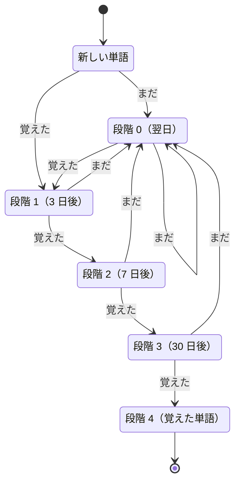
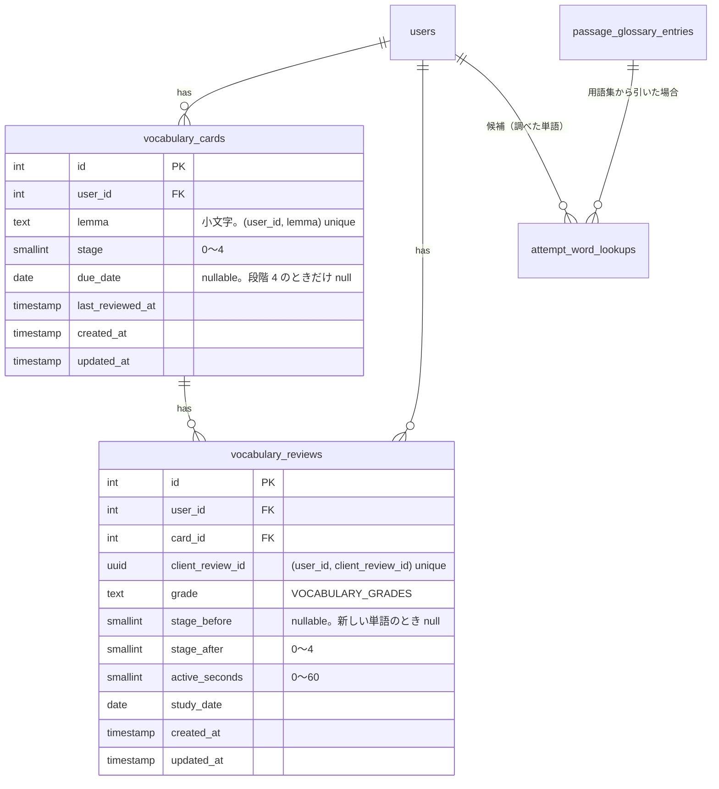
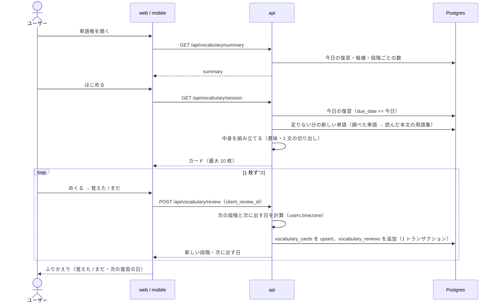

# 単語帳

長文読解で出会った単語を、単語帳のカードで復習して覚える。カードの表で単語と本文の 1 文を見て意味を思い出し、めくって答え合わせをして「覚えた / まだ」を自分で付ける。答えに応じて次に出す日を延ばしていく（間隔反復）ので、毎日数分めくるだけで、読んだ英文の単語が定着する。web と mobile の両方に提供する。

材料は長文読解ですでにためているデータを使う。ユーザーが解答中に調べた単語（`attempt_word_lookups`）を優先し、足りない分は解いた問題の用語集（`passage_glossary_entries`）から補う。新しく LLM で単語を集めたり、問題を生成したりはしない。

このドキュメントは **仕様（What）** と **設計（How）** を分けて記述する：

- **仕様**：カードの表と裏、1 回の流れ、出題する単語、復習の間隔、単語帳のトップ、学習記録への反映
- **設計**：カードの持ち方、カードの中身の組み立て、1 回分の選び方、答えの保存、時間の計測、学習記録の集計の変更

## 関連 spec

- [`../product-overview/README.md`](../product-overview/README.md) — プロダクト全体像。デザインのコンセプト・配色・共通ヘッダーの正本
- [`../product-overview/deferred-grammar-vocabulary.md`](../product-overview/deferred-grammar-vocabulary.md) — 単語問題の元の設計案（4 択）。単語はこの spec に移し、元の文書には文法問題だけが残る
- [`../reading-practice/README.md`](../reading-practice/README.md) — 材料の `attempt_word_lookups` / `dictionary_entries` の正本。解答中の単語のカードの見た目と、結果画面の「調べた単語」
- [`../question-generation/README.md`](../question-generation/README.md) — 材料の `passage_glossary_entries`（文脈での意味・本文中の位置）の正本
- [`../learning-record/README.md`](../learning-record/README.md) — 学習した日・学習時間・カレンダー・連続学習日数の定義の正本。単語帳の分を足す（[学習記録への反映](#学習記録への反映)）
- [`../github-auth/README.md`](../github-auth/README.md) — `users.timezone`（「今日」と次に出す日を決める）と、アカウント削除の cascade
- **この spec が正本のもの**：`vocabulary_cards` / `vocabulary_reviews`、`VOCABULARY_GRADES`、復習の段階と間隔、1 回の枚数

## 目次

- [仕様](#仕様)
  - [用語](#用語)
  - [カードの表と裏](#カードの表と裏)
  - [1 回の流れ](#1-回の流れ)
  - [出題する単語](#出題する単語)
  - [復習の間隔](#復習の間隔)
  - [単語帳のトップ](#単語帳のトップ)
  - [学習記録への反映](#学習記録への反映)
  - [結果画面からの導線](#結果画面からの導線)
- [設計](#設計)
  - [カードの持ち方](#カードの持ち方)
  - [カードの中身の組み立て](#カードの中身の組み立て)
  - [1 回分の選び方](#1-回分の選び方)
  - [答えの保存](#答えの保存)
  - [時間の計測](#時間の計測)
  - [学習記録の集計の変更](#学習記録の集計の変更)
  - [web の実装構成](#web-の実装構成)
  - [mobile の実装構成](#mobile-の実装構成)
  - [MVP 対象外（将来検討）](#mvp-対象外将来検討)
- [必要な画面](#必要な画面)
- [UI 設計](#ui-設計)
  - [紙のカード](#紙のカード)
  - [単語帳のトップ](#単語帳のトップ-1)
  - [1 回分](#1-回分)
  - [既存の画面への追加](#既存の画面への追加)
  - [動き](#動き)
  - [効果音](#効果音)
- [必要な API](#必要な-api)
- [必要な DB 設計](#必要な-db-設計)
- [フロー図](#フロー図)
- [実装ステップ](#実装ステップ)

---

## 仕様

### 用語

| 用語 | 意味 |
| --- | --- |
| **カード** | 単語帳の 1 枚。1 ユーザーにつき **見出し語 1 つで 1 枚**（`opt out of` を 2 つの本文で見ても 1 枚）。内部名は `vocabulary_card` |
| **新しい単語** | 出題の候補にあるが、まだ一度もめくって答えていない単語 |
| **復習中** | 一度以上答えたが、まだ覚えたとみなしていない単語 |
| **覚えた単語** | 最後の段階まで「覚えた」を続けた単語。もう出題しない |
| **今日の復習** | 次に出す日が今日以前になっている復習中のカード |

### カードの表と裏

**表**：意味を思い出すための手がかり。

| 項目 | 内容 |
| --- | --- |
| 語句 | 本文中の表記（例：`reaching for`）。見出し語が違えば小さく添える（`reach for`） |
| 品詞 | 用語集にあれば（熟語・動詞など） |
| 本文の 1 文 | その単語に **最後に出会った本文** の、単語を含む 1 文。単語を琥珀で強調する。見つからなければ出さない |
| 出典 | 問題のタイトル（例：「Synchronizing with Effects より」） |
| 新しい単語の印 | 新しい単語なら「新しい単語」と出す |

**裏**：答え合わせ。表の語句と 1 文は残したまま、下に意味を出す。

| 項目 | 内容 |
| --- | --- |
| 意味 | 用語集の **この文脈での意味**。用語集に無い単語は英和辞書の意味 |
| 補足 | 用語集の補足（あれば） |
| 出どころ | 解答中の単語のカードと同じく、用語集なら琥珀の点と「この文での意味」、辞書なら灰の点と「英和辞書（一般的な意味）」 |
| 答えのボタン | 「まだ」と「覚えた」 |

- **めくるまで答えられない**（意味を見ずに「覚えた」を付けられないようにする）。めくった後は、答える前ならもう一度めくって表に戻せる
- 自分で付ける答えなので、正誤の判定はしない

### 1 回の流れ

1 回は **最大 10 枚**。1〜2 分で終わる長さにする（mobile のすき間時間向け）。

1. 単語帳のトップで「はじめる」を押す
2. カードの表が出る。意味を思い出したら「めくる」（web は `Space`、mobile はカードをタップ）
3. 裏で意味を確かめ、「覚えた」か「まだ」を押す（web は `→` / `←`、mobile はボタンか左右のスワイプ。右が「覚えた」）
4. 答えはその場で保存され、次のカードに進む
5. 全部答えると **ふりかえり** を出す：「覚えた 7 / まだ 3」と、「まだ」の単語と意味の一覧（翌日にまた出ることを添える）。「もう 1 回」と「単語帳のトップへ」。次の回のカードが無ければ「今日の分は終わりました」と次の復習の日を出す

- 進み具合を `3 / 10` とマスで出す（答えたマスを「覚えた」は琥珀、「まだ」はローズで塗る）
- **途中でやめてもよい**。答えたカードはその時点で保存されている。答えていないカードは何も変わらず、次の回に出る
- 「まだ」のカードを同じ回の中でもう一度出すことはしない（翌日に出る。[MVP 対象外](#mvp-対象外将来検討)）
- めくるたびに、紙をめくる短い「シュッ」という音を鳴らす。上部バーで消せる（消した設定は端末に覚えておく）

### 出題する単語

**出題の候補**は次の 2 つ。

| 候補 | 範囲 | 優先 |
| --- | --- | --- |
| 調べた単語 | 解答中に自分で調べた単語（用語集・英和辞書のどちらで引いたものも） | 先 |
| 読んだ本文の用語集 | 自分が **提出した** 問題の用語集の語句 | 後 |

- 解いていない問題の用語集は出さない（知らない文脈の単語になるため。結果画面を見る前の設問の答えも見せない）
- 公開中でなくなった問題の用語集は出さない。その問題で調べた単語は、英和辞書に意味があれば辞書の意味で出す
- 意味が用意できない単語（用語集に無く、辞書にも無い）は出さない

**1 回の 10 枚の選び方**：

1. **今日の復習** を、次に出す日が古い順に入れる
2. 枠が余ったら **新しい単語** を入れる。調べた単語（調べたのが新しい順）→ 読んだ本文の用語集（提出したのが新しい問題から、本文に出てくる順）

今日の復習も新しい単語も無いときは、「今日の分は終わりました」と次の復習の日を出す。

### 復習の間隔

答えるたびに、カードの **段階** と次に出す日が変わる。

| 段階 | 状態 | 「覚えた」を押すと | 「まだ」を押すと |
| --- | --- | --- | --- |
| （カードなし） | 新しい単語 | 段階 1・**3 日後** | 段階 0・**翌日** |
| 0 | 復習中（覚えていない） | 段階 1・3 日後 | 段階 0・翌日 |
| 1 | 復習中 | 段階 2・**7 日後** | 段階 0・翌日 |
| 2 | 復習中 | 段階 3・**30 日後** | 段階 0・翌日 |
| 3 | 復習中 | 段階 4（**覚えた単語**） | 段階 0・翌日 |
| 4 | 覚えた単語 | もう出さない | ― |

- 「まだ」は、どの段階からでも段階 0 に戻る
- 日付はユーザーのタイムゾーンで決める（学習記録と同じ）。「3 日後」は答えた日の 3 日後の日付で、その日になれば時刻に関係なく今日の復習に入る
- 次に出す日を過ぎてからめくった場合も、間隔は **答えた日** から数える



### 単語帳のトップ

| 区画 | 内容 |
| --- | --- |
| 今日の分 | 今日の復習の枚数と、新しい単語の数。「はじめる」（主要ボタン） |
| 単語の数 | 復習中・覚えた単語の数 |
| 次の復習 | 今日の分が無いとき、次に復習のカードが出る日 |

- **まだ候補が 1 つも無いとき**（問題を解いていない、または意味のある単語が無い）は、「問題を解くと、読んだ本文の単語と調べた単語がここに並びます。」と問題一覧への導線を出す
- 見た目は [UI 設計の単語帳のトップ](#単語帳のトップ-1)

### 学習記録への反映

単語帳で答えた日も **学習した日** に数える。定義の正本は [learning-record](../learning-record/README.md#学習した日と学習時間) で、実装の step でそちらを書き換える。

| 項目 | 変更前 | 変更後 |
| --- | --- | --- |
| 学習した日 | 挑戦を 1 回以上提出した日 | 挑戦を 1 回以上提出した日、**または単語帳で 1 枚以上答えた日** |
| 学習時間 | 提出した挑戦の「かかった時間」の合計 | ＋ **単語帳でカードを見ていた時間** |
| 学習カレンダーの色・連続学習日数 | 挑戦だけ | 上の 2 つに従う（単語帳だけの日も色が付き、連続日数が続く） |
| 選んだ日の一覧 | その日の挑戦 | ＋「単語帳 12 枚（覚えた 9）」の 1 行 |
| 週の目標（問題数） | 提出した挑戦の数 | 変えない（単語帳は問題に数えない） |
| 週の目標（学習時間） | 挑戦の時間 | ＋ 単語帳の時間 |
| 累計・正答率・学習履歴 | 挑戦だけ | 累計の学習時間にだけ単語帳を足す。正答率・学習履歴は挑戦だけのまま |

### 結果画面からの導線

長文読解の結果画面の「調べた単語」に「単語帳で復習する」を足す。調べた単語は提出した時点で新しい単語の候補に入っているので、そのまま単語帳のトップへ進む。

---

## 設計

### カードの持ち方

**`vocabulary_cards` には復習の状態（段階・次に出す日）だけを持ち、表と裏の中身（語句・1 文・意味）は出すたびに組み立てる。**

- 中身を保存すると、同じ単語を新しい本文で調べ直したときに古い文が出続ける。出すたびに「最後に出会った本文」から作れば、いつも新しい文脈で出る
- 管理者が用語集を直したり消したりしても、カードの側を直す処理が要らない
- 新しい単語は行を持たない。**初めて答えたときに行を作る**（候補をすべてカードにしておくと、提出のたびに用語集の数だけ行を書くことになるため）

カードの単位は **ユーザーと見出し語の小文字**（`vocabulary_cards (user_id, lemma)` の unique）。用語集の見出し語は LLM が付けたもので、文頭の大文字などの揺れを小文字にまとめる。

### カードの中身の組み立て

見出し語ごとに、**出会った場所** を 1 つ選び、そこから中身を作る。api の Repository が候補をまとめて引き、`lib/` の純関数が 1 文を切り出す。

**出会った場所の選び方**（上が優先）：

1. その見出し語を **最後に調べた** `attempt_word_lookups` の行。用語集から引いた行で、用語集の行が残っていて問題が公開中なら、その用語集の行を使う
2. その見出し語が載っている、**最後に提出した** 問題の `passage_glossary_entries` の行（公開中の問題だけ）

**中身の作り方**：

| 項目 | 用語集の行があるとき | 用語集の行が無いとき（辞書で引いた・用語集が消えた） |
| --- | --- | --- |
| 語句 | 用語集の `surface` | 調べたときの `surface` |
| 品詞・補足 | 用語集の `part_of_speech` / `note_ja` | なし |
| 意味 | 用語集の `meaning_ja`（出どころ `glossary`） | 見出し語（小文字）と一致する英和辞書の項目の意味（出どころ `dictionary`）。辞書で引いた単語は、引けた見出し語が `lemma` に入っているので一致する（結果画面の「調べた単語」と同じ引き方）。辞書にも無ければ **候補から外す** |
| 1 文 | 用語集の `block_index` / `start_offset` / `end_offset` から切り出す | 問題が公開中なら、本文のブロック（`code` 以外）を前から探して最初に見つかった位置（`@repo/domain` の `findSurfaceRange`）から切り出す。見つからなければ 1 文なし |

**1 文の切り出し**（`lib/extract-sentence.ts`、DB を知らない純関数）：

- 単語の位置から前後に、文の終わり（`.` `?` `!` の直後に空白、またはブロックの端）まで広げる。インラインコードの中の `.` では区切らない
- 長すぎるとき（240 文字を超える）は単語の前後を残して `…` で切る
- レスポンスには文の文字列（インラインコードのバッククォートは残す）と、文の中での単語の位置を返す。クライアントは既存の本文の描画と同じ方法でインラインコードを描き、単語を強調する

### 1 回分の選び方

`GET /api/vocabulary/session` が 1 回分（最大 10 枚）を返す。**読み取りだけで、何も書き込まない**（めくらずに離れても状態が変わらないため）。

1. 今日の復習：`vocabulary_cards` から `due_date <= 今日`（`users.timezone` で求めた今日）を `due_date, id` の昇順で 10 枚まで
2. 枠が余れば新しい単語：候補（[出題する単語](#出題する単語)）のうち、`vocabulary_cards` に行が無い見出し語を、優先順に余った枚数まで
3. 選んだ見出し語の中身をまとめて組み立てる。組み立てられない（意味が無い）見出し語は飛ばして次の候補で埋める

候補は `attempt_word_lookups (user_id, lemma)` と `reading_attempts (user_id, ...)`・`passage_glossary_entries (passage_id)` の index で引く。1 ユーザーの候補は多くても数千語なので、都度の集計で足りる（学習記録と同じ判断。[learning-record の集計の方法](../learning-record/README.md#集計の方法)）。

### 答えの保存

`POST /api/vocabulary/review` で **1 枚ずつ** 保存する（途中でやめても、答えた分が残るようにするため）。

- リクエストは見出し語・答え（`VOCABULARY_GRADES`：`remembered` / `forgot`）・見ていた秒数と、**クライアントが作る `client_review_id`（UUID）**
- サーバーは見出し語が自分の候補かカードにあることを確かめ、次の段階と次に出す日を `@repo/domain` の純関数で計算し、`vocabulary_cards` の upsert と `vocabulary_reviews` の追加を 1 トランザクションで行う
- **冪等**：`vocabulary_reviews (user_id, client_review_id)` の unique で、通信のやり直しで同じ答えが 2 回届いても 2 回目は何もせず、1 回目の結果を返す（段階が 2 つ進まないように）
- 2 台の端末で同じカードを同時に開いて別々に答えると、両方が順に反映される。自己学習なので許容する

### 時間の計測

**カードを見ていた時間をクライアントで測り、答えと一緒に送る。** 長文読解の [時間の計測](../reading-practice/README.md#時間の計測) と同じ考え方。

| 項目 | 内容 |
| --- | --- |
| 計測 | カードを表示してから答えるまで、画面が表示中の間だけ 1 秒ごとに加算する（web は `visibilitychange`、mobile は `AppState`） |
| 上限 | 1 枚 **60 秒**。サーバーで `0 ≤ active_seconds ≤ 60` に切り詰めて保存する（カードを開いたまま離れても学習時間が膨らまないように） |
| 学習時間 | `vocabulary_reviews.active_seconds` の合計を学習記録の学習時間に足す |

### 学習記録の集計の変更

学習記録は `reading_attempts` から都度集計している。これを **`reading_attempts` と `vocabulary_reviews` をそれぞれ日ごとに集計し、Repository の中で日付で合わせる** 形に変える（[deferred-grammar-vocabulary の学習記録との統合](../product-overview/deferred-grammar-vocabulary.md#学習記録との統合) の方針。1 本の SQL の `UNION ALL` にすると、挑戦と単語帳の列を NULL で埋め合わせる形になり読みにくいため）。サービスの計算（連続学習日数・週の目標・色の段階）は集計の結果をそのまま使うので変えない。

| 集計 | 変更 |
| --- | --- |
| 学習した日（`findStudyDates`） | 2 つのテーブルの `study_date` の和集合 |
| 日ごとの集計（`summarizeByDate`） | 日ごとに挑戦の数・正答数に加えて **答えた枚数・覚えたの数** を返し、学習秒数は両方の合計 |
| 累計の学習時間（`summarizeTotals`） | 学習秒数に単語帳の秒数を足す。他の累計は挑戦だけ |
| 週の目標の進捗 | 学習時間の指標だけ単語帳の秒数を足す |

- `reading_attempts` に種別の列を足して混ぜる案は採らない。挑戦は「本文・制限時間・アシスト」を持ち、カードとは持つ情報がほとんど違うため
- `vocabulary_reviews.study_date` は、答えた時点のユーザーのタイムゾーンで決めて保存する（挑戦の `study_date` と同じく、後からタイムゾーンを変えても動かない）

### web の実装構成

既存の API 通信ルール（[apps/web/CLAUDE.md](../../../apps/web/CLAUDE.md)）に従う。

| 処理 | 実装 |
| --- | --- |
| 単語帳のトップ | Server Component で `GET /api/vocabulary/summary` |
| 1 回分の取得 | `/vocabulary/session` の Server Component で `GET /api/vocabulary/session` を取得し、Client Component に props で渡す。「もう 1 回」は `router.refresh()` で取り直す |
| 答えの保存 | Server Action（`POST /api/vocabulary/review`）。Client Component は保存を待たずに次のカードへ進み、保存できなかったカードはふりかえりで同じ `client_review_id` で送り直す |
| めくる動き | CSS の `@keyframes`（`animate-card-flip`）で横に回し、真横を向いた瞬間に表と裏を差し替える（[UI 設計の動き](#動き)）。`prefers-reduced-motion` のときは切り替えだけにする |
| 効果音 | Web Audio でノイズから「シュッ」を作って鳴らす（音声ファイルを持たない。[UI 設計の効果音](#効果音)）。`AudioContext` は最初にめくったとき（ユーザーの操作の中）に作る。オン / オフは `localStorage` に覚える |
| キーボード | `Space` / `Enter` めくる、`→` 覚えた、`←` まだ（めくった後だけ） |

### mobile の実装構成

| 処理 | 実装 |
| --- | --- |
| 画面 | タブに「単語帳」を足す（マイページ / 問題 / 単語帳 / 設定）。1 回分はスタックの全画面 |
| API 呼び出し | app から直接 api を Bearer で呼ぶ（既存と同じ） |
| めくる動きとスワイプ | RN の `Animated`（ネイティブドライバ）で、web と同じく真横で表と裏を差し替える。スワイプは `PanResponder` で、横に一定以上動かしたら答えとみなし、足りなければ戻す。めくる前はスワイプしない |
| 効果音 | web と同じ作り方で書き出した WAV（`assets/sounds/page-flip.wav`、0.16 秒）を `expo-audio` で鳴らす。オン / オフは `AsyncStorage` に覚える |
| 背景 | 画面の一番外側は塗らず、ルートのレイアウトに敷いた `AppBackdrop` を透かす（[product-overview の mobile のデザイン](../product-overview/README.md#mobile-のデザイン)） |
| 押した反応 | 答えたときに軽い振動（`expo-haptics`） |
| `client_review_id` | `expo-crypto` の `randomUUID()` |

### MVP 対象外（将来検討）

以下はこの spec では作らない。詳細は [`./deferred-card-features.md`](./deferred-card-features.md)。

- **単語の一覧**（覚えた単語・復習中の単語を一覧で見る、カードを外す）
- **同じ回の中での繰り返し**（「まだ」のカードを回の最後にもう一度出す）
- **先取りの復習**（今日の分が終わった後に、まだ日になっていないカードをめくる）
- **単語の発音**（カードで単語を読み上げる）
- **1 日の新しい単語の上限**

---

## 必要な画面

| 画面 | web | mobile | 概要 |
| --- | --- | --- | --- |
| 単語帳のトップ | `/vocabulary` | 単語帳タブ | 今日の分・単語の数・次の復習、「はじめる」 |
| 単語帳（1 回分） | `/vocabulary/session` | 単語帳からスタック | カードをめくって答え、最後にふりかえり |

既存の画面への追加：

| 画面 | 追加するもの |
| --- | --- |
| 共通ヘッダー（web） | ナビに「単語帳」（マイページ / 問題 / 単語帳 / 履歴 / 設定） |
| 結果・解説 | 「調べた単語」に「単語帳で復習する」 |
| マイページ | 学習カレンダーの選んだ日に単語帳の 1 行、ツールチップに枚数 |

具体的な UI は [UI 設計](#ui-設計) を参照。

## UI 設計

`design-mock` skill で確定したデザイン。配色・書体・共通の部品・共通ヘッダー・ページの背景は [product-overview の UI 設計](../product-overview/README.md#ui-設計) を正本とする。単語帳の画面だけの光や背景は付けず、全画面共通の背景（web は `.app-backdrop`、mobile は `AppBackdrop`）をそのまま使う。

| パス（web） | 画面名 | 認証 | モック |
| --- | --- | --- | --- |
| `/vocabulary` | 単語帳のトップ | 必要 | `/mock/vocabulary` |
| `/vocabulary/session` | 単語帳（1 回分） | 必要 | `/mock/vocabulary/session` |

mobile のモックは `apps/mobile/src/app/mock/`（単語帳タブ `/mock/vocabulary`、1 回分はスタック `/mock/vocabulary/session`）。

### 紙のカード

暗い画面の中で、カードだけを **読書灯に照らされた生成りの紙** にする。文字は墨色。

| トークン | 値 | 用途 |
| --- | --- | --- |
| `paper` | `#f2e8d5` | カードの紙。上ほど明るいグラデーション（表は `#f7eedc` → `paper` → `paper-deep`、裏は少し濃い） |
| `paper-deep` | `#e9dcc3` | 紙の下端、裏の地、穴の縁 |
| `paper-edge` | `#d8c9ac` | 束の後ろの紙、紙の上のインラインコードの地 |
| `ink` | `#2b261f` | 語句・意味 |
| `ink-muted` | `#6b6152` | 本文の 1 文・補足・品詞 |
| `ink-faint` | `#998c76` | 出典・裏の 1 文・辞書の点 |
| `ink-amber` | `#94600f` | 「新しい単語」の印・補足の線 |

web は `globals.css` の `@theme`（`--color-paper` など）、mobile は `src/const/design-theme.ts` に同じ値を置く。

```
┌────────────────────────────────────────────┐
│ ◉                             ┌──────────┐ │ ← 左上：リングの穴（後ろの暗い画面が見える）
│                               │新しい単語│ │ ← 新しい単語だけ。ink-amber の枠、少し傾ける
│                               └──────────┘ │
│              opt out of                    │ ← 語句（Literata 30〜34px）
│        reach for   ( 熟語 )                │ ← 見出し語（違うときだけ）と品詞の丸い枠
│                                            │
│   You can ▓opt out of▓ re-running it by    │ ← 本文の 1 文（Literata 15〜16px、ink-muted）
│   specifying a dependency array, …         │   単語に蛍光ペンのような琥珀の線
│                                            │
│       — Synchronizing with Effects より    │ ← 出典（斜体、ink-faint）
└────────────────────────────────────────────┘
  └──────────────────────────────────────────┘ ← 束：後ろに 2 枚（下と左右にずらして傾ける）
```

- 角丸 12px、下に大きめの影。紙の上端に明るい線、下端に少し影を入れて厚みを出す
- **リングの穴**：左上に 24px の丸（`paper-deep`）、中に 14px の穴（`canvas`）
- **束**：手前のカードの後ろに 2 枚重ねて、3 枚の束に見せる。1 枚目は右下へ（5px, 11px）・1.4deg、2 枚目は左下へ（-7px, 22px）・-2.2deg。奥ほど紙を濃くし、上の縁に明るい線を入れて境目を見せる。残りが 1 枚なら後ろは 1 枚、最後のカードでは束を出さない
- **本文の 1 文の強調**：web は下半分だけ琥珀（`rgb(243 178 76 / 0.55)`）の蛍光ペン、mobile は文字の背景を琥珀 45%。インラインコードは紙の上のコードの見た目（`paper-edge` の地と等幅の書体）

**裏**：語句と品詞を小さく（17px）、その下に 1 文を 2 行まで（`ink-faint`）、破線で区切って意味を大きく（19〜22px、太字、日本語は文節で折り返す）。補足は `ink-amber` の左線つき（13px）、最下部に出どころ（琥珀の点「この文での意味」／灰の点「英和辞書（一般的な意味）」）。辞書の意味は ` / ` で行を分ける。

### 単語帳のトップ

**PC（640px 以上）**

```
┌──────────────────────────────────────────────────────────────────────┐
│ (共通ヘッダー：マイページ  問題  単語帳  履歴  設定)                 │
├──────────────────────────────────────────────────────────────────────┤
│ 単語帳                                                               │
│ 長文で出会った単語を、カードをめくって覚えます。                     │
│ ┌──────────────────────────────────────────────────────────────────┐ │
│ │ 今日の分                                    ┌────────────────┐   │ │ ← 囲みのパネル（surface）
│ │ 今日の復習  新しい単語                      │ ◉  opt out of  │   │ │
│ │ 4 枚        6 語                            │  You can …     │   │ │ ← カードの束の見本
│ │ [ はじめる （10 枚） ]                      └────────────────┘   │ │   （今日の 1 枚目の表を縮小）
│ │ 1〜2 分で終わります。途中でやめても、答えた分は残ります。        │ │
│ └──────────────────────────────────────────────────────────────────┘ │
│ ──────────────────────────────────────────────────────────────────── │
│ 復習中  覚えた単語   復習の間隔                                      │
│ 23 語   41 語        覚えた → 3 日後 → 7 日後 → 30 日後 → 覚えた単語 │ ← 最後だけ琥珀
│                      「まだ」を付けたカードは翌日にもう一度出ます。  │
└──────────────────────────────────────────────────────────────────────┘
```

- 「はじめる（10 枚）」は主要ボタン（琥珀、うっすら光彩）。枚数は `min(今日の復習 + 新しい単語, 10)`
- 数（24px、単位は小さく）は今日の分と単語の数で同じ形
- **今日の分が終わった**：パネルに「今日の分は終わりました」「次の復習は 10月11日（日）です。」と副ボタン「問題を解いて単語を増やす」。束の見本は 45% の薄さにする
- **まだ単語が無い**：パネルの代わりに琥珀の枠と淡い琥珀の地の案内「まだ単語がありません」「問題を解くと、読んだ本文の単語と調べた単語がここに並びます。解答中に単語をタップして意味を調べると、その単語から先に出ます。」と「問題一覧へ」。単語の数と間隔は出さない

**スマホ幅・mobile**：パネルの中を縦に並べる（今日の分の数 → 束の見本 → 「はじめる」→ 案内）。mobile はタブの画面と同じく画面名だけの上部。

### 1 回分

共通ヘッダーは出さず、専用の上部バーを置く（解答画面と同じく集中のため）。

```
┌──────────────────────────────────────────────────────────────────────┐
│ ‹ 単語帳                3 / 10  ■□▢▫▫▫▫▫▫▫                 🔈 効果音 │ ← 上部バー（canvas 60% とぼかし）
├──────────────────────────────────────────────────────────────────────┤
│                                                                      │
│            ┌────────────────────────────────────────────┐            │
│            │ ◉                                          │            │
│            │                propagate                   │            │ ← 紙のカード（表）
│            │                 ( 動詞 )                   │            │   PC は幅 560px・高さ 380px
│            │  Instead of panicking, … or ▓propagate▓ it.│            │
│            │       — Working with errors in Go より     │            │
│            └────────────────────────────────────────────┘            │
│             └──────────────────────────────────────────┘             │ ← 束
│                                                                      │
│                       [ めくる  Space ]                              │
│                意味を思い出してから、めくりましょう。                │
└──────────────────────────────────────────────────────────────────────┘
```

めくった後：

```
│            ┌────────────────────────────────────────────┐            │
│            │ ◉                                          │            │
│            │ propagate ( 動詞 )                         │            │ ← 語句と 1 文を小さく残す
│            │ Instead of panicking, … or propagate it.   │            │
│            │ - - - - - - - - - - - - - - - - - - - - -  │            │
│            │ （エラーなどを）呼び出し元へ伝える、       │            │ ← 意味（太字）
│            │ 伝播させる                                 │            │
│            │ ● この文での意味                           │            │
│            └────────────────────────────────────────────┘            │
│                  [ ← まだ ]   [ 覚えた → ]                           │ ← まだ：ローズの枠、覚えた：琥珀
```

- **上部バー**：左に「‹ 単語帳」（トップへ）、中央に `3 / 10` と進み具合のマス（答えた「覚えた」は琥珀に灯り、「まだ」はローズの枠、今のカードは白い輪、これからは `heat-0`）、右に効果音のオン / オフ（スピーカーのアイコン。PC は「効果音」の文字つき）。スマホ幅ではマスを出さない
- **めくる**：カードのクリック・「めくる」・`Space` / `Enter`。めくった後にもう一度めくると表に戻る。めくる前は答えのボタンを出さず、`→` / `←` も効かない
- **答える**：「まだ」（`←`）と「覚えた」（`→`）。答えると、覚えたは右へ、まだは左へカードが飛び、次のカードが束から上がってくる
- ボタンの欄は高さを固定し、表と裏で切り替わってもカードの位置が動かないようにする
- **ふりかえり**（全部答えたら）：「ふりかえり」の下に「覚えた **7** / **3** まだ」（覚えたの数は琥珀、36px）と全部のマス。「まだの単語」の一覧（語句は Literata、意味は小さく）と「明日、もう一度出ます。」。下に「もう 1 回」（主要）と「単語帳のトップへ」（副）
- **保存できなかった**：ふりかえりの数の下に、ローズの枠と淡いローズの地で「保存できなかったカードが 1 枚あります。」と「もう一度送る」
- **今日の分が終わった**（カードが 0 枚で開いた）：束の見本（「All done.」）、「今日の分は終わりました」「次の復習は 10月11日（日）です。問題を解くと、新しい単語が増えます。」、「問題を解く」と「単語帳のトップへ」

**スマホ幅（web）・mobile**：カードは全幅（mobile は高さ 420px、web のスマホ幅は 440px）。mobile は上部バーの下にマスを並べ、カードはタップでめくる。めくった後は「まだ」「覚えた」のボタンの下に「左右にスワイプしても答えられます（右が覚えた）」、めくる前は「意味を思い出してから、カードをタップしてめくりましょう。」。

- **スワイプ（mobile）**：めくった後だけ。指に合わせてカードが横に動き、最大 10deg 傾く。画面幅の 30% 以上動かして離すと答え（右が覚えた、左がまだ）、足りなければバネで戻る
- **振動（mobile）**：答えたときに軽く（`Light`）

### 既存の画面への追加

| 画面 | 追加するもの |
| --- | --- |
| 共通ヘッダー（web） | ナビに「単語帳」（マイページ / 問題 / **単語帳** / 履歴 / 設定）。スマホ幅は 2 段目の 5 等分 |
| タブ（mobile） | マイページ / 問題 / **単語帳** / 設定。アイコンは `albums-outline` |
| 結果・解説 | 「調べた単語」の見出しの右に「単語帳で復習する」（琥珀の下線つきの文字のリンク）。web は `/vocabulary`、mobile は `router.dismissTo("/vocabulary")` |
| マイページの学習カレンダー | マスのツールチップ・読み上げのラベルと選んだ日の要約を「1 問、単語 12 枚、7 分」にする（0 の項目は出さない）。選んだ日の一覧の最後に、小さな紙のアイコンと「単語帳　12 枚（覚えた 9）」の行（押すと単語帳のトップ）。単語帳だけの日は「この日の学習はありません。」の代わりにこの行だけを出す |

### 動き

| 動き | 時間 | 内容 |
| --- | --- | --- |
| めくる | 440ms（`cubic-bezier(0.45, 0, 0.25, 1)`） | カードを横に回し、真横を向いた瞬間（220ms）に表と裏を差し替え、反対側から戻す（0 → 90deg、-90 → 0deg）。**めくり終わった後は 3D の変形を残さない**（残すと文字がぼやけるため。表と裏を重ねて 180deg 回す作りにしない） |
| 飛ばす | 300ms（mobile は 280ms） | 答えたカードを横へ（覚えたは右、まだは左）、12deg 傾けながら消す |
| 上がる | 280ms | 次のカードが束から上がる（下 10px・97% → 元の位置と大きさ） |
| 灯る | 420ms | 進み具合のマスが「覚えた」で灯る（既存の `lamp-on`） |

- 視差効果を減らす設定（web は `prefers-reduced-motion`、mobile は `useReducedMotion`）のときは、めくる・飛ばす・上がるをすべて省き、切り替えだけにする

### 効果音

- **めくるたび**（表 → 裏、裏 → 表）に、紙をめくる短い「シュッ」を鳴らす。答えたとき・飛ばすときは鳴らさない
- 音の作り：ホワイトノイズ 0.14 秒を、1400Hz のハイパスと、中心を 2800Hz → 5600Hz へ上げるバンドパス（Q 1.1）に通す。音量は 25ms で 0.12 まで上げてから消す。web は鳴らすたびに高さを ±5% 変える
- 上部バーのスピーカーでオン / オフ。既定はオン

## 必要な API

| メソッド | パス | 説明 |
| --- | --- | --- |
| GET | `/api/vocabulary/summary` | 単語帳のトップ。今日の復習の枚数・新しい単語の数・復習中の数・覚えた単語の数・次の復習の日（今日より後で一番近い日。無ければ `null`。今日の分があるときに出すかはクライアントが決める） |
| GET | `/api/vocabulary/session` | 1 回分のカード（最大 10 枚）。各カード：見出し語・語句・品詞・意味・補足・意味の出どころ（`glossary` / `dictionary`）・1 文（文字列と単語の位置。無ければ `null`）・問題（`id` / `title`）・段階（新しい単語なら `null`）。読み取りのみ |
| POST | `/api/vocabulary/review` | 1 枚の答えの保存。`client_review_id`（UUID）・`lemma`・`grade`・`active_seconds`。レスポンスは新しい段階と次に出す日（覚えた単語なら `null`）。`client_review_id` で冪等。自分の候補にもカードにも無い見出し語は 404 |

学習記録の API（[learning-record の必要な API](../learning-record/README.md#必要な-api)）は、形を保ったまま次を足す。

| API | 足すもの |
| --- | --- |
| `GET /api/user/calendar` | 日ごとに `card_count`（答えた枚数）と `remembered_count`（覚えたの数）。`study_seconds` と色の段階は単語帳を含めた値 |
| `GET /api/user/stats` | 連続学習日数・週の進捗（学習時間）・累計の学習時間が単語帳を含めた値になる（形は変えない） |

## 必要な DB 設計

新規テーブルは `vocabulary_cards` と `vocabulary_reviews`。材料の `attempt_word_lookups` / `dictionary_entries` の正本は [reading-practice](../reading-practice/README.md#必要な-db-設計)、`passage_glossary_entries` は [question-generation](../question-generation/README.md#必要な-db-設計)。

| テーブル | 主要カラム | 説明 |
| --- | --- | --- |
| `vocabulary_cards` | `id`, `user_id`, `lemma`, `stage`, `due_date`, `last_reviewed_at` | カードの復習の状態。1 ユーザー・1 見出し語で 1 行。初めて答えたときに作る |
| `vocabulary_reviews` | `id`, `user_id`, `card_id`, `client_review_id`, `grade`, `stage_before`, `stage_after`, `active_seconds`, `study_date` | 1 枚ごとの答えの記録。学習記録の集計と冪等の判定に使う |



- `vocabulary_cards.lemma` は CHECK で `lemma = lower(lemma)`、`stage` は CHECK で `0〜4`、`(stage = 4) = (due_date IS NULL)`
- `vocabulary_reviews.grade` は `VOCABULARY_GRADES`（`remembered` / `forgot`）から CHECK 制約を作る。`active_seconds` は CHECK で `0〜60`
- index：`vocabulary_cards (user_id, lemma)` unique、`vocabulary_cards (user_id, due_date)`（今日の復習）、`vocabulary_reviews (user_id, study_date)`（学習記録の集計）、`vocabulary_reviews (user_id, client_review_id)` unique（冪等の判定。ユーザーごとに一意にし、他のユーザーの答えと衝突しないようにする）、`vocabulary_reviews (card_id)`（カードの削除の cascade）
- どちらの `user_id` も `users` の削除で cascade、`vocabulary_reviews.card_id` は `vocabulary_cards` の削除で cascade（アカウント削除で学習の記録をすべて消すため。[github-auth](../github-auth/README.md#アカウント削除の処理)）
- 材料の側（`attempt_word_lookups` / `passage_glossary_entries`）には外部キーを張らない。カードは見出し語だけで材料とつながる（[カードの持ち方](#カードの持ち方)）

## フロー図



## 実装ステップ

| step | 内容 |
| --- | --- |
| [step1-db-vocabulary-cards](./tasks/step1-db-vocabulary-cards.md) | `vocabulary_cards` / `vocabulary_reviews` のスキーマ、`@repo/domain` の `VOCABULARY_GRADES`・段階と間隔の定数・次の段階を計算する純関数 |
| [step2-api-vocabulary-session](./tasks/step2-api-vocabulary-session.md) | 候補の取得・中身の組み立て・1 文の切り出し、`GET /api/vocabulary/summary`・`GET /api/vocabulary/session` |
| [step3-api-vocabulary-review](./tasks/step3-api-vocabulary-review.md) | `POST /api/vocabulary/review`（冪等・1 トランザクション） |
| [step4-api-learning-record-vocabulary](./tasks/step4-api-learning-record-vocabulary.md) | 学習記録の集計に単語帳を足す（stats / calendar）。learning-record の README の定義を書き換える |
| [step5-web-vocabulary](./tasks/step5-web-vocabulary.md) | web の単語帳のトップ・1 回分の画面、共通ヘッダーのナビ、結果画面の導線 |
| [step6-web-mypage-vocabulary](./tasks/step6-web-mypage-vocabulary.md) | web のマイページの学習カレンダーに単語帳を出す |
| [step7-mobile-vocabulary](./tasks/step7-mobile-vocabulary.md) | mobile の単語帳タブ・1 回分の画面（めくる・スワイプ）、結果画面の導線 |
| [step8-mobile-mypage-vocabulary](./tasks/step8-mobile-mypage-vocabulary.md) | mobile のマイページの学習カレンダーに単語帳を出す |

UI の step（step5〜8）の前に、`design-mock` skill で web と mobile のモックを作り、この README に「UI 設計」を足す。
