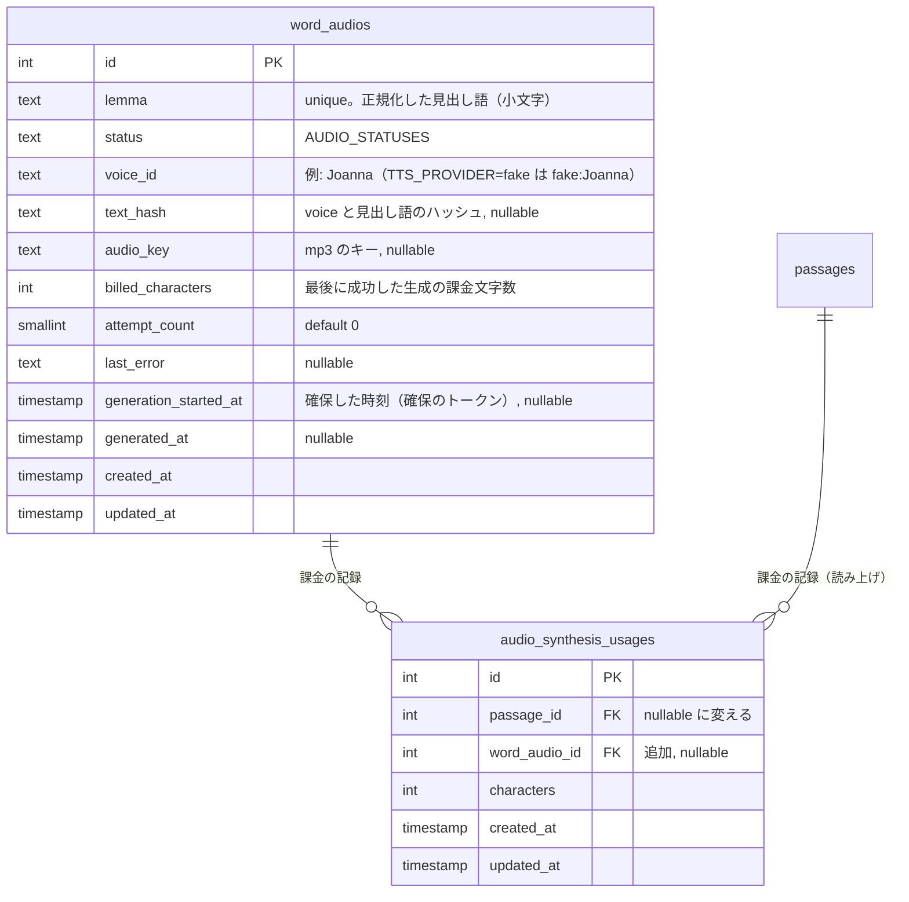
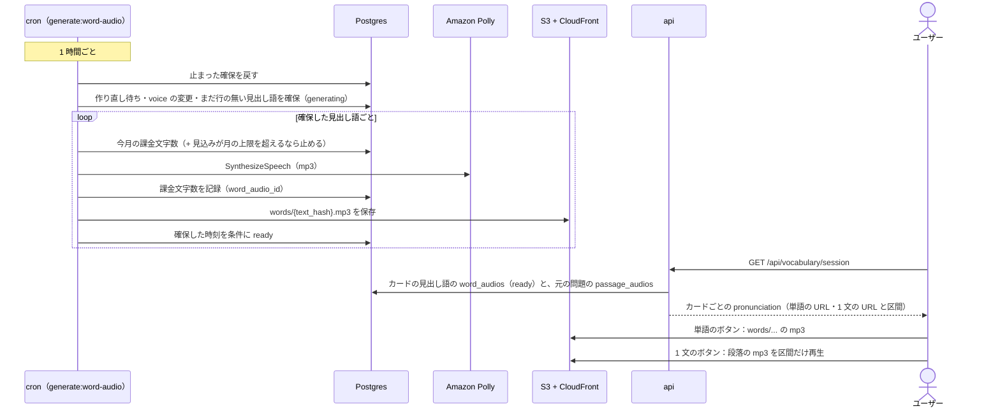

# 単語の発音

単語帳のカードで、**単語の発音** と **カードの 1 文** を音声で聞けるようにする。エンジニアは英文を「読める」が「音で聞いたことがない」単語が多い（`cache`、`queue`、`idempotent` など）。カードで意味を覚えるときに発音も耳で確かめられるようにし、本文の中でどう読まれていたかも 1 文で聞き直せるようにする。

単語の音声は、クラウドの音声合成（Amazon Polly）で **見出し語ごとに 1 度だけ** 作って保存し、全ユーザーで使い回す。1 文の音声は新しく作らず、読み上げ（[read-aloud](../read-aloud/README.md)）で作り置いた段落の音声から、その 1 文の区間だけを再生する。

このドキュメントは **仕様（What）** と **設計（How）** を分けて記述する：

- **仕様**：聞けるもの、ボタンの操作、音声ができるまで
- **設計**：音声の作り方の選定と費用、単語の音声の生成と保存、1 文の区間の求め方、再生の実装

## 関連 spec

- [`../vocabulary-cards/README.md`](../vocabulary-cards/README.md) — 単語帳。カードの中身（見出し語・本文の 1 文）と 1 回分の画面の正本。この spec はカードに発音のボタンを足す
- [`../read-aloud/README.md`](../read-aloud/README.md) — 読み上げ。音声合成（Polly）・音声の保存と配信（S3 + CloudFront）・月の上限（`AUDIO_MONTHLY_CHARACTER_LIMIT`）・段落の音声のマニフェスト（`PassageAudioManifest`）の正本。1 文の音声はこのマニフェストから切り出す
- [`../question-generation/README.md`](../question-generation/README.md) — 用語集（`passage_glossary_entries`）。発音を作る対象の語句の出どころ
- [`../reading-practice/README.md`](../reading-practice/README.md) — 調べた単語（`attempt_word_lookups`）と英和辞書（`dictionary_entries`）。発音を作る対象の語句の出どころ
- [`./deferred-pronunciation-extensions.md`](./deferred-pronunciation-extensions.md) — MVP 対象外。解答画面の単語のカードの発音、略語の読み方の調整、admin の画面など
- **この spec が正本のもの**：`word_audios` の列定義、`audio_synthesis_usages.word_audio_id`、カードの `pronunciation`（API のレスポンス）

## 目次

- [仕様](#仕様)
  - [聞けるもの](#聞けるもの)
  - [読む語句](#読む語句)
  - [ボタンの操作](#ボタンの操作)
  - [音声ができるまで](#音声ができるまで)
- [設計](#設計)
  - [音声の作り方の選定](#音声の作り方の選定)
  - [費用](#費用)
  - [単語の音声の生成タスク](#単語の音声の生成タスク)
  - [単語の音声の保存と配信](#単語の音声の保存と配信)
  - [1 文の区間の求め方](#1-文の区間の求め方)
  - [再生の実装](#再生の実装)
  - [失敗時の扱い](#失敗時の扱い)
  - [MVP 対象外（将来検討）](#mvp-対象外将来検討)
- [必要な画面](#必要な画面)
- [必要な API](#必要な-api)
- [必要な DB 設計](#必要な-db-設計)
- [フロー図](#フロー図)
- [実装ステップ](#実装ステップ)

---

## 仕様

### 聞けるもの

| 聞けるもの | 内容 |
| --- | --- |
| 単語の発音 | カードの見出し語を読む（[読む語句](#読む語句)） |
| 1 文の読み上げ | カードに出ている本文の 1 文を、読み上げと同じ声で読む |

- どちらも **ボタンを押したときだけ** 鳴る。カードが出たとき・めくったときに自動では鳴らさない（めくる効果音とぶつからず、静かな場所でも勝手に鳴らないように）
- 表でも裏でも押せる（表で発音を聞いてから意味を思い出してもよい）
- 声は読み上げと同じ 1 種類（米国英語の女性の声）。速度は 1 倍だけ
- 対象は単語帳の 1 回分の画面（web・mobile）。単語帳のトップの束の見本・解答画面の単語のカードには置かない（[MVP 対象外](#mvp-対象外将来検討)）
- 発音を聞いても学習記録には数えない（単語帳の答えと見ていた秒数だけを数える。アシストにも関係しない）

### 読む語句

- 単語の発音は **見出し語（辞書の形）** を読む。本文の表記と違うとき（`derived` のカードは `derive`）は、カードにも見出し語が小さく出ている（[vocabulary-cards の UI 設計](../vocabulary-cards/README.md#ui-設計)）。本文の中での形は 1 文の読み上げで聞ける
- 熟語（`opt out of`）は続けて読む
- 見出し語は小文字なので、略語（`API`・`CRUD` など）を 1 文字ずつ読まないことがある。読み方の調整は MVP に入れない（[MVP 対象外](#mvp-対象外将来検討)）
- 1 文の読み上げは、カードに出ている範囲を読む。長い文を `…` で切ったカード（[vocabulary-cards のカードの中身の組み立て](../vocabulary-cards/README.md#カードの中身の組み立て)）は、出ている部分だけを読む

### ボタンの操作

| 操作 | 動き |
| --- | --- |
| 単語のボタンを押す | 見出し語を最初から読む |
| 1 文のボタンを押す | 1 文を最初から読む |
| 再生中に同じボタンを押す | 止める |
| 再生中にもう一方のボタンを押す | 今の再生を止めて、押した方を最初から読む |
| めくる・答える・画面を離れる | 止める |

- 再生中のボタンは再生中とわかる見た目にする（見た目は design-mock で決める）
- 単語の音声がまだできていない語句は、単語のボタンを押せない（「準備中」）
- 1 文の音声が聞けない（問題の読み上げの音声ができていない・失敗した、カードに 1 文が無い）カードは、1 文のボタンを出さない
- めくる効果音のオン / オフ（[vocabulary-cards の効果音](../vocabulary-cards/README.md#効果音)）とは別。発音は消さない（ボタンを押さなければ鳴らない）
- mobile は端末の消音モードでも鳴らす（読み上げと同じく、自分で押したときだけ鳴る学習の音声のため）。ほかのアプリの音楽は止めずに、鳴らしている間だけ小さくする

### 音声ができるまで

- 単語の音声は **単語帳に出うる語句** について作り置く
  - 公開中の問題の用語集の語句
  - 解答中に調べた単語のうち、英和辞書の見出し語と一致するもの（単語帳のカードになる単語）
- 生成のタスクは 1 時間ごとに動く。用語集の語句は問題の公開から、調べた単語は調べてから、最大 1 時間ほどで聞けるようになる。それまでは単語のボタンが「準備中」
- 一度作った単語の音声は、問題が非公開・却下になっても消さない（単語の発音は本文ではないため）。ほかのユーザーが同じ見出し語に出会ったときも同じ音声を使う
- 1 文の音声は、その問題の読み上げの音声ができていれば聞ける（[read-aloud の音声ができるまで](../read-aloud/README.md#音声ができるまで)）。カードの元の問題（最後に出会った問題）の音声を使う

---

## 設計

### 音声の作り方の選定

| 方式 | 単語 | 1 文 | 費用 | 判断 |
| --- | --- | --- | --- | --- |
| **見出し語ごとに Polly で作る** | ✅ 単語だけをはっきり読む | ― | 1 万語で約 $1.6（[費用](#費用)） | **単語に採用**。辞書のような単体の発音が覚えやすい。cron のタスクと表が増える |
| **段落の音声から区間を切り出す** | △ 文の流れの中の発音。前後の音につながって聞こえることがある | ✅ 本文と同じ声・同じ読み | 0（作り置きの音声を使う） | **1 文に採用**。読み上げのマニフェストの単語の時刻で区間が求まる |
| 端末の音声合成（Web Speech API / `expo-speech`） | △ | △ | 0 | 不採用。声の品質が端末で変わる（read-aloud と同じ理由） |
| カードを出すときに api が Polly を呼ぶ | ✅ | ― | 見出し語ごとに作るのと同じ（作った音声を保存して使い回すなら） | 不採用。api に Polly と S3 の書き込みの権限が要り、1 回分の取得が遅くなる |

### 費用

Polly の Neural は 100 万文字あたり $16。単語の音声は **mp3 だけ** を作る（単語の時刻は要らないので、読み上げと違ってリクエストは 1 回）。

| 項目 | 計算 | 金額 |
| --- | --- | --- |
| 1 語 | 見出し語の平均 約 10 文字 | 約 $0.00016 |
| 1 万語 | 10 万文字 | **約 $1.6** |
| 月の新しい語句（用語集 月 300 問 × 約 20 語 + 調べた単語） | 1 万語前後 | 約 $1.6 |
| 保存（S3） | 1 語 約 5〜10KB。1 万語で約 100MB | 月 約 $0.003 |
| 配信（CloudFront） | 1 回 約 10KB | 読み上げと同じ無料枠（月 1TB）に収まる |

- 課金された文字数は読み上げと同じ `audio_synthesis_usages` に記録し、**読み上げと合わせて** `AUDIO_MONTHLY_CHARACTER_LIMIT`（[read-aloud の費用](../read-aloud/README.md#費用)）を超えないようにする。Polly の請求は 1 つなので上限も 1 つにする
- 1 回の実行で作る数に上限を置く（`WORD_AUDIO_MAX_PER_RUN`、既定 300）
- voice を変えたときは全語を作り直す（1 万語で約 $1.6）

### 単語の音声の生成タスク

cron に `generate:word-audio` タスクを足す。EventBridge Scheduler で **1 時間ごと** に起動する（`generate:audio` とは独立。片方の失敗で片方を止めない）。流れは `generate:audio`（[read-aloud の音声の生成タスク](../read-aloud/README.md#音声の生成タスク)）にそろえ、1 語 1 行・1 リクエストなので簡単にする。

1. `generating` のまま 30 分以上たった行を `pending` に戻す（前回の実行が途中で落ちた場合の回収）
2. 対象を **状態で確保する**（短いトランザクション、`FOR UPDATE SKIP LOCKED`、`WORD_AUDIO_MAX_PER_RUN` 件まで）。次の順に取る
   1. `pending` の行（失敗が 3 回未満の作り直し待ち）
   2. **まだ行が無い見出し語**：調べた単語（英和辞書の見出し語と一致するもの）を新しい順、続けて公開中の問題の用語集の語句を公開の新しい順。`INSERT ... ON CONFLICT (lemma) DO NOTHING` で `generating` の行を作る（実行が重なっても二重に作らない）
   3. `ready` で `voice_id` が今の voice と違う行（voice の変更。確保中でなく、失敗が 3 回未満）。`ready` のまま `generation_started_at` だけを入れ、作り直す間も前の音声を出す。前の音声を出せるので最後にする（voice を変えた直後も、新しく出た見出し語を先に作る。1 万語の作り直しは 1 時間 300 語で約 34 時間かかる）
3. 1 語ずつ、**トランザクションの外で** 音声を作る。まず月の上限を確かめ（今月の課金文字数 + その語の文字数が `AUDIO_MONTHLY_CHARACTER_LIMIT` を超えるなら、その語と残りの確保を外して止める）、Polly の `SynthesizeSpeech`（`OutputFormat=mp3`、テキストは見出し語のまま）を 1 回呼ぶ。課金された文字数を `audio_synthesis_usages` に記録する（`word_audio_id` 付き）
4. mp3 を保存する（キー：`words/{text_hash}.mp3`。`text_hash` は voice と見出し語のハッシュ。[次節](#単語の音声の保存と配信)）
5. 結果を短いトランザクションで書く。条件は `generation_started_at = 確保した時刻`（30 分を過ぎて別の実行に取り直された行を、古い実行が上書きしない）。成功したら `status = 'ready'`・`audio_key`・`voice_id`・`text_hash`・`generated_at`。前の音声のキーが違えば（voice の変更）前の mp3 を消す
6. 失敗したら `attempt_count` を増やし、3 回で `failed`（`ready` のまま確保した行は `ready` のまま）

- 見出し語の候補の SQL は単語帳の出題の候補（[vocabulary-cards の出題する単語](../vocabulary-cards/README.md#出題する単語)）と同じ条件にそろえる（意味が用意できる語句だけ）。ユーザーをまたいだ `DISTINCT` で、ユーザーは区別しない
- 音声合成は `generate:audio` と同じ `TtsClient`（`TTS_PROVIDER` で選び、`production` 以外の既定は無音の mp3 を返す `fake`）に、mp3 だけを作るメソッドを足す
- 冪等：同じ語を 2 回処理しても、同じキーに上書きして同じ行になる

### 単語の音声の保存と配信

- 読み上げと同じ保存先（`audioStorage`。本番は S3 の音声の bucket、ローカルは `.storage/audio/`）の `words/` の下に置く。配信も同じ CloudFront（本番）と api の `/media`（開発環境だけ）
- キーは `words/{text_hash}.mp3`。`text_hash` は `voice_id` と見出し語の SHA-256（見出し語に空白や記号があっても URL に使える形にするため、見出し語そのものをキーにしない）。voice が変わるとキーも変わるので、長期のキャッシュ（`Cache-Control: public, max-age=31536000, immutable`）のままでよい
- api は `word_audios` が `ready` の語だけ、`audio_key` を `AUDIO_PUBLIC_URL_BASE` とつないだ URL を返す（読み上げと同じ `buildAudioUrl`。本番で未設定なら単語・1 文とも `null`）
- `word_audios` はユーザーに紐づかないので、アカウント削除の cascade の対象外。問題の却下でも消さない（[音声ができるまで](#音声ができるまで)）
- infra は cron のタスクロールの S3 の権限に `words/*` を足し、`generate-word-audio` のスケジュールを足すだけ（bucket・CloudFront・Polly の権限は読み上げのものを使う）

### 1 文の区間の求め方

カードの 1 文（[vocabulary-cards のカードの中身の組み立て](../vocabulary-cards/README.md#カードの中身の組み立て)）は、本文のブロックの中の範囲から作っている。読み上げのマニフェストの単語の時刻は `[startMs, endMs, startOffset, endOffset]`（位置は同じブロックの本文上の UTF-16 の位置。[read-aloud の読み上げ用のテキストと文字位置の対応](../read-aloud/README.md#読み上げ用のテキストと文字位置の対応)）なので、同じ位置の単語の時刻を引けば区間が求まる。

- api の 1 文の切り出し（`extractSentence`）が、カードに出す範囲（`…` を除いた部分）のブロック上の位置を返すようにする
- その範囲に収まる単語（`startOffset >= 範囲の始め` かつ `endOffset <= 範囲の終わり`）を、そのブロックのパートから引く。最初の単語の `startMs` から最後の単語の `endMs` までを区間にする
- 範囲の単語が 2 つのパートにまたがる（3,000 文字を超えるブロックを文で分けた境目。まれ）・単語が 1 つも無いときは、1 文の音声を返さない
- 問題の音声の状態は読み上げと同じ判定（`resolveAudioStatus`。非公開に戻した・公開し直した直後は使わない）で、`ready` のときだけ返す
- 区間の終わりは次の単語の始まりなので、クライアントは終わりに 150ms ほど余白を足して止める（最後の音が切れないように）

### 再生の実装

| | web | mobile |
| --- | --- | --- |
| 再生 | `HTMLAudioElement` を 1 つ使い回し、押すたびに `src` を差し替える | `expo-audio` の `useAudioPlayer` を 1 つ使い回し、押すたびに `replace` |
| 1 文の区間 | `currentTime` を始めに合わせて再生し、`requestAnimationFrame` で終わりを過ぎたら止める | `seekTo` で始めに合わせて再生し、終わりまでの時間でタイマーを置いて止める |
| 先読み | カードが出たときに単語の mp3 を `preload` する（数 KB）。1 文の mp3（段落の音声）は押したときに読む | 先読みしない |
| 音声のモード | ― | 消音モードでも鳴らし、ほかのアプリの音楽は小さくする（`playsInSilentMode: true`・`interruptionMode: "duckOthers"`） |

- 再生の状態（再生中のもの・止める）は 1 つの hook（`usePronunciation`）にまとめ、1 回分の画面で 1 つだけ持つ。カードが替わる（答える）・めくる・画面を離れるときに止める
- mobile は、めくる効果音（ambient：消音モードでは鳴らさない）・発音（上のモード）・読み上げ（`doNotMix`・消音モードでも鳴らす）で音声のモードが違う。今はそれぞれが `setAudioModeAsync` を呼ぶので、後から呼んだ方のモードが残って取り違える（発音を聞いた後のめくる音が消音モードでも鳴る、など）。`src/libs/audio-mode.ts` に「今のモード」を 1 か所で持つ `requestAudioMode(kind)` を作り、3 つとも鳴らす前にこれを待つ（モードが同じなら何もしない）
- web はモードの切り替えが無い（ブラウザに消音モードの扱いが無い）

### 失敗時の扱い

- Polly・保存の一時的なエラーは `generate:audio` と同じく `attempt_count` を増やして次の実行に回す。3 回で `failed`。`failed` の語は自動では作り直さない（admin の画面は MVP では持たない。作り直すときは SQL で `status = 'pending'`・`attempt_count = 0`・`last_error = NULL` に戻す）
- voice の変更で `ready` のまま確保した行の失敗は、`ready` のまま `attempt_count` を増やして `last_error` を残す（前の voice の音声を出し続ける。`failed` にしない。read-aloud と同じ）。3 回に達した行は生成タスクが取らなくなる。作り直すときは SQL で `attempt_count = 0`・`last_error = NULL` に戻す（`status` は `ready` のまま。`pending` にすると作り直しが終わるまで「準備中」になる）
- 資格情報・権限・保存先の設定の誤りは、失敗の回数を増やさずに確保を外してタスクを止める（全語が `failed` にならないように。`generate:audio` と同じ）
- 月の上限で止めたとき・1 語でも失敗したときはタスクを exit 1 にする（ECS のタスクの終了コードとログに残す）
- 再生の失敗（mp3 を読み込めない）は、ボタンを押す前の状態に戻すだけにする（もう一度押すと読み込み直す）。単語帳の答えには影響しない

### MVP 対象外（将来検討）

以下はこの spec では作らない。詳細は [`./deferred-pronunciation-extensions.md`](./deferred-pronunciation-extensions.md)。

- **解答画面・結果画面の単語のカードの発音**（調べた直後に聞く。英和辞書の全見出し語の音声を先に作る必要がある）
- **略語・技術用語の読み方の調整**（`API` を 1 文字ずつ読ませるなど。Polly の Lexicon）
- **単語の音声の admin の画面**（失敗した語の再試行・作り直し）
- **速度の切り替え・声の選択**（読み上げの声の選択と合わせる）

---

## 必要な画面

新しい画面は作らない。既存の画面にボタンを足す。見た目は design-mock で決めて、この README に「UI 設計」として追記する。

| 画面 | 変更 | 担当 spec |
| --- | --- | --- |
| 単語帳の 1 回分（web・mobile） | カードに単語の発音のボタンと 1 文の読み上げのボタン（表・裏の両方） | この spec / [vocabulary-cards](../vocabulary-cards/README.md#ui-設計) |

## 必要な API

新しいエンドポイントは作らない。

| メソッド | パス | 認証 | 説明 |
| --- | --- | --- | --- |
| GET | `/api/vocabulary/session` | 必要 | 既存。カードに `pronunciation` を足す：`word_url`（単語の mp3 の URL。音声ができていなければ `null`）と `sentence`（`url`・`start_ms`・`end_ms`。1 文の区間が求まらなければ `null`） |

## 必要な DB 設計

| テーブル | 列 | 説明 |
| --- | --- | --- |
| `word_audios`（新規） | `id`, `lemma`（unique。小文字・前後の空白なし・1〜200 文字の CHECK）, `status`（`AUDIO_STATUSES`）, `voice_id`, `text_hash`, `audio_key`, `billed_characters`, `attempt_count`, `last_error`, `generation_started_at`, `generated_at`, timestamps | 見出し語ごとの発音の音声。1 語 1 行。ユーザーに紐づかない |
| `audio_synthesis_usages`（変更） | `passage_id` を nullable にし、`word_audio_id`（`word_audios` の削除は restrict）を足す。CHECK で **どちらか一方だけ** が値を持つ。index `(word_audio_id)` | 読み上げと単語の音声の課金文字数の記録。今月の合計で `AUDIO_MONTHLY_CHARACTER_LIMIT` を見る（読み上げと合算） |

- `word_audios` の CHECK は `passage_audios` にそろえる：`ready` なら `audio_key`・`text_hash`・`generated_at` がある、`generating` なら `generation_started_at` がある、`attempt_count >= 0`
- `lemma` は単語帳の `vocabulary_cards.lemma` と同じ正規化（`normalizeVocabularyLemma`。前後の空白を除いた小文字）。api はカードの `lemma` でそのまま引ける
- index：`(status)`（生成タスクの取得用）
- `TTS_PROVIDER=fake` の `voice_id` は `fake:<voice>` にして `text_hash` にも入れる（Polly に切り替えたときに作り直し、キーも変える。読み上げと同じ）

## フロー図

## 実装ステップ

vocabulary-cards と read-aloud（step1〜7）の実装の後に進める。infra（step6）は read-aloud の step8 と同じく AWS の設定の後。

| step | 内容 |
| --- | --- |
| [step1-db-word-audios](./tasks/step1-db-word-audios.md) | `word_audios`、`audio_synthesis_usages` の `word_audio_id`、`@repo/domain` の `WordAudio` |
| [step2-cron-generate-word-audio](./tasks/step2-cron-generate-word-audio.md) | `TtsClient` の mp3 だけの合成、`generate:word-audio` タスク（候補の確保・生成・保存・月の上限・失敗の扱い） |
| [step3-api-vocabulary-pronunciation](./tasks/step3-api-vocabulary-pronunciation.md) | `GET /api/vocabulary/session` のカードに `pronunciation`（単語の URL、1 文の区間） |
| [step4-web-vocabulary-pronunciation](./tasks/step4-web-vocabulary-pronunciation.md) | web のカードの発音のボタンと `usePronunciation` |
| [step5-mobile-vocabulary-pronunciation](./tasks/step5-mobile-vocabulary-pronunciation.md) | mobile のカードの発音のボタン、`usePronunciation`、音声のモードの調停（`requestAudioMode`） |
| [step6-infra-word-audio](./tasks/step6-infra-word-audio.md) | cron のタスクロールの S3 の権限に `words/*`、`generate-word-audio` のスケジュール（1 時間ごと） |

UI（ボタンの位置・見た目・再生中の表示）は、実装の前に `design-mock` で決めて「UI 設計」を追記する。
