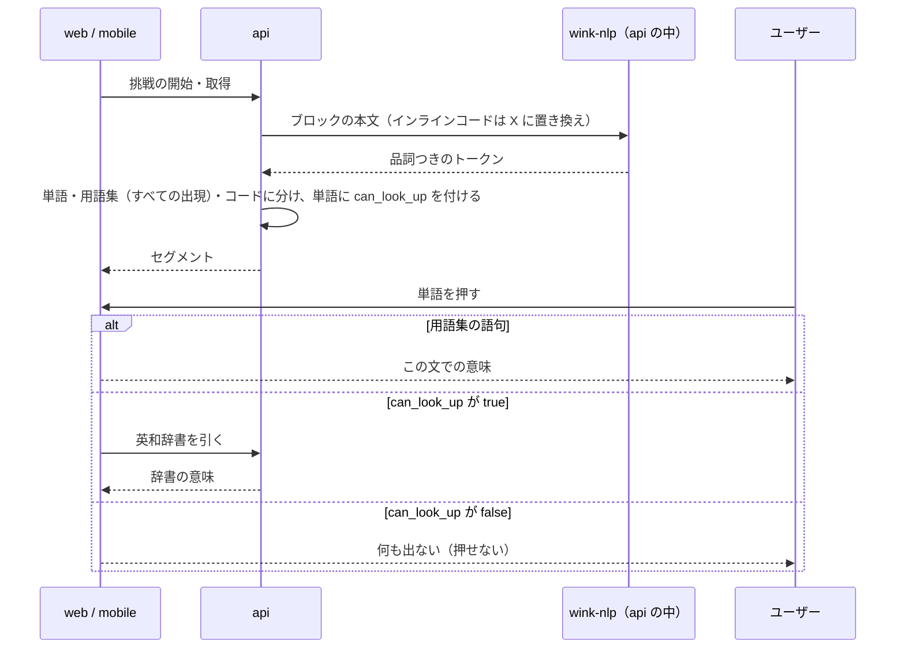

# 単語の意味を出す対象（名詞・動詞と句動詞）

解答画面で本文の単語を押すと意味が出るが、`the` や `of` のような機能語まで押せて、押したい語が埋もれている。押せる単語を **名詞と動詞** に絞り、**句動詞**（`opt out of`・`set up` など、動詞と前置詞・副詞の組み合わせで意味をなすもの）はひとまとまりで意味を出せるようにする。web と mobile の両方。

用語集（問題の生成のときに LLM が選んだ、この文での意味つきの語句）は、品詞に関係なく今までどおり押せる。

このドキュメントは **仕様（What）** と **設計（How）** を分けて記述する：

- **仕様**：ユーザーから見える挙動・ルール・データの意味
- **設計**：実装にあたっての技術的な選択と制約

## 関連 spec

- [`../reading-practice/README.md`](../reading-practice/README.md) — 解答画面のアシスト（単語の意味）・本文のトークン化・英和辞書の正本
- [`../question-generation/README.md`](../question-generation/README.md) — 用語集の生成のルールの正本
- [`../vocabulary-cards/README.md`](../vocabulary-cards/README.md) — 単語帳。調べた単語と用語集の単語をカードにする
- [`../read-aloud/README.md`](../read-aloud/README.md) — 読み上げ。読んでいる単語をハイライトする

## 目次

- [仕様](#仕様)
  - [押せる語](#押せる語)
  - [句動詞](#句動詞)
  - [同じ語句の 2 回目以降](#同じ語句の-2-回目以降)
  - [これまでの問題](#これまでの問題)
  - [ほかの機能への影響](#ほかの機能への影響)
- [設計](#設計)
  - [品詞の判定](#品詞の判定)
  - [セグメントの形](#セグメントの形)
  - [用語集の 2 回目以降の出現](#用語集の-2-回目以降の出現)
  - [句動詞の生成](#句動詞の生成)
  - [MVP 対象外（将来検討）](#mvp-対象外将来検討)
- [必要な画面](#必要な画面)
- [必要な API](#必要な-api)
- [必要な DB 設計](#必要な-db-設計)
- [フロー図](#フロー図)
- [実装ステップ](#実装ステップ)

---

## 仕様

### 押せる語

| 本文の語 | 押せるか | 出る意味 |
| --- | --- | --- |
| 用語集の語句（難しい単語・熟語・句動詞） | 押せる（品詞に関係なく） | この文での意味（今と同じ） |
| 名詞・動詞（固有名詞を含む） | 押せる | 英和辞書の意味（今と同じ） |
| それ以外の単語（冠詞・前置詞・代名詞・助動詞・接続詞・形容詞・副詞など） | **押せない** | ― |
| インラインコード・コードブロック | 押せない（今と同じ） | ― |

- 押せない単語は普通の文字として表示する。web ではホバーしても色・カーソルが変わらない
- 品詞は自動で判定するので、まれに外れる（例：名詞の `hatch` を動詞と判定する。名詞と動詞の取り違えはどちらも押せるので影響しない。形容詞と判定された名詞は押せなくなる）
- 読み上げのハイライトは今までどおり、押せない単語にも付く
- 解答画面と結果画面で同じ

### 句動詞

- 問題の生成のとき、本文の句動詞を **すべて** 用語集に入れる（難しさに関係なく。`set up` のような易しいものも）。文での意味つき
- 用語集の句動詞は今と同じく、どの語を押しても句ごとの意味が出る（例：`out` を押しても `opt out of`）
- 語が離れる形（`set it up`）は扱わない。押した語ごとに辞書の意味が出る（`set` は動詞なので押せる、`up` は押せない）

### 同じ語句の 2 回目以降

- 用語集の語句と同じ表記が本文のほかの箇所（ほかの段落も含む）にあれば、そこを押しても用語集の意味を出す（今は最初の 1 か所だけで、2 回目以降は辞書の意味になる）
- 表記が完全に同じものだけ（`Under the hood` と `under the hood`、`opt out of` と `opted out of` は別の表記として扱う）
- 「文脈での語義」を問う設問の対象語句は、解答中はどの出現も用語集から外す（今と同じ。答えが見えないようにするため）

### これまでの問題

| 変更 | これまでの問題への効き方 |
| --- | --- |
| 押せる単語を名詞・動詞に絞る | 本文を表示するときに判定するので、公開済みの問題にもすぐ効く |
| 用語集の 2 回目以降の出現 | 同上 |
| 句動詞をすべて用語集に入れる | 生成のときなので、これからの生成と作り直した下書きから。公開済みの問題は、今入っている句動詞だけ |

### ほかの機能への影響

| 機能 | 影響 |
| --- | --- |
| 調べた単語の記録（結果画面の「調べた単語」・「単語 N 回」） | 仕組みは同じ。押せる語が減るので、機能語は記録されなくなる |
| 単語帳 | 仕組みは同じ。調べた単語から作るカードも、名詞・動詞と用語集の語句になる |
| 語義の設問 | 上の「同じ語句の 2 回目以降」のとおり。対象語句はどの出現でも解答中は辞書の意味 |
| admin のプレビュー | 変えない（単語を押す機能は無い） |

---

## 設計

### 品詞の判定

**api の本文の分割（`segment-passage.ts`）のときに、品詞タグ付けのライブラリ wink-nlp で判定する。**

| 項目 | 内容 |
| --- | --- |
| ライブラリ | `wink-nlp` と英語のモデル `wink-eng-lite-web-model`（どちらも MIT。合わせて約 4.6MB） |
| 判定 | ブロックの本文を wink-nlp で品詞つきのトークンに分け、単語のセグメントと重なるトークンのどれかが `NOUN`・`PROPN`・`VERB` なら押せる |
| インラインコード | 同じ長さの `X` と空白に置き換えてから判定する（位置をずらさず、文の形を保つ） |
| モデルの読み込み | api の起動時に 1 回（モジュールの読み込み時） |
| 速さ | 本文 1 件（8 段落ほど）で 1ms 前後。挑戦の開始・取得のたびに計算し、保存しない |

- **この方法にした理由**：本文を表示するときに計算するので、公開済みの問題にもすぐ効き、DB も生成も変えなくてよい
- **比べた案**
  - 生成で LLM に品詞を出させる：精度は高いが、全単語の品詞で出力が大きく増え、今ある問題に効かない
  - 辞書に品詞を持たせる：EJDict には品詞の列が無く、文脈も見ない（`run` が名詞か動詞か決まらない）
  - compromise（別の品詞タグ付けのライブラリ）：実際の本文で比べると誤りが wink-nlp より多く、句動詞の検出も `stay in sync with` を `stay in` とするなど当てにならなかった
- **重なるトークンのどれかで決める理由**：このアプリの単語は `React's`・`third-party`・`don't` のように、wink-nlp では複数のトークンになる。どれかが名詞・動詞なら押せるとする（`third-party` は `party` が名詞なので押せる、`don't` は助動詞と否定なので押せない）
- **`PROPN`（固有名詞）を含める理由**：技術文書では、大文字で始まる普通名詞（`Effects`・`Effect`）を固有名詞と判定しがちなため。`React`・`API` なども押せるが、今も押せるので挙動は変わらない
- **`AUX`（助動詞・be 動詞）は押せない**：`is`・`can`・`has` は意味を引く対象として要らない
- 判定は api の `lib/` の純関数にする（DB を知らない。今の分割と同じ層）

### セグメントの形

- セグメントに `can_look_up`（`kind` が `word` のときだけ）を足す。用語集の語句は常に `true`
- 押せない単語も `kind` は `word` のままにする。読み上げのハイライトと進み具合は単語のセグメントの並びで計算しているため（`kind` を変えると読み上げがずれる）
- 古いアプリ（`can_look_up` を読まない版）は今までどおりすべての単語を押せる。フィールドの追加だけなので壊れない

### 用語集の 2 回目以降の出現

- 分割のときに、用語集の各語句の表記を、その本文のすべての段落（code 以外）から探す。語の境界は今の `findSurfaceRange` と同じ（前後が英数字なら語の一部とみなして飛ばす）
- 見つかった位置ごとに、同じ用語集の項目（`glossary_entry_id`）のセグメントにする。保存してある位置（`passage_glossary_entries` の `block_index`・`start_offset`・`end_offset`）は今までどおり使う
- 用語集どうしが重なったら、今の規則（開始が早い方、同じなら長い方）で 1 つにする
- 表記が同じ項目が 2 つあるとき（admin の編集や生成で起こりうる）、保存してある位置ではその項目を使う。どちらの保存位置でもない出現は ID の小さい方になる
- DB には位置を 1 つしか持たない（増やさない）。admin の用語集の位置の検査・プレビューの下線は今のまま、保存してある位置だけを見る
- 表記の完全一致にした理由：大文字小文字や活用の違いまで同じ語句とみなすと、別の意味の出現まで用語集の意味になるおそれがある

### 句動詞の生成

- 生成の system prompt（`GENERATE_QUESTIONS_SYSTEM_PROMPT`）の「5. Glossary」に、本文の句動詞をすべて入れる指示を足す
  - 8〜20 語句の数には含めない（易しい句動詞で難しい語句の枠が減らないように）
  - `partOfSpeech` は `句動詞`、`surface` は本文の表記どおり（語が離れる形は入れない）
- プロンプトを変えるので `PROMPT_VERSION` を上げる
- 出力の増え方：句動詞は本文 1 件で数個ほどなので、用語集の項目が数個増えるだけ

### MVP 対象外（将来検討）

- 語が離れる句動詞（`set it up`）：用語集に位置を複数持たせ、生成・保存・分割・画面の強調表示をすべて変える必要がある
- 用語集の品詞を決まった値にする（admin の用語集の品詞は自由入力のまま）：今回は用語集を品詞に関係なく押せるので要らない
- 大文字小文字・活用の違う出現を同じ用語集の語句とみなす

---

## 必要な画面

| 画面 | アプリ | 変更 |
| --- | --- | --- |
| 解答画面 | web / mobile | 押せない単語を普通の文字で表示する |
| 結果画面 | web / mobile | 同上 |

## 必要な API

| メソッド | パス | 変更 |
| --- | --- | --- |
| POST | `/api/passage/:id/attempt` | 本文のセグメントに `can_look_up`、用語集の 2 回目以降の出現にも `glossary_entry_id` |
| GET | `/api/attempt/:id` | 同上 |
| POST | `/api/attempt/:id/submit` | 同上（結果の本文） |

## 必要な DB 設計

変更なし。

## フロー図

## 実装ステップ

| step | 内容 |
| --- | --- |
| [step1](./tasks/step1-api-word-lookup-targets.md) | api：wink-nlp で品詞を判定してセグメントに `can_look_up`、用語集のすべての出現を分割に使う |
| [step2](./tasks/step2-cron-glossary-phrasal-verbs.md) | cron：生成の用語集に本文の句動詞をすべて入れる |
| [step3](./tasks/step3-web-word-lookup-targets.md) | web：押せない単語を普通の文字で表示する |
| [step4](./tasks/step4-mobile-word-lookup-targets.md) | mobile：同上 |
